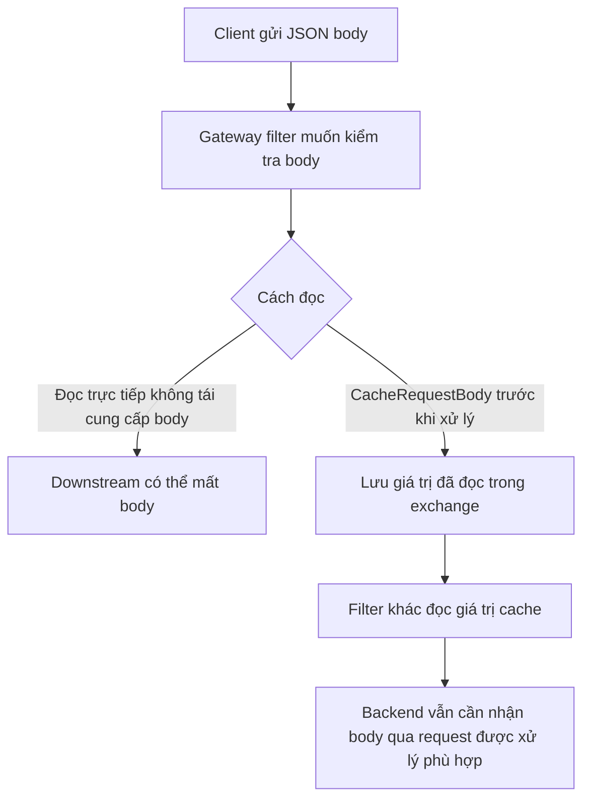
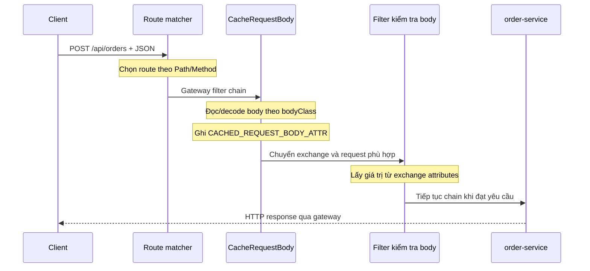
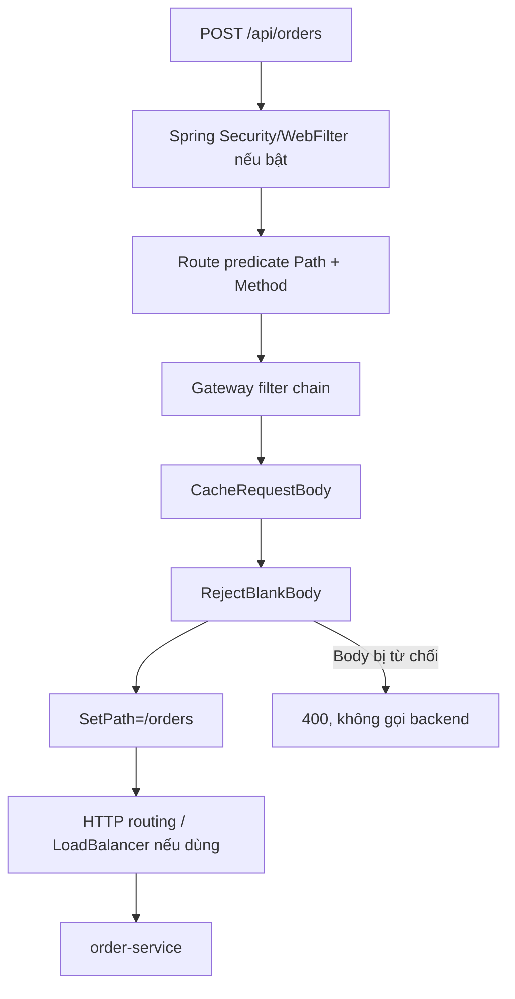
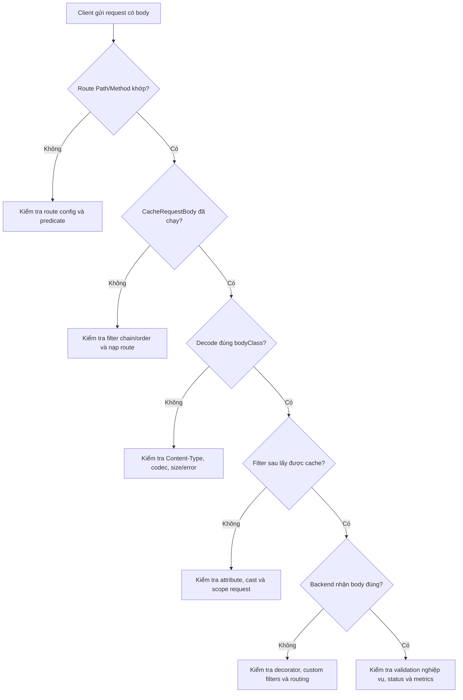

# CacheRequestBody và tái sử dụng nội dung đã đọc

Một API Gateway thường chỉ cần nhìn vào đường dẫn, phương thức, header hoặc token để chọn route và chuyển request đến microservice. Nhưng có trường hợp cổng vào cần **kiểm tra một phần request body trước khi chuyển tiếp**: chẳng hạn một API nhận JSON tạo đơn hàng, gateway cần xác minh body không rỗng và gắn thông tin để quan sát request. Backend vẫn cần đọc **chính body đó** để xử lý nghiệp vụ.

Vấn đề là ở **Spring Cloud Gateway Server WebFlux**, request body được cung cấp dưới dạng luồng dữ liệu reactive. Nếu một filter tự đăng ký đọc hết body rồi chuyển tiếp request gốc như chưa có gì xảy ra, filter hoặc backend phía sau có thể không còn đọc được nội dung. **`CacheRequestBody`** giúp đọc và lưu nội dung của request trong phạm vi xử lý request, để những filter tiếp theo có thể sử dụng giá trị đã cache mà không tự ý tiêu thụ luồng body thêm lần nữa.

Bài thuộc chương **Nội dung HTTP** của module **SPRING_CLOUD_GATEWAY**. Ta sẽ tìm hiểu `CacheRequestBodyGatewayFilterFactory`, thuộc tính `CACHED_REQUEST_BODY_ATTR`, cách sử dụng trong filter chain, kiểu dữ liệu khi decode, các giới hạn bộ nhớ và cách kết hợp với route predicate, biến đổi path/header, service discovery, xác thực, rate limiting, circuit breaker, retry, TLS và quan sát request.

> **Phạm vi:** Nội dung kỹ thuật và ví dụ Java/YAML tập trung vào **Spring Cloud Gateway Server WebFlux**. Gateway Server Web MVC có mô hình servlet, request/response và API filter riêng; không chuyển nguyên ví dụ `ServerWebExchange`/`GatewayFilter` của WebFlux sang MVC. Starter, đường dẫn property và API cần đối chiếu đúng phiên bản Spring Boot/Spring Cloud/Gateway đang dùng.

## 1. Vì sao đọc request body trong gateway dễ gây lỗi?

Giả sử client gửi:

```http
POST /api/orders HTTP/1.1
Host: api.shop.example
Content-Type: application/json

{"productId":42,"quantity":2}
```

Một route nhận `POST /api/orders`, dùng `StripPrefix=2` để backend `order-service` nhận `POST /` hoặc thay path theo contract đã xác định. Trong tình huống này, một filter tùy chỉnh muốn đọc JSON trước khi chuyển tiếp.

Ở WebFlux, `ServerHttpRequest.getBody()` trả về `Flux<DataBuffer>`. Đây là **luồng dữ liệu body**; nó không phải một `String` hoặc byte array mà các filter có thể đọc tùy ý bao nhiêu lần. Việc đọc/đăng ký subscribe vào publisher của body sẽ tiêu thụ dữ liệu từ HTTP request theo cơ chế của server. Nếu filter tự thu hết dữ liệu mà không dựng lại request phù hợp, downstream có thể nhận body rỗng hoặc lỗi đọc lại.



### Ba sự thật cần phân biệt

1. **Body của request có vòng đời gắn với một request**, không phải dữ liệu dùng chung toàn ứng dụng.
2. **CacheRequestBody lưu một giá trị đã đọc/giải mã vào exchange**, thường để filter phía sau lấy lại; cơ chế hỗ trợ đọc body cho downstream cũng phải được thực hiện đúng bởi filter/framework.
3. **Cache request body khác cache response HTTP**. Mục tiêu không phải tăng tốc các lần gọi API sau hoặc lưu kết quả GET giữa nhiều client.

## 2. CacheRequestBody thực chất làm gì?

Trong Spring Cloud Gateway Server WebFlux, `CacheRequestBodyGatewayFilterFactory` là một **GatewayFilterFactory** tạo ra filter để đọc request body theo một kiểu dữ liệu được cấu hình. Tài liệu của Gateway mô tả filter này đọc body và lưu kết quả vào exchange attribute có tên:

```java
ServerWebExchangeUtils.CACHED_REQUEST_BODY_ATTR
```

Các filter xử lý sau đó có thể lấy giá trị từ `ServerWebExchange`:

```java
Object cached = exchange.getAttribute(
    ServerWebExchangeUtils.CACHED_REQUEST_BODY_ATTR);
```

Nếu `bodyClass` được cấu hình là `java.lang.String` và body decode thành công, `cached` thường là một `String`. Nếu chọn kiểu dữ liệu khác, phải kiểm tra **kiểu thực tế** trước khi sử dụng.

### Thành phần và trách nhiệm

| Thành phần | Vai trò | Điều không nên nhầm |
| --- | --- | --- |
| **`CacheRequestBodyGatewayFilterFactory`** | Tạo filter theo cấu hình `bodyClass`. | Factory không phải một bộ nhớ đệm dùng chung giữa request. |
| **`CacheRequestBody` (GatewayFilter)** | Đọc/decode body và đưa giá trị vào exchange; phối hợp cơ chế cần thiết cho việc xử lý downstream. | Không tự xác thực JSON có hợp lệ theo nghiệp vụ hay không. |
| **`ServerWebExchange`** | Ngữ cảnh của request/response đi qua WebFlux gateway. | Không phải vùng lưu trữ bền vững hay distributed cache. |
| **`CACHED_REQUEST_BODY_ATTR`** | Khóa dùng để truy xuất giá trị body đã cache. | Không phải một HTTP header, cookie hoặc response body. |
| **`bodyClass`** | Kiểu Java mong muốn khi đọc body. | Không phải giới hạn kích thước hoặc định nghĩa chính sách bảo mật. |
| **Filter xử lý phía sau** | Đọc giá trị đã cache để xác minh/quan sát theo nhu cầu. | Không nên tự subscribe lại body gốc chỉ để lấy dữ liệu đã được cache. |

### Luồng xử lý khái quát



Sơ đồ chỉ minh họa **request được chấp nhận**. Nếu filter kiểm tra quyết định từ chối, nó có thể trả response tại gateway và **không gọi tiếp chuỗi**, nên backend không nhận request. Cơ chế buffer/decorator và thời điểm giải phóng dữ liệu là chi tiết triển khai theo phiên bản; đừng tự thao tác bộ đệm nội bộ dựa trên giả định.

## 3. Cấu hình CacheRequestBody trong route YAML

### 3.1. Ví dụ Server WebFlux

Với dòng Gateway có property namespace `spring.cloud.gateway.server.webflux.routes`, route minh họa:

```yaml
spring:
  cloud:
    gateway:
      server:
        webflux:
          routes:
            - id: orders-create
              uri: http://localhost:8081
              predicates:
                - Path=/api/orders
                - Method=POST
              filters:
                - name: CacheRequestBody
                  args:
                    bodyClass: java.lang.String
                - name: RejectBlankBody
                - SetPath=/orders
```

**Giải thích:**

- `Path=/api/orders` và `Method=POST` chọn đúng endpoint tạo đơn hàng.
- `CacheRequestBody` đọc body theo kiểu `java.lang.String` và lưu giá trị trong exchange.
- `RejectBlankBody` là **factory tùy chỉnh sẽ được xây dựng ở mục 4**, không phải filter có sẵn trong Spring Cloud Gateway.
- `SetPath=/orders` đặt đường dẫn backend thành `/orders`. Nó độc lập với thao tác đọc body.
- `http://localhost:8081` là mock/backend local; trong hệ thống triển khai thật có thể chuyển sang `lb://order-service` nếu có LoadBalancer và nguồn instance thích hợp.

Khi chỉ muốn minh họa filter được Spring Cloud Gateway cung cấp sẵn, bạn có thể **bỏ dòng `RejectBlankBody`** và giữ `CacheRequestBody`:

```yaml
filters:
  - name: CacheRequestBody
    args:
      bodyClass: java.lang.String
```

Chỉ bật `CacheRequestBody` **không tự đưa ra quyết định** về số lượng sản phẩm, quyền đặt hàng hay dữ liệu JSON nào được chấp nhận.

### 3.2. Vì sao dùng dạng `name/args`?

`CacheRequestBody` cần tham số `bodyClass`, là tên lớp Java mà body sẽ được chuyển thành. Viết dạng đầy đủ giúp người đọc nhận ra đó là tham số cấu hình của một factory, tránh nhầm với một header hoặc property tùy ý.

| Cấu hình | Ý nghĩa |
| --- | --- |
| `name: CacheRequestBody` | Chọn gateway filter factory đọc và cache request body. |
| `bodyClass: java.lang.String` | Yêu cầu decode body thành chuỗi. |
| `bodyClass: java.util.Map` | Có thể decode JSON thành map nếu codec và content type phù hợp; cần kiểm tra kiểu thực tế. |
| Không chỉ định `bodyClass` | Không phải cấu hình mẫu đầy đủ; có thể lỗi binding/khởi tạo tùy phiên bản. |

**`bodyClass` không phải tùy chọn “đọc mọi dữ liệu thành mọi kiểu”.** Nó phụ thuộc HTTP message reader/codec của ngăn xếp WebFlux và `Content-Type` thực tế. Không thể kỳ vọng body binary hay multipart tự chuyển thành DTO JSON chỉ bằng cách ghi tên class.

### 3.3. Chọn property prefix đúng phiên bản

Một số dòng tài liệu Spring Cloud Gateway WebFlux cũ khai báo:

```yaml
spring:
  cloud:
    gateway:
      routes:
        - id: orders-create
          uri: http://localhost:8081
          predicates:
            - Path=/api/orders
            - Method=POST
          filters:
            - name: CacheRequestBody
              args:
                bodyClass: java.lang.String
```

Các tài liệu Gateway mới phân biệt rõ `server.webflux` và `server.webmvc`. Không ghép tùy tiện các prefix từ hai ví dụ hoặc mặc định cả hai cùng có hiệu lực. Hãy xác minh starter Gateway, Spring Cloud release train, Configuration Properties và danh sách route runtime trước khi kiểm tra body.

## 4. Đọc body đã cache từ một GatewayFilterFactory tùy chỉnh

Ta muốn tạo một filter **chỉ từ chối body rỗng** để minh họa việc đọc cache. Quy tắc này cố tình đơn giản: kiểm tra body rỗng **không phải** kiểm tra JSON theo schema, không phải xác thực người dùng và không thay thế validation tại `order-service`.

### 4.1. Mã Java minh họa

```java
import org.springframework.cloud.gateway.filter.GatewayFilter;
import org.springframework.cloud.gateway.filter.factory.AbstractGatewayFilterFactory;
import org.springframework.http.HttpStatus;
import org.springframework.stereotype.Component;

import static org.springframework.cloud.gateway.support.ServerWebExchangeUtils
    .CACHED_REQUEST_BODY_ATTR;

@Component
public class RejectBlankBodyGatewayFilterFactory
        extends AbstractGatewayFilterFactory<
            RejectBlankBodyGatewayFilterFactory.Config> {

    public RejectBlankBodyGatewayFilterFactory() {
        super(Config.class);
    }

    @Override
    public GatewayFilter apply(Config config) {
        return (exchange, chain) -> {
            Object value = exchange.getAttribute(CACHED_REQUEST_BODY_ATTR);

            if (!(value instanceof String body) || body.isBlank()) {
                exchange.getResponse().setStatusCode(
                    HttpStatus.BAD_REQUEST);
                return exchange.getResponse().setComplete();
            }

            // Không cần subscribe lại exchange.getRequest().getBody().
            return chain.filter(exchange);
        };
    }

    public static class Config {
        // Factory không có tham số trong ví dụ này.
    }
}
```

Điều kiện của ví dụ:

- Dự án dùng phiên bản Spring Boot/Java hỗ trợ pattern matching `instanceof` và `String.isBlank()`, chẳng hạn Java 17.
- Bean `RejectBlankBodyGatewayFilterFactory` phải được Spring quét và đăng ký.
- Route cần có `CacheRequestBody` với `bodyClass: java.lang.String` **trước filter** `RejectBlankBody` trong thứ tự hiệu lực của filter chain.
- `RejectBlankBody` là tên rút gọn tương ứng với class kết thúc bằng `GatewayFilterFactory` trong cách đặt tên factory của WebFlux.

### 4.2. Điều gì xảy ra khi chạy?

| Request | Giá trị được cache (trường hợp decode thành công) | Hành động minh họa |
| --- | --- | --- |
| Body là `{"productId":42}` | Chuỗi JSON không rỗng | Filter cho request đi tiếp. |
| Body là `   ` | Chuỗi chỉ có khoảng trắng | Filter trả `400 Bad Request`. |
| Không có body | Giá trị cache có thể vắng mặt | Filter trả `400 Bad Request`. |
| Body là `not-json` nhưng `bodyClass=String` | Chuỗi `not-json` | Filter vẫn cho đi tiếp vì chỉ kiểm tra rỗng; **backend cần kiểm tra JSON**. |
| Body không thể decode theo codec/kiểu đã chọn | Có thể phát sinh lỗi đọc/giải mã trước khi tới filter kiểm tra | Phải xác minh mã lỗi/handler trên phiên bản thực tế. |

Ví dụ trên chỉ đọc `exchange.getAttribute(CACHED_REQUEST_BODY_ATTR)`. Nó không tạo một subscription mới đối với luồng body gốc, không tự tạo bản sao body vào một field singleton, và không sửa request đang chuyển tiếp.

**Không nên ép kiểu mù quáng** như:

```java
String body = (String) exchange.getAttribute(CACHED_REQUEST_BODY_ATTR);
```

Nếu route khác cấu hình `bodyClass` thành `Map` hoặc filter chạy trước bước cache, phép ép kiểu đó có thể gây `ClassCastException`. Kiểm tra `instanceof` và xác định phạm vi route là an toàn hơn.

### 4.3. Vì sao chọn GatewayFilter theo route?

`CacheRequestBody` được cấu hình trên một route cụ thể. Nếu phần đọc cache cũng là filter của route ấy, ta có thể thấy rõ hai bước trong cấu hình và kiểm tra thứ tự:

```text
orders-create:
  1. CacheRequestBody(bodyClass = String)
  2. RejectBlankBody()
  3. SetPath(/orders)
```

Đây là **thứ tự mong muốn trong ví dụ**; khi có `Ordered`, custom global filters hoặc những route filters khác, phải quan sát thứ tự thực tế. Một `GlobalFilter` chạy quá sớm có thể chưa nhìn thấy body cache do `CacheRequestBody` chưa chạy.

## 5. Thực hành với JSON: đọc chuỗi khác đọc đối tượng

### Lựa chọn `java.lang.String`

Phù hợp khi cần xem body nguyên dạng chuỗi để kiểm tra sự có mặt, giới hạn một số điều kiện đơn giản hoặc dùng một bộ phân tích riêng được kiểm soát.

Ưu điểm: dễ nhìn và ít phụ thuộc cấu trúc DTO. Hạn chế: nếu muốn kiểm tra JSON hợp lệ, vẫn cần parse riêng; chuỗi `"{broken}"` cũng là chuỗi không rỗng.

### Lựa chọn đối tượng có cấu trúc

Với `Content-Type: application/json`, một message reader phù hợp có thể decode body thành kiểu dữ liệu Java, ví dụ `java.util.Map` hoặc DTO có codec hỗ trợ:

```yaml
filters:
  - name: CacheRequestBody
    args:
      bodyClass: java.util.Map
```

Trong filter xử lý, kiểu đọc cũng phải phù hợp:

```java
Object cached = exchange.getAttribute(CACHED_REQUEST_BODY_ATTR);
if (cached instanceof java.util.Map<?, ?> payload) {
    Object productId = payload.get("productId");
    // Kiểm tra dữ liệu theo schema/ngữ nghĩa thực tế nếu cần.
}
```

**Cần kiểm chứng trên đúng phiên bản và codec**: hỗ trợ map/DTO, cách bind class và cách xử lý `Content-Type` có thể khác tùy cấu hình Spring WebFlux và Jackson. Khi body sai JSON, trình xử lý có thể lỗi trước khi giá trị cache tồn tại. Đừng mặc định mọi lỗi decode đều chuyển thành HTTP 400 nếu chưa kiểm tra error handling của ứng dụng.

### Quy tắc đặt yêu cầu rõ ràng

| Nhu cầu | Cách tiếp cận | Điều cần tránh |
| --- | --- | --- |
| Chỉ kiểm tra body có nội dung | Cache thành `String`, kiểm tra null/blank | Nhầm kiểm tra rỗng với kiểm tra schema JSON. |
| Kiểm tra trường JSON | Decode thành DTO/map hoặc parse có kiểm soát | Giả định field luôn có mặt/đúng kiểu. |
| Sửa trường JSON trước khi gửi backend | Xem xét `ModifyRequestBody` với schema/codec phù hợp | Sửa attribute cache rồi tưởng request body outbound tự thay đổi. |
| Xử lý body binary/upload | Cân nhắc streaming/giới hạn kích thước và xử lý ở backend | Gom file lớn vào RAM chỉ để đọc vài byte. |
| Dùng body cho policy nhạy cảm | Thiết kế phân quyền/validation ở service sở hữu nghiệp vụ | Dựa vào client-supplied field để xác thực danh tính. |

### Content-Type phải khớp nội dung

Ví dụ client gửi `Content-Type: application/json` nhưng body chứa chuỗi không phải JSON. Nếu `bodyClass=String`, đọc thành chuỗi có thể vẫn thành công; nếu `bodyClass` là DTO, codec có thể từ chối. Không dùng `CacheRequestBody` như một bộ kiểm tra JSON mặc định và không bỏ qua việc xác minh loại nội dung ở backend.

## 6. Tái sử dụng body không có nghĩa được sửa body tùy ý

Khi filter sau đọc giá trị `CACHED_REQUEST_BODY_ATTR`, nó có một **bản biểu diễn đã decode**. Điều này khác với việc thay nội dung của request đang chuyển tiếp.

Ví dụ:

```java
Object cached = exchange.getAttribute(CACHED_REQUEST_BODY_ATTR);
// Một object tham chiếu đến nội dung đã đọc trong request hiện tại.
```

Sửa một `Map` lấy từ cache hoặc đặt lại thuộc tính bằng một object mới **không phải hợp đồng chuẩn để rewrite raw HTTP body**. Downstream chỉ nhận body đã thay đổi nếu cơ chế filter/request decorator của bạn thực sự tạo luồng body mới, điều chỉnh header cần thiết và phối hợp đúng với routing layer.

### Khi nào dùng ModifyRequestBody?

`ModifyRequestBody` là một GatewayFilter dành cho **đọc, chuyển đổi và ghi lại request body** bằng một hàm biến đổi và các codec thích hợp. Trong các dòng WebFlux hỗ trợ, nó thường được cấu hình bằng Java DSL thay vì chỉ ghi một lệnh YAML đơn giản.

So sánh:

| Cơ chế | Mục đích | Kết quả mong đợi |
| --- | --- | --- |
| **CacheRequestBody** | Đọc/lưu giá trị body để filter sau tái sử dụng. | Filter khác lấy được giá trị qua exchange attribute. |
| **ModifyRequestBody** | Chủ động biến đổi body gửi downstream. | Backend nhận body theo biểu diễn mới nếu rewrite thành công. |
| **ReadBody route predicate** (nếu biến thể/phiên bản hỗ trợ) | Dùng nội dung body làm điều kiện chọn route. | Có thể ảnh hưởng bước route matching, không đồng nghĩa với một route filter sau khi match. |
| **RequestSize filter** / giới hạn ingress-server | Kiểm soát kích thước request. | Ngăn request quá lớn theo cơ chế cấu hình. |
| **LocalResponseCache** hoặc HTTP response cache | Cache **response** theo chính sách. | Có thể tái sử dụng response giữa những request đủ điều kiện. |
| **Retry** | Thử lại lời gọi downstream theo điều kiện. | Có thể cần giữ/replay body và phải kiểm soát số lần thử. |

Đừng dùng `CacheRequestBody` với mục tiêu duy nhất là tăng tốc endpoint GET. Nó không cache JSON response để các client lần sau dùng lại.

## 7. CacheRequestBody và thứ tự filter trong Gateway chain

Sau khi `RoutePredicateHandlerMapping` chọn route, `FilteringWebHandler` kết hợp các `GlobalFilter` và `GatewayFilter` của route rồi sắp thứ tự theo `Ordered`/cách sắp xếp của gateway.



Trong ví dụ đơn giản, bước xác thực bằng Spring Security diễn ra trong HTTP `WebFilter` chain trước khi đến các route filters, còn logic xác thực của GatewayFilter (nếu có) là tầng khác. Không mặc định `GlobalFilter` quan sát được mọi request đã bị Security từ chối hoặc mọi request không khớp route.

### Điều gì xảy ra nếu filter đọc cache chạy trước filter cache?

`exchange.getAttribute(CACHED_REQUEST_BODY_ATTR)` có thể trả `null` hoặc một đối tượng không như mong đợi. Lỗi không phải do backend “đọc mất” body mà do **chưa có bước tạo cache** cho request hiện tại.

Giải pháp:

- Đặt `CacheRequestBody` trước các route filters tiêu thụ dữ liệu đã cache theo cấu hình của route.
- Khi custom filter có `Ordered` riêng hoặc dùng `GlobalFilter`, xác nhận thứ tự chạy thực tế thay vì chỉ nhìn vị trí trong YAML.
- Test cả request có body, rỗng, sai Content-Type và các trường hợp một filter short-circuit.

### Khi filter từ chối sớm

Một filter như `RejectBlankBody` có thể trả response 400 và không gọi `chain.filter(exchange)`. Khi ấy:

1. Filter phía sau sẽ không tiếp tục chạy.
2. Backend không nhận request.
3. Những phần hậu xử lý đã đăng ký ở filter phía trước có thể vẫn chạy theo reactive signal.
4. Cơ chế giải phóng body buffer phải do framework và những đoạn mã tự viết tuân thủ đúng vòng đời; không giữ `DataBuffer` ngoài phạm vi request.

Nếu ứng dụng cần đo cả request bị từ chối ở Spring Security trước route matching, đặt số liệu bảo mật ở tầng WebFilter/observability phù hợp thay vì trông chờ chỉ một GatewayFilter sau route.

## 8. Giới hạn bộ nhớ, backpressure và các loại request không nên cache

**Đọc và cache body là thao tác có chi phí.** Gateway có thể phải giữ dữ liệu trong bộ nhớ trong quá trình đọc, decode, kiểm tra và chuyển tiếp. Với nhiều request đồng thời, lượng bộ nhớ giữ tạm thời tăng theo kích thước body và số request đang xử lý.

### Ước lượng để thấy rủi ro

Giả sử 500 request cùng lúc, mỗi body khoảng 512 KiB. Chỉ riêng kích thước raw body đã xấp xỉ:

```text
500 × 512 KiB = 256000 KiB ≈ 250 MiB
```

Con số này **chưa tính** overhead của DataBuffer, đối tượng đã decode, chuỗi Java, cấu trúc JSON, connection pool, request metadata và các buffer khác. Trong tải lớn, việc cache body có thể ảnh hưởng đến bộ nhớ heap/direct memory, garbage collection, độ trễ và khả năng xử lý request song song.

### Các loại traffic cần cân nhắc

| Loại body | Có nên dùng CacheRequestBody? | Lý do |
| --- | --- | --- |
| JSON nhỏ, kích thước đã giới hạn | Có thể phù hợp. | Đọc một lần để filter sau kiểm tra ngắn gọn. |
| JSON rất lớn hoặc nhiều request đồng thời | Cần đánh giá tải và giới hạn. | Decode/buffer làm tăng áp lực bộ nhớ. |
| Upload multipart/file lớn | Thường tránh cache toàn bộ ở gateway. | Nên giới hạn/stream và xử lý nghiệp vụ tại backend. |
| Streaming/chunked body không giới hạn | Không nên mặc định gom toàn bộ. | Mất đặc tính stream và tạo rủi ro chiếm bộ nhớ. |
| Payload binary hoặc media | Chỉ khi có lý do rõ ràng và codec phù hợp. | Decode thành `String`/DTO có thể không đúng. |
| Request không có body | Không cần cache chỉ để route theo path/header. | Tạo thêm chi phí và trường hợp xử lý null. |

### Phòng vệ trước request quá lớn

- Đặt **giới hạn kích thước body** ở ingress/server và có thể dùng `RequestSize` của gateway khi phù hợp; kiểm chứng với cả request có `Content-Length` và streaming/chunked request.
- Đặt giới hạn codec/buffering phù hợp (chẳng hạn tham số `maxInMemorySize` của WebFlux codecs khi được sử dụng); đây **không thay thế** giới hạn toàn bộ request ở tầng mạng.
- Không tăng giới hạn codec vô hạn chỉ để một request lớn không báo lỗi.
- Giới hạn concurrency, timeout và kết nối theo năng lực hệ thống; đo tải với body size thực tế.
- Dùng streaming hoặc xử lý backend khi không thật sự cần gateway đọc toàn bộ body.

Nếu vượt giới hạn của codec, có thể gặp lỗi kiểu `DataBufferLimitException`; status HTTP cuối cùng phụ thuộc vào error handling của Gateway/WebFlux và bộ filter đang bật. Không mặc định mọi trường hợp vượt kích thước đều trả cùng một mã nếu chưa test.

### Không tự quản lý DataBuffer khi chưa hiểu vòng đời

Trong môi trường Netty, buffer có thể được quản lý theo cơ chế reference counting. Khi tự dùng `DataBufferUtils.join()` hoặc tạo decorator đọc body, phải biết thời điểm giữ/thả buffer, copy byte và xử lý hủy subscription; làm sai có thể gây **memory leak, double release hoặc body rỗng**.

Nếu mục tiêu chỉ là dùng lại một chuỗi/DTO đã decode, ưu tiên `CacheRequestBody` và thuộc tính exchange thay vì tự viết cơ chế buffer/replay. Chỉ xây lớp đọc body tùy chỉnh khi không có filter phù hợp và có kiểm thử rõ ràng về lỗi/hủy, bộ nhớ và nhiều request đồng thời.

## 9. Bảo mật: không biến CacheRequestBody thành bộ ghi nội dung nhạy cảm

Body của request có thể chứa địa chỉ giao hàng, thông tin định danh, dữ liệu thanh toán, mật khẩu hoặc nội dung riêng tư. Việc cache để filter đọc được **không đồng nghĩa cho phép log hoặc lưu lại body**.

### Ranh giới trách nhiệm

| Yêu cầu | Tầng phù hợp |
| --- | --- |
| Xác minh JWT, issuer, chữ ký, hạn dùng | Spring Security ở gateway khi được cấu hình đúng. |
| Kiểm tra user có quyền tạo đơn hàng | Gateway có thể kiểm tra quyền API; `order-service` kiểm tra nghiệp vụ/tài nguyên. |
| Giới hạn request theo identity/API key | Rate limiter với KeyResolver và store phù hợp. |
| Kiểm tra JSON có trường bắt buộc | Có thể ở gateway nếu là quy tắc kỹ thuật chung; validation nghiệp vụ vẫn ở backend. |
| Không đưa token/body nhạy cảm vào log | Quy định logging, tracing và dữ liệu tại từng tầng. |
| Bảo vệ kết nối | TLS/mTLS, trust boundary và xác thực upstream. |

### Các nguyên tắc khi đọc body

1. **Không log raw body** chỉ để debug; nếu thật sự cần quan sát một thuộc tính, chỉ ghi dữ liệu đã được chuẩn hóa, không nhạy cảm và có tập giá trị giới hạn.
2. **Không dùng trường userId trong JSON như danh tính đã xác thực.** Cần dùng principal/claim đã được xác minh và đối chiếu quyền ở backend.
3. **Không gửi body cache vào header**: HTTP header không phù hợp để chứa JSON lớn hoặc dữ liệu riêng tư.
4. **Không lưu body trong field của singleton filter bean.** Nhiều request có thể chạy đồng thời; dùng `ServerWebExchange` cho trạng thái thuộc request.
5. **Không xử lý chống gian lận chỉ bằng filter có thể bị bỏ qua do route khác.** Cần chính sách bao quát toàn bộ public API và bảo vệ tại backend.
6. **Không tin Content-Length từ client như lớp phòng vệ duy nhất.** Cần giới hạn dữ liệu thực nhận, kể cả request không khai báo kích thước hoặc dùng transfer encoding.

### Lưu ý chữ ký/HMAC hoặc webhook

Với webhook có chữ ký trên **byte gốc của body**, việc chuyển body thành `String` hoặc DTO có thể làm mất thông tin cần thiết cho việc xác minh chữ ký nếu bạn encode lại, chuẩn hóa JSON hoặc đổi ký tự. Một trường hợp xác thực HMAC phải kiểm tra **đúng byte đã được ký** theo giao thức đối tác, với giới hạn kích thước và cách lưu/replay phù hợp.

Không mặc định `CACHED_REQUEST_BODY_ATTR` chứa byte nguyên bản, vì giá trị của nó phụ thuộc `bodyClass` và codec. Nếu yêu cầu chứng thực trên raw bytes, cần thiết kế đường đi byte rõ ràng, chọn cơ chế phù hợp và test với dữ liệu chứa Unicode, khoảng trắng hoặc thứ tự trường JSON khác nhau.

## 10. CacheRequestBody, Retry và circuit breaker

Một gateway phục vụ microservices thường dùng timeout, `Retry` và `CircuitBreaker` bên cạnh việc đọc body. Những cơ chế này xử lý vấn đề khác nhau:

| Cơ chế | Mục tiêu | Rủi ro khi kết hợp body |
| --- | --- | --- |
| `CacheRequestBody` | Cho filter sau truy cập body đã đọc. | Tốn bộ nhớ; không tự đảm bảo khả năng retry mọi kiểu request. |
| `Retry` | Thử lại lời gọi downstream khi thỏa điều kiện. | Cần body có thể replay, ngân sách timeout và tránh tác dụng phụ trùng. |
| `CircuitBreaker` | Tạm ngừng gọi upstream lỗi/chậm theo chính sách. | Fallback hoặc retry có thể tạo các nhánh xử lý khác, cần kiểm soát response. |
| `RequestRateLimiter` | Chặn vượt quota trước khi gửi upstream. | Nên tránh cache body lớn cho request chắc chắn bị từ chối khi có thể. |

### Tại sao cache body không có nghĩa POST có thể retry an toàn?

Giả sử client gửi `POST /api/payments`. Gateway đã gửi body xuống payment service, nhưng mạng ngắt trước khi nhận response. Backend **có thể đã hoàn thành thanh toán**. Retry chỉ vì gateway có body để gửi lại sẽ có nguy cơ tạo giao dịch trùng.

Để retry thao tác ghi, cần thiết kế **idempotency key**, lưu trạng thái xử lý đáng tin ở backend, giới hạn số lần thử và thời gian tổng. Kỹ thuật replay body là điều kiện kỹ thuật, **không bảo đảm tính đúng đắn nghiệp vụ**.

### Bộ nhớ khi retry

Trong một số cấu hình `Retry`, Gateway WebFlux có cơ chế giữ request body khi cần replay. Việc kết hợp `Retry` và `CacheRequestBody` có thể làm tăng áp lực bộ nhớ nếu không hiểu các buffer và filter đang chạy.

Nên kiểm tra:

- Body có được gửi chính xác đến upstream **mỗi lần thử** không.
- Số lần backend thực sự nhận request có đúng giới hạn không.
- Timeout tổng và thời gian mỗi lần gọi được tính ra sao.
- Khi một filter từ chối sớm, body buffer có được giải phóng sau request không.
- Tính an toàn của các method POST/PUT/PATCH theo contract thực tế.

Không tự kết luận rằng chỉ thêm `CacheRequestBody` là mọi filter phía sau sẽ có thể replay body vô hạn.

## 11. Liên hệ với route, header, discovery và observability

| Mối quan tâm | Liên hệ với body cache | Cách thiết kế |
| --- | --- | --- |
| **Route predicate** | `CacheRequestBody` là route filter sau khi route đã khớp. | Chọn route bằng path/method/header trước, chỉ cache nơi cần thiết. |
| **`StripPrefix`, `RewritePath`** | Thay request path, không tự sửa nội dung JSON. | Kiểm tra backend nhận path đúng và body nguyên nghĩa. |
| **Request header** | `Content-Type` ảnh hưởng cách decode; header auth/cookie có tính nhạy cảm. | Chuẩn hóa header ở biên, không đánh đồng body cache với header. |
| **Service discovery** | `lb://order-service` chọn instance upstream. | Cấu hình LoadBalancer và nguồn instance riêng, cache body không giúp tìm instance. |
| **Xác thực** | Spring Security có thể từ chối trước route filter. | Body cache không thay JWT validation và quyền tài nguyên. |
| **Rate limiting** | Request vượt quota có thể bị chặn sớm. | Kiểm tra thứ tự để tránh decode body lớn không cần thiết. |
| **Circuit breaker / Retry** | Có thể short-circuit hoặc thử lại downstream. | Test bộ nhớ, số lần gửi body, timeout và idempotency. |
| **TLS** | Mã hóa dữ liệu trên đường truyền, không quyết định body được cache ra sao. | Kiểm soát TLS client→gateway và gateway→backend theo topology. |
| **Metrics/tracing** | Có thể ghi loại request, route ID, kích thước và thời gian. | Không log body/token; tránh nhãn chứa dữ liệu động hoặc PII. |

### Quan sát một request tạo đơn hàng

Đội vận hành có thể muốn một log/tracing record như sau:

```text
traceId: [trace context]
routeId: orders-create
method: POST
publicPath: /api/orders
upstream: order-service
bodyValidation: passed
status: 201
elapsedMs: [số đo thực tế]
```

Đây là **mẫu thông tin cần đo**, không phải output mặc định của `CacheRequestBody`. Khi triển khai, dùng Micrometer/Actuator và tracing theo chuẩn của dự án, ghi route ID và trạng thái kiểm tra ở dạng có giới hạn; không đưa body JSON, access token, số thẻ hay địa chỉ khách hàng vào labels/log.

## 12. Bài thực hành: đọc body một lần, sử dụng ở filter và backend

### 12.1. Môi trường

Chuẩn bị:

- Spring Cloud Gateway Server WebFlux trên `http://localhost:8080`.
- Mock `order-service` trên `http://localhost:8081`, công bố `POST /orders` và ghi nhận **method, Content-Type, body** để quan sát trong môi trường thử nghiệm.
- Route ở mục 3, gồm `CacheRequestBody`, `RejectBlankBody` và `SetPath=/orders`.

Backend chỉ cần trả về một JSON phản hồi mẫu, chẳng hạn:

```json
{"accepted":true,"orderId":"demo-001"}
```

Mã trạng thái thực tế do backend/mock quyết định. Ví dụ này không triển khai lưu đơn hàng thật, xác thực JWT hoặc service discovery.

### 12.2. Kiểm tra JSON hợp lệ về mặt không rỗng

```bash
curl -i \
  -H "Content-Type: application/json" \
  --data '{"productId":42,"quantity":2}' \
  "http://localhost:8080/api/orders"
```

Kỳ vọng:

1. `Method=POST` và `Path=/api/orders` khớp route.
2. `CacheRequestBody` cache chuỗi JSON vào exchange attribute.
3. `RejectBlankBody` cho request tiếp tục vì chuỗi không rỗng.
4. `SetPath` đổi path thành `/orders`.
5. Mock backend nhận **body JSON** tương ứng và trả response.

Nếu backend nhận body rỗng, cần kiểm tra thứ tự filter, codec và hành vi decorator/request body trên phiên bản thực tế. Đừng khắc phục bằng cách gọi lại `getBody()` một cách tùy tiện ở custom filter.

### 12.3. Kiểm tra body rỗng

```bash
curl -i -X POST \
  -H "Content-Type: application/json" \
  "http://localhost:8080/api/orders"
```

Trong ví dụ custom filter, trường hợp không có cache String phù hợp sẽ nhận `400 Bad Request` và backend **không được gọi**. Nếu codec/filter xử lý trước đó trả một lỗi khác, ghi lại kết quả thực tế và vị trí lỗi.

### 12.4. Kiểm tra body chỉ có khoảng trắng

```bash
curl -i \
  -H "Content-Type: text/plain" \
  --data '   ' \
  "http://localhost:8080/api/orders"
```

Nếu body được decode thành `String`, `isBlank()` trả true và filter chặn. Với bodyClass khác, kết quả có thể khác và cần kiểm tra Content-Type.

### 12.5. Kiểm tra body không phải JSON

```bash
curl -i \
  -H "Content-Type: application/json" \
  --data 'not-json' \
  "http://localhost:8080/api/orders"
```

Với `bodyClass=String`, filter ví dụ có thể cho request đi tiếp vì body không rỗng; backend phải kiểm tra và có thể từ chối JSON sai. Test này chứng minh **cache không tự xác minh schema**. Nếu chuyển bodyClass sang DTO/Map, thử lại để quan sát lỗi decode.

### 12.6. Kiểm tra path/header/body đồng thời

Thêm một header không nhạy cảm và query param:

```bash
curl -i \
  -H "Content-Type: application/json" \
  -H "X-Client-Version: 2" \
  --data '{"productId":42,"quantity":2}' \
  "http://localhost:8080/api/orders?source=mobile"
```

Mock backend giúp xác nhận method POST, path `/orders`, query `source=mobile`, Content-Type và JSON body phù hợp. `CacheRequestBody` không có nhiệm vụ tự thay method, query hay header.

### 12.7. Kiểm tra kích thước và concurrent requests

Trên môi trường thử nghiệm, chạy các body cỡ 1 KiB, 64 KiB và kích thước tiến gần giới hạn do dự án đặt; quan sát thời gian xử lý, bộ nhớ, mã lỗi và response khi vượt ngưỡng. Sau đó chạy đồng thời nhiều request có kích thước vừa phải để kiểm tra gateway không bị tăng memory theo cách bất thường.

Không dùng payload lớn không giới hạn hoặc tắt mọi giới hạn chỉ để chứng minh filter có thể cache nhiều dữ liệu. Với request lớn/streaming, cân nhắc một thiết kế không cache toàn bộ body.

### Bảng kết quả cần ghi

| Case | Đầu vào | Kết quả cần quan sát |
| --- | --- | --- |
| B01 | JSON hợp lệ, không rỗng | Cache có String, backend vẫn nhận body. |
| B02 | Không có body | Custom filter từ chối hoặc có lỗi decode rõ ràng, không ghi body bí mật. |
| B03 | Body chỉ là khoảng trắng | `RejectBlankBody` trả `400` khi String được decode. |
| B04 | Chuỗi không phải JSON | Cache String không thay thế validation JSON phía backend. |
| B05 | Content-Type khác | Ghi kết quả codec và policy nhận loại nội dung. |
| B06 | Body là JSON nhưng cache thành Map/DTO | Kiểm tra type và xử lý sai cấu trúc. |
| B07 | Body vượt giới hạn | Bị từ chối theo policy; không tạo tăng memory không giới hạn. |
| B08 | Nhiều request đồng thời | Cache riêng từng request, không trộn dữ liệu. |
| B09 | Route không khớp path/method | Filter của route không chạy; handler khác quyết định response. |
| B10 | Thêm Retry trong POC | Số lần backend nhận body đúng policy, không có request ghi trùng ngoài ý muốn. |

## 13. Chẩn đoán lỗi thường gặp

| Triệu chứng | Nguyên nhân có thể | Hướng kiểm tra |
| --- | --- | --- |
| `CACHED_REQUEST_BODY_ATTR` là `null` | Request không có body, filter cache chưa chạy, route khác được chọn hoặc decode không tạo giá trị. | Kiểm tra route ID, thứ tự filter, content type và loại request. |
| `ClassCastException` khi đọc cache | `bodyClass` không tương ứng với kiểu mà filter phía sau ép. | Ghi nhận kiểu thực tế an toàn, kiểm tra `instanceof` và config. |
| Backend nhận body rỗng | Custom filter đã tiêu thụ body gốc, request decorator/replay không đúng hoặc lỗi chain. | Tắt filter tự viết để đối chiếu và kiểm tra cách đọc body trong WebFlux. |
| Response báo lỗi decode | `Content-Type`, body và `bodyClass` không tương thích; codec chưa hỗ trợ. | Test JSON hợp lệ/sai, message readers và error handling. |
| `DataBufferLimitException` | Bộ đệm/codec vượt giới hạn cấu hình. | Xem body size, giới hạn ingress/server, codec và yêu cầu nghiệp vụ. |
| Gateway tốn nhiều RAM | Quá nhiều request body lớn được giữ đồng thời hoặc dữ liệu được copy nhiều lần. | Đo concurrency, body size, direct/heap memory, GC và luồng reactive. |
| Gateway ghi lộ dữ liệu cá nhân | Filter custom log body hoặc giá trị attribute. | Xóa dữ liệu nhạy cảm khỏi log/tracing, kiểm tra retention và quyền truy cập. |
| 401/403 trước khi vào filter | Spring Security hoặc backend từ chối. | Kiểm tra security chain; cache body không giải quyết xác thực. |
| Backend lỗi dù route khớp | `SetPath`/`StripPrefix`, discovery, TLS hoặc upstream riêng có lỗi. | So path, URI instance, network, HTTP status và trace. |
| Retry gửi lại nhiều lần | Chính sách retry, idempotency và body replay chưa phù hợp. | Đếm số request upstream và kiểm tra contract của thao tác ghi. |
| Đổi YAML mà không có cache | Sai property prefix, route chưa refresh hoặc dependency không tương thích. | Đối chiếu version/starter, routes và log startup. |

### Cách debug theo thứ tự



## 14. Checklist trước khi triển khai

- [ ] Đã xác định lý do gateway **thật sự cần đọc body**; nếu chỉ route theo path/header, không bổ sung cache.
- [ ] Đã chọn **Server WebFlux**, bộ JDK/Spring Boot/Spring Cloud/Gateway và starter tương thích; nếu dùng Server Web MVC, tham khảo API khác.
- [ ] Đã xác minh property prefix, `CacheRequestBody` và tham số `bodyClass` theo tài liệu đúng phiên bản.
- [ ] `CacheRequestBody` được đặt trước filter cần đọc `CACHED_REQUEST_BODY_ATTR` theo thứ tự thực thi.
- [ ] Custom filter chỉ đọc attribute đã cache, không subscribe tùy tiện body gốc.
- [ ] Đã kiểm tra trường hợp body vắng mặt, rỗng, JSON sai, Content-Type sai và kiểu decode khác nhau.
- [ ] Đã xác nhận backend vẫn nhận đủ method, path, query, header cần thiết và body hợp lệ.
- [ ] Đã đặt giới hạn kích thước và codec/buffering phù hợp ở ingress/server/gateway.
- [ ] Đã test đồng thời nhiều request và theo dõi heap, direct memory, GC, độ trễ và lỗi.
- [ ] Không log body/token/PII và không lưu body trong singleton hoặc kho dùng chung.
- [ ] Xác thực, phân quyền tài nguyên và validation nghiệp vụ vẫn được thực thi ở đúng tầng.
- [ ] Retry được giới hạn và đánh giá theo idempotency; circuit breaker/timeout không tạo lỗi ngoài dự kiến.
- [ ] URI `lb://`, TLS và service discovery được kiểm tra độc lập với body cache.
- [ ] Đã có observability theo route ID và trace mà không ghi raw body hay nhãn giá trị động.
- [ ] Có quy trình rollback nếu bật cache gây tăng tài nguyên hoặc ảnh hưởng body chuyển tiếp.

## 15. Câu hỏi tự kiểm tra

1. Vì sao `ServerHttpRequest.getBody()` trong WebFlux không thể được xem như một `String` đọc lặp tùy ý?
2. `CacheRequestBodyGatewayFilterFactory` dùng `bodyClass` để làm gì? Nó có tự kiểm tra schema hoặc business rule không?
3. Filter tùy chỉnh lấy body đã cache từ thuộc tính nào của `ServerWebExchange`?
4. Vì sao thay `bodyClass` từ `String` sang `Map` có thể khiến filter ép kiểu `String` gặp lỗi?
5. Việc sửa `Map` được lưu trong cache có tự sửa raw HTTP body mà backend sẽ nhận không?
6. Hãy phân biệt `CacheRequestBody`, `ModifyRequestBody` và HTTP response cache.
7. Vì sao cache body không đủ để retry `POST /payments` một cách an toàn?
8. Nếu backend nhận body rỗng nhưng filter kiểm tra đã thấy dữ liệu, bạn sẽ kiểm tra những bước nào?
9. Vì sao cần giới hạn kích thước và concurrency ngay cả khi gateway dùng reactive programming?
10. Với webhook dùng HMAC trên raw bytes, tại sao có thể không dùng trực tiếp `String`/DTO đã decode để tính lại chữ ký?

## 16. Tài liệu đối chiếu theo phiên bản

Khi triển khai, mở tài liệu **đúng phiên bản và đúng biến thể** để xác minh tên factory, thuộc tính cấu hình, codecs, giới hạn body và cách tích hợp:

- [Spring Cloud Gateway Server WebFlux — CacheRequestBody GatewayFilter Factory](https://docs.spring.io/spring-cloud-gateway/reference/spring-cloud-gateway-server-webflux/gatewayfilter-factories/cacherequestbody-factory.html)
- [Spring Cloud Gateway Server WebFlux — ModifyRequestBody GatewayFilter Factory](https://docs.spring.io/spring-cloud-gateway/reference/spring-cloud-gateway-server-webflux/gatewayfilter-factories/modifyrequestbody-factory.html)
- [Spring Cloud Gateway Server WebFlux — GatewayFilter Factories](https://docs.spring.io/spring-cloud-gateway/reference/spring-cloud-gateway-server-webflux/gatewayfilter-factories.html)
- [Spring Cloud Gateway Server WebFlux — Global Filters](https://docs.spring.io/spring-cloud-gateway/reference/spring-cloud-gateway-server-webflux/global-filters.html)
- [Spring Cloud Gateway — Configuration Properties](https://docs.spring.io/spring-cloud-gateway/reference/configprops.html)
- [Spring Framework WebFlux — Annotated Controllers and HTTP Message Codecs](https://docs.spring.io/spring-framework/reference/web/webflux.html)

**Ghi nhớ:** `CacheRequestBody` giúp gateway **đọc/decode request body một cách có kiểm soát và cung cấp giá trị đã đọc cho những filter phía sau qua `CACHED_REQUEST_BODY_ATTR`**. Nó không tự sửa body, không cache response, không xác thực dữ liệu nghiệp vụ và không bảo đảm retry an toàn. Khi dùng trong Spring Cloud Gateway, hãy xác định đúng kiểu body, thứ tự filter, giới hạn bộ nhớ và bảo mật, rồi kiểm tra rằng **backend vẫn nhận được nội dung request như hợp đồng API yêu cầu**.
