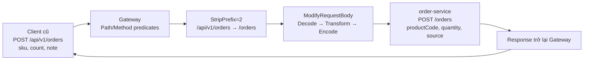
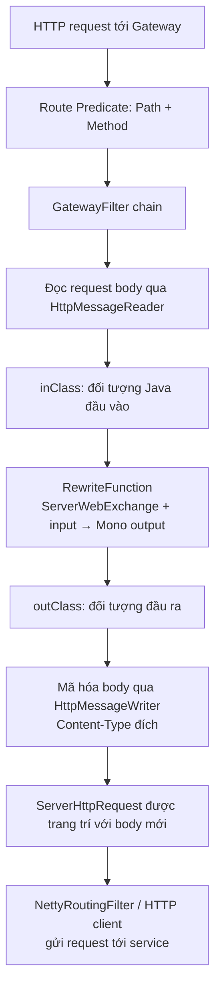
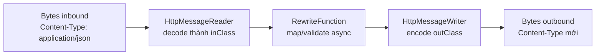

# ModifyRequestBody qua Java DSL và chuyển đổi dữ liệu đầu vào

Trong kiến trúc microservices, API công khai đôi khi phải giữ hợp đồng request cũ trong khi một dịch vụ nội bộ đã sử dụng cấu trúc dữ liệu mới. Ví dụ, ứng dụng mobile gửi JSON có trường `count`, còn `order-service` mới yêu cầu trường `quantity`. Nếu đổi ngay hợp đồng công khai, client cũ có thể ngừng hoạt động. **`ModifyRequestBody` GatewayFilter Factory** của **Spring Cloud Gateway Server WebFlux** cho phép đọc nội dung HTTP request, chuyển thành một kiểu dữ liệu Java, biến đổi bằng hàm reactive rồi ghi lại body để chuyển tới upstream.

Bài thuộc chương **Nội dung HTTP** của module **SPRING_CLOUD_GATEWAY**. Khi xây dựng API Gateway, chúng ta thường dùng route predicate và filter chain để định tuyến, sửa path/header, khám phá dịch vụ và áp dụng bảo mật, rate limit, circuit breaker, retry, TLS, observability. Riêng **biến đổi request body** là công việc nặng và nhạy cảm hơn sửa header: phải đọc, giải mã, có thể giữ dữ liệu trong bộ nhớ, mã hóa lại và bảo toàn tính đúng đắn của HTTP message.

Mục tiêu bài học:

1. Biết **khi nào cần dùng `ModifyRequestBody`** và khi nào chỉ nên chuyển nguyên request body đến backend.
2. Viết được `RouteLocator` bằng **Java DSL** để chuyển JSON đầu vào thành DTO khác và gửi tới upstream.
3. Hiểu `inClass`, `outClass`, `newContentType` và `RewriteFunction`, bao gồm trường hợp **không có body**.
4. Xử lý dữ liệu không hợp lệ, media type/codec, độ dài body, bộ nhớ, xử lý reactive và lỗi trước khi request đến backend.
5. Kiểm thử payload trước/sau chuyển đổi và đánh giá tác động tới xác thực, rate limiting, retry, streaming và quan sát.

> **Phạm vi:** Nội dung áp dụng cho **Spring Cloud Gateway Server WebFlux** sử dụng Spring WebFlux/Project Reactor. Gateway Server MVC có API filter và cách thực thi riêng; không lấy ví dụ Java DSL WebFlux để dùng trực tiếp cho MVC. Tài liệu Spring Cloud Gateway WebFlux 4.x/5.x đều mô tả `ModifyRequestBody`; kiểm tra starter, dependency và cấu hình đúng phiên bản đang chạy.

## 1. Tại sao gateway cần biến đổi request body?

Giả sử client mobile cũ tạo đơn hàng bằng request:

```http
POST /api/v1/orders HTTP/1.1
Host: api.example.com
Content-Type: application/json
Authorization: Bearer <token>

{
  "sku": "BOOK-01",
  "count": 2,
  "note": "Giao giờ hành chính"
}
```

Trong khi đó, backend mới nhận:

```http
POST /orders HTTP/1.1
Content-Type: application/json

{
  "productCode": "BOOK-01",
  "quantity": 2,
  "source": "legacy-v1"
}
```

Có hai phép biến đổi khác nhau:

- **Đường dẫn:** từ `/api/v1/orders` sang `/orders`, có thể dùng `StripPrefix=2`.
- **Body:** từ `sku/count/note` sang `productCode/quantity/source`, cần đọc và mã hóa lại JSON; `StripPrefix` hoặc `RewritePath` **không** làm được việc này.



**Quy tắc phân chia trách nhiệm:** Biến đổi kiểu dữ liệu ở gateway nên phục vụ **tương thích giao thức hoặc contract**, ví dụ đổi tên trường, chuẩn hóa định dạng kỹ thuật, bọc một JSON message. Những quyết định như giá bán, tồn kho, quyền sở hữu đơn hàng, tổng tiền, trạng thái thanh toán vẫn thuộc service nghiệp vụ. Nếu việc chuyển đổi yêu cầu tra database, kết hợp nhiều miền dữ liệu hoặc tổ chức giao dịch, nên đặt logic ở service/BFF phù hợp thay vì nhồi vào filter.

## 2. ModifyRequestBody hoạt động ở đâu trong filter chain?

Trong Spring Cloud Gateway Server WebFlux, `ModifyRequestBody` là một **GatewayFilter Factory theo route**. Nó đọc body từ `ServerHttpRequest`, dùng codec của Spring WebFlux để tạo một giá trị Java kiểu đầu vào, chạy hàm biến đổi và ghi body mới cho request được chuyển tiếp.

Luồng khái niệm:



Cần hiểu những điểm sau:

- **Predicate được xét trước route filter**: ví dụ `Path=/api/v1/orders` chọn route theo đường dẫn công khai. `ModifyRequestBody` không phải một route predicate.
- **Body ban đầu là một luồng dữ liệu** (`Flux<DataBuffer>`); không nên tùy tiện đọc nó hai lần. Filter tích hợp tạo request đã được điều chỉnh để các bước sau có thể đọc body mới.
- **Chuyển đổi đối tượng cần codec phù hợp**: chẳng hạn JSON sang record Java cần bộ giải mã JSON; object đầu ra cần bộ mã hóa JSON.
- **Reactive không có nghĩa không tốn bộ nhớ**: muốn chuyển toàn bộ JSON thành một DTO, filter thường phải giải mã và có thể buffer body.
- **Backend nhận body mới**. Header, phương thức, path và authorization vẫn được xử lý theo các filter/chính sách tương ứng, không tự thay đổi chỉ vì có `ModifyRequestBody`.

`ModifyRequestBody` biến đổi **request body**. Nếu cần biến đổi body **trả về client**, đó là trách nhiệm của `ModifyResponseBody`. Nếu chỉ muốn đổi header, hãy dùng `AddRequestHeader`, `SetRequestHeader`, `RemoveRequestHeader` thay vì đọc body.

## 3. Vì sao phải cấu hình qua Java DSL?

Tài liệu Spring Cloud Gateway Server WebFlux quy định **`ModifyRequestBody` chỉ cấu hình qua Java DSL**. Lý do thực tế là filter cần một hàm Java nhận `ServerWebExchange` và nội dung đã decode, sau đó trả publisher của body mới.

Cú pháp điển hình:

```java
.modifyRequestBody(
    InputType.class,
    OutputType.class,
    MediaType.APPLICATION_JSON_VALUE,
    (exchange, body) -> /* Trả Mono<OutputType> */)
```

| Tham số | Vai trò | Ví dụ |
| --- | --- | --- |
| `inClass` | Kiểu dữ liệu dùng để **đọc và decode body đến** | `LegacyOrderRequest.class` |
| `outClass` | Kiểu dữ liệu dùng để **mã hóa body mới** | `CreateOrderRequest.class` |
| `newContentType` | Content type của body đã chuyển đổi | `MediaType.APPLICATION_JSON_VALUE` |
| `rewriteFunction` | Hàm nhận `ServerWebExchange` và input, trả `Publisher` reactive cho output | `(exchange, input) -> Mono.just(mapped)` |

Các kiểu `InputType` và `OutputType` phải phù hợp với HTTP message codecs trong ứng dụng. Không phải cứ đặt `String.class` hoặc `Object.class` là mọi JSON/XML/multipart sẽ tự được xử lý đúng.

Ví dụ sau **không phải** cách khai báo hợp lệ theo tài liệu WebFlux:

```yaml
# Sai ý tưởng: filter này không cấu hình rewrite function bằng YAML thuần
spring:
  cloud:
    gateway:
      routes:
        - id: orders
          uri: http://localhost:8081
          predicates:
            - Path=/api/v1/orders
          filters:
            - ModifyRequestBody=LegacyOrderRequest,CreateOrderRequest
```

Các route thông thường có thể cấu hình trong YAML, nhưng khi cần hàm Java để biến đổi body, hãy tạo bean `RouteLocator` bằng `RouteLocatorBuilder`. Không suy luận từ ví dụ YAML rằng có thể viết bất kỳ tên factory nào rồi chuyển class name thành converter tự động.

## 4. Ví dụ hoàn chỉnh: chuyển JSON v1 thành JSON nội bộ bằng Java DSL

Giả sử Gateway chạy ở `localhost:8080` và `order-service` thử nghiệm chạy ở `localhost:8081`. Client gọi `POST /api/v1/orders`; backend chỉ có `POST /orders`.

### 4.1. Khai báo DTO đầu vào và đầu ra

Sử dụng Java record để thể hiện rõ contract của hai thế hệ API:

```java
public record LegacyOrderRequest(
    String sku,
    Integer count,
    String note
) {}

public record CreateOrderRequest(
    String productCode,
    Integer quantity,
    String source
) {}
```

`LegacyOrderRequest` giữ cấu trúc từ client cũ. `CreateOrderRequest` là payload mà backend mới yêu cầu. Trong ví dụ, `note` không được chuyển tiếp vì backend không còn hỗ trợ trường này; quyết định bỏ trường phải được xác nhận trong contract, không tùy ý xóa dữ liệu quan trọng.

### 4.2. Cấu hình RouteLocator

Một lớp cấu hình tối giản, gồm import và bean:

```java
import org.springframework.cloud.gateway.route.RouteLocator;
import org.springframework.cloud.gateway.route.builder.RouteLocatorBuilder;
import org.springframework.context.annotation.Bean;
import org.springframework.context.annotation.Configuration;
import org.springframework.http.HttpMethod;
import org.springframework.http.HttpStatus;
import org.springframework.http.MediaType;
import org.springframework.web.server.ResponseStatusException;
import reactor.core.publisher.Mono;

@Configuration(proxyBeanMethods = false)
public class OrderGatewayRoutes {

    @Bean
    RouteLocator orderRoutes(RouteLocatorBuilder builder) {
        return builder.routes()
            .route("orders-legacy-create", r -> r
                .path("/api/v1/orders")
                .and()
                .method(HttpMethod.POST)
                .filters(f -> f
                    .stripPrefix(2)
                    .modifyRequestBody(
                        LegacyOrderRequest.class,
                        CreateOrderRequest.class,
                        MediaType.APPLICATION_JSON_VALUE,
                        (exchange, input) -> {
                            if (input == null) {
                                return Mono.error(new ResponseStatusException(
                                    HttpStatus.BAD_REQUEST,
                                    "Request body is required"));
                            }

                            if (input.sku() == null
                                    || input.sku().isBlank()
                                    || input.count() == null
                                    || input.count() <= 0) {
                                return Mono.error(new ResponseStatusException(
                                    HttpStatus.BAD_REQUEST,
                                    "sku and positive count are required"));
                            }

                            CreateOrderRequest mapped =
                                new CreateOrderRequest(
                                    input.sku().trim(),
                                    input.count(),
                                    "legacy-v1");

                            return Mono.just(mapped);
                        }))
                .uri("http://localhost:8081"))
            .build();
    }

    public record LegacyOrderRequest(
        String sku, Integer count, String note
    ) {}

    public record CreateOrderRequest(
        String productCode, Integer quantity, String source
    ) {}
}
```

**Cần có:** starter Spring Cloud Gateway **Server WebFlux** tương thích với Spring Boot, codec JSON (Jackson theo stack hỗ trợ), Reactor và các import như trên. Bean `RouteLocator` là cấu hình route Java, không phải Spring MVC controller.

**Cách chạy trong pipeline:**

1. `path("/api/v1/orders")` và `method(POST)` giúp route chỉ match đúng endpoint tạo đơn. Request `GET` hoặc path khác không vào converter này.
2. `stripPrefix(2)` bỏ hai segment `api` và `v1`, nên upstream nhận `/orders`.
3. `modifyRequestBody(...)` đọc JSON thành `LegacyOrderRequest`, kiểm tra dữ liệu tối thiểu rồi tạo `CreateOrderRequest`.
4. `MediaType.APPLICATION_JSON_VALUE` hướng dẫn ghi body mới là JSON.
5. `uri("http://localhost:8081")` chọn backend thử nghiệm; có thể thay bằng `lb://order-service` nếu ứng dụng đã có Spring Cloud LoadBalancer và nguồn instance.

Việc kiểm tra `count > 0` trong ví dụ chỉ là **validation biên tối thiểu** giúp tránh gửi payload sai cấu trúc. `order-service` vẫn phải kiểm tra sản phẩm, giá, tồn kho, quyền truy cập và tính hợp lệ của giao dịch. Gateway không phải nguồn chân lý cho các quy tắc này.

### 4.3. Trước và sau chuyển đổi

Client gửi:

```bash
curl -i http://localhost:8080/api/v1/orders \
  -H "Content-Type: application/json" \
  -d '{"sku":"BOOK-01","count":2,"note":"Giao giờ hành chính"}'
```

Backend dự kiến nhận:

```http
POST /orders HTTP/1.1
Content-Type: application/json

{"productCode":"BOOK-01","quantity":2,"source":"legacy-v1"}
```

Chuỗi JSON thực tế có thể khác ở **thứ tự field, whitespace hoặc cách mã hóa Unicode**; điều cần test là **cấu trúc JSON và giá trị**. `Content-Length` ở outbound cũng có thể khác request inbound vì body đã thay đổi. Đừng kỳ vọng giữ nguyên toàn bộ header liên quan framing.

## 5. Trường hợp request không có body và cách xử lý null

Trong `ModifyRequestBody`, nếu request **không có body**, tài liệu Spring Cloud Gateway mô tả `RewriteFunction` sẽ nhận giá trị đầu vào là **`null`**. Đây là trường hợp khác với JSON hợp lệ có các field rỗng.

Hai chính sách hợp lệ nhưng có mục đích khác nhau:

### 5.1. Body là tùy chọn: tiếp tục gửi request không có body

```java
.modifyRequestBody(
    String.class,
    String.class,
    MediaType.TEXT_PLAIN_VALUE,
    (exchange, body) -> {
        if (body == null) {
            return Mono.empty();
        }
        return Mono.just(body.trim());
    })
```

`Mono.empty()` thể hiện **không có body đầu ra**. **Không** dùng `Mono.just(null)` vì Reactor `Mono.just` không chấp nhận giá trị `null`.

### 5.2. Body là bắt buộc: trả lỗi rõ ràng

```java
.modifyRequestBody(
    LegacyOrderRequest.class,
    CreateOrderRequest.class,
    MediaType.APPLICATION_JSON_VALUE,
    (exchange, input) -> {
        if (input == null) {
            return Mono.error(new ResponseStatusException(
                HttpStatus.BAD_REQUEST,
                "Order request body is missing"));
        }
        return Mono.just(new CreateOrderRequest(
            input.sku(),
            input.count(),
            "legacy-v1"));
    })
```

Đây là **mảnh cấu hình minh họa**. Trong production vẫn phải validate `sku` và `count` trước khi dùng; xem ví dụ hoàn chỉnh ở mục 4. `ResponseStatusException` cho phép WebFlux mapping lỗi phù hợp, còn body sai JSON hoặc media type không hỗ trợ có thể lỗi **ở bước decode trước khi hàm rewrite chạy**.

| Trường hợp | Đầu vào tới rewrite function | Hành vi mong muốn |
| --- | --- | --- |
| Có JSON hợp lệ, đủ field | DTO Java khác `null` | Validate rồi trả `Mono<OutputDTO>` |
| Request không có body | `null` | `Mono.empty()` nếu optional, hoặc lỗi `400` nếu bắt buộc |
| JSON hợp lệ nhưng thiếu `sku` | DTO Java có field `null` | Tự validate và trả `400` |
| JSON sai cú pháp | Có thể lỗi ở codec trước rewrite function | Xử lý bằng error handler thích hợp, không giả định lambda sẽ được gọi |
| `Content-Type` không có codec phù hợp | Decode không thực hiện được hoặc bị từ chối | Định nghĩa rõ media type được hỗ trợ |
| Business validation fail ở backend | Gateway đã chuyển đổi thành công | Backend trả lỗi theo contract nghiệp vụ |

**Lưu ý về Bean Validation:** Đừng mặc định `@Valid` trên một DTO sẽ tự được áp dụng chỉ vì đối tượng đi qua `ModifyRequestBody`. Nếu cần validation phức tạp, hãy gọi validator tường minh hoặc triển khai nó ở service phù hợp.

## 6. Hiểu ba bước decode → transform → encode

Từ góc nhìn kỹ thuật, `ModifyRequestBody` không chỉ đổi tên field bằng cách thay chuỗi. Nó có ba lớp:



### 6.1. Decode: inClass phải khớp dữ liệu và media type

Nếu request là JSON:

```json
{"sku":"BOOK-01","count":2}
```

và `inClass=LegacyOrderRequest.class`, codec JSON có thể tạo record chứa `sku` và `count`. Nếu request là `text/plain` nhưng vẫn cấu hình vào DTO JSON, đừng kỳ vọng Spring sẽ tự suy đoán hợp đồng. Khi media type không có decoder tương ứng, request có thể bị từ chối hoặc lỗi chuyển đổi.

Nếu muốn nhận text thuần rồi bọc thành JSON, có thể dùng:

```java
record MessageEnvelope(String message) {}

.modifyRequestBody(
    String.class,
    MessageEnvelope.class,
    MediaType.APPLICATION_JSON_VALUE,
    (exchange, text) ->
        text == null
            ? Mono.empty()
            : Mono.just(new MessageEnvelope(text.trim())))
```

Đoạn trên là **mảnh DSL**: phải đặt `record` và lời gọi `modifyRequestBody` đúng vị trí trong một lớp/cấu hình route; đây không phải một file Java độc lập. Ở ví dụ này, request inbound có thể là `Content-Type: text/plain`, còn backend nhận JSON như `{"message":"hello"}`.

### 6.2. Transform: dùng hàm reactive, tránh blocking

`RewriteFunction` trả `Mono<Out>`. Có thể map thuần trong bộ nhớ như mục 4; nếu phải gọi một HTTP service bất đồng bộ để lấy metadata kỹ thuật thì có thể ghép bằng `flatMap`/`map`, nhưng cần xem xét tăng độ trễ và phụ thuộc.

**Không làm:**

```java
(exchange, body) -> {
    Thread.sleep(200);              // Blocking trên request path
    LegacyResult r = jdbcDao.load(); // JDBC đồng bộ
    return Mono.just(transform(r, body));
}
```

Ví dụ trên chỉ để nhận diện **anti-pattern**; chưa bao gồm khai báo các class liên quan. Trên WebFlux/Reactor Netty, blocking có thể giữ event-loop thread, làm tăng `p95/p99` nhiều route. Nếu bất khả kháng phải dùng thư viện đồng bộ, cần cô lập đúng nguồn blocking trên `Schedulers.boundedElastic()`, giới hạn concurrency và timeout của chính driver. Dù vậy, biến đổi body ở gateway càng đơn giản và deterministic càng tốt.

**Không** gọi `.block()` để lấy dữ liệu từ `Mono` và cũng không `subscribe()` thủ công trong rewrite function; hãy trả publisher cho Gateway quản lý vòng đời request.

### 6.3. Encode: outClass và newContentType phải nhất quán

Nếu kết quả là `CreateOrderRequest` nhưng khai báo `MediaType.TEXT_PLAIN_VALUE`, codec có thể không biết cách ghi object dưới dạng text. Ngược lại, chọn output JSON nhưng trả một chuỗi đã chứa JSON “viết tay” sẽ dễ tạo lỗi JSON bị quote/escape hai lần tùy codec.

Nguyên tắc:

- Muốn object Java thành JSON, chọn `outClass` phù hợp và `application/json`.
- Muốn gửi văn bản thuần, chọn `String.class` và content type tương ứng.
- Muốn chuyển đổi XML, binary hoặc cấu trúc đặc biệt, cần decoder/encoder phù hợp và kiểm thử codec. Không mặc định factory tự xử lý mọi payload.
- Để framework thiết lập framing/độ dài outbound. **Không giữ `Content-Length` cũ bằng custom filter** khi body đã thay đổi, vì có thể gây lỗi cắt/trùng body hoặc lệch giao thức.

## 7. Bộ nhớ, backpressure và giới hạn kích thước body

`ModifyRequestBody` được dùng để chuyển **toàn bộ body thành một đối tượng**. Vì vậy nó có thể cần **buffer** dữ liệu trong bộ nhớ cho quá trình giải mã/ghi lại, khác với đường proxy streaming không sửa body.

| Vấn đề | Rủi ro khi đọc/chuyển đổi body | Biện pháp |
| --- | --- | --- |
| Body JSON lớn | Tăng lượng dữ liệu buffer, áp lực heap/direct memory và GC | Giới hạn kích thước và codec buffering; không nhận dữ liệu vượt nhu cầu |
| Nhiều request đồng thời | Mỗi request đang rewrite có thể giữ dữ liệu riêng | Giám sát concurrency, memory, `p95/p99` và event-loop |
| Multipart/file upload | Không phù hợp để đọc toàn bộ file thành DTO thông thường | Giữ luồng streaming hoặc dùng pipeline upload chuyên biệt |
| Streaming/SSE | Body dài hoặc không kết thúc, không thể gom toàn bộ | Tránh `ModifyRequestBody` cho luồng lớn/liên tục |
| JSON nhiều tầng/cấu trúc cực lớn | Tốn CPU giải mã/mã hóa, gây áp lực codec | Giới hạn payload và độ phức tạp, kiểm thử tải |
| Retry request có body | Có thể cần cache/replay body, tăng bộ nhớ và số lần gọi backend | Chỉ retry khi đúng ngữ nghĩa và có idempotency thích hợp |

### 7.1. RequestSize bảo vệ ở lớp route

Spring Cloud Gateway có **`RequestSize` GatewayFilter Factory** cho phép hạn chế kích thước request, ví dụ:

```yaml
filters:
  - name: RequestSize
    args:
      maxSize: 256KB
```

Đây là mảnh cấu hình cho một route khai báo bằng YAML, không phải phần có thể sao chép nguyên vào ví dụ `RouteLocator` bằng Java. Trong cấu hình thực, hãy đưa giới hạn tương ứng vào route/default filters hoặc lớp ingress, và kiểm thử việc giới hạn được thực thi **trước** bước đọc body lớn. Khi vượt ngưỡng, `RequestSize` có thể trả `413 Payload Too Large` theo tài liệu Gateway.

Với route Java DSL, cần cấu hình filter giới hạn theo API Java tương ứng hoặc chính sách ingress/global được kiểm chứng. Không suy luận rằng ví dụ YAML trên sẽ tự gắn vào tất cả Java routes.

### 7.2. Giới hạn codec và lỗi DataBufferLimitException

Spring WebFlux codecs có cơ chế giới hạn bộ nhớ cho quá trình **buffer dữ liệu khi decode**. Nếu kích thước vượt ngưỡng, có thể gặp `DataBufferLimitException`. Giá trị mặc định và property để tùy chỉnh phụ thuộc Spring Boot/Spring Framework version. Không giải quyết bằng cách đặt ngưỡng vô hạn: gateway có thể bị cạn bộ nhớ khi nhiều client đồng thời gửi body lớn.

Cần kiểm tra **hai lớp giới hạn**:

1. Giới hạn request ở ingress/server/route, để không cho payload quá lớn đi sâu vào pipeline.
2. Giới hạn codec buffering khi biến đổi từ raw bytes thành object, không tăng quá mức cần thiết.

**Backpressure** giúp điều tiết tốc độ truyền trong pipeline reactive, nhưng **không biến thao tác cần giữ toàn bộ JSON thành streaming không tốn bộ nhớ**. Với upload video/file hoặc luồng hàng triệu dòng dữ liệu, nên cho backend/service chuyên trách xử lý qua streaming thay vì decode toàn bộ ở gateway.

## 8. Header, path và filter order khi rewrite body

Bài toán chuyển đổi đầu vào thường kết hợp nhiều filter. Ví dụ:

```text
Client POST /api/v1/orders
    ├─ Route Path + Method
    ├─ StripPrefix(2)          -> /orders
    ├─ ModifyRequestBody       -> JSON backend
    ├─ RemoveRequestHeader     -> xóa identity giả mạo
    ├─ LoadBalancer / Routing  -> order-service
    └─ order-service kiểm tra nghiệp vụ
```

**Thứ tự route filters có ý nghĩa** nếu filter sau cần đọc body đã đổi hoặc filter trước phụ thuộc vào body cũ. Với mỗi route, hãy ghi rõ:

- Path client gửi và path backend cần nhận.
- Kiểu `Content-Type` inbound/outbound.
- Body trước và sau rewrite.
- Header nào phải giữ hoặc thay (đặc biệt `Authorization` và `Content-Length`).
- Filter nào cần xem body gốc, filter nào chỉ nên xem body mới.

Ví dụ một custom filter cố đọc body gốc rồi vẫn chuyển tiếp request body mà không decor/cache đúng cách có thể khiến `ModifyRequestBody` đọc thấy dữ liệu rỗng; trong Reactor Netty/WebFlux, request body không mặc nhiên là chuỗi bytes có thể tiêu thụ nhiều lần.

### 8.1. Xác thực, header danh tính và dữ liệu request

Spring Security nên xác thực token ở lớp biên. Nếu `input` chứa `userId` hay `tenantId` do client gửi, **không được** dùng field đó làm căn cứ cấp quyền hoặc làm danh tính đáng tin. Backend cần kiểm tra principal và dữ liệu nghiệp vụ thực tế. Nếu gateway tạo một header identity nội bộ, cần xóa header client tự đặt và bảo vệ trust boundary.

### 8.2. Caching và retry

Khi route có `Retry` và `ModifyRequestBody`, cần biết **lúc nào body được đọc, biến đổi, cache hoặc replay**. Một request client có thể dẫn tới nhiều lần gửi upstream nếu retry; mỗi lần tạo đơn có thể phát sinh side effect. Vì vậy:

- Không retry `POST /orders` một cách mặc định chỉ vì gặp lỗi mạng.
- Nếu bắt buộc retry, cần idempotency key, kiểm soát trạng thái backend và giới hạn số lần thử.
- Không biến một lỗi chuyển đổi body thành response “đặt hàng thành công”.
- Kiểm tra bộ nhớ sử dụng nếu có caching/replay request body.

### 8.3. Observability

Ghi **route ID, thời gian decode/transform/encode (nếu có instrumentation), kích thước body trong nhóm cho phép, HTTP status và trace ID**; không ghi token, mật khẩu, số thẻ hoặc toàn bộ JSON đơn hàng vào log. Body rewrite có thể làm tăng latency ngay cả khi upstream khỏe, vì gateway phải parse và serialize.

## 9. Phân biệt các kỹ thuật xử lý HTTP body khác

| Kỹ thuật | Mục đích | Khi phù hợp |
| --- | --- | --- |
| **`ModifyRequestBody`** | Decode body, chuyển đổi object, encode body mới trước khi forward | Adapter contract JSON/text cho request nhỏ, xác định rõ schema |
| **`ModifyResponseBody`** | Chuyển đổi body từ backend trước khi trả client | Adapter response contract; cần cấu hình Java DSL tương ứng |
| **`CacheRequestBody`** | Đọc/cache body để filter khác dùng lại theo cơ chế hỗ trợ | Một số policy cần xem body; phải quản lý giới hạn bộ nhớ |
| **`RequestSize`** | Giới hạn kích thước request được phép | Bảo vệ gateway/backend trước payload quá lớn |
| **`RewritePath` / `StripPrefix`** | Thay request path | Đổi URL, không thay JSON |
| **`SetRequestHeader`** | Ghi/thay header outbound | Đổi metadata HTTP, không parse body |
| **Streaming proxy không can thiệp body** | Chuyển bytes qua reactive HTTP proxy | Upload/download lớn, binary/streaming data |
| **BFF / adapter service** | Chuyển đổi lớn có phụ thuộc nghiệp vụ, nguồn dữ liệu hoặc state | Mapping phức tạp hoặc cần transaction, I/O/logic riêng |

Không nên đặt mọi chuyển đổi vào một filter chung cho toàn gateway. Một route tạo đơn hàng và một route upload file có đặc điểm body rất khác nhau. Hãy ưu tiên **route cụ thể** cho những nội dung cần decode và giữ những đường streaming không cần sửa body càng nhẹ càng tốt.

## 10. Các trường hợp lỗi cần xử lý rõ

| Triệu chứng | Nguyên nhân có thể | Cách kiểm tra và sửa |
| --- | --- | --- |
| Gateway không khởi động vì `ModifyRequestBody` trong YAML | Factory yêu cầu Java DSL | Đưa route vào `RouteLocatorBuilder` và truyền rewrite function |
| Rewrite function nhận `null` | Request không có body | Chọn `Mono.empty()` hoặc `Mono.error(400)` theo contract |
| Input record có field `null` | Client thiếu field; codec không nhất thiết validate | Validation tường minh, phản hồi `400` |
| Gửi JSON sai mà lambda không được gọi | Codec parse trước rewrite function và thất bại | Kiểm tra Content-Type, JSON và WebFlux error handling |
| Backend thấy JSON bị quote hai lần | Body String chứa JSON bị encode lần nữa | Dùng DTO/record làm output thay vì tự dựng chuỗi JSON |
| Backend trả `415` | Content-Type outbound không khớp hợp đồng | Đặt `newContentType` đúng và kiểm tra codec |
| Backend nhận body rỗng | Filter khác tiêu thụ body trước; rewrite trả `Mono.empty()` | Xem thứ tự filter, cách cache/decorate và nhánh null |
| Body mới khác độ dài, upstream gặp lỗi framing | Custom code giữ `Content-Length` cũ hoặc thay encoding sai | Để framework quản lý framing, kiểm tra headers thực tế |
| Gateway trả `413`/lỗi buffer | Payload vượt RequestSize hoặc giới hạn codec | Xác định tầng từ chối; điều chỉnh giới hạn hợp lý |
| `p95/p99` tăng khi bật rewrite | Parse/serialize nặng, payload lớn, blocking trong lambda | Giảm dữ liệu/logic, profile event loop, kiểm thử tải |
| Timeout/retry tạo đơn trùng | Retry request có side effect không idempotent | Áp dụng idempotency key và chính sách retry theo nghiệp vụ |
| Dữ liệu khách hàng xuất hiện trong log | Debug log body không che dữ liệu | Chỉ log metadata an toàn, che/khử dữ liệu nhạy cảm |

**Ghi nhớ:** không phải mọi lỗi trong `ModifyRequestBody` tự động biến thành `400`. Một exception tùy ý trong rewrite function có thể đi qua error handling và được ánh xạ khác. Trả `ResponseStatusException` hoặc cấu hình `ErrorWebExceptionHandler` phù hợp để giữ hợp đồng lỗi nhất quán.

## 11. Thực hành: quan sát body trước/sau gateway

### 11.1. Chuẩn bị

- Gateway WebFlux ở `localhost:8080`, dùng Java DSL mục 4.
- Backend `order-service` thử nghiệm ở `localhost:8081`, có `POST /orders`.
- Backend cần ghi nhận **JSON đã parse, path và Content-Type**, tránh log dữ liệu nhạy cảm.

Một backend echo tối giản ở môi trường test có thể có:

```java
import java.util.Map;
import org.springframework.http.MediaType;
import org.springframework.web.bind.annotation.PostMapping;
import org.springframework.web.bind.annotation.RequestBody;
import org.springframework.web.bind.annotation.RestController;
import reactor.core.publisher.Mono;

@RestController
class OrderEchoController {

    @PostMapping(
        path = "/orders",
        consumes = MediaType.APPLICATION_JSON_VALUE)
    Mono<Map<String, Object>> echo(
            @RequestBody Map<String, Object> body) {

        return Mono.just(body);
    }
}
```

Chỉ dùng controller này để minh họa việc backend nhận body mới. API thực tế cần kiểm tra authentication/authorization và nghiệp vụ; không tự echo toàn bộ payload người dùng về client nếu có thông tin nhạy cảm.

### 11.2. Test request thành công

```bash
curl -i http://localhost:8080/api/v1/orders \
  -H "Content-Type: application/json" \
  -d '{"sku":"BOOK-01","count":2,"note":"hello"}'
```

Nếu backend echo đúng payload, response body dự kiến tương đương:

```json
{
  "productCode": "BOOK-01",
  "quantity": 2,
  "source": "legacy-v1"
}
```

### 11.3. Test body thiếu hoặc không hợp lệ

```bash
# Không có body
curl -i -X POST http://localhost:8080/api/v1/orders

# JSON thiếu sku
curl -i http://localhost:8080/api/v1/orders \
  -H "Content-Type: application/json" \
  -d '{"count":2}'

# count không hợp lệ
curl -i http://localhost:8080/api/v1/orders \
  -H "Content-Type: application/json" \
  -d '{"sku":"BOOK-01","count":0}'

# JSON sai cú pháp
curl -i http://localhost:8080/api/v1/orders \
  -H "Content-Type: application/json" \
  -d '{"sku":"BOOK-01","count":'
```

Ba trường hợp đầu được ví dụ Java xử lý bằng `ResponseStatusException(HttpStatus.BAD_REQUEST, ...)`; JSON sai cú pháp bị codec từ chối trước khi vào nhánh validation của rewrite function. Kiểm tra status thực tế, error body và việc backend **không** ghi nhận request không hợp lệ.

### 11.4. Bảng nghiệm thu route và body

| Input | Điều cần thấy ở backend / Gateway |
| --- | --- |
| `POST /api/v1/orders` + JSON hợp lệ | Backend `POST /orders` nhận `productCode/quantity/source` |
| `GET /api/v1/orders` | Route chỉ nhận POST không khớp; không được tự chạy converter |
| `POST /api/v1/catalog` | Route orders không khớp |
| Body rỗng | Với contract bắt buộc, trả `400` trước upstream |
| `sku` thiếu, `count <= 0` | Trả `400`, không tạo đơn |
| `Content-Type: text/plain` với JSON DTO | Không xử lý như input JSON hợp lệ nếu không có codec/contract tương ứng |
| JSON rất lớn | Có giới hạn ingress/route/codec; không để tăng bộ nhớ vô hạn |
| Request bị hủy | Không giữ tác vụ không quản lý hoặc rò rỉ buffer |
| Backend chậm hoặc lỗi | Timeout/resilience có chủ đích; không retry tạo đơn mù quáng |

### 11.5. Kiểm tra payload theo cấu trúc, không theo chuỗi

Trong integration test, ưu tiên xác minh JSON theo cây hoặc DTO thay vì so sánh chuỗi thô, vì thứ tự property và whitespace có thể thay đổi. Sử dụng `WebTestClient` để gọi gateway và một backend stub có thể thu request đã nhận; xác minh route ID/path/header/body và cả nhánh lỗi.

Một mảnh test định hướng:

```java
webTestClient.post()
    .uri("/api/v1/orders")
    .contentType(MediaType.APPLICATION_JSON)
    .bodyValue("""
        {"sku":"BOOK-01","count":2,"note":"hello"}
        """)
    .exchange()
    .expectStatus().is2xxSuccessful();
```

Mảnh trên **chỉ minh họa phía client**: nó cần `WebTestClient` đã kết nối gateway và một backend test trả `2xx`. Test hoàn chỉnh phải kiểm tra backend **nhận JSON đã được chuyển đổi**, vì chỉ nhìn `2xx` không chứng minh converter đã hoạt động.

## 12. Bài tập mở rộng: chuyển text/plain sang JSON

Một API webhook legacy gửi text:

```http
POST /api/legacy/events HTTP/1.1
Content-Type: text/plain

shipment:42
```

Backend mới cần JSON:

```json
{"event":"shipment:42","origin":"legacy"}
```

Hãy thiết kế route `Path=/api/legacy/events`, `Method=POST` và `ModifyRequestBody` với đầu vào `String.class`, đầu ra là record `EventEnvelope`, `newContentType=application/json`. Cần quyết định: **nếu body trống, reject hay cho phép**?

Một rewrite function tham khảo:

```java
record EventEnvelope(String event, String origin) {}

// Đặt bên trong lời gọi modifyRequestBody(...) của Java DSL:
(exchange, text) -> {
    if (text == null || text.isBlank()) {
        return Mono.error(new ResponseStatusException(
            HttpStatus.BAD_REQUEST, "Event is required"));
    }
    return Mono.just(new EventEnvelope(text.trim(), "legacy"));
}
```

Bài tập chỉ yêu cầu biến đổi kỹ thuật, không quyết định webhook có được phép làm gì. Hãy thêm xác minh chữ ký webhook ở lớp thích hợp; **thay đổi body sau khi đã xác minh chữ ký trên raw payload có thể cần giữ nguyên bytes để đối chiếu**. Nếu giao thức xác thực yêu cầu chữ ký dựa trên raw request bytes, phải thiết kế thứ tự xác minh chữ ký và body rewrite đúng theo yêu cầu của nhà cung cấp.

### Câu hỏi tự kiểm tra

**Câu 1.** Vì sao `RewritePath` không giải quyết được việc đổi `count` thành `quantity`?

> `RewritePath` chỉ thay URL path. Để đổi cấu trúc JSON body, cần decode, chuyển đổi và encode bằng `ModifyRequestBody` hoặc một adapter service.

**Câu 2.** Có thể dùng `- ModifyRequestBody=Input,Output` trong YAML để triển khai lambda Java không?

> Không. Tài liệu Gateway Server WebFlux chỉ hỗ trợ cấu hình `ModifyRequestBody` bằng Java DSL với rewrite function.

**Câu 3.** Vì sao `Mono.just(null)` không phải cách gửi request không có body?

> Reactor không cho phép `Mono.just(null)`. Nếu muốn body trống, trả `Mono.empty()`; nếu body là bắt buộc, trả lỗi rõ ràng.

**Câu 4.** Nếu JSON decode được nhưng `sku` không có, body có tự bị từ chối không?

> Không thể giả định. Rewrite function cần validation phù hợp hoặc dùng validator tường minh; service cũng phải kiểm tra nghiệp vụ.

**Câu 5.** Tại sao không nên dùng filter này cho upload file dung lượng lớn?

> Chuyển body thành object có thể đòi hỏi buffer/parse toàn bộ dữ liệu. Upload lớn nên ưu tiên streaming hoặc một dịch vụ được thiết kế cho dữ liệu lớn.

**Câu 6.** Nếu request body thay đổi, có nên giữ nguyên `Content-Length` inbound không?

> Không. Framing phải phù hợp số bytes đã mã hóa lại. Để HTTP framework/transport quản lý header và kiểm thử dữ liệu thực tế.

**Câu 7.** Gateway đã chuyển JSON đúng thì có được tự quyết định đơn hàng hợp lệ không?

> Không. Gateway chỉ làm adapter contract và validation kỹ thuật. Quyết định giá, tồn kho, quyền và trạng thái giao dịch thuộc service nghiệp vụ.

## 13. Checklist khi áp dụng ModifyRequestBody

- [ ] Chỉ dùng cho **Spring Cloud Gateway Server WebFlux** và cấu hình route bằng **Java DSL**.
- [ ] Xác định chính xác **input schema**, **output schema**, `Content-Type` inbound/outbound và hợp đồng backend.
- [ ] Chọn `inClass`/`outClass` phù hợp với codec; test JSON hợp lệ, thiếu field, sai cấu trúc và media type không hỗ trợ.
- [ ] Xử lý body **`null`**: trả `Mono.empty()` hoặc lỗi `400` theo yêu cầu, không gọi `Mono.just(null)`.
- [ ] Kiểm tra dữ liệu tối thiểu; không giả định `@Valid` tự được áp dụng trong rewrite function.
- [ ] Trả publisher cho Gateway; tránh `block()`, `subscribe()` hoặc thao tác I/O blocking trên event loop.
- [ ] Giới hạn request size và codec buffering; không dùng body rewrite toàn-object cho upload/streaming lớn.
- [ ] Không giữ `Content-Length` cũ, kiểm thử path/header/body thực sự nhận ở backend sau rewrite.
- [ ] Đảm bảo filter order, caching và retry không làm tiêu thụ body sai hoặc tạo side effect trùng.
- [ ] Không trộn logic cấp quyền/nghiệp vụ vào adapter body; backend kiểm tra principal, tenant và tài nguyên.
- [ ] Bảo vệ token, cookie và dữ liệu cá nhân trong log; metrics theo route ID/status/latency thay vì body.
- [ ] Có kiểm thử tải và lỗi: payload lớn, codec failure, client cancel, upstream timeout và retry.
- [ ] Kiểm tra service discovery/LoadBalancer khi đổi `uri` thành `lb://...`; TLS và rate limiting vẫn cần chính sách riêng.

## Kết luận

**`ModifyRequestBody`** cho phép **Spring Cloud Gateway Server WebFlux** chuyển đổi body của HTTP request trước khi proxy sang microservice, thông qua **Java DSL** với các thành phần **`inClass`, `outClass`, `newContentType` và `RewriteFunction`**. Đây là công cụ hữu ích để làm adapter cho các contract API trong giai đoạn nâng cấp, ví dụ đổi JSON v1 của client cũ sang JSON nội bộ của `order-service`.

Khi sử dụng, cần xử lý đúng **request không có body**, lỗi decode/validation, Content-Type, Content-Length, giới hạn codec và áp lực bộ nhớ. Không dùng filter này như một nơi tích hợp nghiệp vụ phức tạp hoặc tự retry các thao tác ghi. Phối hợp nó với route predicates, các filter biến đổi path/header, xác thực, rate limit, discovery, circuit breaker, TLS và observability giúp gateway duy trì hợp đồng bên ngoài ổn định và vận hành microservices an toàn.

## Tài liệu tham khảo

- [Spring Cloud Gateway Server WebFlux — ModifyRequestBody GatewayFilter Factory](https://docs.spring.io/spring-cloud-gateway/reference/spring-cloud-gateway-server-webflux/gatewayfilter-factories/modifyrequestbody-factory.html)
- [Spring Cloud Gateway Server WebFlux 4.3.x — GatewayFilter Factories](https://docs.spring.io/spring-cloud-gateway/reference/4.3/spring-cloud-gateway-server-webflux/gatewayfilter-factories.html)
- [Spring Cloud Gateway Server WebFlux — RequestSize GatewayFilter Factory](https://docs.spring.io/spring-cloud-gateway/reference/spring-cloud-gateway-server-webflux/gatewayfilter-factories/requestsize-factory.html)
- [Spring Framework — WebFlux: HTTP Message Codecs](https://docs.spring.io/spring-framework/reference/web/webflux/reactive-spring.html)
