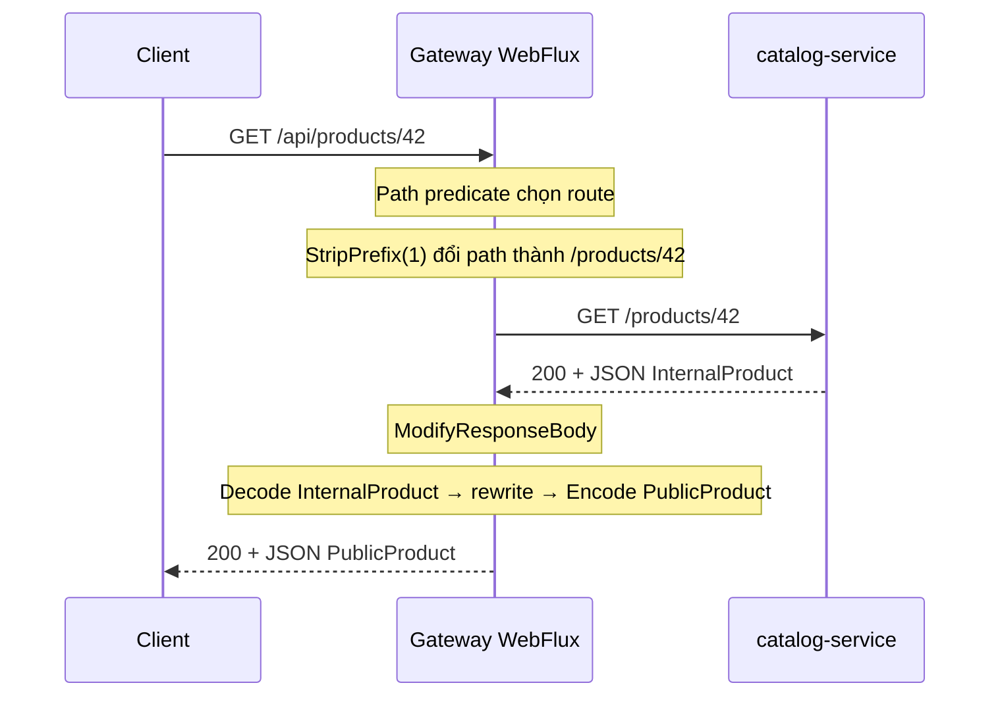

# ModifyResponseBody qua Java DSL và chuyển đổi dữ liệu trả về

## 1. Vì sao cần biến đổi HTTP response body ở API Gateway?

Trong hệ thống microservices, **Spring Cloud Gateway** là điểm nhận request chung: chọn route bằng predicate, áp dụng filter chain để thay đổi đường dẫn/header, chọn service instance qua discovery và thực hiện các chính sách xác thực, rate limiting, circuit breaker, retry, TLS, metrics/tracing. Ngoài việc chuyển tiếp request, đôi khi Gateway cần **chuyển đổi dữ liệu phản hồi** trước khi trả cho client.

Ví dụ, `catalog-service` trả JSON:

```json
{
  "id": "42",
  "name": "Tai nghe không dây",
  "priceCents": 2499000,
  "internalCostCode": "COST-TIER-B"
}
```

Client ứng dụng di động chỉ cần:

```json
{
  "id": "42",
  "displayName": "Tai nghe không dây",
  "priceCents": 2499000
}
```

**`ModifyResponseBody`** cho phép Gateway giải mã body của HTTP response từ upstream, gọi hàm biến đổi do bạn viết, rồi mã hóa lại body trước khi gửi client. Trong ví dụ, Gateway **đổi tên `name` thành `displayName`** và **không đưa `internalCostCode` vào DTO công khai**.

Bài thuộc chương **Nội dung HTTP** của module **SPRING_CLOUD_GATEWAY**. Sau bài học, bạn có thể:

1. Phân biệt đường đi của **request body** và **response body**.
2. Khai báo `ModifyResponseBody` bằng **Java `RouteLocatorBuilder`** trên Gateway Server WebFlux.
3. Hiểu ý nghĩa `inClass`, `outClass`, `RewriteFunction` và `Mono`.
4. Chuyển JSON DTO nội bộ thành DTO client, đổi chuỗi văn bản và xử lý response không có body.
5. Kiểm tra status, `Content-Type`, `Content-Length`, lỗi giải mã, response lớn và streaming.
6. Đặt biến đổi body đúng chỗ trong kiến trúc có xác thực, cache, retry, circuit breaker, TLS và observability.

> **Phạm vi phiên bản:** Các ví dụ chính nhắm đến **Spring Cloud Gateway Server WebFlux 5.0.x**, chạy cùng Spring Boot/Spring Cloud BOM tương thích. Gateway Server Web MVC có filter cùng tên nhưng **API Java khác**, được đối chiếu ở mục 9. Ở dòng 4.x, tên starter, namespace config và API liên quan có thể khác; luôn kiểm tra tài liệu của phiên bản đã khóa trong dự án.

## 2. ModifyResponseBody nằm ở đâu trong luồng xử lý?

`ModifyResponseBody` là **route-specific GatewayFilter**. Nó can thiệp vào body **sau khi upstream tạo response** và **trước khi response được gửi cho client**.



| Tác vụ | Filter/API chính | Chiều áp dụng |
|---|---|---|
| Đổi request path | `StripPrefix` / `RewritePath` | Client → upstream |
| Thêm request header | `AddRequestHeader` | Client → upstream |
| **Đổi response body** | **`ModifyResponseBody`** | Upstream → client |
| Đổi response header | `AddResponseHeader` / `SetResponseHeader` | Upstream → client |
| Đổi request body | `ModifyRequestBody` | Client → upstream |

Thứ tự filter có cả **pha trước** và **pha sau** khi gọi upstream. `ModifyResponseBody` sử dụng cơ chế trang trí response để chuyển đổi nội dung ở thời điểm ghi ra client; việc khai báo nó trong route **không làm backend nhận một request body mới**. Nếu predicate không khớp hoặc response bị chặn từ filter trước (ví dụ rate limiter trả 429), pipeline biến đổi response downstream có thể không được kích hoạt.

### 2.1. Vì sao bắt buộc dùng Java DSL?

`ModifyResponseBody` nhận một **hàm biến đổi body** do lập trình viên cung cấp. Tài liệu Spring Cloud Gateway WebFlux ghi rõ filter này **chỉ cấu hình bằng Java DSL**:

```java
.modifyResponseBody(
    String.class,           // Kiểu body khi đọc upstream response
    String.class,           // Kiểu body sẽ mã hóa gửi client
    (exchange, original) -> // Hàm rewrite reactive
        original == null
            ? Mono.empty()
            : Mono.just(original.toUpperCase(java.util.Locale.ROOT)))
```

Không thể biểu diễn lambda Java này chỉ bằng dòng YAML kiểu `- ModifyResponseBody=...`. YAML vẫn có thể chứa **các cấu hình khác** như cổng ứng dụng, route đơn giản, timeouts; nhưng route có `ModifyResponseBody` ở bài này phải được tạo bằng `@Bean RouteLocator` và `RouteLocatorBuilder`.

### 2.2. Các tham số cần hiểu

| Thành phần | Ý nghĩa | Sai lầm thường gặp |
|---|---|---|
| `inClass` | Kiểu Java mà codec dùng để **đọc** response upstream: ví dụ `String.class` hoặc `InternalProduct.class` | Chọn DTO không khớp JSON thực tế |
| `outClass` | Kiểu Java của giá trị sau biến đổi để **ghi** ra response client | Đổi cấu trúc dữ liệu nhưng giữ `outClass` không tương thích |
| `exchange` | Ngữ cảnh `ServerWebExchange`: request, response, attributes/route | Ghi log token hoặc dựa vào input client chưa xác thực |
| `original` | Body đã được giải mã, có thể là **`null`** khi upstream không trả body | Gọi phương thức của `null` gây lỗi |
| Giá trị trả về | `Mono<outClass>`, hoàn tất bất đồng bộ | Trả `null` thay vì `Mono.empty()`; gọi `block()` trên event loop |

**`Mono.empty()`** biểu thị publisher hoàn tất mà **không phát body**. Nó khác với `Mono.just("")` (body rỗng có kiểu `String`), và cũng khác với một JSON `null` được serialize thành bốn byte văn bản. Đối với HTTP `204 No Content` và `304 Not Modified`, cần tôn trọng quy tắc **không gửi body**.

## 3. Bài thực hành: chuyển DTO JSON tại Gateway

### 3.1. Chuẩn bị hai ứng dụng

| Ứng dụng | Cổng | Dependency chính | Vai trò |
|---|---:|---|---|
| `catalog-demo` | 8081 | Spring Web MVC do Spring Initializr cung cấp | Backend trả DTO nội bộ |
| `gateway-demo` | 8080 | `spring-cloud-starter-gateway-server-webflux` | Route, rewrite path và rewrite response |

Tạo mỗi ứng dụng bằng [Spring Initializr](https://start.spring.io/) với **Java 17+**, chọn Spring Boot tương thích với Spring Cloud BOM. Ở Gateway dùng starter WebFlux; không thêm cả Servlet MVC starter vào Gateway nếu không có yêu cầu kiến trúc riêng.

Dependency quan trọng trong `pom.xml` của **gateway-demo**, đã có Spring Cloud BOM quản lý version:

```xml
<dependency>
    <groupId>org.springframework.cloud</groupId>
    <artifactId>spring-cloud-starter-gateway-server-webflux</artifactId>
</dependency>
```

Spring Boot reactive codecs cần có khả năng serialize/deserialize JSON; Spring Initializr với stack JSON phù hợp thường cung cấp sẵn Jackson. Nếu dùng các cấu hình dependency tùy biến hoặc mapper khác, kiểm tra codec đã được đăng ký.

### 3.2. Viết backend mẫu

Trong dự án **catalog-demo**, tạo `src/main/java/com/example/catalog/CatalogApplication.java`:

```java
package com.example.catalog;

import org.springframework.boot.SpringApplication;
import org.springframework.boot.autoconfigure.SpringBootApplication;
import org.springframework.http.ResponseEntity;
import org.springframework.web.bind.annotation.GetMapping;
import org.springframework.web.bind.annotation.PathVariable;
import org.springframework.web.bind.annotation.RestController;

@SpringBootApplication
@RestController
public class CatalogApplication {

    public static void main(String[] args) {
        SpringApplication.run(CatalogApplication.class, args);
    }

    @GetMapping("/products/{id}")
    public ResponseEntity<InternalProduct> product(@PathVariable String id) {
        if (!"42".equals(id)) {
            return ResponseEntity.notFound().build();
        }

        return ResponseEntity.ok(
            new InternalProduct("42", "Tai nghe không dây",
                                2_499_000L, "COST-TIER-B"));
    }

    public record InternalProduct(
        String id,
        String name,
        long priceCents,
        String internalCostCode
    ) {}
}
```

File `application.yml` của **catalog-demo**:

```yaml
spring:
  application:
    name: catalog-demo
server:
  port: 8081
```

Khởi động ứng dụng backend và kiểm tra trực tiếp:

```bash
# Trong thư mục dự án catalog-demo:
./mvnw spring-boot:run

# Trong terminal khác:
curl -i 'http://localhost:8081/products/42'
```

JSON dự kiến có **đủ bốn trường**, bao gồm `internalCostCode`. Endpoint `/products/99` trả **404 không có response body**; đây là ca kiểm thử để chắc chắn hàm rewrite xử lý body `null` an toàn.

### 3.3. Viết Gateway với RouteLocatorBuilder và ModifyResponseBody

Trong dự án **gateway-demo**, tạo `src/main/java/com/example/gateway/GatewayApplication.java`:

```java
package com.example.gateway;

import org.springframework.boot.SpringApplication;
import org.springframework.boot.autoconfigure.SpringBootApplication;
import org.springframework.cloud.gateway.route.RouteLocator;
import org.springframework.cloud.gateway.route.builder.RouteLocatorBuilder;
import org.springframework.context.annotation.Bean;
import org.springframework.http.HttpMethod;
import reactor.core.publisher.Mono;

@SpringBootApplication
public class GatewayApplication {

    public static void main(String[] args) {
        SpringApplication.run(GatewayApplication.class, args);
    }

    @Bean
    public RouteLocator productRoutes(RouteLocatorBuilder builder) {
        return builder.routes()
            .route("public-product", r -> r
                .path("/api/products/**")
                .and()
                .method(HttpMethod.GET)
                .filters(f -> f
                    .stripPrefix(1)
                    .modifyResponseBody(
                        InternalProduct.class,
                        PublicProduct.class,
                        (exchange, original) -> {
                            if (original == null) {
                                return Mono.empty();
                            }

                            // Chỉ chọn những trường được phép công khai.
                            PublicProduct result = new PublicProduct(
                                original.id(),
                                original.name(),
                                original.priceCents());
                            return Mono.just(result);
                        }))
                .uri("http://localhost:8081"))
            .build();
    }

    // DTO để đọc JSON trả về từ catalog-service.
    public record InternalProduct(
        String id,
        String name,
        long priceCents,
        String internalCostCode
    ) {}

    // DTO công khai mà client nhìn thấy.
    public record PublicProduct(
        String id,
        String displayName,
        long priceCents
    ) {}
}
```

File `application.yml` của **gateway-demo**:

```yaml
spring:
  application:
    name: gateway-demo
server:
  port: 8080
```

**Quan sát quan hệ giữa các thành phần:**

1. `Path=/api/products/**` và `Method=GET` chỉ cho phép route khớp request đúng đường dẫn/phương thức.
2. `StripPrefix=1` biến `/api/products/42` thành `/products/42` trước khi gọi catalog-service.
3. `uri("http://localhost:8081")` là backend đích; Gateway kết nối và nhận JSON.
4. `InternalProduct.class` yêu cầu codec giải mã JSON upstream thành DTO tương ứng.
5. Hàm `(exchange, original) -> ...` chỉ đưa ba trường đã cho phép vào `PublicProduct`, không lấy dữ liệu từ JSON gốc làm chuỗi thao tác thủ công.
6. `PublicProduct.class` cho codec kiểu output để serialize phản hồi JSON mới.
7. `original == null` được xử lý bằng `Mono.empty()` để không sinh body giả khi upstream không trả body.

DTO của backend và Gateway là **hai lớp độc lập**, có cùng cấu trúc JSON ở hợp đồng phía upstream; không cần tạo dependency từ Gateway đến source code của backend. Trong hệ thống thật, quản lý API contract và tương thích schema khi backend thay đổi.

## 4. Kiểm thử kết quả ở client

### 4.1. Hai request cùng một sản phẩm

Khởi động backend `:8081` trước, Gateway `:8080` sau; dùng `curl`:

```bash
# Gọi trực tiếp backend (dữ liệu nội bộ của lab).
curl -i 'http://localhost:8081/products/42'

# Gọi qua Gateway và filter ModifyResponseBody.
curl -i 'http://localhost:8080/api/products/42'
```

Phản hồi **dự kiến** khi gọi qua Gateway:

```http
HTTP/1.1 200 OK
Content-Type: application/json

{"id":"42","displayName":"Tai nghe không dây","priceCents":2499000}
```

So với response upstream, field `internalCostCode` không còn trong body gửi cho client. Đây là ví dụ chuyển đổi **schema DTO**, không phải một phép tìm kiếm/xóa chuỗi bằng regex.

> Đoạn mã và các phản hồi ở đây là **mẫu để người học tự chạy**, không phải kết quả đã kiểm thử trên một ứng dụng đang chạy. Thứ tự trường JSON, charset và các header phụ thuộc phiên bản runtime.

### 4.2. Kiểm thử trường hợp không có body

```bash
# Backend trả 404 không body.
curl -i 'http://localhost:8081/products/99'

# Gateway match route và nhận 404 không body từ backend.
curl -i 'http://localhost:8080/api/products/99'
```

Trong demo, hàm rewrite nhận `null` và trả `Mono.empty()`. Mã status **404** từ backend được giữ, vì filter không thay đổi status; client không được nhận một JSON giả kiểu `{"id":null}`. Nếu upstream thực tế trả **JSON body lỗi riêng** kèm status 404, bộ giải mã `InternalProduct.class` của ví dụ có thể không phù hợp: cần có chính sách xử lý response lỗi riêng (mục 7).

### 4.3. Test route không khớp

```bash
# Không match Path predicate; thường 404 khi không có route khác.
curl -i 'http://localhost:8080/api/orders/42'

# Không match Method=GET; thường 404 nếu không có route khác.
curl -i -X POST 'http://localhost:8080/api/products/42'
```

Filter được khai báo trong route không đồng nghĩa nó chạy trên mọi request. Phải xác minh route **đã khớp** trước khi điều tra việc body không thay đổi.

## 5. Chuyển đổi chuỗi văn bản: ví dụ đơn giản nhất

Trước khi làm việc với DTO JSON, bạn có thể thực nghiệm bằng chuỗi `text/plain`. Thêm endpoint sau vào **CatalogApplication của backend**:

```java
@GetMapping(value = "/text/greeting", produces = "text/plain")
public String greeting() {
    return "hello gateway";
}
```

Trong **bean `productRoutes` đã có**, thêm **một route khác** ngay sau route `public-product`, trước `.build()`:

```java
.route("upper-text", r -> r
    .path("/api/text/**")
    .filters(f -> f
        .stripPrefix(1)
        .modifyResponseBody(
            String.class,
            String.class,
            (exchange, text) -> text == null
                ? Mono.empty()
                : Mono.just(text.toUpperCase(java.util.Locale.ROOT))))
    .uri("http://localhost:8081"))
```

Đây là **đoạn nối vào cùng `builder.routes()`**, không phải một file Java hay một bean hoàn chỉnh để dán độc lập. Route `/api/text/greeting` sau `StripPrefix(1)` gọi `/text/greeting` trên backend.

```bash
curl -i 'http://localhost:8081/text/greeting'
# Body: hello gateway

curl -i 'http://localhost:8080/api/text/greeting'
# Body: HELLO GATEWAY
```

Vì cả **input/output đều là String** và backend khai báo `text/plain`, ví dụ này chỉ thay **nội dung**, không đổi representation media type. `Locale.ROOT` giúp phép đổi chữ hoa không phụ thuộc locale của máy chủ; điều đó vẫn **không phải** một chiến lược chuyển đổi ngôn ngữ hoặc chuẩn hóa dữ liệu quốc tế hoàn chỉnh.

**Không dùng cách đổi hoa này cho JSON**: một thao tác `toUpperCase` trên toàn bộ JSON string có thể đổi cả tên field lẫn nội dung, làm hỏng schema mà client mong đợi. Với JSON có cấu trúc, ưu tiên DTO và JSON codec như mục 3.

## 6. Chọn kiểu dữ liệu, codec và Content-Type cho đúng

`ModifyResponseBody` cần **giải mã** body từ upstream trước khi chạy hàm rewrite. Hình thức dữ liệu và HTTP headers ảnh hưởng trực tiếp đến việc codec có xử lý được hay không.

| Upstream response | `inClass` phù hợp | `outClass` minh họa | Cần lưu ý |
|---|---|---|---|
| `text/plain` với body văn bản | `String.class` | `String.class` | Charset và locale; không cố parse thành JSON |
| `application/json` object | DTO hoặc `JsonNode` nếu đã cấu hình phù hợp | DTO công khai | Field thiếu/sai kiểu, quy ước schema, cấu hình mapper |
| `application/json` array | Kiểu collection phù hợp; có thể cần cơ chế type reference nâng cao | Collection/DTO | Tránh ép JSON array thành một object |
| `application/problem+json` | Schema lỗi/`ProblemDetail` tương ứng | Schema lỗi phù hợp | Không cố giải mã lỗi thành DTO thành công |
| `204` / `304` không có body | Bất kỳ, nhưng body có thể là `null` | `Mono.empty()` | Không tạo dữ liệu ở status không được có body |
| SSE/NDJSON streaming | Không nên gom thành DTO toàn bộ | Cơ chế streaming khác | Giữ event boundary, latency, backpressure |
| PDF, ZIP, ảnh, gRPC/binary | Filter chuyên dụng nếu có, hoặc proxy nguyên bytes | Không dùng DTO JSON | Giữ Content-Type, Content-Encoding, HTTP/2 trailers |

### 6.1. Content-Type và Content-Length

Trong **demo JSON → JSON**, upstream đã trả `Content-Type: application/json` và output cũng là JSON. Cấu trúc Java của output đổi nhưng **representation type** không đổi.

Nếu chuyển đổi **JSON → text/plain**, **XML → JSON** hoặc thay cách mã hóa, phải chỉ định **Content-Type mới** theo API của chính phiên bản Gateway (một số Java DSL overload/configuration cung cấp `newContentType`), đồng thời kiểm thử codec input/output. Đừng chỉ đổi header thành `application/json` khi body thực sự vẫn là văn bản không hợp lệ.

**`Content-Length`** của upstream có thể không còn chính xác sau biến đổi. Gateway/response decorator có thể ghi lại độ dài hoặc sử dụng chunked transfer khi phát body; người lập trình **không được bê nguyên Content-Length cũ** vào response mới. Kiểm tra bằng `curl -i` và một client đọc đầy đủ body, không chỉ nhìn JSON được in ra.

Ngoài ra, các header gắn với **chính nội dung cũ** như `ETag`, `Content-MD5`, `Digest`, `Content-Range` hoặc những metadata cache đặc biệt có thể trở nên sai sau rewrite. Tùy cơ chế, hãy **loại bỏ/tính lại** và kiểm tra tính nhất quán với `Cache-Control`, `Vary` cùng conditional request. Ví dụ, một `ETag` được backend tính từ JSON nội bộ không nhất thiết hợp lệ với JSON đã lọc ở Gateway.

### 6.2. Content-Encoding, Accept-Encoding và nén

Response có `Content-Encoding: gzip` hoặc Brotli là **byte đã nén**, không thể mặc định coi các byte ấy là JSON/UTF-8 thuần. Tùy HTTP client, codec và filter, body có thể cần giải nén trước rewrite rồi nén lại sau rewrite. Nếu gateway bị thiết lập nén sai, client có thể gặp lỗi JSON, nội dung rác hoặc sai `Content-Length`.

Trong bài lab, hãy bắt đầu với HTTP local và response **không nén**. Trên production, thử cả request có `Accept-Encoding: gzip` và không có header ấy, đối chiếu `Content-Encoding`/`Content-Type`/`Content-Length` cuối cùng. Không tùy ý tự xóa `Content-Encoding` để “chữa lỗi” nếu body gửi ra vẫn chứa dữ liệu nén.

### 6.3. Khi upstream có lỗi hoặc body không đúng schema

Hàm rewrite của bài lab đọc vào `InternalProduct.class`. Điều này **đúng cho JSON sản phẩm thành công**, nhưng một số backend trả response lỗi 400/500 với body khác:

```json
{
  "error": "PRODUCT_NOT_AVAILABLE",
  "message": "Cannot load product"
}
```

Không được giả định response lỗi này cũng có thể decode thành `InternalProduct` an toàn. Nếu DTO thiếu dữ liệu bắt buộc hoặc không tương thích schema, việc decode có thể thất bại, làm Gateway trả lỗi khác lỗi gốc. Có ba chiến lược tùy bài toán:

1. **Giữ response lỗi nguyên gốc** nếu có thể thiết kế tuyến/handler không rewrite lỗi và chỉ transform response thành công.
2. **Chuẩn hóa cùng một hợp đồng response** cho backend (ví dụ một envelope rõ status/data/error), sau đó khai báo DTO phù hợp.
3. **Đọc body bằng kiểu tổng quát như String/JSON tree** rồi xử lý có điều kiện theo status, Content-Type và schema, kèm test đầy đủ cho mọi loại response.

Trong mọi cách, hãy **kiểm tra status thực tế trước khi tạo DTO thành công**. Đừng âm thầm trả JSON hợp lệ nhưng status 500, cũng đừng thay status thành 200 chỉ để client nhận được body đẹp hơn.

## 7. Hiệu năng, streaming và giới hạn bộ nhớ

### 7.1. Response body không còn được proxy nguyên dạng streaming

Một filter phải đọc body thành object/chuỗi trước khi sửa thường có nhu cầu **tập hợp/buffer dữ liệu**. So với proxy thuần có thể chuyển tiếp các `DataBuffer` liên tiếp, việc rewrite làm tăng:

- **Bộ nhớ** cần để chứa nội dung khi giải mã và đối tượng Java sau khi giải mã.
- **CPU** để parse, chuyển DTO và serialize lại.
- **Độ trễ** trước khi client nhận đủ body; phản hồi lớn càng rõ.
- **Rủi ro vượt giới hạn codec** khi số request đồng thời cao.

Do đó, không nên áp dụng `ModifyResponseBody` mặc định cho **video, ảnh, file ZIP/PDF lớn, download dung lượng lớn, Server-Sent Events (SSE), NDJSON nhiều phần tử, gRPC streaming hoặc WebSocket frames**. Các giao thức/kiểu truyền này có yêu cầu riêng về streaming, phân mảnh, framing, trailers và backpressure. Nếu có nhu cầu, dùng cơ chế được thiết kế cho streaming hoặc thực hiện biến đổi trong dịch vụ sở hữu dữ liệu.

### 7.2. Lỗi DataBufferLimitException

Khi body bị aggregate vượt giới hạn bộ nhớ của codec, bạn có thể thấy:

```text
org.springframework.core.io.buffer.DataBufferLimitException:
Exceeded limit on max bytes to buffer
```

Trong Spring Boot 4.0.x, thuộc tính giới hạn bộ nhớ codec liên quan là **`spring.http.codecs.max-in-memory-size`**. Ví dụ minh họa cho một ứng dụng **chỉ xử lý JSON nhỏ**:

```yaml
spring:
  http:
    codecs:
      max-in-memory-size: 1MB
```

Đây **không phải cách “cứ tăng là hết lỗi”**. Thuộc tính áp dụng cho các codec của WebFlux/WebClient được auto-configure; thực tế có thể cần cấu hình riêng nếu Gateway, HTTP client hoặc custom codec không dùng đúng nguồn cấu hình ấy. Giới hạn codec **không phải giới hạn tổng bộ nhớ ứng dụng**: khi 500 request đồng thời mỗi request giữ 1MB body, hệ thống có thể chịu tải lớn hơn nhiều vì object và buffer trung gian.

Tập trung vào **giới hạn kích thước response hợp lý**, test response sát ngưỡng, timeout, số kết nối đồng thời và heap/direct memory. `RequestSize` filter kiểm soát **request đầu vào**, không trực tiếp giới hạn **response upstream** đang được rewrite.

### 7.3. Không block event loop trong rewriteFunction

Hàm `RewriteFunction` chạy trong pipeline reactive. Ví dụ sau **không phù hợp** với WebFlux khi thực hiện trực tiếp trên event loop:

```java
// PHẢN VÍ DỤ: đoạn callback có thể làm nghẽn event loop.
(exchange, product) -> {
    try {
        Thread.sleep(1000); // Blocking!
    } catch (InterruptedException ex) {
        Thread.currentThread().interrupt();
        return Mono.error(ex);
    }
    return Mono.just(product);
}
```

Với chuyển đổi DTO thuần túy, dùng các phép toán **nhanh, deterministic và không blocking** như ví dụ mục 3. Nếu thật sự cần I/O, ưu tiên API **reactive** hoặc thiết kế lại kiến trúc để xử lý ở backend. Trường hợp phải gọi thư viện blocking, cô lập vào scheduler thích hợp, áp dụng timeout và giới hạn đồng thời; không dùng `Mono.block()` hay `Thread.sleep()` trong event loop.

### 7.4. Retry và cache có thể thay đổi ngữ nghĩa

- **Retry:** khi upstream trả lỗi hoặc timeout, Gateway có thể gọi lại backend theo chính sách retry. Biến đổi body phải **không có side effect** và lý tưởng là idempotent. Không tự retry những thao tác POST/ghi dữ liệu khi chưa bảo đảm idempotency.
- **Circuit breaker:** có thể trả fallback body với schema khác `InternalProduct`; phải thử cả response bình thường và fallback, tránh lỗi parse đè lên lỗi ban đầu.
- **Response cache:** nếu một cache nằm trước hoặc sau filter biến đổi, nội dung cache có thể là bản gốc hoặc đã được transform. Cần thống nhất cache key, `Vary`, ETag và phân quyền; tuyệt đối tránh cache dữ liệu người dùng này rồi trả cho người khác.
- **Rate limiting:** thường chặn request trước upstream; đừng coi mọi response `429` là một response JSON cùng schema sản phẩm.

## 8. Bảo mật và quan sát response rewrite

### 8.1. Biến đổi DTO có phải cơ chế bảo mật không?

Trong ví dụ, `PublicProduct` chỉ có ba field, giúp hạn chế **vô tình** gửi `internalCostCode` qua route công khai. Nhưng nếu backend còn những route khác, error message, cache, endpoint debug hoặc file download chứa thông tin ấy, chỉ sửa một response không thể bảo đảm an toàn toàn hệ thống.

**Nguyên tắc an toàn:**

- Xem Gateway như **một lớp defense-in-depth**, không thay việc backend tuân thủ hợp đồng API và kiểm soát dữ liệu được phép lộ.
- Chặn quyền truy cập bằng Spring Security/JWT/OAuth2/mTLS/ACL phù hợp; `ModifyResponseBody` không thực hiện xác thực hay phân quyền.
- Không đưa token, cookie, mật khẩu, dữ liệu cá nhân vào log bên trong `RewriteFunction`.
- Không xây response dựa trên `X-User-Id`, `X-Tenant-Id` hoặc Host do client tự khai nếu những thông tin đó chưa được xác thực.
- Nếu lọc dữ liệu theo tenant, thử nhiều tài khoản, nhiều quyền, response cache, 404/403 và các đường gọi trực tiếp tới backend.

### 8.2. Nên quan sát những gì?

| Nhóm tín hiệu | Cách thu thập | Vì sao cần |
|---|---|---|
| Route ID và request ID | Log có cấu trúc, tracing | Biết request đi qua route nào |
| Downstream HTTP status và response status | Metrics/traces, backend access log | Phân biệt lỗi upstream và lỗi rewrite |
| Số byte input/output | Metrics hoặc instrumentation phù hợp | Phát hiện response tăng kích thước bất thường |
| Thời gian decode/transform/encode | Timer theo route hoặc custom instrumentation | Đo độ trễ do filter gây ra |
| Số lỗi codec/`DataBufferLimitException` | Error monitoring/alert | Phát hiện schema không tương thích hoặc body quá lớn |
| Tỷ lệ timeout/cancel | Reactor/Netty telemetry, load test | Kiểm soát tài nguyên khi nhiều kết nối đồng thời |

Trong demo có thể tạm bật debug có chọn lọc:

```yaml
logging:
  level:
    org.springframework.cloud.gateway: DEBUG
```

Trên production, ưu tiên **route ID**, mã status, độ trễ và kích thước; hạn chế log **raw response body** vì có thể chứa thông tin nhạy cảm. Bật TRACE/wiretap chỉ trong môi trường kiểm soát, giới hạn thời gian và lưu lượng.

## 9. Phân biệt Java DSL WebFlux và Web MVC

Cả **Gateway Server WebFlux** lẫn **Gateway Server Web MVC** đều có `ModifyResponseBody` trong tài liệu Spring Cloud Gateway, nhưng **kiểu hàm và API khai báo khác nhau**.

| Tiêu chí | Server WebFlux | Server Web MVC |
|---|---|---|
| Runtime | Reactor Netty / reactive WebFlux | Servlet/WebMvc.fn |
| Khai báo route Java | `RouteLocatorBuilder` trả về `RouteLocator` | `GatewayRouterFunctions.route` trả về `RouterFunction<ServerResponse>` |
| Cách dùng response rewrite | `GatewayFilterSpec.modifyResponseBody(...)` | `AfterFilterFunctions.modifyResponseBody(...)` |
| Callback | `(ServerWebExchange, body) -> Mono<out>` | Hàm xử lý response theo API MVC, trả trực tiếp body chuyển đổi |
| Cấu hình YAML cho lambda body rewrite | Không có factory YAML tương đương callback Java | Cũng cần Java DSL |
| Thư viện/filter class | `org.springframework.cloud.gateway.*` WebFlux | `org.springframework.cloud.gateway.server.mvc.*` |

### 9.1. Một đoạn Java DSL trên Server Web MVC

Để thấy khác biệt, đây là **ví dụ riêng cho ứng dụng Gateway Server Web MVC** proxy endpoint văn bản `GET /text/greeting` trên backend `:8081`:

```java
import java.util.Locale;
import org.springframework.context.annotation.Bean;
import org.springframework.web.servlet.function.RouterFunction;
import org.springframework.web.servlet.function.ServerResponse;

import static org.springframework.cloud.gateway.server.mvc.filter.AfterFilterFunctions.modifyResponseBody;
import static org.springframework.cloud.gateway.server.mvc.filter.BeforeFilterFunctions.uri;
import static org.springframework.cloud.gateway.server.mvc.handler.GatewayRouterFunctions.route;
import static org.springframework.cloud.gateway.server.mvc.handler.HandlerFunctions.http;

@Bean
public RouterFunction<ServerResponse> upperTextMvc() {
    return route("upper-text-mvc")
        .GET("/text/greeting", http())
        .before(uri("http://localhost:8081"))
        .after(modifyResponseBody(
            String.class, String.class, null,
            (request, response, text) ->
                text == null ? "" : text.toUpperCase(Locale.ROOT)))
        .build();
}
```

Đây là **method `@Bean` minh họa** cần đặt vào một class `@Configuration` hoặc class ứng dụng Spring Boot phù hợp, và dùng đúng dependency **Gateway Server Web MVC**. `null` ở vị trí thứ ba của `modifyResponseBody` là tham số **new content type** (ở đây không thay đổi content type). Ví dụ dùng trường hợp backend **luôn trả một chuỗi**, nên không diễn giải chuỗi rỗng `""` như cách xử lý mọi HTTP `204/304`; cần viết xử lý riêng nếu endpoint có thể không trả body.

**Không copy** callback `Mono` WebFlux sang MVC hoặc lấy class `RouterFunction<ServerResponse>` của MVC đưa vào WebFlux `RouteLocatorBuilder`. Các đoạn code phục vụ mục đích đối chiếu và là **hai cách triển khai riêng**.

## 10. Chẩn đoán khi body không đổi hoặc response lỗi

### 10.1. Checklist chẩn đoán theo thứ tự

1. **Xác nhận request khớp route.** Kiểm tra path, method, host và route ID. Một request không match route không thể kích hoạt filter của route ấy.
2. **Xác nhận backend hoạt động trực tiếp.** Gọi URL upstream từ cùng môi trường mạng với Gateway, kiểm tra status và `Content-Type` thực tế.
3. **Kiểm tra DTO/codec.** So sánh JSON upstream với `inClass`, xem có field thiếu/kiểu sai hoặc response lỗi khác schema không.
4. **Kiểm tra callback.** Kiểm tra `original == null`, tránh `Mono.just(null)` hoặc `return null`, và bảo đảm không có blocking.
5. **Kiểm tra header/body cuối cùng.** So sánh `Content-Type`, `Content-Length`, `Content-Encoding`, body và ETag giữa upstream/Gateway.
6. **Kiểm tra các filter khác.** Retry, circuit breaker, response cache, security chain, default filters và route precedence có thể đổi luồng.
7. **Kiểm thử hiệu năng.** Body lớn, nhiều request đồng thời, nén, timeout, hủy kết nối và streaming cần test riêng.

### 10.2. Bảng lỗi điển hình

| Hiện tượng | Nguyên nhân có thể | Bước xử lý |
|---|---|---|
| Không thấy route khi gọi Gateway | `Path` hoặc `Method` không khớp, route Java `@Bean` không được đăng ký | Kiểm tra bean, Actuator route list, request vào Gateway |
| Body vẫn là JSON nội bộ | Route khác đang match hoặc filter không được gắn | So sánh route ID và response trực tiếp/qua Gateway |
| Gateway trả lỗi giải mã JSON | `inClass` không khớp schema upstream hoặc Content-Type sai | Kiểm tra response gốc, DTO, JSON codec và status |
| `NullPointerException` trong rewrite | Upstream không có body, callback giả định object khác null | Xử lý `original == null`, trả `Mono.empty()` khi phù hợp |
| Gateway trả lỗi 5xx sau response lỗi backend | Backend lỗi có body khác DTO thành công, rewrite cố parse sai | Chuẩn hóa lỗi hoặc tách xử lý error response |
| `DataBufferLimitException` | Body cần buffer quá lớn so với codec limit | Giảm kích thước, giới hạn endpoint, đo concurrency, điều chỉnh cấu hình codec có căn cứ |
| Client đọc body bị thiếu hoặc treo | `Content-Length` cũ không khớp hoặc lỗi transfer encoding | Không sao chép length cũ; kiểm tra response headers, compression và chunking |
| Client báo response không phải JSON | Output/`Content-Type` không nhất quán | Chọn kiểu output, codec và Content-Type đồng bộ |
| Cache trả body cũ sai schema | ETag/cache key hoặc vị trí response cache không đúng | Regenerate/loại metadata cache cũ; kiểm tra `Vary`, TTL, phân quyền |
| SSE nhận dữ liệu rất trễ | Rewrite tập hợp body và phá đặc tính streaming | Tắt body rewrite cho SSE, dùng streaming filter phù hợp |
| Khi tải lớn tăng CPU/heap | Decode và encode mỗi response ở Gateway | Đo response size, tối ưu DTO, điều chỉnh concurrency; cân nhắc chuyển đổi tại backend |
| Xảy ra lỗi nén | `Content-Encoding` và bytes không nhất quán | Kiểm thử Accept-Encoding/nén end-to-end |

### 10.3. Quan sát route và filter qua Actuator

Nếu bổ sung `spring-boot-starter-actuator` cho Gateway Server WebFlux, có thể bật quyền đọc endpoint Gateway:

```yaml
management:
  endpoint:
    gateway:
      access: read-only
  endpoints:
    web:
      exposure:
        include: health,gateway
```

Sau khi khởi động:

```bash
curl -sS 'http://localhost:8080/actuator/gateway/routes'
curl -sS 'http://localhost:8080/actuator/gateway/routes/public-product'
```

Actuator giúp chứng minh route đã được **tạo và đăng ký**; nó **không tự chứng minh** một response cụ thể đã được rewrite thành công. Phải kết hợp **response thực qua `curl`, backend log và request ID**. Bảo vệ Actuator bằng Spring Security và mạng nội bộ, không mở API quản trị Gateway công khai.

## 11. Tiêu chí quyết định có nên đặt chuyển đổi tại Gateway

| Bài toán | ModifyResponseBody có phù hợp? | Lý do |
|---|---|---|
| Đổi tên một vài field JSON nhỏ cho API public | **Có thể phù hợp** | DTO chuyển đổi rõ ràng, chi phí thấp |
| Loại field nội bộ khỏi một response API nhỏ | **Có thể phù hợp** | Dùng output DTO allowlist; vẫn cần bảo mật ở backend |
| Chuyển đổi schema để hỗ trợ client cũ trong giai đoạn migration | **Có thể phù hợp** | Có thời hạn, rõ version và có contract test |
| Ánh xạ field phụ thuộc nhiều truy vấn database | **Ưu tiên xử lý ở service** | Tránh I/O blocking và nghiệp vụ nặng tại Gateway |
| Tổng hợp dữ liệu nhiều upstream thành một view | **Cân nhắc BFF/aggregation service** | Cần kiểm soát lỗi một phần, latency và caching |
| Streaming SSE hoặc file lớn | **Không phù hợp cho body rewrite dạng aggregate** | Dễ tăng buffer, phá streaming và giới hạn nhớ |
| Chặn thông tin nhạy cảm mà nhiều endpoint khác cũng truy cập được | **Không đủ** | Cần authorization và data minimization ở nguồn |

**Quy tắc thiết kế:** Gateway nên giữ vai trò **cổng vào**: điều phối route, chính sách biên và chuyển đổi tương thích nhỏ. Chuyển đổi dữ liệu nghiệp vụ phức tạp nên đặt ở **service sở hữu dữ liệu** hoặc **Backend for Frontend (BFF)** khi cần.

## 12. Bài tập thực hành

**Bài 1 — DTO allowlist.** Backend thêm field `supplierEmail` vào `InternalProduct`. Hãy giải thích liệu JSON trả cho client qua route `public-product` có chứa field mới không và những điều kiện nào khiến thiết kế vẫn rò rỉ dữ liệu.

**Bài 2 — Body null.** Vì sao callback `original -> Mono.just(original.id())` có nguy cơ lỗi khi backend trả `404` không body? Viết đoạn callback an toàn.

**Bài 3 — Đường dẫn.** Với route `Path=/api/products/**` và `StripPrefix(1)`, hãy xác định path downstream cho `GET /api/products/42?lang=vi`. Query parameter có bị `ModifyResponseBody` xóa không?

**Bài 4 — Văn bản.** Viết `modifyResponseBody(String.class, String.class, ...)` đổi `"hello gateway"` thành `"HELLO GATEWAY"`, không tạo body khi upstream trả trống.

**Bài 5 — Status lỗi.** Backend trả `500` với JSON `{"error":"DB_DOWN"}`. Vì sao cố decode thành `InternalProduct` có thể làm hỏng response? Hãy đề xuất cách xử lý lỗi rõ hợp đồng.

**Bài 6 — Content-Type.** Gateway đổi JSON thành text/plain, nhưng response header vẫn `application/json`. Client có thể gặp lỗi gì? Cần cấu hình và kiểm thử những thành phần nào?

**Bài 7 — Hiệu năng.** Một route proxy file 40MB qua `ModifyResponseBody`, codec giới hạn 1MB. Nêu ba rủi ro và thiết kế thay thế.

**Bài 8 — Streaming.** Endpoint `text/event-stream` gửi mỗi sự kiện cách nhau 2 giây. Nếu thêm body rewrite dạng aggregate, điều gì có thể xảy ra với thời điểm client nhận event?

### Gợi ý đáp án

1. Nếu `PublicProduct` chỉ chứa ba field đã khai báo, field `supplierEmail` không xuất hiện trong **body của route này**; tuy nhiên có thể rò qua response lỗi, route khác, log hoặc cache nếu những nguồn khác không được bảo vệ.
2. Khi không có body, callback nhận `null`; dùng `if (original == null) return Mono.empty();` trước khi truy cập field.
3. Backend nhận `GET /products/42?lang=vi`. `ModifyResponseBody` chỉ sửa body **response**, không tự thay query của request.
4. `text == null ? Mono.empty() : Mono.just(text.toUpperCase(Locale.ROOT))`.
5. Response 500 dùng schema lỗi khác DTO sản phẩm; cần tách error handling, chuẩn hóa response envelope hoặc xử lý có điều kiện theo status và content type.
6. Client có thể parse text bằng JSON decoder rồi báo lỗi. Cần chọn `outClass`, codec, Content-Type mới và đảm bảo `Content-Length`/encoding nhất quán.
7. Có thể gặp `DataBufferLimitException`, tăng heap/direct memory, tăng latency. Nên proxy stream/download theo cơ chế chuyên dụng hoặc xử lý tại backend.
8. Client có thể không nhận từng event đúng thời điểm do response bị buffer hoặc kết nối quá lâu; tránh body rewrite aggregate đối với SSE.

## Tài liệu tham khảo chính thức

- [Spring Cloud Gateway Server WebFlux 5.0 — ModifyResponseBody GatewayFilter Factory](https://docs.spring.io/spring-cloud-gateway/reference/5.0/spring-cloud-gateway-server-webflux/gatewayfilter-factories/modifyresponsebody-factory.html) — cú pháp Java DSL, `inClass`, `outClass` và xử lý body `null`.
- [Spring Cloud Gateway Server WebFlux 5.0 — ModifyRequestBody GatewayFilter Factory](https://docs.spring.io/spring-cloud-gateway/reference/5.0/spring-cloud-gateway-server-webflux/gatewayfilter-factories/modifyrequestbody-factory.html) — phân biệt chiều request và response.
- [Spring Cloud Gateway Server WebFlux 5.0 — How It Works](https://docs.spring.io/spring-cloud-gateway/reference/5.0/spring-cloud-gateway-server-webflux/how-it-works.html) — route matching, chuỗi pre/post và response về client.
- [Spring Cloud Gateway Server WebFlux 5.0 — Fluent Java Routes API](https://docs.spring.io/spring-cloud-gateway/reference/5.0/spring-cloud-gateway-server-webflux/fluent-java-routes-api.html) — `RouteLocatorBuilder` và khai báo route Java.
- [Spring Cloud Gateway Server Web MVC 5.0 — ModifyResponseBody Filter](https://docs.spring.io/spring-cloud-gateway/reference/5.0/spring-cloud-gateway-server-webmvc/filters/modifyresponsebody.html) — callback Java DSL dành riêng cho MVC.
- [Spring Boot 4.0 — Common Application Properties](https://docs.spring.io/spring-boot/4.0/appendix/application-properties/index.html) — `spring.http.codecs.max-in-memory-size` và các thuộc tính codec.
- [Spring Cloud Gateway Server WebFlux 5.0 — Actuator API](https://docs.spring.io/spring-cloud-gateway/reference/5.0/spring-cloud-gateway-server-webflux/actuator-api.html) — quan sát route/filter đã đăng ký.
