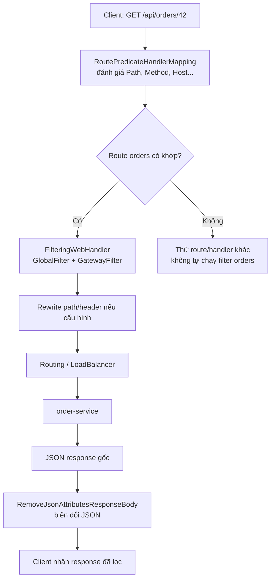

# RemoveJsonAttributesResponseBody và loại bỏ trường JSON

Một microservice có thể dùng cùng một đối tượng dữ liệu để phục vụ nhiều mục đích: xử lý nghiệp vụ nội bộ, hỗ trợ vận hành và trả kết quả cho ứng dụng khách. Nếu backend vô tình đưa các trường chỉ dành cho nội bộ vào JSON response, client có thể nhận những thông tin không thuộc hợp đồng API công khai như `internalNote`, `debugInfo` hoặc định danh kỹ thuật.

Trong **Spring Cloud Gateway Server WebFlux**, **`RemoveJsonAttributesResponseBody`** là một **GatewayFilter Factory** cho phép **xóa các trường được chỉ định khỏi nội dung JSON trong HTTP response**. Có thể chọn chỉ xóa trường ở **cấp gốc** của JSON, hoặc bật tùy chọn **đệ quy** để tìm các tên trường đó ở nhiều cấp lồng nhau. Đây là thao tác **biến đổi response body ở gateway**: backend vẫn sinh dữ liệu gốc, nhưng client nhận JSON đã được xử lý khi request đi qua route có filter.

Bài thuộc chương **Nội dung HTTP** của module **SPRING_CLOUD_GATEWAY**. Kiến thức này bổ trợ cho định tuyến bằng route predicate, filter chain, chỉnh path/header và service discovery; đồng thời có liên hệ đến xác thực, giới hạn lưu lượng, circuit breaker, retry, TLS và observability khi công bố API cho các ứng dụng web, mobile hoặc đối tác.

> **Phạm vi phiên bản:** Bài sử dụng **Spring Cloud Gateway Server WebFlux**. Tài liệu Spring Cloud Gateway 5.x thể hiện route dưới `spring.cloud.gateway.server.webflux.routes`; nhiều bản 4.x cũ sử dụng `spring.cloud.gateway.routes`. Cần kiểm tra đúng starter, phiên bản và biến thể Server WebFlux/Server MVC trước khi áp dụng. Cùng tên tính năng trong tài liệu không bảo đảm factory/cú pháp đã hiện diện ở mọi môi trường.

## 1. Bài toán: backend trả JSON chứa trường không muốn công bố

Giả sử client gọi:

```http
GET /api/orders/42 HTTP/1.1
Host: api.example.test
Accept: application/json
```

Backend trả một biểu diễn JSON dùng chung cho xử lý và chẩn đoán:

```json
{
  "orderId": "ORD-42",
  "status": "PAID",
  "total": 125000,
  "internalNote": "reconciled on node-7",
  "debugInfo": {
    "node": "orders-7",
    "traceHint": "internal"
  },
  "customer": {
    "customerId": "C-19",
    "name": "An",
    "internalNote": "legacy-migration"
  },
  "items": [
    {
      "sku": "BOOK-1",
      "quantity": 2,
      "debugInfo": "stock-candidate-A"
    }
  ]
}
```

API công khai chỉ cần các thông tin đơn hàng, khách hàng và danh sách sản phẩm. Những trường `internalNote` và `debugInfo` không nên hiển thị cho client. Có thể đặt filter ở route của API này để bỏ các tên trường đó khỏi body phản hồi.

Hai yêu cầu cần **phân biệt rõ**:

1. **Chỉ xóa ở cấp gốc**: bỏ `internalNote` và `debugInfo` trực tiếp bên dưới JSON object ngoài cùng; giữ nguyên những trường trùng tên nằm trong `customer` hoặc `items`.
2. **Xóa đệ quy**: loại bỏ những tên trường đó cả trong các đối tượng JSON lồng nhau theo khả năng xử lý của factory.

Chọn sai chế độ có thể khiến dữ liệu nội bộ còn tồn tại trong đối tượng con, hoặc xóa quá nhiều trường mà client hợp lệ đang cần.

## 2. RemoveJsonAttributesResponseBody hoạt động ở đâu?

Trong kiến trúc WebFlux của Spring Cloud Gateway, request được ánh xạ vào một route trước khi chạy các gateway filters của route đó:



Luồng logic:

1. **Route predicate** quyết định request nào được giao cho một route, ví dụ `Path=/api/orders/**`.
2. **Gateway filter chain** thực hiện các thao tác request ở chiều đi và response ở chiều về.
3. **Routing/load balancing** chuyển request tới dịch vụ hoặc instance theo URI của route.
4. **Backend** tạo JSON response.
5. **`RemoveJsonAttributesResponseBody`** xử lý body phản hồi và loại bỏ những thuộc tính được cấu hình trước khi body đến client.

Filter này **không sửa request body**, **không chọn route**, **không thay địa chỉ backend** và **không tự xác thực người dùng**. Nó tập trung vào các trường có tên phù hợp trong **JSON response** của route đang được xử lý.

Do các gateway filters là một chuỗi reactive có thứ tự, một response bị trả sớm bởi Spring Security `WebFilter` hoặc proxy bên ngoài **có thể không đi qua filter của route**. Nếu một filter trong chuỗi tự kết thúc response, cần kiểm tra thứ tự thực thi để biết body có được biến đổi hay không.

## 3. Cú pháp cấu hình: danh sách trường và tùy chọn recursive

Theo tài liệu chính thức, cú pháp rút gọn:

```text
RemoveJsonAttributesResponseBody=<field1>,<field2>,...,<recursive?>
```

Trong đó:

| Thành phần | Mục đích | Ví dụ |
| --- | --- | --- |
| Tên trường JSON | Các tên thuộc tính cần tìm và xóa khỏi JSON object. | `internalNote`, `debugInfo` |
| Danh sách tên | Nhiều tên trường phân tách bằng dấu phẩy. | `internalNote,debugInfo` |
| Tham số cuối `false` | Chỉ xóa ở cấp gốc; đây cũng là mặc định nếu không khai báo. | `internalNote,debugInfo,false` |
| Tham số cuối `true` | Bật tìm và xóa các tên trường ở những cấp lồng nhau. | `internalNote,debugInfo,true` |

Ví dụ của tài liệu Spring:

```yaml
filters:
  - RemoveJsonAttributesResponseBody=id,color
```

Chỉ xóa các thuộc tính `id` và `color` ở **cấp gốc**.

Phiên bản có tham số đệ quy:

```yaml
filters:
  - RemoveJsonAttributesResponseBody=id,color,true
```

Có ý định xóa `id` và `color` **ở mọi cấp** mà factory duyệt qua trong cấu trúc JSON.

**Lưu ý rất quan trọng:** Tham số cuối `true` hoặc `false` là **cờ chế độ**, không phải một trường JSON nữa. Không đặt tên trường trùng với ý nghĩa cờ hoặc chèn sai vị trí tham số mà không kiểm tra cách framework phân tích cú pháp.

### 3.1. Tên trường không phải JSONPath

Filter nhận **tên thuộc tính**, chứ không phải cú pháp chọn đường dẫn JSON tùy ý:

- `internalNote` là tên một trường.
- `debugInfo` là tên một trường khác.
- `customer.internalNote` **không nên được hiểu** là cách chính thức chỉ xóa riêng `internalNote` của `customer`.
- `items[*].debugInfo` cũng **không phải** cú pháp JSONPath được tài liệu factory này cung cấp.

Nếu chỉ muốn xóa một trường trong **một nhánh cụ thể** nhưng giữ trường trùng tên ở nhánh khác, hoặc cần biến đổi theo giá trị, nên dùng DTO tại backend hoặc một giải pháp biến đổi body tùy biến có kiểm thử như `ModifyResponseBody`.

### 3.2. Không nhầm tên thuộc tính với giá trị thuộc tính

Ví dụ:

```json
{
  "internalNote": "hidden",
  "status": "internalNote",
  "message": "debugInfo"
}
```

Với cấu hình `RemoveJsonAttributesResponseBody=internalNote,debugInfo`, mục tiêu là **xóa trường có khóa phù hợp**. Trường `status` hay `message` **không phải tự động bị xóa chỉ vì chuỗi giá trị trùng với tên trường cần bỏ**.

Đây là sự khác biệt giữa **lọc thuộc tính cấu trúc JSON** và thay thế văn bản bằng regex. Không dùng cách tìm/thay chuỗi thô trên JSON để mô phỏng filter, vì có thể vô tình làm hỏng dữ liệu hợp lệ hoặc chuỗi escaped.

## 4. Chế độ mặc định: chỉ xóa trường ở cấp gốc

Với response JSON trong mục 1, áp dụng:

```yaml
filters:
  - RemoveJsonAttributesResponseBody=internalNote,debugInfo
```

Kết quả minh họa:

```json
{
  "orderId": "ORD-42",
  "status": "PAID",
  "total": 125000,
  "customer": {
    "customerId": "C-19",
    "name": "An",
    "internalNote": "legacy-migration"
  },
  "items": [
    {
      "sku": "BOOK-1",
      "quantity": 2,
      "debugInfo": "stock-candidate-A"
    }
  ]
}
```

Hai trường trực tiếp ở cấp gốc đã biến mất:

- `internalNote` ở object ngoài cùng.
- `debugInfo` ở object ngoài cùng.

Nhưng hai trường cùng tên **bên trong** `customer` và phần tử của `items` vẫn còn. Vì vậy, mặc định chỉ thích hợp khi biết chắc dữ liệu cần bỏ **chỉ xuất hiện ở root** hoặc khi mục đích nghiệp vụ cố ý giữ giá trị của các object con.

Tài liệu Spring Cloud Gateway nêu rõ cờ mặc định là `false`; không nên suy luận rằng chỉ cần liệt kê tên trường thì framework sẽ tự duyệt mọi object lồng nhau.

### 4.1. Có nên luôn dùng root-only?

**Ưu điểm:**

- Phạm vi tác động hẹp, dễ dự đoán.
- Ít nguy cơ xóa nhầm thuộc tính có cùng tên nhưng mang ý nghĩa khác trong nested object.
- Phù hợp cho wrapper JSON đơn giản có metadata nội bộ ở root.

**Rủi ro:**

- Trường không mong muốn có thể nằm trong nested object, map hoặc phần tử của mảng.
- Nếu backend thay đổi cấu trúc JSON và đưa trường nhạy cảm xuống một cấp khác, chính sách root-only có thể bỏ sót.

Chỉ nên lựa chọn root-only sau khi kiểm tra các cấu trúc response thực tế và hợp đồng dữ liệu.

## 5. Chế độ recursive: xóa trường ở nhiều cấp

Để yêu cầu tìm những tên trường ở các cấp khác nhau, thêm `true` ở **cuối danh sách**:

```yaml
filters:
  - RemoveJsonAttributesResponseBody=internalNote,debugInfo,true
```

Với JSON ở mục 1, kết quả kỳ vọng:

```json
{
  "orderId": "ORD-42",
  "status": "PAID",
  "total": 125000,
  "customer": {
    "customerId": "C-19",
    "name": "An"
  },
  "items": [
    {
      "sku": "BOOK-1",
      "quantity": 2
    }
  ]
}
```

Cờ `true` được tài liệu mô tả là loại bỏ các thuộc tính ở **bất kỳ cấp nào** trong cấu trúc JSON. Khi triển khai, vẫn cần kiểm thử các trường hợp nested object và phần tử mảng theo **phiên bản framework cụ thể** để đảm bảo đúng hành vi mong đợi.

### 5.1. Rủi ro xóa quá rộng

Giả sử response của API đơn hàng có:

```json
{
  "orderId": "ORD-42",
  "customer": {
    "id": "C-19"
  },
  "items": [
    {
      "id": "LINE-11"
    }
  ]
}
```

Nếu dùng:

```yaml
filters:
  - RemoveJsonAttributesResponseBody=id,true
```

thì mọi trường mang tên `id` trong các object được duyệt có thể bị loại bỏ, bao gồm **mã khách hàng** hoặc **mã dòng hàng** mà client đang cần. Điều này có thể làm client không thể liên kết dữ liệu hoặc thực hiện lời gọi API tiếp theo.

**Bài học:** Recursive không phân biệt “trường nội bộ” với “trường hợp lệ” dựa trên vị trí hay kiểu dữ liệu. Nó chỉ làm theo **tên trường được cấu hình**. Trước khi bật đệ quy, cần rà soát toàn bộ JSON schema và những phiên bản response đang được hỗ trợ.

## 6. Ví dụ route hoàn chỉnh với Spring Cloud Gateway

Giả sử gateway công khai endpoint `GET /api/orders/42`, backend `order-service` phục vụ endpoint `GET /orders/42`. Muốn xóa hai trường nội bộ trước khi trả JSON:

### 6.1. Cấu hình Server WebFlux theo namespace mới

```yaml
spring:
  cloud:
    gateway:
      server:
        webflux:
          routes:
            - id: orders-public
              uri: lb://order-service
              predicates:
                - Path=/api/orders/**
                - Method=GET
              filters:
                - StripPrefix=1
                - RemoveJsonAttributesResponseBody=internalNote,debugInfo,true
```

Giải thích:

1. `Path` và `Method` là **route predicates**, xác định những request nào được chọn.
2. `StripPrefix=1` bỏ phần `api` trong request path để backend nhận `/orders/42`.
3. `lb://order-service` là **đích logic**, cần Spring Cloud LoadBalancer và nguồn danh sách instance phù hợp để chọn backend thực tế.
4. `RemoveJsonAttributesResponseBody=internalNote,debugInfo,true` xử lý **JSON response** của route, không phải request body đầu vào.
5. Client nhận body JSON đã bị loại bỏ những thuộc tính có tên tương ứng.

Khi dùng `Method=GET`, một request `POST /api/orders` **không khớp route này**. Không được kỳ vọng filter sẽ xóa trường khỏi response của một route khác hoặc từ một handler trả response trước khi Gateway chọn tuyến.

**Đây là ví dụ học tập, không phải một mẫu chống rò rỉ dữ liệu hoàn chỉnh**. Nếu cần che thông tin nhạy cảm theo từng quyền, backend vẫn phải kiểm soát dữ liệu được phép trả dựa trên identity đã xác thực.

### 6.2. Namespace thường gặp ở Spring Cloud Gateway 4.x

Trong những phiên bản 4.x dùng namespace cũ, cấu hình tương ứng có dạng:

```yaml
spring:
  cloud:
    gateway:
      routes:
        - id: orders-public
          uri: lb://order-service
          predicates:
            - Path=/api/orders/**
            - Method=GET
          filters:
            - StripPrefix=1
            - RemoveJsonAttributesResponseBody=internalNote,debugInfo,true
```

Chỉ sử dụng **một namespace** phù hợp với phiên bản/starter của ứng dụng. Nếu route không được nạp hoặc framework báo không nhận diện factory, hãy kiểm tra dependency Spring Cloud Gateway, biến thể Server WebFlux hay MVC và tài liệu đúng phiên bản; không tự giả định rằng thêm một tên filter trong YAML là đủ để kích hoạt tính năng.

### 6.3. Cấu hình root-only cho trường hợp đơn giản

Nếu thông tin nội bộ chỉ có ở object ngoài cùng:

```yaml
filters:
  - RemoveJsonAttributesResponseBody=internalNote,debugInfo
```

Đây thường là lựa chọn an toàn hơn về mặt **tính tương thích schema** nếu các thuộc tính lồng nhau cùng tên là dữ liệu hợp lệ. Ngược lại, nếu mục tiêu là loại bỏ trường nhạy cảm ở mọi nơi, cần tính toán kỹ rủi ro của chế độ recursive.

## 7. Phân biệt với các filter sửa nội dung HTTP khác

| Cơ chế | Chiều xử lý | Mục tiêu | Ví dụ |
| --- | --- | --- | --- |
| **`RemoveJsonAttributesResponseBody`** | Response body | Xóa tên thuộc tính JSON ở root hoặc đệ quy. | Bỏ `internalNote` và `debugInfo` khỏi JSON trả client. |
| **`ModifyResponseBody`** | Response body | Tùy biến cách decode, ánh xạ và encode body theo logic riêng. | Đổi cấu trúc JSON, chỉ xóa một trường trong một nhánh, chuyển DTO. |
| **`ModifyRequestBody`** | Request body | Biến đổi nội dung client gửi trước khi downstream nhận. | Chuẩn hóa JSON input. |
| **`RemoveResponseHeader`** | Response header | Xóa một HTTP header. | Bỏ `X-Internal-Node` trong response. |
| **`RewriteResponseHeader`** | Response header | Viết lại giá trị của một header theo biểu thức phù hợp. | Chuẩn hóa một response header. |
| **`DedupeResponseHeader`** | Response header | Loại bớt giá trị trùng lặp của response header. | Xử lý trùng CORS headers. |
| **DTO/serialization của backend** | Backend | Xác định trường nào được phép sinh ra trong response ngay từ nguồn. | Trả DTO công khai không chứa internal metadata. |

**Điểm quan trọng:** JSON field `internalNote` không phải HTTP header. Dùng `RemoveResponseHeader=internalNote` **không xóa** thuộc tính `internalNote` trong body JSON. Ngược lại, `RemoveJsonAttributesResponseBody` **không** tự xóa header `Set-Cookie`, `Server`, `Location` hay thông tin trong query string.

### 7.1. Khi nào nên dùng filter có sẵn?

Phù hợp khi:

- Một vài thuộc tính JSON cần loại bỏ nhất quán khỏi response của route.
- Hợp đồng API đơn giản, dạng JSON bình thường và cần **lọc theo tên**.
- Chấp nhận phạm vi root-only hoặc recursive theo toàn bộ cấu trúc.
- Có thể kiểm thử được mọi phiên bản response đi qua route.

Nên dùng DTO tại backend hoặc `ModifyResponseBody`/custom response transformation khi:

- Cần chọn trường theo **đường dẫn JSON**, kiểu dữ liệu, giá trị hoặc phân quyền.
- API có các biểu diễn nội dung khác nhau, yêu cầu streaming hoặc payload lớn.
- Cần ánh xạ cấu trúc phức tạp, đổi tên trường, kết hợp nhiều trường.
- Thay đổi response phụ thuộc vào danh tính và scope của người dùng.

**Không đưa logic phân quyền cốt lõi sang filter chỉ vì cấu hình nhanh**. Chọn trường JSON theo tên là biến đổi dữ liệu, không phải cơ chế cho phép hoặc từ chối truy cập tài nguyên.

## 8. Response body trong WebFlux là một dòng dữ liệu

Trong Spring WebFlux, response body thường được biểu diễn bằng publisher của `DataBuffer`, không phải một `String` Java được sửa trực tiếp tại mọi thời điểm. Để xóa thuộc tính JSON, gateway cần xử lý biểu diễn dữ liệu ở tầng body rồi phát lại response đã biến đổi.

Vì vậy, thao tác sửa body có những chi phí và giới hạn khác với sửa header:

- **Bộ nhớ:** đối với response lớn hoặc nhiều request đồng thời, việc giải mã/biến đổi JSON có thể tăng lượng bộ nhớ tiêu thụ. Không xem mọi cơ chế biến đổi body là streaming từng trường với chi phí bằng không.
- **CPU:** parse JSON, duyệt cấu trúc và serialize lại có thể tốn thời gian.
- **Backpressure và lifecycle:** publisher cần được xử lý đúng chuỗi reactive; không tự `subscribe()` hoặc `block()` trong event loop để can thiệp response.
- **Giới hạn buffer:** một số cách xử lý body có thể cần tập hợp dữ liệu, chịu giới hạn codec/buffer và phát sinh lỗi khi payload lớn.
- **Content metadata:** khi body thay đổi, độ dài, encoding, caching headers hoặc chữ ký trên body có thể cần được điều chỉnh/kiểm tra.

Đây là các lý do để **đo hiệu năng và kiểm thử loại response**, thay vì mặc định thêm filter vào tất cả routes.

### 8.1. Content-Type và định dạng body

Filter được thiết kế cho **nội dung JSON**. Một hệ thống thực tế có thể trả:

- `application/json` với object JSON thông thường.
- `application/problem+json` hoặc một media type JSON tương thích.
- `text/plain`, XML, HTML hoặc dữ liệu nhị phân.
- Response không có body như `204 No Content`.
- JSON array ở root, JSON scalar hoặc JSON có cấu trúc không như dự kiến.
- Dữ liệu nén, truyền theo chunk hoặc streaming như `text/event-stream`.

**Không khẳng định rằng tất cả định dạng trên đều được filter xử lý giống nhau.** Hành vi decode/bỏ qua/lỗi phụ thuộc framework, content type và phiên bản cụ thể; cần kiểm thử trực tiếp. Với endpoint trả HTML, tệp tin, SSE hoặc payload nhị phân, thường không nên gắn filter JSON một cách rộng khắp.

Nếu cần hỗ trợ JSON arrays, phải kiểm tra dữ liệu khi root là mảng, phần tử là object lồng nhau, mảng rỗng và trường mục tiêu nằm trong object bên trong. Tài liệu mô tả xóa đệ quy ở các cấp, nhưng test trên bản chạy thật vẫn là tiêu chuẩn xác nhận hợp đồng API.

### 8.2. Content-Length, Content-Encoding, ETag và chữ ký response

Ví dụ response gốc là:

```http
HTTP/1.1 200 OK
Content-Type: application/json
Content-Length: 410
ETag: "original-payload"
```

Sau khi xóa trường, JSON sẽ thường **ngắn hơn** và có thể được serialize lại. Hệ quả cần xem xét:

1. **`Content-Length`** phải tương thích với byte response cuối cùng hoặc được bỏ để HTTP stack truyền theo cơ chế phù hợp. Không giữ một độ dài cũ rồi mong client đọc đúng payload.
2. **`Content-Encoding`** như `gzip`: cần xác định body đang được giải nén/nén ở tầng nào; không giả định filter xử lý mọi dạng nén.
3. **`ETag`** và các giá trị checksum/signature trên body: nếu được tạo từ dữ liệu gốc, chúng có thể không còn tương ứng với body đã sửa.
4. **Cache headers và conditional requests:** response `304 Not Modified`, bộ nhớ đệm ở gateway/CDN hoặc cache client phải nhất quán với phiên bản body được phát ra.
5. **Chữ ký ứng dụng:** nếu client xác minh chữ ký tính trên JSON byte-for-byte, việc thay đổi body có thể làm chữ ký sai.

Framework có thể tự xử lý một số header khi biến đổi body tùy bộ lọc/phiên bản, nhưng **không nên suy luận rằng mọi metadata nghiệp vụ đều được sửa tự động**. Phải kiểm tra response trên đường truyền và chính sách cache/chữ ký thực tế.

### 8.3. Vị trí đặt filter và nhiều filter sửa body

Nếu route đồng thời có `ModifyResponseBody`, `RemoveJsonAttributesResponseBody` và một filter nén response, kết quả chịu ảnh hưởng của **thứ tự và cách response được viết**. Các response filters hoạt động trong một filter chain reactive; một filter khác có thể đã biến đổi nội dung hoặc commit response.

Khuyến nghị:

- Bắt đầu với **một nơi chịu trách nhiệm** chính cho biến đổi JSON nếu có thể.
- Tránh cấu hình nhiều filters sửa cùng một response body mà không hiểu thứ tự.
- Kiểm thử response cuối cùng thay vì chỉ test từng filter riêng lẻ.
- Không để việc sửa body làm ngắt truyền response hoặc làm mất tài nguyên do `DataBuffer` không được giải phóng đúng.

## 9. Bảo mật: loại bỏ trường JSON không thay thế phân quyền

Giả sử backend trả:

```json
{
  "orderId": "ORD-42",
  "customerId": "C-19",
  "internalNote": "do not disclose",
  "shippingAddress": "Private address"
}
```

Nếu gateway bỏ `internalNote` nhưng vẫn trả `shippingAddress` cho một người không có quyền xem đơn hàng, hệ thống **vẫn rò rỉ dữ liệu**. Việc bỏ vài tên trường không có tác dụng kiểm soát truy cập theo tài nguyên.

**Các lớp bảo vệ đúng trách nhiệm:**

| Nhu cầu | Lớp phù hợp | Vai trò của filter |
| --- | --- | --- |
| Xác thực JWT/phiên | Spring Security tại gateway/backend theo kiến trúc | Không xác minh danh tính. |
| Phân quyền xem đơn hàng của người khác | Backend hoặc lớp có đủ ngữ cảnh quyền đáng tin cậy | Không quyết định ai được đọc tài nguyên. |
| Quy định cấu trúc response public | DTO/serialization hoặc API layer tại backend | Có thể hỗ trợ lọc các trường có tên cố định. |
| Giới hạn số request | `RequestRateLimiter` hoặc chính sách tương ứng | Không giới hạn RPS. |
| Giảm lộ metadata nội bộ | Backend và filter xóa field/header | Có thể loại bỏ một phần metadata trong response JSON. |
| Giám sát lỗi/độ trễ | Metrics, tracing, logs không chứa dữ liệu nhạy cảm | Không tự cung cấp đầy đủ observability. |

### 9.1. Vì sao whitelist DTO an toàn hơn blacklist field?

`RemoveJsonAttributesResponseBody` hoạt động theo kiểu **blacklist tên trường**: nêu những trường cần bỏ. Khi backend thêm một trường nhạy cảm mới tên `secretKey`, filter chỉ đang loại bỏ `internalNote` và `debugInfo` sẽ **không tự biết** phải bỏ `secretKey`.

Với API chứa dữ liệu cá nhân, thông tin tài chính hoặc quyền truy cập, phương án vững chắc hơn thường là:

1. Backend tạo **public DTO** với danh sách trường được **cho phép** xuất ra.
2. Backend kiểm tra **quyền truy cập** theo người dùng và tài nguyên.
3. Gateway áp dụng các chính sách biên như xác thực, rate limit và lọc metadata phụ trợ khi thật sự cần.
4. Integration tests kiểm tra **không có trường nhạy cảm** trong mọi response của tất cả routes cần bảo vệ.

Filter xóa theo tên là lớp hỗ trợ tiện lợi, **không phải tuyến phòng thủ duy nhất**. Một route khác, endpoint nội bộ bị lộ hoặc request bị chuyển nhầm route có thể bỏ qua filter đó.

### 9.2. Recursive có thể làm hỏng dữ liệu hợp lệ

Một tên trường như `id`, `code` hoặc `token` có thể mang ý nghĩa khác nhau ở các nhánh. Ví dụ trường `token` ở response đăng nhập có thể là access token cần trả cho client, trong khi `token` trong một object nội bộ không được lộ. Xóa đệ quy theo **cùng một tên** sẽ không hiểu sự khác biệt.

Với tình huống cần loại bỏ chọn lọc, tốt hơn là đổi cấu trúc response tại nguồn hoặc dùng một phép biến đổi có điều kiện đã được kiểm thử, thay vì xóa mọi thuộc tính trùng tên.

### 9.3. Không ghi dữ liệu gốc vào log

Khi điều tra filter, tránh ghi toàn bộ JSON trước/sau, nhất là response có token, dữ liệu cá nhân hoặc thông tin thanh toán. Nên ghi:

- Route ID, correlation/trace ID.
- HTTP status và độ trễ.
- Kích thước response trước/sau theo cách đo phù hợp, không chứa nội dung.
- Số lần lỗi decode/body transformation.

Không tự thêm một log “full body” chỉ để chứng minh đã xóa được một trường nhạy cảm; chính log có thể trở thành nơi rò rỉ dữ liệu.

## 10. Thực hành kiểm thử với backend giả

Để chứng minh filter hoạt động, cần có một backend trả JSON **có những trường định xóa**. Chỉ gọi một API không có các trường đó rồi thấy status `200` là chưa đủ.

### 10.1. Chuẩn bị một response xác định

Giả sử backend giả lắng nghe tại `http://localhost:9090` và trả body:

```json
{
  "orderId": "ORD-42",
  "internalNote": "root",
  "customer": {
    "name": "An",
    "internalNote": "nested"
  }
}
```

Cấu hình route kiểm thử:

```yaml
spring:
  cloud:
    gateway:
      server:
        webflux:
          routes:
            - id: orders-test
              uri: http://localhost:9090
              predicates:
                - Path=/api/orders/**
              filters:
                - StripPrefix=1
                - RemoveJsonAttributesResponseBody=internalNote,true
```

Backend giả cần phục vụ path `/orders/42` vì `StripPrefix=1` đã bỏ `api`. Gateway giả định lắng nghe tại `http://localhost:8080`.

### 10.2. Gọi qua gateway

```bash
curl -i http://localhost:8080/api/orders/42 \
  -H 'Accept: application/json'
```

Khi route và filter hoạt động đúng, body nhận được về mặt cấu trúc sẽ là:

```json
{
  "orderId": "ORD-42",
  "customer": {
    "name": "An"
  }
}
```

**Không phụ thuộc whitespace hoặc thứ tự object keys** trong phép kiểm tra JSON; quá trình parse/serialize có thể thay đổi cách trình bày mà không thay đổi dữ liệu. Hãy kiểm tra **sự hiện diện/vắng mặt của JSON properties**, không so chuỗi JSON nguyên văn nếu không có yêu cầu byte-for-byte.

### 10.3. Chuyển sang chế độ mặc định để so sánh

Đổi filter:

```yaml
filters:
  - RemoveJsonAttributesResponseBody=internalNote
```

Kết quả mong đợi trong trường hợp root-only:

```json
{
  "orderId": "ORD-42",
  "customer": {
    "name": "An",
    "internalNote": "nested"
  }
}
```

Đây là phép thử quan trọng để phát hiện hiểu nhầm về cờ `recursive`.

### 10.4. Kiểm thử bằng WebTestClient

Trong integration test đã khởi động Gateway và một backend stub trả JSON như trên, có thể kiểm tra các JSON paths:

```java
webTestClient.get()
    .uri("/api/orders/42")
    .exchange()
    .expectStatus().isOk()
    .expectHeader().contentTypeCompatibleWith(
        MediaType.APPLICATION_JSON
    )
    .expectBody()
    .jsonPath("$.orderId").isEqualTo("ORD-42")
    .jsonPath("$.internalNote").doesNotExist()
    .jsonPath("$.customer.internalNote").doesNotExist()
    .jsonPath("$.customer.name").isEqualTo("An");
```

*Điều kiện:* test phải chạy với **cấu hình `recursive=true`**, response của backend giả có nested field cần xóa và integration context thực sự nạp Gateway filters. `WebTestClient` cần được khởi tạo cùng môi trường test phù hợp; đoạn trên là phần assert, không phải test class hoàn chỉnh.

Khi test chế độ mặc định, thay assertion cuối với thuộc tính nested:

```java
// Áp dụng khi cấu hình root-only (không có true cuối danh sách).
.jsonPath("$.customer.internalNote").isEqualTo("nested");
```

Kiểm tra thêm **backend đã được gọi đúng một lần** và nhận đúng request path. Nếu giả lập response trực tiếp tại controller của gateway mà không đi qua route/filter chain, test không chứng minh factory đang hoạt động.

### 10.5. Ma trận kiểm thử

| Tình huống | Điều cần xác minh |
| --- | --- |
| JSON object với trường mục tiêu ở root | Mặc định xóa root field và giữ trường khác. |
| JSON object có nested field cùng tên | Root-only giữ nested; recursive loại bỏ nested theo hành vi factory. |
| JSON có mảng các object | Kiểm thử traversal recursive trên phần tử mảng của phiên bản đang dùng. |
| JSON không chứa tên trường mục tiêu | Response vẫn là JSON hợp lệ, dữ liệu không bị xóa ngoài ý muốn. |
| Tên trường gần giống nhau, ví dụ `internalNote` và `internalNotes` | Chỉ trường được chỉ định bị xóa; kiểm tra matching thực tế. |
| Root là mảng, JSON scalar hoặc body rỗng | Kiểm tra behavior thực tế; không suy luận từ ví dụ root object. |
| Backend trả `text/plain` hoặc XML | Không kỳ vọng filter JSON hoạt động như với `application/json`. |
| Response nén hoặc streaming | Kiểm tra tương thích; không áp dụng rộng nếu thiếu thử nghiệm. |
| Response có `Content-Length`, `ETag`, `Content-Encoding` | Metadata cuối cùng phải phù hợp body đã biến đổi. |
| Route không có filter hoặc bị route tổng quát bắt trước | Không được mặc định request đã đi qua filter của route mong muốn. |
| Response lỗi 4xx/5xx chứa JSON | Kiểm tra filter có chạy hay response được tạo ở tầng trước/bên ngoài gateway. |

## 11. Chẩn đoán các sự cố thường gặp

### Lỗi 1 — Filter không xóa trường trong nested object

**Triệu chứng:** `internalNote` ở cấp gốc bị xóa, nhưng `customer.internalNote` vẫn còn.

**Nguyên nhân có thể:** cấu hình chỉ có `RemoveJsonAttributesResponseBody=internalNote`, nên chế độ mặc định là **root-only**. Nếu mục tiêu là xóa ở các cấp, cấu hình `RemoveJsonAttributesResponseBody=internalNote,true` và kiểm thử.

### Lỗi 2 — Dùng recursive và mất trường dữ liệu cần thiết

**Triệu chứng:** client thiếu `id` trong các phần tử của một mảng sau khi bật recursive.

**Nguyên nhân có thể:** `id` là tên trường chung ở nhiều cấp; filter không phân biệt semantic của từng object. Tránh xóa `id` toàn cục nếu client cần một số `id`. Dùng DTO/backend hoặc body transformation theo cấu trúc.

### Lỗi 3 — Request đúng path nhưng filter không chạy

**Triệu chứng:** response vẫn chứa `debugInfo` dù route đã khai báo filter.

**Kiểm tra:** `Path`, `Method`, `Host`, giá trị `order`, route ID thực sự được chọn và danh sách filters runtime. Route tổng quát có thể bắt request trước route chuyên biệt, khiến filters của route còn lại không chạy.

### Lỗi 4 — Sai namespace hoặc factory không tồn tại

**Triệu chứng:** ứng dụng báo không tìm thấy `RemoveJsonAttributesResponseBody` hoặc route không được nạp.

**Kiểm tra:** version Spring Cloud Gateway, Server WebFlux/Server MVC, starter, config namespace và tài liệu factory đúng phiên bản. Không sử dụng tài liệu của một biến thể rồi tự coi cú pháp đó được hỗ trợ ở biến thể khác.

### Lỗi 5 — JSON response lỗi hoặc Content-Length sai

**Triệu chứng:** client bị lỗi decode, response bị ngắt, checksum/ETag không khớp hoặc một proxy báo lỗi body framing.

**Kiểm tra:** Content-Type, Content-Encoding, body rỗng/streaming, các filters khác sửa body, metadata response và thời điểm commit. Kiểm thử trên byte response thực tế. Không tự sửa header thủ công khi chưa xác định framework đã xử lý phần nào.

### Lỗi 6 — Backend trả dữ liệu nhạy cảm bằng endpoint khác

**Triệu chứng:** API GET đơn hàng được lọc, nhưng API export hoặc endpoint admin vẫn trả đầy đủ dữ liệu.

**Giải pháp:** rà soát mọi route và hợp đồng API, bảo vệ endpoint tại backend, dùng DTO được phép công bố và kiểm tra phân quyền. Đừng coi filter ở một route là hàng rào dữ liệu cho toàn bộ hệ thống.

### Lỗi 7 — Response quá lớn gây áp lực bộ nhớ

**Triệu chứng:** độ trễ tăng, lỗi giới hạn buffer hoặc memory pressure khi xuất báo cáo lớn qua gateway.

**Giải pháp:** tránh áp dụng body transformation cho file/download/streaming quá lớn, cân nhắc lọc trước tại backend, giới hạn payload, đo độ trễ và bộ nhớ. Với dữ liệu lớn, một API trả DTO chuẩn từ nguồn thường hiệu quả hơn xử lý lại toàn bộ JSON ở edge.

### Lỗi 8 — Client phụ thuộc vào trường bị xóa

**Triệu chứng:** sau triển khai, client cũ báo thiếu trường mặc dù HTTP status vẫn `200`.

**Nguyên nhân:** xóa thuộc tính JSON là **thay đổi schema response**, có thể là breaking change. Cần thống nhất API contract, phiên bản client, tài liệu API và kiểm thử hồi quy trước khi bật filter.

## 12. Vận hành: quan sát, hiệu năng và rollback

Khi đưa filter vào production, nên định nghĩa rõ:

| Hạng mục | Chỉ số/biện pháp cần theo dõi |
| --- | --- |
| **Route matching** | Route ID, predicate, phiên bản cấu hình đã nạp. |
| **Hiệu năng** | RPS, p95/p99 latency, CPU và bộ nhớ khi biến đổi JSON. |
| **Lỗi body transformation** | Số request lỗi decode/encode/buffer, status và route tương ứng. |
| **Tính đúng dữ liệu** | Contract tests cho trường phải có và trường phải vắng mặt. |
| **Bảo mật** | Kiểm tra không rò rỉ trường nhạy cảm trong response qua những routes khác. |
| **Cache và metadata** | Content-Length, ETag, encoding, cache coherence sau biến đổi. |
| **Khả năng phục hồi** | Rollback/disable filter qua cấu hình, đồng bộ nhiều gateway replicas. |

Các yếu tố từ phần còn lại của module vẫn quan trọng:

- **Authentication/authorization:** gateway có thể xác thực request bằng Spring Security, nhưng backend vẫn cần phân quyền theo tài nguyên; lọc JSON không thay thế điều này.
- **Rate limiting:** tránh để request khối lượng lớn hoặc client lạm dụng khiến body transformation tiêu tốn quá nhiều tài nguyên.
- **Retry/circuit breaker:** request downstream có thể được thử lại hoặc trả lỗi/fallback; phải kiểm thử xem response cuối cùng trong các nhánh này có đi qua filter tương ứng hay không.
- **TLS:** bảo vệ dữ liệu trên từng chặng client–gateway và gateway–backend; lọc body không mã hóa đường truyền.
- **Observability:** theo dõi route ID, latency, error rate mà không log body chứa dữ liệu nhạy cảm.

Nếu gateway có nhiều replica, cần đồng bộ cấu hình route/filter giữa các replica. Nếu một replica đã bật recursive còn replica khác vẫn root-only, client có thể nhận hai schema khác nhau ngẫu nhiên tùy instance gateway.

### 12.1. Quy trình rollout đề xuất

1. **Xác định schema công khai:** những trường nào client được nhận, và những trường nào không được nhận ở mọi cấp.
2. **Kiểm thử với bộ JSON đại diện:** root, nested object, array, null, response lỗi, body lớn và media types khác nhau.
3. **Đo baseline:** latency, kích thước response và mức dùng tài nguyên khi chưa bật filter.
4. **Bật theo route/phạm vi giới hạn:** không áp dụng đại trà nếu chưa kiểm thử API khác.
5. **Đối chiếu contract thực tế:** response đã biến đổi có thể được client parse và các URL/ID cần thiết vẫn có.
6. **Giám sát và rollback:** khi phát hiện mất field hợp lệ hoặc lỗi serialization, trở về cấu hình đã kiểm thử rồi điều tra trước khi triển khai lại.

## 13. Tự kiểm tra kiến thức

### Tình huống A — Chỉ muốn bỏ trường ở root

Backend trả:

```json
{
  "debugInfo": "root-only",
  "item": {
    "debugInfo": "nested-still-needed"
  }
}
```

**Hỏi:** Nên dùng cấu hình nào?

**Đáp án:** `RemoveJsonAttributesResponseBody=debugInfo` (hoặc khai báo mặc định `false` nếu phiên bản cho phép). Trường `debugInfo` ở root bị xóa, còn trường trong `item` được giữ theo chế độ root-only.

### Tình huống B — Muốn xóa tên trường ở mọi cấp

Backend trả `internalNote` ở root, `customer` và `items`. **Nên dùng gì?**

**Đáp án:** `RemoveJsonAttributesResponseBody=internalNote,true`. Kiểm thử object lồng nhau và phần tử mảng theo phiên bản framework đang chạy.

### Tình huống C — Chỉ muốn xóa riêng customer.id

Response có `order.id` và `customer.id`; client cần `order.id` nhưng không cần `customer.id`.

**Hỏi:** `RemoveJsonAttributesResponseBody=id,true` có phù hợp không?

**Đáp án:** Không. Recursive theo tên `id` có thể xóa cả hai. Cần DTO/serialization ở backend hoặc body transformation hiểu cấu trúc JSON và vị trí thuộc tính.

### Tình huống D — Trả XML thay vì JSON

API trả `application/xml` nhưng route gắn filter loại JSON. **Có thể mặc định nó vẫn xóa thuộc tính không?**

**Đáp án:** Không. Filter được tài liệu mô tả cho JSON. Phải kiểm tra hành vi trên đúng media type, hoặc dùng giải pháp phù hợp cho XML.

### Tình huống E — Client trả lỗi vì thiếu trường

Sau khi bật recursive, client không đọc được trường `id`. **Nên điều tra điều gì trước?**

**Đáp án:** Xác định trường `id` nằm ở đâu, filter có xóa quá rộng theo tên hay không, API contract có yêu cầu trường đó và client nào đang phụ thuộc. Điều chỉnh danh sách trường/chế độ hoặc chuyển logic lọc về backend.

### Tình huống F — Cấu hình đúng nhưng response vẫn có field nhạy cảm

**Hỏi:** Có thể kết luận filter lỗi không?

**Đáp án:** Chưa. Cần xác nhận route thực sự được chọn, filter có nằm trong filter chain hay không, response có phải JSON thuộc phạm vi xử lý, và request có bị một handler/route khác phục vụ hay không.

## 14. Ghi nhớ

1. **`RemoveJsonAttributesResponseBody` xử lý JSON response body** bằng cách xóa các tên thuộc tính được khai báo, không phải sửa request header hay route predicate.
2. **Mặc định root-only:** `RemoveJsonAttributesResponseBody=internalNote,debugInfo` chỉ xóa các trường ở cấp gốc.
3. **Đệ quy:** thêm `true` ở cuối, ví dụ `RemoveJsonAttributesResponseBody=internalNote,debugInfo,true`, để tìm trường cùng tên ở các cấp lồng nhau.
4. **Không phải JSONPath và không hiểu phân quyền:** xóa theo tên có thể bỏ sót trường nhạy cảm mới hoặc làm mất trường hợp lệ trùng tên.
5. **Response body là dữ liệu reactive:** kiểm tra Content-Type, kích thước, encoding, Content-Length, ETag, cache và khả năng xử lý JSON của framework.
6. **Bảo mật từ nguồn:** dùng DTO/allowlist và kiểm tra quyền ở backend cho dữ liệu nhạy cảm; filter gateway là lớp bổ sung.
7. **Kiểm thử end-to-end:** so sánh các JSON properties thực tế, xác nhận route/backend, thử root-only/recursive và giám sát lỗi biến đổi body trước khi mở rộng triển khai.

**Kết luận thực hành:** Dùng `RemoveJsonAttributesResponseBody` khi cần **loại bỏ nhanh, nhất quán một danh sách tên trường JSON** trên response của route trong Spring Cloud Gateway. Hãy chọn đúng chế độ root-only hoặc recursive, hiểu rõ tác động đến API contract và kiểm thử JSON thực tế. Một gateway an toàn không chỉ ẩn được vài thuộc tính trong body mà còn phải xác thực và phân quyền đúng, quản lý lưu lượng, bảo vệ TLS và quan sát đường đi request mà không làm lộ dữ liệu.

### Tài liệu tham khảo

- [Spring Cloud Gateway Server WebFlux — RemoveJsonAttributesResponseBody GatewayFilter Factory](https://docs.spring.io/spring-cloud-gateway/reference/spring-cloud-gateway-server-webflux/gatewayfilter-factories/removejsonattributesresponsebody-factory.html): danh sách tên thuộc tính, mặc định root-only và tùy chọn recursive.
- [Spring Cloud Gateway 4.2 — RemoveJsonAttributesResponseBody GatewayFilter Factory](https://docs.spring.io/spring-cloud-gateway/reference/4.2/spring-cloud-gateway/gatewayfilter-factories/removejsonattributesresponsebody-factory.html): ví dụ namespace `spring.cloud.gateway.routes`.
- [Spring Blog — Interesting new filters on Spring Cloud Gateway 4.0](https://spring.io/blog/2023/01/18/interesting-new-filters-on-spring-cloud-gateway-4-0/): bối cảnh giới thiệu bộ lọc xóa thuộc tính JSON.
