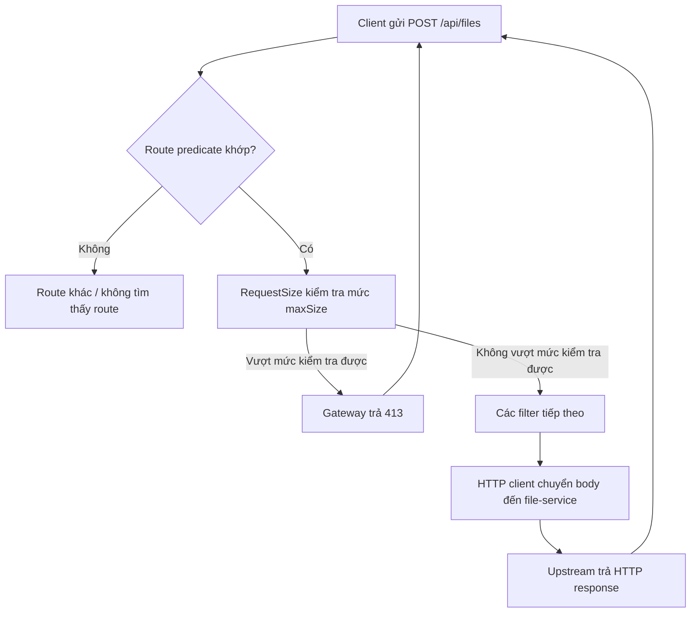
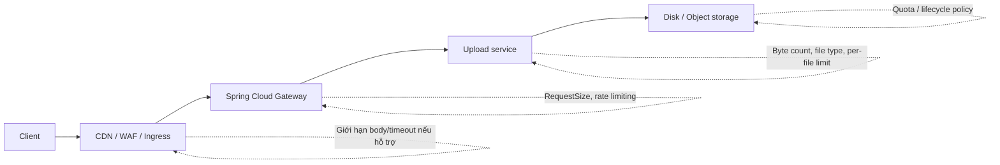

# RequestSize và giới hạn kích thước tải lên

## 1. Vì sao API Gateway cần giới hạn kích thước request?

Trong hệ thống microservices, **Spring Cloud Gateway** là điểm vào chung nhận request từ web, mobile hoặc đối tác, khớp **route predicate**, chạy **filter chain** rồi chuyển đến upstream phù hợp. Một phần request có body nhỏ, chẳng hạn JSON tạo đơn hàng; phần khác mang tệp ảnh, PDF hoặc dữ liệu import có kích thước hàng chục MB.

Nếu không có hạn mức kích thước, một client có thể gửi body quá lớn khiến Gateway hoặc microservice đích tiêu tốn băng thông, bộ nhớ, kết nối, CPU xử lý multipart và dung lượng lưu trữ. Khi nhiều request xảy ra đồng thời, tài nguyên có thể bị chiếm nhanh ngay cả khi số request mỗi giây không cao.

**`RequestSize`** là một **GatewayFilter factory** của **Spring Cloud Gateway Server WebFlux** cho phép khai báo mức `maxSize` trên route. Với request có kích thước vượt ngưỡng theo cơ chế kiểm tra của phiên bản Gateway, filter sẽ từ chối thay vì chuyển đến service đích, thường bằng HTTP **413 Payload Too Large** (tên chuẩn mới cũng gọi là *Content Too Large*).

Bài thuộc chương **Nội dung HTTP** trong module **SPRING_CLOUD_GATEWAY** và tập trung vào:

1. Hiểu `RequestSize`, `maxSize`, `DataSize` và HTTP status 413.
2. Cấu hình giới hạn theo từng route, đặc biệt endpoint upload.
3. Phân biệt kích thước **request body**, **file tải lên**, **multipart overhead** và các giới hạn khác của hệ thống.
4. Nhận diện giới hạn của việc kiểm tra `Content-Length` đối với HTTP streaming/chunked.
5. Kiểm thử bằng curl, giám sát và xây dựng bảo vệ nhiều tầng cho Gateway an toàn.

> **Phạm vi phiên bản:** ví dụ chính sử dụng cách tổ chức **Spring Cloud Gateway Server WebFlux 5.x** với prefix `spring.cloud.gateway.server.webflux`; phần sau cũng minh họa prefix `spring.cloud.gateway` thường gặp ở WebFlux 4.x. Hai kiểu cấu hình không nên trộn trong cùng ứng dụng. Spring Cloud Gateway **Server MVC** là biến thể khác, có cách cấu hình riêng.

## 2. Phân biệt kích thước request với kích thước file

Một HTTP request có thể bao gồm method, URL, headers và body. Khi giới hạn upload, cần hỏi **giới hạn áp dụng ở tầng nào và đo phần dữ liệu nào**.

| Khái niệm | Ý nghĩa | Ví dụ |
| --- | --- | --- |
| Kích thước file | Số byte nội dung tệp thật sự | 9 MiB của `photo.jpg` |
| Kích thước HTTP body | Số byte body đi qua kết nối, có thể gồm metadata multipart | Body khoảng 9 MiB cộng boundary/header của từng part |
| `Content-Length` | Header nêu số octet của HTTP message content khi biết trước | `Content-Length: 1048576` |
| Kích thước request header | Dung lượng các trường header; thuộc một hạn mức riêng | Header/cookie quá lớn |
| Giới hạn đọc/buffer trong memory | Dung lượng mà codec hoặc filter được phép gom trong RAM | `spring.codec.max-in-memory-size` |
| Giới hạn lưu trữ | Dung lượng tệp được service ghi lên disk/object storage | Quota bucket, ổ đĩa, dung lượng tenant |

**Một file 10 MiB không đồng nghĩa một multipart HTTP request đúng 10 MiB.** Với `multipart/form-data`, body còn chứa boundary và metadata từng phần; vì vậy nếu hạn mức request là đúng 10 MiB, upload file có kích thước sát 10 MiB có thể bị từ chối.

Tương tự, một request có thể **không có** `Content-Length` biết trước, ví dụ HTTP/1.1 `Transfer-Encoding: chunked` hoặc một số luồng HTTP/2. Khi đó, một bộ lọc chỉ dựa vào con số trong header không thể biết chắc tổng số byte trước khi đọc hết body. Đây là giới hạn quan trọng phải kiểm chứng theo phiên bản.

### Ví dụ nội dung request upload

```http
POST /api/files HTTP/1.1
Host: api.example.test
Content-Type: multipart/form-data; boundary=----exampleBoundary
Content-Length: 7340032

[body gồm boundary, thông tin part và bytes của file]
```

Header `Content-Length` ở ví dụ thể hiện **body**, không phải số byte chỉ của file bên trong. Dữ liệu trong ngoặc vuông là ký hiệu minh họa, không phải cú pháp multipart hợp lệ để gửi trực tiếp.

## 3. RequestSize hoạt động trong filter chain ra sao?

Một route trong Spring Cloud Gateway gồm:

- **Predicate:** chọn request, chẳng hạn `Path=/api/files/**`, `Method=POST`.
- **Filter:** thực thi chính sách, ví dụ `RequestSize`, `StripPrefix`, rate limiter hoặc biến đổi header/path.
- **URI:** địa chỉ upstream, ví dụ `http://localhost:8081` hay `lb://FILE-SERVICE` khi có discovery/load balancing.

Khi route khớp và `RequestSize` được áp dụng, Gateway so sánh kích thước request theo cơ chế mà phiên bản đó triển khai với `maxSize`. Nếu vượt ngưỡng, Gateway có thể **kết thúc response ngay tại điểm vào**, không chuyển request đi tiếp qua các filter/upstream phía sau. Nếu trong hạn mức, filter tiếp tục gọi `GatewayFilterChain`.



**Chú ý ngôn ngữ:** “Không vượt mức kiểm tra được” không đồng nghĩa chứng minh *tổng byte thực tế* luôn nhỏ hơn `maxSize`. Tính bảo đảm phụ thuộc cách `RequestSize` đo kích thước, nhất là khi body được stream mà không cung cấp `Content-Length`.

### HTTP 413 và thông tin phản hồi

Khi filter từ chối request vượt ngưỡng, tài liệu Spring Cloud Gateway mô tả:

```http
HTTP/1.1 413 Payload Too Large
errorMessage: Request size is larger than permissible limit.
```

Header `errorMessage` có thể chứa thông tin chi tiết về kích thước thực tế và giới hạn. **Tên, nội dung, định dạng và sự xuất hiện của header** nên được kiểm tra ở phiên bản chạy thật; đừng viết client phụ thuộc tuyệt đối vào chuỗi thông báo tiếng Anh. HTTP status 413 là tín hiệu chính cho ứng dụng gọi API.

`RequestSize` **không tự trả JSON lỗi theo một chuẩn API riêng** như `application/problem+json`. Nếu sản phẩm cần body lỗi nhất quán, phải thiết kế cơ chế xử lý lỗi phù hợp với luồng Gateway, đảm bảo không vô tình đọc/buffer body quá lớn trước khi từ chối.

## 4. Cấu hình RequestSize trong Spring Cloud Gateway Server WebFlux

### 4.1. Ví dụ theo namespace WebFlux 5.x

Giả sử Gateway nhận `POST /api/files/raw`, còn service lưu tệp xử lý `POST /files/raw` tại `http://localhost:8081`. Ta chọn hạn mức **10 MiB** ở route upload:

```yaml
spring:
  cloud:
    gateway:
      server:
        webflux:
          routes:
            - id: file-upload
              uri: http://localhost:8081
              predicates:
                - Path=/api/files/**
                - Method=POST,PUT
              filters:
                - name: RequestSize
                  args:
                    maxSize: 10MB
                - StripPrefix=1
```

Giải thích:

1. `Path=/api/files/**` chỉ chọn các request thuộc nhóm API tải tệp.
2. `Method=POST,PUT` giới hạn route vào hai method dùng để gửi dữ liệu trong ví dụ.
3. `RequestSize` là tên GatewayFilter factory.
4. `args.maxSize: 10MB` đặt mức dữ liệu cấu hình bằng kiểu `DataSize`.
5. `StripPrefix=1` bỏ segment `/api`, chuyển `/api/files/raw` thành `/files/raw` khi proxy request.
6. `uri` chỉ service đích; trên production nên dùng địa chỉ theo môi trường hoặc URI `lb://FILE-SERVICE` với DiscoveryClient/LoadBalancer đã được tích hợp.

Đây là cấu hình **ví dụ độc lập**. Nếu service upload cần JWT, rate limit, TLS, timeout hay circuit breaker thì phải bổ sung các thành phần tương ứng, không phải các tính năng được tự bật bởi `RequestSize`.

### 4.2. Ví dụ cho dự án Server WebFlux 4.x

Các dự án dùng kiểu property cũ có thể đặt cùng định nghĩa route dưới `spring.cloud.gateway.routes`:

```yaml
spring:
  cloud:
    gateway:
      routes:
        - id: file-upload
          uri: http://localhost:8081
          predicates:
            - Path=/api/files/**
            - Method=POST,PUT
          filters:
            - name: RequestSize
              args:
                maxSize: 10MB
            - StripPrefix=1
```

Hai đoạn chỉ khác **namespace cấu hình**, không phải hai route cần khai báo cùng lúc. Khi nâng cấp, đối chiếu phiên bản Spring Boot, Spring Cloud release train và Gateway starter WebFlux để biết property nào được hỗ trợ; đừng chỉ thêm cả hai prefix và hy vọng một prefix được đọc.

### 4.3. Cấu hình theo môi trường

Hạn mức có thể nhận từ environment để cùng một JAR/container dùng các giá trị khác nhau:

```yaml
# Đặt bên trong args của filter RequestSize:
maxSize: '${GATEWAY_MAX_UPLOAD_SIZE:10MB}'
```

Ví dụ Linux/macOS:

```bash
export GATEWAY_MAX_UPLOAD_SIZE=16MB
export SPRING_PROFILES_ACTIVE=staging
java -jar target/api-gateway.jar
```

Ví dụ PowerShell:

```powershell
$env:GATEWAY_MAX_UPLOAD_SIZE = "16MB"
$env:SPRING_PROFILES_ACTIVE = "staging"
java -jar target/api-gateway.jar
```

`10MB` ở đây là fallback minh họa để học cấu hình. Ở production, có thể yêu cầu biến bắt buộc bằng placeholder không có mặc định, áp dụng chính sách quản lý cấu hình và xác minh giá trị cuối cùng của route. Không để client tự quyết định `maxSize` qua một header chưa tin cậy.

### 4.4. Dạng khai báo ngắn

Một route cũng có thể dùng cú pháp shortcut của factory:

```yaml
filters:
  - RequestSize=10MB
```

Dạng tường minh với `name`/`args` thường dễ review hơn, nhất là khi một route có nhiều filter. **Chỉ đặt một cách khai báo** cho cùng một bước kiểm tra; tránh vô tình tạo nhiều `RequestSize` khác ngưỡng trong cùng route mà không có thiết kế rõ ràng.

## 5. DataSize: chọn đúng đơn vị và ngưỡng

`maxSize` là kiểu `DataSize` trong Spring Boot, cho phép nhập số byte hoặc số kèm đơn vị như `KB`, `MB`, `GB`.

| Giá trị cấu hình | Ý nghĩa | Số byte tương ứng |
| --- | --- | --- |
| `1000000` | Không có hậu tố, mặc định byte | 1.000.000 |
| `1MB` | 1 mebibyte theo quy ước DataSize | 1.048.576 |
| `5MB` | 5 × 1.048.576 byte | 5.242.880 |
| `10MB` | 10 × 1.048.576 byte | 10.485.760 |
| `5000000` | Chính xác 5 triệu byte | 5.000.000 |
| `512KB` | 512 × 1.024 byte | 524.288 |

Khi trao đổi với đội frontend/backend, nên ghi rõ đơn vị và byte. Đừng coi `5MB` và `5000000` là hai cách ghi hoàn toàn tương đương.

**Giá trị mặc định:** tài liệu Spring Cloud Gateway nêu rằng nếu đã **gắn filter `RequestSize` vào route** nhưng không cung cấp `maxSize`, giá trị mặc định của factory là **5 MB**. Điều này **không có nghĩa mọi route trong Gateway đều tự động bị giới hạn 5 MB** nếu chưa được gắn filter hoặc chưa có giới hạn tại lớp khác.

### Chọn hạn mức theo từng API

Không có một ngưỡng thích hợp cho toàn bộ sản phẩm:

| Nhóm endpoint | Ví dụ quy tắc lựa chọn | Điều phải xác nhận |
| --- | --- | --- |
| JSON thao tác nghiệp vụ | Hạn mức nhỏ hơn endpoint upload | Kích thước JSON thực tế, số phần tử và decoder |
| Avatar/ảnh | Hạn mức vài MB tùy sản phẩm | Kích thước file ảnh cộng multipart overhead |
| Tài liệu PDF | Hạn mức theo yêu cầu nghiệp vụ | Kích thước tối đa, tần suất và khả năng lưu trữ |
| Import CSV | Có thể cần hạn mức cao hơn JSON thông thường | Cách parse/stream, số bản ghi, giới hạn CPU |
| Upload video lớn | Có thể cần kiến trúc riêng | Dung lượng, retry chunk, resumable upload và object storage |

Ví dụ nếu sản phẩm cho phép file tối đa 10 MiB, có thể cần **hạn mức body request lớn hơn 10 MiB một chút** để cộng overhead của multipart. Tuy nhiên, khoảng dư đó không được xem là cách thay thế giới hạn **kích thước file từng phần** ở service.

## 6. Giới hạn quan trọng: Content-Length và streaming upload

### 6.1. Điều gì xảy ra nếu biết trước Content-Length?

Một request HTTP/1.1 có thể gửi header:

```http
POST /api/files/raw HTTP/1.1
Content-Type: application/octet-stream
Content-Length: 12582912
```

Nếu route đặt `maxSize: 10MB`, header này công bố body **12 MiB**, vượt ngưỡng 10 MiB. Trong các bản `RequestSize` dựa vào `Content-Length`, Gateway có thể từ chối ngay trước khi chuyển body tới upstream, mang lại lợi ích tránh chiếm thêm tài nguyên downstream.

**Tuy nhiên, header là metadata do client khai báo.** Không nên xem việc đọc `Content-Length` là bằng chứng đã đo tất cả byte thực sự được truyền qua mạng.

### 6.2. Chunked hoặc HTTP/2 không có Content-Length

HTTP/1.1 có thể truyền body theo `Transfer-Encoding: chunked`; HTTP/2 có thể truyền data frames mà không cần báo tổng kích thước từ đầu. Trong các trường hợp này, `Content-Length` có thể vắng mặt.

Đã có thảo luận chính thức trong dự án Spring Cloud Gateway về một số bản `RequestSizeGatewayFilterFactory` **chỉ kiểm tra giá trị `Content-Length`** và không đếm tổng số byte trên body stream. Khi client không gửi header, filter có thể **không chặn được request lớn** như người vận hành kỳ vọng.

Vì vậy, không nên đưa ra bảo đảm rằng **chỉ cần `RequestSize=10MB` là mọi request trên 10 MiB đều bị chặn ở Gateway**. Trước khi coi nó là cơ chế bảo vệ tài nguyên, cần:

1. Xác định đúng **phiên bản Gateway** đang chạy và kiểm tra hành vi của filter.
2. Kiểm thử request có `Content-Length`, request không có `Content-Length`, HTTP/1.1 chunked và HTTP/2 nếu hạ tầng hỗ trợ.
3. Kiểm tra **upstream nhận được bao nhiêu byte**, thay vì chỉ nhìn status 413 từ client.
4. Cấu hình thêm giới hạn **đếm byte trên luồng body** tại ingress/proxy hoặc service nếu cần bảo vệ cứng.
5. Thiết lập hạn mức băng thông, thời gian upload, số kết nối và số request đồng thời.

> **Cảnh báo thực hành:** chi tiết này không chỉ là trường hợp biên. Client không gửi `Content-Length` là tình huống hợp lệ của HTTP streaming. Có thể tham khảo [issue #3843 của Spring Cloud Gateway](https://github.com/spring-cloud/spring-cloud-gateway/issues/3843) về giới hạn kiểm tra `Content-Length`; hãy xác minh xem phiên bản của bạn đã thay đổi hành vi hay chưa.

### 6.3. Tại sao không tự đọc toàn bộ body để đo?

Một custom GatewayFilter có thể thử đọc body rồi đếm byte, nhưng giải pháp **gom toàn bộ body vào memory trước khi đếm** dễ gây tác dụng ngược: chính Gateway sẽ tiêu tốn RAM theo kích thước upload.

Với WebFlux và Reactor Netty, body có thể được biểu diễn như `Flux<DataBuffer>`. Nếu cần custom byte-counting filter, phải thiết kế theo cách **streaming**, xử lý cancellation/error, bảo toàn downstream request body, quản lý backpressure và quy tắc `DataBuffer`/reference counting. Việc tạo filter đó là một công việc triển khai và kiểm thử riêng; không nên tự viết một vài dòng `DataBufferUtils.join(...)` rồi xem đã bảo vệ hoàn toàn DoS.

Một cách giảm tải khác là **upload trực tiếp lên object storage** bằng URL được ký có thời hạn, dùng chính sách giới hạn file/chunk phù hợp. Gateway chỉ cấp hoặc xác thực quyền upload và xử lý metadata cần thiết; không nhất thiết phải proxy toàn bộ dữ liệu tệp lớn đi qua Gateway.

## 7. Không nhầm RequestSize với những giới hạn khác

Các giới hạn sau giải quyết những vấn đề **khác nhau**:

| Cơ chế | Hạn chế gì? | Có thay thế RequestSize không? |
| --- | --- | --- |
| `RequestSize` GatewayFilter | Kích thước request theo cơ chế filter/phiên bản | Là chủ đề chính, nhưng có thể phụ thuộc `Content-Length` |
| `spring.codec.max-in-memory-size` | Số byte codec được phép buffer trong memory khi giải mã | **Không**; không phải giới hạn body upload tổng quát |
| Giới hạn multipart của service | Kích thước file/part, số part, file hợp lệ | **Không**; là kiểm tra nghiệp vụ/service riêng |
| Header size limit / `RequestHeaderSize` | Kích thước request headers | **Không**; khác body size và thường có mã lỗi khác |
| Ingress/reverse proxy body limit | Kích thước request mà lớp biên nhận | **Bổ sung** lớp bảo vệ, tùy proxy và cấu hình |
| HTTP client timeout / upload timeout | Thời gian chờ và tốc độ gửi dữ liệu | **Không**; chống giữ kết nối quá lâu |
| Rate limiting / concurrency limit | Tần suất/số request đồng thời | **Không**; một request lớn vẫn có thể tiêu tốn nhiều tài nguyên |
| Service storage quota | Dung lượng lưu file trên disk/object storage | **Không**; ngăn vượt quota hoặc hết bộ nhớ lưu trữ |

### 7.1. spring.codec.max-in-memory-size

`spring.codec.max-in-memory-size` kiểm soát lượng dữ liệu mà một số codec WebFlux được phép tích lũy trong memory cho quá trình decode. Nó thường liên quan lỗi `DataBufferLimitException`.

Ví dụ:

```yaml
spring:
  codec:
    max-in-memory-size: 256KB
```

Đây **không phải phép đặt “upload tối đa 256 KB”** cho mọi request đi qua Gateway. Với Gateway chỉ proxy streaming mà không decode body, cơ chế này có thể không được dùng để đo toàn bộ upload. Ngược lại, khi filter cần cache/biến đổi body hoặc handler dùng codec, giới hạn bộ nhớ có thể được áp dụng ở giai đoạn khác.

### 7.2. spring.servlet.multipart.* không phải cấu hình WebFlux Gateway

Trong ứng dụng Spring MVC Servlet, bạn có thể gặp:

```yaml
spring:
  servlet:
    multipart:
      max-file-size: 10MB
      max-request-size: 12MB
```

Các thuộc tính này dành cho cơ chế **Servlet multipart**, không nên sao chép vào **Spring Cloud Gateway Server WebFlux** rồi kỳ vọng chúng kiểm soát upload reactive. Nếu service đích là Spring MVC, service đó vẫn có thể dùng cấu hình multipart riêng; Gateway và backend là hai ứng dụng có trách nhiệm độc lập.

Với WebFlux multipart, cần xem cơ chế reader/decoder liên quan, giới hạn part và cách stream file trong phiên bản Spring Framework/Spring Boot sử dụng. Không có một property duy nhất tự giải quyết mọi trường hợp tệp lớn.

### 7.3. Một file nhỏ có thể đi cùng request lớn

Một `multipart/form-data` có thể chứa nhiều file/part. Hạn mức tổng body 20 MiB **không bảo đảm** từng file thỏa chính sách 5 MiB/file, và giới hạn 5 MiB/file cũng **không bảo đảm** tổng request nhỏ hơn 20 MiB khi có nhiều file. Thiết kế hệ thống nên kiểm tra cả **tổng request**, **từng part/file**, **số part**, loại nội dung, định dạng thực và quyền upload.

## 8. Thiết kế giới hạn nhiều tầng cho production

Hãy xem tuyến upload giống một đường đi qua nhiều “cửa”:



Ví dụ các ngưỡng **minh họa** cho nghiệp vụ cho phép file tối đa 10 MiB:

| Tầng | Chính sách ví dụ | Mục đích |
| --- | --- | --- |
| Ingress | Giới hạn body khoảng 12 MiB và timeout upload | Chặn upload lớn càng gần biên càng tốt |
| Gateway route | `RequestSize=12MB` | Từ chối request có kích thước khai báo vượt ngưỡng |
| Upload service | Kiểm tra tổng số byte đọc thực tế, file tối đa 10 MiB | Bảo vệ khi body streaming không có Content-Length |
| Multipart parser | Giới hạn số part và kích thước metadata | Tránh lạm dụng rất nhiều part nhỏ |
| Storage | Quota theo người dùng/tenant, kiểm tra MIME thực | Bảo vệ tài nguyên và dữ liệu lưu |

Các con số 12 MiB chỉ dùng để minh họa khoảng dư cho multipart; cần đo overhead thực, không sao chép trực tiếp sang production. Nếu ingress có giới hạn nhỏ hơn Gateway, ingress sẽ từ chối trước và response 413 có thể **không có `errorMessage` của Gateway**. Điều này bình thường nhưng cần thể hiện rõ trong log và tài liệu API.

### 8.1. Cấu hình an toàn của các cơ chế khác

- **Xác thực/phân quyền:** yêu cầu JWT hoặc cơ chế phù hợp để chỉ user được phép upload; service vẫn kiểm tra quyền sở hữu đối tượng lưu trữ.
- **Rate limiting:** giới hạn số upload/phút theo danh tính đáng tin cậy; không dùng header tự chọn của client làm khóa quota.
- **TLS:** bảo vệ dữ liệu trên đường truyền client → gateway và gateway → upstream theo mô hình trust của hệ thống.
- **Timeout và concurrency:** ngăn kết nối chậm hoặc quá nhiều upload đồng thời chiếm tài nguyên.
- **Retry/circuit breaker:** retry upload không được giả định an toàn, nhất là khi service đã ghi một phần/tất cả file; dùng upload ID/idempotency hoặc resumable protocol nếu cần.
- **Observability:** đo số request bị 413, kích thước theo nhóm, latency, số connection và lỗi upstream; tránh log nội dung file hoặc token.

Một Gateway non-blocking dùng **Reactor Netty** có thể phục vụ nhiều kết nối đang chờ I/O, nhưng **không giới hạn byte tự động** và không miễn nhiễm trước client gửi quá chậm, file quá lớn hoặc filter cache toàn bộ body.

## 9. Kiểm thử RequestSize bằng curl

Giả sử đã chạy Gateway tại `http://localhost:8080`, route có `maxSize: 10MB`, upstream tại `localhost:8081` có endpoint `POST /files/raw` hoặc `PUT /files/raw` chấp nhận binary body.

### 9.1. Tạo payload nhỏ và lớn

Trên Linux/macOS có thể tạo dữ liệu nhị phân chỉ dùng cho thử nghiệm:

```bash
# 1 MiB và 12 MiB; chạy trong thư mục test riêng.
head -c 1048576 /dev/zero > upload-small.bin
head -c 12582912 /dev/zero > upload-large.bin
```

Không đưa file test này vào Git và không chạy trên dữ liệu thật của người dùng. Dùng máy thử nghiệm có đủ bộ nhớ/dung lượng và xóa file tạm sau khi hoàn tất.

### 9.2. Kiểm thử khi HTTP request có Content-Length

```bash
# Body 1 MiB: không vượt hạn mức 10MB.
curl -i --http1.1 \
  -H "Content-Type: application/octet-stream" \
  --data-binary @upload-small.bin \
  http://localhost:8080/api/files/raw

# Body 12 MiB: vượt hạn mức khi Gateway kiểm tra Content-Length.
curl -i --http1.1 \
  -H "Content-Type: application/octet-stream" \
  --data-binary @upload-large.bin \
  http://localhost:8080/api/files/raw
```

Kỳ vọng:

- Với 1 MiB, `RequestSize` **không tự từ chối vì vượt kích thước**. Upstream có thể trả `200`, `201`, `400`, `404`, `415`… tùy handler thực tế.
- Với 12 MiB và `Content-Length` được gửi đầy đủ, Gateway theo cơ chế kiểm tra dự kiến trả **413**.
- Trong trường hợp bị chặn tại Gateway, upstream nên **không nhận request mới** cho ca vượt ngưỡng; kiểm tra access log/counter của upstream để xác nhận.

Lưu ý: một số client, network proxy hoặc server có thể kết thúc kết nối sớm khi phát hiện body quá lớn, khiến curl hiển thị thêm cảnh báo kết nối dù HTTP status đã được trả. Hãy ưu tiên quan sát status, response header và log ở từng chặng.

### 9.3. Kiểm thử multipart/form-data

Nếu upstream nhận multipart:

```bash
curl -i \
  -F "description=sample" \
  -F "file=@upload-small.bin;type=application/octet-stream" \
  http://localhost:8080/api/files/raw
```

Đây là **request khác** với raw binary body: tổng multipart body có thêm boundary và part headers. Một upstream chỉ chấp nhận `application/octet-stream` có thể trả `415 Unsupported Media Type` hoặc lỗi parse; điều đó không chứng minh filter hoạt động sai.

Để kiểm tra ngưỡng sát ranh giới, tạo file nhỏ hơn `maxSize` một lượng đủ dư cho multipart overhead. Sau đó tăng dần kích thước và ghi lại `Content-Length` **thực sự** mà client gửi.

### 9.4. Kiểm thử chunked không có Content-Length

Trên một môi trường thử nghiệm kiểm soát được, có thể thử request HTTP/1.1 với transfer encoding dạng chunked:

```bash
curl -v --http1.1 \
  -H "Content-Type: application/octet-stream" \
  -H "Transfer-Encoding: chunked" \
  --data-binary @upload-large.bin \
  http://localhost:8080/api/files/raw
```

Trước khi kết luận, **xem trong phần request headers của curl** xem có thực sự không có `Content-Length` hay không. Nếu đang đi qua ingress/proxy, lớp trung gian có thể đổi cách truyền body hoặc bổ sung metadata trước khi Gateway nhìn thấy.

**Không mặc định kỳ vọng 413 ở ca này.** Nếu Gateway cho request lớn đi qua vì phiên bản filter không đo stream, đây là lỗ hổng trong giả định về biện pháp hạn chế kích thước, cần xử lý bằng lớp enforcement khác. Đảm bảo kiểm tra upstream có nhận dữ liệu và dừng phép thử khi đã có bằng chứng.

### 9.5. Bảng kiểm thử đề xuất

| Ca | Body | Header/transport | Điều muốn kiểm chứng |
| --- | --- | --- | --- |
| B1 | 1 MiB | `Content-Length` chính xác | Request trong ngưỡng có đi được tới upstream? |
| B2 | 12 MiB | `Content-Length` chính xác | Gateway trả 413 trước khi proxy? |
| B3 | Sát 10 MiB | Multipart có overhead | Ngưỡng tính theo tổng body hay chỉ tệp? |
| B4 | 12 MiB | HTTP/1.1 chunked, không Length | Filter có thật sự đếm byte streaming? |
| B5 | 12 MiB | HTTP/2, không Length nếu client hỗ trợ | Hành vi trên giao thức đang triển khai |
| B6 | Body nhỏ | Route khác không có `RequestSize` | Chính sách có đúng phạm vi route? |
| B7 | Body vượt mức | Qua ingress thay vì gọi thẳng Gateway | Lớp nào tạo 413? |
| B8 | JSON/stream qua `ModifyRequestBody` | Filter thay đổi body | Giới hạn áp dụng trước/sau biến đổi? |
| B9 | Hai upload đồng thời | Kích thước mỗi request trong ngưỡng | Concurrency/rate limiting có bảo vệ tổng tài nguyên? |

Tạo **assertion cho upstream request count và số byte nhận được** trong kiểm thử tích hợp. Chỉ kiểm tra một status 413 không cho biết lớp nào chặn và có bao nhiêu dữ liệu đã tới microservice.

## 10. Đo lường, xử lý 413 và hợp đồng API

### 10.1. Client nên xử lý 413 như thế nào?

Khi nhận **413**, frontend/mobile nên giải thích giới hạn và đề nghị người dùng chọn file nhỏ hơn, nén/chia file bằng **giao thức được hệ thống hỗ trợ**, hoặc chuyển sang một quy trình upload riêng. Không tự lặp lại cùng request quá khổ vì có thể tăng tải và tiếp tục bị từ chối.

Một response contract do nhóm API thiết kế có thể dùng JSON:

```json
{
  "type": "https://api.example.test/problems/request-too-large",
  "title": "Nội dung tải lên vượt giới hạn",
  "status": 413,
  "detail": "Giới hạn của API này là 10 MiB."
}
```

Đây **không phải body mặc định mà RequestSize bảo đảm trả về**; là ví dụ về cách ứng dụng có thể chuẩn hóa lỗi. Nếu cần body lỗi nhất quán, phải triển khai và kiểm thử error handling mà không vô tình buffer toàn bộ request.

### 10.2. Quan sát ở Gateway và service

Nên theo dõi:

- Số request HTTP **413 theo route** và theo thành phần trả lỗi (ingress/Gateway/service), nếu có cách phân biệt.
- `Content-Length` được công bố theo **bucket/range**, không đưa giá trị từng user vào metric label có cardinality cao.
- Tổng số upload đang chạy, thời gian upload, lượng byte vào/ra và số kết nối.
- Tỷ lệ lỗi `400`/`413`/`429`/`500`/`503` và p95/p99 latency.
- `DataBufferLimitException`, áp lực heap/direct memory, queue, disk đầy và timeout.
- Request/trace ID xuyên các chặng để tìm chính xác bộ phận trả lỗi.

Tránh log nội dung body, mật khẩu, token, tên file nhạy cảm hoặc query string chứa thông tin cá nhân. Thông báo `errorMessage` của filter có thể hữu ích lúc debug, nhưng client không nên dựa vào chuỗi message để suy ra giới hạn trong tương lai.

### 10.3. Mối quan hệ với HTTP status khác

| Status | Tình huống | Không nên nhầm với |
| --- | --- | --- |
| `413 Content Too Large` | Nội dung request vượt hạn mức tại một tầng | HTTP 414 / 431 |
| `414 URI Too Long` | Đường dẫn/URI quá dài | File upload quá lớn |
| `415 Unsupported Media Type` | Service không hỗ trợ content type | Request quá lớn |
| `431 Request Header Fields Too Large` | Request headers quá lớn | Body multipart lớn |
| `400 Bad Request` | Request sai cú pháp hoặc thiếu dữ liệu | Không nhất thiết là size limit |
| `401`/`403` | Vấn đề xác thực/phân quyền | Dedupe/RequestSize |
| `429 Too Many Requests` | Vượt rate limit | Một request đơn lẻ vượt byte |
| `503 Service Unavailable` | Upstream không khả dụng hoặc tầng proxy lỗi | Không tự suy ra upload quá lớn |

HTTP status có thể được tạo ở ingress, Gateway hoặc service. Nếu trước đó một WAF chặn request, `RequestSize` có thể không chạy; do đó hãy theo dõi dấu hiệu từ từng thành phần thay vì kết luận mọi 413 do Spring Cloud Gateway.

## 11. Các lỗi cấu hình dễ gặp

| Hiện tượng | Nguyên nhân khả dĩ | Hướng kiểm tra |
| --- | --- | --- |
| Tệp 8 MiB bị từ chối với ngưỡng `8MB` | Multipart overhead làm tổng body lớn hơn file | Kiểm tra `Content-Length` và cấu trúc multipart |
| Upload 12 MiB vẫn tới upstream dù `maxSize: 10MB` | Request không có `Content-Length` hoặc filter không chạy trên route | Kiểm tra giao thức, route match, phiên bản, test chunked |
| Trả 413 nhưng không có `errorMessage` | Ingress/service tạo lỗi hoặc phiên bản khác format | So sánh response ở từng hop và log |
| Route trả 404/405 thay vì 413 | Path/method predicate không khớp | Kiểm tra route, `StripPrefix`, method |
| Request nhỏ cũng lỗi memory | Custom filter/codec cache hoặc aggregate body | Kiểm tra `spring.codec.max-in-memory-size`, body filters, direct memory |
| Đổi `spring.servlet.multipart.max-file-size` mà Gateway không đổi | Đang dùng WebFlux chứ không phải Servlet multipart | Dùng đúng giới hạn ở Gateway/WebFlux và service |
| Chỉ đổi `maxSize` mà browser upload vẫn lỗi | Ingress/backend/storage vẫn có giới hạn thấp hơn | Kiểm tra từng tầng và response status |
| Client gọi lại nhiều lần khi 413 | Retry policy hoặc frontend retry không phân loại lỗi | Dừng retry 413, hướng dẫn giảm kích thước |
| Import dữ liệu nhiều request nhỏ làm quá tải | `RequestSize` chỉ là giới hạn mỗi request, không giới hạn tổng tải | Rate limiting, concurrency, quota và backpressure |
| Mã 413 phát sinh khi Gateway đã gửi body tới service | Lỗi do upstream hoặc request stream vượt hạn mức ở tầng khác | Dùng trace/counter/byte count để xác định |
| Sau nâng cấp, `RequestSize` dường như không được nạp | Namespace khác giữa WebFlux 4.x/5.x hoặc nhầm Server MVC | Kiểm tra starter, namespace và effective routes |

## 12. Bài thực hành: chính sách upload theo loại API

**Bối cảnh:** hệ thống có hai nhóm API:

- `POST /api/profiles/avatar`: tải ảnh avatar, tối đa 3 MiB tính theo **file thật**.
- `POST /api/documents/upload`: tải PDF, tối đa 10 MiB tính theo **file thật**.

Bạn cần đặt hạn mức **tổng HTTP request** tại Gateway lớn hơn file size một khoảng hợp lý, đồng thời bắt buộc service kiểm tra **giới hạn tệp riêng** và kiểu file thực tế.

Cấu hình Gateway Server WebFlux 5.x **mang tính minh họa**:

```yaml
spring:
  cloud:
    gateway:
      server:
        webflux:
          routes:
            - id: avatar-upload
              uri: http://localhost:8081
              predicates:
                - Path=/api/profiles/avatar
                - Method=POST
              filters:
                - name: RequestSize
                  args:
                    maxSize: 4MB
                - StripPrefix=1

            - id: document-upload
              uri: http://localhost:8082
              predicates:
                - Path=/api/documents/upload
                - Method=POST
              filters:
                - name: RequestSize
                  args:
                    maxSize: 12MB
                - StripPrefix=1
```

**Những việc phải tự kiểm chứng:**

1. Gửi payload có `Content-Length` ngay dưới và ngay trên từng ngưỡng.
2. Gửi `multipart/form-data` có file sát ngưỡng 3 MiB/10 MiB; tính overhead thực tế.
3. Gửi payload lớn không có `Content-Length`; xác minh upstream có thực sự bị bảo vệ.
4. Kiểm tra avatar service chặn file >3 MiB ngay cả khi tổng body <4 MiB.
5. Kiểm tra document service chặn PDF giả mạo hoặc vượt 10 MiB theo policy.
6. Chạy nhiều upload đồng thời để quan sát băng thông, bộ nhớ, CPU và timeout.
7. Kiểm tra JWT/authorization, quota user và khả năng idempotent nếu client được phép upload lại.
8. Bổ sung ingress limits và test rằng không có route upload nào bị bỏ sót.

Các ngưỡng 4MB và 12MB **không phải đề xuất chung cho mọi sản phẩm**. Trong hệ thống thực, phải dựa trên loại dữ liệu, multipart overhead đo được, tốc độ mạng, SLO, quota người dùng và yêu cầu bảo mật.

### Checklist trước production

- [ ] Đã xác định rõ **kích thước file** và **tổng kích thước request** là hai giới hạn khác nhau.
- [ ] Đúng namespace cấu hình `RequestSize` cho phiên bản WebFlux đang dùng.
- [ ] Các endpoint upload quan trọng có `RequestSize` được cấu hình tường minh.
- [ ] Đã thử cả request có `Content-Length`, chunked và HTTP/2 khi hạ tầng hỗ trợ.
- [ ] Service/ingress có giới hạn byte thực tế nếu cần bảo đảm tổng body.
- [ ] Không chỉ dựa vào `spring.codec.max-in-memory-size` hoặc `spring.servlet.multipart.*`.
- [ ] Đã đo memory khi sử dụng `ModifyRequestBody`, `CacheRequestBody` hoặc retry body.
- [ ] Đã kiểm tra 413 không bị retry vô ích, và frontend hiển thị thông báo phù hợp.
- [ ] Đã giới hạn số upload đồng thời, thời gian kết nối và tốc độ/tần suất upload.
- [ ] Không để body/tokens/file nhạy cảm bị ghi log; metrics phân nhóm hợp lý.
- [ ] Có chính sách giới hạn per-file, loại file, quota, malware scanning khi cần.
- [ ] Kiểm tra cả tầng ingress/CDN và upstream để biết chính xác ai tạo lỗi.

## 13. Tổng kết

**`RequestSize`** là GatewayFilter dùng để thiết lập hạn mức kích thước request theo route trong **Spring Cloud Gateway Server WebFlux**, với `maxSize` kiểu `DataSize`. Khi nhận diện request vượt ngưỡng, Gateway có thể trả **413** và một header thông báo lỗi mà không chuyển request đến upstream. Nếu filter được dùng mà không đặt `maxSize`, tài liệu Spring mô tả mức mặc định **5 MB**.

Tuy vậy, một số phiên bản `RequestSize` chủ yếu kiểm tra **`Content-Length`**, không nhất thiết tự đếm byte của một body được stream theo chunked hoặc HTTP/2 mà không có độ dài biết trước. Đây là lý do phải **kiểm thử bằng request thực tế** và áp dụng thêm giới hạn tại ingress/service nếu cần bảo vệ cứng.

Khi xây dựng một API Gateway an toàn cho microservices, hãy phối hợp `RequestSize` với **route predicate**, các filter xử lý header/path, **Spring Security**, **rate limiting**, **timeout**, **circuit breaker/retry có kiểm soát**, **TLS**, quản lý upload tại service và **observability**. Cách tiếp cận nhiều tầng giúp bảo vệ cả Gateway lẫn upstream mà không dựa vào một điều kiện kích thước duy nhất.

### Tài liệu tham khảo

- [Spring Cloud Gateway Server WebFlux — RequestSize GatewayFilter Factory](https://docs.spring.io/spring-cloud-gateway/reference/spring-cloud-gateway-server-webflux/gatewayfilter-factories/requestsize-factory.html).
- [Spring Cloud Gateway — Issue #3843: RequestSize and Content-Length](https://github.com/spring-cloud/spring-cloud-gateway/issues/3843).
- [Spring Boot — Externalized Configuration và DataSize](https://docs.spring.io/spring-boot/reference/features/external-config.html).
- [MDN — HTTP 413 Content Too Large](https://developer.mozilla.org/en-US/docs/Web/HTTP/Reference/Status/413).
