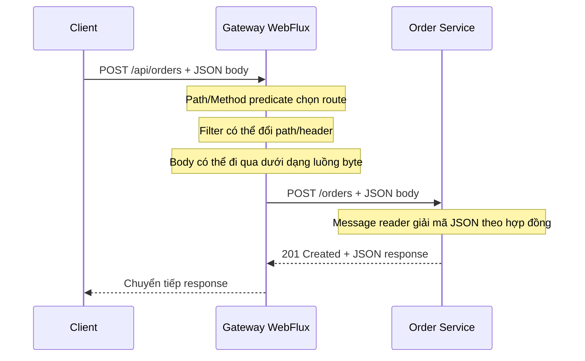
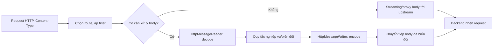
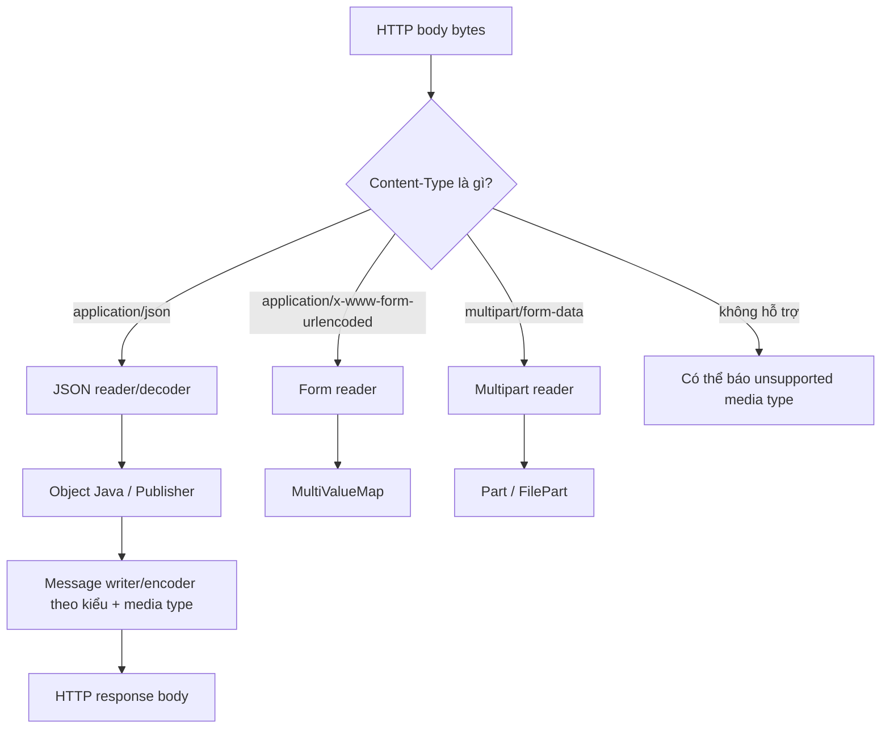
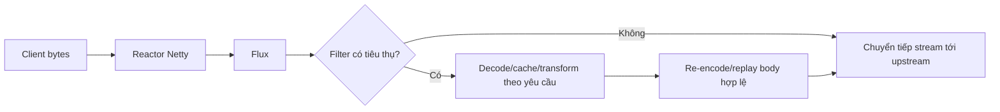

# JSON, form, multipart và lựa chọn bộ chuyển đổi nội dung trong Spring Cloud Gateway

Trong kiến trúc microservices, Gateway không chỉ định tuyến theo `Path` và `Method`. Nó còn phải chuyển tiếp chính xác **HTTP request body** và **response body**: JSON khi tạo đơn hàng, form khi gửi dữ liệu biểu mẫu, multipart khi tải tệp và đôi khi là luồng dữ liệu lớn. Chỉ cần xử lý sai `Content-Type`, tiêu thụ body quá sớm hoặc làm mất ranh giới multipart, request vẫn có thể khớp route nhưng backend nhận nội dung hỏng.

**Spring Cloud Gateway Server WebFlux** vận hành trên mô hình reactive của Spring WebFlux và Reactor Netty. Trong trường hợp chuyển tiếp bình thường, Gateway có thể truyền dữ liệu body mà **không cần giải mã JSON hoặc multipart thành đối tượng Java**. Khi áp dụng các filter đọc, xác thực cấu trúc hoặc viết lại body, Gateway phải dùng cơ chế **HTTP message codec** phù hợp để giải mã và mã hóa lại nội dung.

Bài học thuộc chương **Nội dung HTTP** của module `SPRING_CLOUD_GATEWAY`. Chủ đề này kết nối trực tiếp với route predicate, filter chain, biến đổi path/header, khám phá dịch vụ và các chính sách xác thực, rate limiting, circuit breaker, retry, TLS, quan sát request để vận hành cổng vào microservices an toàn.

> **Phạm vi:** Bài tập trung vào **Spring Cloud Gateway Server WebFlux**. Các ví dụ Java dùng Spring WebFlux/Project Reactor. Namespace và một số API cấu hình có thể khác giữa các phiên bản Spring Boot/Spring Cloud; cần dùng đúng starter và tài liệu của phiên bản đang triển khai. Ví dụ mã minh họa cần có các dependency tương ứng.

## 1. Từ client tới backend: body đi qua những lớp nào?

Giả sử client gửi request tạo đơn hàng:

```http
POST /api/orders HTTP/1.1
Host: gateway.example.com
Content-Type: application/json
Accept: application/json

{"sku":"BOOK-42","quantity":2}
```

Gateway có thể chọn route `order-api`, đổi `/api/orders` thành `/orders` rồi chuyển tiếp đến Order Service. Nếu không có filter cần đọc hoặc sửa body, Gateway không cần chuyển chuỗi JSON trên thành `OrderRequest`.



Khi cần chuyển đổi nội dung, một nhánh khác xuất hiện:



**Phân biệt hai công việc:** *định tuyến* trả lời “request này thuộc service nào?”, còn *chuyển đổi nội dung* trả lời “byte body phải được đọc thành gì và viết lại như thế nào?”. Không nên giải mã tất cả payload ở Gateway nếu mục tiêu chỉ là chuyển tiếp.

## 2. Những header quyết định cách xử lý body

HTTP body là một dãy byte. Các header mô tả cách phía nhận phải diễn giải byte và cách hai bên thương lượng định dạng.

| Header | Vai trò | Ví dụ |
| --- | --- | --- |
| `Content-Type` | Cho biết **kiểu nội dung của body đang gửi**. | `application/json`, `application/x-www-form-urlencoded`, `multipart/form-data; boundary=...` |
| `Accept` | Cho biết **kiểu response mà client muốn nhận**. | `application/json`, `text/event-stream` |
| `Content-Length` | Số byte body khi áp dụng cách đóng khung tương ứng. | `Content-Length: 32` |
| `Transfer-Encoding` | Cơ chế truyền body ở HTTP/1.1 khi dùng dạng truyền theo khối; không phải định dạng nghiệp vụ. | `chunked` |
| `Content-Encoding` | Cách biểu diễn nội dung đã nén/mã hóa ở mức HTTP representation. | `gzip` |
| `Content-Disposition` | Cung cấp thông tin về một part/attachment, ví dụ tên field/tệp. | `form-data; name="file"; filename="photo.jpg"` |

**`Content-Type` không giống `Accept`.** Một client có thể gửi `Content-Type: application/json` và `Accept: text/plain`: body request là JSON nhưng client muốn response kiểu text. Backend có thể chấp nhận hoặc từ chối dựa trên các định dạng nó hỗ trợ. Trong HTTP, `415 Unsupported Media Type` thường liên quan kiểu **request body** không được hỗ trợ; `406 Not Acceptable` thường liên quan việc không tạo được **response** phù hợp với `Accept`.

**Quan trọng với Gateway:** khi chỉ proxy, nó thường giữ các header thích hợp và body đã nhận. Nó không tự động biến JSON thành form hoặc chuyển JPEG thành PNG chỉ vì client đặt một `Accept` khác. Việc thay đổi định dạng chỉ xảy ra khi có cơ chế chuyển đổi rõ ràng.

### 2.1. MIME type và charset

`Content-Type` là **media type**, đôi khi kèm tham số:

```http
Content-Type: application/json
Content-Type: application/x-www-form-urlencoded
Content-Type: text/plain; charset=UTF-8
Content-Type: multipart/form-data; boundary=----FormBoundary8f1
```

Ví dụ `application/json` thường dùng JSON UTF-8; không nên tùy tiện xử lý như chuỗi byte theo charset mặc định của hệ điều hành. Với text, đọc sai charset có thể làm hỏng tiếng Việt. Với file nhị phân, **không** chuyển byte thành `String` để xử lý rồi encode lại nếu không có hợp đồng dữ liệu rõ ràng.

### 2.2. Content-Length sau khi viết lại body

Giả sử body JSON ban đầu dài 20 byte nhưng filter thêm trường mới khiến body dài 55 byte. Nếu filter vẫn chuyển tiếp `Content-Length: 20` cũ, upstream có thể đọc thiếu hoặc báo lỗi giao thức.

Khi dùng filter tích hợp viết lại body, hãy để cơ chế mã hóa và HTTP transport tương ứng xử lý độ dài/khung truyền; tránh tự giữ `Content-Length` cũ sau biến đổi. Với custom filter, phải xem cả `Content-Type`, `Content-Encoding` và `Transfer-Encoding` để không tạo header mâu thuẫn với bytes thực tế.

## 3. JSON: kiểu dữ liệu phổ biến của API

### 3.1. JSON được nhận như thế nào?

Ví dụ:

```http
POST /api/orders HTTP/1.1
Content-Type: application/json
Accept: application/json

{"sku":"BOOK-42","quantity":2}
```

Backend có thể ánh xạ body vào một DTO:

```java
public record CreateOrderRequest(String sku, int quantity) {}
```

Ở một backend Spring WebFlux, handler có thể nhận body:

```java
@PostMapping(
    path = "/orders",
    consumes = MediaType.APPLICATION_JSON_VALUE,
    produces = MediaType.APPLICATION_JSON_VALUE
)
public Mono<ResponseEntity<OrderReceipt>> create(
        @RequestBody Mono<CreateOrderRequest> requestBody) {
    return requestBody
        .flatMap(orderService::create)
        .map(created -> ResponseEntity
            .status(HttpStatus.CREATED)
            .body(created));
}
```

Ví dụ giả định `orderService.create` trả `Mono<OrderReceipt>` và áp dụng validation/quyền nghiệp vụ phù hợp. Đây là code **backend WebFlux**, không phải yêu cầu bắt buộc phải tạo controller ở Gateway.

Trong Spring WebFlux, codec JSON (thường dựa vào Jackson khi dependency có sẵn) đọc byte và ánh xạ vào kiểu Java cần nhận. Nếu body sai cú pháp, kiểu dữ liệu không phù hợp hoặc vượt giới hạn decode, request có thể thất bại trước khi chạy logic nghiệp vụ.

### 3.2. Điều gì xảy ra khi Gateway chỉ chuyển tiếp JSON?

Một route WebFlux đơn giản có thể là:

```yaml
spring:
  cloud:
    gateway:
      server:
        webflux:
          routes:
            - id: order-api
              uri: http://localhost:8082
              predicates:
                - Path=/api/orders/**
              filters:
                - StripPrefix=1
```

Khi client gọi `POST /api/orders` với JSON body, Gateway đổi path thành `/orders` và chuyển tiếp body tới backend. Vì route không yêu cầu đọc nội dung, **Gateway không cần biết DTO của Order Service**.

Các hệ quả:

- Backend sở hữu schema JSON, validation và quy tắc nghiệp vụ.
- Gateway có thể dùng Spring Security/rate limiting để bảo vệ điểm vào, nhưng các cơ chế này không mặc nhiên đòi hỏi giải mã toàn bộ JSON.
- Thay đổi schema JSON ở backend có thể không cần thay đổi route nếu Gateway không biến đổi body.
- Nếu cần ký request, xác thực chữ ký trên byte gốc hoặc kiểm tra checksum, phải đặc biệt cẩn thận vì parse/serialize lại JSON có thể làm thay đổi biểu diễn byte dù dữ liệu logic tương đương.

### 3.3. JSON object, array và JSON streaming

Ba kiểu dữ liệu sau không nên được coi là một:

| Ví dụ | Thường sử dụng | Điểm cần chú ý |
| --- | --- | --- |
| `{"id":42}` | Một object JSON | Có thể ánh xạ vào DTO duy nhất. |
| `[{"id":1},{"id":2}]` | JSON array | Có thể cần đọc toàn bộ cấu trúc trước khi xử lý. |
| Nhiều dòng JSON liên tiếp, ví dụ `application/x-ndjson` | Streaming nhiều object | Cần codec và media type hỗ trợ streaming; không đồng nhất với một JSON array. |

Một response `Flux<Product>` ở backend có thể được encode thành mảng JSON hoặc định dạng streaming khác tùy media type và writer. Chỉ nhìn thấy `Flux` trong Java không bảo đảm client nhận từng object ngay khi nó phát sinh.

## 4. Form URL-encoded: dữ liệu dạng cặp tên–giá trị

HTML form truyền thống thường dùng:

```http
POST /login HTTP/1.1
Content-Type: application/x-www-form-urlencoded

username=mai&remember=true
```

Trong đó:

- Dữ liệu body là các cặp `key=value`, nối bằng dấu `&`.
- Ký tự đặc biệt được URL-encode theo quy tắc form; không nên cắt chuỗi thủ công rồi tự decode từng phần bằng thao tác ad hoc.
- Một key có thể xuất hiện nhiều lần, ví dụ `tag=java&tag=spring`. Vì thế dữ liệu có dạng **`MultiValueMap<String, String>`** phù hợp hơn một map chỉ giữ một giá trị.

Ở backend WebFlux, có thể đọc dữ liệu form qua:

```java
@PostMapping(
    path = "/search",
    consumes = MediaType.APPLICATION_FORM_URLENCODED_VALUE
)
public Mono<ResponseEntity<String>> search(ServerWebExchange exchange) {
    return exchange.getFormData()
        .map(form -> {
            String query = form.getFirst("q");
            return ResponseEntity.ok(
                query == null ? "Không có từ khóa" : "Đã nhận từ khóa"
            );
        });
}
```

Đây chỉ là cách minh họa **đọc body form**; handler thật vẫn phải validate dữ liệu, giới hạn kích thước và không ghi log giá trị nhạy cảm. `getFormData()` dùng codec phù hợp để parse dữ liệu và trả về publisher reactive.

### 4.1. Form khác query string

Hai request dưới đây khác nhau:

```http
POST /search?q=java HTTP/1.1
Content-Type: application/x-www-form-urlencoded

page=2
```

`q=java` nằm ở **query** của URI; `page=2` nằm trong **body**. Route predicate `Query` của Gateway kiểm tra query parameter của request; nó **không tự kiểm tra** các field bên trong body form.

Một đường dẫn URL có query khác chỉ vì cách gửi dữ liệu cũng có thể tạo ra hành vi cache/log khác. Nếu dữ liệu là mật khẩu, token hoặc mã bí mật, không đặt chúng vào query URL vì có nguy cơ bị ghi vào log, history, analytics hay referrer.

### 4.2. Kiểm thử form qua curl

```bash
curl -i "http://localhost:8080/api/form/submit" \
  -H "Content-Type: application/x-www-form-urlencoded" \
  --data-urlencode "name=Nguyễn An" \
  --data-urlencode "tag=java" \
  --data-urlencode "tag=spring"
```

Ví dụ giả định route tương ứng đã được cấu hình và backend chấp nhận form. `--data-urlencode` giúp curl encode từng field đúng quy tắc, đặc biệt hữu ích với khoảng trắng và ký tự tiếng Việt.

### 4.3. Vì sao không nên đọc form tùy tiện trong GatewayFilter?

Khi một filter gọi:

```java
return exchange.getFormData()
    .flatMap(form -> {
        // Đọc được form, nhưng body đã được tiêu thụ ở tầng này.
        return chain.filter(exchange);
    });
```

Đoạn code **không bảo đảm** backend vẫn đọc được body gốc. Trong WebFlux, body là một publisher thường chỉ được tiêu thụ theo vòng đời xác định; đọc sớm có thể khiến phần còn lại của Gateway chain không còn byte để chuyển tiếp. Nếu thật sự cần kiểm tra body ở Gateway, phải chọn cơ chế cache/replay/decorate request phù hợp và đặt giới hạn tài nguyên. Đừng xem `getFormData()` là phép đọc miễn phí không tác động tới pipeline.

## 5. Multipart/form-data: nhiều phần và tệp nhị phân

Multipart thường dùng khi form chứa text và file:

```http
POST /api/files HTTP/1.1
Content-Type: multipart/form-data; boundary=----WebKitFormBoundaryExample

------WebKitFormBoundaryExample
Content-Disposition: form-data; name="description"

Ảnh sản phẩm
------WebKitFormBoundaryExample
Content-Disposition: form-data; name="file"; filename="photo.jpg"
Content-Type: image/jpeg

... bytes tệp ...
------WebKitFormBoundaryExample--
```

Ví dụ trên giản lược biểu diễn byte; thực tế các part được ngăn cách bởi boundary cùng CRLF đúng chuẩn. **Boundary phải khớp với body**. Nếu client hoặc filter tự đặt `Content-Type: multipart/form-data` mà làm mất tham số `boundary`, backend có thể không parse được file.

### 5.1. Multipart khác form URL-encoded

| Đặc tính | `application/x-www-form-urlencoded` | `multipart/form-data` |
| --- | --- | --- |
| Thành phần điển hình | Các cặp field dạng text | Nhiều part, gồm field text và tệp nhị phân |
| Phân tách | `&` giữa các field | Boundary giữa các part |
| Hỗ trợ file nhị phân | Không phù hợp trực tiếp cho file lớn | Được thiết kế để truyền các phần nhị phân |
| Dữ liệu nhận trong WebFlux | `MultiValueMap<String,String>` | `Part`, `FormFieldPart`, `FilePart` hoặc luồng sự kiện part tùy API |
| Chi phí khi Gateway tự parse | Có thể cần gom form trong bộ nhớ | Có thể dùng bộ nhớ, đĩa tạm và nhiều buffer; rủi ro tài nguyên cao hơn |

Với tải file lớn, nên **chuyển tiếp luồng multipart** khi Gateway chỉ cần định tuyến, thay vì tải toàn bộ tệp vào bộ nhớ.

### 5.2. Backend đọc multipart bằng WebFlux

Một handler backend minh họa nhận file:

```java
@PostMapping(
    path = "/files",
    consumes = MediaType.MULTIPART_FORM_DATA_VALUE
)
public Mono<ResponseEntity<Void>> upload(
        @RequestPart("file") FilePart file) {

    Path destination = Path.of("/var/app/uploads", "generated-id.bin");

    return file.transferTo(destination)
        .thenReturn(ResponseEntity.accepted().build());
}
```

Ví dụ sử dụng tên đích do **server** kiểm soát, không nối nguyên `file.filename()` vào path. Trong ứng dụng thật, cần bảo đảm thư mục tồn tại, cấp quyền phù hợp, đặt ID duy nhất, giới hạn dung lượng, kiểm tra content/file signature và sử dụng hệ thống lưu trữ thích hợp.

`FilePart.transferTo(...)` là cách backend xử lý dữ liệu upload qua API reactive. Gateway không cần tự ghi file vào đĩa nếu trách nhiệm upload thuộc dịch vụ phía sau.

### 5.3. Gateway có thể parse multipart không?

Có, Spring WebFlux hỗ trợ `exchange.getMultipartData()` và API liên quan đến các `Part`. Tuy nhiên:

- Parsing multipart có thể tiêu tốn bộ nhớ và/hoặc đĩa tạm.
- Nếu filter tiêu thụ body, cần cơ chế tái phát toàn bộ multipart, bao gồm **boundary, field, filename, part header và byte dữ liệu**.
- Chuyển `Flux<DataBuffer>` thành `String` sẽ làm hỏng tệp nhị phân.
- Tên file, media type do client gửi và các field metadata **không phải đầu vào tin cậy**.
- Nếu có nhiều part lớn, việc aggregate toàn bộ thành byte array có thể gây tăng bộ nhớ đột biến.

Khi yêu cầu chỉ là chặn loại upload quá lớn hoặc không hợp lệ, nên đặt giới hạn sớm và giao validation nội dung cho backend/đường kiểm soát upload phù hợp, thay vì viết một custom GatewayFilter tự parse mọi loại multipart.

### 5.4. curl tự sinh boundary

```bash
curl -i -X POST "http://localhost:8080/api/files" \
  -F "description=Ảnh sản phẩm" \
  -F "file=@./photo.jpg;type=image/jpeg"
```

Tham số `-F` khiến curl xây body multipart và `Content-Type` có boundary tương ứng. **Không thêm thủ công header `Content-Type: multipart/form-data`** với boundary rỗng/sai khi dùng `-F`.

## 6. Spring WebFlux chọn bộ chuyển đổi nội dung như thế nào?

Trong Spring WebFlux, các thành phần **`HttpMessageReader<?>`** và **`HttpMessageWriter<?>`** chịu trách nhiệm đọc/ghi body theo kiểu Java và media type. Chúng dựa vào các codec phù hợp; danh sách codec có thể được cung cấp/cấu hình qua `ServerCodecConfigurer`, `ClientCodecConfigurer` hoặc cơ chế của framework.

Với một endpoint WebFlux có body kiểu `Mono<CreateOrderRequest>`:

1. Framework xem `Content-Type` của request và kiểu Java mà handler/filter muốn đọc.
2. Chọn message reader/decoder hỗ trợ tổ hợp đó.
3. Giải mã các byte thành object hoặc publisher.
4. Khi trả response object, dùng writer/encoder hỗ trợ kiểu dữ liệu và media type phù hợp với endpoint và thương lượng HTTP.



Sơ đồ mô tả **quá trình chủ động decode/encode**. Nó không có nghĩa Netty routing filter của Gateway tự động giải mã mọi request trước khi proxy.

### 6.1. Những codec phổ biến

| Kiểu nội dung | Bộ đọc/ghi điển hình ở WebFlux | Điều kiện/giới hạn |
| --- | --- | --- |
| JSON (`application/json`) | Jackson-based decoder/encoder khi thư viện tương ứng được cấu hình | Phải tương thích DTO, media type, giới hạn bộ nhớ và xử lý null/schema. |
| Văn bản (`text/plain`) | String decoder/encoder | Charset, kích thước và việc chọn kiểu `String`. |
| Form URL-encoded | Form reader/writer hỗ trợ `MultiValueMap` | Cần xử lý đúng encoding và nhiều giá trị cho một key. |
| Multipart | Reader/writer cho `Part` hoặc tài nguyên multipart | Boundary, file streaming, giới hạn bộ nhớ/đĩa và vòng đời part. |
| Dữ liệu byte (`byte[]`, `DataBuffer`) | Byte array/buffer codecs | Không tự hiểu dữ liệu nghiệp vụ; cần quản lý tài nguyên. |
| Streaming (`text/event-stream`, `application/x-ndjson`) | Writer/encoder hỗ trợ media type streaming | Không được gom vô hạn stream thành một object/chuỗi. |

Một media type chỉ là **tín hiệu chọn codec**, không chứng minh payload hợp lệ. Client có thể gửi dữ liệu nhị phân nhưng khai `application/json`; decoder vẫn phải phát hiện lỗi khi được yêu cầu đọc JSON.

### 6.2. Chọn codec phụ thuộc kiểu Java

Nếu gọi decoder muốn đọc `String.class`, cách diễn giải có thể khác với đọc `CreateOrderRequest.class`. Tương tự, yêu cầu đọc `Flux<DataBuffer>` là thao tác ở mức byte buffer, không tương đương với giải mã `Mono<List<Product>>`.

Do đó, khi dùng các filter viết lại body trong Gateway, phải chọn đúng **input class**, **output class** và **media type của output**. Nếu chúng không tương ứng với payload thực tế, lỗi decode/encode có thể xuất hiện ngay tại gateway dù backend hoạt động tốt.

### 6.3. `Accept` không tự chuyển đổi response của proxy

Ở backend WebFlux, `Accept: application/json` thường tham gia chọn representation khi handler có nhiều định dạng output. Nhưng nếu Gateway chỉ chuyển tiếp response gốc, nó thường **không tự chuyển `text/plain` từ backend thành `application/json`**. Chỉ các filter/cấu hình biến đổi body phù hợp mới thực hiện conversion như vậy.

Khi dùng response rewrite, hãy kiểm tra `Content-Type` output sau encode. Không tự chuyển nội dung sang JSON trong khi vẫn giữ header `text/plain` cũ.

## 7. Khi nào nên để Gateway chuyển tiếp body nguyên trạng?

Trong nhiều hệ thống, quyết định tốt nhất là giữ Gateway tập trung vào **route, security edge và reliability**, còn backend quyết định schema. Có thể dùng bảng sau:

| Nhu cầu | Lựa chọn ở Gateway | Lý do |
| --- | --- | --- |
| Chuyển JSON từ client đến Order Service, không đổi schema | Chuyển tiếp body | Không phải decode/serialize lại JSON; giảm coupling với DTO. |
| Chuyển form login đến Authentication Service | Chuyển tiếp body, đặt bảo mật phù hợp | Dữ liệu nhạy cảm nên được xử lý bởi service sở hữu nghiệp vụ. |
| Upload multipart tệp lớn | Ưu tiên streaming pass-through với giới hạn phù hợp | Tránh giữ byte tệp trong heap Gateway. |
| Thêm header `X-Gateway-Source` | `SetRequestHeader` | Không cần đụng body. |
| Bỏ `/api` trước khi gọi backend | `StripPrefix` hoặc `SetPath` | Chỉ đổi path, không cần decode body. |
| Thêm một trường JSON vào request theo hợp đồng tích hợp | `ModifyRequestBody` hoặc một lớp chuyên biệt | Phải decode/transform/encode có kiểm soát. |
| Xóa trường nội bộ khỏi JSON response | `ModifyResponseBody` hoặc đổi DTO ở backend | Cần rewrite body, coi chừng status khác nhau và schema error. |
| Kiểm tra quyền người dùng | Spring Security + backend authorization | Không tin dữ liệu body làm bằng chứng danh tính. |

Thay đổi body ở Gateway có lợi trong những trường hợp chuyển đổi hợp đồng API phiên bản cũ, chuẩn hóa một số trường hoặc lọc response. Nhưng mỗi lần decode/encode là thêm một điểm tiêu thụ CPU, RAM và rủi ro sai schema.

## 8. `ModifyRequestBody`: chuyển đổi JSON có kiểu rõ ràng

`ModifyRequestBody` là một GatewayFilter Factory dùng để đọc request body thành kiểu đầu vào, gọi một hàm rewrite reactive rồi mã hóa kết quả thành body mới. Trong các phiên bản WebFlux phổ biến, filter này chủ yếu được cấu hình bằng **Java DSL** thông qua `RouteLocatorBuilder`, không giả định cú pháp YAML rút gọn hoạt động cho mọi phiên bản.

Giả sử client gửi:

```json
{"sku":"BOOK-42","quantity":2}
```

Backend nội bộ yêu cầu thêm một trường `source` do Gateway xác định:

```json
{"sku":"BOOK-42","quantity":2,"source":"edge-gateway"}
```

Ví dụ minh họa ở lớp cấu hình Java:

```java
import org.springframework.cloud.gateway.route.RouteLocator;
import org.springframework.cloud.gateway.route.builder.RouteLocatorBuilder;
import org.springframework.context.annotation.Bean;
import org.springframework.context.annotation.Configuration;
import org.springframework.http.MediaType;
import reactor.core.publisher.Mono;

@Configuration
public class OrderBodyRoutes {

    public record ClientOrder(String sku, int quantity) {}
    public record BackendOrder(String sku, int quantity, String source) {}

    @Bean
    RouteLocator orderRoutes(RouteLocatorBuilder builder) {
        return builder.routes()
            .route("order-json", r -> r
                .path("/api/orders")
                .and()
                .method("POST")
                .filters(f -> f
                    .modifyRequestBody(
                        ClientOrder.class,
                        BackendOrder.class,
                        MediaType.APPLICATION_JSON_VALUE,
                        (exchange, input) -> {
                            if (input == null) {
                                return Mono.empty();
                            }
                            return Mono.just(new BackendOrder(
                                input.sku(),
                                input.quantity(),
                                "edge-gateway"
                            ));
                        }
                    )
                    .stripPrefix(1)
                )
                .uri("http://localhost:8082"))
            .build();
    }
}
```

**Giải thích từng thành phần:**

1. `ClientOrder.class`: kiểu mà message reader cần giải mã từ JSON client.
2. `BackendOrder.class`: kiểu mà message writer cần serialize thành JSON mới.
3. `MediaType.APPLICATION_JSON_VALUE`: media type mong đợi cho body output.
4. Hàm `(exchange, input) -> Mono<BackendOrder>`: mô tả phép chuyển đổi không chặn.
5. `input == null`: xử lý trường hợp request không có body; tùy hợp đồng API có thể cần từ chối request rỗng thay vì cho đi tiếp.
6. `stripPrefix(1)`: chuyển `/api/orders` thành `/orders` trước khi routing, độc lập với phép đổi JSON.

Khi client gửi:

```bash
curl -i "http://localhost:8080/api/orders" \
  -H "Content-Type: application/json" \
  -d '{"sku":"BOOK-42","quantity":2}'
```

Order Service ở `http://localhost:8082/orders` có thể nhận body với trường `source` bổ sung.

**Giới hạn của ví dụ:** Nó giả định một JSON object theo DTO xác định, không chứa file hoặc stream vô hạn; backend phải kiểm tra `sku`, `quantity` và quyền nghiệp vụ. Header `source` hay trường `source` chỉ đáng tin trong phạm vi backend được bảo vệ khỏi truy cập trực tiếp hoặc có cơ chế xác minh quan hệ tin cậy. Ví dụ không định nghĩa policy response/status cho JSON sai hoặc body rỗng; production cần quy tắc lỗi rõ ràng.

### 8.1. Không biến đổi JSON bằng thay chuỗi tùy tiện

Cách làm như:

```java
String changed = body.replace("\"role\":\"user\"", "\"role\":\"admin\"");
```

không phải phép biến đổi JSON an toàn. Nó phụ thuộc vào khoảng trắng, thứ tự field, escaping và có thể đụng chuỗi nằm trong nội dung dữ liệu. Không dùng thay chuỗi để cấp quyền, đổi định danh người dùng hoặc thao tác trường bảo mật.

Hãy dùng DTO, JSON tree/codec có validation rõ ràng, hoặc để backend chịu trách nhiệm nếu trường đó thuộc nghiệp vụ. Đặc biệt, **không bao giờ tin role/userId lấy từ request body làm danh tính đã xác thực**.

### 8.2. Body rỗng và ngữ nghĩa reactive

Hàm rewrite trả về `Mono<Output>`. Nếu muốn phát một object output, dùng `Mono.just(output)`; nếu muốn phát không có phần tử, dùng `Mono.empty()` theo hợp đồng của filter/endpoint. Đừng gọi `block()` để lấy request body, cũng không gọi `subscribe()` thủ công trong filter: WebFlux/Gateway cần quản lý subscription, lỗi và cancellation xuyên suốt HTTP exchange.

## 9. `ModifyResponseBody`: viết lại JSON response

Giả sử backend trả:

```json
{"sku":"BOOK-42","name":"Java Handbook","internalNote":"warehouse-only"}
```

Gateway chỉ muốn công bố:

```json
{"sku":"BOOK-42","name":"Java Handbook"}
```

Một route Java DSL minh họa:

```java
@Configuration
public class ProductResponseRoutes {

    public record InternalProduct(
        String sku, String name, String internalNote) {}
    public record PublicProduct(String sku, String name) {}

    @Bean
    RouteLocator productRoutes(RouteLocatorBuilder builder) {
        return builder.routes()
            .route("product-json", r -> r
                .path("/api/products/**")
                .filters(f -> f
                    .stripPrefix(1)
                    .modifyResponseBody(
                        InternalProduct.class,
                        PublicProduct.class,
                        MediaType.APPLICATION_JSON_VALUE,
                        (exchange, body) -> {
                            if (body == null) {
                                return Mono.empty();
                            }
                            return Mono.just(
                                new PublicProduct(body.sku(), body.name())
                            );
                        }
                    )
                )
                .uri("http://localhost:8081"))
            .build();
    }
}
```

Các import của `@Configuration`, `@Bean`, `RouteLocator`, `RouteLocatorBuilder`, `MediaType` và `Mono` tương tự ví dụ mục 8. Khi copy vào dự án thực tế, cần bổ sung import/package và kiểm tra chữ ký API theo phiên bản đang dùng.

**Lưu ý đặc biệt:**

- `ModifyResponseBody` phải giải mã body backend thành `InternalProduct`; nếu backend trả **schema lỗi khác** với object thành công, việc decode có thể thất bại. Cần phân biệt status và media type trước khi áp dụng transform hoặc quy định response schema thống nhất.
- Khi response không có body (`204 No Content`, `HEAD` hoặc body rỗng), không nên giả định luôn có object.
- Một filter dùng chung cho cả JSON và file download có thể phá dữ liệu nhị phân; hãy giới hạn route/media type phù hợp.
- Nếu dữ liệu `internalNote` là bí mật thật sự, tốt nhất backend trả DTO công khai ngay từ đầu. Gateway không nên là rào chắn duy nhất chống rò rỉ dữ liệu nhạy cảm.
- Hãy kiểm tra các header như `Content-Length`, `Content-Type` và `Content-Encoding` sau khi mã hóa lại.

Đổi body ở Gateway có thể hữu ích trong giai đoạn chuyển tiếp API, nhưng làm gateway phụ thuộc schema backend. Một thay đổi DTO không đồng bộ có thể khiến mọi request trên route lỗi 5xx dù backend thực chất vẫn hoạt động.

## 10. Body là `Flux<DataBuffer>`, không phải `String` có sẵn

Trong Spring WebFlux, request body ở mức thấp có dạng:

```java
Flux<DataBuffer> body = exchange.getRequest().getBody();
```

`DataBuffer` là vùng dữ liệu byte; một body HTTP có thể đến dưới nhiều buffer. Chuỗi reactive hỗ trợ mô hình I/O không chặn và backpressure ở các mức thích hợp.

Sơ đồ vòng đời đơn giản:



### 10.1. Đọc một lần và replay body

Không nên giả định mọi code có thể subscribe nhiều lần vào `exchange.getRequest().getBody()`. Tùy nguồn, body có thể chỉ được tiêu thụ một lần; đọc trước trong filter mà không tái phát đúng cách sẽ khiến backend nhận body rỗng.

Nếu cần nhiều bước đọc cùng một nội dung, có thể cân nhắc `CacheRequestBody` hoặc cơ chế tích hợp tương ứng của Gateway. Khi dùng cache, phải:

- Đặt giới hạn kích thước body rõ ràng.
- Biết body được cache dạng gì và nguồn nào có quyền đọc.
- Tôn trọng vòng đời DataBuffer, tránh giữ buffer quá lâu.
- Kiểm tra hoạt động với JSON, form và multipart thực tế, vì yêu cầu replay không giống nhau.
- Không cache payload nhạy cảm lâu hơn cần thiết.

Một ví dụ cấu hình `CacheRequestBody` trong các bản Gateway hỗ trợ factory đó có thể dùng tên filter và kiểu body:

```yaml
filters:
  - name: CacheRequestBody
    args:
      bodyClass: java.lang.String
```

Ví dụ chỉ minh họa **cơ chế cache body dạng text**; không nên áp dụng `String` cho file nhị phân hoặc request lớn. Cần đối chiếu factory và giới hạn với phiên bản Gateway đang dùng.

### 10.2. DataBuffer phải được quản lý đúng

Với một số kiểu buffer pooled, trách nhiệm release/retain có thể quan trọng. Những cách làm nguy hiểm:

- Lưu `DataBuffer` vào field/static collection để sử dụng sau request.
- Đọc byte rồi quên release đối với đoạn code tự quản lý buffer.
- Dùng `DataBufferUtils.join(...)` để gom **mọi byte** của upload lớn mà không giới hạn.
- Gọi `body.blockFirst()` hoặc chặn thread event loop.
- Chuyển file nhị phân thành `String` theo charset không tương thích.

Khi xây custom body filter ở mức `DataBuffer`, phải nắm rõ hợp đồng sở hữu bộ đệm, cancellation/error handling và cách decorate `ServerHttpRequest` hoặc `ServerHttpResponse`. Nếu chỉ cần đổi JSON đơn giản, ưu tiên các body filter tích hợp thay vì tự thao tác pooled memory.

### 10.3. Backpressure không phải rate limiting

- **Backpressure** điều tiết nhu cầu nhận các phần tử trong stream, hỗ trợ quản lý áp lực giữa publisher và subscriber.
- **Rate limiting** giới hạn tần suất/số lượng request theo client, API key, user hoặc route.

Có `Flux<DataBuffer>` không có nghĩa Gateway tự giới hạn một client gửi hàng nghìn request upload. `RequestRateLimiter` cũng không thay thế giới hạn dung lượng của từng request.

## 11. Chọn giới hạn bộ nhớ, tệp và kích thước request

Viết lại body thường buộc hệ thống decode/encode nên **giới hạn tài nguyên** là phần bắt buộc của thiết kế.

| Loại giới hạn | Mục tiêu | Cần kiểm tra |
| --- | --- | --- |
| Giới hạn kích thước body request | Tránh upload vượt hạn mức từ một request. | Route filter `RequestSize`, reverse proxy và backend. |
| Giới hạn in-memory decode | Tránh codec gom một payload quá lớn trong heap. | `spring.codec.max-in-memory-size` ở stack hỗ trợ; `DataBufferLimitException` khi vượt giới hạn decode cụ thể. |
| Multipart per-part/aggregate limits | Giới hạn part, số lượng part, bộ nhớ và tệp tạm. | Cấu hình multipart reader của WebFlux, quota đĩa và chính sách upload. |
| Timeout và kết nối | Giữ tài nguyên gateway khi backend hoặc client quá chậm. | Timeout Netty/Gateway, backpressure, client disconnect. |
| Kiểm tra định dạng | Ngăn payload không hợp lệ/độc hại đi sâu vào nghiệp vụ. | Content-Type, byte signature file, validation backend, giới hạn giải nén. |

### 11.1. `RequestSize` filter

Ví dụ đặt giới hạn payload trên route upload:

```yaml
- id: file-upload
  uri: lb://file-service
  predicates:
    - Path=/api/files/**
    - Method=POST
  filters:
    - StripPrefix=1
    - name: RequestSize
      args:
        maxSize: 5MB
```

Giá trị `maxSize: 5MB` chỉ mang tính minh họa; cần chọn theo API và hiểu cách factory kiểm tra request size trong phiên bản đang dùng. Request vượt ngưỡng thường có thể bị từ chối (chẳng hạn `413 Payload Too Large`), nhưng không nên mặc định mọi nhánh, mọi streaming mode hoặc proxy đều trả cùng status/body mà không kiểm thử.

### 11.2. `max-in-memory-size` không phải giới hạn upload toàn cục

Một cấu hình WebFlux thường gặp:

```yaml
spring:
  codec:
    max-in-memory-size: 1MB
```

Đây là một **giới hạn liên quan đến codec khi decode cần gom dữ liệu trong bộ nhớ**, không phải bảo đảm mọi request đi qua Netty proxy đều bị chặn ở 1MB. Những upload streaming lớn vẫn cần hạn mức riêng ở edge/route/backend. Đồng thời, nếu tăng giới hạn decode quá cao chỉ để xử lý JSON lớn, mỗi kết nối đồng thời có thể tiêu tốn nhiều heap.

### 11.3. Multipart và tệp tạm

Multipart có thể cần đệm các part và lưu file tạm tùy decoder/configuration. Khi vận hành, cần xét:

- quota đĩa và dung lượng thư mục tạm;
- số lượng file, số lượng part, phần metadata quá dài;
- kích thước tối đa mỗi file, tổng request, timeouts;
- dọn dẹp tài nguyên khi request lỗi/hủy;
- filename/path traversal và chính sách quét file;
- trường hợp nhiều client tải lên đồng thời.

Chỉ tăng `max-in-memory-size` không giải quyết tất cả nguy cơ của multipart. Nếu upload lớn trở thành chức năng chủ đạo, có thể cân nhắc upload trực tiếp tới object storage qua URL ký ngắn hạn theo mô hình tin cậy thích hợp để giảm tải Gateway.

## 12. JSON, form và multipart dưới góc độ bảo mật

### 12.1. Đừng tin Content-Type do client khai

`Content-Type: image/jpeg` của một part không chứng minh byte là ảnh JPEG thật. `Content-Type: application/json` cũng không chứng minh body khớp schema.

Khi backend cần kiểm tra an toàn:

- Kiểm tra định dạng thực, kích thước, cấu trúc và dữ liệu nghiệp vụ.
- Không tạo đường dẫn lưu file bằng cách nối trực tiếp filename từ client.
- Không đưa nguyên văn giá trị form hoặc JSON vào câu lệnh SQL, template hoặc command.
- Giữ chính sách auth/resource authorization ở server, không dựa vào `userId` hoặc `role` trong body.
- Hạn chế dữ liệu nhạy cảm được ghi vào log, traces, error response và cache.

### 12.2. Không log payload chứa bí mật

JSON đăng nhập có thể có `password`, form OAuth có `client_secret`, multipart có giấy tờ cá nhân. Một `GlobalFilter` tự đọc body để log “cho dễ debug” có thể vừa rò rỉ dữ liệu vừa gây lỗi consume/replay. Ưu tiên log:

- route ID, HTTP method, status, latency, correlation/trace ID hợp lệ;
- kích thước body nếu đo được an toàn;
- Content-Type đã chuẩn hóa thành nhóm MIME;
- mã lỗi decode/validate ở mức tổng quát, không chứa raw token hay file.

Nếu cần quan sát payload cho một trường hợp đặc biệt, phải sử dụng môi trường kiểm thử, dữ liệu giả lập và cơ chế che thông tin nhạy cảm phù hợp.

### 12.3. Header và cookie không tương đương body

Xác thực thường dựa trên Bearer token hoặc session/cookie tại lớp WebFlux/Spring Security, không phải dựa vào một trường JSON như `"isAdmin":true`. Header `X-User-Id` do client tự gửi cũng không trở thành bằng chứng danh tính khi Gateway chuyển tiếp nó.

Các chính sách TLS/mTLS bảo vệ kết nối, `SecureHeaders` xử lý một số response header phía browser, `RequestRateLimiter` quản lý tần suất, còn body validation bảo vệ **dữ liệu**. Chúng bổ sung cho nhau chứ không thay thế.

## 13. Ảnh hưởng của retry, circuit breaker và response body

Thay đổi hoặc cache body có thể tương tác với các filter đảm bảo độ tin cậy:

### 13.1. Retry và khả năng phát lại body

Giả sử Gateway chuyển `POST /orders` đến backend. Backend đã tạo đơn nhưng response bị mất, Gateway thử lại request. Nếu backend không hỗ trợ idempotency, hai đơn hàng có thể được tạo.

Với body streaming (JSON lớn hoặc multipart), một publisher có thể **không đọc lại được** sau lần gửi đầu. Một số cơ chế Retry của Gateway có thể phải cache body để phát lại, khiến bộ nhớ sử dụng tăng mạnh.

Trước khi bật retry cho route có body:

1. Xác định method nào an toàn để retry và status/lỗi nào được thử lại.
2. Định nghĩa idempotency key cho thao tác ghi có tác dụng phụ khi cần.
3. Kiểm tra khả năng replay body và giới hạn cache.
4. Kiểm thử client ngắt kết nối, backend timeout và các response lỗi một phần.
5. Đo heap/buffer khi nhiều request retry cùng lúc.

### 13.2. Circuit breaker không tự sửa body

`CircuitBreaker` giúp bảo vệ lời gọi upstream khi backend lỗi hoặc quá chậm. Nó **không tự** biến JSON thành form hay trả đúng schema của mỗi API khi fallback. Nếu fallback được cấu hình, phải thống nhất status, `Content-Type` và shape dữ liệu, đặc biệt khi phía client trông đợi một JSON object cụ thể.

### 13.3. Response compressed và streaming

Nếu upstream trả `Content-Encoding: gzip`, body bytes là nội dung nén theo HTTP representation. Một custom filter cố decode bytes nén thành JSON trực tiếp sẽ thất bại nếu không có cơ chế giải nén phù hợp.

Với SSE (`text/event-stream`), NDJSON streaming hoặc file download, một filter chuyển toàn bộ response thành `String` có thể phá streaming, tăng latency, tốn bộ nhớ hoặc làm hỏng file. Ưu tiên giữ nguyên streaming khi không cần biến đổi.

## 14. Chẩn đoán lỗi theo tầng

Khi Gateway khớp route nhưng backend không xử lý được body, nên theo thứ tự:

1. **Route/predicate:** request có đi vào route mong muốn không?
2. **Headers:** `Content-Type`, `Content-Encoding`, `Accept` có đúng không?
3. **Filter chain:** filter nào đọc/cache/rewrite body, và chạy trước bước routing không?
4. **Codec:** input class, output class, media type, giới hạn bộ nhớ có tương thích?
5. **Routing:** URI đích, load balancer, timeout và kết nối upstream có hoạt động?
6. **Backend:** body có đủ byte, schema/form/part hợp lệ, quyền nghiệp vụ đúng không?
7. **Response:** status/header/body có tương ứng với kết quả thực và chính sách retry/circuit breaker không?

| Triệu chứng | Khả năng cần xem xét | Hướng xử lý |
| --- | --- | --- |
| Backend nhận body rỗng sau custom filter | Filter đã consume publisher và không replay. | Sử dụng body filter/caching đúng cách; kiểm thử request thực ở backend. |
| JSON trả `400` | JSON sai cú pháp, schema/validation không hợp lệ. | Kiểm tra payload, DTO, thông báo lỗi có kiểm soát. |
| Gateway trả `415` khi rewrite | Media type hoặc codec không hỗ trợ input body. | Kiểm tra `Content-Type`, kiểu Java và codec được cấu hình. |
| Multipart không có file | Thiếu `boundary`, sai tên part hoặc body đã bị đọc. | Để client tạo multipart header; kiểm thử part name và byte ở backend. |
| Form có field tiếng Việt bị hỏng | Encode/decode charset không thống nhất. | Dùng form codec/URL encoding đúng; không tách chuỗi thủ công. |
| Upload lớn lỗi 413 | Giới hạn request ở Gateway/proxy/backend. | Kiểm tra limit của từng tầng và mục tiêu dung lượng cho phép. |
| `DataBufferLimitException` khi decode | Body vượt giới hạn in-memory của codec cụ thể. | Giảm kích thước, chuyển streaming hoặc điều chỉnh limit có cân nhắc. |
| Sửa JSON làm upstream treo | `Content-Length`/framing không khớp hoặc filter blocking. | Dùng filter tích hợp, kiểm tra transport headers và event loop. |
| Response lỗi parse khi dùng `ModifyResponseBody` | Error body khác DTO thành công hoặc content type khác. | Phân nhánh theo status/media type hoặc đổi chiến lược rewrite. |
| File download bị biến dạng | Đọc bytes thành String hoặc ghi lại theo charset. | Streaming byte đúng loại, không decode text không cần thiết. |
| Retry tạo bản ghi trùng | POST có tác dụng phụ được gửi lại. | Idempotency, điều kiện retry và kiểm tra khả năng replay body. |
| Gateway mất nhiều RAM khi upload | Filter aggregate/cache multipart hoặc JSON lớn. | Giới hạn cache, buffer/part, ưu tiên streaming pass-through. |

## 15. Kiểm thử HTTP với JSON, form và multipart

Các ví dụ sau giả định Gateway chạy ở `http://localhost:8080` và đã có những route tương ứng. Khi kiểm thử, nên dùng **backend giả lập** ghi nhận method, path, headers và kích thước body thực nhận (không lưu bí mật).

### 15.1. Gửi JSON

```bash
curl -i "http://localhost:8080/api/orders" \
  -H "Content-Type: application/json" \
  -H "Accept: application/json" \
  --data '{"sku":"BOOK-42","quantity":2}'
```

Kiểm tra backend nhận:

- `Content-Type` là JSON.
- Body là JSON hợp lệ, có trường `source` nếu route dùng `ModifyRequestBody` ở mục 8.
- Path backend là `/orders` nếu dùng `StripPrefix=1`.
- Nếu DTO không hợp lệ, backend/Gateway trả mã lỗi đúng hợp đồng.

### 15.2. Gửi form URL-encoded

```bash
curl -i "http://localhost:8080/api/forms/search" \
  --data-urlencode "q=Spring Cloud Gateway" \
  --data-urlencode "tag=webflux" \
  --data-urlencode "tag=reactor"
```

Khi dùng `--data-urlencode`, curl thường tự dùng media type form thích hợp. Backend cần xử lý đúng key `tag` có hai giá trị thay vì chỉ lấy một khi nghiệp vụ muốn giữ cả hai.

### 15.3. Gửi multipart

```bash
curl -i "http://localhost:8080/api/files" \
  -F "title=Ảnh đại diện" \
  -F "file=@./avatar.png;type=image/png"
```

Cần tạo sẵn file `avatar.png` phù hợp và bảo đảm backend upload chỉ chấp nhận kiểu, kích thước cho phép. Không tự viết boundary và không đọc upload qua `String`.

### 15.4. Thử media type không được hỗ trợ

```bash
curl -i "http://localhost:8080/api/orders" \
  -H "Content-Type: text/plain" \
  --data "not-json"
```

Nếu route dùng `ModifyRequestBody` với input DTO JSON và không có reader phù hợp cho `text/plain`, Gateway có thể từ chối/đưa ra lỗi decode. Nếu Gateway chỉ proxy, backend mới là nơi quyết định có chấp nhận text/plain hay không. Không mặc định cùng một status sẽ xuất hiện ở hai kiến trúc.

### 15.5. Thử giới hạn và hủy request

Trong môi trường test, tạo các payload hợp lệ ở những mức:

- Vừa dưới và vừa trên giới hạn body configured.
- JSON object lớn/JSON array nhiều phần tử.
- Form có nhiều field trùng tên.
- Multipart nhiều part hoặc file lớn.
- Response streaming chậm, client dừng giữa chừng.

Theo dõi memory, buffer usage, latency, lỗi timeout và request có được dọn tài nguyên khi hủy. Tránh dùng dữ liệu nhạy cảm thật trong các bài test này.

## 16. Bài tập vận dụng có đáp án

### Bài 1 — Nhận diện Content-Type

Client gửi `POST /api/orders` với body `{"sku":"A","quantity":1}` và `Content-Type: application/json`. Gateway chỉ có `StripPrefix=1`. Gateway bắt buộc phải dùng Jackson để đọc JSON không?

**Đáp án:** Không. Nếu chỉ chuyển tiếp, Gateway có thể truyền body dưới dạng luồng byte; Jackson/codec thường được dùng khi backend hoặc filter cần giải mã JSON thành kiểu Java.

### Bài 2 — Phân biệt form với query

Client gọi `POST /search?q=reactor`, body `page=2&tag=java` với `Content-Type: application/x-www-form-urlencoded`. `Query=q, reactor` ở Gateway có đánh giá `page` hoặc `tag` không?

**Đáp án:** Không. `Query` predicate đánh giá query trên URI; `page` và `tag` nằm trong form body. Backend hoặc cơ chế đọc form mới xử lý các field đó.

### Bài 3 — Vì sao multipart mất file?

Một filter tự đọc `exchange.getRequest().getBody()`, chuyển thành `String`, rồi gửi lại chuỗi đã tạo. Backend báo ảnh lỗi hoặc mất file. Nên kiểm tra gì?

**Đáp án:** Filter có thể phá byte nhị phân, boundary và part headers; cũng có thể không replay body đúng cách. Ưu tiên chuyển tiếp multipart nguyên trạng hoặc dùng cơ chế streaming/codec phù hợp, giới hạn tài nguyên và giữ nguyên cấu trúc part.

### Bài 4 — Chọn body filter

Bạn muốn thêm trường `source` vào một JSON request có schema ổn định trước khi chuyển đến backend. Lựa chọn nào phù hợp?

**Đáp án:** `ModifyRequestBody` với input/output DTO và codec JSON phù hợp. Không dùng `String.replace` trên raw JSON. Với nghiệp vụ bảo mật, xác định nguồn tin cậy của giá trị `source`.

### Bài 5 — Dự đoán lỗi decode

Route dùng `ModifyResponseBody` kỳ vọng `InternalProduct`, nhưng backend trả `404` với JSON `{"error":"Not found"}`. Rủi ro gì?

**Đáp án:** Codec có thể không ánh xạ được response lỗi vào DTO thành công, hoặc tạo object thiếu field không hợp lệ. Cần xử lý có chủ đích theo status/media type/schema hoặc để backend trả DTO public nhất quán.

### Bài 6 — Nhầm lẫn backpressure và quota

Gateway đã dùng luồng `Flux<DataBuffer>` chuyển tiếp upload, nên không cần giới hạn kích thước request hoặc rate limiting. Nhận định đúng không?

**Đáp án:** Không. Backpressure hỗ trợ quản lý tốc độ tiêu thụ stream, còn giới hạn byte/request và số request/client là các chính sách khác nhau. Cần giới hạn dung lượng, timeout và rate limiting phù hợp.

### Bài 7 — Retry và idempotency

`POST /payments` có thể đã trừ tiền ở backend nhưng Gateway nhận timeout. Có thể bật retry ba lần vì đã cache được body JSON không?

**Đáp án:** Không nên bật tự động chỉ vì body có thể replay. Khả năng gửi lại byte là vấn đề kỹ thuật; tránh thanh toán trùng là vấn đề nghiệp vụ. Cần cơ chế idempotency, điều kiện retry và xử lý kết quả không chắc chắn.

### Bài 8 — Tại sao đổi Accept không đủ?

Client đặt `Accept: application/xml` nhưng backend chỉ trả JSON; Gateway chỉ proxy, không có filter đổi response body. Có chắc Gateway trả XML không?

**Đáp án:** Không. `Accept` là mong muốn của client. Backend có thể trả 406 hoặc hành vi khác theo hợp đồng; Gateway không tự tạo XML từ JSON nếu không có cơ chế conversion được thiết kế rõ ràng.

## 17. Checklist triển khai an toàn

- [ ] Đã phân biệt trường hợp **proxy byte stream** với **decode/transform/encode** body.
- [ ] Các route xử lý đúng `Content-Type` và `Accept`; không dùng một decoder JSON cho form/file không phù hợp.
- [ ] JSON được parse bằng codec/DTO phù hợp, validate schema và không tin các field danh tính do client gửi.
- [ ] Form hỗ trợ URL encoding, nhiều giá trị một key, charset và tách biệt query với body.
- [ ] Multipart giữ boundary/part headers/file bytes; không tự biến file thành `String`.
- [ ] File upload có giới hạn dung lượng, số part, thư mục tạm, filename/path và kiểm tra nội dung.
- [ ] Custom filter không tự đọc body rồi bỏ qua bước replay cho backend.
- [ ] Các phép biến đổi body không gọi `block()` hoặc `subscribe()` tách khỏi vòng đời Gateway.
- [ ] Có kiểm soát `Content-Length`, `Content-Type`, `Content-Encoding` sau khi viết lại body.
- [ ] `max-in-memory-size`, giới hạn request size và multipart được cấu hình có chủ đích.
- [ ] Các request streaming lớn không bị gom toàn bộ vào heap chỉ để log hoặc transform nhỏ.
- [ ] Response rewrite xử lý cả 2xx, error schema, 204/HEAD và content type khác nhau.
- [ ] Retry với body có kiểm tra replay, idempotency và chi phí cache.
- [ ] Rate limiter, timeout, circuit breaker, TLS và authorization được cấu hình ở tầng phù hợp.
- [ ] Không ghi password, token, form bí mật, tệp tải lên hoặc raw body vào log/trace.
- [ ] Đã kiểm thử JSON, form, multipart, body rỗng, body quá lớn, sai media type, hủy kết nối và lỗi upstream.

## 18. Tổng kết

Ba dạng nội dung HTTP có trách nhiệm khác nhau: **JSON** phù hợp trao đổi dữ liệu có cấu trúc; **`application/x-www-form-urlencoded`** truyền các cặp field text đã encode; **`multipart/form-data`** chứa nhiều part, đặc biệt thích hợp upload file nhị phân với boundary chính xác. Trong **Spring Cloud Gateway Server WebFlux**, routing bình thường không buộc Gateway giải mã nội dung, còn các filter viết lại body cần **message reader/writer và codec** phù hợp với media type và kiểu Java.

Nguyên tắc quan trọng nhất là **chỉ đọc hoặc biến đổi body khi thật sự cần**, và khi đã đọc thì phải quản lý replay, tài nguyên, response headers, lỗi decode và toàn bộ vòng đời reactive. Giữ rõ ranh giới giữa route predicate, filter chain, business validation và quyền truy cập giúp Gateway thực hiện tốt việc chuyển tiếp API mà không trở thành điểm nghẽn hoặc nơi rò rỉ dữ liệu.

Khi kết hợp đúng JSON/form/multipart với `ModifyRequestBody`, `ModifyResponseBody`, stream `Flux<DataBuffer>`, giới hạn bộ nhớ, retry có idempotency, TLS và observability, cổng vào `SPRING_CLOUD_GATEWAY` có thể hỗ trợ các microservices an toàn và dễ vận hành ngay cả khi lưu lượng và kích thước payload tăng.
