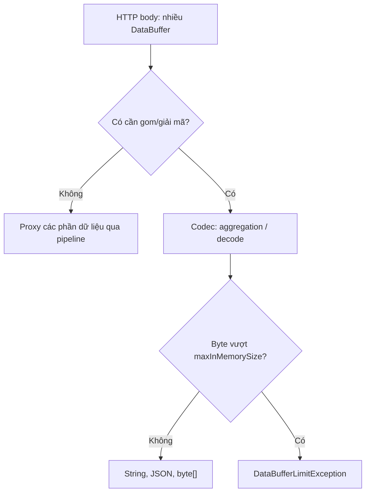

# Giới hạn bộ đệm codec và `DataBufferLimitException` trong Spring Cloud Gateway

**Spring Cloud Gateway** đảm nhận route predicate, filter chain và chuyển tiếp HTTP đến các microservice. Khi Gateway chỉ định tuyến và chuyển tiếp các mảnh dữ liệu, một request lớn không nhất thiết phải được gom nguyên vẹn vào RAM. Tuy nhiên, khi ứng dụng hoặc filter muốn **đọc/biến đổi HTTP body** — như `ModifyRequestBody`, `ModifyResponseBody`, `CacheRequestBody` hoặc một decoder JSON — dữ liệu có thể phải được tích lũy đến một giới hạn đã cấu hình.

Khi tích lũy vượt ngưỡng, bạn có thể thấy:

```text
org.springframework.core.io.buffer.DataBufferLimitException:
Exceeded limit on max bytes to buffer : 262144
```

Bài thuộc chương **Nội dung HTTP**, giải thích giới hạn codec, bản chất của `DataBufferLimitException`, cách xác định chính xác thành phần gây lỗi và thiết kế Gateway không lãng phí bộ nhớ.

> **Phạm vi phiên bản:** Các ví dụ dùng **Spring Cloud Gateway Server WebFlux 5.0.x** với Spring Cloud 2025.1 / Spring Boot 4. Route YAML dùng `spring.cloud.gateway.server.webflux.routes`; cấu hình codec của Spring Boot 4 là `spring.http.codecs.max-in-memory-size`. Đừng tự sao chép `spring.codec.max-in-memory-size` từ những hướng dẫn cho bản Boot cũ. Server Web MVC có runtime Servlet và bộ API xử lý body khác.

## 1. Kết quả học tập

Sau bài này, bạn sẽ có thể:

1. Phân biệt `DataBuffer`, codec và `maxInMemorySize`.
2. Hiểu vì sao proxy streaming có thể khác với decode body thành `String`/JSON.
3. Đọc `DataBufferLimitException` và khoanh vùng request, response hoặc custom `WebClient`.
4. Cấu hình giới hạn codec đúng bản Spring Boot, đồng thời nhận biết phạm vi hiệu lực.
5. Phân biệt `RequestSize`, multipart, timeout và codec buffering.
6. Thực hành tái hiện lỗi, đo đạc và chọn giải pháp an toàn trước tải đồng thời.

## 2. `DataBuffer` và quá trình tích lũy dữ liệu

WebFlux biểu diễn body bằng một chuỗi `DataBuffer`; mỗi buffer chứa một phần byte nhận từ mạng. `Decoder` chuyển những byte đó thành đối tượng Java: `String`, `byte[]`, JSON object hoặc một phần dữ liệu form.

**Không phải decoder nào cũng cần toàn bộ body.** Khi một decoder cần tạo một giá trị đơn, nó thường phải giữ dữ liệu đến lúc đủ để hoàn tất. Đây là lý do xuất hiện **codec buffer limit**.



### 2.1. Vì sao thường là 256 KiB?

Nhiều codec mặc định của Spring WebFlux có giới hạn khoảng **256 KiB = 262.144 byte** nếu không được cấu hình khác đi. Đây là giới hạn trong **thao tác gom dữ liệu của codec**, **không phải** một quy tắc nói rằng mọi request lớn hơn 256 KiB đều bị Gateway chặn.

Ví dụ:

| Đường xử lý | Có thể phải gom toàn bộ body? | Ý nghĩa đối với giới hạn codec |
|---|---|---|
| Route chỉ dùng `Path` và `StripPrefix` | Thường không | Không nên mặc định gặp giới hạn 256 KiB vì proxy |
| Controller nhận `@RequestBody Mono<String>` | Có | Một String lớn có thể vượt ngưỡng |
| `ModifyRequestBody(String.class, ...)` | Thường cần decode request | Có thể gặp giới hạn |
| `ModifyResponseBody(String.class, ...)` | Thường cần decode response | Có thể gặp giới hạn |
| `CacheRequestBody` với `String.class` | Có đọc và lưu body | Có thể gặp giới hạn |
| NDJSON/SSE được parse thành từng event | Gom theo từng phần tử tùy decoder | Giới hạn có thể áp dụng cho **mỗi phần tử** |
| Multipart file part | Có cơ chế parser riêng | Ngưỡng in-memory còn liên quan đến ghi đĩa |
| Download file không transform | Có thể streaming | Còn các giới hạn khác ngoài codec |

**Backpressure không xóa bỏ nhu cầu có giới hạn bộ đệm.** Các operator gom như `collectList`/`join` hoặc decoder tạo một object vẫn có thể tiêu thụ bộ nhớ đáng kể, dù dữ liệu vận chuyển theo luồng reactive.

### 2.2. `DataBufferLimitException` thực sự là gì?

`org.springframework.core.io.buffer.DataBufferLimitException` thuộc Spring Framework, kế thừa `IllegalStateException`. Nó cho biết số byte đã tiêu thụ để tích lũy vượt giới hạn đặt trước. Ngoại lệ có thể xuất hiện tại:

- `DataBufferUtils.join(...)` khi ghép nhiều buffer;
- decoder tạo một `String`/`byte[]`/object từ request hoặc response;
- bộ giải mã stream gom byte cho một JSON record hoặc một sự kiện SSE;
- form reader hoặc cơ chế cache body bên trong filter.

Lỗi **không đồng nghĩa** với `OutOfMemoryError`. Trái lại, giới hạn giúp ngăn một thao tác đơn lẻ giữ quá nhiều byte. Nhưng nếu tăng giới hạn không kiểm soát, hệ thống vẫn có thể gặp áp lực RAM, GC, direct memory và số kết nối đồng thời.

## 3. Đọc stacktrace, không đoán chỉ từ HTTP status

Dòng thường gặp:

```text
DataBufferLimitException: Exceeded limit on max bytes to buffer : 262144
    at org.springframework.core.io.buffer.LimitedDataBufferList...
    ...
```

Số `262144` tính bằng **byte**, tương ứng 256 KiB. Đây không phải 262.144 ký tự Unicode; một ký tự UTF-8 có thể cần nhiều byte.

| Dấu hiệu trong stacktrace | Điểm cần điều tra |
|---|---|
| `StringDecoder`, `Jackson...Decoder` hoặc `bodyToMono` | Một giá trị đang được giải mã từ body |
| `LimitedDataBufferList`, `DataBufferUtils.join` | Có bước tích lũy byte |
| `ModifyRequestBody`, `CacheRequestBody` | Request body có thể bị đọc/cache |
| `ModifyResponseBody`, `ClientResponse` | Response body có thể bị gom/biến đổi |
| Custom `WebClient` | Codec của HTTP client được tạo ở đâu? |
| `MultipartHttpMessageReader` | Giới hạn multipart/part hoặc disk cần được kiểm tra |

Các câu hỏi chẩn đoán đầu tiên là: **lỗi xuất hiện ở request hay response?** Có filter nào đọc body không? Decoder có được tạo từ codec auto-configured của Spring Boot không? Có người gọi `join` hoặc `collect` trước khi chuyển tiếp không?

### 3.1. `DataBufferLimitException` có luôn trả HTTP 413 không?

**Không.** HTTP status thực tế phụ thuộc vị trí exception và cách ứng dụng xử lý:

- Nếu decoder đọc request body và ứng dụng có bộ xử lý ngoại lệ phù hợp, có thể trả mã lỗi theo hợp đồng API.
- Nếu lỗi xảy ra lúc filter đọc **response** upstream, Gateway có thể đã bắt đầu ghi dữ liệu về client; không phải lúc nào cũng có thể đổi status.
- Nếu không có xử lý riêng, phản hồi có thể là `5xx` hoặc kết nối bị kết thúc, tùy runtime.

`413 Payload Too Large` là mã hợp lý cho chính sách từ chối một **request** quá lớn, nhưng **không** phải kết quả mặc định bắt buộc của mọi `DataBufferLimitException`.

### 3.2. Phân biệt các loại giới hạn

| Cơ chế | Giới hạn đối tượng nào? |
|---|---|
| Codec `maxInMemorySize` | Byte được gom/giải mã cho một đối tượng/phần tử |
| Gateway `RequestSize` | Kích thước request được cho phép theo route |
| Ingress/proxy body limit | Request bị nhận/từ chối tại lớp biên ngoài |
| Multipart configuration | Bộ nhớ, dung lượng đĩa và số lượng part |
| Backend payload policy | Dữ liệu mà từng microservice chấp nhận |
| Timeout | Thời gian chờ request/response |
| RateLimiter | Số request theo user, tenant, khóa đáng tin cậy |

Một Gateway bảo mật tốt cần **nhiều lớp bảo vệ**, không dùng `max-in-memory-size` để thay tất cả những loại giới hạn khác.

## 4. Cấu hình codec trên Spring Boot 4

Spring Boot 4 sử dụng property:

```yaml
spring:
  http:
    codecs:
      max-in-memory-size: 512KB
```

Nó đặt giới hạn byte được phép gom khi codec cần aggregation, trong phạm vi **WebFlux server** và `WebClient` được Spring Boot tự cấu hình. Nếu chưa khai báo, từng codec dùng mặc định riêng; nhiều codec giới hạn khoảng 256 KiB.

### 4.1. Tích hợp với route Gateway

```yaml
server:
  port: 8080

spring:
  application:
    name: body-limit-demo
  http:
    codecs:
      max-in-memory-size: 256KB # Chủ đích chọn mức thấp cho lab
  cloud:
    gateway:
      server:
        webflux:
          routes:
            - id: raw-proxy
              uri: http://localhost:9001
              predicates:
                - Path=/raw/**
              filters:
                - StripPrefix=1
```

Trong ví dụ, `spring.http.codecs.max-in-memory-size` là cấu hình **codec**, còn `spring.cloud.gateway.server.webflux.routes` là cấu hình **định tuyến**. `StripPrefix=1` chỉ xóa segment `raw` khỏi request path; nó không tự đọc body hoặc đặt quota cho toàn bộ payload.

### 4.2. Property có hiệu lực ở đâu?

Không khẳng định một property luôn điều chỉnh **mọi** bộ đệm trong ứng dụng. Ví dụ `ModifyRequestBody`, `ModifyResponseBody`, custom `HttpMessageReader` và một `WebClient` dựng bằng `WebClient.builder()` có thể sử dụng codec hoặc `HandlerStrategies` được tạo độc lập.

Khi đã khai báo giới hạn mà lỗi vẫn còn:

1. Kiểm tra tên property đúng phiên bản Spring Boot.
2. Đọc stacktrace để thấy decoder và bộ lọc nào đang phát sinh lỗi.
3. Xác minh component dùng `ServerCodecConfigurer`/`ClientCodecConfigurer` nào; có tạo riêng readers/writers không.
4. Thử bỏ filter body transformation nếu không bắt buộc.
5. Chỉ nâng giới hạn ở đúng vị trí khi payload nghiệp vụ thực sự cần được buffer.

Một `WebClient` được tạo thủ công có thể cấu hình riêng:

```java
import org.springframework.web.reactive.function.client.WebClient;

WebClient client = WebClient.builder()
        .codecs(configurer ->
            configurer.defaultCodecs().maxInMemorySize(512 * 1024))
        .build();
```

Thiết lập trên dành cho **WebClient ấy**. Nó không tự thay mọi `WebClient` khác hay codec được một GatewayFilter dùng. Không dùng `-1` (bỏ giới hạn) để xử lý lỗi một cách mặc định.

## 5. Lab: tái hiện `DataBufferLimitException` bằng `Mono<String>`

Để tách vấn đề codec khỏi các chi tiết triển khai filter, tạo một **WebFlux controller trong cùng ứng dụng Gateway**. Controller đọc request body thành một `String` duy nhất; khi body lớn hơn codec limit, bạn có thể quan sát exception.

### 5.1. Ứng dụng

Chọn Spring Boot 4 và Spring Cloud 2025.1 với starter **Spring Cloud Gateway Server WebFlux**. Dependency Maven chính:

```xml
<dependency>
    <groupId>org.springframework.cloud</groupId>
    <artifactId>spring-cloud-starter-gateway-server-webflux</artifactId>
</dependency>
```

Dự án thực tế cần Spring Cloud BOM và Spring Boot parent/plugin tương thích; snippet trên không phải `pom.xml` hoàn chỉnh.

Class khởi động:

```java
import org.springframework.boot.SpringApplication;
import org.springframework.boot.autoconfigure.SpringBootApplication;

@SpringBootApplication
public class BodyLimitApplication {
    public static void main(String[] args) {
        SpringApplication.run(BodyLimitApplication.class, args);
    }
}
```

Controller đặt trong package được Spring Boot quét:

```java
import org.springframework.http.MediaType;
import org.springframework.web.bind.annotation.PostMapping;
import org.springframework.web.bind.annotation.RequestBody;
import org.springframework.web.bind.annotation.RestController;
import reactor.core.publisher.Mono;

@RestController
public class CodecLabController {
    @PostMapping(
        path = "/lab/decode",
        consumes = MediaType.TEXT_PLAIN_VALUE,
        produces = MediaType.TEXT_PLAIN_VALUE)
    public Mono<String> decode(@RequestBody Mono<String> body) {
        return body.map(value -> "chars=" + value.length());
    }
}
```

`Mono<String>` cần một String hoàn chỉnh. Controller trả số ký tự và **không** ghi raw body vào log. Vì không có route Gateway khớp `/lab/decode`, request tới path này được controller WebFlux tiếp nhận.

### 5.2. Tạo dữ liệu ASCII và kiểm thử

Trên Windows PowerShell 5.1, trong thư mục thực hành, tạo hai file với ký tự `a` (mỗi ký tự ASCII là một byte):

```powershell
[System.IO.File]::WriteAllText("$PWD\payload-100k.txt", ('a' * (100 * 1024)), [System.Text.Encoding]::ASCII)
[System.IO.File]::WriteAllText("$PWD\payload-300k.txt", ('a' * (300 * 1024)), [System.Text.Encoding]::ASCII)

(Get-Item .\payload-100k.txt).Length
(Get-Item .\payload-300k.txt).Length
```

Độ dài mong đợi: `102400` và `307200` byte. Khi dùng UTF-8 với ký tự tiếng Việt, số ký tự Java có thể khác số byte; giới hạn codec tính theo **byte**.

Khởi động Gateway:

```powershell
.\mvnw.cmd spring-boot:run
```

Gửi body 100 KiB:

```powershell
curl.exe -i -X POST -H "Content-Type: text/plain" --data-binary "@payload-100k.txt" http://localhost:8080/lab/decode
```

Kết quả bình thường với `max-in-memory-size: 256KB`:

```text
HTTP/1.1 200 OK

chars=102400
```

Sau đó thử body 300 KiB:

```powershell
curl.exe -i -X POST -H "Content-Type: text/plain" --data-binary "@payload-300k.txt" http://localhost:8080/lab/decode
```

Với `Mono<String>` phải gom 300 KiB, codec giới hạn 256 KiB thường ném `DataBufferLimitException`. Hãy xem stacktrace và **ghi lại HTTP status thực tế**, không mặc định luôn là 413.

Đổi `max-in-memory-size` từ `256KB` thành `512KB`, khởi động lại và gửi lại body 300 KiB. Với controller dùng codec WebFlux do Boot tự cấu hình, request có thể thành công, trả:

```text
chars=307200
```

Nếu vẫn lỗi, kiểm tra binding cấu hình và các codec tùy biến. Lab này **chứng minh giới hạn decoder của controller**, không bảo đảm mọi filter nội bộ dùng cùng codec.

## 6. Thử proxy streaming để so sánh

Giờ dựng backend đọc request theo từng mảnh `8 KiB`, không biến cả body thành một `String`.

Tạo `StreamEchoBackend.java`:

```java
import com.sun.net.httpserver.HttpServer;
import java.net.InetSocketAddress;
import java.nio.charset.StandardCharsets;

public class StreamEchoBackend {
    private static final long MAX_BYTES = 1024L * 1024L;

    public static void main(String[] args) throws Exception {
        HttpServer server = HttpServer.create(
                new InetSocketAddress("127.0.0.1", 9001), 0);

        server.createContext("/echo", exchange -> {
            long total = 0;
            byte[] buffer = new byte[8192];

            try (var input = exchange.getRequestBody()) {
                int n;
                while ((n = input.read(buffer)) != -1) {
                    total += n;
                    if (total > MAX_BYTES) {
                        exchange.sendResponseHeaders(413, -1);
                        exchange.close();
                        return;
                    }
                }
            }

            byte[] output = ("receivedBytes=" + total + "\n")
                    .getBytes(StandardCharsets.UTF_8);
            exchange.getResponseHeaders().set(
                    "Content-Type", "text/plain; charset=utf-8");
            exchange.sendResponseHeaders(200, output.length);
            try (var response = exchange.getResponseBody()) {
                response.write(output);
            }
        });

        server.start();
        System.out.println("Backend on localhost:9001");
    }
}
```

Chạy backend trên terminal khác:

```powershell
java --add-modules jdk.httpserver StreamEchoBackend.java
```

Giữ route `/raw/**`, `StripPrefix=1` và codec limit `256KB` tại Gateway. Dùng cùng payload 300 KiB:

```powershell
curl.exe -i -X POST -H "Content-Type: text/plain" --data-binary "@payload-300k.txt" http://localhost:8080/raw/echo
```

Khi route chỉ proxy byte, không có filter đọc body nào khác, bạn có thể nhận:

```text
HTTP/1.1 200 OK
receivedBytes=307200
```

`/lab/decode` có thể lỗi trong khi `/raw/echo` vẫn thành công vì **decode một giá trị** và **chuyển tiếp dữ liệu theo luồng** là hai cơ chế khác nhau. Nhưng proxy vẫn có buffer mạng, connection pool, giới hạn backend và quota hệ thống; streaming không có nghĩa payload có thể lớn vô hạn.

## 7. Body filters: khi Gateway phải gom request/response

Hai filter quan trọng của **Server WebFlux**:

- **`ModifyRequestBody`** đọc và biến đổi request body trước khi chuyển tới backend.
- **`ModifyResponseBody`** đọc và biến đổi response body từ backend trước khi gửi về client.

Theo tài liệu chính thức, cả hai được cấu hình qua **Java DSL**. Khi yêu cầu chuyển nguyên body thành `String` hoặc JSON object, một codec thường phải tích lũy dữ liệu; khi payload lớn, đó là nơi có thể gặp `DataBufferLimitException`.

Ví dụ minh họa một route có phép biến đổi response body:

```java
import java.util.Locale;
import org.springframework.cloud.gateway.route.RouteLocator;
import org.springframework.cloud.gateway.route.builder.RouteLocatorBuilder;
import org.springframework.context.annotation.Bean;
import org.springframework.context.annotation.Configuration;
import reactor.core.publisher.Mono;

@Configuration
public class BodyRewriteRoutes {
    @Bean
    RouteLocator rewriteRoutes(RouteLocatorBuilder builder) {
        return builder.routes()
            .route("rewrite-text", r -> r
                .path("/rewrite/**")
                .filters(f -> f
                    .stripPrefix(1)
                    .modifyResponseBody(
                        String.class,
                        String.class,
                        (exchange, body) ->
                            body == null
                                ? Mono.empty()
                                : Mono.just(body.toUpperCase(Locale.ROOT))))
                .uri("http://localhost:9001"))
            .build();
    }
}
```

Ví dụ minh họa API, **không phải lời khuyên bật body rewrite cho tất cả response**. Đặc biệt, khi chỉ muốn chỉnh header hoặc path, dùng các filter chuyên biệt: `AddRequestHeader`, `RemoveResponseHeader`, `RewritePath`, `StripPrefix`... Chúng không cần biến toàn bộ payload thành String.

### 7.1. Body thường không thể đọc lại tùy ý

Dữ liệu reactive từ request được tiêu thụ theo luồng. Nếu một custom `GlobalFilter` tự subscribe vào `exchange.getRequest().getBody()` rồi không decorate/cache request đúng cách, backend có thể nhận body rỗng hoặc bị lỗi.

`CacheRequestBody` của Gateway giúp trường hợp thật sự cần cache, nhưng việc cache:

- làm tăng chi phí bộ nhớ;
- có thể kích hoạt giới hạn decoder;
- yêu cầu quản lý lifecycle dữ liệu khi lỗi, retry hoặc client cancel;
- không nên tự động áp dụng cho mọi route.

Chỉ cache request body khi có yêu cầu nghiệp vụ; với payload lớn, cân nhắc đổi thiết kế để không cần đọc lại toàn bộ.

### 7.2. `DataBuffer` và giải phóng bộ nhớ

Trong WebFlux chạy trên Reactor Netty, một số `DataBuffer` được cấp phát trên bộ nhớ pooled/direct memory. Nếu tự viết code xử lý `DataBuffer`, phải hiểu rõ quyền sở hữu, thời điểm `retain`/`release` và xử lý khi bị hủy.

- Không giữ tham chiếu buffer lâu hơn lifecycle của nó.
- Không gọi `subscribe()` bằng tay để log body rồi bỏ quên forwarding/cleanup.
- Có thể tham khảo `DataBufferUtils.join(publisher, maxByteCount)` nếu cần gom **có giới hạn**, nhưng phải xử lý buffer trả về và giải phóng đúng cách.
- Tránh biến một luồng byte thành String chỉ để đếm byte hoặc tìm một header.

Sai vòng đời buffer có thể làm tăng bộ nhớ theo thời gian hoặc gây lỗi khi request bị hủy, **ngay cả khi đã nâng codec limit**.

## 8. `RequestSize`: từ chối request quá lớn theo chính sách

Nếu nghiệp vụ chỉ chấp nhận request tối đa `1MB`, dùng filter `RequestSize` cho route phù hợp thay vì chỉ chỉnh codec limit:

```yaml
spring:
  cloud:
    gateway:
      server:
        webflux:
          routes:
            - id: bounded-upload
              uri: http://localhost:9001
              predicates:
                - Path=/api/upload/**
              filters:
                - name: RequestSize
                  args:
                    maxSize: 1MB
                - StripPrefix=1
```

Theo tài liệu Gateway, filter `RequestSize` từ chối request vượt mức và có thể trả **HTTP 413 Payload Too Large** cùng thông tin lỗi. Đó là chính sách về **kích thước request**, không phải việc đặt `maxInMemorySize` cho codec.

| Câu hỏi | `RequestSize` | Codec `maxInMemorySize` |
|---|---|---|
| Giới hạn tổng HTTP request theo route? | Mục đích chính | Không phải mục đích chính |
| Điều khiển decoder `Mono<String>`? | Không | Có, nếu decoder thuộc phạm vi config |
| Ảnh hưởng response body lớn? | Không phải bộ lọc response | Có thể, khi response bị decode |
| Status 413 được mô tả rõ? | Có, theo tài liệu filter | Không bảo đảm với mọi exception |
| Dùng cùng lúc được không? | Có | Có |

Các tình huống streaming/chunked không có `Content-Length` cần kiểm thử riêng trên version đang chạy. Nếu dùng ingress/reverse proxy, đặt thêm request body quota ngoài Gateway để từ chối lưu lượng quá mức sớm hơn.

### 8.1. `RequestSize` không phải rate limiting

- `RequestSize` kiểm soát **kích thước** của một request.
- `RequestRateLimiter` kiểm soát **tần suất** request theo khóa như user/tenant, khi cấu hình đúng.
- `Timeout`, `CircuitBreaker` và `Retry` xử lý độ trễ, lỗi upstream hoặc việc gửi lại.

Chúng có thể cùng xuất hiện trên một route nhưng không thay thế lẫn nhau. Với request non-idempotent như `POST /payments`, bật retry không kiểm soát còn có nguy cơ thực hiện tác động nghiệp vụ nhiều lần.

## 9. Multipart: ngưỡng RAM khác với dung lượng file

Multipart upload có các property riêng trong WebFlux. Trên Spring Boot 4 có thể cấu hình:

```yaml
spring:
  webflux:
    multipart:
      max-in-memory-size: 256KB
      max-disk-usage-per-part: 20MB
      max-parts: 10
```

Ý nghĩa:

- `max-in-memory-size`: ngưỡng giữ dữ liệu của một part trong RAM; với **file part**, nó thường là ngưỡng để dữ liệu được ghi ra đĩa, không phải quota upload toàn phần.
- `max-disk-usage-per-part`: giới hạn dung lượng lưu một part trên đĩa.
- `max-parts`: giới hạn số part trong request.

Các property này dành cho **multipart parser**, khác `spring.http.codecs.max-in-memory-size`. Giá trị mặc định có thể thay đổi giữa các release; không đoán mặc định của Boot 4 từ ví dụ Boot 3.

Nếu Gateway chỉ proxy multipart thô mà không parse body, các property parser có thể không được sử dụng. Nếu có filter đọc/cache multipart, hãy kiểm tra cả bộ nhớ, disk, xử lý file tạm, giới hạn số part và quyền truy cập thư mục tạm. Với upload rất lớn, kiến trúc streaming hoặc upload trực tiếp tới object storage thường phù hợp hơn việc gom toàn bộ file trong Gateway.

## 10. Vì sao không tăng giới hạn lên thật lớn?

Giả sử bạn nâng buffer limit lên `4 MiB`. Với `200` request đồng thời, mỗi request có thể cần gần `4 MiB` dữ liệu tích lũy:

```text
200 request × 4 MiB ≈ 800 MiB dữ liệu gốc
```

Đây chỉ là phép tính minh họa, **chưa** tính object sau decode, bản sao để biến đổi body, JSON tree, Netty direct memory, connection pool, heap overhead và GC. Một giới hạn trên cho **một thao tác buffering** không phải ngân sách bộ nhớ của cả JVM.

Cách giảm rủi ro:

1. **Không đọc body nếu không cần.** Route predicate, TLS, kiểm tra JWT hay đổi header/path không đòi hỏi tự gom payload.
2. **Giới hạn request ở ranh giới ngoài.** Ingress, Gateway `RequestSize` và backend nên có quota nhất quán theo nghiệp vụ.
3. **Chỉ tăng vừa đủ.** Dựa trên phân bố kích thước payload, tải đồng thời và headroom bộ nhớ thực.
4. **Chọn streaming khi có thể.** Đặc biệt cho file, video, report lớn, SSE hoặc NDJSON.
5. **Phân biệt request với response.** Response lớn bị `ModifyResponseBody` gom lại gây rủi ro dù client chỉ gửi GET nhỏ.
6. **Quan sát hủy request và lỗi.** Nếu client ngắt kết nối, các buffer phải được dọn đúng lifecycle.
7. **Kiểm thử retry/circuit breaker.** Retry có thể khiến một logical request gọi backend nhiều lần, kéo dài tài nguyên đang giữ.

## 11. Quy trình chẩn đoán `DataBufferLimitException`

Một quy trình có thể áp dụng khi production xảy ra lỗi:

| Bước | Cần tìm | Tại sao |
|---|---|---|
| 1 | Request ID, route ID, method, path template | Xác định đúng tuyến và logical request |
| 2 | Request body hay response body? | Phân biệt dữ liệu client gửi và upstream trả |
| 3 | Filter/decoder trong stacktrace | Tìm vị trí thật sự gom byte |
| 4 | Giá trị limit hiện hành | Đối chiếu con số byte trong exception |
| 5 | Codec lấy từ Boot hay tự tạo | Tránh sửa property không có tác dụng |
| 6 | Kích thước payload thực tế, loại `Content-Type` | Thiết kế test và quota đúng |
| 7 | Heap, direct memory, GC, concurrency, p95/p99 | Đánh giá tác động khi tăng giới hạn |
| 8 | Các trường hợp lỗi/cancel/timeout | Kiểm tra memory cleanup và response commit |

**Không** ghi raw body, `Authorization`, cookie, access token hoặc dữ liệu cá nhân để tìm nguyên nhân. Sử dụng log có cấu trúc, correlation ID, route ID và sampling thích hợp.

### 11.1. Actuator cho biết gì?

Nếu đã thêm `spring-boot-starter-actuator`, có thể bật endpoint Gateway ở chế độ chỉ đọc trên 5.0.x:

```yaml
management:
  endpoint:
    gateway:
      access: read-only
  endpoints:
    web:
      exposure:
        include: health,info,gateway
```

Sau khi khởi động lại:

```bash
curl -i http://localhost:8080/actuator/gateway/routes
curl -i http://localhost:8080/actuator/gateway/globalfilters
```

Actuator giúp quan sát route và filter đã đăng ký, nhưng **không tự nói** codec gây lỗi đang có giới hạn byte nào. Kết hợp stacktrace, cấu hình thực tế và test theo kích thước payload. Trong production, endpoint quản trị cần có giới hạn truy cập mạng và xác thực phù hợp.

### 11.2. Khi lỗi xảy ra trong response

Nếu Gateway đã bắt đầu gửi response và một bộ lọc sau đó mới gặp lỗi decode, header/status có thể đã được commit. Vì vậy **đừng mặc định** một `onErrorResume` cuối chuỗi luôn có thể biến lỗi thành JSON `413`. Cần thiết kế exception handling theo thời điểm response có thể thay đổi, và kiểm chứng bằng backend trả chậm, trả response lớn hoặc client hủy kết nối.

## 12. Các ngộ nhận phổ biến

| Ngộ nhận | Thực tế |
|---|---|
| “Gateway chặn mọi body lớn hơn 256 KiB.” | Đây thường là giới hạn codec khi **gom**; proxy streaming có thể không áp dụng ngưỡng ấy. |
| “Tăng property là chữa mọi nơi.” | Custom decoder, `WebClient` và body filter có thể có codec riêng. |
| “`DataBufferLimitException` luôn trả 413.” | Status phụ thuộc exception handling; `RequestSize` mới mô tả rõ hành vi 413. |
| “`Content-Length` nhỏ là chắc chắn an toàn.” | Header có thể thiếu/sai; dữ liệu nén hoặc một JSON record lớn vẫn có vấn đề. |
| “`Flux` không bao giờ buffer.” | Decoder streaming vẫn có thể tích lũy theo **mỗi phần tử**. |
| “Backpressure thay thế memory quota.” | Không; `join`/`collect` hoặc codec có thể gom toàn bộ dữ liệu. |
| “File multipart hơn 256 KiB luôn bị từ chối.” | Ngưỡng memory của file part có thể kích hoạt ghi đĩa; cần quota disk/file riêng. |
| “Nâng giới hạn 10 MiB nghĩa là JVM chỉ dùng tối đa 10 MiB.” | Concurrency, object copy và direct memory có thể nhân nhu cầu bộ nhớ lên nhiều lần. |
| “Log full body giúp debug an toàn.” | Payload có thể lớn, chứa bí mật hoặc PII; chỉ log metadata an toàn. |

## 13. Vận dụng cho các loại route microservices

| Route | Đặc điểm | Hướng xử lý |
|---|---|---|
| `/api/orders/**` | JSON nghiệp vụ vừa/nhỏ | Quota body rõ ràng; chỉ decode khi cần validate/transform |
| `/api/media/upload/**` | File multipart lớn | Streaming, disk quota, kiểm soát loại file; tránh `String` toàn body |
| `/api/reports/**` | Response lớn | Proxy streaming, tránh `ModifyResponseBody` toàn report nếu không cần |
| `/api/events/**` | SSE hoặc NDJSON | Xử lý theo event/record, giới hạn từng record, heartbeat |
| `/api/payments/**` | Request không idempotent | Giới hạn request và retry theo chính sách idempotency |
| `/api/auth/**` | Cookie, JWT và dữ liệu nhạy cảm | Xác thực/phân quyền, không ghi body/token nhạy cảm |

Mỗi route còn cần chính sách **rate limiting**, timeout, circuit breaker, retry, TLS inbound/outbound và metrics/tracing. Không có một `maxInMemorySize` duy nhất thay thế các chính sách này.

## 14. Câu hỏi tự kiểm tra

**Câu 1.** `DataBufferLimitException` thường xuất hiện khi nào?

**Đáp án:** Khi một decoder hoặc thao tác join/cache tích lũy dữ liệu vượt giới hạn byte đã cấu hình.

**Câu 2.** Vì sao 300 KiB có thể được proxy thành công trong khi `Mono<String>` decoder thất bại?

**Đáp án:** Proxy có thể chuyển từng mảnh byte; `Mono<String>` cần tạo một giá trị từ body và chịu codec buffer limit.

**Câu 3.** Property codec trên Spring Boot 4 là gì?

**Đáp án:** `spring.http.codecs.max-in-memory-size`, ví dụ `512KB`. Chú ý phạm vi auto-configuration.

**Câu 4.** `262144` trong thông báo lỗi là số ký tự hay byte?

**Đáp án:** Byte; tương đương 256 KiB. Số ký tự có thể khác số byte khi dùng UTF-8.

**Câu 5.** `DataBufferLimitException` có chắc trả `413` không?

**Đáp án:** Không. Phụ thuộc vị trí lỗi, exception handler và response commit.

**Câu 6.** `RequestSize` và codec max-in-memory-size có thay thế nhau không?

**Đáp án:** Không. Một bên quản lý kích thước request theo route; bên kia giới hạn thao tác buffering của codec.

**Câu 7.** Multipart file hơn 256 KiB có luôn bị từ chối vì `max-in-memory-size: 256KB` không?

**Đáp án:** Không. Với file part, ngưỡng ấy thường chuyển sang lưu đĩa; cần giới hạn disk/size/part riêng.

**Câu 8.** Tại sao đặt buffer 10 MiB có thể rủi ro khi có nhiều request đồng thời?

**Đáp án:** Mỗi request có thể gom gần giới hạn, cộng với dữ liệu giải mã, bản sao, Netty buffer và overhead, làm tổng bộ nhớ lớn hơn rất nhiều.

**Bài tập:** Chạy lab ở mục 5 với codec `256KB`. Gửi `payload-300k.txt` tới `/lab/decode` và `/raw/echo`, ghi kết quả. Sau đó nâng giới hạn lên `512KB`, khởi động lại và thử lại. Giải thích nơi nào cần aggregation, nơi nào streaming, và đề xuất `RequestSize` cho API chỉ chấp nhận request tối đa 1 MiB.

## 15. Tài liệu chính thức

- [Spring Boot 4.0 — Common Application Properties, codec limit](https://docs.spring.io/spring-boot/4.0/appendix/application-properties/index.html).
- [Spring Framework 7.0 — WebFlux Reactive Core, Limits](https://docs.spring.io/spring-framework/reference/7.0/web/webflux/reactive-spring.html).
- [Spring Framework — DataBufferLimitException Javadoc](https://docs.spring.io/spring-framework/docs/current/javadoc-api/org/springframework/core/io/buffer/DataBufferLimitException.html).
- [Spring Cloud Gateway 5.0 — ModifyRequestBody](https://docs.spring.io/spring-cloud-gateway/reference/5.0/spring-cloud-gateway-server-webflux/gatewayfilter-factories/modifyrequestbody-factory.html).
- [Spring Cloud Gateway 5.0 — ModifyResponseBody](https://docs.spring.io/spring-cloud-gateway/reference/5.0/spring-cloud-gateway-server-webflux/gatewayfilter-factories/modifyresponsebody-factory.html).
- [Spring Cloud Gateway 5.0 — CacheRequestBody](https://docs.spring.io/spring-cloud-gateway/reference/5.0/spring-cloud-gateway-server-webflux/gatewayfilter-factories/cacherequestbody-factory.html).
- [Spring Cloud Gateway 5.0 — RequestSize](https://docs.spring.io/spring-cloud-gateway/reference/5.0/spring-cloud-gateway-server-webflux/gatewayfilter-factories/requestsize-factory.html).
- [Spring Cloud Gateway 5.0 — How It Works](https://docs.spring.io/spring-cloud-gateway/reference/5.0/spring-cloud-gateway-server-webflux/how-it-works.html).
- [Spring Framework — DataBufferUtils](https://docs.spring.io/spring-framework/docs/current/javadoc-api/org/springframework/core/io/buffer/DataBufferUtils.html).

**Ghi nhớ:** `DataBufferLimitException` là dấu hiệu rằng **một thao tác đang gom/giải mã body** vượt ngưỡng; nó không tự chứng minh mọi HTTP payload lớn hơn ngưỡng đều bị cấm. Muốn vận hành Spring Cloud Gateway bền vững, hãy tìm đúng decoder, cấu hình giới hạn phù hợp, tách request-size policy khỏi codec limit và **ưu tiên streaming nếu không cần đọc toàn bộ body**.
