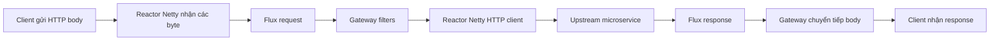
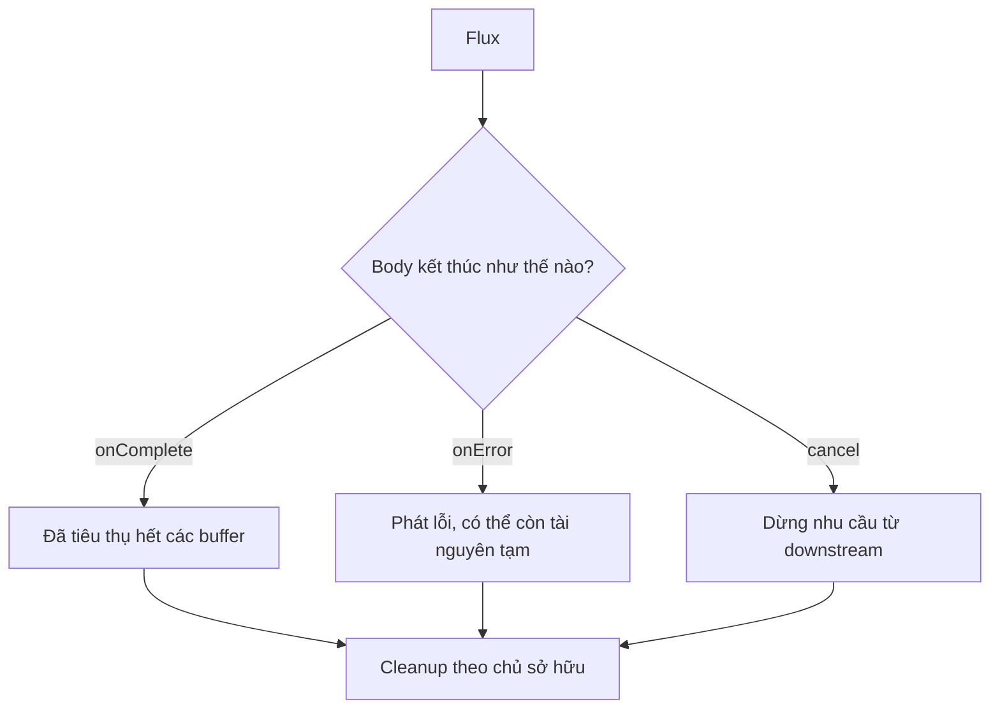
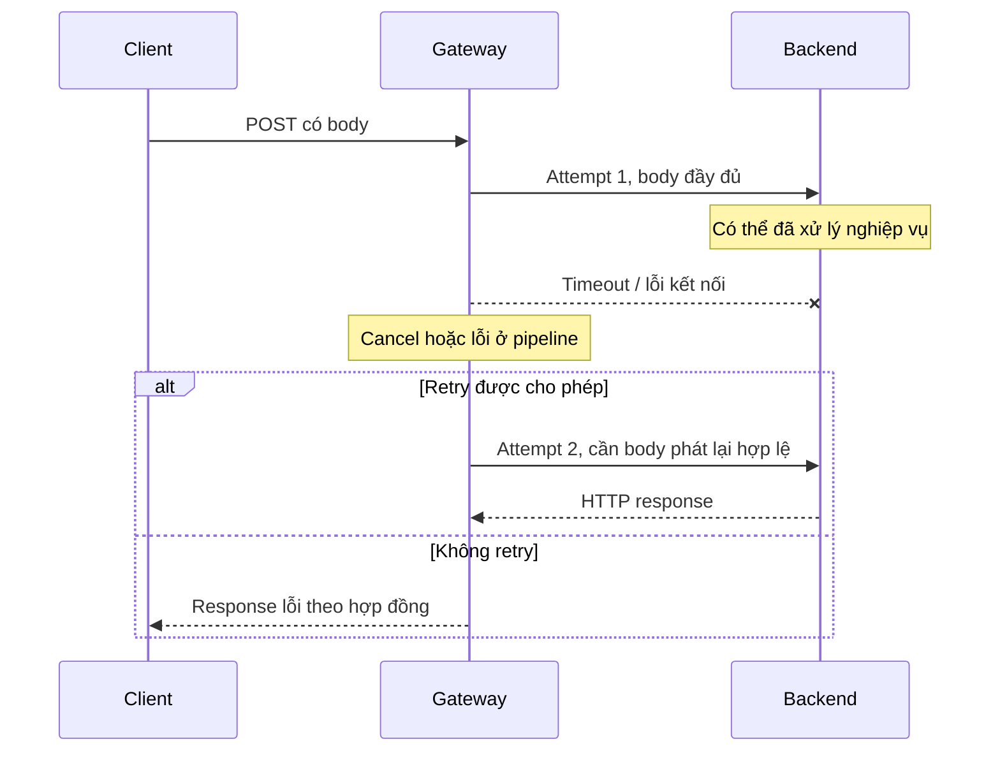

# DataBuffer, giữ/thả bộ đệm và phòng tránh rò rỉ bộ nhớ

Trong **Spring Cloud Gateway Server WebFlux**, phần thân HTTP (request body và response body) thường được truyền qua một luồng `Flux<DataBuffer>`. Mỗi `DataBuffer` chứa một phần dữ liệu nhị phân; nhiều phần được phát dần theo nhu cầu của downstream. Cơ chế này giúp API Gateway chuyển tiếp request/response lớn mà không nhất thiết phải giữ toàn bộ nội dung trong bộ nhớ.

Tuy nhiên, khi Gateway cần kiểm tra chữ ký, ghi nhận kích thước, thay đổi JSON body, cache body để retry hoặc thực hiện filter tự viết, câu hỏi quan trọng xuất hiện: **ai sở hữu từng buffer, khi nào được giữ (`retain`), khi nào phải thả (`release`), và phải làm gì nếu lỗi hoặc client hủy request?** Sai sót ở đây có thể gây rò rỉ bộ nhớ trực tiếp (off-heap), lỗi truy cập bộ nhớ đã giải phóng, tăng độ trễ hoặc làm Gateway hết tài nguyên trong lúc vẫn còn heap Java.

Bài thuộc chương **Nội dung HTTP**, tập trung vào vòng đời `DataBuffer` trong nền tảng Reactor, Spring WebFlux và Spring Cloud Gateway, kèm ví dụ Java, bảng quyết định sở hữu tài nguyên, chiến lược giới hạn body, cách kiểm thử và các tình huống vận hành thực tế.

> **Phạm vi:** Ví dụ áp dụng cho Spring Cloud Gateway **Server WebFlux** dùng Reactor/Netty. Gateway Server MVC vận hành trên mô hình request/response khác. Những đoạn mã thấp cấp về `DataBuffer` chỉ nên dùng khi thực sự cần; ưu tiên filter body có sẵn của Gateway nếu có thể.

## 1. Tại sao Gateway phải quản lý bộ đệm?

HTTP message có thể mang body lớn hoặc stream liên tục: JSON request, file tải lên, file download, Server-Sent Events (SSE), video hoặc response được tạo từng phần. Với WebFlux, body thường không phải một chuỗi `String` đã nằm sẵn trong RAM.



Một `DataBuffer` là giao diện trừu tượng của Spring cho vùng dữ liệu byte, có các thao tác như đọc, ghi, xác định số byte có thể đọc và lấy các view dữ liệu. Hai tình huống nền tảng thường gặp:

| Loại buffer | Đặc điểm | Điều cần nhớ |
| --- | --- | --- |
| Buffer thông thường, ví dụ tạo bằng `DefaultDataBufferFactory` | Có thể dựa trên bộ nhớ heap; không nhất thiết có reference counting | `release` thường không có việc gì phải giải phóng |
| Buffer dựa trên Netty, ví dụ `NettyDataBuffer` với `ByteBuf` | Có thể dùng direct/off-heap memory và cơ chế đếm tham chiếu | Giữ quá lâu gây leak; release quá sớm gây lỗi truy cập |

Không phải mọi `DataBuffer` đều dùng bộ nhớ ngoài heap hoặc `ByteBuf` pooled. Code cần làm việc qua abstraction `DataBuffer` / `DataBufferUtils`, tránh giả định mọi triển khai đều có cùng cơ chế cấp phát.

### Tại sao rò rỉ off-heap khó nhận biết?

Khi reference count của một pooled `ByteBuf` không bao giờ về 0, pool không thể tái sử dụng vùng nhớ đúng lúc. Java GC có thể vẫn chạy bình thường, heap graph không biểu hiện rõ nguyên nhân, nhưng Gateway tăng sử dụng **direct memory** và mất khả năng phục vụ tải lớn. Ngược lại, gọi `release` quá nhiều khiến vùng byte bị thu hồi khi publisher khác vẫn cần đọc, dẫn đến lỗi hoặc dữ liệu không hợp lệ.

**Hai hướng đều nguy hiểm:** không release đủ gây leak; release quá sớm hoặc nhiều lần gây sử dụng tài nguyên đã được giải phóng.

## 2. Mô hình sở hữu (`ownership`) và reference counting

Với buffer có đếm tham chiếu, hãy hình dung tài nguyên cần tồn tại cho tới khi **mọi bên đang sở hữu** đã xong việc. `DataBufferUtils.retain(buffer)` và `DataBufferUtils.release(buffer)` là các API Spring dùng để quản lý vòng đời tương ứng khi buffer hỗ trợ pooling.

```text
Một pooled buffer đang được sở hữu (refCnt = 1)
  |
  +-- retain() --> refCnt = 2
  |                  |
  |                  +-- bên giữ thêm hoàn tất -> release() -> refCnt = 1
  |
  +-- chủ sở hữu còn lại hoàn tất ----------- -> release() -> refCnt = 0
                                                 tài nguyên có thể tái sử dụng
```

Ví dụ số đếm ở trên minh họa nguyên lý của một `ByteBuf` ref-counted. Mức đếm khởi đầu và chi tiết thực hiện có thể khác giữa các loại buffer và khi vùng nhớ được chia sẻ theo view/slice/composite.

Các thao tác quan trọng:

| API | Vai trò | Dùng khi nào |
| --- | --- | --- |
| `DataBufferUtils.retain(buffer)` | Giữ thêm tham chiếu nếu buffer có hỗ trợ pooling | Một bên khác cần dùng buffer sau khi bên chủ hiện tại có thể hoàn tất |
| `DataBufferUtils.release(buffer)` | Giải phóng một tham chiếu nếu buffer có hỗ trợ pooling | Thành phần **đang sở hữu** đã dùng xong dữ liệu |
| `DataBufferUtils.touch(buffer, hint)` | Gắn gợi ý để hỗ trợ theo dõi leak trên buffer có hỗ trợ | Chẩn đoán vòng đời trong test/điều tra |
| `DataBufferUtils.releaseConsumer()` | `Consumer<DataBuffer>` hỗ trợ thả buffer | Dùng tại pipeline mà consumer chịu trách nhiệm release |

### Quy tắc sở hữu tối thiểu

1. **Nhận rồi chuyển tiếp nguyên vẹn cho framework:** nếu chỉ quan sát và chuyển cùng buffer xuống downstream, **đừng release thủ công**; bên tiêu thụ theo hợp đồng sẽ quản lý nó.
2. **Nhận và tự tiêu thụ, không chuyển tiếp:** sau khi xử lý xong dữ liệu, phần code nhận quyền sở hữu phải **release** buffer, kể cả khi xảy ra exception.
3. **Cần giữ buffer vượt ra ngoài vòng đời bên gửi:** phải cân nhắc `retain` trước khi chuyển quyền sở hữu và phải có cleanup tương ứng ở mọi đường kết thúc.
4. **Buffer bị loại bỏ khỏi một chuỗi Reactive:** cần cơ chế `discard` phù hợp cho các toán tử hỗ trợ, tránh mất tham chiếu tới buffer chưa release.
5. **Không chắc ai sở hữu:** không thêm `retain`/`release` đoán mò. Đọc hợp đồng API nhận/trả buffer và xác định trách nhiệm ở đúng điểm chuyển giao.

### Ví dụ sai: vừa chuyển tiếp vừa release

```java
// SAI: downstream còn cần dùng buffer để gửi HTTP body.
Flux<DataBuffer> unsafe = inboundBody
    .doOnNext(buffer -> {
        log.debug("bytes={}", buffer.readableByteCount());
        DataBufferUtils.release(buffer); // Thả quá sớm.
    });

return response.writeWith(unsafe);
```

`response.writeWith(unsafe)` sẽ nhận những buffer có thể đã bị thả. Với pooled buffer, nguy cơ là lỗi khi HTTP writer cố đọc dữ liệu.

**Đúng nếu chỉ ghi kích thước:**

```java
Flux<DataBuffer> observed = inboundBody
    .doOnNext(buffer ->
        log.debug("bytes={}", buffer.readableByteCount()));

return response.writeWith(observed);
```

Đoạn mã chỉ đọc `readableByteCount()`, không thay con trỏ đọc và không giữ buffer; HTTP writer vẫn chịu trách nhiệm tiêu thụ dữ liệu.

## 3. Tín hiệu Reactor liên quan trực tiếp tới cleanup

Một body publisher có thể:

- Phát các `onNext(DataBuffer)` và kết thúc thành công bằng `onComplete`.
- Phát một hoặc vài buffer rồi thất bại bằng `onError`.
- Bị `cancel` do client ngắt kết nối, timeout hoặc downstream không cần dữ liệu.
- Bị cắt bởi operator như `take`, `filter` hoặc bởi một nhánh fallback.



Cancellation **không phải** tín hiệu `onError`. Ví dụ toán tử `timeout` thường hủy upstream rồi phát `TimeoutException` xuống downstream. Vì vậy một bộ đếm ở phía source có thể thấy `CANCEL`, còn bộ đếm sau `timeout` lại thấy `ON_ERROR` trong cùng request.

Nếu cần ghi nhận ba kiểu kết thúc:

```java
return bodyProcessing
    .doOnError(error -> log.warn("body processing failed", error))
    .doFinally(signal -> log.debug("body pipeline finished: {}", signal));
```

`doFinally` phù hợp với quan sát hoặc cleanup tài nguyên **mà code sở hữu rõ ràng**. Không dùng `doFinally` để gọi `release` cho mọi buffer đã từng đi qua `Flux`: buffer có thể đã được writer giải phóng hoặc vẫn đang do một thành phần khác sở hữu.

### `doOnDiscard` và các toán tử loại bỏ dữ liệu

Một số toán tử Reactor có thể **bỏ qua** phần tử `DataBuffer` đã được nhận mà không phát xuống subscriber. Với những toán tử **hỗ trợ discard hook**, có thể đăng ký:

```java
Flux<DataBuffer> selected = source
    .filter(this::shouldKeep)
    .doOnDiscard(DataBuffer.class, DataBufferUtils::release);
```

Đây là ví dụ về cơ chế discard trên `Flux<DataBuffer>` tổng quát; **không dùng lọc tùy tiện từng chunk như vậy để xử lý HTTP body thật**, vì loại chunk có thể phá hỏng nội dung HTTP. Khi `filter` bỏ một buffer, hook cho phép release buffer bị loại. Buffer được giữ lại vẫn chuyển tiếp cho downstream và **không** được release tại hook.

Cần lưu ý:

- `doOnDiscard` chỉ có tác dụng với operator có hỗ trợ discard; không thể đảm bảo mọi operator, nguồn hoặc side effect tùy chỉnh đều báo cho hook.
- Vị trí đặt hook ảnh hưởng những operator nào được bao phủ. Đặt nó ở đoạn pipeline có thể loại bỏ buffer và xác minh bằng test.
- Không vừa `release` trực tiếp cho buffer bị loại vừa đăng ký một hook khác cũng release chính buffer đó.
- Đối với buffer được giữ trong queue hoặc cache tùy chỉnh, người viết queue/cache vẫn phải tự thiết kế cleanup khi lỗi hoặc cancel.

## 4. Đọc toàn bộ body bằng `DataBufferUtils.join`

Khi cần xác minh chữ ký hoặc parse payload, một cách phổ biến là **gom các buffer thành một vùng dữ liệu**. Spring cung cấp `DataBufferUtils.join(...)` để tổng hợp một `Publisher<DataBuffer>` thành một `Mono<DataBuffer>`.

`join` có thể tạo buffer tổng hợp từ nhiều thành phần hoặc cơ chế gộp tùy `DataBufferFactory`; **không được giả định nó luôn tạo một bản sao byte độc lập**. Khi nhận được buffer gộp, code tiêu thụ nó chịu trách nhiệm release theo hợp đồng.

### Ví dụ an toàn: sao chép sang `byte[]` và giải phóng buffer gộp

```java
static Mono<byte[]> copyBody(Flux<DataBuffer> body) {
    int maxBytes = 1024 * 1024; // 1 MiB cho ví dụ.

    return DataBufferUtils.join(body, maxBytes)
        .map(joined -> {
            try {
                byte[] copy = new byte[joined.readableByteCount()];
                joined.read(copy);
                return copy;
            } finally {
                DataBufferUtils.release(joined);
            }
        })
        .defaultIfEmpty(new byte[0]);
}
```

Giải thích:

1. `join(body, maxBytes)` thu các buffer với giới hạn **tổng lượng dữ liệu có thể tích lũy**. Nếu vượt ngưỡng, có thể phát `DataBufferLimitException`.
2. `joined.readableByteCount()` xác định số byte cần sao chép.
3. `joined.read(copy)` chuyển dữ liệu vào mảng byte của ứng dụng.
4. `finally` đảm bảo buffer gộp được `release` ngay cả khi code trong `map` ném exception.
5. Nếu publisher không phát buffer nào, `join` có thể hoàn tất rỗng; `defaultIfEmpty` biến nó thành mảng byte rỗng cho helper này.

**Vòng đời bên trong `join`:** Khi upstream lỗi hoặc bị cancel trong quá trình ghép, `DataBufferUtils.join` có cơ chế giải phóng các buffer đã tích lũy. Sau khi phát ra một `DataBuffer` hoàn chỉnh, thành phần nhận kết quả phải release khi dùng xong. Không release riêng các buffer thành phần mà `join` đã nhận quyền quản lý, vì điều đó có thể tạo double-release.

### Tại sao vẫn cần giới hạn body?

Nếu 1.000 client đồng thời gửi body 10 MiB và Gateway gom toàn bộ, riêng payload đã có thể chiếm xấp xỉ **10 GiB** dữ liệu trong bộ nhớ trước overhead. Với ứng dụng Gateway có tính chất chuyển tiếp, sao chép toàn bộ body có thể triệt tiêu lợi thế streaming/backpressure.

Tùy trường hợp, có thể cấu hình giới hạn bộ nhớ cho WebFlux codecs, ví dụ:

```yaml
spring:
  codec:
    max-in-memory-size: 1MB
```

Đây là giới hạn liên quan đến các thao tác codec/buffer hóa trong hệ sinh thái Spring; nó **không thay thế** giới hạn ở mọi code tùy chỉnh. Đối với `DataBufferUtils.join(body, maxBytes)`, ngưỡng `maxBytes` được truyền trực tiếp vào helper riêng. Cần xác minh cấu hình tương thích với Spring Boot/Spring Framework phiên bản đang dùng và thiết kế thêm giới hạn tại reverse proxy/Gateway phù hợp.

Nếu body lớn hơn giới hạn, hãy xử lý lỗi theo **hợp đồng API đã định nghĩa** (ví dụ response thích hợp cho nội dung quá lớn, thường là HTTP `413 Content Too Large` khi đúng ngữ cảnh) và đảm bảo response chưa commit. Đừng mặc định mọi `DataBufferLimitException` sẽ tự được chuyển thành đúng một HTTP status cố định.

## 5. Đọc body không có nghĩa là backend vẫn nhận được body

Một hiểu nhầm phổ biến khi viết `GatewayFilter`:

```java
// SAI về mặt luồng nghiệp vụ:
// body request có thể đã bị tiêu thụ trước khi Gateway proxy.
return copyBody(exchange.getRequest().getBody())
    .flatMap(bytes -> {
        log.info("received {} bytes", bytes.length);
        return chain.filter(exchange);
    });
```

Publisher body thường **được thiết kế để tiêu thụ khi có subscription** và không đảm bảo có thể đọc lại. Sau khi `copyBody` đọc hết dữ liệu, `chain.filter(exchange)` vẫn nhận request gốc nhưng upstream có thể thấy body rỗng, body bị mất một phần hoặc lỗi đọc lần hai.

Để **vừa kiểm tra vừa chuyển tiếp**, phải chủ động bảo toàn dữ liệu trong request được truyền xuống chain. Các lựa chọn:

- Dùng **`ModifyRequestBody`** khi cần giải mã/biến đổi payload theo kiểu dữ liệu rồi ghi lại body mới qua cơ chế framework.
- Dùng **`CacheRequestBody`** khi cần tái sử dụng body cho filter tiếp theo; chú ý chi phí bộ nhớ và cleanup do cơ chế cache quản lý.
- Nếu tự viết filter, phải tạo `ServerHttpRequestDecorator` cung cấp body thay thế và quản lý buffer mới đúng vòng đời, kể cả khi bị cancel hoặc retry.
- Nếu chỉ cần quan sát kích thước/counters, ưu tiên **streaming pass-through** thay vì đọc hết body.

Không gọi `subscribe()` trong `GatewayFilter` để “đọc trước cho nhanh”: subscription phụ tách khỏi vòng đời request, dễ gây race condition, mất body và leak khi client ngắt kết nối.

### Ví dụ DSL: dùng cơ chế sửa body có sẵn

Một route có thể sử dụng Java DSL của Gateway WebFlux:

```java
@Bean
RouteLocator bodyRoutes(RouteLocatorBuilder builder) {
    return builder.routes()
        .route("orders", r -> r
            .path("/api/orders/**")
            .filters(f -> f
                .modifyRequestBody(
                    String.class,
                    String.class,
                    (exchange, originalBody) -> {
                        // Ví dụ giữ nguyên nội dung sau khi framework decode.
                        return Mono.justOrEmpty(originalBody);
                    }))
            .uri("http://localhost:8081"))
        .build();
}
```

Đây là ví dụ sử dụng builder hỗ trợ `modifyRequestBody` để minh họa **quyền sở hữu buffer do Gateway filter factory quản lý**. Chữ ký overload và hỗ trợ media type có thể khác theo phiên bản; cần cấu hình đúng codec, content type và schema khi đổi payload thực tế. Để body không đổi, việc chạy qua decode/encode thường là không cần thiết và có overhead; đừng thêm filter này chỉ để logging.

Nếu thực sự biến đổi JSON, kiểm tra rằng body sau chuyển đổi là JSON hợp lệ, header `Content-Type` đúng, độ dài body được framework xử lý phù hợp và các thuộc tính bảo mật/chữ ký không còn dựa trên byte gốc.

## 6. Quan sát response body mà không giữ hoặc thả buffer

Một `GlobalFilter` có thể decorate response để ghi nhận kích thước từng chunk mà không tiêu thụ body:

```java
@Component
public class ResponseSizeFilter implements GlobalFilter, Ordered {

    private static final Logger log =
        LoggerFactory.getLogger(ResponseSizeFilter.class);

    @Override
    public int getOrder() {
        return -1;
    }

    @Override
    public Mono<Void> filter(
            ServerWebExchange exchange,
            GatewayFilterChain chain) {

        ServerHttpResponseDecorator decorated =
            new ServerHttpResponseDecorator(exchange.getResponse()) {
                @Override
                public Mono<Void> writeWith(
                        Publisher<? extends DataBuffer> body) {
                    return super.writeWith(
                        Flux.from(body).doOnNext(buffer ->
                            log.debug("response chunk: {} bytes",
                                buffer.readableByteCount())));
                }
            };

        return chain.filter(
            exchange.mutate().response(decorated).build());
    }
}
```

Các kiểu dùng trong ví dụ gồm `GlobalFilter`, `Ordered`, `GatewayFilterChain`, `ServerWebExchange`, `ServerHttpResponseDecorator`, `Publisher`, `DataBuffer`, `Flux`, `Mono` và các kiểu log phù hợp.

**Vì sao không leak ở thao tác đo?** Callback chỉ đọc số byte có thể đọc và chuyển **cùng buffer** cho writer, không thêm `retain` và không `release`. Writer tiếp tục sở hữu việc tiêu thụ/làm sạch theo hợp đồng.

**Giới hạn ví dụ:** `writeWith(...)` chưa bao phủ mọi kiểu ghi, đặc biệt `writeAndFlushWith(...)` thường dùng cho luồng có flush theo từng nhóm (ví dụ SSE). Nếu yêu cầu metric đầy đủ cho streaming, cần xử lý thêm phương thức phù hợp hoặc dùng observability có sẵn. Đừng đổi body thành một chuỗi để “tiện log”, vì có thể phá streaming và gây rò rỉ thông tin.

## 7. Khi nào cần `retain` và cách tránh giữ quá lâu

`retain` chỉ nên dùng khi có **hai vòng đời sở hữu độc lập**. Ví dụ, một thành phần cần chuyển buffer cho HTTP writer và đồng thời một tác vụ bất đồng bộ khác cần giữ vùng byte sau thời điểm writer có thể xong việc.

Với pooled buffer, nếu cả hai bên cùng giữ một tham chiếu mà không `retain`, một bên có thể release khi bên kia vẫn dùng. Nếu `retain` nhưng không cleanup ở nhánh lỗi/hủy, pool sẽ bị leak. Bởi vậy lựa chọn an toàn hơn trong nhiều bài toán quan sát là **sao chép một phần dữ liệu nhỏ, có giới hạn** sang dạng độc lập rồi cho writer tiếp tục sử dụng buffer gốc.

| Nhu cầu | Cách tiếp cận | Rủi ro cần kiểm soát |
| --- | --- | --- |
| Đếm byte, đo latency | Quan sát metadata rồi pass-through | Không giải phóng nhầm buffer |
| Hash/checksum streaming | Xử lý từng chunk không chặn thread và chuyển tiếp nguyên vẹn nếu được phép | Không thay đổi reader index, không giữ references ngoài vòng đời |
| Log preview tối đa vài trăm byte | Sao chép đúng số byte cho phép, làm sạch dữ liệu nhạy cảm | Tránh log token/PII, giới hạn overhead |
| Giữ body để kiểm tra chữ ký trước khi proxy | Dùng filter body/caching có giới hạn | Body một lần đọc, cleanup khi lỗi/hủy |
| Retain buffer cho tác vụ async | `retain` và cặp `release` theo ownership rõ ràng | Double release hoặc thiếu release |
| Toàn bộ response lớn | Streaming pass-through | Không gom body vào RAM |

### Những bẫy cụ thể với retain

**Bẫy 1 — `retain` mỗi lần `onNext` rồi không có nơi release:** số đếm tăng mà không giảm. Sau hàng triệu request, direct memory bị giữ lại.

**Bẫy 2 — chuyển buffer sang tác vụ nền độc lập:** nếu tác vụ không gắn với `Mono`/`Flux` chính, cancellation từ client không dừng nó và cleanup có thể không chạy.

**Bẫy 3 — dùng chung một buffer qua nhiều subscription:** publisher body có thể bị subscribe lại do retry hoặc fallback; nếu re-emit một pooled buffer đã release thì sử dụng sau giải phóng. Cache/replay yêu cầu cơ chế retention và phát lại được thiết kế chủ đích.

**Bẫy 4 — `release` cả bản gốc lẫn composite từ `join`:** composite có thể đang sở hữu các thành phần bên trong; release hai lần phá ownership.

**Bẫy 5 — giữ buffer trong field của singleton filter:** dễ trộn dữ liệu giữa request, tạo race condition, tăng memory retention và lộ dữ liệu người dùng.

Khi không có bằng chứng cần chia sẻ buffer qua thời gian, **ưu tiên chuyển tiếp mà không `retain`**.

## 8. Request body, retry và circuit breaker tại Gateway

Spring Cloud Gateway có thể áp `Retry` hoặc `CircuitBreaker` lên route. Với request không có body, retry tương đối đơn giản về dữ liệu đầu vào. Với request có body, **mỗi lần gửi lại cần một nguồn body có thể phát lại hợp lệ**.

Ví dụ:

```http
POST /api/payments HTTP/1.1
Content-Type: application/json

{"orderId":"o-42","amount":250000}
```

Nếu request đầu tiên đến backend, backend đã ghi thanh toán nhưng Gateway bị timeout trước khi nhận response, một lần retry có thể tạo thanh toán trùng. Nếu Gateway không thể phát lại body đúng cách, lần retry có thể mang body rỗng hoặc hỏng. Hai vấn đề **độc lập**:

1. **Đúng dữ liệu kỹ thuật:** body phải được cache/replay và quản lý `DataBuffer` an toàn qua mọi attempt.
2. **Đúng nghiệp vụ:** chỉ retry khi thao tác có idempotency key/chính sách chống lặp hoặc được xác định là an toàn.



Gateway filter xử lý caching/retry có thể sử dụng bộ đệm tham chiếu để phục vụ nhiều attempt; không tự giải phóng buffer do filter tích hợp đang sở hữu. Nếu tự viết cơ chế retry hoặc cache, phải thiết kế cleanup khi thành công, lỗi, cancel và khi giới hạn retry kết thúc.

**Rate limiting** hoạt động tốt nhất khi từ chối sớm, trước khi tốn bộ nhớ đọc body lớn. **Circuit breaker** cần fallback đúng hợp đồng; không trả `200` mặc định khi upstream lỗi và body phản hồi không còn ý nghĩa. **TLS** bảo vệ dữ liệu trên đường truyền, nhưng không tự giải quyết leak trong bộ nhớ Gateway.

## 9. Lỗi và cancellation khi xử lý body

Những trường hợp sau cần được phân biệt:

| Sự kiện | Tác động lên stream | Hành động cần thiết |
| --- | --- | --- |
| Client ngắt kết nối giữa upload | Downstream có thể cancel request body upstream | Dọn tài nguyên đã sở hữu, không tiếp tục đọc body vô hạn |
| Backend đóng kết nối sớm | Response/request pipeline có thể lỗi hoặc cancel | Không giữ buffer trong queue không được cleanup |
| Vượt giới hạn gom body | `join`/codec có thể phát `DataBufferLimitException` | Giải phóng buffer đã tích lũy; tạo lỗi HTTP phù hợp |
| Decode JSON lỗi | Publisher có thể `onError` sau khi nhận một phần dữ liệu | Tránh giữ buffer/byte[] tạm không có giới hạn |
| Timeout giữa response streaming | Response có thể đã commit | Không cố đổi HTTP status sau commit; đóng stream và quan sát lỗi |
| Toán tử bỏ chunk | Buffer không đến downstream | Dùng discard hook/cleanup đúng operator và ownership |
| Retry với request body | Có thể subscribe lại hoặc tái sử dụng cache | Bảo đảm replay và release tài nguyên khi hết attempts |

Một ví dụ dễ mắc lỗi:

```java
// SAI: block() trên đường xử lý reactive của Gateway.
byte[] bytes = copyBody(exchange.getRequest().getBody()).block();
return chain.filter(exchange);
```

Lỗi ở đây gồm việc chặn event-loop và tiêu thụ request body rồi vẫn chuyển request gốc. Trong Gateway WebFlux, pipeline cần được **nối bất đồng bộ**:

```java
// Đây chỉ là minh họa kết hợp bất đồng bộ.
// Nếu muốn proxy request gốc sau khi đọc body, còn phải dựng body mới.
return copyBody(exchange.getRequest().getBody())
    .flatMap(bytes -> validateBody(bytes));
```

`validateBody` trong minh họa cần trả về một `Mono` phù hợp; đoạn mã chỉ cho thấy cách nối xử lý, **chưa phải** filter hoàn chỉnh để forward body. Muốn tiếp tục `chain.filter(exchange)` với body hợp lệ, hãy sử dụng cơ chế rewrite/decorator đúng như mục 5.

### Không biến lỗi DataBuffer thành lỗi HTTP sai hợp đồng

- Body vượt giới hạn có thể được trả bằng `413` nếu đó là chính sách được thiết kế.
- JSON không hợp lệ có thể tương ứng `400`; dữ liệu hợp lệ về cú pháp nhưng sai nghiệp vụ có thể dùng mã khác theo hợp đồng.
- Lỗi kết nối upstream thường thuộc nhóm `502`/`503`/`504` tùy nguồn và chính sách timeout.
- Client hủy upload không nhất thiết có một response HTTP cuối cùng còn gửi được.

Không dùng `onErrorResume` để luôn trả thành công hoặc nuốt mọi exception; làm vậy có thể che lỗi bộ nhớ và gây khó đo sự cố.

## 10. Cách debug rò rỉ bộ nhớ trên Reactor Netty

### Dấu hiệu nghi ngờ

- Direct memory hoặc mức sử dụng bộ nhớ của process/container tăng theo lưu lượng rồi không hồi phục như dự kiến.
- Gateway giảm throughput, tăng latency hoặc xuất hiện lỗi liên quan `ByteBuf`/reference count.
- Log có cảnh báo Netty như `LEAK: ByteBuf.release() was not called before it's garbage-collected`.
- Lỗi chỉ xuất hiện ở các route có request/response body lớn, filter tùy chỉnh hoặc retry.

**Không kết luận leak chỉ vì pool dùng nhiều bộ nhớ.** Pool có thể giữ bộ nhớ để tái sử dụng và resident memory không nhất thiết giảm ngay sau mỗi request. Cần xem tăng trưởng qua các chu kỳ tải, giới hạn pool, log và khả năng tái sử dụng.

### Bật leak detection có kiểm soát

Netty có cơ chế phát hiện buffer không được release. Trong môi trường test hoặc chẩn đoán, có thể tăng mức phát hiện bằng JVM system property phù hợp:

```bash
-Dio.netty.leakDetection.level=advanced
```

Giá trị `advanced` cung cấp nhiều thông tin hơn mức đơn giản; `paranoid` có thể hữu ích trong test cô lập nhưng tốn overhead lớn. Không bật mức chi tiết cao vô thời hạn trong production nếu chưa đo tác động. Log leak detection là **chỉ dấu hỗ trợ**, không thay thế phân tích luồng sở hữu; một leak không được phát hiện bởi sampling vẫn có thể tồn tại.

Có thể gắn hint với `DataBufferUtils.touch(buffer, "route=orders,stage=body-check")` tại nơi thích hợp để hỗ trợ truy dấu nếu buffer hỗ trợ leak tracking. Không dùng hint chứa token, dữ liệu cá nhân hoặc payload.

### Quy trình tìm nguyên nhân

1. Xác định route và filter có đọc/ghi body, đặc biệt filter tự viết, body cache, retry và fallback.
2. Phân biệt tuyến **pass-through** với tuyến **consume-and-drop** hoặc **cache/replay**.
3. Với mọi `DataBuffer` bị giữ, đánh dấu ai sở hữu sau từng operator và điều kiện nào kết thúc ownership.
4. Kiểm tra ba lối kết thúc: **complete, error, cancel**. Một code path thành công không chứng minh nhánh timeout được cleanup.
5. Nếu dùng `join`, xem nơi buffer gộp được release; nếu dùng discard, xem operator có hỗ trợ `doOnDiscard` không.
6. Tạo tải lặp với body đủ lớn, thử client ngắt kết nối giữa chừng và backend lỗi; theo dõi memory/allocator metrics và log Netty.
7. Sau khi sửa, chạy lại cùng kịch bản để xem tài nguyên có ổn định hay không, và xác minh body upstream không bị hỏng.

## 11. Kiểm thử quản lý buffer

### Kiểm thử helper đọc body

Có thể dùng `StepVerifier` từ `reactor-test` để kiểm tra một helper như `copyBody`:

```java
@Test
void joinsAndCopiesSmallBody() {
    DataBufferFactory factory = new DefaultDataBufferFactory();

    Flux<DataBuffer> body = Flux.just(
        factory.wrap("hello ".getBytes(StandardCharsets.UTF_8)),
        factory.wrap("gateway".getBytes(StandardCharsets.UTF_8))
    );

    StepVerifier.create(copyBody(body))
        .assertNext(bytes -> assertEquals(
            "hello gateway",
            new String(bytes, StandardCharsets.UTF_8)))
        .verifyComplete();
}
```

Test xác nhận kết quả byte, nhưng `DefaultDataBufferFactory` thường **không** mô phỏng mọi rủi ro reference-counting của Netty pooled memory. Muốn kiểm tra leak/double-release, cần thêm test với implementation pooled phù hợp, leak detector, các tình huống cancel/error và kiểm chứng trạng thái reference count nếu API thử nghiệm cho phép.

### Kiểm thử vượt ngưỡng

```java
@Test
void rejectsBodyLargerThanLimit() {
    DataBufferFactory factory = new DefaultDataBufferFactory();
    Flux<DataBuffer> body = Flux.just(
        factory.wrap(new byte[2 * 1024 * 1024])
    );

    StepVerifier.create(copyBody(body))
        .expectError(DataBufferLimitException.class)
        .verify();
}
```

Kỳ vọng trên phụ thuộc helper dùng ngưỡng 1 MiB như mục 4. Test không tự xác nhận xử lý HTTP `413` vì `copyBody` là helper thấp tầng; HTTP status cần được kiểm tra ở integration test của Gateway và error handler tương ứng.

### Kiểm thử Gateway end-to-end

Sử dụng `WebTestClient`, WireMock/MockWebServer hoặc upstream giả lập để xác nhận:

| Kịch bản | Assertion quan trọng |
| --- | --- |
| POST JSON nhỏ đi qua filter | Upstream nhận **đủ** byte, đúng `Content-Type` và body |
| Body bị biến đổi theo hợp đồng | Upstream nhận JSON hợp lệ, đúng schema, không lỗi `Content-Length` |
| Upload lớn vượt giới hạn | Request bị xử lý theo policy, không lưu toàn bộ body vô hạn |
| Client ngắt giữa upload | Cancellation xảy ra, không có task đọc độc lập tiếp tục vô hạn |
| Backend đóng kết nối sớm | Resource/connection/buffer được cleanup trên nhánh error |
| Retry request có body | Mỗi attempt nhận payload chính xác; không có release trước hạn |
| Response streaming | Các chunk được chuyển tiếp, không bị gom thành một buffer lớn |
| Response bị cancel giữa stream | Buffer đã giữ được cleanup, không còn subscription thừa |
| Tải đồng thời kéo dài | Direct memory và số connection không tăng không giới hạn |

Đừng kiểm tra leak chỉ bằng HTTP `200` hoặc bằng một test phát đúng một buffer. Nhiều lỗi chỉ lộ ra sau **nhiều chunk**, khi **cancel sau khi đã nhận một phần dữ liệu**, hoặc khi **hai attempt cùng truy cập tài nguyên bị share sai**.

## 12. Những lỗi triển khai thường gặp

| Lỗi | Vì sao nguy hiểm | Cách xử lý |
| --- | --- | --- |
| `release` trong `doOnNext` rồi trả cùng buffer cho writer | Writer có thể đọc vùng nhớ đã được giải phóng | Chỉ quan sát rồi pass-through; writer quản lý việc tiêu thụ |
| `join` rồi đọc dữ liệu nhưng không `release` buffer gộp | Leak pooled memory | Dùng `try/finally` như `copyBody` |
| Release buffer thành phần đã được `join` sở hữu | Double release | Chỉ release buffer kết quả theo hợp đồng |
| `retain` mà thiếu release trên cancel/error | Reference count không về 0 | Liệt kê rõ mọi owner và cleanup trên mọi nhánh |
| Đọc body rồi gọi `chain.filter(exchange)` với request gốc | Body không còn đảm bảo phát lại | Dùng `ModifyRequestBody`/cache/decorator đúng cách |
| `subscribe()` trong filter | Tạo công việc độc lập với lifecycle của request | Trả về `Mono`/`Flux` được kết hợp vào chain |
| `block()` trên event-loop | Chặn xử lý các request khác | Dùng operator bất đồng bộ; cô lập I/O chặn nếu bắt buộc |
| Gom toàn bộ body không giới hạn | Dễ OOM/DoS khi concurrency cao | Giới hạn bytes, concurrency, timeout và streaming |
| Cố log toàn bộ body | Tốn bộ nhớ và có thể lộ token/PII | Log metadata hoặc preview an toàn có giới hạn |
| Tự sửa body nhưng giữ `Content-Length` cũ | Client/backend đọc thiếu hoặc chờ thêm byte | Sử dụng framework body rewrite; kiểm tra header sau biến đổi |
| Retry `POST` không idempotency | Có thể thực hiện nghiệp vụ nhiều lần | Dùng idempotency key và policy retry chặt |
| Không kiểm thử cancellation | Leak chỉ xuất hiện khi client ngắt kết nối | Thêm test abort/timeout với pooled buffer |
| Sửa response status sau khi streaming đã commit | Không thể đổi status đã gửi | Xử lý lỗi trước commit hoặc kết thúc stream đúng chuẩn |

### Khi nào không cần chạm đến `DataBuffer`?

Nếu chỉ muốn đổi path/header, xử lý route predicate, xác thực, rate limit, circuit breaker hoặc TLS, thường **không cần truy cập request/response body**. Hãy dùng các Gateway filters và Spring Security có sẵn. Mỗi lần can thiệp vào body là thêm trách nhiệm đối với:

- Kích thước dữ liệu và backpressure.
- Ownership/reference count.
- Semantics của request body khi retry.
- Tính đúng đắn của content type/encoding/length.
- Cleanup khi error/cancellation.
- Bảo mật nội dung và hiệu năng.

## 13. Bài tập thực hành: kiểm tra giới hạn JSON trước khi proxy

Một Gateway phục vụ `POST /api/orders` đến `order-service`. Nhóm phát triển muốn kiểm tra JSON body tối đa **1 MiB**, ghi số byte vào metric và vẫn chuyển tiếp body nguyên vẹn. Request bị client hủy trong lúc upload phải dừng an toàn; request quá lớn phải bị từ chối theo HTTP contract và không để Gateway giữ buffer vô hạn.

### Một phương án thiết kế

1. Dùng route predicate `Path` và `Method` để chọn `POST /api/orders`; Spring Security xử lý JWT/scope ở tầng WebFilter.
2. Ưu tiên cơ chế codec/`ModifyRequestBody` hoặc body validation có giới hạn, tránh tự subscribe/request body nhiều lần.
3. Nếu dùng `DataBufferUtils.join`, đặt `maxBytes=1_048_576` và giải phóng buffer gộp sau khi đã lấy nội dung cần thiết.
4. Khi body hợp lệ, cung cấp **body mới** qua cơ chế request decoration/rewrite do framework quản lý để `order-service` nhận đầy đủ dữ liệu.
5. Với body quá lớn, dùng error mapping phù hợp trước khi response commit và xác minh cleanup trên nhánh lỗi/cancel.
6. Đếm byte bằng metadata ở mức streaming khi có thể; không log payload hoặc token.
7. Test request hợp lệ, request rỗng, request vượt ngưỡng, client abort, upstream timeout và retry nếu route có bật retry.

### Câu hỏi tự kiểm tra

1. Vì sao `DataBufferUtils.release(buffer)` có thể là no-op trên một loại buffer nhưng cực kỳ quan trọng trên loại khác?
2. `retain` làm gì với reference count, và khi nào phải có release tương ứng?
3. Nếu một buffer đã được chuyển cho HTTP writer, vì sao không được release ngay trong `doOnNext`?
4. `DataBufferUtils.join(body, maxBytes)` có giúp tránh gom body vô hạn không? Ai release buffer được phát ra sau `join`?
5. Vì sao `copyBody(exchange.getRequest().getBody())` rồi gọi `chain.filter(exchange)` không đảm bảo backend còn body?
6. Khi `filter` của Reactor loại `DataBuffer`, vai trò của `doOnDiscard` là gì? Nó có áp dụng cho mọi operator không?
7. Khi `timeout` hủy upstream, nhánh nào cần cleanup, và vì sao `CANCEL` không đồng nghĩa HTTP `500`?
8. Vì sao test trên `DefaultDataBufferFactory` chưa đủ để bắt leak của pooled Netty buffer?
9. Retry `POST` cần thỏa **hai điều kiện** nào về dữ liệu body và nghiệp vụ?
10. Vì sao leak detector cần được dùng có kiểm soát ở môi trường thử nghiệm thay vì bật mức tối đa liên tục cho production?

**Ghi nhớ:** `DataBuffer` là đơn vị dữ liệu trong pipeline HTTP reactive. Mỗi buffer cần **một vòng đời sở hữu rõ ràng**: chuyển tiếp thì để downstream quản lý, tiêu thụ rồi bỏ thì release, giữ thêm tham chiếu thì phải có cleanup tương ứng; dữ liệu bị discard/cancel cũng không được bỏ quên. Dùng giới hạn kích thước, ưu tiên Gateway body filters có sẵn và kiểm thử cả success/error/cancel giúp ngăn memory leak mà vẫn giữ lợi thế streaming của Spring Cloud Gateway.

