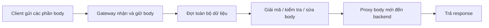
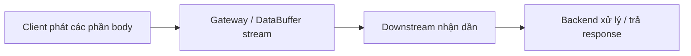

# Bộ đệm toàn bộ nội dung so với truyền dữ liệu theo luồng trong Spring Cloud Gateway

## 1. Vấn đề: một API Gateway có cần giữ toàn bộ HTTP body?

**Spring Cloud Gateway** là cổng vào microservices: nhận request, chọn route qua **route predicate**, thực thi **filter chain**, biến đổi path/header, khám phá dịch vụ và chuyển tiếp tới backend. Những cơ chế như xác thực JWT, rate limiting, circuit breaker, retry, TLS và quan sát request giúp hệ thống vận hành an toàn. Khi xử lý **HTTP body**, một quyết định kiến trúc quan trọng là **giữ toàn bộ nội dung vào bộ nhớ** (*full buffering*) hay **chuyển tiếp từng phần khi dữ liệu đến** (*streaming*).

Ví dụ:

- `POST /api/orders` gửi JSON nhỏ: có thể cần đọc nội dung, kiểm tra hoặc thay đổi một trường trước khi proxy.
- `PUT /api/files/video.mp4` tải lên video hàng trăm MB: giữ trọn file trong RAM cho mỗi request sẽ gây áp lực bộ nhớ.
- `GET /api/reports/export` trả file dung lượng lớn: nên chuyển tiếp từng phần thay vì chờ tạo đủ file.
- `GET /api/events` trả **Server-Sent Events (SSE)**: response có thể mở trong thời gian dài, không có “toàn bộ body” để chờ hoàn tất.

**Mục tiêu bài học:** hiểu cách `Flux<DataBuffer>` hoạt động trong Gateway Server WebFlux; biết khi nào buffering là cần thiết, khi nào streaming là lựa chọn đúng; thiết lập giới hạn, tránh rò rỉ buffer và kiểm thử được sự khác biệt.

> **Phạm vi:** bài tập trung vào **Spring Cloud Gateway Server WebFlux** dùng Reactor/Netty. Gateway Server Web MVC dùng Servlet stack và cách xử lý I/O khác; tư duy lựa chọn buffering/streaming vẫn áp dụng, nhưng không sao chép trực tiếp `Flux<DataBuffer>` hoặc `GlobalFilter` WebFlux sang MVC.

## 2. Hai mô hình xử lý body

### 2.1. Full buffering: đọc đủ rồi xử lý



Với **full buffering**, Gateway hoặc một filter tiêu thụ body thành dữ liệu trong bộ nhớ như `String`, DTO, `byte[]` hoặc `DataBuffer` đã tổng hợp. Chỉ sau khi đã có đủ dữ liệu cần thiết, filter mới quyết định xử lý tiếp, ví dụ sửa JSON hoặc xác thực nội dung.

Ưu điểm: xem được toàn bộ nội dung, thuận tiện cho kiểm tra cấu trúc JSON, biến đổi body, tính checksum của toàn payload hoặc dùng lại request khi retry. Đổi lại, bộ nhớ, độ trễ và công việc giải mã tăng theo kích thước body.

### 2.2. Streaming: xử lý từng phần



Với **streaming**, Gateway không cần chờ toàn bộ request/response kết thúc mới chuyển tiếp dữ liệu; các phần dữ liệu được truyền tiếp qua pipeline reactive. Điều này đặc biệt có ích cho upload/download lớn, SSE và nội dung được sinh liên tục.

**Streaming không có nghĩa là “không dùng bộ nhớ”.** Socket, Netty, codec, bộ đệm mạng, TLS, các toán tử Reactor và bộ lọc đều có thể giữ một lượng dữ liệu tạm thời. Backpressure giúp điều phối tốc độ khi các thành phần có khả năng tôn trọng nhu cầu nhận dữ liệu, nhưng không bảo đảm toàn hệ thống luôn dùng bộ nhớ hằng số.

### 2.3. So sánh trực tiếp

| Tiêu chí | Full buffering | Streaming |
|---|---|---|
Khi nào downstream có thể bắt đầu nhận dữ liệu? | Thường sau khi Gateway đã đọc xong phần body cần tổng hợp | Có thể ngay khi các phần body sẵn sàng |
Memory theo kích thước body | Có xu hướng tăng theo tổng payload và số request đồng thời | Chủ yếu theo các phần đang chờ xử lý, nhưng phụ thuộc pipeline |
Độ trễ phần dữ liệu đầu tiên | Có thể tăng vì chờ đủ body | Có thể thấp hơn |
Đọc lại body | Dễ hơn nếu có cơ chế cache/replay phù hợp | Không mặc định đọc lại được |
Biến đổi toàn bộ JSON | Thuận tiện | Phải dùng parser incremental/phương án khác nếu muốn giữ streaming |
Upload/download lớn | Nguy cơ giữ nhiều dữ liệu trong RAM | Thường phù hợp hơn |
SSE/NDJSON vô hạn | Không phù hợp để đợi toàn bộ nội dung | Phù hợp nếu từng sự kiện được flush phù hợp |
Rủi ro | `DataBufferLimitException`, OOM, tăng latency | Buffer leak, nghẽn downstream, tích tụ queue khi backpressure bị phá vỡ |

## 3. Body trong Gateway Server WebFlux là gì?

Ở WebFlux, request body thường có thể được đọc dưới dạng:

```java
Flux<DataBuffer> body = exchange.getRequest().getBody();
```

Trong đó:

- `Flux<DataBuffer>` là luồng **không đồng bộ** gồm các khối byte.
- `DataBuffer` là abstraction của Spring cho byte buffer; trên Reactor Netty, nó có thể bọc `ByteBuf` được **pool** và **reference-count**.
- Khi dùng codec, Spring có thể giải mã body sang `String`, JSON DTO, `byte[]` hoặc dữ liệu đa phần (*multipart*).
- Một HTTP body được thiết kế theo hướng **được tiêu thụ như một luồng**. Nếu filter đọc hết body, downstream **không tự nhiên đọc lại được** nếu chưa có cơ chế cache hoặc request decoration.

Do đó, không nên tự viết filter làm:

```java
// Sai về mặt thiết kế khi vẫn muốn proxy request gốc:
exchange.getRequest().getBody().subscribe(buffer -> {
    // đọc/log body ở đây rồi bỏ qua
});
return chain.filter(exchange);
```

Đoạn trên tạo một subscription ngoài luồng kiểm soát của Gateway, dễ tiêu thụ body trước khi backend đọc, phá quy tắc backpressure và gây rò rỉ buffer. **Không `subscribe()` thủ công, `block()` hoặc dùng `collectList()` vô hạn trong filter** chỉ để xem payload.

### 3.1. Phân biệt dữ liệu byte và đối tượng đã giải mã

```text
Network bytes
    |
    v
Flux<DataBuffer>    <-- có thể streaming
    |
    +--> Codec/Decoder --> Mono<DTO> hoặc Mono<String>
    |                     (có trường hợp phải tổng hợp body)
    |
    +--> Proxy HTTP client --> downstream nhận byte stream
```

Khác biệt không nằm ở việc dùng Reactor hay không, mà nằm ở việc **một bước có yêu cầu toàn bộ nội dung hay không**. Ví dụ `Mono<String>` đại diện cho một kết quả bất đồng bộ, **không có nghĩa** dữ liệu được chuyển tiếp từng phần: nếu phải dựng một `String` đại diện trọn body, filter đã tổng hợp nội dung.

## 4. Khi nào Spring Cloud Gateway cần buffering?

### 4.1. Các filter liên quan trực tiếp đến body

| Thành phần WebFlux | Vì sao có thể giữ body? | Lưu ý vận hành |
|---|---|---|
`CacheRequestBody` | Đọc/cached request để các thành phần sau dùng lại | Body gốc chỉ đọc một lần; dữ liệu cached tăng memory |
`ModifyRequestBody` | Giải mã request, chạy hàm biến đổi, rồi mã hóa nội dung mới | Chỉ cấu hình bằng **Java DSL**; không phù hợp mặc định cho file lớn |
`ModifyResponseBody` | Giải mã và sửa response trước khi trả client | Chỉ cấu hình bằng **Java DSL**; có thể làm mất lợi ích streaming |
`Retry` với HTTP method có body | Lưu request body để có thể gửi lại trên những lần retry | Tài liệu Gateway cảnh báo bộ nhớ khi retry request có body |
`ReadBody` route predicate | Đọc và cache body để đưa vào predicate lập trình | Đọc body ngay tại bước chọn route; cân nhắc kích thước và chi phí |
`LocalResponseCache` | Cache response theo chính sách để dùng lại | Không đồng nghĩa streaming; cần chính sách cache, TTL, giới hạn dung lượng |

**Không phải mọi filter đều đọc body.** `Path`, `Host`, `Method`, `StripPrefix`, `AddRequestHeader`, `SetResponseHeader` chủ yếu làm việc với metadata hoặc path/header; việc sử dụng chúng **không tự buộc** Gateway lưu trọn body.

### 4.2. `CacheRequestBody`: đọc rồi cho phép dùng lại

Ví dụ route WebFlux **4.3+/5.x**:

```yaml
spring:
  cloud:
    gateway:
      server:
        webflux:
          routes:
            - id: cached-json-route
              uri: http://localhost:8081
              predicates:
                - Path=/api/inspect/**
              filters:
                - name: CacheRequestBody
                  args:
                    bodyClass: java.lang.String
```

Filter này đọc request body, chuyển thành `String` (theo `bodyClass`) và lưu trong `ServerWebExchange` attribute có khóa `ServerWebExchangeUtils.CACHED_REQUEST_BODY_ATTR`. Các filter thực sự cần body có thể sử dụng dữ liệu cached; Gateway cần cơ chế thích hợp để những bước sau đọc được request.

**Chi phí:** chuyển request thành `String` có thể cần giữ nhiều hơn kích thước byte gốc do biểu diễn ký tự, chuyển đổi và dữ liệu trung gian. Đừng bật cache body mặc định trên mọi route chỉ để dự phòng logging.

### 4.3. `ModifyRequestBody` và `ModifyResponseBody` qua Java DSL

Hai factory này dành cho trường hợp thật sự cần biến đổi **nội dung**, không chỉ path/header. Tài liệu chính thức yêu cầu cấu hình chúng bằng **Java DSL** (không dùng tên filter cùng tham số tùy ý trong YAML).

Ví dụ sau minh họa **request text nhỏ**, không dành cho binary upload:

```java
package com.example.gateway;

import org.springframework.cloud.gateway.route.RouteLocator;
import org.springframework.cloud.gateway.route.builder.RouteLocatorBuilder;
import org.springframework.context.annotation.Bean;
import org.springframework.context.annotation.Configuration;
import org.springframework.http.MediaType;
import reactor.core.publisher.Mono;

@Configuration
public class TextBodyRoutes {

    @Bean
    RouteLocator textRoutes(RouteLocatorBuilder builder) {
        return builder.routes()
            .route("normalize-text", r -> r.path("/api/text")
                .filters(f -> f
                    .modifyRequestBody(
                        String.class,
                        String.class,
                        MediaType.TEXT_PLAIN_VALUE,
                        (exchange, text) ->
                            text == null
                                ? Mono.empty()
                                : Mono.just(text.strip()))
                    .modifyResponseBody(
                        String.class,
                        String.class,
                        (exchange, text) ->
                            text == null
                                ? Mono.empty()
                                : Mono.just(text.toUpperCase())))
                .uri("http://localhost:8081"))
            .build();
    }
}
```

Đường dẫn `POST /api/text` gửi body `"  hello  "` sẽ được trim trước khi gọi backend; response dạng text do backend trả có thể được chuyển thành chữ hoa. Muốn ví dụ chạy end-to-end cần backend có endpoint `/api/text` tương ứng và trả `text/plain`.

**Điều quan trọng:**

- Chuyển sang `String` để sửa body có chi phí decode/encode. Không mặc định áp hai filter trên video, zip, file dung lượng lớn hoặc SSE.
- Khi request/response **không có body**, hàm rewrite có thể nhận `null`; tài liệu yêu cầu xử lý bằng `Mono.empty()` cho trường hợp không có nội dung.
- Việc đổi body có thể tác động `Content-Length`, `Content-Type`, `Content-Encoding`, chữ ký nội dung hoặc `ETag`. Cần để filter/framework cập nhật metadata phù hợp và kiểm thử; đừng giữ một `Content-Length` cũ sau khi body đã đổi.
- Sửa payload sau khi xác thực chữ ký body có thể làm **chữ ký không còn khớp** ở downstream. Hãy xác định nơi xác thực và ký lại nếu giao thức thực sự yêu cầu.

### 4.4. `Retry` với request body: bộ nhớ có thể tăng đột biến

Tài liệu Gateway Server WebFlux cảnh báo: khi `Retry` được dùng với **HTTP method có body**, request body có thể được **cache trong memory** để thực hiện các lần thử lại; dữ liệu được quản lý qua exchange attribute `CACHED_REQUEST_BODY_ATTR`. Một client request có thể gây nhiều downstream attempts.

Vì vậy cần:

1. Chỉ retry **những operation an toàn hoặc được thiết kế idempotent**; với POST tạo đơn/thanh toán, cần idempotency key và chính sách nghiệp vụ.
2. Giới hạn số attempts, backoff, timeout và lượng request đồng thời.
3. Giới hạn kích thước request trước khi cho phép caching/retry.
4. Tránh để một route upload file lớn vô tình nhận `Retry` như một `default-filter` chung.

## 5. Streaming: route chỉ proxy, không đọc body vào đối tượng

### 5.1. Cấu hình routes cho upload và SSE

Giả sử backend `file-service` chạy `localhost:8081`, backend `event-service` chạy `localhost:8082`. Với **Gateway Server WebFlux 4.3+**:

```yaml
server:
  port: 8080

spring:
  application:
    name: edge-gateway
  cloud:
    gateway:
      server:
        webflux:
          routes:
            - id: file-upload-route
              uri: http://localhost:8081
              predicates:
                - Path=/api/files/**
                - Method=PUT,POST
              filters:
                - StripPrefix=1
                - name: RequestSize
                  args:
                    maxSize: 20MB

            - id: live-events-route
              uri: http://localhost:8082
              predicates:
                - Path=/api/events/**
                - Method=GET
              filters:
                - StripPrefix=1
```

Với `PUT /api/files/video.mp4`, filter `StripPrefix=1` đổi path gửi backend thành `/files/video.mp4`. Với `GET /api/events/ticks`, backend được gọi theo `/events/ticks`. Trong hai route này, chúng ta **không khai báo** filter đọc/biến đổi toàn body; Gateway có thể chuyển tiếp theo stream nhờ pipeline HTTP reactive.

`RequestSize` là **giới hạn kích thước HTTP request** do Gateway cung cấp, có tham số `maxSize`; request vượt ngưỡng theo cơ chế kiểm tra của filter bị từ chối với **413 Payload Too Large**. Nó không biến request thành buffered body và cũng **không phải** giới hạn riêng cho codec decode. Với upload chunked/không có `Content-Length`, reverse proxy và backend cần có các kiểm soát kích thước phù hợp; không chỉ tin vào một lớp.

**Phiên bản cũ:** ở Gateway Server WebFlux 4.2 trở về trước, danh sách route thường nằm dưới `spring.cloud.gateway.routes`. Đừng sao chép namespace mới vào release train cũ nếu chưa nâng cấp starter.

### 5.2. SSE là minh họa rõ nhất của streaming

Backend **WebFlux** có thể xuất sự kiện liên tục:

```java
package com.example.events;

import java.time.Duration;
import org.springframework.http.MediaType;
import org.springframework.http.codec.ServerSentEvent;
import org.springframework.web.bind.annotation.GetMapping;
import org.springframework.web.bind.annotation.RestController;
import reactor.core.publisher.Flux;

@RestController
class EventController {
    @GetMapping(value = "/events/ticks", produces = MediaType.TEXT_EVENT_STREAM_VALUE)
    Flux<ServerSentEvent<String>> ticks() {
        return Flux.interval(Duration.ofSeconds(1))
            .map(number -> ServerSentEvent.<String>builder()
                .event("tick")
                .id(number.toString())
                .data("tick-" + number)
                .build());
    }
}
```

Code là controller của backend, không phải filter Gateway. Client có thể quan sát sự kiện xuất hiện dần:

```bash
curl -N -i http://localhost:8080/api/events/ticks
```

`-N`/`--no-buffer` ngăn **curl** tự buffering output quá mức, giúp quan sát sự kiện theo thời gian. Proxy, HTTP client, nén nội dung hoặc các bộ đệm trung gian vẫn có thể ảnh hưởng thời điểm flush. Đối với SSE, nên gửi **heartbeat** định kỳ và thiết kế xử lý ngắt kết nối.

**Không đặt `ModifyResponseBody(String.class, ...)` vào route SSE** chỉ để ghi log. Một response stream dài hoặc vô hạn không có “string hoàn chỉnh” để filter nhận và trả lại; điều này có thể làm tăng bộ nhớ, trì hoãn dữ liệu hoặc thất bại.

## 6. Giới hạn codec khác giới hạn kích thước HTTP request

Một lỗi hay gặp khi decode body là:

```text
org.springframework.core.io.buffer.DataBufferLimitException:
Exceeded limit on max bytes to buffer
```

Spring WebFlux codecs có giới hạn số byte **được phép gom vào bộ nhớ** khi một bước decoder cần aggregate dữ liệu. Theo tài liệu Spring Framework, mặc định nhiều codec giới hạn khoảng **256 KiB**. Con số cụ thể và property cấu hình cần đối chiếu đúng dòng Spring Boot/Framework.

Với Spring Boot **3.5 và 4.x**, property cấu hình codec của Boot là:

```yaml
spring:
  http:
    codecs:
      max-in-memory-size: 1MB
```

Đây là ví dụ **cho phép codec tích hợp tổng hợp tối đa 1 MB khi cần**, không phải lời khuyên tăng giới hạn mặc định lên tùy ý. Property `spring.http.codecs.max-in-memory-size` áp dụng cho **WebFlux server và WebClient được Spring Boot tự cấu hình**; không tự bảo đảm giới hạn mọi `DataBufferUtils.join(...)` tự viết, mọi HTTP client/codec tự tạo hoặc mọi đường đi của Gateway.

| Giới hạn | Điều được giới hạn | Có tự bảo vệ toàn bộ Gateway không? |
|---|---|---|
`RequestSize` của route | Kích thước request theo cơ chế filter | Không; cần phối hợp ingress, backend và dạng request |
`spring.http.codecs.max-in-memory-size` | Lượng dữ liệu codec được phép aggregate khi decode | Không; chỉ các codec/instance thuộc phạm vi cấu hình |
Giới hạn body của reverse proxy/ingress | Request đi vào hệ thống | Không thay cho kiểm soát tại Gateway/backend |
Giới hạn multipart | Số phần, dung lượng bộ nhớ/ổ đĩa của các part | Áp dụng khi dùng cơ chế decode multipart tương ứng |
`DataBufferUtils.join(source, maxByteCount)` | Tổng byte được join trong một đoạn code tùy chỉnh | Chỉ có hiệu lực ở nơi đoạn code đó được gọi |

**Đừng “sửa” `DataBufferLimitException` bằng cách đặt một giới hạn cực lớn hoặc tắt giới hạn.** Hãy hỏi: request nào đang bị aggregate, tại sao cần đọc toàn body, liệu có thể streaming, kiểm soát kích thước hợp lệ của nghiệp vụ và số request đồng thời như thế nào?

### 6.1. Một phép ước lượng bộ nhớ để thiết kế tải

Giả sử **100 request đồng thời**, mỗi request giữ một payload **8 MiB** trong RAM. Riêng dữ liệu body đã xấp xỉ:

```text
100 request × 8 MiB = 800 MiB
```

Đây mới là **ước tính tối thiểu để nhìn thấy mức rủi ro**, chưa tính byte buffers tạm, đối tượng Java/JSON, các bản copy, TLS, metadata, thread stack, bộ đệm gửi và bộ nhớ off-heap của Netty. Cùng một máy chạy container có giới hạn RAM thấp sẽ dễ gặp OOM hoặc bị hệ điều hành kết thúc tiến trình.

Trên thực tế, memory không phải luôn bằng đúng công thức trên; số lượng copy, cách decode và thời gian giữ body khác nhau. Hãy đo **peak concurrent buffered bytes**, không chỉ lấy tổng request trong một phút.

## 7. `DataBuffer`, pool và trách nhiệm giải phóng bộ nhớ

Netty có thể dùng buffer được pool và đếm tham chiếu. Nếu custom filter tiêu thụ `DataBuffer` mà không chuyển quyền sở hữu hoặc **release** đúng lúc, memory leak có thể xảy ra ngay cả khi Java heap trông còn trống.

Một số nguyên tắc:

1. **Ưu tiên dùng filter/codec có sẵn** thay vì tự đọc buffer nếu không bắt buộc.
2. Nếu tự consume một `DataBuffer` mà không chuyển tiếp, phải bảo đảm buffer được giải phóng, thường bằng `DataBufferUtils.release(buffer)`.
3. Khi các toán tử Reactor có thể loại bỏ phần tử (`filter`, `skip`, prefetch, cancel/error), cần dùng cơ chế giải phóng phù hợp như `doOnDiscard(DataBuffer.class, DataBufferUtils::release)` theo tài liệu.
4. Khi gom nhiều buffer, ưu tiên API hỗ trợ **giới hạn dung lượng** và cơ chế cleanup, ví dụ `DataBufferUtils.join(source, maxByteCount)`.
5. Không giữ tham chiếu tới pooled buffer trong singleton, cache không giới hạn hay callback có vòng đời vượt quá request mà không quản lý reference count.

### 7.1. Ví dụ minh họa đọc **có giới hạn** trong Java

Đoạn hàm sau chỉ minh họa cách tổng hợp một `Flux<DataBuffer>` thành `String` **với giới hạn rõ ràng**. Nó **không** phải GlobalFilter hoàn chỉnh và **không** tự tạo lại body cho downstream:

```java
import java.nio.charset.StandardCharsets;
import org.springframework.core.io.buffer.DataBuffer;
import org.springframework.core.io.buffer.DataBufferUtils;
import reactor.core.publisher.Flux;
import reactor.core.publisher.Mono;

static Mono<String> readSmallBody(Flux<DataBuffer> source) {
    int maxBytes = 1024 * 1024; // 1 MiB
    return DataBufferUtils.join(source, maxBytes)
        .map(joined -> {
            try {
                byte[] bytes = new byte[joined.readableByteCount()];
                joined.read(bytes);
                return new String(bytes, StandardCharsets.UTF_8);
            } finally {
                DataBufferUtils.release(joined);
            }
        });
}
```

**Giới hạn của ví dụ:** nó tiêu thụ source một lần. Muốn proxy request sau khi đọc, phải dùng cách cache/decorate request phù hợp; nếu không, downstream không còn body để đọc. Khi vượt `maxBytes`, phép join có thể phát lỗi giới hạn; caller cần xử lý error thành phản hồi thích hợp thay vì làm lộ stack trace. Đối với payload lớn, không chọn đoạn code này.

## 8. Streaming và backpressure: lợi ích và giới hạn

**Backpressure** là cơ chế bên nhận thông báo nhu cầu dữ liệu cho bên phát trong pipeline reactive. Khi downstream chậm, các phần của pipeline tôn trọng backpressure có thể giảm tốc độ phát, tránh tích tụ vô hạn ngay trong một số hàng đợi.

Tuy nhiên, không phải mọi ranh giới đều hiểu cùng tín hiệu:

- TCP có flow control riêng; tốc độ mạng thực tế và buffer socket vẫn ảnh hưởng.
- HTTP/1.1 hoặc HTTP/2 có cách framing/flow control khác nhau; việc dùng Netty không bảo đảm mỗi `DataBuffer` trở thành đúng một HTTP chunk trên wire.
- Một filter sử dụng `collectList()`, `cache()` hoặc hàng đợi không giới hạn có thể phá lợi ích streaming dù bên ngoài vẫn dùng `Flux`.
- Nếu nén nội dung, transform body hoặc kết hợp nhiều service, dữ liệu có thể bị giữ tạm ở từng lớp.
- Khi client hủy request, pipeline phải xử lý tín hiệu `CANCEL`, ngắt downstream và giải phóng những buffers còn giữ.

Với **SSE** hoặc `application/x-ndjson`, cần quan sát thời gian nhận **event/dòng đầu tiên** thay vì chỉ thời gian hoàn tất response; một stream vô hạn có thể không có thời điểm kết thúc bình thường.

## 9. Khi nào nên chọn mô hình nào?

| Tình huống | Khuyến nghị | Lý do |
|---|---|---|
Proxy JSON nhỏ, không cần sửa body | **Streaming/pass-through** | Tránh decode/copy không cần thiết |
Thêm JWT, sửa path hoặc header | **Không cần full buffering** | Có thể giải quyết ở metadata và lớp Security |
Kiểm tra/chuyển đổi toàn bộ JSON nhỏ | **Buffer có giới hạn** | Cần nhìn thấy nội dung; giới hạn phù hợp SLA |
Kiểm tra hash toàn payload | Tùy nghiệp vụ: có thể **tính hash tăng dần** | Không nhất thiết giữ toàn bộ bytes |
Upload file lớn | **Streaming** hoặc upload trực tiếp tới object storage qua URL được cấp quyền | Giảm memory và tải qua Gateway |
Trả PDF/CSV/binary lớn | **Streaming** | Có thể gửi từng phần cho client |
SSE/NDJSON dài | **Streaming**, flush/heartbeat | Tránh chờ một body không kết thúc |
Retry POST/PUT có body lớn | **Tránh retry mù quáng** | Có thể cần cache, nguy cơ memory/idempotency |
Đọc body để quyết định route | **Rà soát lại kiến trúc; giới hạn payload** | Route matching trở nên tốn bộ nhớ và khó scale |

**Quy tắc thực hành:** nếu chỉ cần quyết định theo `Path`, `Host`, `Method`, một header hoặc quyền truy cập, đừng đọc body. Khi cần validate nội dung sâu, xem xét đặt nghiệp vụ ở backend, còn Gateway giữ trách nhiệm định tuyến và thực thi chính sách ở biên.

## 10. Thực hành kiểm tra buffering so với streaming

### 10.1. Upload thử qua Gateway

Với `file-upload-route` ở mục 5, chuẩn bị một tệp thử nghiệm `sample.bin` tại máy client và backend có endpoint chấp nhận `PUT /files/sample.bin`. Gửi request:

```bash
curl -i -X PUT \
  -H 'Content-Type: application/octet-stream' \
  --data-binary @sample.bin \
  http://localhost:8080/api/files/sample.bin
```

Nếu payload vượt ngưỡng `RequestSize` và filter xác định được điều đó, Gateway có thể trả `413` thay vì chuyển xuống backend. Thử với payload nhỏ và lớn, đồng thời so sánh request qua Gateway với gọi backend trực tiếp. Không khẳng định body luôn được giữ trong RAM chỉ vì đường truyền lớn.

### 10.2. SSE: quan sát event đầu tiên

Khởi động `event-service` với controller ở mục 5, sau đó:

```bash
curl -N -i http://localhost:8080/api/events/ticks
```

Kỳ vọng các dòng sự kiện lần lượt xuất hiện khi backend tạo ra chúng. Nếu client chỉ nhận sau một thời gian dài, kiểm tra nén, proxy buffering, filter response body, việc flush và timeout. So sánh thêm khi gọi thẳng `http://localhost:8082/events/ticks` để khoanh vùng vấn đề.

### 10.3. Thử JSON nhỏ với `ModifyRequestBody`

Với route `normalize-text` ở mục 4 và backend echo text trên `8081`:

```bash
curl -i -X POST \
  -H 'Content-Type: text/plain' \
  --data-binary '  hello gateway  ' \
  http://localhost:8080/api/text
```

Nếu backend echo nguyên text đã nhận, request đi qua Gateway có thể cho nội dung `HELLO GATEWAY` ở response sau hai filter. Ví dụ cần backend trả `text/plain` và không thêm filter khác can thiệp. Nó chỉ chứng minh cách transform body nhỏ, **không** là phép thử throughput cho file lớn.

### 10.4. Ma trận số liệu cần thu thập

| Chỉ số/quan sát | Dùng để phát hiện gì? |
|---|---|
Kích thước request/response, loại content | Tuyến nào chứa payload lớn hoặc stream dài |
Số request đồng thời và thời gian giữ body | Áp lực memory do buffering |
JVM heap, GC pause, Netty direct/off-heap memory | Phân biệt GC và leak pooled buffer |
`DataBufferLimitException`, `413`, `5xx` | Lỗi aggregation/giới hạn/body hoặc backend |
Time to first byte/event và tổng latency | Buffering không mong muốn, flush chậm |
Tỷ lệ client disconnect/cancel | Cleanup và backpressure |
Retry attempts theo route | Số lần đọc/gửi lại body và chi phí tăng |
Tốc độ ingress/egress, độ trễ backend | Nghẽn network, downstream hay filter |

Có thể dùng Spring Boot Actuator, Micrometer, tracing và log có kiểm soát để đo route ID, status, latency. **Không log toàn bộ request/response body**, nhất là token, dữ liệu cá nhân, thông tin thanh toán hoặc file khách hàng.

## 11. Các lỗi điển hình và hướng xử lý

| Triệu chứng | Nguyên nhân có thể | Cách xử lý |
|---|---|---|
`DataBufferLimitException` | Codec hoặc bước join cần aggregate quá giới hạn | Xác định filter/decoder đang giữ body; giảm phạm vi đọc, streaming hoặc đặt ngưỡng hợp lý |
Gateway bị OOM khi nhiều POST | Cache body/Retry/ModifyRequestBody cùng hoạt động với concurrency cao | Giới hạn payload, concurrency, retries; bỏ buffering không cần thiết |
Backend nhận request **rỗng** sau custom logging | Filter đã tiêu thụ body trước, không decorate/cache để đọc lại | Dùng cơ chế body caching/forwarding đúng, không subscribe thủ công |
SSE chỉ trả dữ liệu sau khi kết nối kết thúc | Filter tổng hợp `String` hoặc proxy buffer response | Bỏ body-transform và kiểm tra flush/heartbeat/proxy |
Upload lớn thất bại nhưng JSON nhỏ vẫn ổn | `RequestSize`, ingress limit, codec/multipart limit, timeout | Xác định tầng trả `413`/`400`/`5xx` và ngưỡng ở mỗi lớp |
Latency tăng khi bật body rewrite | Decode + tổng hợp + encode + cấp phát thêm | Đo kích thước và thời gian, cân nhắc chuyển xử lý về backend |
Netty báo memory leak | Custom code giữ `DataBuffer` không release | Rà reference counting, `DataBufferUtils.release` và các đường error/cancel |
Retry gây trùng giao dịch | POST được phát lại sau timeout mà thiếu idempotency | Thiết kế idempotency key, giới hạn retry và chính sách phù hợp |
`Content-Length` sai sau khi sửa body | Header cũ không phù hợp body mới | Kiểm tra codec/filter cập nhật headers; không set tay framing sai |
Request có chunked body vượt kiểm soát | Một lớp chỉ kiểm tra header `Content-Length` | Áp thêm giới hạn stream tại ingress/backend và test request không biết độ dài |

## 12. Bài tập và đáp án

**Bài 1.** Gateway chỉ cần `Path=/api/files/**`, `StripPrefix=1` và xác thực JWT. Có cần giải mã toàn body của file upload không?

**Đáp án:** không. Path và header/token có thể được xử lý trước hoặc không cần body; giữ streaming cho file lớn và bảo vệ bằng size limit, timeouts cùng chính sách xác thực phù hợp.

**Bài 2.** Một route gọi `ModifyResponseBody(String.class, ...)` trên SSE kéo dài. Vấn đề cốt lõi là gì?

**Đáp án:** filter cố làm việc ở mức toàn nội dung `String`, trong khi SSE là luồng dài hoặc vô hạn; có thể gây buffering, tăng latency hoặc không hoàn tất. Nên để response đi theo stream và xử lý sự kiện tăng dần nếu thật sự cần.

**Bài 3.** Tăng `spring.http.codecs.max-in-memory-size` có bảo đảm Gateway chặn mọi request lớn hơn giá trị đó không?

**Đáp án:** không. Đó là **giới hạn aggregation của codec** trong phạm vi cấu hình, không phải giới hạn kích thước mọi HTTP request. Cần `RequestSize` và các ngưỡng ở ingress/backend phù hợp.

**Bài 4.** Bật `Retry` cho POST body lớn làm Gateway tăng RAM. Vì sao?

**Đáp án:** để gửi lại request có body, Gateway có thể phải cache nội dung. Memory bị ảnh hưởng bởi số request đồng thời, kích thước payload, cách lưu và số lần thử; còn có rủi ro tác dụng phụ nghiệp vụ khi POST không idempotent.

**Bài 5.** Một `GlobalFilter` tự gọi `exchange.getRequest().getBody().subscribe(...)` để log rồi gọi `chain.filter(exchange)`. Vì sao backend đôi khi thấy body rỗng?

**Đáp án:** filter đã tiêu thụ publisher body ngoài chain và không có cách tái cấp dữ liệu cho downstream; còn có thể vi phạm backpressure và leak buffers. Tránh subscribe thủ công; nếu thật sự cần nội dung, dùng cơ chế cache/modify phù hợp và giới hạn rõ ràng.

**Bài 6.** Một upload đang streaming qua Gateway. Có thể khẳng định Gateway dùng đúng một `DataBuffer` trong RAM không?

**Đáp án:** không. Có socket buffer, Netty pool, queue, TLS, prefetch và các bước filter. Streaming thường giảm nhu cầu giữ **toàn bộ** body, nhưng không bảo đảm số lượng buffer cố định hoặc không có tích tụ.

## 13. Tài liệu tham khảo chính thức

- [Spring Cloud Gateway – CacheRequestBody GatewayFilter](https://docs.spring.io/spring-cloud-gateway/reference/spring-cloud-gateway-server-webflux/gatewayfilter-factories/cacherequestbody-factory.html): body chỉ đọc một lần, cached body ở `ServerWebExchange`.
- [Spring Cloud Gateway – ModifyRequestBody GatewayFilter](https://docs.spring.io/spring-cloud-gateway/reference/spring-cloud-gateway-server-webflux/gatewayfilter-factories/modifyrequestbody-factory.html): sửa request body bằng Java DSL.
- [Spring Cloud Gateway – ModifyResponseBody GatewayFilter](https://docs.spring.io/spring-cloud-gateway/reference/spring-cloud-gateway-server-webflux/gatewayfilter-factories/modifyresponsebody-factory.html): sửa response body bằng Java DSL.
- [Spring Cloud Gateway – Retry GatewayFilter](https://docs.spring.io/spring-cloud-gateway/reference/spring-cloud-gateway-server-webflux/gatewayfilter-factories/retry-factory.html): cảnh báo caching request body và memory khi retry.
- [Spring Cloud Gateway – RequestSize GatewayFilter](https://docs.spring.io/spring-cloud-gateway/reference/spring-cloud-gateway-server-webflux/gatewayfilter-factories/requestsize-factory.html): giới hạn kích thước request và `413`.
- [Spring Framework – Data Buffers and Codecs](https://docs.spring.io/spring-framework/reference/core/databuffer-codec.html): pooling, reference counting, `DataBufferUtils.join` và release.
- [Spring Framework – Reactive Core](https://docs.spring.io/spring-framework/reference/web/webflux/reactive-spring.html): reactive streaming, SSE và yêu cầu xử lý `DataBuffer`.
- [Spring Boot 3.5 – Common Application Properties](https://docs.spring.io/spring-boot/3.5/appendix/application-properties/): `spring.http.codecs.max-in-memory-size` và các giới hạn WebFlux/multipart.

**Ghi nhớ:** **chỉ buffer toàn bộ HTTP body khi chức năng thực sự cần và có giới hạn rõ ràng**. Với route proxy thông thường, file lớn và SSE, ưu tiên **streaming** để giảm thời gian chờ và bộ nhớ trung gian. `Flux<DataBuffer>` không tự bảo đảm an toàn: cần kiểm soát pooling/release, backpressure, codec limits, request size, retries, thời gian kết nối và quan sát lưu lượng để vận hành Spring Cloud Gateway ổn định.
