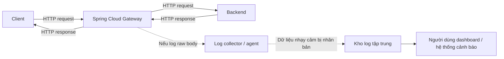

# Che dữ liệu nhạy cảm khi ghi log request hoặc response body

## Mục tiêu học tập

Trong chương **Nội dung HTTP**, bài này tập trung vào một tình huống rất thực tế khi vận hành **Spring Cloud Gateway**: nhóm phát triển muốn ghi log nội dung request/response để truy vết lỗi, nhưng body có thể chứa mật khẩu, token, thông tin khách hàng hoặc dữ liệu thanh toán. Nếu ghi nguyên body vào log, API Gateway vô tình tạo ra một kho dữ liệu nhạy cảm mới, thường có nhiều người và hệ thống được quyền truy cập hơn cơ sở dữ liệu nghiệp vụ.

Sau bài học, bạn có thể:

- Giải thích **vì sao mặc định không nên log HTTP body** ở gateway và xác định khi nào có ngoại lệ được phê duyệt.
- Phân biệt **không ghi log**, **allowlist dữ liệu được phép ghi**, **redaction/masking** và **pseudonymization**.
- Biết cách ghi log metadata của request an toàn trong `GlobalFilter` mà **không tiêu thụ** reactive body.
- Hiểu rủi ro khi dùng `ModifyRequestBody`, `ModifyResponseBody` hoặc `DataBuffer` để quan sát nội dung.
- Triển khai một bộ xử lý JSON theo cấu trúc, tránh regex che chuỗi mù; biết giới hạn của cả cách làm này.
- Kiểm soát headers, URL, response lỗi, logging từ framework/wiretap, độ dài payload và thời hạn lưu log.
- Viết unit/integration tests để chứng minh dữ liệu nhạy cảm không xuất hiện trong log và request/response thực sự vẫn nguyên vẹn.

> Bài sử dụng ngữ cảnh **Spring Cloud Gateway Server WebFlux** dựa trên Project Reactor. Gateway Server MVC có cơ chế filter và body riêng. Tên API/cấu hình ở từng phiên bản có thể khác; phải đối chiếu dependency và kiểm chứng bằng HTTP integration test trước khi vận hành.

## 1. Vì sao việc ghi log toàn bộ body rất nguy hiểm?

Một client gửi request:

```http
POST /api/accounts/login HTTP/1.1
Host: api.example.com
Content-Type: application/json
Authorization: Bearer <access-token>

{
  "username": "user-42",
  "password": "<secret>",
  "deviceId": "<device-identifier>"
}
```

Backend có thể trả:

```http
HTTP/1.1 200 OK
Content-Type: application/json

{
  "accessToken": "<new-access-token>",
  "refreshToken": "<new-refresh-token>",
  "expiresIn": 3600
}
```

Nếu Gateway ghi nguyên hai body và header `Authorization`, log có thể chứa **cả thông tin đăng nhập đầu vào và token dùng để truy cập hệ thống**. Vấn đề không biến mất khi log được gửi tới hệ thống tập trung: dữ liệu sẽ đi qua agent thu thập, hàng đợi, chỉ mục tìm kiếm, sao lưu và dashboard.



Những rủi ro điển hình:

| Rủi ro | Ví dụ | Hậu quả |
| --- | --- | --- |
| Lộ thông tin xác thực | `password`, `accessToken`, cookie phiên | Người có quyền đọc log có thể dùng lại credential |
| Lộ dữ liệu cá nhân | Email, số điện thoại, địa chỉ, ngày sinh | Vi phạm yêu cầu bảo vệ dữ liệu và chính sách riêng tư |
| Lộ dữ liệu tài chính | Số thẻ, tài khoản, giao dịch | Tăng mức độ nhạy cảm và phạm vi kiểm soát của hệ thống log |
| Lộ dữ liệu nội bộ | Chẩn đoán bệnh, hồ sơ, ghi chú khách hàng | Tạo bản sao dữ liệu ngoài hệ thống nguồn |
| Log injection | Chuỗi chứa newline/đoạn giống log entry | Làm sai lệch điều tra hoặc tạo bản ghi giả |
| Phình to log | File upload, body JSON lớn, video | Tăng CPU, I/O, chi phí lưu trữ và ảnh hưởng độ trễ |
| Nhân rộng bề mặt tấn công | Log có trong backup, cảnh báo, báo cáo | Khó kiểm soát ai đã nhận và giữ dữ liệu |

**Nguyên tắc ưu tiên:** nếu một bài toán chẩn đoán có thể giải quyết bằng route ID, mã trạng thái, độ trễ, trace ID, error type và kích thước payload đã tổng hợp, **không cần ghi body**. Chỉ ghi body cho trường hợp có lý do cụ thể, phân loại dữ liệu rõ ràng, giới hạn phạm vi, kiểm thử và chính sách vòng đời log phù hợp.

## 2. Phân biệt các chiến lược bảo vệ dữ liệu

Nhiều tài liệu gọi chung là "masking", nhưng các cách xử lý có đặc tính khác nhau:

| Cách xử lý | Ý nghĩa | Ví dụ trong log | Độ ưu tiên |
| --- | --- | --- | --- |
| **Không log body** | Bỏ hoàn toàn nội dung | `bodyLogged=false` | **Mặc định, an toàn nhất** |
| **Allowlist** | Chỉ lấy các trường đã được phép và chuẩn hóa giá trị | `eventType=created` | Nên ưu tiên khi thật sự cần vài thông tin |
| **Redaction** | Thay toàn bộ giá trị nhạy cảm bằng marker | `"password":"[REDACTED]"` | Phòng vệ bổ sung cho JSON có cấu trúc |
| **Masking một phần** | Chỉ giữ một phần không nhạy cảm theo chính sách | `account=****4321` | Chỉ khi được phép và có mục đích rõ |
| **Pseudonymization/tokenization** | Dùng mã thay thế thay vì giá trị gốc | `customerRef=tok_...` | Phải quản lý khả năng liên kết và khóa |
| **Hash** | Biểu diễn bằng hàm băm | `customerHash=...` | Không tự động bảo vệ giá trị ít entropy; cần thiết kế phù hợp |

Ví dụ raw JSON:

```json
{
  "eventType": "created",
  "customer": {
    "email": "private@example.invalid",
    "phone": "+000000000",
    "password": "not-for-logs"
  },
  "items": [
    {"sku": "BOOK-001", "cardNumber": "0000000000000000"}
  ]
}
```

Nếu chỉ cần biết loại sự kiện, log thích hợp có thể là:

```text
route=orders eventType=created bodyLogged=false status=201 durationMs=34
```

Không có email, điện thoại, mật khẩu hoặc số thẻ trong bản ghi. Log này vẫn hữu ích để phân loại sự cố theo tuyến, sự kiện và trạng thái.

Nếu một luồng audit được phê duyệt yêu cầu biết **cấu trúc** JSON, nội dung sau redaction có thể là:

```json
{
  "eventType": "created",
  "customer": {
    "email": "[REDACTED]",
    "phone": "[REDACTED]",
    "password": "[REDACTED]"
  },
  "items": [
    {"sku": "BOOK-001", "cardNumber": "[REDACTED]"}
  ]
}
```

Nhưng đây **không phải bảo đảm an toàn tuyệt đối**: một bí mật có thể nằm trong `notes`, `description` hoặc trường mới chưa có trong danh sách. Đó là lý do allowlist thường tốt hơn một danh sách tên field cần che.

## 3. Trước tiên: xác định nội dung nào được phép ghi

Đừng bắt đầu bằng câu hỏi "làm sao đọc được body trong reactive stream?". Hãy bắt đầu bằng câu hỏi **“thông tin tối thiểu nào cần cho mục đích quan sát này?”**.

Một chính sách logging khả thi có thể có các nhóm:

1. **Chỉ metadata:** hầu hết endpoints, đặc biệt đăng nhập, thanh toán, thay đổi mật khẩu, thông tin sức khỏe, API chứa dữ liệu người dùng.
2. **Chỉ trường allowlist:** một số API nghiệp vụ có `eventType` hoặc `schemaVersion` với tập giá trị giới hạn, được phép đưa vào audit log.
3. **Body đã redacted theo chính sách riêng:** chỉ endpoint đã được đánh giá và có yêu cầu điều tra rõ ràng; giới hạn môi trường, kích thước, access và retention.
4. **Không hỗ trợ body logging:** upload `multipart`, dữ liệu nhị phân, file lớn, gRPC/Protobuf không có schema phù hợp, SSE, streaming vô hạn, WebSocket frames.

Không chỉ phân loại **request**. Response có thể nhạy cảm hơn request, chẳng hạn backend trả access token, kết quả tìm kiếm có thông tin cá nhân hoặc lỗi có chi tiết nội bộ. Chính sách phải bao phủ **cả hai hướng**.

### 3.1. Không ghi raw path và query một cách máy móc

Dữ liệu nhạy cảm không chỉ nằm trong body:

```text
GET /api/users/private@example.invalid
GET /api/orders?customerId=123456&token=<secret>
GET /api/documents/<sensitive-document-id>
```

Nếu log toàn bộ `exchange.getRequest().getURI()` hoặc `getQueryParams()`, bạn vẫn có thể làm lộ dữ liệu. Nên ưu tiên **route ID** hoặc **route pattern đã được kiểm soát**, không dùng URI hoàn chỉnh như nhãn metric hoặc log mặc định. Kể cả route pattern cũng nên được review để tránh gắn dữ liệu do client điều khiển vào tên.

### 3.2. Header cần lọc riêng

Những header thường phải loại khỏi log giá trị:

- `Authorization`, `Proxy-Authorization`, `Cookie`, `Set-Cookie`.
- API keys hoặc secret headers do tổ chức tự định nghĩa.
- Token được relay, CSRF token, session ID và các giá trị nhạy cảm trong `Forwarded`/`X-Forwarded-*` nếu có.
- Header chứa định danh cá nhân hoặc dữ liệu nghiệp vụ tùy API.

Không dùng `headers.toString()` trong production để debug. Một danh sách loại trừ các header phổ biến **không đủ** nếu các service được phép định nghĩa secret headers mới. Nếu thực sự cần thông tin header, hãy ghi **tên header nằm trong allowlist**, tình trạng hiện diện và giá trị đã được phân loại an toàn.

## 4. Logging an toàn bằng metadata trong `GlobalFilter`

Với Spring Cloud Gateway Server WebFlux, cách an toàn và ít chi phí nhất là không đụng đến `DataBuffer` của body. Ta chỉ ghi route ID, method, status và thời gian request.

Ví dụ:

```java
import org.slf4j.Logger;
import org.slf4j.LoggerFactory;
import org.springframework.cloud.gateway.filter.GatewayFilterChain;
import org.springframework.cloud.gateway.filter.GlobalFilter;
import org.springframework.cloud.gateway.route.Route;
import org.springframework.core.Ordered;
import org.springframework.http.HttpStatusCode;
import org.springframework.stereotype.Component;
import org.springframework.web.server.ServerWebExchange;
import reactor.core.publisher.Mono;

import static org.springframework.cloud.gateway.support.ServerWebExchangeUtils
    .GATEWAY_ROUTE_ATTR;

@Component
public class SafeAccessLogFilter implements GlobalFilter, Ordered {

    private static final Logger log =
        LoggerFactory.getLogger(SafeAccessLogFilter.class);

    @Override
    public int getOrder() {
        return -100;
    }

    @Override
    public Mono<Void> filter(
            ServerWebExchange exchange,
            GatewayFilterChain chain) {

        Route route = exchange.getAttribute(GATEWAY_ROUTE_ATTR);
        String routeId = route == null ? "unknown" : route.getId();
        String method = exchange.getRequest().getMethod().name();
        long startNanos = System.nanoTime();

        return chain.filter(exchange)
            .doFinally(signal -> {
                HttpStatusCode code =
                    exchange.getResponse().getStatusCode();
                long latencyMs =
                    (System.nanoTime() - startNanos) / 1_000_000;

                log.info(
                    "gateway.request route={} method={} "
                        + "status={} durationMs={} terminal={}",
                    routeId,
                    method,
                    code == null ? "unknown" : code.value(),
                    latencyMs,
                    signal
                );
            });
    }
}
```

Filter này **không đọc body** và **không ghi toàn bộ URL/header**. Nó hoạt động sau route matching, khi `GATEWAY_ROUTE_ATTR` thường đã chứa route được chọn. Giá trị `signal` của `doFinally` là tín hiệu Reactor như hoàn tất, lỗi hoặc hủy, **không phải HTTP status**. Với request bị chặn trước Gateway filter chain (ví dụ bởi `SecurityWebFilterChain`) hoặc request không match route, filter trên có thể **không chạy**; cần telemetry ở tầng WebFlux/security/ingress nếu muốn quan sát đầy đủ mọi request đến cổng.

Thay vì lấy trace ID từ một header do client tùy ý gửi, nên dùng context propagation từ hệ thống tracing đã được cấu hình và tin cậy. Nếu dùng correlation ID riêng, phải giới hạn định dạng/độ dài và tránh injection; **MDC dựa trên `ThreadLocal` không tự lan truyền qua mọi operator Reactor** nếu không có bridge phù hợp.

### 4.1. Tại sao log ở `doFinally`?

`chain.filter(exchange)` trả `Mono<Void>` đại diện cho xử lý request qua gateway chain. `doFinally` cho phép ghi lại kết quả khi chuỗi kết thúc bình thường, lỗi hoặc bị hủy. Thời gian đo ở đây là **thời gian của phần chain được filter bao bọc**, không tự động là latency của mọi thành phần ở trước nó hoặc tổng thời gian từ lúc client bắt đầu TLS handshake.

Không gọi `.subscribe()` bên trong filter để log theo luồng riêng: thao tác đó mở subscription mới và có thể làm mất khả năng quản lý error/cancellation của HTTP request. Khi cần xử lý bất đồng bộ, phải ghép publisher vào chain bằng các toán tử Reactor thích hợp.

## 5. Cơ chế body trong WebFlux: không thể tùy ý đọc rồi chuyển tiếp

Trong WebFlux, nội dung HTTP thường đi qua **`Flux<DataBuffer>`**. Body có thể được chia thành nhiều buffer và được xử lý theo cơ chế backpressure. Vì vậy, request body **không phải một chuỗi Java có thể gọi đọc lại tùy ý**.

### 5.1. Điều gì xảy ra nếu đọc body như một luồng riêng?

Một cách làm sai thường thấy là:

```java
// KHÔNG LÀM: đọc body chỉ để log rồi mới tiếp tục chain.
exchange.getRequest().getBody()
    .subscribe(buffer -> log.info("requestBody={}", buffer));

return chain.filter(exchange);
```

Vấn đề:

- `subscribe()` tạo một subscription tách khỏi request pipeline.
- Request body có thể chỉ dùng được một lần; routing phía sau có thể không còn đọc được nội dung đầy đủ.
- `DataBuffer.toString()` không đại diện cho nội dung HTTP có định dạng an toàn.
- Việc sử dụng/release `DataBuffer` không đúng có thể gây rò rỉ bộ nhớ hoặc lỗi use-after-release.
- Không có logic để che bí mật; buffer có thể chứa password/token, binary hoặc dữ liệu nén.

Đừng sửa bằng cách gọi `.block()`: blocking trên thread xử lý non-blocking có thể gây lỗi, tăng latency và làm suy giảm throughput.

### 5.2. Vì sao tự viết `ServerHttpRequestDecorator` / `ServerHttpResponseDecorator` là công việc khó?

Decorator cho phép can thiệp request/response body ở cấp thấp, nhưng phải đảm bảo:

- Không tiêu thụ body trước khi downstream đọc.
- Nếu cần quan sát bytes, phải **sao chép ở thời điểm phù hợp**, giữ đúng reference counting và giải phóng `DataBuffer`.
- Giữ nguyên backpressure, cancellation, timeout và lỗi.
- Tôn trọng `Content-Type`, charset, `Content-Encoding`, `Content-Length`, `Transfer-Encoding`, HTTP/2 và semantics response body.
- Không buffer vô hạn đối với payload lớn, SSE hoặc multipart.
- Khi response đã commit, không tự thay header/status.

Một filter chỉ để ghi log mà vô tình làm thay đổi body, length hoặc timing là một lỗi gateway nghiêm trọng. Do đó **không nên tự cài đặt decorator body chung cho mọi route chỉ để debug**.

## 6. Nếu được phép kiểm tra nội dung: ưu tiên allowlist

Giả sử một endpoint chỉ cần ghi lại `eventType` của JSON request để đếm các loại thao tác. Body có thể có nhiều trường bí mật khác. Thay vì cố che tất cả trường nhạy cảm, hãy chỉ **trích một trường đã biết và chuẩn hóa theo một tập đóng**.

### 6.1. Hàm rút thông tin không nhạy cảm

Ví dụ Java dùng Jackson, chỉ dùng trong luồng audit đã được chấp thuận:

```java
import com.fasterxml.jackson.databind.JsonNode;
import com.fasterxml.jackson.databind.ObjectMapper;

public final class SafeEventSummary {
    private static final ObjectMapper MAPPER = new ObjectMapper();

    private SafeEventSummary() {
    }

    public static String fromJson(String body) {
        if (body == null || body.length() > 4096) {
            return "omitted";
        }

        try {
            JsonNode root = MAPPER.readTree(body);
            if (root == null || !root.isObject()) {
                return "other";
            }

            String eventType =
                root.path("eventType").asText("");

            // Chỉ xuất ra các giá trị cố định được cho phép.
            return switch (eventType) {
                case "created", "updated", "cancelled" -> eventType;
                default -> "other";
            };
        } catch (Exception ignored) {
            // Không log raw body hoặc exception message chứa input.
            return "invalid-json";
        }
    }
}
```

Với JSON:

```json
{
  "eventType": "created",
  "customer": {
    "email": "private@example.invalid",
    "password": "<secret>"
  },
  "payment": {"cardNumber": "<sensitive>"}
}
```

hàm trả **`created`**, không bao giờ dựng bản log từ email, password hoặc card number. Ngay cả khi client gửi `eventType` chứa xuống dòng và chuỗi giả mạo log, hàm chỉ trả `other` vì nó không thuộc allowlist.

**Giới hạn:** chỉ được gọi trên các endpoint, content type và kích thước được phép. Hàm trên không đủ để ngăn cấp thấp hơn đọc/giải mã body lớn trước đó. Giới hạn tại server/codec/filter vẫn cần được thiết lập. Những giá trị từ body dù đã chuẩn hóa **không phải bằng chứng danh tính hoặc quyền truy cập**.

### 6.2. Redaction JSON theo cấu trúc khi thật sự cần

Nếu một yêu cầu audit đặc biệt cần giữ cấu trúc JSON, cần che dữ liệu tại **mọi mức lồng nhau**, kể cả trong mảng. Ví dụ sau chỉ minh họa một lớp phòng vệ, **không thay thế allowlist, phân loại dữ liệu hay kiểm thử**:

```java
import java.util.Iterator;
import java.util.Locale;
import java.util.Map;
import java.util.Set;

import com.fasterxml.jackson.databind.JsonNode;
import com.fasterxml.jackson.databind.ObjectMapper;
import com.fasterxml.jackson.databind.node.ArrayNode;
import com.fasterxml.jackson.databind.node.ObjectNode;

public final class JsonLogRedactor {

    private static final ObjectMapper MAPPER = new ObjectMapper();
    private static final int MAX_INPUT_CHARS = 4096;
    private static final int MAX_NESTING = 16;

    private static final Set<String> PRIVATE_KEYS = Set.of(
        "password", "passwd", "secret",
        "token", "accesstoken", "refreshtoken",
        "authorization", "apikey",
        "email", "phone", "cardnumber", "cvv"
    );

    private JsonLogRedactor() {
    }

    public static String safeForLog(String body) {
        if (body == null) {
            return "[ABSENT]";
        }
        if (body.length() > MAX_INPUT_CHARS) {
            return "[OMITTED_TOO_LARGE]";
        }

        try {
            JsonNode tree = MAPPER.readTree(body);
            if (tree == null) {
                return "[OMITTED_EMPTY]";
            }
            maskTree(tree, 0);
            String sanitized = MAPPER.writeValueAsString(tree);
            return sanitized.length() <= MAX_INPUT_CHARS
                ? sanitized
                : "[OMITTED_TOO_LARGE]";
        } catch (Exception ignored) {
            return "[OMITTED_UNPARSEABLE]";
        }
    }

    private static void maskTree(JsonNode node, int depth) {
        if (depth > MAX_NESTING) {
            throw new IllegalArgumentException("nesting too deep");
        }

        if (node instanceof ObjectNode object) {
            Iterator<Map.Entry<String, JsonNode>> fields =
                object.fields();

            while (fields.hasNext()) {
                Map.Entry<String, JsonNode> field = fields.next();
                String normalized =
                    field.getKey().toLowerCase(Locale.ROOT);

                if (PRIVATE_KEYS.contains(normalized)) {
                    object.put(field.getKey(), "[REDACTED]");
                } else {
                    maskTree(field.getValue(), depth + 1);
                }
            }
        } else if (node instanceof ArrayNode array) {
            for (JsonNode item : array) {
                maskTree(item, depth + 1);
            }
        }
    }
}
```

Với:

```json
{
  "eventType": "created",
  "user": {
    "password": "hidden-value",
    "email": "private@example.invalid"
  },
  "cards": [
    {"cardNumber": "0000000000000000", "cvv": "000"}
  ]
}
```

log redacted có thể là:

```json
{
  "eventType": "created",
  "user": {
    "password": "[REDACTED]",
    "email": "[REDACTED]"
  },
  "cards": [
    {"cardNumber": "[REDACTED]", "cvv": "[REDACTED]"}
  ]
}
```

**Các giới hạn bắt buộc ghi nhớ:**

- Danh sách `PRIVATE_KEYS` **không đầy đủ**; `pin`, `sessionKey`, `access_token`, trường tùy biến hoặc bí mật nằm trong `notes` có thể lọt qua.
- Chuỗi lỗi có thể chứa nguyên body ở những vị trí khác. Ví dụ trên cố ý **không log exception message** khi parse thất bại.
- JSON hợp lệ không chứng minh dữ liệu được phép ghi log. Dù đã che một số trường, phần còn lại vẫn có thể là dữ liệu cá nhân hoặc bí mật thương mại.
- Độ dài ký tự là chốt an toàn đơn giản để tránh log quá dài, **không thay thế giới hạn số byte của HTTP body/codec**; JSON parser có thể tốn bộ nhớ với nested payload.
- Không lấy đầu ra đã redacted làm body gửi cho backend trừ khi có yêu cầu biến đổi nội dung riêng được phê duyệt. **Dữ liệu dùng cho log và dữ liệu gửi đến dịch vụ phải có trách nhiệm tách biệt.**

Với dữ liệu nhạy cảm thật, **allowlist** thường hiệu quả hơn cố xây danh sách không bao giờ đầy đủ của các trường cần che.

## 7. Điểm tích hợp trong Spring Cloud Gateway: `ModifyRequestBody` và `ModifyResponseBody`

Spring Cloud Gateway cung cấp **`ModifyRequestBody`** và **`ModifyResponseBody`** GatewayFilter Factories để xử lý nội dung với kiểu dữ liệu do codec hỗ trợ. Chúng dành cho **biến đổi body**, không được thiết kế như giải pháp logging mặc định cho toàn bộ traffic. Tuy nhiên, khi một route đã có lý do chính đáng để decode body, có thể tạo **bản tóm tắt an toàn riêng cho audit** trong quá trình xử lý đó.

### 7.1. Ví dụ giới hạn cho một route JSON

Ví dụ Java DSL sau chỉ dùng khi route nhận/ghi JSON text nhỏ, đã có **hợp đồng rõ ràng** và việc đọc nội dung được phép:

```java
import org.slf4j.Logger;
import org.slf4j.LoggerFactory;
import org.springframework.cloud.gateway.route.RouteLocator;
import org.springframework.cloud.gateway.route.builder.RouteLocatorBuilder;
import org.springframework.context.annotation.Bean;
import org.springframework.http.MediaType;
import reactor.core.publisher.Mono;

class AuditedRoutes {
    private static final Logger log =
        LoggerFactory.getLogger(AuditedRoutes.class);

    @Bean
    RouteLocator auditedRoute(RouteLocatorBuilder builder) {
        return builder.routes()
            .route("order-events", r -> r.path("/api/events/**")
                .filters(f -> f
                    .modifyRequestBody(
                        String.class,
                        String.class,
                        MediaType.APPLICATION_JSON_VALUE,
                        (exchange, body) -> {
                            String eventType =
                                SafeEventSummary.fromJson(body);
                            log.info(
                                "audit phase=request route={} eventType={}",
                                "order-events", eventType
                            );
                            return body == null
                                ? Mono.empty()
                                : Mono.just(body);
                        }
                    )
                    .modifyResponseBody(
                        String.class,
                        String.class,
                        (exchange, body) -> {
                            // Không ghi raw response; ví dụ chỉ đánh dấu
                            // pha, vì response có thể chứa dữ liệu cá nhân.
                            log.info(
                                "audit phase=response route={}",
                                "order-events"
                            );
                            return body == null
                                ? Mono.empty()
                                : Mono.just(body);
                        }
                    )
                )
                .uri("http://localhost:9001"))
            .build();
    }
}
```

Trong ví dụ này:

- `SafeEventSummary` là hàm **allowlist** ở mục 6.1. Không in raw body, thông tin cá nhân hoặc access token.
- Hàm rewrite trả về cùng **giá trị `String` logic** nhận được, không phải bản đã redacted. Redaction hoặc summary dùng cho log **không làm thay đổi nội dung nghiệp vụ** theo ý định.
- `Mono.empty()` xử lý trường hợp body không có; không được tự tạo một JSON `"null"` hoặc một body giả.
- Địa chỉ `localhost:9001` chỉ là backend giả lập cho bài tập.

**Cảnh báo quan trọng:** dù trả lại cùng `String`, `ModifyRequestBody`/`ModifyResponseBody` vẫn có thể **decode rồi encode lại bytes**, thay đổi charset, `Content-Length`, transfer encoding hoặc cách xử lý compression. Vì vậy **không sử dụng mẫu này chỉ để log** nếu yêu cầu là bảo toàn payload byte-for-byte, chữ ký trên body, nội dung nén, multipart, streaming hoặc body lớn. Đối với nhu cầu log metadata, cách ở mục 4 an toàn và rẻ hơn nhiều.

Ở một số phiên bản, Java DSL và namespace cấu hình của Gateway có thể khác. Mục tiêu của ví dụ là minh họa **chỗ lấy summary đã làm sạch**, không khẳng định dùng cùng một DSL cho mọi phiên bản hay mọi content type.

### 7.2. Vì sao không log response body trên mọi route?

Response của backend có thể chứa:

- Access token, refresh token, session cookie hoặc thông tin xác thực gián tiếp.
- Dữ liệu hồ sơ cá nhân, quyền truy cập, đơn hàng, hóa đơn.
- Nội dung người dùng tự nhập như ghi chú, bình luận, tài liệu.
- Thông báo lỗi có SQL, stack trace, địa chỉ nội bộ nếu backend cấu hình sai.
- File tải xuống, hình ảnh, dữ liệu nhị phân hoặc stream không kết thúc nhanh.

Một `ModifyResponseBody` áp dụng hàng loạt có thể ép buffering, ảnh hưởng latency/memory và gây lỗi với compression hoặc streaming. **Không biến Gateway thành nơi thu thập toàn bộ response payload** chỉ vì lỗi ứng dụng cần thêm thông tin để debug.

### 7.3. Ranh giới của retry và circuit breaker

Nếu filter quan sát body nằm **bên trong vùng publisher** mà `Retry` subscribe lại, cùng một request bên ngoài có thể tạo **nhiều log audit** cho các attempts. Nếu đặt ngoài Retry, nó thường mô tả một request end-to-end nhưng có thể không biết từng attempt nào thất bại.

Khi có circuit breaker/fallback, response cuối có thể là body fallback do Gateway tạo, không phải body từ backend. Chính sách redaction phải áp dụng đúng **response thực ghi**. Đừng coi mỗi log `phase=response` là bằng chứng backend đã trả thành công.

Trong môi trường có lỗi mạng, timeout hoặc client cancellation, một callback log body có thể không được gọi hoặc chỉ thấy một phần tín hiệu tùy cách filter được triển khai. Không dùng body log như **nguồn chứng cứ giao dịch duy nhất**; audit nghiệp vụ quan trọng nên được ghi ở backend trong một luồng có đảm bảo thích hợp.

## 8. Không vô tình lộ dữ liệu qua logging của framework

Ngay cả khi custom filter của bạn chỉ ghi metadata, các thành phần khác vẫn có thể log payload:

| Nguồn log | Rủi ro cần kiểm tra |
| --- | --- |
| **Reactor Netty wiretap** | Có thể ghi dữ liệu HTTP ở mức thấp, bao gồm headers/body tùy chế độ format và mức log |
| **WebFlux codec / request-details logging** | Chế độ debug chi tiết có thể ghi dữ liệu request hoặc thông tin nhạy cảm |
| **Reverse proxy/ingress/API management** | Access logs có thể chứa URL + query string, headers do cấu hình |
| **HTTP client hoặc retry library** | Debug request/response có thể ghi payload khi lỗi |
| **Exception handler** | Exception message/stack trace đôi khi chứa giá trị từ request |
| **Tracing/observability instrumentation** | Span attributes/baggage tùy biến có thể thu thập URL, header hoặc body |
| **Log collectors và exporters** | Có thể lấy log từ stdout, file cục bộ hoặc sidecar mà không biết đã chứa bí mật |

**Không bật wiretap hoặc body debug rộng rãi trên production** chỉ để điều tra một lỗi đơn lẻ. Nếu bắt buộc kích hoạt trong môi trường được kiểm soát, cần giới hạn route, traffic, thời gian, quyền xem log và có kế hoạch gỡ bỏ/sanitize dữ liệu sau đó. Prefix cấu hình `httpclient.wiretap`/`httpserver.wiretap` phụ thuộc phiên bản Gateway; đừng sao chép cấu hình từ phiên bản khác khi chưa xác minh.

Trong Spring WebFlux, một số cấu hình logging request details có thể nhạy cảm; cần review cả Spring Framework, Reactor Netty và bộ công cụ tracing. Việc code ứng dụng không gọi `log.info(body)` **chưa đủ** để kết luận toàn hệ thống không log body.

## 9. Các loại body cần tránh logging hoặc xử lý riêng

Không phải mọi HTTP body đều là JSON text:

| Kiểu nội dung | Ví dụ | Chính sách phù hợp |
| --- | --- | --- |
| JSON nhỏ đã được đánh giá | `application/json` | Ưu tiên allowlist; redaction chỉ khi có phê duyệt |
| Form URL-encoded | `application/x-www-form-urlencoded` | Có thể chứa password, token; tránh raw values |
| Multipart upload | `multipart/form-data` | Không log file part, filename nhạy cảm hoặc form data thô |
| File nhị phân | PDF, ZIP, ảnh, video | Không đổi thành `String`, không buffer để log |
| Protobuf/gRPC | Payload nhị phân theo schema | Không đoán bytes là UTF-8; cần công cụ/contract riêng |
| Compressed body | `Content-Encoding: gzip` | Không log bytes nén hoặc giải nén vô hạn |
| SSE/streaming | `text/event-stream` | Không gom vô hạn body; dùng telemetry cấp kết nối/sự kiện đã cho phép |
| WebSocket | Frame hai chiều sau upgrade | Không coi là response body HTTP thông thường |

Để quan sát sức khỏe endpoint streaming, hãy đo **status handshake, thời gian mở kết nối, throughput, số bytes tổng hợp, error/cancellation** thay vì cố giữ toàn bộ nội dung.

### 9.1. Giới hạn tài nguyên và kích thước

Ngay cả body JSON vài kilobyte cũng cần được decode và parse. Khi hàng nghìn requests đồng thời, một filter buffer toàn bộ payload có thể làm tăng memory và GC. Cần:

- Xác định **ngưỡng kích thước đầu vào** và ngưỡng log đầu ra; quá ngưỡng thì bỏ qua log.
- Áp dụng giới hạn tại codec/server/ingress nếu có thể, tránh để phép kiểm tra `String.length()` là hàng rào đầu tiên.
- Không đưa raw body hoặc `DataBuffer` vào `ServerWebExchange.getAttributes()`, `Reactor Context` hay static cache để lưu “tạm”.
- Kiểm soát streaming và backpressure; không chặn event-loop bằng parse hoặc ghi log đồng bộ quá nặng.
- Thử tải ở peak traffic; so sánh CPU, memory, p95/p99 latency trước và sau khi bật audit.

### 9.2. Redaction không có nghĩa an toàn về mặt giao thức

Nếu một filter **thực sự biến đổi body gửi đi** (không chỉ tạo bản log), headers phải phù hợp với bytes mới:

- `Content-Length` tính theo **byte thực**, không phải `String.length()`.
- `Content-Encoding` phải khớp nội dung đã nén hoặc chưa nén.
- HTTP/1.1 `Transfer-Encoding` là framing từng chặng; HTTP/2 không dùng chunked transfer coding.
- `Content-Type`, charset, ETag, checksum, cache validators và byte ranges có thể cần cập nhật.
- Không tự thêm body vào response 204/304 hoặc HEAD theo cách vi phạm semantics HTTP.

Đó là một lý do nữa để **tách bản log đã che dữ liệu khỏi payload thực đi qua Gateway**. Masking phục vụ logging không nên thay request/response mà client hoặc backend kỳ vọng.

## 10. Log injection và định danh tin cậy

Dù đã loại password/token, một chuỗi không nằm trong danh sách che vẫn có thể chứa:

```text
created
ERROR user=admin authenticated=true
```

Nếu ghép trực tiếp giá trị đó vào log không cấu trúc, attacker có thể tạo nội dung giống bản ghi khác. Biện pháp:

1. **Allowlist giá trị** như `created|updated|cancelled`, thay vì chép văn bản tự do.
2. Ghi **structured logs** qua logger/encoder được cấu hình phù hợp; không tự xây JSON log bằng nối chuỗi.
3. Giới hạn độ dài, xử lý newline/control characters, Unicode và dữ liệu không hợp lệ.
4. Kiểm soát route labels/trace IDs và mọi field do client ảnh hưởng.
5. Không dùng một header client tự đặt làm bằng chứng authentication/authorization.

Một correlation ID hữu ích để liên kết Gateway với backend nhưng **không phải bí mật** và cũng không nên là dữ liệu tùy ý quá dài. Nếu cần giữ trace ID qua nhiều dịch vụ, cấu hình tracing context propagation theo tiêu chuẩn; Reactor Context không tự truyền qua HTTP sang backend.

## 11. Kiểm thử yêu cầu “không lộ dữ liệu”

Kiểm thử phải trả lời **hai câu hỏi độc lập**:

1. Log có bảo vệ được dữ liệu nhạy cảm hay không?
2. Request và response thực tế đến client/backend có còn nguyên vẹn theo contract hay không?

### 11.1. Unit test bộ tóm tắt allowlist

```java
import static org.junit.jupiter.api.Assertions.assertEquals;

import org.junit.jupiter.api.Test;

class SafeEventSummaryTest {

    @Test
    void doesNotReturnSecretFields() {
        String body = """
            {
              "eventType": "created",
              "password": "never-print-me",
              "accessToken": "another-secret",
              "customer": {"email": "private@example.invalid"}
            }
            """;

        assertEquals("created", SafeEventSummary.fromJson(body));
        assertEquals(
            "other",
            SafeEventSummary.fromJson(
                "{\\"eventType\\":\\"created\\nERROR fake-entry\\"}"
            )
        );
    }

    @Test
    void failsClosedForInvalidOrOversizedBody() {
        assertEquals(
            "invalid-json",
            SafeEventSummary.fromJson("{not-json}")
        );
        assertEquals(
            "omitted",
            SafeEventSummary.fromJson("x".repeat(5000))
        );
    }
}
```

Các test trên kiểm tra hàm tóm tắt không trả nguyên body/secret. Để chứng minh không lộ qua **logging thực tế**, còn phải capture log của route filter và các logger liên quan bằng cơ chế test phù hợp, sau đó xác minh không có `never-print-me`, `another-secret`, email, raw token hoặc dữ liệu nhạy cảm khác.

### 11.2. Unit test redaction JSON

```java
import static org.junit.jupiter.api.Assertions.assertFalse;
import static org.junit.jupiter.api.Assertions.assertTrue;

import org.junit.jupiter.api.Test;

class JsonLogRedactorTest {

    @Test
    void masksNestedFieldsAndArrays() {
        String input = """
            {
              "user": {"password": "secret-123"},
              "cards": [{"cardNumber": "1111222233334444"}],
              "eventType": "created"
            }
            """;

        String sanitized = JsonLogRedactor.safeForLog(input);

        assertFalse(sanitized.contains("secret-123"));
        assertFalse(sanitized.contains("1111222233334444"));
        assertTrue(sanitized.contains("[REDACTED]"));
        assertTrue(sanitized.contains("created"));
    }

    @Test
    void omitsUnparseableData() {
        String sanitized =
            JsonLogRedactor.safeForLog("{invalid-token-123");
        assertFalse(sanitized.contains("invalid-token-123"));
    }
}
```

**Không dừng ở các test trên:** thử thêm tên field chưa biết, viết hoa/biến thể dấu gạch dưới, bí mật trong chuỗi tự do, Unicode, JSON lồng sâu và JSON quá lớn. Một redactor theo danh sách key **không thể tự chứng minh tất cả dữ liệu còn lại đều an toàn**.

### 11.3. Ma trận integration test cho Gateway

| Trường hợp | Cách thử | Kết quả mong đợi |
| --- | --- | --- |
| Login body có password | POST JSON vào route login | Không ghi raw request body hoặc password |
| Login response có tokens | Backend trả token JSON | Không ghi raw response hoặc access/refresh token |
| Query chứa token | `GET /api/search?token=...` | Không ghi URL/query đầy đủ |
| Header chứa secret | Gửi `Authorization`, cookie, API key | Không có giá trị secret trong logs |
| JSON nested + arrays | Body có nhiều tầng đối tượng | Nếu cho phép redaction thì trường đã nhận diện bị che ở mọi tầng |
| Tên field chưa biết | Body có `privateNote` chứa secret | Không lộ nếu dùng allowlist; redactor không được coi là đủ |
| Invalid JSON | Gửi JSON sai cú pháp | Không ghi input thô trong thông báo lỗi |
| Body lớn | Payload vượt ngưỡng được phép | Bỏ log body, phản hồi/giới hạn HTTP theo policy |
| Multipart/nhị phân | Upload file | Không decode hoặc log file contents |
| Response gzip | Backend trả gzip | Không log bytes nén; response tới client hợp lệ |
| Streaming/SSE | Luồng kéo dài | Không buffer toàn luồng để tạo log |
| Retry | Backend lỗi tạm thời rồi thành công | Biết log theo request hay attempt, không log trùng secrets |
| Circuit breaker fallback | Backend không khả dụng | Fallback không bị log raw ngoài policy |
| Client hủy request | Ngắt kết nối giữa chừng | Không rò buffer, không mất kiểm soát cancellation |
| Đồng thời | Nhiều client và tenant | Không trộn dữ liệu giữa request hoặc đưa secret vào log của request khác |

Đối với integration test, nên có **backend giả lập ghi nhận payload thực nhận** và một **log collector thử nghiệm** để so sánh. Ví dụ với route audit giới hạn ở mục 7:

- Gửi JSON có `eventType=created` và một password.
- Backend phải nhận JSON nghiệp vụ hợp lệ theo contract (trừ khi có biến đổi được thiết kế riêng).
- Log audit chỉ có `eventType=created`, route ID và metadata an toàn.
- Client nhận response đúng status, content type và body như thiết kế.
- Bật thử compression và lỗi upstream để phát hiện thay đổi không mong muốn do codec/filter.

Không chỉ kiểm tra HTTP 200; response hợp lệ không chứng minh log an toàn, và log sạch không chứng minh payload được chuyển tiếp nguyên vẹn.

## 12. Quản trị vòng đời log và xử lý khi đã lỡ ghi bí mật

Ngay cả với logging an toàn, chính sách vận hành vẫn cần:

- **Quyền truy cập tối thiểu:** chỉ nhóm có nhu cầu được xem log; phân tách log kỹ thuật và audit nghiệp vụ.
- **Mã hóa khi truyền và lưu:** bảo vệ log collectors, storage, backup và exporter.
- **Thời hạn lưu phù hợp:** tránh giữ quá lâu các bản ghi không cần thiết; áp dụng xóa theo chính sách.
- **Kiểm soát nhà cung cấp/điểm đến:** biết dữ liệu được xuất tới đâu, kể cả môi trường staging.
- **Kiểm tra cấu hình:** review logging levels, Netty wiretap, debug toggles và filters trước triển khai.
- **Cảnh báo có giới hạn:** tránh gửi payload/headers thô vào email, chat ops hoặc incident ticket.
- **Phân định ownership:** ai có quyền bật body logging đặc biệt, ai phê duyệt thời gian bật, ai kiểm chứng việc tắt.

Nếu phát hiện **mật khẩu hoặc token đã lọt vào log**:

1. Dừng ngay nguồn phát sinh log nhạy cảm và hạn chế truy cập bản ghi.
2. Đánh giá phạm vi dữ liệu, thời gian, hệ thống log/backup đã nhận và người có thể đã truy cập.
3. Vô hiệu hóa/rotate các secret hoặc token có thể bị lộ theo quy trình bảo mật của tổ chức.
4. Xử lý log đã thu thập theo quy trình xóa, retention, pháp lý và incident response; không giả định sửa code là đã loại dữ liệu cũ.
5. Bổ sung test phòng ngừa tái diễn ở cả Gateway, proxy và các thành phần logging.

Che dữ liệu ở tầng filter chỉ là một lớp. Việc vận hành an toàn đòi hỏi kết hợp **authentication, authorization, TLS, giới hạn lưu lượng, circuit breaker, retry, tracing và chính sách dữ liệu** theo đúng phạm vi trách nhiệm.

## 13. Bài thực hành có đáp án

Một tuyến `POST /api/payments` nhận:

```json
{
  "eventType": "created",
  "customer": {
    "email": "private@example.invalid",
    "phone": "+000000000"
  },
  "payment": {
    "cardNumber": "0000000000000000",
    "cvv": "000"
  },
  "notes": "khách hàng yêu cầu hỗ trợ riêng"
}
```

Backend trả:

```json
{
  "paymentId": "pay-42",
  "status": "accepted",
  "accessToken": "<unexpected-secret>"
}
```

Giả sử nhóm vận hành chỉ cần biết tổng request theo route, tỷ lệ lỗi, latency và loại `eventType`. Hãy trả lời:

1. Có nên log raw request body để lấy `eventType` không?
2. Redactor chỉ che `cardNumber` và `cvv` đã đủ để log an toàn chưa?
3. Có nên log response body vì response chỉ có ba trường không?
4. Có thể lấy `eventType` từ một allowlist cố định và bỏ qua các trường còn lại không?
5. Nếu cần log nội dung vì điều tra, phải xử lý thế nào với trường `notes`?
6. Có thể dùng `String.length()` để dự đoán kích thước body gửi HTTP sau rewrite không?
7. Nếu Gateway dùng Retry cho POST thanh toán, chỉ quan sát một log per request đã đủ để biết số attempts chưa?

**Đáp án gợi ý:**

1. **Không cần**. Ghi route ID, status, latency và `eventType` đã chuẩn hóa là đủ cho mục đích đặt ra.
2. **Chưa đủ**. Email, số điện thoại, ghi chú và những field mới vẫn có thể chứa dữ liệu nhạy cảm.
3. **Không**. Response có `accessToken`; số lượng trường ít không làm nó trở nên an toàn.
4. **Có**. Chỉ trả một giá trị trong tập `created|updated|cancelled|other`, không đưa raw JSON vào log.
5. Theo mặc định, **không log `notes`**. Nếu được phê duyệt ngoại lệ, cần thiết kế kiểm soát dữ liệu riêng; chỉ redaction theo tên key không đủ che bí mật nằm trong text tự do.
6. **Không**. Framing dựa trên số byte thực sau encoding/compression; `String.length()` đo UTF-16 code units.
7. **Chưa đủ**. Retry có thể tạo nhiều outbound attempts; cần telemetry theo attempt phù hợp và chính sách idempotency để tránh giao dịch trùng.

## Tổng kết

Trong **Spring Cloud Gateway Server WebFlux**, ghi log request/response body không đơn thuần là thêm `log.info(...)`: đây là một quyết định về **dữ liệu, bảo mật, hiệu năng và vòng đời của reactive HTTP body**. Mặc định hãy **không log body**. Nếu cần quan sát nội dung, ưu tiên **allowlist các giá trị an toàn**, chỉ cân nhắc redaction theo cấu trúc ở những tuyến đã được đánh giá, có giới hạn kích thước và được phê duyệt.

Đừng quên rằng bí mật còn có thể nằm trong **URL, query, header, exception và response**. Đừng dùng `subscribe()`/`block()` để lấy body, không tạo cache không giới hạn và không coi một redactor theo tên trường là đủ. Kiểm thử cả **log đã phát sinh** lẫn **HTTP payload thực đến downstream/client**, đồng thời rà soát logging của Reactor Netty, proxy, tracing và hệ thống lưu trữ log. Cách tiếp cận này giúp gateway giữ được khả năng chẩn đoán mà không trở thành nguồn rò rỉ dữ liệu của các microservices.
