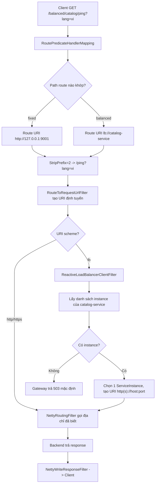

# Tuyến cố định so với tuyến dùng định danh dịch vụ `lb://`

## 1. Vì sao API Gateway cần hai cách chọn đích?

Trong hệ thống microservices, **SPRING_CLOUD_GATEWAY** nhận request từ client, chọn route bằng predicate, chạy filter chain (biến đổi path/header, xác thực, rate limit, retry, circuit breaker...) rồi chuyển tiếp HTTP tới upstream. Ở bước chuyển tiếp này, Gateway cần biết **địa chỉ thực của dịch vụ đích**.

Có hai cách khai báo route phổ biến:

- **Tuyến cố định:** `uri: http://127.0.0.1:9001` hoặc `uri: https://inventory.internal.example`. Route nêu trực tiếp địa chỉ HTTP(S) mà Gateway sẽ gọi.
- **Tuyến dùng định danh dịch vụ:** `uri: lb://catalog-service`. Route nêu một **service ID**, để **Spring Cloud LoadBalancer** phân giải thành một instance cụ thể từ nguồn danh sách instance.

Ví dụ một dịch vụ Catalog có hai instance đang chạy:

```text
Catalog instance A: 127.0.0.1:9001
Catalog instance B: 127.0.0.1:9002
Service ID:         catalog-service
```

Khi dùng route cố định tới `9001`, Gateway không tự chọn `9002`. Khi dùng `lb://catalog-service` và đã cấu hình LoadBalancer cùng nguồn instance, Gateway có thể chuyển tiếp các request khác nhau tới `9001` hoặc `9002`.

Mục tiêu bài học trong chương **Khám phá và cân bằng tải**:

1. Phân biệt **địa chỉ trực tiếp**, **service ID**, **service discovery** và **load balancing**.
2. Giải thích đầy đủ luồng `lb://` qua `RouteToRequestUrlFilter`, `ReactiveLoadBalancerClientFilter` và `NettyRoutingFilter`.
3. Viết cấu hình Gateway Server WebFlux cho cả route cố định lẫn route `lb://`.
4. Tạo hai backend cục bộ và dùng `SimpleDiscoveryClient` để chạy ví dụ mà không cần Eureka/Consul.
5. Phân biệt các lỗi **không match route (404)**, **không tìm thấy instance (mặc định 503)** và **không kết nối được tới instance đã chọn (5xx)**.
6. Nhận biết tác động đến path/header, TLS, xác thực, retry/circuit breaker và quan sát request.

> **Phiên bản ví dụ:** Spring Boot 3.5.x và Spring Cloud 2025.0.x, tương ứng Gateway Server WebFlux 4.3.x. Dùng starter `spring-cloud-starter-gateway-server-webflux`, `spring-cloud-starter-loadbalancer` và prefix cấu hình `spring.cloud.gateway.server.webflux`. Chọn bản vá được hỗ trợ khi triển khai thật; các phiên bản cụ thể trong mã bên dưới chỉ dùng để minh họa cặp tương thích.

## 2. So sánh nhanh tuyến cố định và tuyến `lb://`

| Khía cạnh | Tuyến cố định `http(s)://` | Tuyến theo service ID `lb://` |
| --- | --- | --- |
| `uri` của route | `http://127.0.0.1:9001` | `lb://catalog-service` |
| Tên đích | Host + port thực, hoặc một DNS/virtual IP có thể phân giải. | Tên logic (service ID), **không phải hostname HTTP**. |
| Cách xác định instance | Gateway dùng URI đã khai báo; nếu host là DNS/LB, cơ chế bên ngoài có thể phân phối tải. | Spring Cloud LoadBalancer lấy danh sách `ServiceInstance` rồi chọn một instance. |
| Có cần Spring Cloud LoadBalancer? | Không, nếu chỉ proxy HTTP(S) tới host tĩnh. | **Có** khi dùng route theo `lb://`. |
| Có cần nguồn instance? | Không cần registry cho URI HTTP(S) cố định. | **Có**: registry/discovery client, `SimpleDiscoveryClient`, hoặc nhà cung cấp instance tương đương. |
| Khi thêm/bớt instance | Route không tự thay đổi; DNS/ingress bên ngoài có thể che việc thay đổi. | Danh sách instance từ nguồn discovery/supplier có thể được cập nhật và dùng cho lần chọn tiếp theo. |
| Failure khi backend mất kết nối | Kết nối tới host tĩnh thất bại. | Nếu không có instance → thường 503; nếu chọn instance còn được liệt kê nhưng đã chết → lỗi kết nối. |
| Lựa chọn phù hợp | Demo, endpoint cố định, upstream sau một reverse proxy/LB ổn định. | Nhiều replica, địa chỉ thay đổi, cần cân bằng tải phía Gateway. |

**Điểm quan trọng:** một hostname tĩnh như `https://catalog.internal.example` có thể trỏ tới DNS round-robin hoặc một load balancer hạ tầng, nên tuyến cố định **không có nghĩa hệ thống không cân bằng tải ở bất kỳ tầng nào**. Nó chỉ có nghĩa Spring Cloud Gateway không tự chọn `ServiceInstance` qua scheme `lb://` cho route đó.

Tương tự, **`lb://` không tự bật discovery**. Nó chỉ cho biết Gateway cần thực hiện phân giải service ID. Nếu chưa có danh sách instance, Gateway không thể đoán địa chỉ upstream.

## 3. Cấu trúc request khi đi qua hai kiểu route

Giả sử client gửi:

```http
GET /balanced/catalog/ping?lang=vi HTTP/1.1
Host: localhost:8080
```

Có thể mô tả luồng xử lý bằng sơ đồ:



Các thuật ngữ trong sơ đồ:

- **`RoutePredicateHandlerMapping`** chọn route theo các predicate. Nó không thực hiện cân bằng tải.
- **`FilteringWebHandler`** kết hợp `GlobalFilter` với `GatewayFilter` của route, sắp xếp theo `Ordered`, rồi thực thi filter chain.
- **`StripPrefix=2`** đổi request path từ `/balanced/catalog/ping` thành `/ping` trước lúc proxy.
- **`RouteToRequestUrlFilter`** xây dựng URI định tuyến và lưu vào `ServerWebExchangeUtils.GATEWAY_REQUEST_URL_ATTR`.
- **`ReactiveLoadBalancerClientFilter`** kiểm tra `GATEWAY_REQUEST_URL_ATTR`: nếu scheme là `lb`, nó chọn một instance thông qua `ReactorLoadBalancer`, thay giá trị attribute đó bằng URI HTTP(S) thực và lưu URI trước đó vào lịch sử.
- **`NettyRoutingFilter`** gửi request tới URI HTTP(S) đã xác định bằng Reactor Netty; **`NettyWriteResponseFilter`** chuyển phản hồi về client.

Với route `lb://`, `ReactiveLoadBalancerClientFilter` không đồng nghĩa với một HTTP request tới "máy chủ tên lb". **`lb` là scheme chỉ thị nội bộ** để yêu cầu chọn instance.

### Exchange attributes trong quá trình phân giải

```text
Request từ client:
  http://localhost:8080/balanced/catalog/ping?lang=vi

GATEWAY_ROUTE_ATTR:
  Route(id="catalog-balanced", uri=lb://catalog-service, ...)

Sau StripPrefix:
  request path = /ping

Sau RouteToRequestUrlFilter:
  GATEWAY_REQUEST_URL_ATTR = lb://catalog-service/ping?lang=vi

Sau ReactiveLoadBalancerClientFilter (ví dụ chọn B):
  GATEWAY_REQUEST_URL_ATTR = http://127.0.0.1:9002/ping?lang=vi

Sau NettyRoutingFilter:
  request HTTP đã được gửi tới instance B
```

`GATEWAY_ORIGINAL_REQUEST_URL_ATTR` có thể ghi lại các URI trước khi chuyển đổi. Đây là **metadata nội bộ trong exchange**; nó không tự trở thành header gửi cho backend. Không sửa các thuộc tính định tuyến nếu không hiểu thứ tự filter và cơ chế load balancing.

## 4. Tuyến cố định: cấu hình đơn giản và hành vi

Route WebFlux cố định:

```yaml
spring:
  cloud:
    gateway:
      server:
        webflux:
          routes:
            - id: catalog-fixed
              uri: http://127.0.0.1:9001
              predicates:
                - Path=/fixed/catalog/**
              filters:
                - StripPrefix=2
```

Client gọi `GET /fixed/catalog/ping`:

1. `Path=/fixed/catalog/**` khớp request.
2. `StripPrefix=2` bỏ hai phân đoạn `fixed` và `catalog`; upstream nhận `GET /ping`.
3. Gateway gửi HTTP trực tiếp đến `127.0.0.1:9001`.
4. Nếu instance ở cổng `9001` dừng hoạt động, Gateway không tự gọi `9002` chỉ vì cổng đó đang chạy.

Ưu điểm: đơn giản, dễ xác minh, ít phụ thuộc hạ tầng. Hạn chế: nếu địa chỉ instance thay đổi, route phải được cập nhật (hoặc dùng DNS/ingress ổn định ở phía trước dịch vụ).

### Khi nào địa chỉ "cố định" vẫn là một lựa chọn đúng?

Nếu route là:

```yaml
uri: https://catalog.internal.example
```

thì hostname có thể đại diện cho một **load balancer khác** hoặc một **Kubernetes Service** do hạ tầng quản lý. Gateway không nhất thiết cần `lb://` trong mọi kiến trúc. Điều quan trọng là xác định tầng nào thực hiện phân phối tải, kiểm tra health và xử lý failover, tránh nhân đôi hoặc chồng chéo chính sách thiếu chủ đích.

## 5. Tuyến `lb://`: service ID, discovery và load balancing

Cấu hình route:

```yaml
spring:
  cloud:
    gateway:
      server:
        webflux:
          routes:
            - id: catalog-balanced
              uri: lb://catalog-service
              predicates:
                - Path=/balanced/catalog/**
              filters:
                - StripPrefix=2
```

Trong `lb://catalog-service`:

- `lb` cho biết cần cơ chế LoadBalancer.
- `catalog-service` là **service ID**.
- Route **không chứa** trực tiếp `9001` hay `9002`: chúng đến từ nguồn danh sách instance.

Để hoạt động, cần **hai phần độc lập**:

1. **`spring-cloud-starter-loadbalancer`** cung cấp hạ tầng Spring Cloud LoadBalancer và `ReactorLoadBalancer` dùng trong WebFlux.
2. **Nguồn `ServiceInstance`** cung cấp một hay nhiều `host:port` tương ứng với service ID. Nguồn đó có thể đến từ `DiscoveryClient`/registry, cấu hình đơn giản hoặc một `ServiceInstanceListSupplier` được tùy biến có kiểm soát.

Khi có nhiều instance, Spring Cloud LoadBalancer hỗ trợ các thuật toán như **Round-Robin** (thường là lựa chọn mặc định) hoặc **Random** và các cách chọn instance khác qua cấu hình/tùy biến. Kết quả thực tế **không được bảo đảm luôn xen kẽ A–B một cách tuyệt đối**: concurrency, cache, danh sách instance, thuật toán và các filter có thể ảnh hưởng thứ tự.

### Service discovery khác load balancing thế nào?

| Thành phần | Trả lời câu hỏi | Ví dụ |
| --- | --- | --- |
| **Registry / DiscoveryClient** | "Dịch vụ `catalog-service` hiện có những instance nào?" | Eureka, Consul, Kubernetes discovery, `SimpleDiscoveryClient` trong demo. |
| **ServiceInstanceListSupplier** | "Nguồn danh sách instance nào mà LoadBalancer sẽ sử dụng?" | Supplier từ discovery, có thể kết hợp cache/health-check. |
| **ReactorLoadBalancer** | "Trong danh sách này, chọn instance nào cho request?" | Round-Robin hoặc thuật toán khác. |
| **Gateway routing filter** | "Gửi request HTTP tới URI đích đã chọn bằng cách nào?" | `NettyRoutingFilter` qua Reactor Netty. |

Một registry có thể chứa instance không còn khỏe trong một khoảng thời gian; **discovery chỉ cung cấp danh sách**, không tự bảo đảm mọi instance đang trả lời HTTP thành công.

## 6. Thực hành: một Gateway, hai route và hai instance cục bộ

Bài thực hành sau dùng **`SimpleDiscoveryClient`** để khai báo danh sách instance qua `application.yml`. Nhờ đó, bạn học được cơ chế `lb://` **mà không cần cài Eureka, Consul hay Kubernetes**.

Kiến trúc:

```text
Client: localhost:8080
    |
    +-- GET /fixed/catalog/ping
    |       --> fixed URI ----------------> Catalog Blue :9001
    |
    +-- GET /balanced/catalog/ping
            --> lb://catalog-service
                    |
                    +-- catalog-service / instance 0 --> Blue  :9001
                    +-- catalog-service / instance 1 --> Green :9002
```

### 6.1. Tạo `pom.xml` với các dependency cần thiết

Yêu cầu: **JDK 17 trở lên**, Maven và `curl`. Dùng cặp Spring Boot `3.5.0` / Spring Cloud `2025.0.0` **để minh họa release train tương thích**, không phải khuyến nghị chọn bản vá `*.0` cho production.

```xml
<?xml version="1.0" encoding="UTF-8"?>
<project xmlns="http://maven.apache.org/POM/4.0.0"
         xmlns:xsi="http://www.w3.org/2001/XMLSchema-instance"
         xsi:schemaLocation="http://maven.apache.org/POM/4.0.0
                             https://maven.apache.org/xsd/maven-4.0.0.xsd">
    <modelVersion>4.0.0</modelVersion>

    <parent>
        <groupId>org.springframework.boot</groupId>
        <artifactId>spring-boot-starter-parent</artifactId>
        <version>3.5.0</version>
        <relativePath/>
    </parent>

    <groupId>com.example</groupId>
    <artifactId>discovery-gateway</artifactId>
    <version>0.0.1-SNAPSHOT</version>

    <properties>
        <java.version>17</java.version>
    </properties>

    <dependencyManagement>
        <dependencies>
            <dependency>
                <groupId>org.springframework.cloud</groupId>
                <artifactId>spring-cloud-dependencies</artifactId>
                <version>2025.0.0</version>
                <type>pom</type>
                <scope>import</scope>
            </dependency>
        </dependencies>
    </dependencyManagement>

    <dependencies>
        <dependency>
            <groupId>org.springframework.cloud</groupId>
            <artifactId>spring-cloud-starter-gateway-server-webflux</artifactId>
        </dependency>
        <dependency>
            <groupId>org.springframework.cloud</groupId>
            <artifactId>spring-cloud-starter-loadbalancer</artifactId>
        </dependency>
    </dependencies>

    <build>
        <plugins>
            <plugin>
                <groupId>org.springframework.boot</groupId>
                <artifactId>spring-boot-maven-plugin</artifactId>
            </plugin>
        </plugins>
    </build>
</project>
```

Đừng tự gắn version cho hai starter: Spring Cloud BOM quản lý chúng trong cùng release train. Gateway Server WebFlux chạy trên Reactor Netty; không cần thêm `spring-boot-starter-web` vào demo này.

### 6.2. Tạo entry point Java

Tạo `src/main/java/com/example/gateway/GatewayApplication.java`:

```java
package com.example.gateway;

import org.springframework.boot.SpringApplication;
import org.springframework.boot.autoconfigure.SpringBootApplication;

@SpringBootApplication
public class GatewayApplication {
    public static void main(String[] args) {
        SpringApplication.run(GatewayApplication.class, args);
    }
}
```

Một ứng dụng Gateway proxy tối thiểu không cần REST controller. Khi dùng các starter Spring Cloud phù hợp, khả năng phát hiện client/load balancing được auto-configure; với ví dụ này bạn không cần tự viết `@EnableDiscoveryClient` hoặc đăng ký Eureka server.

### 6.3. Tạo `application.yml`

Tạo `src/main/resources/application.yml`:

```yaml
server:
  port: 8080

spring:
  application:
    name: discovery-gateway
  cloud:
    discovery:
      client:
        simple:
          instances:
            catalog-service:
              - uri: http://127.0.0.1:9001
              - uri: http://127.0.0.1:9002

    gateway:
      server:
        webflux:
          routes:
            - id: catalog-fixed
              uri: http://127.0.0.1:9001
              predicates:
                - Path=/fixed/catalog/**
              filters:
                - StripPrefix=2
                - AddResponseHeader=X-Gateway-Route, catalog-fixed

            - id: catalog-balanced
              uri: lb://catalog-service
              predicates:
                - Path=/balanced/catalog/**
              filters:
                - StripPrefix=2
                - AddResponseHeader=X-Gateway-Route, catalog-balanced
```

Hãy đọc cấu hình thành **ba phần khác nhau**:

1. `spring.cloud.discovery.client.simple.instances.catalog-service` là **danh sách instance nguồn**, do Spring Cloud Commons `SimpleDiscoveryClient` đọc. Nó chứa hai URI HTTP cụ thể.
2. `spring.cloud.gateway.server.webflux.routes` là danh sách route Gateway. Hai route chọn theo **hai đường dẫn khác nhau** để bạn so sánh mà không bị trùng predicate.
3. `AddResponseHeader=X-Gateway-Route, ...` chỉ thêm marker quan sát route trong bài thực hành; không phải cách chọn instance và không chứa tên backend được LoadBalancer chọn.

**Không cần bật `discovery.locator.enabled`** ở ví dụ này. Chúng ta đã khai báo route rõ ràng. `SimpleDiscoveryClient` cung cấp instance cho `lb://catalog-service`, còn **DiscoveryClient Route Definition Locator** là cơ chế khác để tự sinh route từ các service đã phát hiện.

### 6.4. Tạo backend Echo chạy ở hai cổng

Tạo file `EchoBackend.java` tại thư mục thực hành riêng, **không** đưa vào source Gateway:

```java
import com.sun.net.httpserver.HttpServer;
import java.net.InetSocketAddress;
import java.nio.charset.StandardCharsets;

public class EchoBackend {
    public static void main(String[] args) throws Exception {
        int port = Integer.parseInt(args[0]);
        String instance = args[1];

        HttpServer server = HttpServer.create(
                new InetSocketAddress("127.0.0.1", port), 0);

        server.createContext("/", exchange -> {
            String path = exchange.getRequestURI().getRawPath();
            String query = exchange.getRequestURI().getRawQuery();

            System.out.println(instance + " received " + path
                    + (query == null ? "" : "?" + query));

            String body = "instance=" + instance + "\n"
                    + "path=" + path + "\n"
                    + "query=" + query + "\n";
            byte[] payload = body.getBytes(StandardCharsets.UTF_8);

            exchange.getResponseHeaders().set(
                    "Content-Type", "text/plain; charset=UTF-8");
            exchange.sendResponseHeaders(200, payload.length);

            try (var output = exchange.getResponseBody()) {
                output.write(payload);
            }
        });

        server.start();
        System.out.println(instance + " ready on port " + port);
    }
}
```

`EchoBackend` là HTTP server nhỏ dùng thư viện chuẩn của JDK, chỉ bind loopback. Nó trả tên instance thật sự đã nhận request, path và raw query string; **không triển khai xác thực, TLS, rate limiting hoặc health-check production**.

Mở ba terminal:

**Terminal A – Blue:**

```bash
java EchoBackend.java 9001 blue
```

**Terminal B – Green:**

```bash
java EchoBackend.java 9002 green
```

**Terminal C – Gateway** (ở thư mục có `pom.xml`):

```bash
mvn spring-boot:run
```

Nếu dùng Maven Wrapper: `./mvnw spring-boot:run` trên Linux/macOS hoặc `mvnw.cmd spring-boot:run` trên Windows.

### 6.5. Kiểm chứng tuyến cố định

Mở terminal thứ tư, gửi nhiều lần:

```bash
curl -i "http://127.0.0.1:8080/fixed/catalog/ping?lang=vi"
```

Kết quả điển hình:

```http
HTTP/1.1 200 OK
X-Gateway-Route: catalog-fixed
Content-Type: text/plain; charset=UTF-8

instance=blue
path=/ping
query=lang=vi
```

Đối với route này, backend Blue ở cổng `9001` được dùng ở mỗi request bình thường. Green ở cổng `9002` không nhận request qua route cố định này.

### 6.6. Kiểm chứng tuyến dùng `lb://`

Gửi lặp lại:

```bash
curl -i "http://127.0.0.1:8080/balanced/catalog/ping?lang=vi"
curl -i "http://127.0.0.1:8080/balanced/catalog/ping?lang=vi"
curl -i "http://127.0.0.1:8080/balanced/catalog/ping?lang=vi"
curl -i "http://127.0.0.1:8080/balanced/catalog/ping?lang=vi"
```

Các response có cùng `X-Gateway-Route: catalog-balanced`, `path=/ping`, `query=lang=vi`. Trường `instance` cho biết request được gửi tới **blue** hoặc **green**. Trong cấu hình đơn giản mặc định, bạn thường sẽ quan sát cả hai instance sau nhiều request; không nên đặt test yêu cầu **chính xác** A–B–A–B khi chạy nhiều request song song hoặc có thay đổi danh sách instance.

Bạn cũng có thể gọi trực tiếp hai backend để đối chiếu:

```bash
curl -i "http://127.0.0.1:9001/ping?lang=vi"
curl -i "http://127.0.0.1:9002/ping?lang=vi"
```

Điều cần chứng minh không chỉ là response 200, mà là **hai backend thật sự đều có thể nhận request qua route `lb://catalog-service`**.

### 6.7. Khi route không khớp

```bash
curl -i "http://127.0.0.1:8080/not-configured"
```

Nếu không có route hay handler khác khớp path, Gateway thường trả `404 Not Found`. Lỗi này xảy ra **trước** khi LoadBalancer chọn service instance.

## 7. Thử các tình huống lỗi để hiểu cơ chế

### 7.1. Không có instance nào được discovery trả về

Giả sử route vẫn khai báo:

```yaml
uri: lb://catalog-service
```

nhưng không có instance nào được cung cấp cho service ID đó (ví dụ danh sách rỗng, đăng ký sai tên hoặc client discovery không hoạt động). `ReactiveLoadBalancerClientFilter` không thể phân giải đích; theo hành vi mặc định Gateway Server WebFlux, kết quả thường là:

```http
HTTP/1.1 503 Service Unavailable
```

Gateway có tùy chọn cấu hình **trả 404 thay cho 503 khi không có instance**, nhưng tên property cần đối chiếu với phiên bản đang chạy. Không nên bật tùy chọn đó chỉ để che lỗi discovery: 404 "không tìm thấy tài nguyên" và 503 "dịch vụ tạm không sẵn sàng" mang ý nghĩa vận hành khác nhau.

**Chú ý:** 503 do không tìm thấy instance **khác** với HTTP 503 do một backend thực sự trả về. Dùng route ID, log LoadBalancer/discovery và tracing để phân biệt nguồn lỗi.

### 7.2. Một instance dừng nhưng vẫn nằm trong danh sách

Dừng tiến trình Green ở cổng `9002`, giữ Gateway và Blue chạy; tiếp tục gọi:

```bash
curl -i "http://127.0.0.1:8080/balanced/catalog/ping"
```

Vì `SimpleDiscoveryClient` của ví dụ chứa **hai địa chỉ cấu hình tĩnh**, việc bạn dừng Green không tự xóa Green khỏi danh sách. Nếu LoadBalancer vẫn chọn `9002`, Gateway cố kết nối và gặp lỗi, thường là response nhóm **5xx**. Những request khác chọn Blue vẫn có thể thành công.

**Không suy luận:** "Dùng `lb://` thì tự động loại mọi instance chết ngay lập tức." Trong hệ thống thực cần một hoặc nhiều cơ chế health-check, cập nhật registry, danh sách instance, timeout và retry/circuit breaker đúng chính sách.

### 7.3. Tuyến cố định khi backend mất kết nối

Nếu dừng Blue ở `9001`, route `/fixed/catalog/**` sẽ không tự chuyển sang `9002`: nó vẫn cố gọi đúng URI đã cấu hình và có thể trả lỗi kết nối. Với route `lb://`, một số request có thể tiếp tục thành công nếu LoadBalancer chọn Green (nếu Green đang chạy).

### 7.4. Sai service ID

```yaml
uri: lb://catalog-servce
```

Lỗi gõ tên `catalog-servce` khác `catalog-service`. Các route predicate vẫn có thể match, nhưng danh sách instance thuộc service ID gõ sai rỗng; kết quả thường là 503. **Định danh dịch vụ phải khớp chính xác** với nguồn discovery; chú ý quy ước chữ hoa/chữ thường khi dùng các registry khác nhau.

## 8. Từ `SimpleDiscoveryClient` đến registry thực

Trong demo, danh sách instance được ghi vào cấu hình:

```yaml
spring:
  cloud:
    discovery:
      client:
        simple:
          instances:
            catalog-service:
              - uri: http://127.0.0.1:9001
              - uri: http://127.0.0.1:9002
```

`SimpleDiscoveryClient` dùng cấu hình đó khi không có client discovery dựa trên registry thay thế. Đây là cách học cú pháp **service ID → danh sách instance**, nhưng không tự đăng ký/deregister theo vòng đời process như một hệ thống discovery thật.

Ở production, nguồn instance có thể là:

- **Eureka:** ứng dụng backend đăng ký instance theo service name và registry cung cấp danh sách.
- **Consul:** service registration và health-check của Consul cung cấp thông tin instance.
- **Kubernetes:** dùng Service/DNS hoặc cơ chế discovery phù hợp với hạ tầng; không phải mọi cụm Kubernetes đều cần `lb://` phía Gateway.
- **Supplier tùy biến:** cung cấp `ServiceInstance` dựa trên hệ thống quản lý đích nội bộ, với chính sách cache/health phù hợp.

Các bước chuyển sang registry thực:

1. Thêm starter discovery client đúng với registry đang dùng vào Gateway (và cấu hình đăng ký cho backend nếu kiến trúc yêu cầu).
2. Cấu hình endpoint registry, thông tin xác thực, namespace và network policy.
3. Bảo đảm tên service trong registry khớp chính xác với `catalog-service`.
4. Giữ route `uri: lb://catalog-service`, nếu vẫn muốn Gateway thực hiện client-side balancing.
5. Gỡ cấu hình instance tĩnh của demo khi registry trở thành nguồn sự thật, tránh danh sách trùng/nguồn khó đoán.
6. Kiểm thử scaling, restart, deregister, timeout và TLS với môi trường thật.

### Có phải cần `discovery.locator.enabled` khi đã dùng `lb://`?

**Không.** Hai chức năng khác nhau:

- **Route thủ công:** tự khai báo `id`, `Path`, `uri: lb://catalog-service`, filter. LoadBalancer chỉ cần nguồn instance phù hợp.
- **DiscoveryClient Route Definition Locator:** khi được bật, Gateway có thể **tự tạo route** từ các service mà `DiscoveryClient` nhìn thấy. Route auto-generated thường dùng `lb://serviceId`, `Path=/serviceId/**` và rewrite path bỏ prefix service ID theo mặc định.

Nếu lựa chọn locator, hãy kiểm tra cấu hình trong **đúng phiên bản Gateway Server WebFlux**; ở dòng 2025.0.x, các property Gateway WebFlux chuyển sang prefix `spring.cloud.gateway.server.webflux`. Bật tự động sinh route có thể vô tình phơi bày dịch vụ nội bộ qua Gateway, nên cần cơ chế giới hạn service được phép expose, auth và review quy tắc predicate/filter. Bài thực hành giữ locator **tắt** và khai báo hai route có kiểm soát.

## 9. Cân bằng tải tác động gì đến bảo mật và filter chain?

### Xác thực và phân quyền

Tuyến `lb://` chỉ thay cách chọn **địa chỉ đích**, không biến Gateway thành một hệ thống xác thực. Client vẫn phải được kiểm tra qua Spring Security WebFlux/OAuth2 hoặc cơ chế tương ứng trước khi truy cập tài nguyên cần bảo vệ. Service ID do cấu hình trusted cung cấp; không lấy một URI bất kỳ do client gửi rồi chuyển thành `lb://` để chọn dịch vụ nội bộ ngoài quyền cho phép.

### Rate limiting

Giới hạn lưu lượng thường đặt ở Gateway để bảo vệ toàn bộ nhóm dịch vụ; số instance tăng không đồng nghĩa được tự ý tăng quota. Khi chạy nhiều Gateway instance, cần xác định bộ đếm phân tán/đồng bộ và khóa giới hạn đáng tin cậy. Không dùng IP hoặc query parameter do client dễ giả mạo làm định danh duy nhất cho chính sách quan trọng.

### Circuit breaker và retry

LoadBalancer chọn một instance; **retry và circuit breaker không tự xuất hiện chỉ vì route dùng `lb://`**. Cần cấu hình riêng khi có nhu cầu.

- Retry có thể gửi lại request sau lỗi kết nối/status, nhưng hành vi có đổi instance giữa các attempt hay không phụ thuộc thứ tự filter, cấu hình và cách tích hợp LoadBalancer.
- Tránh retry mù quáng các thao tác `POST`/ `PATCH` có side effect nếu không có cơ chế idempotency phù hợp.
- Circuit breaker giúp bảo vệ khi downstream liên tục lỗi/timeout; không thay thế hoàn toàn health checks và discovery.
- Thiết lập connect/response timeout ở các tầng thích hợp; quyết định mã phản hồi/fallback và metrics cho cả failure khi không có instance lẫn lỗi HTTP thực.

### TLS và `isSecure`

Client có thể kết nối Gateway bằng HTTPS nhưng kết nối **Gateway → backend** vẫn là HTTP nếu `ServiceInstance` được chọn không được đánh dấu secure. Ngược lại, instance secure có thể dẫn tới HTTPS outbound. Vì vậy, **không suy ra scheme kết nối upstream từ scheme của request client**.

Nếu dùng `lb://`, cấu hình instance/registry phải mô tả đúng giao thức, cổng, chứng chỉ và trust. Với trường hợp scheme prefix đặc biệt (chẳng hạn `lb:ws://...`), Gateway có thêm quy tắc về scheme; kiểm tra tài liệu định tuyến theo phiên bản. Không tắt xác minh TLS để xử lý lỗi chọn instance.

### Header và path

`StripPrefix`, `SetPath`, `RewritePath`, `AddRequestHeader` và các filter khác vẫn áp dụng theo route dù backend là fixed hay `lb://`. Nhưng việc chuyển Host/Forwarded headers phải được kiểm soát theo ranh giới proxy tin cậy; không dựa vào header `Host` giả mạo từ client để phân quyền tenant. Trong Spring Cloud 2025.0, cần chú ý thay đổi hành vi tin cậy các header `X-Forwarded-*`/`Forwarded` theo release notes.

### Quan sát request

Nên quan sát ít nhất:

- Route ID (ví dụ `catalog-fixed` hoặc `catalog-balanced`).
- Service ID đích (`catalog-service`) khi có `lb://`.
- HTTP status, độ trễ, số lỗi 5xx/timeout và số lần retry.
- Số instance sẵn có, tần suất không tìm thấy instance và kết quả health check.
- Instance thực nhận request, từ log backend/trace có kiểm soát.

Tránh biến `host:port`, URL đầy đủ, query chứa PII hoặc token thành metric label có cardinality cao. Spring Boot Actuator/Micrometer hỗ trợ theo dõi Gateway; endpoint quản trị phải được bảo vệ, không mở công khai.

## 10. Chẩn đoán lỗi nhanh

| Hiện tượng | Nguyên nhân thường gặp | Cách kiểm tra |
| --- | --- | --- |
| `404` với `/not-configured` | Không có route/handler match request. | Xem `Path` predicates và route list. |
| `503` với `lb://catalog-service` | LoadBalancer không tìm thấy instance hợp lệ cho service ID. | Kiểm tra starter LoadBalancer, nguồn DiscoveryClient, tên service và danh sách instance. |
| `lb://` không được phân giải đúng | Thiếu starter/auto-configuration LoadBalancer hoặc cấu hình không đúng phiên bản. | Kiểm tra Maven dependency tree và log startup; xác nhận `spring-cloud-starter-loadbalancer`. |
| Một số request `lb://` trả 5xx xen kẽ | Một instance đã chết nhưng vẫn nằm trong danh sách static/cache hoặc lỗi kết nối. | Gọi trực tiếp từng instance, xem discovery/health và log định tuyến. |
| Route fixed chỉ gọi Blue | Route URI chỉ rõ `9001`. | Đây là hành vi mong đợi; muốn cân bằng tải hãy dùng hạ tầng phía sau hoặc `lb://`. |
| Backend nhận `/balanced/catalog/ping` thay vì `/ping` | Thiếu hoặc sai `StripPrefix=2`. | Kiểm tra filter gắn trên route và request thực tại backend. |
| Vừa bật locator vừa có route thủ công, đường dẫn bị bất ngờ | Locator có thể sinh thêm route theo service ID. | Kiểm tra danh sách route, predicate/filter, tắt locator nếu không cần. |
| Lỗi TLS/SSL khi đến instance | Scheme, cổng, chứng chỉ hoặc trust store không phù hợp. | Kiểm tra cấu hình `ServiceInstance.isSecure`, HTTPS client và SNI/certificate. |
| Thay số replica nhưng traffic chưa đổi | Registry/supplier cache, health-check hoặc refresh chưa cập nhật. | Kiểm tra discovery, cache TTL và số instance hiện tại. |
| Gọi đúng path nhưng nhận 403/429 | Một lớp bảo mật hoặc rate limiter đã từ chối trước routing. | Kiểm tra filter chain, security rules, route ID và response marker. |

### Quy trình khoanh vùng sự cố

1. **Route có match?** Nếu không, kiểm tra Path/Host predicates, prefix cấu hình và route ID.
2. **URI là fixed hay `lb://`?** Nếu fixed, gọi trực tiếp URI đã khai báo. Nếu `lb://`, kiểm tra service ID và có nguồn instance.
3. **Có instance nào không?** Xác nhận qua registry, `SimpleDiscoveryClient` hoặc supplier thực tế.
4. **Instance được chọn có kết nối được không?** Gọi trực tiếp host:port, kiểm tra port, firewall, protocol và TLS.
5. **Path/header có bị filter thay đổi đúng không?** Kiểm tra `StripPrefix`, `RewritePath`, header filters và log tại backend.
6. **Bảo vệ và vận hành có ảnh hưởng không?** Kiểm tra auth, rate limiter, retry, circuit breaker, timeout, trace/metrics.
7. **Đã kiểm thử trường hợp instance dừng/khởi động lại chưa?** Xác nhận hệ thống cập nhật danh sách và phản hồi đúng khi không còn instance.

## 11. Bộ kiểm thử gợi ý

| Tình huống | Request/điều kiện | Kết quả cần xác minh |
| --- | --- | --- |
| Cố định bình thường | `/fixed/catalog/ping` | Backend Blue nhận `/ping`; route ID fixed. |
| Cân bằng bình thường | Gửi nhiều `/balanced/catalog/ping` | Có request đến cả Blue/Green trong cấu hình mặc định. |
| Bảo toàn query | `/balanced/catalog/ping?lang=vi` | Backend nhận `query=lang=vi`. |
| Không có route | `/not-configured` | Thường 404, không gửi request downstream. |
| Không có instance | `lb://missing-service` hoặc danh sách instance trống | Mặc định 503, log cho biết thiếu instance. |
| Một instance ngừng | Dừng Green, giữ danh sách static | Có thể có lỗi kết nối khi chọn Green; không bảo đảm tự loại khỏi danh sách. |
| Cố định mất kết nối | Dừng Blue | Route fixed không tự chọn Green. |
| Tên service sai | `lb://catalog-servce` | Không tìm thấy instance, không tự nhận diện lỗi chính tả. |
| Thêm/bớt instance qua registry | Môi trường discovery thực | Danh sách thay đổi theo cơ chế registry/cache/health. |
| TLS upstream | ServiceInstance có HTTP và HTTPS tương ứng | Giao thức, chứng chỉ, SNI và trust được kiểm soát. |
| Tải đồng thời | Gửi nhiều request song song | Không dựa vào thứ tự round-robin tuyệt đối; đo phân phối và lỗi. |

Các kiểm thử này không yêu cầu phải dùng một thuật toán cụ thể; chúng kiểm tra **hành vi Gateway có thể quan sát được** và tách rõ lỗi route, lỗi service discovery và lỗi kết nối.

## 12. Câu hỏi tự kiểm tra

**1. Dùng `uri: http://127.0.0.1:9001` nhưng có hai bản sao catalog ở cổng 9001/9002, Gateway có tự đổi sang cổng 9002 không?**

Không. URI cố định chỉ dẫn đến địa chỉ đã khai báo. Nếu muốn dùng nhiều instance, cần một tầng cân bằng tải khác hoặc route `lb://` cùng nguồn instance và LoadBalancer.

**2. `lb://catalog-service` có phải một URL HTTP mà Netty có thể gọi trực tiếp không?**

Không. `lb` là scheme nội bộ yêu cầu `ReactiveLoadBalancerClientFilter` đổi service ID thành URI HTTP(S) thực trước khi Netty routing.

**3. Để route `lb://` hoạt động, có phải chỉ cần thêm `spring-cloud-starter-loadbalancer` là đủ không?**

Chưa đủ. Cần một nguồn cung cấp các `ServiceInstance` tương ứng với service ID; có thể dùng registry hoặc `SimpleDiscoveryClient` như ví dụ.

**4. Nếu một request `lb://` trả 503, có luôn có nghĩa upstream thực sự đã trả 503 không?**

Không. Gateway mặc định cũng có thể trả 503 khi LoadBalancer không tìm được instance. Cần phân biệt lỗi trước routing với HTTP response do upstream trả.

**5. `discovery.locator.enabled` có bắt buộc khi khai báo thủ công `uri: lb://catalog-service` không?**

Không. Locator dùng để **tự tạo route** từ các service được phát hiện; route thủ công có thể dùng `lb://` độc lập với nó.

**6. Nếu dừng một instance trong cấu hình `SimpleDiscoveryClient`, tại sao đôi khi Gateway vẫn cố kết nối đến instance đó?**

Vì cấu hình instance là danh sách tĩnh; dừng tiến trình không tự xóa mục đã khai báo. Cần registry/health-check hoặc cơ chế cập nhật instance phù hợp.

**7. Gateway nhận HTTPS từ client thì kết nối tới backend do LoadBalancer chọn có mặc định là HTTPS không?**

Không. Scheme outbound phụ thuộc thông tin về `ServiceInstance`, route và cấu hình liên quan; TLS client–Gateway và Gateway–backend là hai kết nối tách biệt.

**8. `StripPrefix=2` dùng với cả URI cố định và `lb://` được không?**

Được. Đây là GatewayFilter biến đổi path của request trước khi gửi upstream; việc chọn instance thuộc bước định tuyến tiếp theo.

## Kết luận

Trong Spring Cloud Gateway Server WebFlux, **tuyến cố định** dùng `http(s)://host:port` để proxy tới một địa chỉ đã biết, còn **tuyến `lb://serviceId`** dùng tên logic và nhờ Spring Cloud LoadBalancer chọn một `ServiceInstance` từ nguồn discovery. Hai cách này vẫn sử dụng cùng hệ thống route predicates và filter chain để biến đổi path/header. Điều làm `lb://` hoạt động không phải riêng chuỗi `lb://` mà là **đủ dependency LoadBalancer, danh sách instance hợp lệ và cấu hình service ID chính xác**.

Trong microservices production, cần kiểm tra health, mất kết nối, cache discovery, TLS, xác thực, rate limit, retry, circuit breaker và observability. Hãy chọn tuyến theo đúng cách hạ tầng đang cung cấp dịch vụ, tránh giả định client-side load balancing tự động giải quyết mọi lỗi instance hoặc thay thế các cơ chế chịu lỗi khác.

### Tài liệu tham khảo chính thức

- [Spring Cloud Gateway Server WebFlux 4.3 — Global Filters: ReactiveLoadBalancerClientFilter và RouteToRequestUrlFilter](https://docs.spring.io/spring-cloud-gateway/reference/4.3/spring-cloud-gateway-server-webflux/global-filters.html)
- [Spring Cloud Gateway Server WebFlux 4.3 — DiscoveryClient Route Definition Locator](https://docs.spring.io/spring-cloud-gateway/reference/4.3/spring-cloud-gateway-server-webflux/the-discoveryclient-route-definition-locator.html)
- [Spring Cloud Gateway Server WebFlux 4.3 — How It Works](https://docs.spring.io/spring-cloud-gateway/reference/4.3/spring-cloud-gateway-server-webflux/how-it-works.html)
- [Spring Cloud Commons — Spring Cloud LoadBalancer](https://docs.spring.io/spring-cloud-commons/reference/4.3/spring-cloud-commons/loadbalancer.html)
- [Spring Cloud Commons — Common Abstractions, SimpleDiscoveryClient](https://docs.spring.io/spring-cloud-commons/reference/spring-cloud-commons/common-abstractions.html)
- [Spring Cloud 2025.0 Release Notes — starter và prefix cấu hình](https://github.com/spring-cloud/spring-cloud-release/wiki/Spring-Cloud-2025.0-Release-Notes)
- [Spring Cloud — chọn release train tương thích với Spring Boot](https://spring.io/projects/spring-cloud/)
