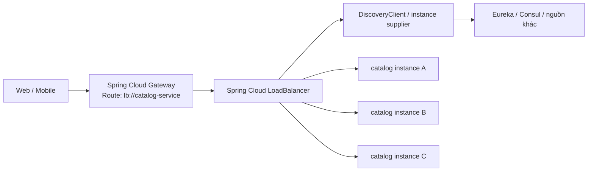
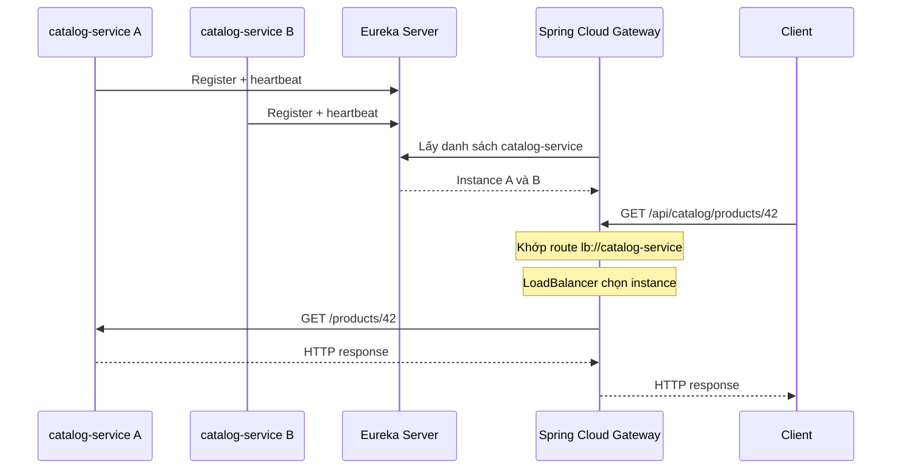
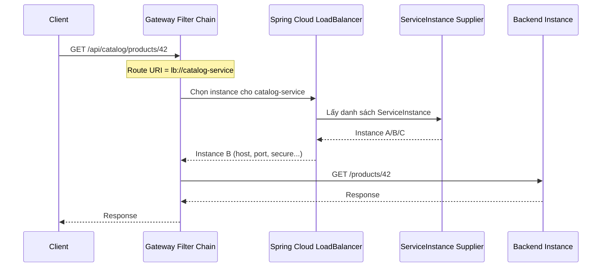
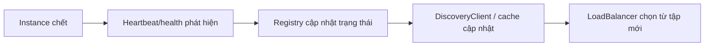

# Kết nối DiscoveryClient với Eureka, Consul hoặc nguồn dịch vụ phù hợp

Trong một hệ thống microservices, **Spring Cloud Gateway** thường đứng trước nhiều bản sao của cùng một dịch vụ. Hôm nay `catalog-service` có hai instance, ngày mai hệ thống mở rộng lên năm instance; một instance có thể bị khởi động lại, chuyển máy hoặc bị loại do không còn khỏe mạnh. Nếu phải khai báo IP và port của mọi instance trực tiếp trong route của gateway, mỗi đợt triển khai backend có thể kéo theo một lần cập nhật cấu hình cổng vào.

**Service discovery** giải quyết vấn đề tìm địa chỉ instance theo **tên dịch vụ logic**. Với cơ chế khám phá dịch vụ phù hợp, gateway chỉ cần biết tên như `catalog-service` và cấu hình route dùng URI `lb://catalog-service`. Lúc chuyển tiếp, **Spring Cloud LoadBalancer** chọn một instance cụ thể từ danh sách do nguồn khám phá dịch vụ cung cấp.

Bài thuộc chương **Khám phá và cân bằng tải** của module **SPRING_CLOUD_GATEWAY**. Trọng tâm là kết nối `DiscoveryClient` với **Eureka**, **Consul** hoặc một nguồn instance khác; phân biệt đăng ký dịch vụ, tìm dịch vụ, tạo route tự động và chọn instance; rồi kiểm thử thực tế trong gateway có route predicate, filter chain, biến đổi path/header, xác thực, giới hạn lưu lượng, circuit breaker, retry, TLS và quan sát request.

> **Phạm vi:** Ví dụ route và filter dưới đây sử dụng **Spring Cloud Gateway Server WebFlux**, với cách tổ chức dependency và property cần đối chiếu theo phiên bản. Web MVC có route/filter API tương ứng nhưng không dùng nguyên code WebFlux. Các giá trị hostname, địa chỉ và cổng chỉ là ví dụ; không có Eureka, Consul, backend hay kết quả load test thật được tạo sẵn bởi bài viết.

## 1. Vấn đề của route gắn cứng địa chỉ

Giả sử một route của gateway được khai báo:

```yaml
id: catalog-route
uri: http://192.0.2.10:8081
predicates:
  - Path=/api/catalog/**
filters:
  - StripPrefix=2
```

Đây là **đoạn mô tả route rút gọn**; cấu hình thật phải được đặt dưới property prefix hợp lệ của phiên bản Gateway. Với route trên, gateway luôn chuyển tiếp đến một địa chỉ cụ thể, nếu không có cơ chế nào khác được cấu hình.

Những giới hạn dễ gặp:

1. **IP thay đổi:** container hoặc máy ảo mới có thể nhận IP/port khác.
2. **Scale không tự động:** route chỉ biết một upstream dù dịch vụ có nhiều instance.
3. **Failover thủ công:** khi instance đích chết, route không tự biết địa chỉ thay thế.
4. **Quản lý cấu hình khó:** nhiều gateway replica phải cùng cập nhật danh sách backend.
5. **Rủi ro vận hành:** sửa nhầm IP có thể gửi traffic đến môi trường hoặc dịch vụ không đúng.

Thay vì lưu địa chỉ instance trong route, ta định tuyến bằng **tên dịch vụ**:

```yaml
id: catalog-route
uri: lb://catalog-service
predicates:
  - Path=/api/catalog/**
filters:
  - StripPrefix=2
```

`lb://catalog-service` không phải hostname Internet và cũng không tự định nghĩa thuật toán chọn instance. Đây là **URI logic** được các thành phần load balancing của Spring Cloud Gateway xử lý. Cần có dependency `spring-cloud-starter-loadbalancer` và một nguồn `ServiceInstance` tương thích.



Gateway quyết định **request thuộc route nào** trước, sau đó load balancer chọn **instance nào của dịch vụ**. Hai quyết định này không được đánh đồng.

## 2. Phân biệt Service Registry, DiscoveryClient, LoadBalancer và Gateway

| Thành phần | Trả lời câu hỏi | Ví dụ |
| --- | --- | --- |
| **Service Registry** | “Hiện có những instance nào của dịch vụ này?” | Eureka Server, Consul Catalog |
| **Service registration** | “Một instance được đăng ký/hủy đăng ký như thế nào?” | `catalog-service` đăng ký địa chỉ, port và trạng thái |
| **`DiscoveryClient` / `ReactiveDiscoveryClient`** | “Ứng dụng Spring đọc danh sách dịch vụ/instance bằng API nào?” | `getInstances("catalog-service")` theo giao diện tương ứng |
| **`ServiceInstance`** | “Một instance có host, port, ID, metadata và trạng thái bảo mật như thế nào?” | `catalog-service@10.0.0.21:8081` |
| **Spring Cloud LoadBalancer** | “Chọn instance nào trong tập các instance được cung cấp?” | Round-robin hoặc chiến lược được cấu hình |
| **Gateway RouteLocator** | “Request này đi theo route logic nào?” | `/api/catalog/**` → `lb://catalog-service` |
| **`DiscoveryClientRouteDefinitionLocator`** | “Có nên tự tạo route dựa trên tên dịch vụ tìm thấy?” | Route tự sinh `/catalog-service/**`, khi được bật và cấu hình phù hợp |

Một triển khai Spring Cloud `DiscoveryClient` có thể là **đồng bộ**, trong khi `ReactiveDiscoveryClient` cung cấp giao diện phù hợp với luồng reactive. Gateway WebFlux và Spring Cloud LoadBalancer có những điểm tích hợp để tiêu thụ danh sách instance tùy nguồn; không nên mặc định mỗi registry có cùng kiểu client, cache hay cơ chế cập nhật.

### 2.1. Hai luồng độc lập nhưng có liên quan

**Luồng đăng ký và khám phá:**

```text
catalog instance khởi động
    -> đăng ký với Eureka/Consul (hoặc được hạ tầng khám phá)
    -> registry cung cấp danh sách instance
    -> gateway/load balancer đọc danh sách theo cơ chế tương ứng
```

**Luồng xử lý request:**

```text
GET /api/catalog/products/42
    -> predicate Path khớp catalog-route
    -> StripPrefix=2 đổi path thành /products/42
    -> lb://catalog-service giải quyết tên logic
    -> LoadBalancer chọn một ServiceInstance
    -> HTTP client kết nối tới host:port của instance
    -> backend trả response
```

Việc registry có một bản ghi dịch vụ **không tự bảo đảm** kết nối từ gateway đến instance sẽ thành công. Cần đúng địa chỉ mạng, health, DNS, port, firewall, giao thức HTTP(S) và chứng chỉ nếu dùng TLS.

## 3. Nguồn khám phá dịch vụ nào phù hợp?

Không phải hệ thống nào cũng phải triển khai Eureka hoặc Consul. Chọn nguồn instance theo **hạ tầng đang vận hành**, thay vì cài thêm registry chỉ vì đã dùng Spring Cloud Gateway.

| Nguồn | Mô hình cơ bản | Phù hợp khi | Điều cần kiểm tra |
| --- | --- | --- | --- |
| **Netflix Eureka** | Ứng dụng Eureka client tự đăng ký; Eureka Server cung cấp registry và trạng thái lease. | Hệ thống Spring Cloud đã dùng Eureka hoặc cần registry theo mô hình này. | Eureka Server, lease/heartbeat, cấu hình instance, bảo vệ registry. |
| **HashiCorp Consul** | Ứng dụng/agent đăng ký service và health check; Consul Catalog/Health cung cấp instance. | Tổ chức đã dùng Consul cho discovery/config hoặc chạy nhiều loại ứng dụng. | Consul agent/server, ACL token, health checks, datacenter và network. |
| **Kubernetes-native discovery** | Service và EndpointSlice/DNS của cluster đại diện backend; có thể dùng Spring Cloud Kubernetes DiscoveryClient. | Microservices đã triển khai trong Kubernetes. | Dùng Service DNS trực tiếp hay cần DiscoveryClient, RBAC và topology. |
| **`SimpleDiscoveryClient`** | Danh sách `ServiceInstance` khai báo tĩnh bằng properties. | POC/local hoặc ít backend cố định. | Danh sách URI, quá trình thay đổi cấu hình và cách LoadBalancer lấy instance. |
| **Nguồn tùy chỉnh** | Cung cấp danh sách instance qua client/supplier tự viết. | Có service catalog nội bộ đã được chuẩn hóa. | API, cache/TTL, xác thực, health, xử lý lỗi và tính tương thích. |

**Quy tắc thực dụng:** nếu Kubernetes Service DNS và ingress hiện có đã đáp ứng đầy đủ routing và cân bằng tải, có thể không cần Spring Cloud discovery client trong gateway. Ngược lại, khi gateway cần chọn instance theo metadata, vùng hoặc chính sách riêng, một nguồn `ServiceInstance` có thể đem lại tính linh hoạt.

### Điều gì không nên kỳ vọng ở registry?

- Registry không tự xác thực JWT của người dùng cuối.
- Registry không tự thiết lập TLS giữa gateway và backend.
- Registry không tự giới hạn request theo user/API key.
- Registry không quyết định endpoint path, method hoặc permission của nghiệp vụ.
- Registry không tạo circuit breaker và không làm cho thao tác POST tự retry an toàn.

Đó là trách nhiệm của route predicate/filter chain, Spring Security, các thư viện resilience và chính backend.

## 4. Chuẩn bị dependency và tương thích phiên bản

Trước khi cấu hình, khóa **JDK, Spring Boot, Spring Cloud release train, Spring Cloud Gateway WebFlux** và phiên bản discovery client phù hợp. Sử dụng Spring Cloud BOM/Dependency Management để giữ các thư viện trong bộ tương thích.

### 4.1. Nhóm dependency cần có

| Vai trò | Starter thường gặp |
| --- | --- |
| API Gateway WebFlux ở các dòng mới | `org.springframework.cloud:spring-cloud-starter-gateway-server-webflux` |
| Spring Cloud LoadBalancer | `org.springframework.cloud:spring-cloud-starter-loadbalancer` |
| Eureka DiscoveryClient | `org.springframework.cloud:spring-cloud-starter-netflix-eureka-client` |
| Consul DiscoveryClient | `org.springframework.cloud:spring-cloud-starter-consul-discovery` |
| Health/metrics tại ứng dụng Spring Boot | `org.springframework.boot:spring-boot-starter-actuator` |
| Xác thực JWT resource server nếu cần | `org.springframework.boot:spring-boot-starter-oauth2-resource-server` |

Tên starter Gateway, property prefix và hỗ trợ phiên bản có thể thay đổi theo release train. Ví dụ Gateway WebFlux cũ có starter `spring-cloud-starter-gateway`, trong khi các dòng mới phân biệt rõ `server-webflux` và `server-webmvc`. Kiểm tra ma trận tương thích chính thức trước khi copy dependency.

### 4.2. Ví dụ Gradle (ý tưởng, không phải file build hoàn chỉnh)

Giả sử dự án **đã cấu hình** Spring Boot plugin, repositories và Spring Cloud BOM tương thích:

```groovy
dependencies {
    implementation "org.springframework.cloud:spring-cloud-starter-gateway-server-webflux"
    implementation "org.springframework.cloud:spring-cloud-starter-loadbalancer"

    // Chỉ chọn starter discovery phù hợp hạ tầng.
    implementation "org.springframework.cloud:spring-cloud-starter-netflix-eureka-client"
    // Hoặc: implementation "org.springframework.cloud:spring-cloud-starter-consul-discovery"

    implementation "org.springframework.boot:spring-boot-starter-actuator"
}
```

Đoạn trên **không** chỉ định số phiên bản vì phiên bản cần được quản lý bởi BOM tương ứng. Không vừa bật Eureka vừa bật Consul chỉ để “phòng trường hợp cần”, vì nhiều `DiscoveryClient` trên classpath có thể cùng tham gia cung cấp thông tin instance và làm cấu hình phức tạp. Nếu dự án thực sự cần nhiều registry, hãy xác định rõ độ ưu tiên, nhóm dịch vụ và cơ chế kết hợp.

### 4.3. Có cần @EnableDiscoveryClient không?

Trong nhiều ứng dụng Spring Cloud hiện đại, thêm starter discovery tương ứng và cấu hình đúng là đủ để bật discovery client qua auto-configuration; **không nhất thiết phải thêm `@EnableDiscoveryClient`**. Tùy nền tảng, có thể tắt tự đăng ký instance nếu gateway chỉ tiêu thụ registry thay vì tự trở thành một service được công bố.

Không dùng annotation như một cách khắc phục thiếu dependency hoặc URL registry sai. Hãy kiểm tra startup log, bean discovery và kết quả lấy instance thực tế.

## 5. Kết nối Eureka: đăng ký backend và cho gateway khám phá

### 5.1. Sơ đồ Eureka



Eureka dùng cơ chế đăng ký và duy trì lease/heartbeat; danh sách instance nhìn thấy ở gateway có thể **trễ hơn trạng thái thực** trong một khoảng thời gian. Một bản ghi đang hiển thị trong registry chưa chứng minh instance đó vừa trả HTTP thành công.

### 5.2. Cấu hình catalog-service làm Eureka client

Ví dụ trong ứng dụng backend `catalog-service`:

```yaml
spring:
  application:
    name: catalog-service
server:
  port: 8081

eureka:
  client:
    serviceUrl:
      defaultZone: http://localhost:8761/eureka/
```

Backend cần có starter Eureka client tương thích. `defaultZone` là key được Eureka client sử dụng trong cấu hình `serviceUrl`; hãy giữ đúng tên/case và cách biểu diễn trong tài liệu phiên bản bạn dùng.

Nếu backend có hai instance cùng chạy trên một máy để thử nghiệm, phải dùng **port khác nhau**, ví dụ 8081 và 8082, cùng một `spring.application.name`. Mỗi instance phải đăng ký địa chỉ mà **gateway có thể truy cập**, không phải chỉ địa chỉ hợp lệ trên máy chạy backend.

### 5.3. Cấu hình gateway kết nối Eureka

```yaml
spring:
  application:
    name: api-gateway

server:
  port: 8080

eureka:
  client:
    serviceUrl:
      defaultZone: http://localhost:8761/eureka/
```

Đây là cấu hình kết nối discovery chung. Route Gateway sẽ được thêm riêng ở mục 8. Gateway có thể đăng ký chính nó với Eureka tùy cấu hình mặc định; nếu gateway **chỉ cần đọc registry**, có thể đặt `eureka.client.register-with-eureka=false` và vẫn bật việc lấy registry theo nhu cầu. Cần thử nghiệm với topologies thực tế trước khi thay đổi.

### 5.4. Những điểm thường gây lỗi với Eureka

| Tình huống | Dấu hiệu | Cách xử lý |
| --- | --- | --- |
| `defaultZone` sai URL hoặc port | Không lấy được registry, lỗi kết nối trong log. | Kiểm tra Eureka Server thực sự chạy và gateway truy cập được URL. |
| Dịch vụ đăng ký địa chỉ không đến được từ gateway | Có instance trên UI nhưng request trả lỗi kết nối. | Kiểm tra hostname/IP công bố, container network, port và firewall. |
| Registry lưu tên dịch vụ khác cách viết trong route | `lb://catalog-service` không tìm thấy instance. | So chính xác service ID từ client/registry, tránh đoán case. |
| Backend chết nhưng registry chưa cập nhật | Request vẫn có thể chọn instance lỗi trong giai đoạn chuyển tiếp. | Theo dõi lease, cache, timeout, retry an toàn và sức khỏe ứng dụng. |
| Gateway bị lỗi khi registry tạm thời mất | Có thể thiếu instance mới hoặc không refresh được. | Kiểm tra hành vi cache/TTL và phương án suy giảm đã thiết kế. |

Trong một số môi trường Eureka, tên application/service được chuẩn hóa chữ hoa ở registry. Cần **so khớp cách đặt service ID thực tế** giữa client, DiscoveryClient và route thay vì mặc định mọi nguồn đều phân biệt chữ hoa/thường như nhau.

## 6. Kết nối Consul: discovery gắn với health checks

Consul cung cấp catalog dịch vụ và hệ thống health check. Ứng dụng có thể đăng ký thông qua Consul client/agent; phần discovery của Spring Cloud Consul đọc những dịch vụ/instance phù hợp để cung cấp cho LoadBalancer.

### 6.1. Ví dụ cấu hình catalog-service với Consul

Mẫu YAML hợp lệ cần đặt `spring.application` và `spring.cloud.consul` chung dưới **một** khóa `spring`, không khai báo trùng key ở cấp cao nhất:

```yaml
spring:
  application:
    name: catalog-service
  cloud:
    consul:
      host: localhost
      port: 8500
      discovery:
        service-name: catalog-service
        health-check-path: /actuator/health

server:
  port: 8081

management:
  endpoints:
    web:
      exposure:
        include: health,info
```

Ở đây:

- `spring.cloud.consul.host` và `port` chỉ đến Consul agent/server mà ứng dụng có thể truy cập.
- `discovery.service-name` là service ID dùng để đăng ký và tìm dịch vụ.
- `health-check-path` là path Consul dùng kiểm tra sức khỏe theo cấu hình/phiên bản.
- Nếu muốn Consul kiểm tra health endpoint của ứng dụng, cần Spring Boot Actuator (hoặc endpoint HTTP tương đương), địa chỉ/port đăng ký chính xác và chính sách network cho phép health check.

**Không nên** công khai toàn bộ Actuator chỉ để Consul đọc health. Đặt endpoint sức khỏe trong mạng quản trị hoặc kiểm tra đúng đường tin cậy; tránh tiết lộ cấu hình, secrets và dữ liệu quản trị.

### 6.2. Gateway kết nối Consul

```yaml
spring:
  application:
    name: api-gateway
  cloud:
    consul:
      host: localhost
      port: 8500
      discovery:
        register: false

server:
  port: 8080
```

`register: false` minh họa gateway **chỉ tiêu thụ** dịch vụ trong Consul, không tự đăng ký. Nếu ingress hoặc các ứng dụng khác cần khám phá chính gateway, có thể chọn cho nó đăng ký, nhưng phải có quyết định kiến trúc và cấu hình health/port phù hợp.

Consul có thể dùng **ACL token**, HTTPS/mTLS và datacenter/namespaces theo cách triển khai. Không ghi token thật vào YAML commit lên repository; sử dụng secrets manager/biến môi trường và tài liệu đúng phiên bản về thuộc tính bảo mật.

### 6.3. Khác biệt quan trọng với Eureka

| Vấn đề | Eureka | Consul |
| --- | --- | --- |
| Cơ chế sức khỏe | Thường dựa vào đăng ký và heartbeat/lease, tùy cấu hình health indicator. | Có health check từ Consul agent/health subsystem. |
| Giao thức và hạ tầng | Eureka Server + Eureka clients. | Consul servers/agents, catalog, health và ACL. |
| Service ID | Có thể bị chuẩn hóa theo naming của Eureka client. | Thường gắn với service name được khai báo trong Consul. |
| Cập nhật trạng thái | Có độ trễ do heartbeat/cache/registry. | Có độ trễ theo health interval/cache/consistency. |
| Xác thực registry | Bảo vệ Eureka Server theo hạ tầng, TLS/auth khi cấu hình. | Có mô hình ACL token và TLS/Consul service identity riêng. |

Không coi Consul luôn phát hiện lỗi “ngay lập tức” hoặc Eureka luôn kém chính xác. Hành vi thực tế phụ thuộc health check, interval/TTL, cách lấy instance của LoadBalancer và tình trạng mạng.

## 7. Không cần registry ngoài: SimpleDiscoveryClient

Để học cơ chế `lb://` mà chưa triển khai Eureka hoặc Consul, Spring Cloud có thể dùng `SimpleDiscoveryClient` với các URI instance được cấu hình tĩnh. Đây là phương án tốt cho POC; không thay thế khả năng tự phát hiện thay đổi trong môi trường scale động.

```yaml
spring:
  cloud:
    discovery:
      client:
        simple:
          instances:
            catalog-service:
              - uri: http://localhost:8081
              - uri: http://localhost:8082
```

Nếu gateway có `spring-cloud-starter-loadbalancer` và phiên bản Spring Cloud hỗ trợ nguồn instance tĩnh này, route `lb://catalog-service` có thể chọn giữa hai địa chỉ.

Khi dùng local:

- Chạy hai mock backend ở 8081 và 8082.
- Để mỗi backend trả một dấu hiệu khác nhau như `instance: A` và `instance: B`.
- Gọi nhiều request qua gateway để quan sát phân phối.
- Dừng một mock backend và ghi nhận hành vi của hệ thống **khi danh sách tĩnh vẫn chứa instance đó**.

Danh sách tĩnh không tự loại bỏ URI chết chỉ vì process dừng. Đây là ví dụ rất rõ để phân biệt **biết instance nào tồn tại trong cấu hình** với **biết instance nào đang khỏe**.

## 8. Cấu hình route Gateway dùng lb://

### 8.1. YAML cho Server WebFlux với namespace mới

Khi ứng dụng đang dùng dòng Gateway WebFlux có property prefix `spring.cloud.gateway.server.webflux.routes`:

```yaml
spring:
  cloud:
    gateway:
      server:
        webflux:
          routes:
            - id: catalog-route
              uri: lb://catalog-service
              predicates:
                - Path=/api/catalog/**
              filters:
                - StripPrefix=2
                - SetRequestHeader=X-Edge-Source, gateway

            - id: orders-route
              uri: lb://order-service
              predicates:
                - Path=/api/orders/**
              filters:
                - StripPrefix=2
```

Những route này **độc lập với việc chọn Eureka, Consul hay SimpleDiscoveryClient**. Chúng giả định cơ chế LoadBalancer nhìn thấy `catalog-service` và `order-service` qua nguồn instance phù hợp.

Ví dụ request:

```http
GET /api/catalog/products/42?lang=vi HTTP/1.1
Host: api.example
```

Luồng kỳ vọng:

1. Predicate `Path=/api/catalog/**` chọn `catalog-route`.
2. `StripPrefix=2` bỏ hai phân đoạn `api` và `catalog`, để upstream nhận path `/products/42`.
3. Filter header đặt `X-Edge-Source: gateway` trước khi chuyển tiếp.
4. LoadBalancer tìm danh sách instance `catalog-service` và chọn một instance phù hợp.
5. Backend nhận request `GET /products/42?lang=vi`, với header đã qua các bước xử lý.

**Không dùng `X-Edge-Source` làm bằng chứng xác thực.** Client có thể tự gửi tên header tương tự nếu gateway/backend không có chính sách loại bỏ và tạo lại; danh tính cần được xác minh bằng Spring Security hoặc kênh đáng tin cậy.

### 8.2. Dòng Gateway WebFlux cũ có prefix khác

Nhiều hướng dẫn cho các dòng Gateway 4.x cũ khai báo route ở:

```yaml
spring:
  cloud:
    gateway:
      routes:
        - id: catalog-route
          uri: lb://catalog-service
          predicates:
            - Path=/api/catalog/**
          filters:
            - StripPrefix=2
```

**Không ghép hai kiểu namespace** nếu chưa kiểm tra bản đang dùng. Spring Cloud Gateway có những thay đổi về cách phân nhóm Server WebFlux/Web MVC và tên property theo các dòng phát hành. Khi route không xuất hiện dù ứng dụng khởi động, hãy kiểm tra Configuration Properties/starter trước khi nghi ngờ Eureka hay Consul.

### 8.3. Java DSL không gắn chặt vào một prefix YAML

```java
import org.springframework.cloud.gateway.route.RouteLocator;
import org.springframework.cloud.gateway.route.builder.RouteLocatorBuilder;
import org.springframework.context.annotation.Bean;
import org.springframework.context.annotation.Configuration;

@Configuration
public class CatalogGatewayRoutes {

    @Bean
    RouteLocator catalogRoutes(RouteLocatorBuilder builder) {
        return builder.routes()
            .route("catalog-route", route -> route
                .path("/api/catalog/**")
                .filters(filters -> filters.stripPrefix(2))
                .uri("lb://catalog-service"))
            .build();
    }
}
```

Đoạn này tạo `RouteLocator` cho Server WebFlux. Nó không tự cung cấp LoadBalancer hoặc DiscoveryClient; các dependency tương thích vẫn là bắt buộc. Với Web MVC, hãy dùng route DSL và handler/filter tương ứng của MVC, không dùng `RouteLocatorBuilder` WebFlux.

## 9. DiscoveryClientRouteDefinitionLocator: có nên tự sinh route?

Spring Cloud Gateway còn hỗ trợ cơ chế **tạo route dựa trên tên dịch vụ phát hiện được** thông qua `DiscoveryClientRouteDefinitionLocator`. Đó là một chức năng **khác** với việc đã có route rõ ràng dùng `lb://catalog-service`.

### So sánh hai cách

| Cách định tuyến | Cách hoạt động | Ưu điểm | Rủi ro/giới hạn |
| --- | --- | --- | --- |
| **Explicit route + `lb://`** | Khai báo route ID, predicate, filter và service ID có chủ đích. | Public API ổn định, dễ kiểm soát auth/rate limit/rewrite. | Phải bảo trì danh sách route được công bố. |
| **Discovery locator tự sinh** | Lấy service ID từ DiscoveryClient và tạo định nghĩa tuyến theo quy tắc được cấu hình. | Tiện cho môi trường thử nghiệm hoặc hệ có nhiều service đồng nhất. | Có nguy cơ công bố nhiều service không dự định, đường dẫn phụ thuộc tên registry. |

Ở một số dòng Gateway WebFlux, cấu hình bật locator có dạng cũ:

```yaml
spring:
  cloud:
    gateway:
      discovery:
        locator:
          enabled: true
          lower-case-service-id: true
```

Với các dòng có namespace Gateway mới, **phải xác minh nhánh property của discovery locator trên đúng tài liệu phiên bản**. Không mặc định ví dụ cũ là hợp lệ với ứng dụng mới.

### Hành vi đường dẫn mặc định

Trong mô hình phổ biến của discovery locator, route tự sinh có thể sử dụng predicate dạng `/{serviceId}/**` và rewrite path để bỏ `/{serviceId}` trước khi đến backend. Ví dụ nếu service ID là `catalog-service`:

```text
Client:  GET /catalog-service/products/42
Backend: GET /products/42
```

Đây là mô tả **quy tắc mặc định có thể cấu hình** trong những dòng hỗ trợ, không phải cam kết rằng mọi registry/phiên bản cùng tạo URL như vậy. Tên dịch vụ có thể khác về chữ hoa/thường và các predicate/filters tự sinh có thể bị thay đổi khi tùy biến locator.

**Lựa chọn an toàn cho API công khai:** thường nên khai báo explicit routes có kiểm soát, chỉ bật auto discovery locator khi thực sự cần. Nếu tự sinh route, lọc danh sách dịch vụ được công bố, kiểm tra bảo mật từng route và tránh lộ endpoint nội bộ.

### Vì sao registry cập nhật không đồng nghĩa route tự sinh xuất hiện ngay?

Nguồn DiscoveryClient và **cache route** là hai vòng đời khác nhau. Khi một **tên dịch vụ mới** xuất hiện, locator cần thấy tên mới và Gateway cần nạp lại danh sách route theo cơ chế tương ứng. Khi một **instance mới của service ID đã có** xuất hiện, LoadBalancer có thể cập nhật danh sách instance mà không cần tạo route ID khác.

Nếu đang debug `lb://catalog-service` không chuyển tiếp được, đừng tự động gọi refresh route rồi kết luận đã sửa discovery; cần kiểm tra đúng tầng đang thiếu dữ liệu.

## 10. Chuyện gì xảy ra khi LoadBalancer chọn instance?

Ở Gateway Server WebFlux, sau khi request khớp route, một filter liên quan load balancing giải quyết URI `lb://service-id` thành địa chỉ thực tế.



### 10.1. Thuật toán cân bằng tải

Spring Cloud LoadBalancer có thể cung cấp lựa chọn phân phối như **round-robin**; tùy phiên bản và cấu hình có thể có chiến lược khác hoặc extension riêng. Không suy luận:

- Cứ 2 instance thì cứ đúng mỗi instance 50% request.
- Một instance chậm luôn được ít request hơn.
- Có LoadBalancer là chắc chắn có health-based filtering.
- LoadBalancer sẽ không bao giờ chọn instance vừa chết nhưng chưa bị loại khỏi danh sách.

Độ phân phối thực tế phụ thuộc tập instance, cơ chế cache/supplier, thuật toán, concurrency, retry và trạng thái khám phá dịch vụ. Muốn đưa vào production, cần đo **số request đến từng instance**, lỗi và thời gian chuyển đổi khi instance bị mất.

### 10.2. Khi không có instance

Nếu LoadBalancer không tìm được `ServiceInstance` cho service ID, gateway thường không thể chuyển tiếp và có thể trả **503 Service Unavailable** theo mặc định ở các dòng WebFlux hỗ trợ. Một số phiên bản cung cấp lựa chọn dùng **404** trong tình huống không có instance. Mã chính xác phải kiểm tra theo cấu hình bản đang chạy.

Đừng hiểu **503 do không tìm thấy instance** là **404 do predicate không khớp route**:

| Trường hợp | Tầng phát sinh | Hướng xử lý |
| --- | --- | --- |
| Không route nào khớp `/api/catalog/**` | Route predicate/handler mapping | Kiểm tra path/method/host, order và cấu hình route. |
| Route khớp nhưng service ID không có instance | LoadBalancer/discovery | Kiểm tra registry, health, tên dịch vụ và source cache. |
| Đã chọn instance nhưng không kết nối được | HTTP client/network/TLS | Kiểm tra IP, port, firewall, certificate và timeout. |
| Upstream trả 404 | Backend | Kiểm tra `StripPrefix`/`RewritePath` và endpoint backend. |

## 11. Registry health, cache và tính nhất quán cuối cùng

Trong hệ phân tán, thông tin đăng ký không thay đổi đồng thời ở mọi nơi. Một instance có thể đã chết nhưng:

1. Registry chưa nhận hoặc chưa xử lý tín hiệu mất instance.
2. DiscoveryClient trên gateway vẫn thấy snapshot cũ.
3. LoadBalancer có thể đang dùng tập instance đã được cache.
4. Một request có thể chọn instance đó trước khi toàn bộ hệ thống hội tụ về trạng thái mới.



**Không có thời gian hội tụ cố định cho mọi hệ thống.** Eureka dùng lease/heartbeat và những cơ chế cache nhất định; Consul dùng health checks và cache/consistency theo cấu hình; Kubernetes cũng có readiness, endpoint propagation và DNS/network behavior riêng.

### Cần cấu hình và thử nghiệm gì?

- **Health/readiness endpoint:** chỉ coi instance sẵn sàng khi backend có thể phục vụ request theo yêu cầu.
- **Registration identity:** instance ID, hostname, IP và port phải phù hợp mạng nhìn từ gateway.
- **TTL/interval:** biết khoảng làm mới của registry và discovery cache, nhưng không giảm tất cả về mức quá thấp nếu không có lý do tải/vận hành.
- **LoadBalancer supplier:** hiểu nguồn instance và cache/filter health đang được cấu hình; không mặc định tất cả supplier lọc bỏ instance lỗi tức thì.
- **Timeout/retry:** đặt giới hạn để request không treo lâu khi gặp instance chết; chỉ retry thao tác an toàn và có ngân sách.
- **Tính quan sát:** đo request lỗi ngay sau scale-down, thời gian hội tụ và tỷ lệ gọi vào instance không khỏe.

Đặt health endpoint **đúng nghĩa**: endpoint trả 200 nhưng ứng dụng không xử lý nổi request có thể khiến registry tiếp tục coi instance khỏe. Tuy nhiên, readiness cũng không nên phụ thuộc quá rộng vào mọi dịch vụ phụ trợ đến mức gây hiệu ứng dây chuyền không cần thiết.

## 12. TLS, bảo mật và trust boundary

Discovery cung cấp **địa chỉ đích**, nhưng các địa chỉ ấy có thể nằm trong vùng tin cậy khác nhau. Phải bảo vệ cả đường tới registry và đường tới backend.

| Chặng | Rủi ro | Kiểm soát |
| --- | --- | --- |
| Gateway → Eureka/Consul | Lộ danh sách dịch vụ, bị giả mạo registry, đánh cắp credential. | TLS, ACL/xác thực và hạn chế mạng quản trị theo registry. |
| Gateway → backend được khám phá | URI dẫn đến host sai, kết nối plaintext hoặc certificate không phù hợp. | Giới hạn mạng outbound, TLS/mTLS, hostname verification và cấu hình instance chính xác. |
| Client → Gateway | Token giả, truy cập API không được phép, quá tải. | HTTPS, Spring Security, rate limiter và CORS đúng trường hợp. |
| Backend → backend | Gọi nội bộ không có kiểm soát. | Phân quyền theo tài nguyên, service identity/mTLS khi cần và network policy. |

### 12.1. Không nên tự ghép URI từ dữ liệu client

Route `lb://catalog-service` lấy tên dịch vụ từ **cấu hình gateway được quản lý**, không phải một raw URL do client gửi. Nếu ứng dụng cho phép client chọn service ID hoặc hostname rồi ánh xạ trực tiếp sang URI `lb://...` hoặc `http://...`, có nguy cơ **SSRF/open proxy** và vượt qua phân quyền route.

Giữ danh sách route/service ID được phép rõ ràng; quản trị registry và routes bằng quyền riêng. Một instance bất thường xuất hiện trong registry có thể nhận traffic nếu hệ thống tin registry thiếu kiểm soát.

### 12.2. HTTP hay HTTPS khi dùng lb://?

`lb://catalog-service` là URI logic; giao thức/kết nối outbound được xác định thông qua thông tin instance và cơ chế filter HTTP theo bản Gateway/LoadBalancer. **Không xem `lb://` là bảo đảm dùng HTTPS**.

Nếu backend bắt buộc HTTPS, cần kiểm tra cờ secure/metadata tương ứng của `ServiceInstance`, cấu hình gateway HTTP client, certificate/trust store, SNI và các proxy trung gian. Thử bằng backend có chứng chỉ hợp lệ, không chỉ nhìn service ID.

### 12.3. Header chuyển tiếp và danh tính

Gateway thường thêm các header như `Forwarded`/`X-Forwarded-*` trong topology có proxy phía trước. Chỉ tin header được tạo bởi proxy/ingress đã kiểm soát; không coi IP hoặc user ID trong header client-supplied là bằng chứng đáng tin.

Tương tự, route filter `SetRequestHeader=X-Edge-Source,gateway` không xác thực client. Xác thực JWT và phân quyền vẫn phải dùng cơ chế thích hợp; `order-service` phải xác minh user có quyền xem **đơn hàng cụ thể**.

## 13. Rate limiting, circuit breaker và retry khi instance thay đổi

Discovery không thay thế các thành phần bảo vệ cổng vào:

| Cơ chế | Nó giải quyết điều gì? | Quan hệ với discovery |
| --- | --- | --- |
| **RequestRateLimiter** | Giới hạn request theo key như user/API key. | Thường áp theo public route/identity; quota cần nhất quán giữa nhiều gateway replica. |
| **Timeout** | Hạn chế thời gian chờ kết nối/phản hồi. | Giúp xử lý instance không phản hồi; phải đặt phù hợp SLO và retry. |
| **CircuitBreaker** | Tạm ngừng gọi upstream có lỗi cao theo chính sách. | Không thay registry health; bảo vệ client/gateway khi một tập backend lỗi. |
| **Retry** | Thử lại request thỏa điều kiện. | Có thể làm tăng số lần gọi và cần kiểm soát retry vào instance vừa lỗi. |
| **LoadBalancer** | Chọn một instance từ danh sách hiện có. | Không tự giới hạn tốc độ hay xác thực danh tính. |

### Ví dụ: lỗi xảy ra giữa khi chọn instance và gọi backend

1. LoadBalancer chọn instance A vì registry còn báo A khỏe.
2. Instance A mất kết nối khi gateway gửi request.
3. Gateway nhận lỗi HTTP client hoặc timeout.
4. Nếu có `Retry` và điều kiện cho phép, request có thể được thử lại, nhưng **không có bảo đảm** retry sẽ tự chọn B theo đúng kỳ vọng nếu không kiểm tra sự phối hợp filter/LoadBalancer thực tế.

Với GET idempotent, retry có giới hạn có thể chấp nhận được tùy contract. Với `POST /api/orders` hoặc thanh toán, backend có thể đã hoàn tất thao tác rồi mất response; nếu retry không có **idempotency key** sẽ có nguy cơ tạo dữ liệu hoặc giao dịch trùng.

**Đừng cố làm registry cập nhật thật nhanh để thay thế timeout và policy phục hồi.** Các lớp phục hồi bổ sung cho nhau nhưng phải có ngân sách tổng thời gian và đo tải để tránh khuếch đại lỗi.

## 14. Bài thực hành A: SimpleDiscoveryClient trước khi dùng registry thật

### 14.1. Chuẩn bị ba process

| Process | Địa chỉ giả định | Vai trò |
| --- | --- | --- |
| Gateway WebFlux | `localhost:8080` | Route `catalog-route` dùng `lb://catalog-service` |
| Mock catalog A | `localhost:8081` | Trả JSON `{"instance":"A"}` |
| Mock catalog B | `localhost:8082` | Trả JSON `{"instance":"B"}` |

Dùng cấu hình `SimpleDiscoveryClient` ở mục 7 và route Gateway ở mục 8. Với cả hai mock backend, cần endpoint `GET /products/42`.

### 14.2. Gọi qua gateway

```bash
curl -i "http://localhost:8080/api/catalog/products/42"
curl -i "http://localhost:8080/api/catalog/products/42"
curl -i "http://localhost:8080/api/catalog/products/42"
```

Ghi kết quả `instance` theo từng request. Có thể quan sát nhiều instance được chọn; **đừng biến việc xen kẽ A/B tuyệt đối thành điều kiện đúng**, vì thuật toán/supplier/filter và số lượng request đồng thời có thể ảnh hưởng phân phối.

### 14.3. Dừng một instance

1. Dừng mock B nhưng **giữ nguyên** danh sách SimpleDiscoveryClient gồm A và B.
2. Gọi lại cùng URL nhiều lần.
3. Ghi mã status, loại lỗi, timeout và số request vào A.
4. Xác nhận cơ chế danh sách tĩnh không tự loại B chỉ nhờ process B dừng, trừ khi dự án có supplier/health check bổ sung.
5. Khôi phục B và so lại kết quả.

Bài thực hành cho thấy **load balancing không đồng nghĩa active health checking**. Một nguồn instance có cơ chế health như Consul hoặc thông tin lease Eureka phù hợp sẽ cung cấp tín hiệu tình trạng tốt hơn, dù vẫn có độ trễ cập nhật.

## 15. Bài thực hành B: chuyển sang Eureka hoặc Consul

### Phương án Eureka

1. Triển khai Eureka Server trong mạng thử nghiệm ở địa chỉ mà các process kết nối được.
2. Thêm starter Eureka client vào hai mock `catalog-service`, thống nhất `spring.application.name=catalog-service`, mỗi instance dùng port khác nhau.
3. Cho gateway dùng Eureka client và load balancer phù hợp.
4. Bỏ cấu hình SimpleDiscoveryClient tĩnh để tránh lẫn nguồn instance trong POC.
5. Xem registry đã nhận A và B; kiểm tra **địa chỉ từ góc nhìn gateway**.
6. Gửi request qua `lb://catalog-service` và quan sát instance được chọn.
7. Dừng B; đo thời gian từ lúc dừng đến khi registry/LoadBalancer không còn chọn B.

### Phương án Consul

1. Triển khai Consul agent/server trong môi trường thử nghiệm và cấu hình mạng/ACL phù hợp.
2. Thêm starter Consul Discovery cho các backend và gateway.
3. Cấu hình `spring.cloud.consul.host/port`, `discovery.service-name` và health check phù hợp.
4. Đảm bảo health endpoint ở mỗi backend thực sự có thể truy cập **từ Consul agent**.
5. Gửi request qua cùng route `lb://catalog-service`; ghi instance được chọn.
6. Làm cho B không sẵn sàng (dừng hoặc khiến health check fail), đo thời gian Consul đánh dấu không khỏe và thời gian Gateway ngừng chọn B.
7. Khôi phục B, quan sát tiến trình đăng ký/health trở lại và xử lý request.

Không nên vừa chạy Eureka vừa chạy Consul cho **cùng một tên dịch vụ** trong POC cơ bản nếu chưa kiểm soát việc hợp nhất `DiscoveryClient`; kết quả khi đó có thể khó xác định thuộc registry nào.

### Bảng kết quả nghiệm thu mẫu

| Case | Thiết lập | Điều cần quan sát |
| --- | --- | --- |
| D01 | Hai instance khỏe | Gateway tìm được cả hai instance và chuyển tiếp đúng path. |
| D02 | Thêm instance thứ ba | Tốc độ xuất hiện của instance mới trong danh sách được sử dụng. |
| D03 | Một instance chết | Số lỗi và thời gian hội tụ đến khi instance chết không còn được chọn. |
| D04 | Eureka/Consul tạm mất kết nối | Gateway có danh sách cache hay trả lỗi; khả năng hồi phục khi registry trở lại. |
| D05 | Service ID gõ sai | Không có instance cho route `lb://...`; phân biệt với lỗi predicate. |
| D06 | IP/port đăng ký sai | Registry có bản ghi nhưng kết nối HTTP client thất bại. |
| D07 | Backend HTTPS | Kiểm chứng cert, host, SNI, trust store và URI outbound. |
| D08 | Route có `StripPrefix=2` | Backend nhận đúng `/products/42`, query string không mất. |
| D09 | Nhiều gateway replica | Các replica dùng cùng registry/policy và có kết quả tương thích. |
| D10 | Bật Retry có giới hạn cho GET | Đo số lần upstream được gọi, lỗi và tổng latency. |
| D11 | Bật JWT và rate limit | Token sai/quota vượt bị chặn; không quy lỗi cho discovery. |
| D12 | Quan sát request | Trace liên kết gateway/backend, metrics theo route ID và service group. |

## 16. Quan sát và debug từ route đến instance

### 16.1. Những thông tin cần quan sát

Khi vận hành, cố gắng có:

- Route ID đã khớp, ví dụ `catalog-route`.
- Service ID trong URI `lb://catalog-service`.
- Số lượng instance được nguồn discovery cung cấp.
- Instance thực tế đã chọn, host/port hoặc nhóm backend ở mức log **có kiểm soát**.
- Kết quả gọi upstream, timeout, TLS/network errors và HTTP status.
- Mã trace/correlation qua gateway và backend.
- Thời điểm refresh registry/instance list và metrics lỗi khi nguồn discovery không sẵn sàng.

Một bản ghi minh họa:

```text
traceId:       [trace ID]
routeId:       catalog-route
serviceId:     catalog-service
instanceGroup: catalog-region-a
requestPath:   /api/catalog/products/42
upstreamPath:  /products/42
status:        200
elapsedMs:     [số đo thực tế]
```

Đó **không phải log mặc định** mà Gateway tự tạo từ một dòng `lb://`. Cần tích hợp Micrometer, Spring Boot Actuator, tracing và hệ thống metrics/logging thích hợp. Không log Authorization token, cookie, nội dung request body nhạy cảm hoặc URI có bí mật. Tránh đưa instance ID/URL có nhiều biến thể vào nhãn metrics gây cardinality cao.

### 16.2. Actuator phục vụ kiểm tra gì?

Trong các phiên bản có Spring Boot Actuator/Gateway actuator endpoint đã bật và bảo vệ, có thể xem route runtime:

```http
GET /actuator/gateway/routes
```

Endpoint này giúp kiểm tra Gateway có route `catalog-route` và URI `lb://catalog-service` hay không. Nó **không nhất thiết liệt kê toàn bộ instance cuối cùng** hoặc chứng minh instance đó healthy. Thông tin instance cần xem ở registry, LoadBalancer diagnostics/metrics hoặc endpoint quản trị nội bộ thích hợp.

**Không công khai endpoint actuator quản trị ra Internet.** Chỉ bật những endpoint cần dùng, giới hạn quyền và kiểm tra mô hình access/exposure của đúng phiên bản Spring Boot/Gateway.

### 16.3. Bảng chẩn đoán

| Triệu chứng | Nguyên nhân có thể | Kiểm tra |
| --- | --- | --- |
| `GET /api/catalog/products/42` trả 404 ngay từ gateway | Route chưa nạp hoặc predicate không khớp. | Prefix cấu hình, path/method, route order và danh sách route runtime. |
| Route có `lb://catalog-service` nhưng 503 | Không tìm thấy instance hoặc không khả dụng. | DiscoveryClient, registry, service ID, cache và LoadBalancer. |
| Registry hiển thị instance nhưng gateway kết nối thất bại | IP/port/hostname/firewall/TLS sai. | Network từ gateway tới instance, log HTTP client, chứng chỉ. |
| Chỉ một vài request bị lỗi sau scale-down | Discovery/LoadBalancer còn nhìn thấy instance vừa dừng. | Lease/health interval, cache/TTL và thời gian hội tụ. |
| Path backend bị sai | `StripPrefix`/`RewritePath`/`PrefixPath` không đúng contract. | Backend echo path, thứ tự filter và query. |
| Chỉ khi chuyển sang Consul route mới mất | Service name, health check hoặc ACL/địa chỉ Consul sai. | Catalog Health API, agent logs, config registration và ACL. |
| Tên Eureka khác tên trong `lb://` | Case/service ID mismatch. | Giá trị thực sự mà DiscoveryClient trả về. |
| Trình duyệt báo CORS | Chính sách cross-origin của gateway chưa phù hợp. | Preflight OPTIONS, origin, headers; không đổi registry để sửa. |
| Client nhận 401/403 | Xác thực/phân quyền. | JWT issuer/scope, security chain và quyền tài nguyên backend. |
| Request bị chặn 429 | Rate limiting. | KeyResolver/quota/Redis hoặc limiter đang dùng. |
| Lỗi TLS giữa gateway và backend | Sai scheme, SNI hoặc trust. | Certificate, endpoint HTTPS, httpclient SSL và instance secure. |
| Dịch vụ trả 5xx sau khi vào backend | Lỗi nghiệp vụ hoặc backend. | Trace, upstream log và circuit breaker; không chỉ nhìn registry. |

## 17. Checklist triển khai production

- [ ] Chọn nguồn discovery theo hạ tầng: Eureka, Consul, Kubernetes, SimpleDiscoveryClient hay giải pháp hiện hữu.
- [ ] Khóa JDK, Spring Boot, Spring Cloud release train, Gateway WebFlux/MVC, starter discovery và Spring Cloud LoadBalancer tương thích.
- [ ] Xác định service ID và quy ước chữ hoa/thường; mọi instance cùng dịch vụ đăng ký dưới tên logic đúng.
- [ ] Đảm bảo địa chỉ IP/hostname/port mà registry công bố **có thể truy cập từ gateway**.
- [ ] Thiết kế health/readiness, lease/heartbeat và xác định thời gian chấp nhận được để loại instance lỗi.
- [ ] Dùng `lb://service-id` với explicit route khi muốn giữ public API, predicate và filter bảo mật rõ ràng.
- [ ] Chỉ bật `DiscoveryClientRouteDefinitionLocator` auto-routes khi có chính sách công bố dịch vụ, auth và giới hạn path.
- [ ] Bảo vệ registry bằng mạng quản trị, TLS/ACL/xác thực phù hợp; secrets không commit trong YAML.
- [ ] Xác minh HTTP/HTTPS đến instance, SNI, hostname verification và mTLS theo topology thật.
- [ ] Đặt timeout, rate limiting và circuit breaker; retry có giới hạn/idempotency, tránh khuếch đại tải.
- [ ] Đã thử scale up/down, instance chết, health fail, registry mất và phục hồi, cùng cache instance trong nhiều gateway replica.
- [ ] Đã quan sát route ID, service ID, latency, error rate và trace qua các tầng mà không log token/PII.
- [ ] Có runbook khi không có instance, registry lỗi, rollout backend và thay đổi cấu hình route.
- [ ] Có phương án rollback, cảnh báo và kiểm chứng lại sau mỗi lần nâng cấp release train.

## 18. Câu hỏi tự kiểm tra

1. Vì sao `lb://catalog-service` **không** tự hoạt động nếu chỉ thêm route vào gateway mà không cấu hình LoadBalancer/nguồn instance?
2. Phân biệt `DiscoveryClient`, `DiscoveryClientRouteDefinitionLocator` và Spring Cloud LoadBalancer về thời điểm và nhiệm vụ.
3. Vì sao một instance đã đăng ký trên Eureka/Consul vẫn có thể khiến gateway lỗi kết nối?
4. Khi Eureka cung cấp service ID khác case với `catalog-service`, bạn cần kiểm chứng ở đâu trước khi chỉnh route?
5. Khi nào nên chọn Consul, Eureka hoặc Kubernetes Service DNS thay vì thêm một registry mới?
6. Với danh sách instance tĩnh của `SimpleDiscoveryClient`, chuyện gì xảy ra khi một backend dừng nhưng cấu hình vẫn giữ URI của nó?
7. Vì sao tự sinh tất cả route từ registry có thể tạo rủi ro công bố endpoint nội bộ?
8. Khi một instance chết, tại sao registry, client cache và LoadBalancer có thể mất thời gian mới đồng bộ trạng thái?
9. Khác biệt giữa HTTP 404 do route không khớp và HTTP 503 do không có instance là gì?
10. Vì sao TLS và JWT không tự được bảo đảm chỉ vì một route có `lb://`?
11. Trước khi retry `POST /orders` khi backend lỗi kết nối, hệ thống cần cơ chế an toàn nào?
12. Khi đo một lần scale-down, bạn cần thu thập những số liệu gì để đánh giá thời gian hội tụ và trải nghiệm client?

## 19. Tài liệu tham khảo theo phiên bản

Các đường dẫn dưới đây phục vụ **đối chiếu tên starter, property, cơ chế client và API đúng release**; không tự suy luận rằng mọi ví dụ của dòng mới có thể chạy trên một dự án Gateway cũ hoặc Gateway Server Web MVC:

- [Spring Cloud Gateway Server WebFlux — The DiscoveryClient Route Definition Locator](https://docs.spring.io/spring-cloud-gateway/reference/spring-cloud-gateway-server-webflux/the-discoveryclient-route-definition-locator.html)
- [Spring Cloud Gateway Server WebFlux — Global Filters và LoadBalancer](https://docs.spring.io/spring-cloud-gateway/reference/spring-cloud-gateway-server-webflux/global-filters.html)
- [Spring Cloud Gateway — Configuration Properties](https://docs.spring.io/spring-cloud-gateway/reference/configprops.html)
- [Spring Cloud Commons — Common Abstractions (DiscoveryClient, LoadBalancer)](https://docs.spring.io/spring-cloud-commons/reference/spring-cloud-commons/common-abstractions.html)
- [Spring Cloud Netflix — Eureka Clients](https://docs.spring.io/spring-cloud-netflix/reference/spring-cloud-netflix.html)
- [Spring Cloud Consul — Discovery](https://docs.spring.io/spring-cloud-consul/reference/discovery.html)
- [Spring Cloud — Project / Supported release trains](https://spring.io/projects/spring-cloud)
- [Spring Cloud Gateway Server Web MVC — Reference](https://docs.spring.io/spring-cloud-gateway/reference/spring-cloud-gateway-server-webmvc/index.html)

**Ghi nhớ:** **DiscoveryClient cho Spring Cloud biết những instance nào đang được registry/nguồn discovery công bố; Spring Cloud LoadBalancer chọn instance cho route `lb://service-id`; còn Gateway route predicate/filter chain quyết định request được xử lý và chuyển tiếp ra sao.** Kết nối Eureka, Consul hoặc nguồn khác thành công chỉ là bước đầu: cổng vào microservices cần được bảo vệ bằng xác thực, TLS, quota, timeout, circuit breaker, retry an toàn và khả năng quan sát để vận hành ổn định khi số instance và trạng thái hệ thống liên tục thay đổi.
