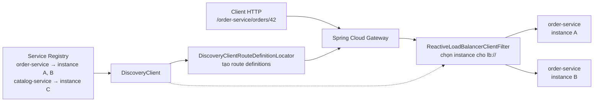
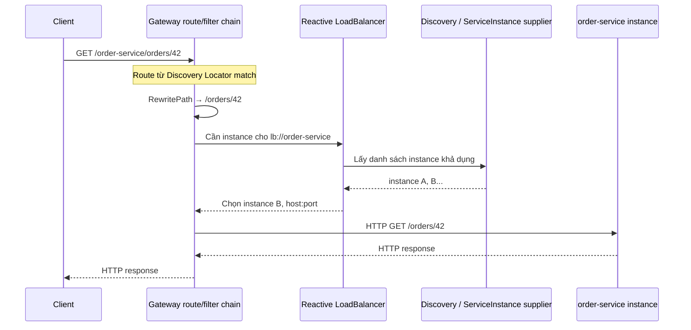

# DiscoveryClient Route Definition Locator

Trong kiến trúc microservices, địa chỉ và số lượng instance của một dịch vụ thay đổi theo quá trình triển khai, mở rộng và phục hồi sau sự cố. Nếu mỗi lần tạo một service mới đều phải bổ sung thủ công một route vào API Gateway, cấu hình sẽ dần cồng kềnh, dễ sai tên service hoặc trỏ tới instance không còn tồn tại.

**`DiscoveryClient Route Definition Locator`** của **Spring Cloud Gateway Server WebFlux** giải quyết một phần bài toán này: nó **tạo các route definition dựa trên những service được một `DiscoveryClient` phát hiện**, thay vì yêu cầu người vận hành viết từng route. Theo cấu hình mặc định, mỗi service tạo một route với URI dạng `lb://service-name`, predicate theo path `/serviceId/**` và filter gỡ tiền tố service ID trước khi chuyển request tới upstream.

Bài thuộc chương **Khám phá và cân bằng tải** trong module **SPRING_CLOUD_GATEWAY**. Trong một API Gateway với route predicate, filter chain, biến đổi đường dẫn/header, khám phá dịch vụ, xác thực, giới hạn lưu lượng, circuit breaker, retry, TLS và observability, cần phân biệt rõ **tự sinh route từ registry** với **chọn một instance để gửi request**. Hai bước liên quan chặt chẽ nhưng không đồng nghĩa nhau.

Sau bài học, bạn có thể:

1. Giải thích vai trò của `DiscoveryClient`, `RouteDefinitionLocator`, `DiscoveryClientRouteDefinitionLocator` và Spring Cloud LoadBalancer.
2. Dự đoán route mặc định được sinh ra từ một service ID, gồm URI, path predicate và `RewritePath`.
3. Bật locator theo **đúng namespace của phiên bản Gateway**; chuẩn bị dependency và service registry.
4. Cấu hình `include-expression`, `lower-case-service-id`, `route-id-prefix`, `predicates` và `filters` mà không vô tình làm mất route hoặc filter mặc định.
5. So sánh route tự phát hiện với route `lb://` khai báo tường minh; chọn cách phù hợp với môi trường nội bộ và môi trường public.
6. Chẩn đoán các tình huống `404`, `503`, đổi tên service, registry stale, thiếu instance, lộ endpoint nội bộ và route chồng lấn.

> **Phạm vi:** Bài nói về **Spring Cloud Gateway Server WebFlux** với Reactor Netty, không áp dụng nguyên xi API và namespace cho Server MVC. Cấu hình discovery đã thay đổi giữa các phiên bản. Bảng **configuration properties** của Gateway WebFlux **5.x** ghi `spring.cloud.gateway.server.webflux.discovery.locator.*`; Gateway WebFlux **4.3.x** dùng `spring.cloud.gateway.discovery.locator.*`. Một số đoạn văn trong trang hướng dẫn locator 5.x vẫn sử dụng tên cũ; khi có khác biệt, cần đối chiếu bảng configuration properties, dependency và cấu hình có hiệu lực trong **đúng bản đang chạy**, rồi kiểm thử route thực tế.

## 1. Đặt DiscoveryClient Route Definition Locator vào kiến trúc tổng thể

Một hệ thống có thể đăng ký hai instance của `order-service` và một instance của `catalog-service` vào service registry. Gateway cần biết **có những service ID nào** để tạo route, và **service ID đó hiện có instance nào** khi request đến.



Sơ đồ là mô tả khái niệm; trên thực tế, danh sách instance mà LoadBalancer dùng có thể được cung cấp bởi `ServiceInstanceListSupplier` cùng cache, health check và cơ chế của discovery client. Không nên hiểu rằng locator trực tiếp gửi mọi request HTTP hoặc tự duy trì một danh sách instance bất biến.

| Thành phần | Trách nhiệm | Đầu vào / đầu ra tiêu biểu |
| --- | --- | --- |
| **Service registry** | Lưu thông tin service ID và các instance hiện có | `order-service → host:port, metadata, trạng thái` |
| **`DiscoveryClient`** | Cung cấp cách tìm tên service và instance qua Spring Cloud Commons | `getServices()`, `getInstances(serviceId)` hoặc API reactive tương ứng |
| **`RouteDefinitionLocator`** | Cung cấp các `RouteDefinition` cho Gateway | `Flux<RouteDefinition>` |
| **`DiscoveryClientRouteDefinitionLocator`** | Dựa vào các service được discovery nhìn thấy để sinh các route definition | Predicate, filter, URI `lb://...` và route ID |
| **`RoutePredicateHandlerMapping`** | Chọn route phù hợp với request client | `Path`, `Host`, `Method`, v.v. |
| **`ReactiveLoadBalancerClientFilter`** | Phân giải URI `lb://serviceId` thành instance cụ thể | Chọn `host:port` rồi điều chỉnh URI outbound |
| **`NettyRoutingFilter`** | Gửi request HTTP/HTTPS đến instance đã chọn qua Reactor Netty | Response upstream để trả về client |

**Hai câu hỏi khác nhau:**

- **“Client gọi URL nào để vào route?”** — do route definition và predicate quyết định.
- **“Request này tới instance nào của service?”** — do load balancing và danh sách instance hiện có quyết định.

Việc bật discovery locator **không tự bảo đảm** instance khỏe mạnh, backend cho phép truy cập hay timeout/retry được cấu hình phù hợp.

## 2. Cơ chế sinh route mặc định

Giả sử `DiscoveryClient::getServices()` trả về hai service ID:

```text
order-service
catalog-service
```

Khi discovery locator đã bật, Gateway thường sinh route tương đương về mặt ý tưởng với:

```yaml
# MINH HỌA route sinh tự động; không phải cấu hình cần sao chép
- id: <prefix>order-service
  uri: lb://order-service
  predicates:
    - Path=/order-service/**
  filters:
    - RewritePath=/order-service/?(?<remaining>.*), /$\{remaining}

- id: <prefix>catalog-service
  uri: lb://catalog-service
  predicates:
    - Path=/catalog-service/**
  filters:
    - RewritePath=/catalog-service/?(?<remaining>.*), /$\{remaining}
```

Dòng `RewritePath` ở trên biểu diễn **ý nghĩa mặc định**; biểu thức thay thế thực tế được locator xây dựng theo cơ chế riêng. Khi tự viết cấu hình YAML cho route hoặc cho locator, cách escape ký tự `$` và biểu thức SpEL phải được thực hiện phù hợp (xem mục 6).

### Request cụ thể được xử lý ra sao?

Giả sử backend `order-service` có endpoint `GET /orders/42`:

1. Client gọi `GET /order-service/orders/42` tới Gateway.
2. `Path=/order-service/**` match route sinh từ registry.
3. `RewritePath` bỏ tiền tố `/order-service`, tạo request path `/orders/42`.
4. Route URI có dạng `lb://order-service`, nên LoadBalancer tìm một instance đang được cung cấp cho service ID đó.
5. Gateway proxy `GET /orders/42` tới một instance của `order-service` và chuyển response về client.

| Request công khai | Predicate route | Path sau rewrite | URI route |
| --- | --- | --- | --- |
| `/order-service/orders/42` | `/order-service/**` | `/orders/42` | `lb://order-service` |
| `/catalog-service/products/7` | `/catalog-service/**` | `/products/7` | `lb://catalog-service` |
| `/other-service/test` | Không có route tương ứng trong ví dụ | Không áp dụng | Không áp dụng |

**Điểm dễ nhầm:** `/order-service/orders/42` chỉ là **đường dẫn public mặc định của discovery locator**, không phải yêu cầu bắt buộc trong mọi thiết kế API. Nếu muốn công khai `/api/orders/42` và gọi `order-service`, bạn có thể dùng route tường minh hoặc tùy chỉnh predicates/filters của locator.

### Route ID mặc định không nhất thiết bằng service ID

Theo bảng configuration properties, `route-id-prefix` mặc định dựa trên tên lớp discovery client, kết hợp dấu gạch dưới; service ID được nối vào cuối. Vì vậy route ID có thể giống `ReactiveCompositeDiscoveryClient_order-service` hoặc một tên khác tùy discovery implementation và phiên bản, **không nên hard-code tên minh họa đó**. Có thể cấu hình prefix để định danh dễ theo dõi; luôn kiểm tra route ID thực tế qua Actuator/log.

## 3. Dependency và điều kiện trước khi bật locator

Có ba thành phần cơ bản:

1. **Spring Cloud Gateway Server WebFlux** — cổng HTTP dựa trên WebFlux.
2. **Một implementation của `DiscoveryClient`** — ví dụ tích hợp Netflix Eureka, Consul, Zookeeper hoặc Kubernetes phù hợp môi trường; phải có service thực sự đăng ký và có thể truy vấn.
3. **Spring Cloud LoadBalancer** — để xử lý URI `lb://service-name` mà các route tự sinh mặc định sử dụng.

Ví dụ khai báo các dependency cần thiết trong Maven, **không tự chọn phiên bản thư viện riêng lẻ** nếu dự án đã dùng Spring Cloud BOM/release train tương thích:

```xml
<!-- Gateway Server WebFlux, theo release train tương thích -->
<dependency>
  <groupId>org.springframework.cloud</groupId>
  <artifactId>spring-cloud-starter-gateway-server-webflux</artifactId>
</dependency>

<!-- Cần khi sử dụng route URI lb://service-id -->
<dependency>
  <groupId>org.springframework.cloud</groupId>
  <artifactId>spring-cloud-starter-loadbalancer</artifactId>
</dependency>

<!-- Ví dụ nếu sử dụng Eureka làm service registry -->
<dependency>
  <groupId>org.springframework.cloud</groupId>
  <artifactId>spring-cloud-starter-netflix-eureka-client</artifactId>
</dependency>
```

Trên môi trường Consul/Kubernetes, phải thay starter Eureka bằng implementation đúng với hạ tầng của mình, không cài nhiều discovery provider vô cớ.

**Không nhầm dependency của locator với dependency của LoadBalancer.** Một app có thể đọc danh sách service từ registry nhưng không có cơ chế phân giải `lb://`, hoặc đã cấu hình LoadBalancer nhưng registry không có instance. Hai lỗi dẫn đến hiện tượng khác nhau và cần kiểm tra riêng.

### Điều kiện hoạt động thực tế

- Registry đang chạy hoặc có nguồn service instance phù hợp với cách tích hợp.
- Gateway đăng ký/kết nối tới registry theo cấu hình của discovery provider.
- Service ID mong muốn xuất hiện trong danh sách mà discovery nhìn thấy.
- Instance của service có địa chỉ và cổng **mà Gateway có thể kết nối**; địa chỉ private chỉ hợp lệ khi các container/VM nằm trong mạng tương thích.
- Tên service thống nhất giữa registry, LoadBalancer và các route.

Không phải cứ đặt `enabled: true` là Gateway tự dựng Eureka/Consul, tự đăng ký backend hay tự thiết lập health check.

## 4. Bật Discovery Locator theo phiên bản Gateway

### 4.1. Spring Cloud Gateway Server WebFlux 5.x

Dạng cấu hình phản ánh bảng **Configuration Properties** của nhánh 5.x:

```yaml
spring:
  cloud:
    gateway:
      server:
        webflux:
          discovery:
            locator:
              enabled: true
```

Khi cấu hình đúng và discovery client có service ID, Gateway sẽ có thêm các route tự phát hiện. `enabled` mặc định là `false`. Ở nhánh 5.x, các property khác như `include-expression`, `predicates`, `filters`, `lower-case-service-id` cũng nằm cùng namespace `spring.cloud.gateway.server.webflux.discovery.locator`.

### 4.2. Spring Cloud Gateway Server WebFlux 4.3.x

Dạng cấu hình trong hướng dẫn 4.3.x:

```yaml
spring:
  cloud:
    gateway:
      discovery:
        locator:
          enabled: true
```

Namespace ở đây là `spring.cloud.gateway.discovery.locator`, **khác** namespace 5.x.

### 4.3. Vì sao một trang hướng dẫn 5.x lại ghi tên property cũ?

Tài liệu `DiscoveryClient Route Definition Locator` của nhánh 5.x còn có đoạn ví dụ `spring.cloud.gateway.discovery.locator.enabled=true` và YAML theo layout cũ, trong khi **bảng Configuration Properties 5.x** liệt kê `spring.cloud.gateway.server.webflux.discovery.locator.enabled`.

Do đó, bài này **ưu tiên namespace từ bảng configuration properties của phiên bản 5.x** và lưu ý sự không đồng nhất của tài liệu. Khi triển khai thực tế, hãy kiểm tra metadata cấu hình/Actuator của đúng artifact đang chạy và kiểm thử danh sách route sau startup. Không dùng cả hai namespace một cách ngẫu nhiên để “chữa” route không xuất hiện.

## 5. Mở rộng route: Discovery Locator khác Route tĩnh sử dụng lb://

Hai lựa chọn đều có thể tải cân bằng request tới cùng service:

**Cách A — Route tường minh:**

```yaml
spring:
  cloud:
    gateway:
      server:
        webflux:
          routes:
            - id: orders-public
              uri: lb://order-service
              predicates:
                - Path=/api/orders/**
              filters:
                - StripPrefix=1
```

Client gọi `/api/orders/42`, backend nhận `/orders/42`.

**Cách B — Bật discovery locator với mặc định:**

```yaml
spring:
  cloud:
    gateway:
      server:
        webflux:
          discovery:
            locator:
              enabled: true
```

Client gọi `/order-service/orders/42`, backend nhận `/orders/42`.

| Tiêu chí | Route `lb://` tường minh | Discovery Locator tự sinh |
| --- | --- | --- |
| Cần viết từng route? | Có | Không, route sinh theo service registry |
| URI backend | Có thể dùng `lb://order-service` | Thường mặc định `lb://serviceId` |
| Path công khai | Do người thiết kế quyết định | Mặc định `/serviceId/**`; có thể tùy chỉnh |
| Service mới được registry nhận ra | Chưa có public route trừ khi thêm cấu hình | Có thể được sinh route nếu thỏa điều kiện lọc và route cache được cập nhật |
| Quyền kiểm soát API public | Rõ ràng, thu hẹp theo nhu cầu | Phải kiểm soát bằng `include-expression`, predicates, security và mạng |
| Mức độ phù hợp | API internet/public cần contract ổn định | Khám phá service nội bộ, dev/test hoặc môi trường có governance chặt |
| Phụ thuộc registry để chọn instance | Có khi dùng `lb://` | Có cả để sinh route và để chọn instance |

**Điểm then chốt:** Không cần bật discovery locator để một route tường minh `uri: lb://order-service` sử dụng LoadBalancer. Locator tạo **route definition**; LoadBalancer chọn **service instance**. Đây là hai tính năng độc lập về trách nhiệm.

## 6. Tùy chỉnh predicates và filters cho route tự sinh

Mặc định locator sử dụng:

- `Path=/serviceId/**`.
- `RewritePath=/serviceId/?(?<remaining>.*)` với replacement `/${remaining}`.

Nếu định nghĩa `predicates` hoặc `filters` dưới locator, bạn đang **thay thế danh sách mặc định tương ứng**, không chỉ “thêm một filter mới” vào danh sách cũ. Tài liệu Spring nhấn mạnh phải khai báo lại `RewritePath` nếu vẫn cần bỏ service ID khỏi path.

### 6.1. Ví dụ công khai prefix /internal/serviceId/**

Giả sử các service ID đều **chữ thường**, như `order-service` và `catalog-service`, và chỉ muốn tạo route cho hai service này. Cấu hình WebFlux 5.x:

```yaml
spring:
  cloud:
    gateway:
      server:
        webflux:
          discovery:
            locator:
              enabled: true
              include-expression: >-
                serviceId == 'order-service' or serviceId == 'catalog-service'
              predicates:
                - name: Path
                  args:
                    pattern: "'/internal/' + serviceId + '/**'"
              filters:
                - name: RewritePath
                  args:
                    regexp: "'/internal/' + serviceId + '/?(?<remaining>.*)'"
                    replacement: "'/${remaining}'"
```

**Lưu ý cú pháp:** Những giá trị như `"'/internal/' + serviceId + '/**'"` là **biểu thức SpEL dạng chuỗi**, không phải literal route path. Locator đánh giá biểu thức với ngữ cảnh có `serviceId` để tạo predicate/filter cho từng service. Phần thay thế `'/${remaining}'` là một **chuỗi trả về từ SpEL**, về sau được `RewritePath` dùng như replacement với named capture group `remaining`. Ví dụ tuân theo cách trình bày YAML của tài liệu locator; khi dùng cấu hình/loader khác, phải kiểm thử cách xử lý `${...}` và escape property placeholder.

Kết quả với service ID `order-service`:

| Thuộc tính | Giá trị |
| --- | --- |
| Route URI | `lb://order-service` |
| Path predicate | `/internal/order-service/**` |
| Rewrite regex | `/internal/order-service/?(?<remaining>.*)` |
| Request từ client | `GET /internal/order-service/orders/42` |
| Path upstream | `GET /orders/42` |

**Tại sao không thêm CircuitBreaker ngay trong ví dụ này?** Filter `CircuitBreaker` cần dependency, tên và chính sách fallback phù hợp; để ví dụ cốt lõi dễ kiểm tra, chỉ giữ lại predicate và filter cơ bản. Khi thêm custom filter như `CircuitBreaker`, `Retry`, `RequestRateLimiter`, hãy **giữ RewritePath** nếu backend vẫn yêu cầu path đã cắt service ID.

### 6.2. Thêm Host predicate mà không đánh mất Path

Ví dụ chỉ cho phép những request có Host nội bộ thích hợp:

```yaml
predicates:
  - name: Host
    args:
      pattern: "'gateway.internal.example.com'"
  - name: Path
    args:
      pattern: "'/internal/' + serviceId + '/**'"
```

Đây là phần `predicates` thay thế trong locator, không phải YAML toàn ứng dụng. Hai predicate cùng route được xét theo logic AND. Nếu chỉ cấu hình `Host` và quên `Path`, route có thể khớp phạm vi rộng hơn rất nhiều so với mong muốn, tùy điều kiện các route khác.

**Host predicate không phải một biện pháp xác thực.** Client có thể chủ động đặt Host ở một số tình huống; cần đặt Gateway sau ingress/proxy tin cậy, yêu cầu token và bảo vệ network/service tương ứng.

### 6.3. Bổ sung filter và giữ RewritePath

Một mẫu mở rộng có thể gồm:

```yaml
filters:
  - name: RewritePath
    args:
      regexp: "'/internal/' + serviceId + '/?(?<remaining>.*)'"
      replacement: "'/${remaining}'"
  - name: RemoveRequestHeader
    args:
      name: "'X-User-Id'"
```

Đây là ví dụ danh sách filter dùng **biểu thức SpEL** cho tham số `name`, nhằm tránh tin header `X-User-Id` do client tự gửi. Cần đối chiếu exact argument names của factory theo phiên bản và thử trong ứng dụng thật. Nếu không cần phụ thuộc `serviceId`, bạn cũng có thể đưa chính sách chung vào `default-filters` cho Gateway WebFlux với namespace đúng phiên bản.

Trong môi trường public, đặt bảo mật và hạn mức truy cập ở một lớp đáng tin, không chỉ dựa vào tên path `/internal`.

## 7. include-expression: chỉ đưa service nào ra Gateway?

Cấu hình mặc định `include-expression` là `true`: về mặt chính sách locator, **mọi service mà DiscoveryClient thấy đều có thể được cân nhắc để sinh route**, không phân biệt tên nội bộ hay public.

Đây là rủi ro lớn nếu Gateway kết nối với một registry chứa cả:

- `order-service` và `catalog-service` (được phép public).
- `payment-admin`, `billing-worker` hoặc `internal-secrets` (không được public).
- Các service dành riêng cho monitoring, batch hoặc vận hành.

**Không nên bật locator trần trụi trên API Gateway công khai** khi chưa xác định các service nào được xuất bản.

Ví dụ allowlist theo tên service ID:

```yaml
spring:
  cloud:
    gateway:
      server:
        webflux:
          discovery:
            locator:
              enabled: true
              include-expression: >-
                serviceId == 'order-service' or serviceId == 'catalog-service'
```

Biểu thức này chỉ đúng khi ID từ registry có chữ thường đúng như ví dụ. Nếu registry trả `ORDER-SERVICE`, phép so sánh `==` với `'order-service'` sẽ không khớp.

**Nguyên tắc vận hành:**

1. Dùng **allowlist rõ ràng** thay vì diễn đạt âm kiểu “trừ một vài service nguy hiểm”, vì service nội bộ mới có thể được đăng ký bất kỳ lúc nào.
2. Kiểm tra service ID thực tế mà DiscoveryClient nhìn thấy trước khi viết biểu thức.
3. Không dùng dữ liệu từ client làm SpEL expression hoặc thay đổi động biểu thức không kiểm soát; đây là cấu hình được người quản trị tin cậy.
4. Sau khi đổi biểu thức, kiểm tra danh sách route thực tế và những URL có thể truy cập.
5. Cho dù route chỉ được tạo cho service mong muốn, backend vẫn phải kiểm tra authentication/authorization theo tài nguyên, tenant và vai trò.

`include-expression` quyết định **có tạo route cho service hay không**. Nó không phải cơ chế lọc từng instance khỏe/yếu và cũng không thực hiện user authorization.

## 8. lower-case-service-id, route-id-prefix và url-expression

Theo bảng configuration properties, discovery locator cung cấp một số tùy chọn bổ sung:

| Thuộc tính dưới `...discovery.locator` | Mặc định | Ý nghĩa |
| --- | --- | --- |
| `enabled` | `false` | Bật tự sinh route từ registry |
| `include-expression` | `true` | Quyết định service nào được đưa vào danh sách route bằng SpEL |
| `lower-case-service-id` | `false` | Hỗ trợ hiển thị service ID chữ thường trong predicates/filters, đặc biệt khi registry trả ID chữ hoa |
| `route-id-prefix` | Dựa trên tên discovery client và dấu gạch dưới | Tiền tố route ID; service ID được nối vào |
| `url-expression` | `'lb://' + serviceId` | Biểu thức tạo URI của route |
| `predicates` | Một `Path` mặc định | Danh sách predicate chung được sinh cho mỗi service |
| `filters` | Một `RewritePath` mặc định | Danh sách filter chung được sinh cho mỗi service |

### 8.1. Eureka trả service ID chữ hoa

Một số cấu hình Eureka trả service ID dạng `ORDER-SERVICE`. Nếu không điều chỉnh, route công khai mặc định có thể xuất hiện với `/ORDER-SERVICE/**` thay vì `/order-service/**`, gây nhầm cho client.

Với Gateway WebFlux 5.x:

```yaml
spring:
  cloud:
    gateway:
      server:
        webflux:
          discovery:
            locator:
              enabled: true
              lower-case-service-id: true
```

Tùy chọn này giúp xử lý tên hiển thị trong **predicates/filters**. Nó **không có nghĩa tên service trong registry bị đổi tên**, cũng không mặc nhiên thay thế định danh mà LoadBalancer dùng để tìm instance. Hãy xác minh riêng:

- `DiscoveryClient` thực sự trả ID nào.
- Path mà Gateway sinh ra là chữ hoa hay chữ thường.
- URI `lb://...` và `serviceId` mà LoadBalancer dùng.
- `include-expression` có so sánh đúng casing chưa.

### 8.2. Đặt route ID dễ quan sát

```yaml
spring:
  cloud:
    gateway:
      server:
        webflux:
          discovery:
            locator:
              enabled: true
              route-id-prefix: registry_
```

Mỗi route có ID dựa trên prefix này cùng service ID, ví dụ `registry_order-service`. Dùng route ID ổn định giúp lọc log, metrics và traces; nhưng nếu đổi tên service, ID cũng thay đổi theo.

### 8.3. Khi nào phải chỉnh url-expression?

Mặc định `url-expression` sinh URI `lb://serviceId`, đây thường là cách phù hợp khi Gateway cần cân bằng tải. Không cần tự viết biểu thức tạo host/port từ giá trị client gửi.

Nếu cần thay đổi URI đích theo metadata đã tin cậy từ registry, phải đánh giá **schema của service instance, protocol HTTP/HTTPS, TLS trust và quyền truy cập mạng**. Không tạo open proxy bằng việc nhận một hostname tùy ý từ header/query của client rồi nối vào URI route. Biểu thức quá phức tạp cũng khó debug và có thể chịu ràng buộc bảo mật của Spring Expression Language ở các phiên bản mới.

**Lưu ý tương thích:** Không mặc định mọi phương thức Java hoặc helper call trong SpEL expression đều được cho phép. Các bản Gateway mới có thể giới hạn ngữ cảnh đánh giá biểu thức vì lý do bảo mật. Ưu tiên biểu thức đơn giản và kiểm thử trên đúng phiên bản.

## 9. Từ service ID đến instance: LoadBalancer làm gì?

Locator tạo route có URI `lb://order-service`, nhưng khi có request, Gateway cần chọn **một instance cụ thể**:



Trong **Gateway Server WebFlux**, `ReactiveLoadBalancerClientFilter` sử dụng Spring Cloud LoadBalancer để thay URI `lb://` thành một URI HTTP/HTTPS cụ thể rồi `NettyRoutingFilter` mới proxy request.

Cần phân biệt:

- **Service ID có trong registry nhưng không có instance khả dụng**: route có thể tồn tại nhưng request không có đích để gửi.
- **Instance tồn tại nhưng không kết nối được**: lỗi DNS/network/TLS/timeout có thể xảy ra sau bước chọn instance.
- **Backend trả `404`**: có thể là request đến đúng service nhưng path đã rewrite sai, endpoint không tồn tại hoặc nghiệp vụ trả “không tìm thấy”.
- **Không có route match**: Gateway chưa chọn được route, không có bước load balancing cho request đó.

Khi LoadBalancer không tìm thấy instance, Gateway WebFlux thường trả **`503 Service Unavailable` theo mặc định**; có cấu hình cho phép trả `404` tùy phiên bản. Đừng dùng status `503` làm bằng chứng tuyệt đối lỗi registry, vì circuit breaker, backend/network và các filter khác cũng có thể trả status này.

### TLS của client và TLS tới backend là hai kết nối riêng

Client truy cập `https://api.example.com` không tự đảm bảo Gateway gửi request HTTPS tới backend. Với `lb://`, scheme outbound có thể dựa trên metadata `ServiceInstance.isSecure` và các quy tắc của load-balancer/routing filter. Phải xác định truststore, chứng chỉ backend, mTLS hoặc network policy theo kiến trúc. Không tắt kiểm tra chứng chỉ để chữa lỗi chọn instance.

## 10. Làm sao cập nhật route khi registry thay đổi?

Discovery locator tạo route definition từ danh sách service mà DiscoveryClient cung cấp, nhưng **không có nghĩa mọi thay đổi registry sẽ xuất hiện ngay tức thì** ở danh sách route đang cache.

Thời điểm thấy route mới hoặc route biến mất phụ thuộc vào:

- Tần suất/độ trễ cập nhật của registry và discovery client.
- Cache danh sách service hoặc instance của Spring Cloud LoadBalancer.
- Cơ chế refresh route cache/event mà bản Gateway sử dụng.
- Kết nối giữa Gateway và registry, lỗi mạng hoặc service chưa đăng ký thành công.

Điều cần phân biệt khi triển khai:

| Thay đổi | Điều có thể xảy ra | Cách xác minh |
| --- | --- | --- |
| Thêm **instance** mới cho service đang có route | LoadBalancer có thể chọn instance sau khi danh sách được cập nhật | Truy dấu instance/backend response và cache health |
| Gỡ một instance | Service ID và route có thể vẫn tồn tại nếu còn instance khác | Kiểm tra số instance khả dụng và tần suất refresh |
| Đăng ký một **service ID mới** | Locator có thể tạo route mới khi dữ liệu discovery và route definitions được refresh | Kiểm tra `/actuator/gateway/routes` sau refresh |
| Service biến mất khỏi registry | Route tự sinh có thể bị loại khỏi cache sau cập nhật, nhưng không nên giả định tức thời | Quan sát registry và route list qua thời gian |
| Registry bị ngắt | Route cũ/cache có thể vẫn xuất hiện trong một khoảng tùy implementation | Phân biệt route vẫn có với upstream có instance kết nối được |

### Actuator để xem route — phải bảo vệ cẩn thận

Trong Gateway WebFlux 5.x, Actuator Gateway endpoint thường **không mở mặc định**; có thể cấu hình **read-only** cho môi trường quản trị:

```properties
management.endpoint.gateway.access=read-only
management.endpoints.web.exposure.include=gateway
```

Sau khi bảo vệ endpoint bằng quyền truy cập và mạng tin cậy, có thể xem:

```bash
curl -s http://localhost:8080/actuator/gateway/routes
```

Kết quả chứa route ID, URI, predicates và filters của các route được Gateway nhìn thấy. Endpoint này là **công cụ quản trị**, không phải API public cho client. Trên các bản Gateway/Boot khác nhau, property mở Actuator có thể khác; cần kiểm tra tài liệu bản đang chạy.

Nếu cần làm mới route cache, tài liệu Actuator có endpoint `POST /actuator/gateway/refresh` khi được bật với quyền phù hợp. Đây là thao tác có **quyền thay đổi cấu hình runtime**, nên không mở công khai và không dùng nó như một giải pháp thay thế cho registry/refresh events đang lỗi. Trong môi trường production, ưu tiên cơ chế refresh tự động có kiểm soát và quy trình vận hành rõ ràng.

## 11. Bảo mật: tự phát hiện route có thể đồng nghĩa tự công khai service

Đây là rủi ro lớn nhất của discovery locator khi gắn trực tiếp với Gateway public.

Giả sử registry có:

```text
order-service
catalog-service
payment-admin
user-internal
billing-worker
```

Nếu locator mặc định tạo route cho **mọi service**, một client có thể thử:

```text
/payment-admin/**
/user-internal/**
/billing-worker/**
```

Ngay cả khi backend trả `403`, việc lộ tên service và route không cần thiết cũng tăng bề mặt tấn công. Nếu một backend chỉ dựa vào giả định “service này chỉ có caller nội bộ” để bỏ qua xác thực, việc public route có thể gây lỗi nghiêm trọng.

**Thiết kế an toàn:**

1. Chỉ đưa những service **được phê duyệt** vào locator qua `include-expression` hoặc tách riêng registry/vùng mạng.
2. Cân nhắc dùng **route tường minh** cho API Internet, nhất là khi URL public cần contract ổn định và phân quyền riêng.
3. Bắt buộc xác thực, giới hạn lưu lượng, giới hạn kích thước request và các chính sách bảo vệ biên tương ứng.
4. Backend vẫn kiểm tra quyền tài nguyên thực tế, tenant/ownership và service-to-service authentication khi phù hợp.
5. Không tin `X-User-Id`, `X-Tenant-Id`, `Forwarded` hoặc `X-Forwarded-*` do client tự đặt; chỉ tin proxy và identity đã xác minh.
6. Không cho client chủ động cung cấp `serviceId`/host URI ngoài tập được phép bằng custom filter, tránh open proxy/SSRF.
7. Hạn chế Actuator Gateway ở mạng quản trị, ưu tiên read-only nếu chỉ cần quan sát.

**Không dùng Path predicate như lớp phân quyền.** Predicate `/payment-admin/**` chỉ chọn route, không chứng minh người gọi là admin.

## 12. Kết hợp route tự phát hiện với các chính sách Gateway khác

Trong hệ thống thật, route sinh tự động vẫn đi qua filter chain như route thường. Các trách nhiệm kỹ thuật liên quan bao gồm:

| Chính sách | Tác động với route từ discovery | Ranh giới cần giữ |
| --- | --- | --- |
| **Authentication** | Yêu cầu JWT/OAuth2 token cho API cần bảo vệ | Dịch vụ vẫn phải kiểm tra quyền trên tài nguyên |
| **Rate limiting** | Chặn quá tải theo principal/API key hoặc nguồn tin cậy | Không dùng IP từ header giả mạo làm key tùy tiện |
| **Circuit breaker** | Giảm lưu lượng tới backend đang lỗi, có thể dùng policy theo service/route | Không trả thành công giả cho thanh toán hoặc thao tác ghi |
| **Retry** | Khắc phục lỗi kết nối thoáng qua có điều kiện | Không retry `POST` thiếu idempotency; tránh nhân tải registry/backend |
| **Timeout** | Giới hạn connect/response latency | Timeout không đảm bảo backend đã hủy thao tác |
| **TLS/mTLS** | Bảo vệ hop từ client/ingress tới Gateway và Gateway tới instance | `lb://` không có nghĩa tự động dùng TLS |
| **Request path/header** | Locator thường bỏ service ID qua RewritePath; có thể thêm header policy | Không truyền identity client tự khai báo như thông tin đáng tin |
| **Observability** | Theo dõi route ID, service ID, status, latency, retry và instance được chọn | Không ghi token, cookie, body hoặc raw URL nhạy cảm |

Khi dùng `filters` cấu hình riêng cho locator, cần nhớ nó **thay danh sách filter default**. Nếu bổ sung `RequestRateLimiter` hay `CircuitBreaker` mà không khai báo lại `RewritePath`, backend có thể nhận `/order-service/orders/42` thay vì `/orders/42`, dẫn đến `404` dù instance khỏe.

Bên cạnh đó, không nên gọi JDBC, HTTP client đồng bộ hoặc `Thread.sleep()` trong custom `GlobalFilter` dùng chung; Gateway WebFlux hoạt động trên event loop nên lời gọi blocking có thể làm chậm nhiều route đồng thời.

## 13. Thực hành: đưa order-service và catalog-service qua Gateway

**Mục tiêu:** quan sát route được sinh tự động, path rewrite, việc chọn instance và trường hợp thiếu service/instance. Thực hành trong môi trường local hoặc staging đã kiểm soát, không bật discovery locator tràn lan trên API public.

### Chuẩn bị

- Gateway Server WebFlux chạy cổng `8080`, có discovery client + Spring Cloud LoadBalancer.
- Registry hợp lệ, ví dụ Eureka hoặc Consul, dùng đúng starter với Spring Cloud BOM.
- `order-service` đã đăng ký service ID `order-service` và có `GET /orders/42`.
- `catalog-service` đã đăng ký service ID `catalog-service` và có `GET /products/7`.
- Nếu muốn quan sát load balancing, chạy **hai instance khác nhau** của `order-service` với instance ID/port riêng và endpoint trả marker không nhạy cảm.

### Bước 1 — Bật locator

Ví dụ WebFlux 5.x:

```yaml
spring:
  cloud:
    gateway:
      server:
        webflux:
          discovery:
            locator:
              enabled: true
              include-expression: >-
                serviceId == 'order-service' or serviceId == 'catalog-service'
```

Ví dụ dùng service IDs chữ thường. Nếu registry trả chữ hoa, phải điều chỉnh expression và/hoặc cấu hình `lower-case-service-id` theo hành vi thực tế; không mặc định rằng hai service sẽ match điều kiện này.

### Bước 2 — Kiểm tra route được tạo

Nếu Actuator Gateway read-only đã được bật và bảo vệ phù hợp, gọi `GET /actuator/gateway/routes`. Kiểm tra có các route:

- URI tương đương `lb://order-service` với predicate `/order-service/**`.
- URI tương đương `lb://catalog-service` với predicate `/catalog-service/**`.
- Các filter rewrite bỏ service ID.
- **Không** có route cho các service nội bộ ngoài allowlist.

### Bước 3 — Gọi API và xem path thực tế

```bash
curl -i http://localhost:8080/order-service/orders/42
curl -i http://localhost:8080/catalog-service/products/7
```

Kỳ vọng backend nhìn thấy:

| Client request | Backend được chọn | Path backend nhận |
| --- | --- | --- |
| `GET /order-service/orders/42` | `order-service` | `/orders/42` |
| `GET /catalog-service/products/7` | `catalog-service` | `/products/7` |

Nếu backend nhận path gốc chứa service ID, kiểm tra danh sách custom filters có làm mất `RewritePath` mặc định hay không.

### Bước 4 — Quan sát instance selection

Cho hai instance `order-service` trả một header `X-Instance-Marker: A` và `X-Instance-Marker: B` trong môi trường thử nghiệm, sau đó gọi lặp lại:

```bash
curl -i http://localhost:8080/order-service/orders/42
```

Quan sát backend nào đã xử lý. **Không cam kết một kiểu phân phối 50/50 chỉ sau vài request**; thuật toán chọn, cache, health, load và việc sticky session/weight có được bật hay không đều ảnh hưởng kết quả.

### Bước 5 — Thử sự cố một cách có kiểm soát

1. **Tắt một instance**: xác minh instance còn lại có thể tiếp tục phục vụ sau khi discovery/load balancer cập nhật.
2. **Tắt mọi instance**: kiểm tra status lỗi và trace; thông thường `503` khi không tìm được instance.
3. **Đăng ký service ID mới không thuộc allowlist**: xác minh Gateway không công khai route cho service đó.
4. **Thêm custom filter nhưng bỏ RewritePath** trong môi trường thử nghiệm: quan sát backend nhận path sai; sau đó khôi phục filter.
5. **Đổi tên service trong registry**: xác minh route ID, public URL và `include-expression` thay đổi theo, tránh breaking change ngoài ý muốn.

### Bảng nghiệm thu

| Kịch bản | Kết quả cần xác minh |
| --- | --- |
| Discovery client hoạt động, services được đăng ký | Route definitions được sinh |
| Có route nhưng LoadBalancer không tìm được instance | Lỗi chọn instance; không nhầm với thiếu route |
| Client gọi `/order-service/orders/42` | Route đúng, backend nhận `/orders/42` |
| Custom filters giữ `RewritePath` | Path tiếp tục đúng |
| Service không thuộc allowlist | Không có route tự phát hiện dành cho service đó |
| Registry trả service ID chữ hoa | Casing/path/include expression được cấu hình và test rõ |
| Registry có thay đổi | Quan sát độ trễ cập nhật route/instance, không giả định tức thời |
| Request không có token hoặc không có quyền | Bị từ chối theo chính sách, backend không rò rỉ dữ liệu |
| Gateway/registry/backend lỗi mạng | Timeout, metrics và log đủ khoanh vùng nguyên nhân |

## 14. Những lỗi phổ biến và cách chẩn đoán

| Triệu chứng | Nguyên nhân khả dĩ | Cách xử lý |
| --- | --- | --- |
| Locator `enabled: true` nhưng không sinh route | Sai property namespace; thiếu DiscoveryClient hoặc registry không có service | Kiểm tra bản Gateway, cấu hình có hiệu lực, client discovery, danh sách service |
| Route xuất hiện nhưng gọi trả `503` | LoadBalancer không có instance, instance bị đánh dấu unavailable hoặc lỗi transport | Kiểm tra `spring-cloud-starter-loadbalancer`, số instance, network, trace |
| Backend trả `404` cho `/order-service/orders/42` | Default RewritePath bị thay bằng filters riêng, hoặc backend không có endpoint đúng | Xem path upstream thật và danh sách filters |
| Cấu hình custom predicates khiến route bắt mọi path | Thay `Path` mặc định mà không định nghĩa lại | Khôi phục predicate Path và test vùng match |
| Path viết chữ thường không match | Registry trả ID chữ hoa, `lower-case-service-id` chưa bật | Kiểm tra service IDs, property casing, URI/Path thực tế |
| `include-expression` lọc mất service hợp lệ | So sánh ID sai casing hoặc biểu thức sai | Kiểm tra service IDs đúng từ registry, rút gọn SpEL |
| Service mới đăng ký nhưng route chưa xuất hiện | Delay từ discovery, route cache chưa refresh, hoặc allowlist chưa cập nhật | Kiểm tra trạng thái registry, danh sách route và quy trình refresh bảo mật |
| Route ID bị trùng hoặc không ổn định | Prefix/ID của nhiều locator/route bị chồng lấn | Đặt `route-id-prefix` rõ, quan sát route list |
| Request tới route sai khi có route manual trùng | Predicates/route order chồng lấn | Thiết kế tránh overlap và integration test route ID |
| `lb://` có instance nhưng kết nối TLS lỗi | Metadata secure/certificate hoặc outbound trust không đúng | Kiểm tra isSecure, TLS truststore, mTLS và log HTTP client |
| Request v1/v2 sai contract | Locator tạo route theo service name, không tự hiểu API version | Dùng route riêng hoặc thêm predicate/logic version phù hợp |
| API nội bộ trở nên public | Locator mặc định include tất cả services | Bật allowlist, phân vùng gateway/registry, xác thực và network policy |
| Actuator không xem được routes | Gateway endpoint chưa được bật hoặc thiếu quyền | Cấu hình read-only và truy cập qua kênh quản trị |
| Latency cao ở nhiều route | Registry chậm, cache/connection pool, backend chậm, custom filter blocking | Xem route ID, trace, latency theo giai đoạn, event loop và instance pool |

Khi có lỗi, hãy xác định theo thứ tự **registry có tên service không → Gateway có route không → predicate có match không → LoadBalancer tìm instance không → backend có nhận request đúng path không**. Chỉ dựa vào status `404`/`503` không đủ kết luận.

## 15. Câu hỏi củng cố

**1. `DiscoveryClientRouteDefinitionLocator` có chọn instance cho từng request không?**

> Không. Nó tạo **route definitions** từ các service ID mà discovery cung cấp. Việc chọn instance cho URI `lb://serviceId` được thực hiện bởi Spring Cloud LoadBalancer và các filter routing liên quan.

**2. Nếu có route `uri: lb://order-service` khai báo bằng YAML, có cần bật discovery locator không?**

> Không. Đây là route tường minh; LoadBalancer vẫn cần nguồn service instance. Locator chỉ cần khi muốn tự sinh route từ registry.

**3. Với service ID `order-service`, route mặc định match path nào?**

> Mặc định là `/order-service/**`. Filter `RewritePath` bỏ phần `/order-service` để backend nhận path như `/orders/42`.

**4. Vì sao thêm một filter custom có thể làm backend nhận path sai?**

> Vì danh sách `discovery.locator.filters` tùy chỉnh **thay thế** danh sách default. Nếu quên thêm lại `RewritePath`, tiền tố service ID không còn bị loại bỏ.

**5. Có nên bật locator không giới hạn trên Gateway Internet nếu registry chứa payment-admin?**

> Không. Registry có thể chứa service nội bộ; locator mặc định cân nhắc tất cả service. Cần allowlist, phân vùng mạng và kiểm soát quyền; với API public, route tường minh thường dễ quản trị hơn.

**6. `lower-case-service-id: true` có đổi tên service ở registry không?**

> Không. Nó hỗ trợ cách viết chữ thường trong predicates/filters. Phải kiểm tra riêng service ID từ registry và URI mà LoadBalancer phân giải.

**7. Vì sao gateway đã có route nhưng vẫn trả `503`?**

> Route chỉ cho biết yêu cầu nên đi tới **service ID nào**. Nếu không có instance khả dụng hoặc bị lỗi ở bước chọn/gọi upstream, request vẫn thất bại.

**8. Service mới xuất hiện trong registry thì route chắc chắn xuất hiện ngay lập tức chứ?**

> Không thể khẳng định. Còn có discovery/cache/route refresh lifecycle và policy include-expression; cần kiểm tra thực tế.

## 16. Checklist trước khi vận hành

- [ ] Xác nhận starter **Gateway Server WebFlux**, một `DiscoveryClient` phù hợp và Spring Cloud LoadBalancer đã có.
- [ ] Chọn namespace cấu hình locator đúng version: **4.3.x** dùng `spring.cloud.gateway.discovery.locator`, **5.x** dùng `spring.cloud.gateway.server.webflux.discovery.locator` theo configuration properties.
- [ ] Đã biết service ID thực tế từ registry và xác minh URI `lb://serviceId` có instance khả dụng.
- [ ] Kiểm thử route mặc định `/serviceId/**` cùng `RewritePath` cắt tiền tố.
- [ ] Nếu tùy chỉnh predicates/filters, **khai báo lại Path/RewritePath** khi muốn giữ chức năng tương ứng.
- [ ] Không bật `include-expression: true` không kiểm soát trên gateway public; dùng allowlist rõ ràng.
- [ ] Kiểm tra `lower-case-service-id`, route ID prefix, casing của registry và tác động của việc đổi tên service.
- [ ] Tránh route discovery và route manual bị chồng lấn ngoài ý muốn; test đúng route ID.
- [ ] Đặt authentication/authorization, rate limit, timeout, TLS và network controls theo trust boundary; backend vẫn kiểm tra nghiệp vụ.
- [ ] Không dùng `url-expression` hoặc custom filter ghép URI từ dữ liệu client không được phép; tránh SSRF/open proxy.
- [ ] Theo dõi service ID, route ID, số instance, connection errors, `p95/p99` và trace ID; không log token/cookie/body nhạy cảm.
- [ ] Có test dịch vụ mới đăng ký, service biến mất, tất cả instance down, registry stale và route cache refresh.
- [ ] Bảo vệ Actuator Gateway, ưu tiên `read-only` khi chỉ cần xem route; không mở quyền thay route/refresh trên Internet.
- [ ] Không dùng retry thiếu idempotency cho thao tác ghi, đặc biệt `POST` thanh toán/đặt hàng.

## Kết luận

**`DiscoveryClient Route Definition Locator`** cho phép Spring Cloud Gateway Server WebFlux **sinh route từ các service được khám phá**, với URI mặc định `lb://serviceId`, predicate `/serviceId/**` và `RewritePath` bỏ tiền tố trước khi proxy. Đó là công cụ giảm cấu hình lặp lại trong môi trường microservices, nhưng **không thay thế LoadBalancer**, không đảm bảo instance luôn khả dụng và không tự xác thực người gọi.

Sử dụng locator an toàn đòi hỏi chọn đúng namespace theo phiên bản, chuẩn bị dependency, giới hạn service được công khai, giữ lại predicate/filter mặc định nếu cần và quan sát route/instance thực tế. Trong các API public có hợp đồng ổn định, route tường minh với `lb://` thường cho quyền kiểm soát dễ hiểu hơn; discovery locator đặc biệt hữu ích khi cần route tự động trong mạng nội bộ hoặc môi trường có quy tắc công bố service rõ ràng. Kết hợp đúng với bảo mật, rate limiting, circuit breaker, retry, TLS và observability sẽ giúp gateway phục vụ microservices đáng tin cậy hơn.

## Tài liệu tham khảo

- [Spring Cloud Gateway WebFlux 5.x — DiscoveryClient Route Definition Locator](https://docs.spring.io/spring-cloud-gateway/reference/spring-cloud-gateway-server-webflux/the-discoveryclient-route-definition-locator.html)
- [Spring Cloud Gateway WebFlux 4.3.x — DiscoveryClient Route Definition Locator](https://docs.spring.io/spring-cloud-gateway/reference/4.3/spring-cloud-gateway-server-webflux/the-discoveryclient-route-definition-locator.html)
- [Spring Cloud Gateway 5.x — Configuration Properties](https://docs.spring.io/spring-cloud-gateway/reference/configprops.html)
- [Spring Cloud Gateway WebFlux — Global Filters / ReactiveLoadBalancerClientFilter](https://docs.spring.io/spring-cloud-gateway/reference/spring-cloud-gateway-server-webflux/global-filters.html)
- [Spring Cloud Gateway WebFlux — Actuator API](https://docs.spring.io/spring-cloud-gateway/reference/spring-cloud-gateway-server-webflux/actuator-api.html)
- [Spring Cloud Gateway WebFlux — Starter](https://docs.spring.io/spring-cloud-gateway/reference/spring-cloud-gateway-server-webflux/starter.html)
