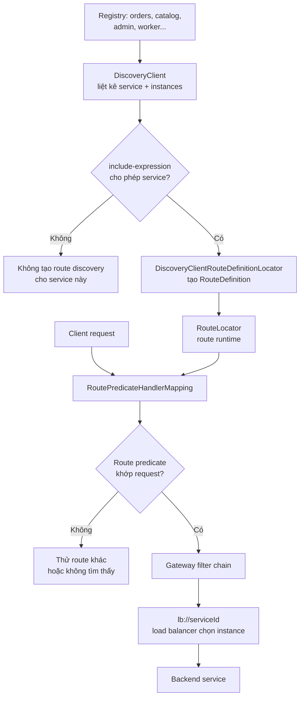

# Tùy chỉnh điều kiện đưa dịch vụ vào danh sách tuyến

Khi một tổ chức có hàng chục microservice đăng ký với Eureka, Consul hoặc một hệ thống service discovery tương thích, **không phải dịch vụ nào cũng nên được công bố thành API route**. Ngoài những dịch vụ phục vụ client như `orders-service` hay `catalog-service`, registry có thể chứa `admin-service`, `internal-report-service`, worker xử lý nền hoặc những dịch vụ chỉ được gọi trong mạng nội bộ.

**Spring Cloud Gateway** có thể tự sinh route từ danh sách dịch vụ được khám phá thông qua **`DiscoveryClient` Route Definition Locator**. Tính năng này hữu ích vì khi thêm service mới, ta không cần khai báo thủ công từng `uri: lb://...`. Nhưng bật tự động cho **tất cả** service có thể tạo bề mặt API rộng hơn chủ đích. Để kiểm soát, Gateway cung cấp thuộc tính **`discovery.locator.include-expression`**: một biểu thức **Spring Expression Language (SpEL)** quyết định **dịch vụ nào được đưa vào danh sách route tự động**.

Bài học thuộc chương **Khám phá và cân bằng tải** của module **SPRING_CLOUD_GATEWAY**. Đây là điểm giao giữa route predicate, filter chain, sửa path/header và service discovery. Việc chọn đúng dịch vụ để sinh route cũng ảnh hưởng đến chỗ đặt xác thực, rate limiting, circuit breaker, retry, TLS và hệ thống quan sát request khi vận hành một API Gateway an toàn.

> **Phạm vi:** Nội dung tập trung vào **Spring Cloud Gateway Server WebFlux**. Ở các phiên bản mới, namespace cấu hình là `spring.cloud.gateway.server.webflux.discovery.locator.*`; ở một số phiên bản 4.x cũ, namespace là `spring.cloud.gateway.discovery.locator.*`. Luôn chọn đúng namespace, starter và tài liệu theo phiên bản Spring Cloud Gateway đang chạy. Đừng sao chép nguyên cấu hình Server WebFlux sang biến thể Server MVC rồi mặc định hành vi giống nhau.

## 1. Vì sao cần lọc dịch vụ trước khi tạo route?

Giả sử registry chứa:

| Service ID | Chức năng | Có muốn gateway tự tạo route công khai? |
| --- | --- | --- |
| `orders-service` | Đơn hàng | Có, sau khi áp dụng chính sách API phù hợp |
| `catalog-service` | Danh mục sản phẩm | Có |
| `payments-service` | Thanh toán | Có thể, nhưng cần kiểm soát quyền và API cụ thể |
| `admin-service` | Quản trị hệ thống | Không tự động công bố |
| `internal-report-service` | Tạo báo cáo nội bộ | Không |
| `billing-worker` | Tác vụ nền | Không |

Với Discovery Locator bật và điều kiện mặc định cho phép mọi dịch vụ, Gateway **có thể sinh route cho cả những service chỉ dành cho nội bộ**. Điều này không có nghĩa các request vào service đó luôn được phép—Spring Security, routing và network policy có thể còn các lớp bảo vệ khác—nhưng danh sách route công khai trở nên khó kiểm soát và dễ gây nhầm lẫn.

**Mục tiêu:** chỉ những service đáp ứng **điều kiện được chủ động phê duyệt** mới có route được sinh tự động. Có thể dùng:

- **Danh sách cho phép (allowlist)** theo service ID.
- **Quy ước đặt tên**, ví dụ chỉ chọn các tên có tiền tố `public-`.
- **Metadata từ registry**, ví dụ instance có `edge=true`.
- **Kết hợp nhiều điều kiện**, chẳng hạn đúng nhóm dịch vụ và được gắn cờ công bố.

Đây là bước quản lý **route definitions**, không phải cơ chế xác thực hay phân quyền trên từng request.

## 2. Phân biệt service discovery, route generation và load balancing

Ba quá trình liên quan nhau nhưng trả lời ba câu hỏi khác nhau.

| Quá trình | Câu hỏi | Thành phần thường tham gia |
| --- | --- | --- |
| **Service discovery** | Những dịch vụ nào có mặt, các instance ở host/port nào? | `DiscoveryClient` / `ReactiveDiscoveryClient` và registry |
| **Tạo route tự động** | Service nào được Gateway công bố dưới dạng một route? | `DiscoveryClientRouteDefinitionLocator`, `include-expression` |
| **Load balancing** | Khi route đã chọn `lb://orders-service`, instance nào nhận request? | Spring Cloud LoadBalancer, nguồn danh sách instance |
| **Route matching** | Một request HTTP khớp route nào? | `RoutePredicateHandlerMapping`, `Path`/`Host`/`Method` predicates |

Luồng logic:



**Thời điểm khác nhau là điểm mấu chốt:**

1. **`include-expression`** xét thông tin dịch vụ/instance discovery khi **tạo danh sách route**.
2. **`Path`, `Host`, `Method`** là **route predicates** được đánh giá khi một HTTP request đến.
3. **`lb://`** được phân giải khi request đã có route và gateway cần chọn backend instance.

Lọc dịch vụ ở bước 1 **không kiểm tra danh tính người gọi** ở bước 2. Một route được phép sinh ra vẫn cần chính sách bảo mật, quota và giới hạn truy cập hợp lệ.

## 3. Bật DiscoveryClient Route Definition Locator

Thông thường, các route có thể được khai báo thủ công:

```yaml
spring:
  cloud:
    gateway:
      server:
        webflux:
          routes:
            - id: orders-api
              uri: lb://orders-service
              predicates:
                - Path=/api/orders/**
              filters:
                - StripPrefix=1
```

Nhưng khi muốn route **được tạo dựa trên các service đã đăng ký**, bật Discovery Locator:

```yaml
spring:
  cloud:
    gateway:
      server:
        webflux:
          discovery:
            locator:
              enabled: true
```

Ví dụ trên cần thêm **một triển khai DiscoveryClient** phù hợp (Eureka, Consul, Kubernetes hoặc nền tảng khác) đã được kết nối tới registry. Do URI mặc định của route discovery có dạng `lb://service-name`, Gateway còn cần tích hợp **`spring-cloud-starter-loadbalancer`** và nguồn instance để phân giải service ID khi gọi downstream.

**Nếu không bật `enabled: true`**, Gateway không tự sinh các route theo discovery locator chỉ vì ứng dụng có DiscoveryClient. Ngược lại, chỉ bật flag mà thiếu registry/discovery implementation hoặc load balancer phù hợp cũng không đảm bảo request đi tới backend thành công.

### 3.1. Dạng cấu hình ở các bản Spring Cloud Gateway trước đây

Trong nhiều tài liệu và ứng dụng Spring Cloud Gateway 4.x cũ, cùng tính năng được cấu hình:

```yaml
spring:
  cloud:
    gateway:
      discovery:
        locator:
          enabled: true
```

Các thuộc tính con như `include-expression`, `lower-case-service-id`, `predicates`, `filters`, `url-expression` và `route-id-prefix` đi dưới cùng node `locator`. Chọn **một namespace đúng phiên bản**, không tạo đồng thời hai danh sách route chỉ để thử.

### 3.2. Mặc định khi không đặt include-expression

Giá trị mặc định của `discovery.locator.include-expression` là **`true`**, tức biểu thức bao gồm service không loại bỏ service theo một điều kiện tùy biến. Tùy registry và phiên bản, danh sách route vẫn phụ thuộc những service/instance mà DiscoveryClient thật sự nhìn thấy và cơ chế làm mới.

Khi dùng giá trị mặc định, một service mới xuất hiện trong registry **có thể được đưa vào danh sách route tự sinh** nếu có đủ dữ liệu phục vụ route generation. Do đó nên cân nhắc kỹ trước khi bật Discovery Locator ở một edge gateway truy cập trực tiếp từ Internet.

## 4. include-expression: điều kiện SpEL cho từng service

`include-expression` là một **biểu thức SpEL** phải cho kết quả logic phù hợp để quyết định **đưa hay không đưa** một service vào các route được Discovery Locator tạo ra.

Cấu hình ngắn:

```yaml
spring:
  cloud:
    gateway:
      server:
        webflux:
          discovery:
            locator:
              enabled: true
              include-expression: "serviceId == 'orders-service'"
```

Ở đây:

- `serviceId` là thuộc tính của đối tượng **`ServiceInstance`** được dùng để đánh giá biểu thức.
- `==` so sánh giá trị.
- `'orders-service'` là chuỗi trong **SpEL**, nên dấu nháy đơn nằm **bên trong** chuỗi YAML.
- Nếu biểu thức cho kết quả đúng với service, Discovery Locator tạo route cho nó; nếu sai, **không tạo route discovery** cho service đó.

Điều kiện nên **rõ ràng, đơn giản, dễ kiểm thử**. Không nên để cấu hình SpEL đến từ nguồn không đáng tin cậy vì đây là ngôn ngữ biểu thức mạnh và ảnh hưởng tới cách ứng dụng xây cấu hình định tuyến.

### 4.1. Các trường thường được sử dụng

| Dữ liệu của `ServiceInstance` | Ví dụ SpEL | Công dụng |
| --- | --- | --- |
| `serviceId` | `serviceId == 'orders-service'` | Chọn đúng một service theo tên |
| `serviceId` | `serviceId.startsWith('public-')` | Chọn các service dùng một tiền tố đặt tên |
| `serviceId` | `serviceId matches '^(orders|catalog)-service$'` | Chọn theo regex danh sách cho phép |
| `metadata` | `metadata['edge'] == 'true'` | Chọn service được registry truyền metadata cho phép công bố |
| Kết hợp | `metadata['edge'] == 'true' and serviceId.startsWith('public-')` | Phải đáp ứng cả hai điều kiện |

**Về metadata:** Tính khả dụng và kiểu dữ liệu của `metadata` phụ thuộc DiscoveryClient/registry. Với nhiều tích hợp, metadata là map có key/value chuỗi. Nếu chưa có trường `edge`, `metadata['edge']` không trùng chuỗi `'true'`, nên điều kiện ví dụ sẽ không cho phép. Cần xác minh metadata thực sự được trả về **cho ServiceInstance mà Gateway nhìn thấy**, không suy ra chỉ từ annotation/label hay cấu hình service nguồn.

### 4.2. Ví dụ 1 — Danh sách cho phép theo serviceId

Giả sử chỉ muốn tự sinh route cho hai service:

- `orders-service`.
- `catalog-service`.

Cấu hình:

```yaml
spring:
  cloud:
    gateway:
      server:
        webflux:
          discovery:
            locator:
              enabled: true
              include-expression: "serviceId == 'orders-service' or serviceId == 'catalog-service'"
```

Nếu registry trả service ID chính xác ở dạng chữ thường, kết quả mong đợi:

| Service trong registry | Kết quả SpEL | Có route discovery? |
| --- | --- | --- |
| `orders-service` | `true` | Có |
| `catalog-service` | `true` | Có |
| `admin-service` | `false` | Không |
| `internal-report-service` | `false` | Không |

**Điểm mạnh của allowlist:** service mới vô tình đăng ký vào registry **không được tự động đưa vào route list** trừ khi có chủ đích cập nhật danh sách. **Nhược điểm:** cần thay cấu hình/refresh khi thêm API service được phép công bố.

### 4.3. Ví dụ 2 — Quy ước tiền tố tên

Giả sử registry phân biệt service công khai với service nội bộ:

```text
public-orders
public-catalog
public-payment
internal-report
admin-service
billing-worker
```

Cấu hình:

```yaml
spring:
  cloud:
    gateway:
      server:
        webflux:
          discovery:
            locator:
              enabled: true
              include-expression: "serviceId.startsWith('public-')"
```

Biểu thức này linh hoạt: bất kỳ service mới nào tên bắt đầu bằng `public-` có thể được sinh route. Tuy nhiên, **đặt tên đúng tiền tố không phải một cơ chế phê duyệt bảo mật**; nếu người quản trị registry hoặc một pipeline deploy chưa được kiểm soát có thể đặt tên tùy ý, họ cũng có thể tạo một service đủ điều kiện. Khi edge gateway hướng ra Internet, nên kết hợp quản trị quyền đăng ký registry và kiểm soát việc triển khai.

### 4.4. Ví dụ 3 — Regex nhóm dịch vụ đã được duyệt

```yaml
spring:
  cloud:
    gateway:
      server:
        webflux:
          discovery:
            locator:
              enabled: true
              include-expression: "serviceId matches '^(orders|catalog|payments)-service$'"
```

Regex trên chỉ chấp nhận những tên khớp **toàn bộ chuỗi** theo mẫu. Dấu `^` và `$` giúp mô tả rõ ý định, tránh khớp nhầm tên như `orders-service-test`.

Khi registry như **Eureka** trả ID chữ hoa, ví dụ `ORDERS-SERVICE`, biểu thức trên có thể không khớp. Khi cần so khớp bất kể chữ hoa/thường, có thể **chuẩn hóa trong SpEL**:

```yaml
include-expression: "serviceId.toLowerCase() matches '^(orders|catalog|payments)-service$'"
```

Đây là xử lý **tên dùng để so sánh trong biểu thức**. Đừng nhầm với thuộc tính `lower-case-service-id` của Discovery Locator, vốn được dùng cho cách tạo **predicates/filters** của route (xem mục 6).

### 4.5. Ví dụ 4 — Chỉ đưa service được gắn metadata edge

Spring Cloud từng giới thiệu ví dụ chính thức:

```yaml
spring:
  cloud:
    gateway:
      server:
        webflux:
          discovery:
            locator:
              enabled: true
              include-expression: "metadata['edge'] == 'true'"
```

Giả sử registry cung cấp metadata:

| Service ID | Metadata `edge` | Kỳ vọng |
| --- | --- | --- |
| `orders-service` | `"true"` | Có route |
| `catalog-service` | `"true"` | Có route |
| `admin-service` | `"false"` | Không có route |
| `worker-service` | Không có key | Không có route |

Ưu điểm của cách này là việc công bố API dựa trên **metadata do quy trình đăng ký dịch vụ kiểm soát**, thay vì hard-code toàn bộ service ID trong Gateway. Nhưng cần xác định:

1. Registry/DiscoveryClient có thật sự **truyền metadata** đến Gateway không?
2. Giá trị `edge` đang là chuỗi `"true"` hay một kiểu/chuỗi khác? Phép so sánh phải tương thích.
3. Ai có quyền tạo/sửa metadata `edge`? Có quy trình review và audit không?
4. Những instance cùng `serviceId` có metadata đồng nhất không?
5. Khi đổi metadata, cách nào đảm bảo route runtime được cập nhật?

**Lưu ý về nhiều instance:** Trong các triển khai Discovery Locator phổ biến, biểu thức include được đánh giá dựa trên một **ServiceInstance đại diện của service** trong quá trình tạo route. Nó **không** phải bộ lọc chọn từng instance khi load balancing. Nếu cùng một service có instance gắn `edge=true` và instance khác `edge=false`, hành vi có thể khó dự đoán theo danh sách instance/refresh. Hãy giữ metadata công bố **nhất quán theo toàn service**, hoặc quản lý quyền công bố bằng nguồn cấu hình tập trung đáng tin cậy.

### 4.6. Ví dụ 5 — Kết hợp metadata với allowlist

Nếu muốn vừa giới hạn tên, vừa đòi hỏi cờ cho phép:

```yaml
include-expression: "(serviceId.toLowerCase() matches '^(orders|catalog)-service$') and metadata['edge'] == 'true'"
```

Biểu thức chỉ trả `true` nếu **cả hai** điều kiện đúng. Dấu ngoặc diễn tả rõ thứ tự xử lý, giúp người đọc dễ bảo trì hơn một chuỗi biểu thức dài.

Khi sử dụng điều kiện chặt, một service hợp lệ nhưng thiếu metadata sẽ **không được tạo route**. Đây có thể là hành vi fail-closed mong muốn, nhưng phải có quy trình kiểm thử để tránh mất API sau khi deploy.

## 5. Khi service vượt qua include-expression, route nào được tạo?

Discovery Locator mặc định thường tạo route với các thành phần:

| Thành phần mặc định | Dạng minh họa | Ý nghĩa |
| --- | --- | --- |
| **Route ID** | Tiền tố từ DiscoveryClient + service ID | Giúp định danh route được tạo tự động; tiền tố tùy cấu hình/triển khai. |
| **URI** | `lb://orders-service` | Đích logic; instance được chọn về sau bởi load balancer. |
| **Path predicate** | `/orders-service/**` | Chỉ match request đến path có tiền tố service ID. |
| **RewritePath filter** | Bỏ `/orders-service` ở đầu path | Backend nhận path không chứa service ID của gateway. |

Ví dụ sau khi route được tạo:

```text
Client -> Gateway:
  GET /orders-service/orders/42

Route discovery:
  serviceId = orders-service
  Path = /orders-service/**
  URI = lb://orders-service
  RewritePath bỏ /orders-service

Gateway -> Backend:
  GET /orders/42
```

**Không mặc định đường vào là `/api/orders/**`.** Đó là thiết kế thường gặp ở các route **khai báo thủ công**. Discovery Locator mặc định tạo path theo `/serviceId/**`; nếu muốn endpoint công khai đẹp hơn, cần cấu hình predicates/filters tùy biến hoặc dùng route tĩnh theo API contract.

**Và không phải cứ có route là backend chắc chắn truy cập được.** Với `lb://...`, còn phải tìm được instance, resolve DNS/port và thiết lập kết nối phù hợp.

### 5.1. Ví dụ request theo bản đồ service

Giả sử registry chứa:

```text
orders-service  -> 10.2.0.10:8080, 10.2.0.11:8080
catalog-service -> 10.2.0.20:8080
admin-service   -> 10.2.0.30:8080
```

Với include-expression chỉ cho phép orders và catalog:

| HTTP request vào Gateway | Có route discovery tương ứng? | Backend path sau rewrite |
| --- | --- | --- |
| `GET /orders-service/orders/42` | Có | `/orders/42` |
| `GET /catalog-service/products/9` | Có | `/products/9` |
| `GET /admin-service/admin/users` | **Không tạo route discovery cho admin** | Không có chuyển tiếp qua route discovery này |

Request cuối vẫn có thể được **route tĩnh**, một handler WebFlux khác hoặc một tầng proxy khác xử lý nếu ứng dụng được cấu hình thêm. Vì vậy, kết luận đúng là **“không có route discovery tự sinh cho admin”**, không phải khẳng định mọi đường truy cập đến admin đã bị khóa.

## 6. Vai trò của lower-case-service-id, url-expression và route-id-prefix

Khi cấu hình dịch vụ nào được sinh route, thường phải quan tâm tới cả cách route đó được biểu diễn.

### 6.1. lower-case-service-id

Một số registry, đặc biệt các cấu hình Eureka, có thể trả service ID dưới dạng chữ hoa như `ORDERS-SERVICE`. Nếu `lower-case-service-id: true`, Gateway có thể tạo path patterns và filters dùng service ID chữ thường, giúp client gọi `/orders-service/**` thay vì `/ORDERS-SERVICE/**`.

```yaml
spring:
  cloud:
    gateway:
      server:
        webflux:
          discovery:
            locator:
              enabled: true
              lower-case-service-id: true
              include-expression: "serviceId.toLowerCase() == 'orders-service'"
```

Hai cấu hình giải quyết **hai vấn đề khác nhau**:

- `lower-case-service-id`: hỗ trợ định dạng service ID trong predicates/filters của route sinh ra.
- `serviceId.toLowerCase()` trong `include-expression`: giúp điều kiện **lọc dịch vụ** không bỏ sót service vì tên trả về từ registry có chữ hoa.

Đừng chỉ bật `lower-case-service-id: true` rồi mặc định điều kiện `serviceId == 'orders-service'` chắc chắn so khớp với một registry trả ID `ORDERS-SERVICE`.

### 6.2. url-expression

URI mặc định của discovery route có dạng:

```text
'lb://' + serviceId
```

Trong cấu hình, có thể thấy:

```yaml
url-expression: "'lb://'+serviceId"
```

Đây là một **SpEL expression tạo URI đích cho route**, khác với `include-expression` quyết định có sinh route hay không.

**Không đổi `url-expression` tùy tiện** để tạo địa chỉ từ dữ liệu registry nếu chưa hiểu ranh giới tin cậy, scheme, TLS và cơ chế phân giải instance. Mục đích thông dụng của Gateway là dùng `lb://serviceId` để Spring Cloud LoadBalancer chọn instance đã đăng ký; đổi sang `http://` cố định có thể bỏ qua bước cân bằng tải hoặc trỏ sai hạ tầng.

### 6.3. route-id-prefix

Các route discovery thường dùng route ID xây từ tiền tố locator và service ID. `route-id-prefix` cho phép tùy chỉnh tiền tố route để phân biệt chúng với routes cấu hình thủ công trong logs, metrics và cấu hình quan sát.

Ví dụ:

```yaml
route-id-prefix: discovery_
```

Hãy chọn định dạng ID dễ đọc và không xung đột với route ID tĩnh. Route ID rất hữu ích khi xác định request đang được xử lý qua **route discovery tự sinh** hay qua một route tĩnh có path chồng lấn.

## 7. Lọc service khác với tùy chỉnh predicates và filters

Giả sử yêu cầu:

> “Chỉ những service có metadata `edge=true` được sinh route, **và** mỗi route đó chỉ nhận request trên host `api.example.test`.”

Có **hai loại điều kiện**:

1. `metadata['edge'] == 'true'`: **điều kiện đưa service vào danh sách route**, giải quyết bằng `include-expression`.
2. `Host=api.example.test`: **điều kiện mỗi HTTP request phải thỏa**, giải quyết bằng **route predicate**.

Một cấu hình tổng hợp (theo cấu trúc tham số của tài liệu Server WebFlux) có thể như sau:

```yaml
spring:
  cloud:
    gateway:
      server:
        webflux:
          discovery:
            locator:
              enabled: true
              include-expression: "metadata['edge'] == 'true'"
              predicates:
                - name: Host
                  args:
                    pattern: "'api.example.test'"
                - name: Path
                  args:
                    pattern: "'/'+serviceId+'/**'"
              filters:
                - name: RewritePath
                  args:
                    regexp: "'/' + serviceId + '/?(?<remaining>.*)'"
                    replacement: "'/${remaining}'"
```

**Giải thích các lớp dấu nháy:**

- `pattern: "'api.example.test'"` là một **chuỗi YAML** có nội dung là **biểu thức SpEL trả về chuỗi**.
- `pattern: "'/'+serviceId+'/**'"` tạo path pattern từ service ID ở thời điểm xây route.
- `regexp` tạo biểu thức rewrite path theo service ID.
- `replacement` tham chiếu nhóm regex `remaining` để giữ phần đường dẫn còn lại.

**Cảnh báo khi tùy chỉnh:** Trong các phiên bản phổ biến, cấu hình danh sách `discovery.locator.predicates`/**`filters`** tùy biến **thay thế danh sách mặc định**, không đơn thuần “thêm một dòng vào mặc định”. Nếu thêm `Host` nhưng quên khai báo lại `Path`, hoặc thêm filter khác nhưng quên `RewritePath`, route có thể nhận request không như dự kiến hoặc backend nhận path còn chứa service ID và trả `404`. Luôn định nghĩa lại các thành phần mặc định mà bạn cần giữ.

**Về ký tự `${remaining}`:** Đây là ký hiệu nhóm đặt tên trong replacement của `RewritePath`. Khi đi qua các nguồn cấu hình khác nhau (YAML, `.properties`, biến môi trường), ký tự `$` và dấu ngoặc có thể bị cơ chế placeholder xử lý; hãy dùng cú pháp escaping đúng theo tài liệu phiên bản và kiểm thử path thực tế. Ví dụ trong tài liệu Spring Cloud Gateway minh họa cách viết replacement trong YAML và cách escape khác ở `.properties`.

### 7.1. Khi nào dùng route tĩnh thay vì discovery locator?

Discovery Locator hợp lý khi:

- Hệ thống có nhiều service với **quy ước route thống nhất**.
- Service discovery được quản trị chặt.
- Phạm vi công bố dựa trên một allowlist/metadata rõ ràng.
- Chấp nhận đường dẫn public theo mẫu `/serviceId/**` hoặc có quy tắc chung có thể kiểm chứng.

Route tĩnh có thể phù hợp hơn khi:

- API public dùng một hợp đồng ổn định như `/api/orders/**`, không muốn lộ service ID.
- Mỗi route cần nhiều predicates/filters, auth scopes, quota và timeout khác nhau.
- Có route versioning, canary và chính sách đặc biệt cho thanh toán/quản trị.
- Người vận hành muốn review rõ từng endpoint được xuất bản.

Hai hình thức **có thể cùng tồn tại**. Nhưng nếu route tĩnh và route tự sinh có path chồng nhau, cần xác định `order` và các predicates để tránh bắt nhầm request.

## 8. Metadata phải được kiểm soát tại nguồn

Giả sử service đăng ký vào registry với metadata tương đương:

```yaml
# Đây là metadata logic tại nguồn đăng ký dịch vụ;
# cú pháp thực tế phụ thuộc Eureka, Consul, Kubernetes...
metadata:
  edge: "true"
  owner: "api-team"
```

Gateway chỉ có thể dùng `metadata['edge']` nếu DiscoveryClient tương ứng **đưa key/value đó vào `ServiceInstance.getMetadata()`**. Không phải mọi Kubernetes label, annotation hay cấu hình container đều tự động xuất hiện trong map này; cần đối chiếu cơ chế chuyển metadata của discovery integration.

**Ranh giới tin cậy cần kiểm soát:**

- Ai được phép **đăng ký service** vào registry?
- Ai có thể sửa metadata `edge`?
- Có review/audit trail cho việc đổi `edge=false` thành `edge=true` không?
- Việc đăng ký phải gắn với service ID thật hay có thể giả mạo tên?
- Các gateway replicas có cùng cách đọc registry và metadata không?
- Quyền mạng giữa gateway và backend có giới hạn những service được gọi không?

Việc lọc bằng metadata là **quy tắc tạo route**, không phải security authorization. Nếu attacker có thể đăng ký một service với `edge=true` và kiểm soát các đường dẫn công khai, bộ lọc sẽ không tự biết service đó không được phê duyệt.

Đối với API nhạy cảm, cân nhắc **allowlist tĩnh được review** hoặc một hệ thống kiểm soát triển khai đảm bảo metadata chỉ được đặt bởi pipeline tin cậy.

## 9. Tránh hiểu sai về các lớp lọc khác nhau

| Tính năng | Đối tượng được lọc/chọn | Thời điểm | Ví dụ |
| --- | --- | --- | --- |
| `include-expression` | **Service** được tạo route discovery | Khi tạo/làm mới định nghĩa route | Chỉ service có `edge=true` được sinh route |
| `Path`/`Host`/`Method` predicate | **HTTP request** đủ điều kiện cho một route | Khi request đến Gateway | Chỉ `GET /orders-service/**` |
| `route.order` | Thứ tự xét **các route** cạnh tranh | Khi route matching | Route chuyên biệt trước fallback |
| Spring Cloud LoadBalancer | **Instance** nhận request đã có route | Sau khi chọn route và đích `lb://` | Chọn `10.2.0.10` hoặc `10.2.0.11` |
| Health check/discovery | Instance khả dụng theo registry/health state | Trong cập nhật danh sách instance | Loại instance unhealthy khỏi nguồn LB |
| Spring Security | **Người gọi/request** được phép truy cập | Tầng security của Gateway/backend | JWT, scopes, quyền theo tài nguyên |
| `RequestRateLimiter` | Request theo quota/tốc độ | Gateway filter hoặc tầng tương ứng | Chặn `429` khi vượt hạn mức |

### 9.1. include-expression không giới hạn instance theo metadata

Một lỗi thiết kế phổ biến:

> “Tôi có ba instance của `orders-service`, chỉ một instance gắn `edge=true`. Tôi đặt `include-expression` để chỉ route request đến đúng instance đó.”

Điều này **không đúng về trách nhiệm**. `include-expression` lựa chọn có sinh **route cho service ID** hay không. Khi route `lb://orders-service` được chọn, các instance nào đủ điều kiện nhận request lại phụ thuộc nguồn danh sách instance, health và chính sách load balancing.

Nếu muốn loại trừ instance unhealthy hoặc áp dụng zone, canary, metadata-based instance filtering, hãy thiết kế và kiểm chứng ở **discovery/load-balancing layer**, không sử dụng `include-expression` như một bộ lọc instance.

### 9.2. include-expression không phải route predicate trên HTTP request

Biểu thức `serviceId == 'orders-service'` không kiểm tra client có được gọi `/orders-service/**` hay không. Một service dù được include vẫn có thể cần kiểm tra `Host`, `Path`, HTTP method, authentication và authorization.

Nếu request đến `/admin-service/**` nhưng admin service đã bị loại khỏi route discovery, Gateway **không tự sinh route** cho path đó. Tuy nhiên, một static route khác hoặc tầng proxy khác vẫn có thể chuyển tiếp request nếu được cấu hình. Cần kiểm thử toàn bộ đường đi.

## 10. Khi thay đổi registry hoặc cấu hình, route có tự đổi ngay không?

Service discovery thường là nguồn dữ liệu động: instance có thể xuất hiện, biến mất, đổi metadata hoặc di chuyển sang hạ tầng khác. Nhưng **danh sách route runtime** có thể được cập nhật qua cơ chế refresh/cache/sự kiện riêng của Spring Cloud Gateway và discovery implementation.

Không nên giả định mọi thay đổi trong registry **được phản ánh ngay tức thì** đến tất cả gateway replicas:

1. Registry có chu kỳ đồng bộ/heartbeat riêng.
2. DiscoveryClient có thể cache danh sách service/instance.
3. Discovery Locator và RouteLocator có thể cache hoặc tái xây route khi có refresh.
4. Nhiều gateway instance có thể nhìn các snapshot khác nhau.
5. Một request đang xử lý có thể tiếp tục theo route đã chọn trước khi cấu hình mới có hiệu lực.

**Quy trình thay đổi an toàn:**

- Xác nhận service/metadata thực sự đã xuất hiện trong DiscoveryClient.
- Xác nhận biểu thức SpEL trả kết quả mong muốn.
- Kiểm tra **route runtime** ở từng Gateway instance.
- Thực hiện refresh theo **cơ chế được phiên bản/hệ thống hỗ trợ**, không chỉ sửa file YAML.
- Gửi request kiểm thử qua các đường dẫn được phép và bị loại.
- Giám sát số lượng route, route IDs, error rate và tác động tới backend.

Nếu môi trường có Spring Boot Actuator và endpoint của Spring Cloud Gateway để xem routes, có thể kiểm tra **danh sách route đã nạp**. Endpoint quản trị phải được bảo vệ quyền truy cập, không công bố tùy tiện ra Internet vì có thể làm lộ topology và URI nội bộ.

### 10.1. Khi service bị loại nhưng route vẫn còn

Nguyên nhân có thể:

- Điều kiện SpEL chưa được nạp ở đúng namespace/profiles.
- Service có metadata/tên khác với giả định; biểu thức thực tế vẫn trả true.
- Route tĩnh khác có ID/path tương tự, không thuộc Discovery Locator.
- Route cache chưa được làm mới.
- Gateway replica nhận request đang chạy cấu hình cũ.

**Không kết luận từ một lệnh curl duy nhất.** Kiểm tra route ID, cấu hình effective, provenance của route và gateway instance đã xử lý request.

## 11. Thực hành với registry giả lập và phép kiểm tra route

Giả sử môi trường thực hành có ba service trong registry:

```text
orders-service      metadata: edge=true
catalog-service     metadata: edge=true
admin-service       metadata: edge=false
```

Để tập trung vào điều kiện lọc, dùng:

```yaml
spring:
  cloud:
    gateway:
      server:
        webflux:
          discovery:
            locator:
              enabled: true
              include-expression: "metadata['edge'] == 'true'"
              lower-case-service-id: true
```

**Yêu cầu trước khi chạy:** có DiscoveryClient kết nối được registry, metadata được truyền tới Gateway, và Spring Cloud LoadBalancer nếu dùng URI `lb://`. Gateway giả định lắng nghe tại `localhost:8080`; các backend phải có endpoint tương ứng để nhận request.

### 11.1. Kiểm tra những service được include

Khi route có cấu hình mặc định, thử:

```bash
curl -i http://localhost:8080/orders-service/orders/42
curl -i http://localhost:8080/catalog-service/products/9
```

Kỳ vọng:

- Gateway có route discovery cho orders và catalog.
- Request qua `/orders-service/orders/42` được rewrite thành `/orders/42` trước backend.
- Nếu backend sẵn sàng, nhận response hợp lệ; nếu không có instance hoặc kết nối lỗi, có thể nhận lỗi **dù route đã được include**.

### 11.2. Kiểm tra dịch vụ không được include

```bash
curl -i http://localhost:8080/admin-service/admin/users
```

Kỳ vọng **không tồn tại route discovery tự tạo** cho `admin-service`. Nếu không có route/handler khác, có thể nhận `404`. Nếu request vẫn đến admin backend, cần điều tra route tĩnh, proxy khác, condition hoặc route cache.

**Không dùng trả `404` làm bằng chứng duy nhất.** Backend có thể trả `404` sau khi route đã khớp; nhìn route runtime hoặc metric/trace có route ID sẽ rõ hơn.

### 11.3. Ma trận kiểm thử

| Tình huống | Kết quả mong đợi | Cần xác minh thêm |
| --- | --- | --- |
| `orders-service` có `edge=true` | Có route discovery | URI, ID, Path, RewritePath |
| `catalog-service` có `edge=true` | Có route discovery | Backend instance sẵn sàng |
| `admin-service` có `edge=false` | Không có route discovery | Không có static route thay thế vô ý |
| Service thiếu metadata `edge` | Không khớp điều kiện `== 'true'` | Registry có truyền đúng metadata? |
| Eureka trả `ORDERS-SERVICE` và biểu thức so chữ thường trực tiếp | Có thể không match | Dùng normalization trong SpEL |
| Một service có hai instance metadata khác nhau | Không dùng kết quả làm instance filtering | Chuẩn hóa metadata theo service |
| Service vừa đổi metadata | Route có thể chưa cập nhật tức thì | Route cache/refresh trên mọi Gateway replica |
| Discovery route và static route chồng path | Có thể route khác thắng | `order`, route ID, predicates |
| Route tồn tại, không có healthy instance | Không gọi downstream thành công | Health/discovery/load-balancer |

### 11.4. Kiểm thử SpEL riêng với ServiceInstance

Có thể kiểm tra logic biểu thức trước khi tích hợp với Gateway bằng cách đánh giá nó trên một `ServiceInstance` mẫu. Ví dụ Java **minh họa**:

```java
import org.springframework.cloud.client.DefaultServiceInstance;
import org.springframework.expression.Expression;
import org.springframework.expression.spel.standard.SpelExpressionParser;

DefaultServiceInstance instance = new DefaultServiceInstance(
    "orders-1", "orders-service", "127.0.0.1", 9090, false
);
instance.getMetadata().put("edge", "true");

Expression include = new SpelExpressionParser().parseExpression(
    "serviceId == 'orders-service' and metadata['edge'] == 'true'"
);

Boolean allowed = include.getValue(instance, Boolean.class);
// allowed: true với dữ liệu ví dụ.
```

Đoạn này chỉ kiểm tra biểu thức trên object giả lập; nó **không chứng minh DiscoveryClient thật có metadata đúng**, không kiểm tra binding YAML và không xác nhận route được tạo. Sau khi unit test SpEL, vẫn cần một integration test sử dụng registry/DiscoveryClient của môi trường thực tế.

### 11.5. Kiểm thử “fail closed” khi thiếu dữ liệu

Với biểu thức `metadata['edge'] == 'true'`, hãy cố ý bỏ key `edge` khỏi một service thử nghiệm và xác nhận **route discovery không được tạo**. Nếu môi trường của bạn đòi hỏi mọi service hợp lệ phải có metadata này, nên kiểm tra tại pipeline đăng ký để phát hiện cấu hình thiếu trước khi đưa lên production.

Khi chuyển trạng thái `edge` từ `true` sang `false`, cần có phép thử **sau refresh** để xác nhận route runtime biến mất. Không mặc định xóa route sẽ chấm dứt một request đang xử lý hoặc đóng tất cả kết nối được mở từ trước.

## 12. Những lỗi phổ biến và cách xử lý

### Lỗi 1 — Dùng include-expression để lọc theo HTTP path

**Sai kỳ vọng:** cấu hình `include-expression` để chỉ cho phép `GET /api/orders/**`. Biểu thức được dùng để xét **ServiceInstance/serviceId**, không phải request HTTP. Muốn lọc theo HTTP method/path phải dùng `Method` và `Path` predicates.

### Lỗi 2 — Nhầm lower-case-service-id với thay đổi dữ liệu trong SpEL

**Triệu chứng:** Eureka trả service ID chữ hoa; bật `lower-case-service-id: true` nhưng điều kiện `serviceId == 'orders-service'` vẫn không hoạt động như mong đợi.

**Khắc phục:** chuẩn hóa giá trị trong biểu thức như `serviceId.toLowerCase() == 'orders-service'` hoặc dùng đúng ID thực mà registry trả. Phân biệt tên dùng cho matching với tên dùng trong predicate/filter đã sinh.

### Lỗi 3 — Metadata không được DiscoveryClient truyền tới

**Triệu chứng:** service có label/annotation `edge=true` nhưng `metadata['edge'] == 'true'` trả false hoặc không sinh route.

**Khắc phục:** kiểm tra `ServiceInstance.getMetadata()` của DiscoveryClient thực. Với Kubernetes/Consul/Eureka, cơ chế truyền metadata khác nhau; đừng suy ra tự động từ manifest.

### Lỗi 4 — Cùng service có metadata không nhất quán

**Triệu chứng:** route có/không xuất hiện sau các lần refresh.

**Khắc phục:** chuẩn hóa metadata dùng để quyết định công bố **ở mức toàn service**. Không dùng include-expression để cố lọc từng instance; hãy kiểm soát instance ở load balancing/discovery layer.

### Lỗi 5 — Dịch vụ bị exclude nhưng vẫn truy cập được

**Nguyên nhân có thể:** một route tĩnh hay ingress khác vẫn dẫn tới service, hoặc cấu hình effective khác bản đang đọc. `include-expression` chỉ kiểm soát **route được discovery locator tạo ra**, không xóa các route khác và không thay firewall/network policy.

### Lỗi 6 — Tự thêm predicate hoặc filter rồi mất rewrite mặc định

**Triệu chứng:** backend trả `404` vì nhận `/orders-service/orders/42` thay vì `/orders/42`.

**Khắc phục:** khi tùy biến danh sách `discovery.locator.filters`, khai báo lại `RewritePath` tương ứng nếu vẫn muốn bỏ service ID khỏi path. Tương tự, khi thay `predicates` cần giữ `Path` nếu muốn default routing convention.

### Lỗi 7 — Có route nhưng trả lỗi không tìm thấy backend

**Phân biệt:** include-expression đã cho phép sinh route, nhưng `lb://serviceId` có thể không tìm được instance hoặc gặp lỗi mạng/TLS. Kiểm tra Spring Cloud LoadBalancer, service registry, health, host/port và certificate. Đừng sửa biểu thức include khi nguyên nhân là load balancing.

### Lỗi 8 — Dùng SpEL từ nguồn không đáng tin cậy

**Rủi ro:** SpEL là ngôn ngữ biểu thức mạnh; việc cho phép người dùng không được tin cậy cập nhật trực tiếp biểu thức Gateway có thể tạo rủi ro cấu hình và thực thi ngoài ý muốn. Chỉ triển khai cấu hình qua kênh được phân quyền và review. Không xây một endpoint công khai nhận biểu thức tùy ý rồi áp dụng vào runtime.

### Lỗi 9 — Chỉ sửa file cấu hình mà không kiểm tra runtime

**Triệu chứng:** sau đổi include-expression, route vẫn có/không theo trạng thái cũ.

**Khắc phục:** xác nhận config profile, namespace, route cache/refresh và các replicas. Kiểm tra route runtime thay vì chỉ đọc YAML; thay đổi có thể chưa được đồng bộ.

## 13. Bảo mật và vận hành khi công bố service tự động

**Cho phép sinh route không đồng nghĩa cấp quyền truy cập.** Với một edge gateway an toàn, nên phân lớp:

| Lớp | Trách nhiệm | Ví dụ |
| --- | --- | --- |
| **Registry governance** | Quy định ai được đăng ký service và sửa metadata | Chỉ pipeline được review mới đặt `edge=true` |
| **Discovery include-expression** | Quy định service nào sinh route tự động | Allowlist hoặc metadata + allowlist |
| **Route predicates** | Quy định HTTP request nào khớp route | `Path`, `Host`, `Method` |
| **Spring Security/auth** | Kiểm tra identity, token và quyền | JWT/OAuth2, phân quyền API |
| **Gateway filters** | Chính sách biên, biến đổi HTTP | Rate limiting, header sanitation, retry, circuit breaker |
| **Backend authorization** | Quyền trên tài nguyên thực tế | Người dùng chỉ thấy đơn hàng của họ |
| **Mạng/TLS** | Bảo vệ các kết nối và hạn chế đường truy cập | TLS gateway–backend, network policy |
| **Observability** | Phát hiện route sai, latency và lỗi | Route ID, status, metrics, trace |

### 13.1. Không tự động mở toàn bộ registry ra Internet

Một service có thể được đăng ký để **các service nội bộ khác** gọi đến. Điều đó không có nghĩa nó có API contract công khai hoặc đã được kiểm thử với traffic từ Internet. Nên dùng allowlist, route tĩnh cho API nhạy cảm và phân vùng registry/network hợp lý.

Đặc biệt:

- **Admin service**: không dựa duy nhất vào include-expression để bảo vệ; hạn chế mạng và yêu cầu authentication/authorization mạnh.
- **Payments**: quản lý method, idempotency, timeouts và retry, tránh cho client tự do gọi endpoint nội bộ.
- **Internal workers**: không cần sinh route nếu không phục vụ HTTP API.
- **Actuator endpoints**: phải được bảo vệ, không coi registry metadata là một cách ẩn endpoint hoàn chỉnh.

### 13.2. Đặt rate limit và resilience khi dùng routes động

Khi Discovery Locator sinh route tự động, các route đó có thể dùng cùng predicates/filters template. Nếu mỗi service cần quota, circuit breaker, retry, timeout hoặc chính sách JWT khác nhau, hãy xác định:

1. Có thể biểu đạt chính sách chung bằng `default-filters` và security WebFilter không?
2. Có cần route tĩnh cho service đặc biệt để chọn chính sách riêng?
3. Các filters tùy biến có còn `RewritePath` mặc định không?
4. Retry có an toàn với POST/PUT không, đặc biệt ở API thanh toán?
5. Các lỗi backend có được phân loại theo route ID và instance để điều tra không?

Một “route sinh được” chưa phải một “API sẵn sàng vận hành”. Discovery chủ yếu giải quyết phần định tuyến động và danh sách instance, chứ không tự thiết kế business contract hay chính sách bảo mật.

### 13.3. Observability phù hợp cho route động

Khi theo dõi Gateway, nên có:

- Danh sách route runtime, service ID và nguồn route được tạo.
- Số route theo nhóm/registry, phát hiện tăng bất thường.
- Route ID cùng HTTP status, p95/p99 latency và error rate.
- Lỗi `lb://` không tìm được instance và các vấn đề TLS/network downstream.
- Chênh lệch route list/config giữa nhiều Gateway replicas.
- Audit sự kiện sửa metadata `edge` và thay đổi include-expression.

**Không log token, cookie, dữ liệu cá nhân hoặc body nhạy cảm** chỉ để điều tra route. Giữ log theo service ID, route ID và correlation/trace ID đã được xử lý an toàn.

## 14. Checklist triển khai

1. **Xác định ranh giới công bố**: những service nào thực sự là public API, những service nào nội bộ?
2. **Chọn cách lọc**: allowlist theo `serviceId`, prefix naming, metadata `edge=true` hoặc kết hợp.
3. **Kiểm tra registry thật**: service ID chính xác, chữ hoa/thường, metadata thực nhận, độ nhất quán giữa instances.
4. **Chọn namespace đúng**: `server.webflux.discovery.locator.*` hoặc namespace của bản cũ.
5. **Bật Discovery Locator đúng điều kiện**: `enabled=true`, implementation discovery và LoadBalancer nếu dùng `lb://`.
6. **Xác minh path convention**: default `/serviceId/**` và `RewritePath` có phù hợp API public hay không.
7. **Kiểm tra route runtime**: những service được include/exclude, ID, URI, predicates và filters.
8. **Kiểm thử tích hợp**: request vào route hợp lệ, route bị loại, service không có instance, metadata thiếu và cấu hình refresh.
9. **Bảo vệ quyền truy cập**: Spring Security, backend authorization, rate limits, TLS và network policies.
10. **Giám sát sau thay đổi**: route count, lỗi `404`/`5xx`, route mismatch, drift giữa Gateway replicas.

## 15. Câu hỏi và tình huống tự ôn tập

### Tình huống A — Registry có service nội bộ

Registry chứa `orders-service`, `catalog-service`, `admin-service`. Gateway bật Discovery Locator với `include-expression=true`.

**Hỏi:** Có an toàn để xem mọi service đều là API công khai không?

**Đáp án:** Không. Mặc định không có điều kiện loại trừ ở bước tạo route, nên các service có thể được tự tạo route. Cần giới hạn service được phép công bố và vẫn triển khai bảo mật ở tầng request/backend.

### Tình huống B — So khớp tên với Eureka

Registry trả `ORDERS-SERVICE`; biểu thức cấu hình là `serviceId == 'orders-service'`.

**Hỏi:** Vì sao route có thể không xuất hiện?

**Đáp án:** So sánh chuỗi phân biệt chữ hoa/thường. Dùng đúng tên registry trả hoặc `serviceId.toLowerCase() == 'orders-service'`.

### Tình huống C — Metadata có mặt trên Kubernetes manifest

Deployment có label `edge=true` nhưng Gateway không tạo route khi dùng `metadata['edge'] == 'true'`.

**Hỏi:** Cần kiểm tra gì?

**Đáp án:** Kiểm tra DiscoveryClient có chuyển label đó thành metadata map của `ServiceInstance` mà Gateway đánh giá không; không phải mọi label/annotation tự động có mặt ở đó.

### Tình huống D — Chỉ một instance được đánh dấu edge

`orders-service` có ba instances, một instance `edge=true`, hai instance `edge=false`.

**Hỏi:** Dùng include-expression có bảo đảm chỉ instance đầu được chọn để nhận request không?

**Đáp án:** Không. Nó quyết định có sinh route cho **service ID** hay không; việc chọn instance thuộc load balancer/discovery. Metadata cần đồng nhất nếu sử dụng để công bố toàn service.

### Tình huống E — Route tồn tại nhưng request trả 404

Gateway đã sinh route cho `orders-service`, client gọi `GET /orders-service/orders/42` nhưng backend trả `404`.

**Hỏi:** Có nhất thiết do include-expression sai?

**Đáp án:** Không. Có thể route đã match nhưng path rewrite sai hoặc backend không có endpoint `/orders/42`. Kiểm tra route ID, `RewritePath`, URL sau routing và backend contract.

### Tình huống F — Thêm Host predicate

Bạn tự cấu hình `discovery.locator.predicates` chỉ có `Host=api.example.test`.

**Hỏi:** Đã giữ được quy tắc mặc định chỉ nhận `/serviceId/**` chưa?

**Đáp án:** Chưa chắc. Cấu hình predicates tùy biến thay danh sách mặc định; phải khai báo lại `Path` nếu muốn giữ quy ước này.

### Tình huống G — Xóa edge metadata nhưng vẫn có route

Một service đã được đổi `edge=false` ở registry, nhưng một Gateway replica vẫn công bố route.

**Hỏi:** Điều tra thế nào?

**Đáp án:** Xác nhận metadata mà DiscoveryClient replica đó nhìn thấy, namespace/profile include-expression, route cache/refresh, các Gateway replicas khác và khả năng tồn tại static route có cùng path.

## 16. Ghi nhớ

1. **`DiscoveryClient Route Definition Locator`** sinh routes từ những service mà discovery cung cấp; mặc định URI logic là `lb://serviceId` và thường dùng path `/serviceId/**`.
2. **`include-expression`** là biểu thức SpEL quyết định **service có được đưa vào danh sách route tự sinh hay không**. Mặc định là `true`.
3. Có thể lọc bằng **service ID**, quy ước tên hoặc **metadata của ServiceInstance** như `metadata['edge'] == 'true'`. Cần hiểu sự khác nhau về chữ hoa/thường và khả năng truyền metadata của registry.
4. **Đưa service vào route list ≠ chọn HTTP route ≠ chọn backend instance**. `include-expression`, route predicates và load balancing giải quyết các bước khác nhau.
5. Khi tùy biến Discovery Locator `predicates` hoặc `filters`, nhớ khai báo lại **Path/RewritePath mặc định** nếu vẫn cần quy tắc `/serviceId/**`.
6. **Không dùng include-expression thay thế bảo mật**. Vẫn cần auth/authorization, quản trị registry, network policies, rate limits, TLS và quan sát route/runtime.
7. **Kiểm tra route đang chạy**, không chỉ YAML hoặc trạng thái registry; các thay đổi có thể cần refresh và đồng bộ nhiều Gateway replicas.

**Kết luận thực hành:** Với Spring Cloud Gateway, `include-expression` là điểm kiểm soát quan trọng để **chỉ sinh route cho những dịch vụ thực sự cần được gateway công bố**. Ưu tiên điều kiện rõ ràng, có nguồn metadata đáng tin cậy, kiểm thử hành vi allowlist/exclusion và xác minh runtime sau mỗi lần thay đổi. Việc giới hạn route tự động, kết hợp security và load balancing đúng trách nhiệm, giúp API Gateway linh hoạt mà không mở rộng bề mặt truy cập ngoài chủ đích.

### Tài liệu tham khảo

- [Spring Cloud Gateway — DiscoveryClient Route Definition Locator (Server WebFlux)](https://docs.spring.io/spring-cloud-gateway/reference/spring-cloud-gateway-server-webflux/the-discoveryclient-route-definition-locator.html): cơ chế tạo route từ registry, URI `lb://`, path/rewrite mặc định và lưu ý khi thay danh sách predicates/filters.
- [Spring Cloud Gateway — Configuration Properties](https://docs.spring.io/spring-cloud-gateway/reference/configprops.html): các thuộc tính `discovery.locator.enabled`, `include-expression`, `lower-case-service-id`, `url-expression` và `route-id-prefix`.
- [Spring Blog — Spring Cloud Finchley.RC1 Has Been Released](https://spring.io/blog/2018/04/25/spring-cloud-finchley-rc1-has-been-released/): ví dụ SpEL `metadata['edge'] == 'true'` được công bố khi giới thiệu lọc service của Discovery Locator.
