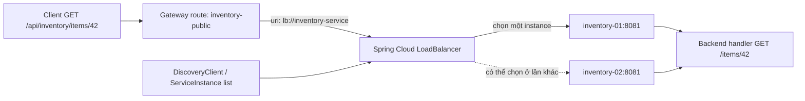
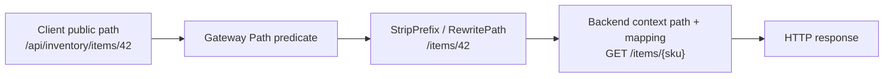
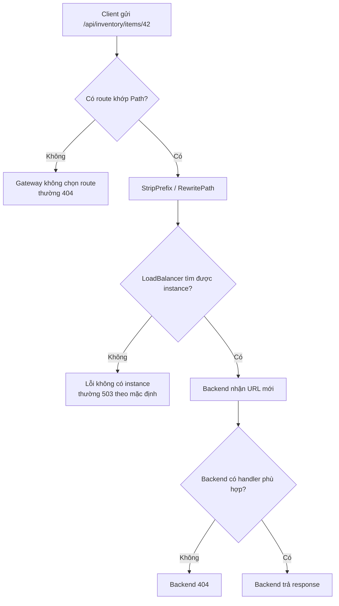

# Định danh dịch vụ, chữ hoa/thường và quy tắc đường dẫn

**Chương:** Khám phá và cân bằng tải  
**Module:** `SPRING_CLOUD_GATEWAY` — Spring Cloud Gateway

Spring Cloud Gateway có thể định tuyến đến một địa chỉ cố định như `http://localhost:8081`, hoặc đến **tên logic của dịch vụ** qua `lb://inventory-service`. Cách thứ hai rất phù hợp với microservices vì IP, cổng và số lượng instance thay đổi theo lúc triển khai. Tuy nhiên, nhiều lỗi “Gateway không tìm thấy dịch vụ” hoặc “đường dẫn trả 404” không nằm ở thuật toán cân bằng tải: chúng xuất phát từ việc nhầm lẫn **tên service trong registry**, **cách viết hoa/thường của tên**, **đường dẫn mà client gọi** và **đường dẫn thực sự đi xuống backend**.

Bài này giải thích cách các thành phần liên hệ với nhau, đặc biệt là tính năng **DiscoveryClient Route Definition Locator** của **Spring Cloud Gateway Server WebFlux**. Bạn sẽ làm hai bài thử: tự khai báo route `lb://...` với public path ổn định, và bật locator tự tạo route từ những service đã khám phá. Sau đó kiểm tra tên, chữ hoa/thường, `Path` predicate và `RewritePath` bằng request thật.

> **Phạm vi phiên bản:** Ví dụ cấu hình chính dùng tên property của Spring Cloud Gateway Server WebFlux ở các release train mới (ví dụ Spring Cloud 2025.0+/Gateway 4.3+ và 5.x). Dòng cũ thường dùng `spring.cloud.gateway.discovery.locator.*` và `spring.cloud.gateway.routes`; dòng mới dùng `spring.cloud.gateway.server.webflux.discovery.locator.*` và `spring.cloud.gateway.server.webflux.routes`. Nếu dùng Gateway Server Web MVC hoặc Proxy Exchange, phải kiểm tra API/cơ chế của biến thể đó, không sao chép cấu hình WebFlux một cách máy móc.

## 1. Mục tiêu học tập

Sau bài này, bạn có thể:

1. Phân biệt **service ID**, **instance ID**, **route ID**, **hostname** và **public API path**.
2. Giải thích `lb://service-id` tìm backend qua Spring Cloud LoadBalancer và một nguồn `ServiceInstance` như thế nào.
3. Mô tả các route mặc định mà DiscoveryClient Locator tạo: `Path=/serviceId/**` và `RewritePath` loại bỏ tiền tố.
4. Hiểu `lower-case-service-id` và lý do các tên viết hoa do Eureka trả về có thể ảnh hưởng URL public.
5. Viết route thủ công ổn định như `/api/inventory/**`, độc lập với dạng chữ trong registry.
6. Phát hiện lỗi từ **sai tên service**, **sai path**, **thiếu instance**, **thiếu dependency**, **sai protocol** hoặc **filter rewrite bị thay thế**.
7. Kết hợp kiến thức này với xác thực, rate limiting, circuit breaker, retry, TLS và quan sát request theo route/service.

## 2. Năm tên không được đánh đồng

Giả sử một hệ thống có dịch vụ Inventory chạy ở hai instance:

| Khái niệm | Ví dụ | Ý nghĩa |
|---|---|---|
| **Service ID** | `inventory-service` | Định danh *nhóm dịch vụ* trong discovery/LoadBalancer |
| **Instance ID** | `inventory-01`, `inventory-02` | Định danh một tiến trình/pod/instance cụ thể |
| **Instance address** | `10.10.2.11:8081`, `10.10.2.12:8081` | Địa chỉ thực sự mà Gateway kết nối sau khi chọn instance |
| **Route ID** | `inventory-public` | Định danh route do Gateway quản lý, dùng cho cấu hình/metric/diagnostics |
| **Public path** | `/api/inventory/items/42` | Giao diện URL mà client biết và sử dụng |

Một hostname như `inventory.default.svc.cluster.local` cũng **không tự động là service ID**. Với `http://inventory.default.svc.cluster.local:8080`, Gateway có thể dựa vào DNS; với `lb://inventory-service`, Gateway dùng cơ chế chọn instance của Spring Cloud LoadBalancer. Hạ tầng cụ thể có thể nối chúng với nhau, nhưng cách phân giải không đồng nhất.



**Điều rất quan trọng:** LoadBalancer chọn **instance**, không quyết định public path. `Path` predicate và `StripPrefix`/`RewritePath` ở Gateway mới quyết định URL nào khớp và path nào được gửi đến backend. Thay đổi service ID không nhất thiết buộc bạn phải thay public API path nếu route thủ công đã tách hai khái niệm.

## 3. `lb://service-id` hoạt động như thế nào?

Một route tĩnh có thể khai báo:

```yaml
spring:
  cloud:
    gateway:
      server:
        webflux:
          routes:
            - id: inventory-public
              uri: lb://inventory-service
              predicates:
                - Path=/api/inventory/**
              filters:
                - StripPrefix=2
```

Với `GET /api/inventory/items/42?expand=stock`:

1. `Path=/api/inventory/**` khớp đường dẫn bên ngoài.
2. `StripPrefix=2` bỏ hai phân đoạn `api` và `inventory`, còn `/items/42`; query string `expand=stock` được giữ nếu không có filter khác thay đổi.
3. Gateway phát hiện URI có scheme `lb` và yêu cầu LoadBalancer chọn một `ServiceInstance` của `inventory-service`.
4. LoadBalancer sử dụng danh sách instance được cung cấp bởi Spring Cloud DiscoveryClient hoặc một nguồn tương thích.
5. Gateway định tuyến HTTP(S) đến host/cổng của instance được chọn; scheme bảo mật thực tế phụ thuộc thông tin instance/configuration.
6. Backend nhận request tại `/items/42` và trả HTTP response cho Gateway chuyển lại client.

**Cần cả hai điều kiện:** có starter `spring-cloud-starter-loadbalancer` và có **nguồn instance thật**. Chỉ thêm starter Gateway, chỉ đặt `spring.application.name` hoặc chỉ viết `lb://...` chưa chắc tìm được dịch vụ.

Với một service không có instance, Gateway Server WebFlux thông thường trả HTTP `503 Service Unavailable` theo cấu hình mặc định; có lựa chọn chuyển trường hợp không tìm được instance thành `404`. Đừng nhầm lỗi này với HTTP `503` do backend cố tình trả về.

### 3.1. Service ID không phải tên người dùng được chọn tùy ý

Service ID trong `lb://...` phải nhất quán với cách nguồn discovery công bố dịch vụ. Không dựa vào tên artifact Maven, tên container, package Java hoặc chuỗi trên dashboard để tự đoán. Hãy kiểm tra ID mà DiscoveryClient/registry thực sự cung cấp và danh sách instance tương ứng.

Đối với Eureka, tên ứng dụng có thể được registry trình bày/chuẩn hóa thành dạng chữ hoa. Đối với Consul, Kubernetes hoặc SimpleDiscoveryClient, quy ước đặt tên có thể khác. **Không giả định mọi registry xử lý service ID giống tên DNS không phân biệt hoa/thường.**

### 3.2. Route thủ công khác route tự sinh

Hai cách sau đều có thể dùng LoadBalancer, nhưng **khác cách định nghĩa route**:

| Tiêu chí | Route thủ công `lb://...` | DiscoveryClient Locator |
|---|---|---|
| Ai định nghĩa route? | Lập trình viên trong YAML/Java DSL | Gateway tạo từ danh sách service discovery |
| Public path | Bạn tự quyết: `/api/inventory/**` | Mặc định `/serviceId/**` |
| Bộ lọc path | Bạn tự khai báo, ví dụ `StripPrefix=2` | Mặc định có `RewritePath` để bỏ segment service ID |
| Thêm service mới | Không tự sinh route thủ công | Có thể xuất hiện route mới khi locator nhận diện service |
| Kiểm soát mặt API public | Rõ ràng hơn vì route được duyệt | Cần giới hạn service nào được expose |
| Phụ thuộc LoadBalancer | Có khi `uri` là `lb://...` | Mặc định URI locator là `lb://serviceId` |

Bật DiscoveryClient Locator **không phải điều kiện bắt buộc** để một route thủ công `lb://...` hoạt động.

## 4. DiscoveryClient Locator sinh đường dẫn mặc định thế nào?

Theo tài liệu Gateway Server WebFlux, với một service ID được discovery trả về là `inventory-service`, locator mặc định tạo logic tương đương:

```yaml
# Sơ đồ minh họa route tự tạo, KHÔNG phải file cần khai báo thủ công.
- id: <discovery-prefix>inventory-service
  uri: lb://inventory-service
  predicates:
    - Path=/inventory-service/**
  filters:
    - RewritePath=/inventory-service/?(?<remaining>.*), /${remaining}
```

Mục đích `RewritePath` là **loại tiền tố tên service** khỏi request trước khi chuyển cho backend. Ví dụ:

```text
Client gọi Gateway:
  GET /inventory-service/items/42?expand=stock

Path predicate:
  /inventory-service/** -> khớp

Default RewritePath:
  /inventory-service/items/42 -> /items/42

Backend nhận:
  GET /items/42?expand=stock
```

Nếu service trong registry là `INVENTORY-SERVICE` và không bật chuẩn hóa path, route locator có thể dùng tiền tố `/INVENTORY-SERVICE/**`. Khi đó request `/inventory-service/items/42` có thể **không khớp** vì đường dẫn phân biệt hoa/thường trong cấu hình thông thường. Đây là lỗi lựa chọn route, không phải lỗi LoadBalancer không tìm được instance.

### 4.1. Default path và default filter gắn thành một cặp

Để `/serviceId/items/42` đi đến backend `/items/42`, cần có **cả predicate** và **rewrite tương ứng**. Nếu chỉ giữ `Path=/inventory-service/**` mà bỏ `RewritePath`, backend có thể nhận nguyên `/inventory-service/items/42` rồi trả `404` vì handler chỉ đăng ký `/items/42`.

Ngược lại, nếu filter bỏ sai số phân đoạn, request có thể đến `/service/items/42` hoặc `/42`. Không kết luận “discovery lỗi” khi thực tế instance đã được chọn và request đã đến backend nhưng sai URL.

### 4.2. Vì sao `RewritePath` khác `StripPrefix`?

| Filter | Ví dụ | Đặc điểm |
|---|---|---|
| `StripPrefix=2` | `/api/inventory/items/42` → `/items/42` | Bỏ số segment xác định |
| `StripPrefix=1` | `/inventory-service/items/42` → `/items/42` | Dễ dùng trên route thủ công với một prefix |
| `RewritePath` | Regex bỏ `/serviceId` → `/items/42` | Linh hoạt theo mẫu path; locator dùng để tạo rewrite theo service ID |

Locator mặc định dùng `RewritePath` có regex nhóm tên `remaining`. Việc sử dụng `StripPrefix=1` trên một **route thủ công** có thể cho kết quả giống nhau với path đơn giản, nhưng không nên thay bộ lọc locator mặc định mà không kiểm tra toàn bộ trường hợp (trailing slash, segment rỗng, encoded path, version Gateway).

### 4.3. Khi nào HTTP 404 xuất hiện?

| Tình huống | Lỗi ở đâu? | Hướng kiểm tra |
|---|---|---|
| `Path` không khớp vì sai chữ hoa/thường | Gateway chưa chọn route | Xem route predicate và URL client |
| Path khớp, RewritePath sai | Backend nhận URL sai và có thể trả 404 | Xem `requestUri` tại backend |
| Path đúng, backend không có handler | Backend | Kiểm tra `@GetMapping`/`@RequestMapping` |
| `lb://...` không tìm được instance | LoadBalancer/discovery | Kiểm tra registry; thường 503 theo mặc định |
| Có route khác khớp trước | Thứ tự/độ ưu tiên route | Xem route ID thực được chọn và cấu hình order |

Không gộp mọi 404 thành “không có service”: response Gateway khi không route, response backend sau rewrite và cấu hình LoadBalancer trả 404 là **ba trường hợp khác nhau**.

## 5. Chữ hoa/thường: service ID, public path và tên DNS

Sự giống nhau về kiểu chữ dễ đánh lừa người mới học:

| Đối tượng | Cách xử lý hoa/thường cần nhớ |
|---|---|
| **HTTP header name** | Theo chuẩn HTTP là không phân biệt hoa/thường — **không liên quan** đến service ID |
| **DNS hostname** | Tra cứu tên DNS nhìn chung không phân biệt hoa/thường |
| **URL path** | Thường được xử lý phân biệt hoa/thường; đừng giả định `/Orders` giống `/orders` |
| **Service ID trong registry** | Chuỗi logic theo quy ước từng registry/DiscoveryClient; có thể được chuẩn hóa hoa/thường |
| **Route ID** | Nhãn định danh route do Gateway quản lý, không phải phép so khớp DNS |
| **Instance ID** | Tên một instance cụ thể; không phải path segment tự động của locator |

Ví dụ:

```text
Registry trả về:   INVENTORY-SERVICE
Client gọi:        /inventory-service/items/42
URI mong muốn:     lb://INVENTORY-SERVICE
Backend endpoint:  GET /items/42
```

Nếu `lower-case-service-id=false`, locator sử dụng tên theo registry trong pattern/filter mặc định; request dùng chữ thường có thể bị loại bởi `Path`. Nếu bật tùy chọn lower-case cho locator, public path có thể dùng chữ thường trong khi bước chọn instance vẫn phải truy vấn tên logic mà discovery đã đăng ký.

**Không chữa bằng cách đổi URI thành `lb://inventory-service` một cách mù quáng** khi registry thật sự xuất `INVENTORY-SERVICE`. Hãy xác nhận tên lookup mà LoadBalancer hỗ trợ và thay đổi đúng lớp: public path, registry name hoặc mapping giữa chúng.

## 6. `lower-case-service-id` giải quyết vấn đề gì?

Trong **Gateway Server WebFlux** hiện đại, cấu hình:

```yaml
spring:
  cloud:
    gateway:
      server:
        webflux:
          discovery:
            locator:
              enabled: true
              lower-case-service-id: true
```

Tài liệu cấu hình Spring Cloud Gateway ghi nhận:

- Mặc định `lower-case-service-id` là `false`.
- Khi bật `true`, locator sử dụng dạng chữ thường của service ID trong các **predicate/filter do locator tạo**.
- Tình huống đặc biệt hữu ích là Eureka công bố `MYSERVICE` nhưng bạn muốn route public `/myservice/**`.

Ví dụ minh họa:

| DiscoveryClient trả về | `lower-case-service-id` | Path mặc định phía client |
|---|---|---|
| `inventory-service` | `false` | `/inventory-service/**` |
| `inventory-service` | `true` | `/inventory-service/**` |
| `INVENTORY-SERVICE` | `false` | `/INVENTORY-SERVICE/**` |
| `INVENTORY-SERVICE` | `true` | `/inventory-service/**` |

**Giới hạn của thuộc tính:** nó không “đổi tên” service trong Eureka, không bắt mọi client khác dùng chữ thường, không tự sửa tên container/DNS, và không có nghĩa các lookup của mọi LoadBalancer bỗng không phân biệt hoa/thường. Theo cấu hình mặc định, `url-expression` của locator vẫn tạo `'lb://' + serviceId` từ tên discovery; chính vì vậy cần tách **chuẩn hóa public path** khỏi **identity dùng để chọn instance**.

### 6.1. Cách đặt tên bền vững hơn

Nếu kiểm soát được hệ thống từ đầu, nên:

1. Đặt một convention ổn định cho service ID, chẳng hạn chữ thường + dấu gạch nối (`inventory-service`, `order-service`).
2. Xác định cách từng registry phản ánh hoặc chuẩn hóa convention đó.
3. Không thay đổi service ID tùy tiện giữa môi trường dev/staging/prod.
4. Tách public API path thành một hợp đồng riêng (`/api/inventory/**`), tránh buộc mobile/web clients phụ thuộc tên registry.
5. Dùng route thủ công nếu cần domain API đẹp, đường dẫn versioned, hoặc chỉ muốn expose một tập service được phê duyệt.

`lower-case-service-id` là **công cụ tương thích**, không thay thế được quy ước đặt tên và quản trị route.

## 7. Thực hành từ đầu: dựng Inventory Backend

Ta sẽ tạo một backend HTTP có endpoint `GET /items/{sku}`. Response chứa **instance ID** và **đường dẫn thực nhận**, nhờ vậy có thể xác nhận vừa chọn đúng instance vừa rewrite đúng URL.

### 7.1. Tạo dự án Spring Boot

Từ [Spring Initializr](https://start.spring.io/), tạo dự án Maven, Java, package `com.example.inventory`, có dependency **Spring Web**. Đối với Spring Boot 3.x, Java 17+ phù hợp. Với Spring Boot 4.x, chọn đúng tên starter mà Initializr sinh ra thay vì sao chép tên từ phiên bản khác.

`src/main/resources/application.yml` của backend:

```yaml
spring:
  application:
    name: inventory-service

server:
  port: 8081

lab:
  instance-id: blue
```

Lớp khởi động `InventoryApplication.java`:

```java
package com.example.inventory;

import org.springframework.boot.SpringApplication;
import org.springframework.boot.autoconfigure.SpringBootApplication;

@SpringBootApplication
public class InventoryApplication {
    public static void main(String[] args) {
        SpringApplication.run(InventoryApplication.class, args);
    }
}
```

Controller `InventoryController.java` trong cùng package:

```java
package com.example.inventory;

import jakarta.servlet.http.HttpServletRequest;
import java.util.LinkedHashMap;
import java.util.Map;
import org.springframework.beans.factory.annotation.Value;
import org.springframework.web.bind.annotation.GetMapping;
import org.springframework.web.bind.annotation.PathVariable;
import org.springframework.web.bind.annotation.RestController;

@RestController
public class InventoryController {

    @Value("${lab.instance-id:blue}")
    private String instanceId;

    @GetMapping("/items/{sku}")
    public Map<String, Object> item(
            @PathVariable String sku,
            HttpServletRequest request) {
        Map<String, Object> result = new LinkedHashMap<>();
        result.put("service", "inventory-service");
        result.put("instance", instanceId);
        result.put("sku", sku);
        result.put("method", request.getMethod());
        result.put("path", request.getRequestURI());
        result.put("query", request.getQueryString());
        return result;
    }
}
```

**Lưu ý:** `spring.application.name` giúp đặt tên ứng dụng nhưng **không tự đăng ký instance vào một service registry**. Trong lab, Gateway sẽ biết instance nhờ cấu hình `SimpleDiscoveryClient` riêng.

### 7.2. Chạy backend và kiểm tra trực tiếp

Trong thư mục dự án backend:

```bash
./mvnw spring-boot:run
```

Mở terminal khác:

```bash
curl -i "http://localhost:8081/items/SKU-42?include=stock"
```

Body JSON rút gọn mong đợi:

```json
{
  "service": "inventory-service",
  "instance": "blue",
  "sku": "SKU-42",
  "method": "GET",
  "path": "/items/SKU-42",
  "query": "include=stock"
}
```

Nếu backend trả `404` khi gọi trực tiếp, cần sửa controller/mapping trước khi kiểm thử Gateway. Nếu cổng `8081` bị chiếm, thay cổng một cách **đồng bộ** ở backend và danh sách instances phía Gateway.

### 7.3. Thêm instance thứ hai để quan sát load balancing

Có thể chạy cùng ứng dụng trong terminal khác với cổng và instance ID khác:

**Bash (Linux/macOS):**

```bash
SERVER_PORT=8082 LAB_INSTANCE_ID=green ./mvnw spring-boot:run
```

**PowerShell (chỉ áp dụng trong terminal thứ hai):**

```powershell
$env:SERVER_PORT = "8082"
$env:LAB_INSTANCE_ID = "green"
.\mvnw.cmd spring-boot:run
```

Kiểm tra `curl -i http://localhost:8082/items/SKU-42` trả `"instance":"green"`. Đảm bảo hai instance thực sự chạy song song trên `8081` và `8082`; nếu thiếu một instance mà vẫn đưa địa chỉ đó vào cấu hình tĩnh, LoadBalancer có thể chọn instance không hoạt động và dẫn tới lỗi kết nối.

## 8. Dựng Gateway với route thủ công và Discovery Locator

Tạo một ứng dụng Spring Boot **Gateway Server WebFlux** riêng, ví dụ package `com.example.gateway`, sử dụng Spring Boot và Spring Cloud BOM tương thích. Với Spring Cloud release train hiện đại, thêm các dependency:

```xml
<dependencies>
    <dependency>
        <groupId>org.springframework.cloud</groupId>
        <artifactId>spring-cloud-starter-gateway-server-webflux</artifactId>
    </dependency>
    <dependency>
        <groupId>org.springframework.cloud</groupId>
        <artifactId>spring-cloud-starter-loadbalancer</artifactId>
    </dependency>
</dependencies>
```

`SimpleDiscoveryClient` có thể cung cấp các instance tĩnh từ properties khi không sử dụng một registry bên ngoài. Cách này phù hợp để học, không phải giải pháp tự động khám phá service khi pod/instance tăng giảm.

### 8.1. `application.yml` của ứng dụng Gateway

```yaml
server:
  port: 8080

spring:
  application:
    name: inventory-gateway-lab
  cloud:
    discovery:
      client:
        simple:
          instances:
            inventory-service:
              - uri: http://localhost:8081
              - uri: http://localhost:8082
    gateway:
      server:
        webflux:
          discovery:
            locator:
              enabled: true
              lower-case-service-id: true
          routes:
            - id: inventory-public
              uri: lb://inventory-service
              predicates:
                - Path=/api/inventory/**
              filters:
                - StripPrefix=2
                - AddRequestHeader=X-Lab-Route, inventory-public
```

Trong file này có **hai nguồn route**:

1. **Route thủ công `inventory-public`:** public path là `/api/inventory/**`. Gateway dùng `lb://inventory-service` để chọn instance; `StripPrefix=2` bỏ `api/inventory`.
2. **Route Discovery Locator tự sinh:** service `inventory-service` xuất hiện trong danh sách discovery, nên locator có thể tạo thêm route cho `/inventory-service/**` và tự thêm filter bỏ tiền tố `inventory-service`.

Hai public path **khác nhau**, do đó trong lab chúng không cạnh tranh trên cùng request. Việc bật `lower-case-service-id: true` ở đây không gây thay đổi rõ rệt vì service ID tĩnh đã được đặt là chữ thường. Để quan sát ý nghĩa của tùy chọn trong tình huống Eureka trả ID chữ hoa, xem phần 10.

### 8.2. Chạy Gateway và thử hai kiểu URL

Khởi động Gateway ở `8080`, trong khi cả hai backend instance `8081`/`8082` vẫn hoạt động. Từ terminal khác:

```bash
# 1) Route thủ công với public path do nhóm API quyết định.
curl -i "http://localhost:8080/api/inventory/items/SKU-42?include=stock"

# 2) Route tự sinh theo service ID từ DiscoveryClient.
curl -i "http://localhost:8080/inventory-service/items/SKU-42?include=stock"
```

Kết quả kỳ vọng ở cả hai lệnh: HTTP response từ backend có `"path":"/items/SKU-42"` và `"sku":"SKU-42"`. Trường `"instance"` sẽ là `blue` hoặc `green` tùy instance đã chọn. Query `include=stock` được giữ nếu không có filter nào khác sửa query.

| URL bên ngoài | Nguồn route | Filter path | URL backend nhận |
|---|---|---|---|
| `/api/inventory/items/SKU-42` | Thủ công | `StripPrefix=2` | `/items/SKU-42` |
| `/inventory-service/items/SKU-42` | Locator tự sinh | Default `RewritePath` | `/items/SKU-42` |

Chạy lặp mỗi lệnh để quan sát LoadBalancer có thể chọn nhiều instance:

```bash
curl -s http://localhost:8080/api/inventory/items/SKU-42
curl -s http://localhost:8080/api/inventory/items/SKU-42
curl -s http://localhost:8080/api/inventory/items/SKU-42
curl -s http://localhost:8080/api/inventory/items/SKU-42
```

**Không khẳng định cứ hai request phải luân phiên blue/green tuyệt đối.** Thuật toán/chính sách LoadBalancer, cache instance, số instance thực hoạt động và các thành phần mạng đều có thể ảnh hưởng kết quả. Mục tiêu là xác nhận Gateway có thể dùng đúng một trong các instance công bố bởi nguồn discovery, chứ không áp một chu kỳ cố định vào mọi phiên bản/hạ tầng.

**Nếu không có cả hai backend:** bạn có thể chỉ khai báo một instance `8081` rồi thực hiện bài lab một-instance trước; khi đó chưa kiểm tra được phân phối tải giữa nhiều instance. Đừng để `8082` trong danh sách nếu tiến trình ở cổng ấy chưa chạy.

### 8.3. Vì sao route thủ công hữu ích?

Nếu sau này registry đổi từ `inventory-service` thành `INVENTORY-SERVICE`, hoặc hệ thống chuyển từ Eureka sang Kubernetes, bạn có thể điều chỉnh mapping đích ở Gateway mà giữ public API `/api/inventory/**` ổn định, miễn cách lookup service phù hợp và backend còn hỗ trợ `/items/**`.

Ngược lại, khi dùng locator mặc định, tên service có thể xuất hiện trực tiếp trong public URL. Điều này thuận tiện cho môi trường nội bộ, nhưng không nên mặc định coi tất cả route tự sinh là giao diện public an toàn.

## 9. So sánh trực tiếp: viết hoa ID không đồng nghĩa viết hoa path

Xét một ứng dụng đăng ký vào Eureka với service ID được Gateway nhìn thấy là `INVENTORY-SERVICE`. Đường đi mặc định thay đổi theo tùy chọn:

```text
DiscoveryClient trả về:
    serviceId = INVENTORY-SERVICE

Nếu lower-case-service-id = false:
    Client path mặc định: /INVENTORY-SERVICE/items/SKU-42
    Downstream path:      /items/SKU-42
    Default route URI:    lb://INVENTORY-SERVICE

Nếu lower-case-service-id = true:
    Client path mặc định: /inventory-service/items/SKU-42
    Downstream path:      /items/SKU-42
    Default route URI:    lb://INVENTORY-SERVICE
```

Điểm cần nhìn: **public path được chuẩn hóa**, trong khi **ID gốc để tìm instance vẫn cần tương thích với registry**. Property lower-case của locator không nhằm sửa chữ hoa/thường của mọi URI `lb://...` do lập trình viên khai báo thủ công.

### 9.1. Thí nghiệm logic route với URL viết khác kiểu chữ

Giả sử locator sinh `Path=/inventory-service/**`, thử:

```bash
# Đường dẫn đúng mẫu (chữ thường).
curl -i http://localhost:8080/inventory-service/items/SKU-42

# Đường dẫn cố ý viết hoa một phần.
curl -i http://localhost:8080/Inventory-Service/items/SKU-42

# Đường dẫn có thêm tiền tố không thuộc route locator.
curl -i http://localhost:8080/api/inventory-service/items/SKU-42
```

Với đường dẫn `Path` phân biệt hoa/thường theo cấu hình thông thường, hai lệnh cuối không khớp **route locator mặc định** và thường nhận `404` nếu không có route khác. Đừng dùng thử nghiệm này để kết luận registry không trả instance: quá trình chọn route đã loại request trước khi LoadBalancer được gọi.

Nếu muốn public route luôn là `/api/inventory/**`, không nên bắt client đoán tên service theo registry; hãy định nghĩa route thủ công như phần 8.

## 10. Tùy chỉnh Discovery Locator mà không làm mất default path rewrite

Locator cho phép tùy chỉnh các route mà nó tự sinh bằng những nhóm thuộc tính như:

- `discovery.locator.enabled` — bật/tắt route discovery tự động;
- `discovery.locator.lower-case-service-id` — chuẩn hóa phần service ID xuất hiện trong predicate/filter mặc định;
- `discovery.locator.include-expression` — quyết định service nào được đưa vào tập route locator;
- `discovery.locator.route-id-prefix` — tiền tố của route ID được sinh;
- `discovery.locator.url-expression` — biểu thức tạo URI, mặc định là `'lb://' + serviceId`;
- `discovery.locator.predicates` / `discovery.locator.filters` — định nghĩa các predicate/filter cho route tự sinh.

Các thuộc tính trên nằm dưới `spring.cloud.gateway.server.webflux` với phiên bản minh họa. **Đọc đúng bảng Configuration Properties của phiên bản đang chạy**, vì tài liệu trang con hoặc ví dụ cũ có thể dùng prefix `spring.cloud.gateway.discovery.locator`.

### 10.1. Dùng allowlist để không tự công khai mọi service

Mặc định `include-expression` có giá trị tương đương `true`: những service phù hợp trong discovery có thể trở thành route tự sinh. Nếu Gateway là điểm vào công khai, điều này có thể vô tình đưa cả service quản trị hoặc backend nội bộ ra ngoài.

Trong lab chỉ có `inventory-service`, thử cấu hình giới hạn:

```yaml
spring:
  cloud:
    gateway:
      server:
        webflux:
          discovery:
            locator:
              enabled: true
              lower-case-service-id: true
              include-expression: "serviceId == 'inventory-service'"
```

Biểu thức `include-expression` kiểm tra ID do DiscoveryClient trả về; ví dụ trên chỉ phù hợp khi nguồn discovery thực sự cung cấp `inventory-service` chữ thường. Nếu Eureka trả `INVENTORY-SERVICE`, biểu thức so sánh **chính xác như trên** có thể loại bỏ service, dù `lower-case-service-id=true`. Tùy chọn lower-case phục vụ path/filter không phải phép biến đổi toàn bộ biến `serviceId` trong mọi biểu thức custom.

Trong production, cần review chính sách `include-expression` cùng Spring Security, chính sách network, route ownership và những API được phép công khai. Một allowlist locator là **một lớp giảm rủi ro**, không thay thế xác thực/ủy quyền.

### 10.2. Tại sao thêm filter custom có thể tạo 404?

Giả sử bạn muốn mọi route locator gắn header `X-Route-Source`. Nếu cấu hình:

```yaml
# KHÔNG PHẢI mẫu hoàn chỉnh; cố ý minh họa lỗi mất default rewrite.
spring:
  cloud:
    gateway:
      server:
        webflux:
          discovery:
            locator:
              enabled: true
              filters:
                - name: AddRequestHeader
                  args:
                    name: X-Route-Source
                    value: discovery-locator
```

Khi **tự đặt danh sách `locator.filters`**, danh sách mặc định của locator bị thay thế; đừng nghĩ filter `RewritePath` vẫn luôn tự hiện diện. Kết quả có thể là:

```text
Client:         GET /inventory-service/items/42
Route khớp:     Path=/inventory-service/**
Filter còn lại: AddRequestHeader
Backend nhận:   GET /inventory-service/items/42
Backend muốn:   GET /items/42
Kết quả:        404 tại backend, dù LoadBalancer đã tìm được instance.
```

**Cách giải quyết:** nếu muốn giữ hành vi mặc định, phải khai báo lại cả `RewritePath` trong danh sách custom filters, tương ứng với dạng service ID đang dùng. Khi tùy chỉnh `locator.predicates`, cũng phải khai báo lại `Path` nếu vẫn muốn giới hạn route theo `/serviceId/**`. Đây là điều được tài liệu Gateway cảnh báo rõ.

Sơ đồ logic cần duy trì:

```text
discovery.locator.predicates
  - Path: "/<serviceId>/**"
  - (tùy chọn) Host / Method / Header theo chính sách

discovery.locator.filters
  - RewritePath: "/<serviceId>/?(?<remaining>.*)" -> "/\${remaining}"
  - (tùy chọn) AddRequestHeader / CircuitBreaker / ...
```

Đoạn trên **là sơ đồ**, không phải YAML copy-paste: Spring sử dụng biểu thức SpEL để tạo regex theo từng service ID, còn trong `application.yml` ký hiệu `${remaining}` của replacement thường cần escape theo hướng dẫn phiên bản. Không được nhập nguyên `<serviceId>` vào config và mong framework tự hiểu đây là biến.

Nếu chỉ cần một vài route với chính sách đặc thù, giải pháp dễ kiểm soát hơn có thể là **route thủ công** kết hợp `Path` và `StripPrefix` hoặc `RewritePath` tĩnh. Cách này tránh sửa bộ template chung của mọi service.

### 10.3. Tránh trùng path khi dùng đồng thời route tự sinh và route thủ công

Giả sử bạn vừa tạo:

- Route tự sinh `Path=/inventory-service/**`;
- Route thủ công cũng `Path=/inventory-service/**` nhưng có filter xác thực riêng.

Khi nhiều route cùng khớp, route được chọn phụ thuộc thứ tự ưu tiên và tập route thực tế. Không mặc định “route thủ công luôn thắng” hoặc “route discovery luôn thắng”. Đặc biệt nguy hiểm khi route được chọn lại thiếu filter auth/rate limiting mong muốn.

Trong lab, ta cố ý dùng **hai prefix khác nhau** để tránh xung đột. Trong triển khai thật, cần quản lý route ID, thứ tự route và chính sách bảo mật ở tất cả đường đi có thể khớp.

## 11. Quy tắc đường dẫn cần giữ nhất quán qua các tầng

Có ít nhất bốn lớp “đường dẫn”:



### 11.1. Path có phân biệt hoa/thường

HTTP path nhìn chung không được xử lý như hostname DNS. Trong route `Path=/inventory-service/**`, request `/Inventory-Service/items/42` không nên được xem là tương đương nếu không có cấu hình so khớp đặc biệt. Sự khác biệt này tách biệt với:

- Tên service trong registry có viết hoa hay không;
- Hostname backend có chữ hoa hay không;
- Query parameter như `?sort=asc`;
- HTTP header names, vốn không phân biệt hoa/thường theo chuẩn HTTP.

### 11.2. Prefix, context path và đường dẫn của backend

Giả sử backend được cấu hình thêm context path `/inventory` và controller mapping `/items/{sku}`. Khi đó URL backend thực có thể là `/inventory/items/42`. Nếu Gateway strip prefix để chỉ còn `/items/42`, backend có thể trả 404 dù discovery đúng. Cần thống nhất hợp đồng đường dẫn hoặc thêm phép rewrite/prefix thích hợp.

Không tự động giả định service ID (`inventory-service`) trùng context path (`/inventory`) hay API base path (`/api/v1/inventory`). Ba chuỗi này là những quyết định kiến trúc khác nhau.

### 11.3. Trailing slash, path encoding và nhiều proxy

Các đường dẫn `/inventory-service`, `/inventory-service/`, `/inventory-service/items/42`, hoặc path có ký tự percent-encoded có thể kích hoạt hành vi khác nhau tùy `Path` predicate, rewrite regex, HTTP server và phiên bản framework.

Khi debug:

1. Ghi nhận **path client thực gửi** (không chỉ nội dung URL đã được công cụ tự chuẩn hóa);
2. Xem route predicate có khớp không;
3. Quan sát **path backend thực nhận**;
4. Kiểm tra đường dẫn controller/backend context path;
5. Không cho phép nhiều tầng decode hoặc normalize path bất nhất tạo cách đi vòng quy tắc xác thực.

Không tùy tiện biến đổi path bằng cách ghép chuỗi với dữ liệu client không kiểm soát. Nếu cần rewrite, dùng filter chính thức và kiểm thử các path có dấu slash, encoded characters hoặc segment bất thường trong môi trường cô lập.

### 11.4. URL public không nên phụ thuộc tên registry

Tên `inventory-service` có thể thay đổi do tổ chức, framework discovery hoặc chuẩn hóa chữ hoa/thường; client bên ngoài không nên phải đổi URL mỗi khi hạ tầng đổi tên service. Thiết kế bền vững hơn:

```text
Public API:  /api/v1/inventory/items/42
Gateway:     Path=/api/v1/inventory/**
Filter:      StripPrefix=3
Downstream:  lb://inventory-service
Backend:     GET /items/42
```

Với `/api/v1/inventory/items/42`, ba segment đầu là `api`, `v1`, `inventory`; `StripPrefix=3` còn `/items/42`. Đây là ví dụ **route thủ công**, không phải đường dẫn locator mặc định.

## 12. Chẩn đoán 404 và 503 theo đúng tầng

Khi một request thất bại, cần xác định nó dừng ở bước nào:



| Triệu chứng | Giả thuyết ưu tiên | Phép kiểm tra |
|---|---|---|
| `/inventory-service/**` khớp nhưng `/Inventory-Service/**` 404 | Khác chữ hoa/thường ở `Path` predicate | Kiểm tra route locator và `lower-case-service-id` |
| `/inventory-service/items/42` 404, backend không có log | Route không khớp hoặc Gateway không load locator | Xem route definitions, prefix cấu hình, `DiscoveryClient.getServices` |
| Backend ghi `/inventory-service/items/42` rồi trả 404 | Filter mặc định bị thay hoặc không rewrite | Kiểm tra `locator.filters` có `RewritePath` không |
| Backend ghi `/items/42` rồi trả 404 | Backend không có mapping hoặc context path khác | Gọi trực tiếp backend cùng path |
| `lb://inventory-service` trả 503 nhưng backend direct được | LoadBalancer không có instance hợp lệ cho đúng service ID | Kiểm tra dependency, instance list và tên lookup |
| Lúc được lúc lỗi kết nối | Một instance trong danh sách không hoạt động hoặc sai cổng | Gọi từng `uri` instance, xem ID instance đã chọn |
| `lb://...` chuyển sang HTTPS ngoài dự kiến | Registry đánh dấu instance secure hoặc cấu hình scheme khác | Kiểm tra `ServiceInstance`, cờ secure, TLS trust |
| Gateway trả lỗi khi backend chưa phục vụ | TCP connect refused, DNS, firewall, sai port | Kiểm tra network từ môi trường Gateway đến backend |
| Locator không tạo bất kỳ route nào | `enabled` sai prefix/false, DiscoveryClient không có services, `include-expression` lọc hết | Kiểm tra version, DiscoveryClient và expression |
| Backend phản hồi 503 có body ứng dụng | Dịch vụ thực sự trả 503 | So sánh direct backend response với response qua Gateway |
| Route thủ công đúng nhưng tự sinh không đúng | Đường public path và filter defaults khác nhau | Đối chiếu `Path` và `RewritePath` từng route |
| Thêm custom filter, path backend đổi | Danh sách filters locator thay thế default | Khôi phục `RewritePath` hoặc dùng route thủ công |

### 12.1. Phân biệt mã 404 do LoadBalancer và 404 do không có route

Ở Server WebFlux hiện đại có cấu hình kiểu:

```yaml
spring:
  cloud:
    gateway:
      server:
        webflux:
          loadbalancer:
            use404: true
```

Nếu bật tùy chọn này, **trường hợp LoadBalancer không tìm được instance** có thể trả 404 thay vì 503 như mặc định. Do đó, không thể chỉ nhìn vào mã HTTP để quyết định “route không tồn tại”; cần xem log/correlation ID và kiểm tra service instances.

Khi debugging production, hãy ưu tiên route ID, service ID, instance ID và nguyên nhân lỗi có thể đo đạc được; tránh ghi nguyên URL có token/query nhạy cảm vào log.

### 12.2. Tại sao `spring.application.name` đúng mà discovery vẫn rỗng?

`spring.application.name: inventory-service` chỉ đặt tên cho ứng dụng. Với Eureka/Consul/Kubernetes discovery, cần có client và cấu hình đăng ký/tra cứu hoặc hạ tầng service discovery tương ứng. Với lab `SimpleDiscoveryClient`, phải khai báo instance URIs trong cấu hình của **Gateway**; thay đổi cổng backend mà quên cập nhật danh sách sẽ dẫn đến kết nối thất bại.

Điểm kiểm tra chính:

1. Gateway có load balancer dependency hợp lệ không?
2. Nguồn discovery có thực sự trả `inventory-service` không?
3. Có ít nhất một `ServiceInstance` với host, port và scheme hợp lệ không?
4. Instance đó đang phục vụ đúng endpoint/path không?
5. Network namespace của Gateway có truy cập được tới địa chỉ ấy không?

Trong Docker Compose hoặc Kubernetes, `localhost` là namespace của container/pod đang gọi. Nếu Gateway và backend chạy ở hai container, `http://localhost:8081` của Gateway không tự trỏ tới backend. Dùng địa chỉ/DNS service hợp lệ và kiểm tra network policy.

## 13. Bảo mật khi expose service qua locator

Tự động tạo route từ registry có thể giúp phát triển nhanh nhưng cũng làm tăng **bề mặt API**. Nếu registry chứa `admin-service` hoặc `billing-internal`, việc bật locator không kiểm soát có thể đưa đường dẫn `/admin-service/**` hoặc `/billing-internal/**` vào Gateway, tùy chính sách route và security.

Thiết kế an toàn nên có các tầng:

1. **Allowlist service hoặc route public rõ ràng:** `include-expression` hoặc route thủ công; review khi có service mới được đăng ký.
2. **Spring Security và authorization:** quyết định client nào được phép gọi từng route. Tên path hay service ID không chứng minh quyền truy cập.
3. **Mạng tin cậy:** backend chỉ nên chấp nhận kết nối từ các thành phần được cho phép; tránh truy cập bypass Gateway.
4. **Header và định danh:** không tin `X-User`, `X-Role` hoặc `X-Forwarded-For` do client tự khai; nếu cần forward identity, phải xác minh và đặt lại theo trust boundary.
5. **Rate limiting / request limits:** không tự được bật khi dùng `lb://`; cấu hình theo key và tài nguyên phù hợp.
6. **TLS ở từng chặng:** HTTPS client → Gateway và HTTPS/mTLS Gateway → backend là hai kết nối khác nhau, cần hostname/certificate/trust riêng.
7. **Quan sát và bảo vệ thông tin:** không ghi credentials, payload nhạy cảm hoặc URL query bí mật vào logs/metrics.

### 13.1. Thay tên service không phải cơ chế phân quyền

Ẩn service `admin-service` phía sau một path khó đoán không làm nó an toàn. Một route `lb://admin-service` vẫn có thể truy cập được nếu predicate và security cho phép. Vì vậy, các policy xác thực/ủy quyền cần đặt tại đúng lớp, không phụ thuộc cách viết chữ của tên service.

### 13.2. Retry và circuit breaker không sửa lỗi path

`Retry` có thể thử lại request lỗi, `CircuitBreaker` có thể ngăn lan truyền lỗi từ backend, nhưng **không sửa được** `StripPrefix`/`RewritePath` đang gửi URL sai. Retry một 404 do path sai chỉ tăng tải và làm lỗi khó quan sát. Với POST hoặc request có body, retry còn có thể cần cache payload và tạo side effect lặp; hãy thiết kế idempotency, timeout và tiêu chí retry trước khi bật.

Đối với `lb://` nhiều instance, circuit breaker và health check cũng cần được hiểu theo **đơn vị bảo vệ**: một service ID có thể chứa instance khỏe và instance lỗi. Không giả định chỉ thay `uri` thành `lb://` sẽ tự bật health checks/circuit breakers hoặc loại bỏ mọi instance không khỏe.

## 14. Quan sát route, service và instance trong vận hành

Một HTTP response thành công từ Gateway chỉ chứng minh request đã đến một nơi xử lý, chưa đủ khẳng định LoadBalancer phân phối đúng. Nên đo:

| Tín hiệu | Vì sao hữu ích? |
|---|---|
| **Route ID** | Phân biệt route thủ công với route locator tự sinh |
| **Service ID** | Biết nhóm dịch vụ mà `lb://` tìm kiếm |
| **Instance ID/host/port đã chọn** | Biết request được gửi đến instance nào |
| **Path trước và sau rewrite** | Phân biệt lỗi predicate và lỗi mapping backend |
| HTTP status/latency từng chặng | Biết lỗi ở Gateway, LoadBalancer hay backend |
| Số instance khả dụng theo service | Phát hiện registry rỗng hoặc thay đổi cấu hình |
| Lỗi SSL/TLS và connect timeout | Phân biệt lỗi giao thức/đường truyền với lỗi path |
| Retry, circuit breaker, rate-limit outcomes | Hiểu chi phí và chính sách của từng route |

Spring Boot Actuator và các cơ chế Gateway metrics/tracing có thể hỗ trợ quan sát, nhưng cách bật endpoint/metric thay đổi theo phiên bản. Nếu sử dụng route management actuator, chỉ mở endpoint cần thiết, bảo vệ quyền truy cập và tránh công bố URI/route configurations nhạy cảm.

**Tránh metric label có cardinality cao** như raw URL chứa SKU/user ID, giá trị token, header do người dùng gửi hoặc chuỗi query. Ưu tiên route ID, service ID, method, status class và tên endpoint chuẩn hóa. Khi trace một request qua Gateway và backend, dùng correlation ID/W3C Trace Context theo chính sách tổ chức thay vì chỉ dựa vào các header lab.

### 14.1. Bằng chứng tốt nhất trong bài lab

Trong bài phần 8, backend trả `instance` và `path`. Hai trường này giúp tách:

- `"instance":"blue"` hoặc `"green"`: đường đi đã chọn một instance cụ thể.
- `"path":"/items/SKU-42"`: filter đã đưa path về dạng backend cần.
- `"service":"inventory-service"`: ứng dụng backend tự khai tên để đối chiếu, không phải chứng thực từ registry.

Trong môi trường production, không nhất thiết phải trả thông tin hạ tầng như hostname/IP/instance ID cho client bên ngoài. Hãy đưa chúng vào log/trace nội bộ có kiểm soát và chỉ hiển thị metadata cần thiết.

## 15. Bài tập tự thực hành

Làm từng bước với backend và Gateway của phần 7–8; sau mỗi thay đổi, ghi lại **URL client gọi**, **route được chọn**, **instance** và **path backend nhận**.

### Bài 1 — So sánh route thủ công và route Locator

Gửi hai request:

```bash
curl -i http://localhost:8080/api/inventory/items/BOOK-1
curl -i http://localhost:8080/inventory-service/items/BOOK-1
```

Giải thích vì sao backend đều thấy `/items/BOOK-1` nhưng hai request sử dụng **hai route khác nhau** với cơ chế bỏ prefix khác nhau.

### Bài 2 — Thay đổi filter ở route thủ công

Thử đổi `StripPrefix=2` thành `StripPrefix=1` ở route `inventory-public`, khởi động lại Gateway hoặc làm mới route bằng cơ chế phù hợp và gọi:

```bash
curl -i http://localhost:8080/api/inventory/items/BOOK-2
```

Backend sẽ có thể nhận `/inventory/items/BOOK-2` và không có controller tương ứng, dẫn tới `404`. Khôi phục `StripPrefix=2` rồi chạy lại. Hãy phân biệt lỗi này với việc **không tìm được instance `inventory-service`**.

### Bài 3 — Kiểm tra URL viết hoa/thường

Khi locator sinh route `/inventory-service/**`, thử:

```bash
curl -i http://localhost:8080/inventory-service/items/BOOK-3
curl -i http://localhost:8080/INVENTORY-SERVICE/items/BOOK-3
```

So sánh kết quả, giải thích tại sao `lower-case-service-id` liên quan predicate/filter của locator mà không làm mọi đường dẫn bất kỳ trở nên case-insensitive.

### Bài 4 — Thử tình huống không có instance

Trong một môi trường lab có thể thay đổi an toàn, tạm thời dùng một service ID không tồn tại trong cấu hình route thủ công, ví dụ `lb://missing-lab-service`. Gửi request vào route và kiểm tra status/log. Khôi phục ngay URI ban đầu.

Trả lời: kết quả có khác tình huống chỉ sửa sai `StripPrefix` không? Nếu có, khác ở **giai đoạn nào**? Đừng thực hiện bài này trên Gateway production.

### Bài 5 — Quan sát hai instance

Chạy cả `blue` và `green`. Gửi 10 request vào `/api/inventory/items/BOOK-4` và đếm trường `instance` trong JSON. Thử dừng một instance rồi lặp lại ở **môi trường lab**. Nếu không có health check/eviction thích hợp cho nguồn instance tĩnh, điều gì có thể xảy ra khi LoadBalancer vẫn nhìn thấy địa chỉ instance đã dừng?

### Bài 6 — Tùy biến Locator

Giữ `include-expression` chỉ cho phép `inventory-service` và kiểm tra một service khác trong registry không tự tạo public route. Sau đó thảo luận điều gì xảy ra nếu registry trình bày tên service là `INVENTORY-SERVICE` nhưng expression vẫn so sánh chuỗi chữ thường.

### Bài 7 — Bảo mật và quan sát

Thiết kế chính sách cho public API `/api/v1/inventory/**`: route predicate, path rewrite, xác thực/authorization, rate limiting theo user/key đáng tin, circuit breaker, retry, TLS outbound, log/metrics và cách không đưa tên/pod nội bộ vào response công khai.

### Tiêu chí hoàn thành

| Tiêu chí | Điều kiện đạt |
|---|---|
| Biết service ID | Giải thích được `inventory-service` khác route ID và instance ID |
| Hiểu `lb://` | Biết cần LoadBalancer cùng nguồn `ServiceInstance` |
| Hiểu locator | Nêu đúng default `Path=/serviceId/**` và `RewritePath` bỏ prefix |
| Tách public path | Giải thích được `/api/inventory/**` là hợp đồng riêng |
| Chữ hoa/thường | Biết vai trò của `lower-case-service-id` và giới hạn của nó |
| Kiểm chứng path | Backend nhận `/items/SKU-42` từ cả route thủ công và locator |
| Phân biệt lỗi | Tách được 404 route mismatch, 404 backend và lỗi no-instance |
| Không expose bừa service | Có allowlist hoặc route public được phê duyệt |
| Quan sát tải | Biết instance được chọn và có thể kiểm tra nhiều instance |
| Vận hành an toàn | Không dùng path/ID làm phân quyền; có auth, TLS và logging policy |

## 16. Câu hỏi ôn tập và đáp án định hướng

**1. `lb://inventory-service` có đồng nghĩa Gateway gọi DNS host `inventory-service` không?**  
Không. `lb://` yêu cầu cơ chế LoadBalancer lựa chọn `ServiceInstance`. DNS có thể nằm sau discovery hoặc được dùng theo cách khác, nhưng `lb` không chỉ là `http://` đổi prefix.

**2. Có bắt buộc bật DiscoveryClient Route Definition Locator khi muốn dùng `lb://` không?**  
Không. Route thủ công `lb://...` vẫn có thể làm việc nếu LoadBalancer truy vấn được instance từ một nguồn hợp lệ.

**3. Locator mặc định tạo đường dẫn công khai nào?**  
`/serviceId/**`, trong đó `serviceId` đến từ DiscoveryClient (có thể được đổi sang chữ thường cho predicate/filter bằng tùy chọn locator).

**4. Locator bỏ tiền tố tên service như thế nào?**  
Nhờ default `RewritePath` với mẫu `/serviceId/?(?<remaining>.*)` và replacement `/${remaining}`, để backend thấy path còn lại.

**5. Vì sao `lower-case-service-id: true` không chắc sửa được lỗi `lb://INVENTORY-SERVICE` thiếu instance?**  
Vì thuộc tính đó phục vụ việc tạo predicate/filter từ service ID, không thay thế nguồn discovery và không làm mọi phép lookup tên dịch vụ trong hệ thống tự động trở nên không phân biệt hoa/thường.

**6. Một request được LoadBalancer chuyển đến backend nhưng backend trả 404. Phải kiểm tra điều gì trước?**  
So sánh `requestUri` backend nhận với mapping/controller và context path, đặc biệt khi đã tùy chỉnh hoặc vô tình bỏ default `RewritePath`.

**7. Vì sao chỉ thêm một `AddRequestHeader` vào `locator.filters` có thể khiến path sai?**  
Vì việc đặt danh sách filters custom có thể **thay thế toàn bộ danh sách mặc định**, bao gồm `RewritePath` đã bỏ prefix.

**8. Có nên tự động expose mọi service trong registry lên Internet không?**  
Không. Cần allowlist/route public rõ ràng, auth/authorization, network policies, quan sát và review các endpoint nội bộ.

**9. Nếu Gateway trả 404 thì có chắc không tìm thấy route không?**  
Không. Có thể là 404 do backend, hoặc LoadBalancer được cấu hình dùng 404 khi không tìm được instance. Phải phân tích theo từng tầng.

**10. Khi nào nên ưu tiên public route `/api/inventory/**` thay vì `/inventory-service/**`?**  
Khi muốn hợp đồng API ổn định, không lộ tên registry hoặc cần áp dụng chính sách path/version/security tùy chỉnh theo sản phẩm.

## 17. Tổng kết

Trong Spring Cloud Gateway, **service ID, route ID, instance ID và public URL path là bốn khái niệm khác nhau**. `lb://service-id` giúp Gateway tìm một backend instance qua LoadBalancer, còn predicate/filter quyết định client gọi đường dẫn nào và backend thực nhận path nào.

**DiscoveryClient Locator** có thể tự tạo route từ danh sách service. Theo mặc định, nó dùng `/serviceId/**` làm predicate và `RewritePath` để loại tiền tố service ID. Tùy chọn `lower-case-service-id` giúp tạo đường dẫn chữ thường khi registry như Eureka trả tên viết hoa, nhưng không tự đổi tên service gốc hoặc sửa mọi vấn đề lookup.

Khi xây cổng vào microservices cần hoạt động lâu dài, hãy chuẩn hóa định danh dịch vụ, giữ public API path độc lập registry, kiểm soát service được tự expose, kiểm chứng path tại backend, rồi bổ sung xác thực, giới hạn lưu lượng, circuit breaker, retry, TLS và quan sát request. Khi lỗi xảy ra, chẩn đoán theo thứ tự **Path predicate → path rewrite → service lookup → instance → backend mapping**, thay vì chỉ nhìn HTTP 404/503 và đoán.

## Tài liệu tham khảo

1. [Spring Cloud Gateway Server WebFlux — DiscoveryClient Route Definition Locator](https://docs.spring.io/spring-cloud-gateway/reference/spring-cloud-gateway-server-webflux/the-discoveryclient-route-definition-locator.html).
2. [Spring Cloud Gateway — Configuration Properties](https://docs.spring.io/spring-cloud-gateway/reference/configprops.html) (tra `spring.cloud.gateway.server.webflux.discovery.locator.*` và `loadbalancer.use404`).
3. [Spring Cloud Gateway Server WebFlux — Route Predicate Factories](https://docs.spring.io/spring-cloud-gateway/reference/spring-cloud-gateway-server-webflux/request-predicates-factories.html).
4. [Spring Cloud Gateway Server WebFlux — GatewayFilter Factories](https://docs.spring.io/spring-cloud-gateway/reference/spring-cloud-gateway-server-webflux/gatewayfilter-factories.html).
5. [Spring Cloud Gateway Server WebFlux — Global Filters](https://docs.spring.io/spring-cloud-gateway/reference/spring-cloud-gateway-server-webflux/global-filters.html).
6. [Spring Cloud Commons — Common Abstractions: SimpleDiscoveryClient](https://docs.spring.io/spring-cloud-commons/reference/spring-cloud-commons/common-abstractions.html).
7. [Spring Cloud Commons — Spring Cloud LoadBalancer](https://docs.spring.io/spring-cloud-commons/reference/spring-cloud-commons/loadbalancer.html).
8. [Spring Cloud Netflix — Eureka Client](https://docs.spring.io/spring-cloud-netflix/reference/spring-cloud-netflix.html).

> **Lưu ý phiên bản:** Các trang tài liệu cũ có thể minh họa cùng hành vi Discovery Locator bằng prefix `spring.cloud.gateway.discovery.locator.*`, trong khi bảng cấu hình phiên bản Gateway Server WebFlux mới dùng `spring.cloud.gateway.server.webflux.discovery.locator.*`. Hãy đối chiếu phiên bản thực tế trước khi sao chép cấu hình; nội dung này là hướng dẫn kiến thức và bài thực hành, chưa phải kết quả QA học thuật hay cấu hình sẵn sàng cho production.
