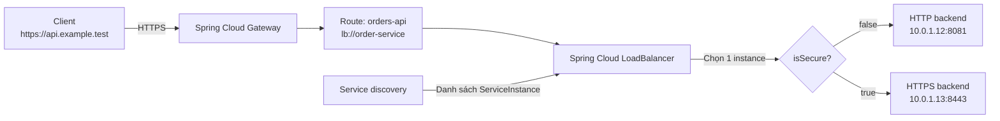
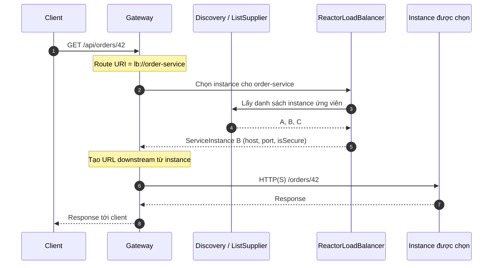
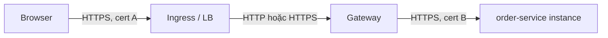

# Lựa chọn instance, trạng thái isSecure và giao thức phía sau

## 1. Vấn đề: client dùng HTTPS nhưng Gateway có thể gọi backend bằng HTTP

Một hệ thống microservices thường triển khai nhiều bản sao của cùng một dịch vụ, ví dụ `order-service` có ba instance trong các pod hoặc máy khác nhau. **Spring Cloud Gateway** cần chọn một instance thích hợp cho từng request đã khớp route, sau đó biết nên kết nối đến instance ấy bằng **HTTP hay HTTPS**, ở **host/port** nào.

Hai quyết định này dễ bị nhầm:

1. **Chọn instance**: `order-service` ở đâu, những bản sao nào đang có thể nhận request và bản sao nào sẽ được chọn?
2. **Chọn giao thức phía sau (downstream/upstream scheme)**: Gateway sẽ gửi `http://host:port` hay `https://host:port` đến bản sao đã chọn?

Giả sử client gọi `https://api.example.test/api/orders/42`. Gateway có thể chấp nhận **HTTPS từ client**, nhưng nếu instance được chọn là `10.0.1.12:8081` với `isSecure=false`, kết nối **Gateway → order-service** có thể dùng **HTTP**. Ngược lại, nếu instance được công bố `isSecure=true` và backend thực sự phục vụ TLS, Gateway có thể sử dụng **HTTPS** ở chặng sau.

Vì vậy, **không được suy luận giao thức đến microservice chỉ từ giao thức mà client dùng để gọi Gateway**.

Bài thuộc chương **Khám phá và cân bằng tải** trong module **SPRING_CLOUD_GATEWAY**, nhằm giải thích `ServiceInstance`, `ReactiveLoadBalancerClientFilter`, `lb://`, trạng thái `isSecure` và ngoại lệ scheme prefix, sau đó thực hành cấu hình, kiểm thử, chẩn đoán lỗi và bảo vệ các chặng TLS.

> **Phạm vi:** tập trung vào **Spring Cloud Gateway Server WebFlux** với Spring Cloud LoadBalancer. Ví dụ YAML dùng namespace `spring.cloud.gateway.server.webflux` của các phiên bản mới; phần tương thích cũng chỉ ra namespace `spring.cloud.gateway` thường gặp ở WebFlux 4.x. Cần chọn đúng phiên bản Spring Boot/Spring Cloud và không trộn cấu hình của biến thể **Gateway Server MVC**.

## 2. Các khái niệm phải phân biệt

| Khái niệm | Vai trò | Ví dụ |
| --- | --- | --- |
| **Service ID** | Tên logic của một nhóm instance | `order-service` |
| **Service discovery** | Tìm danh sách instance theo service ID | Eureka, Consul, Kubernetes integration, SimpleDiscoveryClient |
| **ServiceInstance** | Thông tin một điểm đến cụ thể | `host=10.0.1.12`, `port=8081`, `isSecure=false` |
| **Spring Cloud LoadBalancer** | Chọn một instance từ danh sách ứng viên | Round Robin hoặc chiến lược được cấu hình |
| **Route predicate** | Chọn route Gateway theo request đầu vào | `Path=/api/orders/**` |
| **GatewayFilter / GlobalFilter** | Thực hiện chính sách và định tuyến trong filter chain | `StripPrefix`, `ReactiveLoadBalancerClientFilter` |
| **Scheme** | Giao thức của kết nối đến điểm đích | `http`, `https`, `ws`, `wss` |
| **`isSecure`** | Thuộc tính bảo mật transport của instance | `true` hoặc `false` |
| **TLS trust** | Cấu hình tin cậy chứng chỉ, xác minh hostname/mTLS | CA, truststore, SSL bundle hoặc cấu hình HTTP client |

Cần nhớ: **route** không phải **instance**. Một route có ID `orders-api` có thể chỉ tới service ID `order-service`; service ID đó lại tương ứng nhiều instance có host, port và giao thức riêng.



Đây là sơ đồ về **lựa chọn**. Mỗi request thông thường sẽ chọn **một** instance, không đồng thời gửi sang cả hai chỉ vì có hai nhánh. Cơ chế retry/circuit breaker nếu được cấu hình riêng mới có thể làm xuất hiện những lần thử bổ sung.

## 3. ServiceInstance: dữ liệu nhỏ quyết định điểm đích và giao thức

Spring Cloud Commons định nghĩa `org.springframework.cloud.client.ServiceInstance` làm abstraction cho một bản sao dịch vụ. Các trường/phương thức quan trọng gồm:

| Thuộc tính | Ý nghĩa | Cần xác minh |
| --- | --- | --- |
| `getServiceId()` | Nhóm dịch vụ logic | Khớp service ID của route `lb://...` |
| `getInstanceId()` | Danh tính bản sao (nếu provider có) | Dùng để quan sát, loại bỏ instance lỗi |
| `getHost()` | Host/IP có thể được Gateway truy cập | Có DNS hoặc định tuyến mạng đúng từ Gateway |
| `getPort()` | Cổng nhận kết nối của instance | Cổng HTTP khác cổng HTTPS nếu cấu hình như vậy |
| `isSecure()` | Cờ mô tả instance có dùng transport bảo mật | Phải phản ánh đúng giao thức thực sự ở endpoint |
| `getUri()` | URI mô tả instance | Xem scheme, host và port thực tế |
| `getMetadata()` | Thông tin bổ sung tùy DiscoveryClient | Zone, version, weight hoặc dữ liệu được cấu hình |

Ví dụ minh họa dữ liệu của hai instance:

```text
Service ID: order-service

Instance A
  instanceId: orders-a
  host:       10.0.1.12
  port:       8081
  isSecure:   false
  target:     http://10.0.1.12:8081

Instance B
  instanceId: orders-b
  host:       orders-b.internal.example
  port:       8443
  isSecure:   true
  target:     https://orders-b.internal.example:8443
```

Nếu chọn **A**, Gateway có thể dùng HTTP; nếu chọn **B**, Gateway có thể dùng HTTPS. Đây chỉ là **dữ liệu giả định**, không phải một registry đang tồn tại.

### 3.1. Minh họa ServiceInstance trong Java

```java
import org.springframework.cloud.client.DefaultServiceInstance;
import org.springframework.cloud.client.ServiceInstance;

ServiceInstance a = new DefaultServiceInstance(
    "orders-a",
    "order-service",
    "10.0.1.12",
    8081,
    false
);

ServiceInstance b = new DefaultServiceInstance(
    "orders-b",
    "order-service",
    "orders-b.internal.example",
    8443,
    true
);
```

Ở constructor này, đối số boolean cuối thể hiện `secure`. **Chỉ tạo hai object trong Java không tự đăng ký chúng vào Eureka, Kubernetes hay Gateway**. Để Gateway chọn được chúng, phải có nguồn `DiscoveryClient`/`ServiceInstanceListSupplier` cung cấp các instance đó.

Một số DiscoveryClient xây dựng `isSecure` từ URL đăng ký, một số từ metadata/thuộc tính của registry. Ví dụ với Eureka, thông tin secure port và tình trạng đăng ký cần được cấu hình phù hợp. Đừng giả định mọi loại registry đều suy ra `isSecure` giống nhau.

### 3.2. isSecure không có nghĩa instance đang khỏe

`isSecure=true` chỉ mô tả **giao thức bảo mật của endpoint**. Nó **không** chứng minh instance còn sống, đang nhận traffic, có chứng chỉ hợp lệ, kết nối đã thành công hoặc user đã được xác thực.

Một instance có thể có `isSecure=true` nhưng đang lỗi TLS handshake; một instance `isSecure=false` vẫn có thể khỏe và trả HTTP 200 trên mạng nội bộ. **Health/availability** và **TLS scheme** là hai thông tin khác nhau, cần kiểm tra độc lập.

## 4. Quá trình chọn instance khi route dùng lb://

Route URI `lb://order-service` **không** có nghĩa một hostname `order-service` sẽ được Netty DNS lookup như một URL HTTP bình thường. Tiền tố `lb://` yêu cầu Gateway nhờ **Spring Cloud LoadBalancer** phân giải service ID thành một instance thực tế.

Quá trình khái quát:

1. Request `GET /api/orders/42` khớp predicate `Path=/api/orders/**`.
2. Gateway lấy URI route `lb://order-service` và tạo URL định tuyến trong `ServerWebExchange`.
3. `ReactiveLoadBalancerClientFilter` nhận diện scheme `lb`, tra bộ chọn `ReactorLoadBalancer` cho service ID `order-service`.
4. `ServiceInstanceListSupplier` cung cấp các instance ứng viên từ discovery/config, có thể qua caching hoặc bộ lọc zone/health.
5. LoadBalancer chọn một instance; Gateway thay URI logic bằng địa chỉ host, port và scheme cụ thể.
6. Filter HTTP routing (thường là Reactor Netty `HttpClient`) gửi request đến backend đã chọn; response đi ngược về client.



Thứ tự cụ thể giữa các `GlobalFilter` được quản lý bằng `Ordered` và có thể khác theo phiên bản. Không tự xây dựng logic phụ thuộc vào order của filter hệ thống nếu chưa xác minh bằng tài liệu và runtime đang dùng.

### 4.1. Ba URI dễ nhầm

| URI trong route | Ý nghĩa | Có dùng Spring Cloud LoadBalancer? |
| --- | --- | --- |
| `http://localhost:8081` | Gọi đúng host/port qua HTTP | Không; Gateway định tuyến cố định |
| `https://orders.internal.example:8443` | Gọi đúng host/port qua HTTPS | Không; DNS có thể phân giải host nhưng không phải Spring Cloud LB |
| `lb://order-service` | Chọn một instance từ service ID rồi xác định downstream URL | Có, nếu có LoadBalancer và nguồn instance |
| `lb:https://order-service` | Có tiền tố LB cùng scheme HTTPS tường minh | Có; scheme route có thể ghi đè lựa chọn từ `isSecure` theo quy tắc scheme prefix |

Dùng `lb://` không tự tạo service registry hoặc instance. Phải cung cấp `spring-cloud-starter-loadbalancer` và một DiscoveryClient/nguồn ServiceInstance phù hợp. Tên thư viện và starter Gateway cần khớp phiên bản dự án.

### 4.2. Round Robin và các chiến lược lựa chọn

Spring Cloud LoadBalancer cung cấp các triển khai như **Round Robin** và **Random**, bên cạnh những cơ chế lọc danh sách instance. Trong cấu hình mặc định thông thường, việc chọn mang tính quay vòng theo danh sách các instance khả dụng.

Nhưng không nên hứa “100 request chắc chắn chia đều tuyệt đối”:

- Danh sách instance có thể thay đổi khi autoscaling hoặc instance bị gỡ khỏi discovery.
- Gateway có thể chạy nhiều replica; mỗi replica có bộ đếm/trạng thái lựa chọn riêng.
- Caching, health checks, zone preference, weights và retry có thể làm phân phối khác nhau.
- Các request không tốn tài nguyên như nhau; chia đều **số request** không đồng nghĩa chia đều CPU/latency.
- Round Robin không tự đảm bảo session affinity, readiness hay loại bỏ ngay một instance đang lỗi.

Một LoadBalancer lựa chọn **điểm đến**; nó không thay thế việc service tự kiểm tra quyền truy cập, rate limit theo người dùng hoặc kiểm soát sức khỏe tiến trình.

## 5. Cấu hình một route dùng LoadBalancer

### 5.1. Gateway Server WebFlux với namespace mới

Ví dụ một route công khai `/api/orders/**` trỏ đến service logic `order-service`:

```yaml
spring:
  cloud:
    gateway:
      server:
        webflux:
          routes:
            - id: orders-api
              uri: lb://order-service
              predicates:
                - Path=/api/orders/**
              filters:
                - StripPrefix=1
```

Nếu client gọi `GET /api/orders/42`, filter `StripPrefix=1` bỏ segment `api` để upstream nhận `GET /orders/42`. LoadBalancer quyết định instance nào nhận request và giao thức phía sau. Route này chưa có xác thực, rate limiting, retry hoặc circuit breaker; các chính sách đó phải cấu hình riêng.

### 5.2. Cùng route ở dự án WebFlux 4.x

Một số dự án đang dùng namespace:

```yaml
spring:
  cloud:
    gateway:
      routes:
        - id: orders-api
          uri: lb://order-service
          predicates:
            - Path=/api/orders/**
          filters:
            - StripPrefix=1
```

**Chọn một namespace đúng với bản Gateway**, không ghi cả hai trong cùng ứng dụng chỉ để dự phòng. Nếu cấu hình route không được load, Gateway có thể trả 404 vì không có route, dễ bị nhầm với 503 do không tìm được instance.

### 5.3. Dùng SimpleDiscoveryClient cho môi trường học tập

Không nhất thiết phải dựng Eureka/Consul chỉ để minh họa selection. Spring Cloud Commons có `SimpleDiscoveryClient` nhận danh sách instance từ properties.

Ví dụ **ứng dụng mẫu không có registry-backed DiscoveryClient**:

```yaml
spring:
  cloud:
    discovery:
      client:
        simple:
          instances:
            order-service:
              - uri: http://localhost:8081
              - uri: http://localhost:8082
```

Kết hợp đoạn này với route `lb://order-service` ở phần trên. Chạy hai HTTP server ứng dụng demo tại `8081` và `8082`, mỗi server trả một dấu nhận diện riêng trong response, ví dụ `X-Instance-Id: orders-a` hoặc `X-Instance-Id: orders-b`.

Quan trọng:

- Hai endpoint phải **thực sự tồn tại** và có thể được Gateway kết nối.
- `SimpleDiscoveryClient` dùng cấu hình tĩnh; tự nó không có đầy đủ khả năng đăng ký, phát hiện và loại bỏ các instance động như một service registry.
- Khi thêm một registry-backed DiscoveryClient vào dự án, nguồn danh sách instance có thể thay đổi. Không kỳ vọng cấu hình static luôn được dùng trong mọi profile.
- Nếu muốn kiểm thử HTTPS, dùng URI `https://...` đến một server thật có TLS hợp lệ; không chỉ đổi string URL từ `http` sang `https`.

## 6. isSecure quyết định HTTP hay HTTPS ở chặng sau thế nào?

**Đây là điểm trọng tâm của bài.** Với `ReactiveLoadBalancerClientFilter` và route kiểu `lb://service-id`, tài liệu Gateway mô tả rằng giá trị `ServiceInstance.isSecure()` từ instance được chọn có thể **ghi đè scheme của request phía client** khi xác định kết nối downstream.

Ví dụ:

```text
Client → Gateway: HTTPS https://api.example.test/api/orders/42
Route URI:       lb://order-service
Chosen instance: 10.0.1.12:8081, isSecure=false
Gateway → Backend: HTTP http://10.0.1.12:8081/orders/42
```

Mặc dù browser đã dùng TLS ở chặng đầu, chặng sau **không tự mã hóa**. Nếu security policy yêu cầu end-to-end encryption hoặc mã hóa giữa các service, cấu hình này không đạt yêu cầu.

Ngược lại:

```text
Client → Gateway: HTTP http://localhost:8080/api/orders/42
Route URI:       lb://order-service
Chosen instance: orders-b.internal.example:8443, isSecure=true
Gateway → Backend: HTTPS https://orders-b.internal.example:8443/orders/42
```

Giao thức phía sau có thể là HTTPS dù request đến Gateway là HTTP. Điều đó **không có nghĩa chặng Client → Gateway an toàn**; muốn bảo vệ client, phải cấu hình TLS ở Gateway hoặc lớp ingress phù hợp.

### 6.1. Ma trận hai chặng giao thức

Giả định route là `lb://order-service`, không có scheme prefix ép giao thức:

| Client → Gateway | Instance `isSecure` | Gateway → Upstream thông thường | Nhận xét |
| --- | --- | --- | --- |
| HTTP | `false` | HTTP | Cả hai chặng có thể không mã hóa |
| HTTPS | `false` | HTTP | TLS kết thúc ở Gateway/ingress; chặng sau không tự có TLS |
| HTTP | `true` | HTTPS | Chặng sau có TLS, chặng client cần chính sách riêng |
| HTTPS | `true` | HTTPS | Cả hai chặng có thể dùng TLS, nhưng là **hai phiên TLS khác nhau** |

Ma trận diễn giải **scheme mong muốn do routing quyết định**, không phải bảo đảm kết nối đã thành công. Để HTTPS hoạt động cần server cung cấp TLS trên port đó, chứng chỉ hợp lệ và HTTP client của Gateway tin cậy CA/hostname phù hợp.

### 6.2. Giá trị isSecure lấy từ đâu?

Phụ thuộc `DiscoveryClient` và cách dịch vụ được đăng ký:

- Với `SimpleDiscoveryClient`, các URI cấu hình cho instance chứa thông tin `http://` hoặc `https://`.
- Với Eureka/Consul và các integration khác, metadata, secure-port hoặc thông tin URL đăng ký có thể ảnh hưởng `isSecure`.
- Với một `ServiceInstanceListSupplier` tùy biến, chính code tạo `ServiceInstance` có thể đặt flag secure đúng hoặc sai.
- Khi service nằm sau ingress/reverse proxy, **port được công bố** phải là port mà Gateway thực sự kết nối được, không phải port nội bộ không mở hoặc không có TLS.

Không nên tự “sửa chữa” trường `isSecure` bằng một filter thêm `X-Forwarded-Proto: https`. Header đó là metadata HTTP/proxy, không làm socket HTTP biến thành TLS. Cần sửa **thông tin instance** hoặc scheme route phù hợp.

## 7. Ngoại lệ: route có scheme prefix tường minh

Gateway hỗ trợ trường hợp route URI có **tiền tố `lb:` đứng trước một URI với scheme riêng**, ví dụ:

```yaml
# Ví dụ cho scheme HTTP(S) được ghi tường minh:
uri: lb:https://order-service
```

Hoặc với WebSocket:

```yaml
uri: lb:ws://chat-service
```

Trong quá trình xử lý, `RouteToRequestUrlFilter` tách prefix `lb` và lưu thông tin này vào attribute nội bộ `GATEWAY_SCHEME_PREFIX_ATTR`. `ReactiveLoadBalancerClientFilter` vẫn chọn instance bằng service ID, **nhưng scheme từ route URI có prefix có thể được ưu tiên hơn cờ `isSecure` của instance** theo quy tắc được tài liệu Spring Cloud Gateway mô tả.

Do đó:

| Route URI | Thuộc tính quan trọng | Hệ quả |
| --- | --- | --- |
| `lb://order-service` | Instance `isSecure` | Thường quyết định `http`/`https` downstream |
| `lb:https://order-service` | Scheme HTTPS ghi trong route | Có thể ép kết nối HTTPS theo scheme tường minh, kể cả metadata instance ghi `isSecure=false` |
| `lb:ws://chat-service` | Scheme WebSocket | Dùng định tuyến WebSocket theo scheme `ws`, không áp dụng như HTTP thường |
| `lb:wss://chat-service` | Scheme WebSocket bảo mật | Cần backend hỗ trợ WSS và TLS đúng |

> **Không lạm dụng ép scheme để che giấu metadata sai.** Nếu chỉ một số instance có HTTPS còn số khác chỉ có HTTP, ép toàn bộ route thành `lb:https://...` có thể khiến những instance chỉ hỗ trợ HTTP thất bại TLS handshake. Cách bền vững là đăng ký đúng endpoint/giao thức của từng instance, hoặc tách nhóm service theo chính sách rõ ràng.

### 7.1. Phân biệt lb:ws và websocket route

WebSocket bắt đầu bằng HTTP Upgrade rồi sử dụng kết nối có giao thức `ws` hoặc `wss`. Trong Spring Cloud Gateway Server WebFlux, `lb:ws://chat-service` có thể kết hợp load balancing với WebSocket routing; với SockJS fallback qua HTTP, có thể phải khai báo thêm route HTTP bình thường.

Không tự giả định một route `lb://chat-service` có cùng hành vi với `lb:ws://chat-service`. Scheme của URL là tín hiệu để Gateway chọn cách chuyển tiếp WebSocket, không chỉ là cờ mã hóa.

### 7.2. Scheme prefix có thay đổi việc chọn instance?

Không. Tiền tố `lb:` vẫn dẫn đến **bước chọn instance qua LoadBalancer**. Ngoại lệ chính liên quan **scheme downstream**, không phải bỏ qua discovery hoặc hard-code host. Instance được chọn vẫn phải có host/port hợp lệ và server tương thích với scheme đã xác định.

## 8. Chọn instance khi danh sách thay đổi

Trong deployment thực tế, `order-service` có thể scale từ 2 lên 5 bản sao hoặc một bản sao phải rời pool khi shutdown. `ServiceInstanceListSupplier` hỗ trợ cung cấp danh sách ứng viên; có thể bổ sung những bước như caching, health checking và lọc theo zone, tùy cấu hình.

### 8.1. Các lớp trách nhiệm

| Thành phần | Trách nhiệm | Điều không tự bảo đảm |
| --- | --- | --- |
| Registry / DiscoveryClient | Cập nhật danh sách instance và metadata | Không kiểm tra mọi request sẽ thành công |
| `ServiceInstanceListSupplier` | Phát danh sách instance cho LoadBalancer | Không tự chọn endpoint cuối nếu không có LoadBalancer |
| LoadBalancer algorithm | Chọn một instance từ danh sách | Không tự retry một instance khác khi gặp lỗi |
| Health-check supplier (nếu có) | Lọc instance theo tiêu chí sức khỏe | Không tự thay TLS/certificate/config sai |
| Gateway HTTP client | Kết nối host/port theo scheme đã chọn | Không tự sửa cờ `isSecure` sai |
| Circuit breaker / retry policy | Phối hợp chịu lỗi khi được cấu hình | Không làm thao tác ghi tự trở nên idempotent |

**Caching có độ trễ.** Discovery đã gỡ một instance không nhất thiết khiến mọi Gateway replica lập tức ngừng chọn nó; TTL, cache ở registry và tiến trình làm mới danh sách ảnh hưởng kết quả. Cần thiết kế graceful shutdown, readiness và retry chính sách phù hợp.

### 8.2. Zone preference, weight và health check

Spring Cloud LoadBalancer có các lựa chọn mở rộng như:

- **Zone preference:** ưu tiên instance trong vùng gần, khi metadata và cấu hình zone được cung cấp.
- **Weighted load balancing:** chọn theo trọng số, khi có cơ chế supplier/weight phù hợp.
- **Health-check supplier:** loại hoặc giảm khả năng chọn instance không đáp ứng health check.
- **Caching:** giảm tải truy vấn discovery, nhưng có thể làm danh sách chậm cập nhật.

Đừng khẳng định các tính năng này **đều bật mặc định**. Chúng cần đúng dependency và cấu hình. Một instance đặt `isSecure=true` không được ưu tiên hơn instance `isSecure=false` chỉ vì secure; việc chọn instance và chính sách giao thức là hai bước.

Nếu hệ thống yêu cầu **tất cả upstream đều dùng HTTPS**, hãy quản lý nhóm instance sao cho endpoint công bố đều hỗ trợ HTTPS và được giám sát đúng. Trộn HTTP/HTTPS trong cùng service ID chỉ nên là quyết định có kiểm soát, ví dụ trong một giai đoạn migration ngắn.

## 9. Khi không tìm thấy instance: 503 hay 404?

Một route có thể khớp request, nhưng LoadBalancer không tìm được instance ứng viên cho service ID. Tài liệu Gateway nêu hành vi thông thường là **HTTP 503 Service Unavailable**.

Ví dụ:

```text
Client: GET /api/orders/42
Route:  orders-api   (predicate khớp)
URI:    lb://order-service
LB:     Không tìm được ServiceInstance
Result: 503 (mặc định)
```

Có thể đổi thành 404 qua thuộc tính `loadbalancer.use404`, với namespace tương ứng phiên bản.

**WebFlux namespace mới:**

```yaml
spring:
  cloud:
    gateway:
      server:
        webflux:
          loadbalancer:
            use404: true
```

**WebFlux namespace cũ:**

```yaml
spring:
  cloud:
    gateway:
      loadbalancer:
        use404: true
```

Đây là **hai cách thay thế**. Đừng coi 404 do không có instance là giống hệt 404 vì không có route hoặc upstream trả “resource not found”; chúng phát sinh ở những giai đoạn khác nhau.

| Tình huống | HTTP status thường thấy | Điều cần kiểm tra |
| --- | --- | --- |
| Không có route khớp `Path`/`Method` | 404 | Predicate, route registration |
| Route `lb://` khớp nhưng không có instance | 503 (hoặc 404 nếu bật `use404`) | Registry, supplier, service ID, cache |
| Instance được chọn nhưng host/port không kết nối được | Thường lỗi kết nối, có thể dẫn đến 5xx | DNS, network, port, policy, timeout |
| Instance chỉ nghe HTTP nhưng Gateway gọi HTTPS | TLS/SSL handshake hoặc lỗi protocol | `isSecure`, scheme prefix, listener TLS |
| Instance chỉ nghe HTTPS nhưng Gateway gọi HTTP | Lỗi protocol/connection, mã tùy proxy/server | `isSecure`, cổng, scheme |
| Upstream trả 404 cho path đã định tuyến | Thường proxy 404 về client | `StripPrefix`, rewrite path, endpoint service |

HTTP status cuối cùng còn phụ thuộc error handler, retry, circuit breaker hoặc lớp ingress. Cần xem log/trace theo route và nguyên nhân, không chỉ phán đoán từ status.

## 10. TLS phía client và TLS phía backend là hai cấu hình độc lập

Một Gateway có thể đứng sau ingress kết thúc TLS, tự kết thúc TLS, hoặc thực hiện cả hai chức năng phù hợp kiến trúc.



Trong sơ đồ, **chứng chỉ A và B phục vụ các chặng khác nhau**. Cấu hình TLS ở phía public không tự cấu hình trust của Netty `HttpClient` khi gọi order-service.

### 10.1. Điều kiện cần cho upstream HTTPS

Muốn Gateway gọi `https://orders-b.internal.example:8443` thành công, cần:

1. Instance thực sự **lắng nghe TLS** ở cổng được công bố.
2. Certificate phù hợp hostname/SNI mà Gateway dùng để kết nối.
3. Gateway HTTP client **tin cậy CA hoặc truststore** cần thiết.
4. Hai đầu hỗ trợ phiên bản TLS/cipher phù hợp theo chính sách bảo mật.
5. Nếu dùng **mTLS**, Gateway có client certificate/key hợp lệ và service chấp nhận chúng.
6. Firewall, service mesh, proxy và DNS cho phép kết nối đúng từ Gateway.

`isSecure=true` **không tự tạo certificate**, không vô hiệu hóa xác minh chứng chỉ và không tự thiết lập mTLS. Ngược lại, `isSecure=false` cũng không đồng nghĩa quyền truy cập không cần xác thực: ứng dụng vẫn có thể dùng JWT trên HTTP nội bộ, nhưng payload trên đoạn đó không được mã hóa bởi TLS nếu không có một lớp tunnel bảo vệ khác.

### 10.2. Không dùng insecure trust manager trên production

Một số phiên bản Gateway expose thuộc tính như `httpclient.ssl.use-insecure-trust-manager` để bỏ xác minh chứng chỉ phục vụ thử nghiệm. **Không dùng cách này làm giải pháp cho lỗi TLS production.** Nó làm suy yếu xác thực endpoint, khiến kết nối HTTPS vẫn có thể bị trung gian giả mạo.

Khi SSL handshake thất bại, cần xem certificate chain, SAN/hostname, CA và SNI. Nếu sử dụng mesh sidecar/proxy, cần biết Gateway thực sự kết nối đến **địa chỉ nào và chặng nào kết thúc TLS**.

### 10.3. X-Forwarded-Proto không quyết định TLS socket

`X-Forwarded-Proto: https` hoặc header `Forwarded` có thể thông báo cho ứng dụng về giao thức public mà client đã dùng khi đi qua proxy. Header này **không ép** Gateway dùng HTTPS đến backend.

Không tin các header forwarded từ mọi client tùy ý; ingress/Gateway cần cấu hình ranh giới trusted proxies và ngăn client giả mạo. Những header này phục vụ xây dựng URL, chính sách ứng dụng và observability, không thay thế `ServiceInstance.isSecure` hay cấu hình SSL client.

## 11. Kiểm thử instance selection và downstream protocol

### 11.1. Chuẩn bị hai backend để nhận diện instance

Giả sử cấu hình `SimpleDiscoveryClient` ở phần 5 đã được kích hoạt và có hai service chạy:

- `localhost:8081`: trả response/header `X-Instance-Id: orders-a`.
- `localhost:8082`: trả response/header `X-Instance-Id: orders-b`.

Cả hai phải xử lý `GET /orders/42`. Nếu muốn thử HTTPS, tạo riêng một instance có endpoint TLS thật và chứng chỉ đúng; đừng dùng `https://localhost:8082` nếu server ở cổng đó chỉ nói HTTP.

Thử trực tiếp các backend trước:

```bash
curl -i http://localhost:8081/orders/42
curl -i http://localhost:8082/orders/42
```

Nếu các backend chưa chạy, những bước tiếp theo không thể chứng minh load balancing hoạt động.

### 11.2. Gọi Gateway nhiều lần

Khi Gateway chạy trên `http://localhost:8080`:

```bash
curl -i http://localhost:8080/api/orders/42
curl -i http://localhost:8080/api/orders/42
curl -i http://localhost:8080/api/orders/42
curl -i http://localhost:8080/api/orders/42
```

Ghi lại `X-Instance-Id` do backend trả và mã HTTP. Nếu dùng Round Robin mặc định, có thể thấy hai instance thay phiên nhau. **Không dựa vào việc bốn request chắc chắn có mẫu A-B-A-B**: số Gateway replica, cache, thay đổi danh sách và chính sách LB có thể ảnh hưởng thứ tự.

Không nên cố tình thêm header `X-Instance-Id` dựa trên dữ liệu nội bộ nhạy cảm ở môi trường production nếu header này bị client công khai nhìn thấy. Trong bài thực hành, đó là dấu nhận diện giả định để dễ quan sát.

### 11.3. Kiểm tra isSecure bằng các tổ hợp

Tạo hai môi trường thử nghiệm riêng:

**Ca HTTP backend:** một instance `http://localhost:8081` và `isSecure=false`. Gọi Gateway qua HTTP hoặc HTTPS. Xem request có đến được `8081` và không xảy ra TLS handshake.

**Ca HTTPS backend:** một instance `https://orders-b.internal.example:8443` và `isSecure=true`. Gateway phải có trust đúng, backend phải phục vụ TLS; kiểm tra network trace hoặc log an toàn để xác nhận kết nối.

Bảng kiểm thử:

| Test | Route | Instance được cung cấp | Kỳ vọng về scheme |
| --- | --- | --- | --- |
| S1 | `lb://order-service` | `isSecure=false`, HTTP `8081` | HTTP downstream |
| S2 | `lb://order-service` | `isSecure=true`, HTTPS `8443` | HTTPS downstream |
| S3 | `lb:https://order-service` | `isSecure=false`, backend chỉ có HTTP | Có nguy cơ lỗi TLS vì route ép HTTPS |
| S4 | `lb:https://order-service` | `isSecure=false`, backend **thực sự** có TLS | HTTPS có thể hoạt động nếu trust/port đúng |
| S5 | `lb:ws://chat-service` | WebSocket server `ws` | WebSocket routing đến instance |
| S6 | `lb://missing-service` | Danh sách rỗng | 503 mặc định hoặc 404 nếu bật cấu hình tương ứng |

Với S3/S4, mục tiêu là **kiểm chứng scheme prefix override**, không phải khuyến khích vận hành metadata sai. Hãy xác minh hành vi trên đúng phiên bản Gateway/LoadBalancer đang chạy.

### 11.4. Khi thấy SSLHandshakeException hoặc lỗi giao thức

Phân loại bằng cách trả lời:

1. Gateway đã khớp route và **chọn instance nào**?
2. Instance công bố `host`, `port`, `isSecure` và URI gì?
3. Route là `lb://` hay `lb:https://`/`lb:wss://`?
4. Endpoint thực tế có trả HTTP hay nói TLS ở cổng ấy?
5. Gateway tin CA/chứng chỉ, hostname và SNI đúng chưa?
6. Có mesh/proxy/ingress thay đổi giao thức hoặc port giữa Gateway và service không?

**Đừng sửa bằng cách tắt certificate verification** trước khi biết nguyên nhân. Một handshake lỗi có thể đơn giản do metadata `isSecure` và port đăng ký không thống nhất, hoặc do thiết lập trust chưa đúng.

## 12. Quan sát route, instance và thông tin kết nối

Một request chậm/lỗi có thể xuất phát từ route predicate, danh sách instance, LB selection, DNS, TCP, TLS handshake, filter chain hoặc upstream xử lý nghiệp vụ. Quan sát từng lớp sẽ giúp tránh chẩn đoán nhầm.

| Tín hiệu cần quan sát | Mục đích |
| --- | --- |
| Route ID, service ID | Xác định route đã khớp và nhóm đích |
| Instance ID/host/port **được chọn** | Biết backend cụ thể gặp lỗi; tránh log PII/secret |
| Scheme downstream | Tách lỗi HTTP khỏi HTTPS/TLS |
| Tỷ lệ 503 “no instances” | Phát hiện registry/discovery/supplier rỗng |
| HTTP status upstream và client | Phân biệt upstream 4xx/5xx với Gateway routing error |
| Connection timeout/SSL exception | Xem network, truststore, port và certificate |
| Latency, retry count, circuit breaker state | Xác định chi phí khi instance thất bại |
| Danh sách và tuổi cache instance | Kiểm tra độ trễ khi scale hoặc gỡ instance |

Khi dùng Spring Boot Actuator có kiểm soát truy cập, endpoint Gateway có thể cho phép xem các route/filter theo phiên bản; không công khai endpoint quản trị ra Internet. **Không ghi token, cookie, body, tên miền nội bộ nhạy cảm vào log client-visible**. Đối với metrics, tránh gắn path có ID hoặc instance ID không kiểm soát vào nhãn dẫn đến cardinality quá cao.

### Phân biệt lỗi LB và lỗi upstream

- **Không có instance:** LoadBalancer chưa chọn được điểm đích; thường trả 503 theo mặc định.
- **Có instance nhưng không kết nối được:** đã có host/port, lỗi thường ở DNS/network/TLS.
- **Kết nối được nhưng upstream trả lỗi:** service xử lý request và phản hồi mã lỗi; xem path, auth và logic nghiệp vụ.
- **Request đi nhầm instance:** kiểm tra danh sách discovery, service ID, zone/weight/caching và route order; không tự cho rằng LB ngẫu nhiên gây lỗi.

## 13. Tình huống thực tế: chuyển dần service từ HTTP sang HTTPS

Giả sử ba instance `order-service` ban đầu chỉ hỗ trợ HTTP và đều công bố `isSecure=false`. Đội vận hành muốn chuyển chặng Gateway → service sang HTTPS mà không làm gián đoạn traffic.

Một kế hoạch minh họa:

1. **Chuẩn bị TLS ở backend:** mở cổng HTTPS có chứng chỉ hợp lệ, xác minh Gateway kết nối được, cấu hình CA/trust và mTLS nếu yêu cầu.
2. **Cập nhật thông tin đăng ký:** instance mới công bố đúng host, HTTPS port và `isSecure=true`.
3. **Kiểm tra tính nhất quán:** URI/metadata/port ở discovery phải phản ánh endpoint thực tế, tránh `true` đi kèm port chỉ hỗ trợ HTTP.
4. **Triển khai có kiểm soát:** chỉ cho instance HTTPS vào pool sau khi readiness/health chứng minh sẵn sàng; nếu tạm trộn HTTP/HTTPS, đánh giá chính sách bảo mật cho chặng chưa mã hóa.
5. **Quan sát:** tỷ lệ SSL handshake error, 503, 5xx, retry, latency và instance được chọn.
6. **Hoàn tất:** khi tất cả instance đều công bố/đáp ứng HTTPS, xác nhận không còn lưu lượng plaintext giữa Gateway và backend; có thể củng cố policy ở network/mesh.
7. **Rollback:** nếu cần trở lại phiên bản cũ, phải khôi phục cả cấu hình registry, port, trust/certificate và các route scheme có liên quan.

**Không nên đặt `lb:https://order-service` khi pool vẫn chứa instance chỉ nghe HTTP** để “bật TLS toàn hệ thống”. Prefix sẽ thay scheme của URL, **không nâng cấp** HTTP server cũ thành HTTPS.

Nếu doanh nghiệp bắt buộc mọi request nội bộ có TLS, cách an toàn hơn là tách pool, giới hạn instance eligible và enforce TLS tại tầng network/sidecar/service, thay vì chấp nhận plaintext rồi chỉ hy vọng metadata tự đúng.

## 14. Sự khác biệt với discovery route tự động

Có hai tính năng thường bị lẫn:

- **Route tĩnh có URI `lb://service-id`:** bạn chủ động khai báo một route; Gateway chỉ dùng discovery/load balancer **khi route đó được chọn**.
- **DiscoveryClient Route Definition Locator:** một tính năng khác có thể tạo route tự động từ các service đã đăng ký khi được bật và cấu hình.

Để dạy cách chọn instance/isSecure, **không cần bật discovery locator**. Cấu hình route tĩnh dễ kiểm tra path, filter và service ID hơn, đồng thời không vô tình công khai endpoint của tất cả service trong registry.

Khi dùng discovery locator trong ứng dụng thật, phải kiểm soát danh sách service được phép public, cơ chế auth, route predicates, rewrite path và các ranh giới network. Thấy một service trong registry không có nghĩa service ấy nên được Internet truy cập trực tiếp qua Gateway.

## 15. Các lỗi thường gặp và hướng xử lý

| Hiện tượng | Sai lầm thường gặp | Hành động |
| --- | --- | --- |
| `lb://order-service` luôn trả 503 | Không có instance, thiếu DiscoveryClient hoặc LoadBalancer | Kiểm tra dependency và danh sách instance thực tế |
| 404 khi gọi route nhưng service có instance | Route predicate sai hoặc URL không được load | Xem route ID, path, method, namespace config |
| Client dùng HTTPS nhưng backend thấy HTTP | Tưởng frontend TLS tự áp dụng cho chặng sau | Kiểm tra `isSecure` và TLS termination |
| `isSecure=true` nhưng TLS handshake lỗi | Port chỉ phục vụ HTTP, CA/hostname không tin cậy | Kiểm tra listener, certificate, SNI/trust |
| `lb:https://...` làm một số instance lỗi | Trộn HTTP-only và HTTPS instance trong cùng pool | Cập nhật endpoint/metadata hoặc tách pool |
| Thay registry metadata nhưng Gateway còn lỗi cũ | Cache danh sách instance chưa cập nhật | Kiểm tra cache/TTL, rollout/readiness |
| Gọi `http://service-name` thay `lb://...` | Nhầm DNS lookup với Spring Cloud LB | Dùng đúng scheme và xem cơ chế discovery đang có |
| `X-Forwarded-Proto: https` nhưng backend vẫn HTTP | Header không thay đổi transport socket | Sửa `isSecure`/scheme và listener TLS |
| Retry khiến lặp thao tác tạo đơn | Chính sách retry không xét idempotency | Dùng idempotency key, giới hạn retry đúng method |
| LB chọn instance không khỏe | Supplier thiếu health policy hoặc dữ liệu registry stale | Xem readiness, health, cache và selection strategy |
| Upstream trả `404` dù LB chọn đúng | `StripPrefix`/`RewritePath` gửi path sai | Kiểm tra path trước/sau filter và endpoint backend |
| Route không nhận WebSocket | Dùng HTTP URI thay `ws`/`wss` | Khai báo route WebSocket đúng scheme và backend |
| TLS có nhưng traffic nội bộ vẫn lộ | Chặng HTTPS chỉ nằm ở edge | Xác định toàn bộ hops và enforce mã hóa end-to-end |

### Những điều không nên làm

- Không dựa vào `isSecure` làm **kiểm tra sức khỏe** hoặc **quyền truy cập**.
- Không cho client tự chọn backend instance bằng host/header không được xác thực.
- Không tắt TLS certificate verification để “chữa” lỗi cấu hình production.
- Không mặc định retry `POST`/`PUT` khi có lỗi kết nối nếu không có idempotency.
- Không phơi bày toàn bộ DiscoveryClient routes hoặc Actuator management endpoints ra Internet.
- Không log credential/Authorization header khi cần theo dõi instance hay scheme.

## 16. Bài thực hành: kiểm tra bốn tổ hợp HTTP/HTTPS

**Bối cảnh:** viết route `orders-api` theo `lb://order-service` và chuẩn bị hai loại instance:

- A: HTTP, `isSecure=false`, cổng 8081.
- B: HTTPS, `isSecure=true`, cổng 8443, chứng chỉ mà Gateway có thể xác minh.

Hãy thực hiện trên môi trường thử nghiệm:

1. Chỉ công bố A; gọi Gateway qua HTTP và (nếu có) HTTPS. Ghi scheme và host/port thực tế ở upstream.
2. Chỉ công bố B; gọi lại. Kiểm tra Netty HTTP client thiết lập TLS đúng.
3. Công bố cả A/B; quan sát request được chia cho hai instance và hai loại giao thức khác nhau. Xác nhận liệu điều này có phù hợp security policy.
4. Thử route có prefix `lb:https://order-service` khi A vẫn chỉ nghe HTTP; ghi lại lỗi và lý do.
5. Gỡ toàn bộ instance khỏi supplier; xác nhận Gateway trả 503 theo default (hoặc 404 nếu đã bật `use404`).
6. Khôi phục instance, kiểm tra thời gian danh sách/caching cập nhật.
7. Bổ sung một ca `GET /api/orders/42` nhưng upstream chỉ hỗ trợ `/orders/42`; xác nhận `StripPrefix=1` hoạt động.
8. Thử một request `POST` giả lập, kiểm tra hệ thống **không retry vô điều kiện** khi kết nối đứt giữa chừng.

**Kết quả cần ghi lại** là route ID, service ID, instance ID, host/port, `isSecure`, downstream scheme, HTTP status, TLS handshake outcome và upstream path. Không cần log body hoặc token.

### Checklist triển khai production

- [ ] `lb://` có nguồn `ServiceInstance` hoạt động và dependency LoadBalancer tương thích.
- [ ] Service ID trong route khớp registry/config, không bị sai case hoặc tên.
- [ ] Host/port được công bố có thể truy cập từ Gateway; readiness và health đúng.
- [ ] `isSecure` phản ánh endpoint thật và được kiểm chứng bằng HTTP/TLS handshake.
- [ ] Không nhầm TLS phía client với TLS phía backend.
- [ ] Nếu dùng `lb:https://`, đã kiểm tra scheme prefix override và mọi instance tương thích.
- [ ] Truststore/CA, SNI, SAN và mTLS được cấu hình theo chính sách.
- [ ] Biết rõ lỗi do không có instance (503/404) khác lỗi network/TLS/upstream.
- [ ] Có metrics, trace, log đã lọc thông tin nhạy cảm và cơ chế nhận diện instance lỗi.
- [ ] Zone/weight/health/cache đã được thiết kế, không giả định mặc định.
- [ ] Retry, circuit breaker, rate limiting và xác thực độc lập với LoadBalancer selection.
- [ ] WebSocket dùng `ws/wss` đúng loại route nếu có.
- [ ] Các thay đổi TLS/registry có kế hoạch rollout, quan sát và rollback.

## 17. Tổng kết và tài liệu tham khảo

**Spring Cloud Gateway Server WebFlux** dùng route như `lb://order-service` để nhờ **Spring Cloud LoadBalancer** chọn một `ServiceInstance` từ nguồn discovery. Instance mang host, port và cờ `isSecure`; cờ này thường quyết định Gateway gửi **HTTP hay HTTPS** ở chặng upstream, **độc lập với** HTTP/HTTPS mà client dùng để gọi Gateway.

Một ngoại lệ quan trọng là URI có scheme prefix tường minh như `lb:https://...` hoặc `lb:ws://...`: theo quy tắc Gateway, scheme sau prefix có thể ghi đè `isSecure`. Cần xác minh đúng phiên bản, vì ép scheme không sửa được backend chưa hỗ trợ TLS.

**Bài học vận hành:** quyết định chọn instance, quyết định giao thức và quyết định cấp quyền là **ba vấn đề khác nhau**. Kết hợp khám phá dịch vụ, route/filter chain, TLS, timeout, circuit breaker/retry, rate limiting và observability mới giúp Gateway kết nối microservices đúng và an toàn.

Tài liệu chính thức để tra cứu theo phiên bản:

- [Spring Cloud Gateway Server WebFlux — Global Filters, ReactiveLoadBalancerClientFilter, RouteToRequestUrl](https://docs.spring.io/spring-cloud-gateway/reference/spring-cloud-gateway-server-webflux/global-filters.html).
- [Spring Cloud Commons — Spring Cloud LoadBalancer](https://docs.spring.io/spring-cloud-commons/reference/spring-cloud-commons/loadbalancer.html).
- [Spring Cloud Commons — DiscoveryClient, SimpleDiscoveryClient](https://docs.spring.io/spring-cloud-commons/reference/spring-cloud-commons/common-abstractions.html).
- [Spring Cloud Gateway Server WebFlux — Actuator API](https://docs.spring.io/spring-cloud-gateway/reference/spring-cloud-gateway-server-webflux/actuator-api.html).
