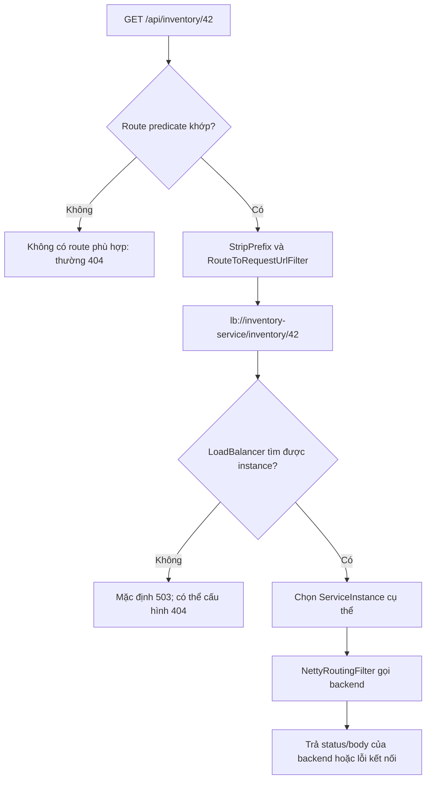
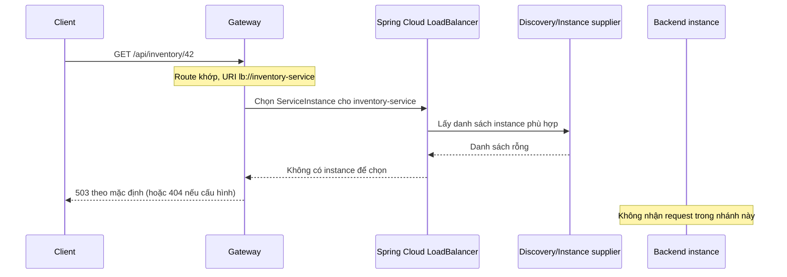
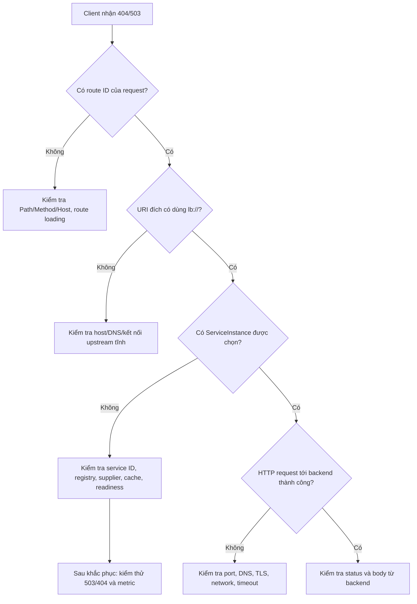

# Xử lý khi không có service instance khả dụng: chọn phản hồi 503 hay 404 trong Spring Cloud Gateway

Trong hệ thống microservices, một API Gateway có thể chọn **đúng route** nhưng vẫn **không gửi được request đến backend**. Chẳng hạn, client gọi `GET /api/inventory/42`; predicate `Path` và `Method` đều khớp, URL đích là `lb://inventory-service`, nhưng bộ cân bằng tải không tìm được instance nào của `inventory-service`. Đây là tình huống **không có service instance khả dụng** (*no available service instance*), khác với việc không có route phù hợp hoặc backend đã nhận request rồi trả lỗi.

Trong **Spring Cloud Gateway Server WebFlux**, khi đi qua đường định tuyến `lb://`, Gateway sử dụng Spring Cloud LoadBalancer để chọn một `ServiceInstance` từ danh sách mà hệ thống khám phá dịch vụ cung cấp. Nếu không có instance để chọn, hành vi mặc định thường là **`503 Service Unavailable`**; trong những phiên bản hỗ trợ tùy chọn `use404`, có thể yêu cầu trả **`404 Not Found`** thay thế.

Bài học thuộc chương **Khám phá và cân bằng tải** của module `SPRING_CLOUD_GATEWAY`. Chủ đề này giúp xác định đúng trách nhiệm của route predicate, filter chain, URI rewriting, khám phá dịch vụ và load balancing; từ đó phối hợp xác thực, rate limiting, circuit breaker, retry, TLS và observability để vận hành cổng vào microservices an toàn.

> **Phạm vi:** Các ví dụ dành cho **Spring Cloud Gateway Server WebFlux**. Cấu trúc starter và namespace cấu hình khác nhau giữa các thế hệ Spring Cloud Gateway/Spring Boot. Cần xác minh tài liệu và metadata cấu hình của đúng phiên bản trước khi sao chép một property. Các địa chỉ, service ID và mã đáp ứng trong tình huống mô phỏng đều chỉ nhằm mục đích học tập.

## 1. Một request có route nhưng chưa chắc có backend

Giả sử hệ thống có Gateway ở `localhost:8080` và Inventory Service dự kiến đăng ký dưới tên `inventory-service`. Route:

```yaml
spring:
  cloud:
    gateway:
      server:
        webflux:
          routes:
            - id: inventory-api
              uri: lb://inventory-service
              predicates:
                - Path=/api/inventory/**
                - Method=GET
              filters:
                - StripPrefix=1
```

Client gọi:

```http
GET /api/inventory/42 HTTP/1.1
Host: localhost:8080
Accept: application/json
```

Theo cách xử lý bình thường:

1. Gateway kiểm tra `Path=/api/inventory/**` và `Method=GET`: cả hai cùng khớp.
2. Route `inventory-api` được chọn; `StripPrefix=1` chuyển path thành `/inventory/42`.
3. `RouteToRequestUrlFilter` dựng URL logic, ví dụ `lb://inventory-service/inventory/42`.
4. `ReactiveLoadBalancerClientFilter` hỏi Spring Cloud LoadBalancer về một instance của `inventory-service`.
5. Nếu có instance, URL được đổi thành đích thực như `http://10.0.0.21:8081/inventory/42`, sau đó routing filter gửi request.
6. **Nếu danh sách instance không có ứng viên**, việc định tuyến dừng trước khi gọi upstream. Gateway tạo phản hồi lỗi theo chính sách áp dụng, mặc định thường là `503`.



**Ranh giới trách nhiệm:** `Path` predicate chọn route; `RouteToRequestUrlFilter` chuẩn bị URL logic; Spring Cloud LoadBalancer quyết định instance; routing filter mới kết nối HTTP. Lỗi ở bước 4 không có nghĩa predicate hoặc `StripPrefix` bị sai.

## 2. Ba loại 404/503 có thể trông giống nhau nhưng nguyên nhân khác nhau

Khi nhìn thấy mã HTTP, không thể xác định chắc nguyên nhân chỉ từ con số. Cần kết hợp thông tin route, instance và điểm phát sinh lỗi.

| Tình huống | Route có khớp không? | Backend có được gọi không? | Kết quả thường gặp |
| --- | --- | --- | --- |
| Request `GET /unknown`, không route nào khớp. | Không | Không | `404 Not Found` do Gateway/WebFlux. |
| Route `lb://inventory-service` khớp, nhưng LoadBalancer không có instance để chọn. | Có | Không | **`503 Service Unavailable`** theo mặc định thông dụng, hoặc **`404`** nếu cấu hình `use404` có hiệu lực. |
| Route khớp, instance được chọn; backend trả `404` vì tài nguyên không tồn tại. | Có | Có | `404` từ backend, Gateway chuyển tiếp khi không có xử lý khác. |
| Route khớp, instance được chọn; backend chủ động trả `503` do quá tải. | Có | Có | `503` từ backend. |
| Route khớp, instance được chọn nhưng cổng backend từ chối kết nối. | Có | Đã cố kết nối, có thể chưa gửi được HTTP request hoàn chỉnh | Lỗi mạng, thường dẫn đến 5xx tùy cấu hình và xử lý ngoại lệ; không phải thiếu instance. |
| Route khớp nhưng thiếu hoặc lỗi tích hợp load balancer. | Có | Không đảm bảo | Lỗi cấu hình/khởi động/định tuyến tùy phiên bản; không đồng nhất với một danh sách rỗng hợp lệ. |

Ví dụ hai response có cùng `404` vẫn có ý nghĩa khác:

- `404` từ **route matching**: Gateway không có route phù hợp với request.
- `404` từ **load balancer dùng `use404`**: Gateway biết route nhưng không tìm thấy instance.
- `404` từ **backend**: đích có tồn tại ở mức mạng và đã xử lý HTTP, nhưng endpoint hoặc tài nguyên không tồn tại theo hợp đồng backend.

Một trang lỗi hoặc JSON body giống nhau không chứng minh nguồn lỗi giống nhau. Quan sát theo route ID, trace ID và request upstream sẽ giúp phân loại.

### 2.1. HTTP status là kết quả, không phải chẩn đoán đầy đủ

Khi client thấy `503`, không nên ngay lập tức tăng timeout hoặc bật retry. Nếu load balancer **không có một instance nào**, retry tức thời thường tiếp tục thất bại; cần kiểm tra service registration, health và nguồn discovery.

Khi client thấy `404`, cũng không nên lập tức sửa `Path`. Trước hết phải xác định route có khớp hay không và mã 404 được phát từ Gateway, load balancer hay backend.

## 3. `lb://`, DiscoveryClient và LoadBalancer phối hợp thế nào?

URI `lb://inventory-service` mang **tên dịch vụ logic**, không phải DNS host mà HTTP client chắc chắn kết nối được. Trong Spring Cloud Gateway Server WebFlux:

- `Route` xác định `uri=lb://inventory-service` cùng predicate và các filter.
- `RouteToRequestUrlFilter` ghép URI route với path/query hiện tại, lưu trong thuộc tính nội bộ `GATEWAY_REQUEST_URL_ATTR`.
- `ReactiveLoadBalancerClientFilter` nhận biết scheme `lb` (hoặc tiền tố scheme tương ứng) và sử dụng cơ chế `ReactorLoadBalancer`/Spring Cloud LoadBalancer để yêu cầu instance.
- Nguồn `ServiceInstanceListSupplier`, `DiscoveryClient` hoặc `ReactiveDiscoveryClient` cung cấp thông tin instance tùy cấu hình.
- Khi chọn được instance, bộ lọc cân bằng tải thay URL logic bằng URI tới instance để routing filter tiếp tục.



Tên service phải được **đăng ký và truy xuất nhất quán**. Chỉ khai báo `uri: lb://inventory-service` không tự tạo instance, không tự khởi chạy backend và không thay thế một registry.

### 3.1. Instance là gì?

Một `ServiceInstance` thường mô tả một đích cụ thể gồm service ID, host, port, thông tin secure và metadata cần thiết. Cùng một service ID có thể có nhiều instance, ví dụ:

| Service ID | Instance | URI minh họa | Trạng thái trong nguồn discovery |
| --- | --- | --- | --- |
| `inventory-service` | A | `http://10.0.0.21:8081` | Có thể được chọn |
| `inventory-service` | B | `http://10.0.0.22:8081` | Có thể được chọn |
| `inventory-service` | C | `http://10.0.0.23:8081` | Không còn trong danh sách hợp lệ |

Nếu sau khi lọc/tra cứu không có ứng viên A/B/C nào, LoadBalancer không có URL cụ thể để tạo. Điều đó **khác** với việc có instance A trong danh sách nhưng A đang chết: trường hợp thứ hai có thể gây kết nối bị từ chối hoặc timeout sau khi chọn.

### 3.2. Nguồn instance có thể đến từ đâu?

Tùy dự án, danh sách có thể đến từ:

- Registry như Eureka hoặc cơ chế khám phá dịch vụ tương thích, khi starter và client được cấu hình.
- Kubernetes Service discovery hoặc tích hợp Spring Cloud Kubernetes thích hợp.
- `SimpleDiscoveryClient` với danh sách instance cấu hình tĩnh cho môi trường thử nghiệm.
- `ServiceInstanceListSupplier` tùy biến, có thể có quy tắc health check, zone hoặc cache.

Không mặc định hai ứng dụng cùng dùng Spring Boot sẽ tự khám phá nhau. Phải có **cơ chế cung cấp danh sách instance và Spring Cloud LoadBalancer** tương ứng.

## 4. Vì sao Gateway trả 503 khi không có instance?

`503 Service Unavailable` thể hiện rằng thành phần phục vụ request hiện **không sẵn sàng xử lý**; có thể là tình trạng tạm thời. Với route đã khớp nhưng backend không có instance, thông điệp này thường phù hợp hơn `404` về mặt ngữ nghĩa:

- URL công khai và route của Gateway vẫn **tồn tại**.
- Vấn đề là **năng lực phục vụ** phía sau không sẵn sàng tại thời điểm chọn instance.
- Client và hệ thống quan sát có thể xem đây là lỗi khả dụng, thay vì tài nguyên bị xóa vĩnh viễn.
- Chính sách retry/circuit breaker có thể xem xét lỗi này khi phù hợp, nhưng phải có giới hạn và tính tới trạng thái discovery.

Ví dụ kết quả điển hình:

```http
HTTP/1.1 503 Service Unavailable
Content-Type: application/json
```

**Body, header và cách mã hóa lỗi không cố định** chỉ từ việc bật Spring Cloud Gateway. Chúng phụ thuộc phiên bản, error handler, Spring Boot và các filter/adapter. Không nên dựa vào một thông báo JSON mặc định làm hợp đồng API lâu dài.

Khi hệ thống biết rõ thời gian bảo trì, có thể cân nhắc thông tin `Retry-After` trong response 503 ở lớp tạo lỗi phù hợp. Tuy nhiên, Gateway **không tự biết** lúc nào instance sẽ quay lại chỉ vì danh sách hiện rỗng; đừng tự phát một thời điểm phục hồi không có căn cứ.

## 5. Khi nào nên dùng 404 thay vì 503?

Một số nhóm phát triển chọn `404 Not Found` khi một service ID không có instance để ẩn khả năng tồn tại của một dịch vụ hoặc giữ tương thích với hợp đồng API cũ. Spring Cloud Gateway có cơ chế cấu hình `use404` ở các phiên bản hỗ trợ.

Đây là lựa chọn **ngữ nghĩa và vận hành**, không phải cách sửa lỗi discovery.

| Cân nhắc | Trả 503 khi hết instance | Trả 404 khi hết instance |
| --- | --- | --- |
| Diễn giải cho client | Dịch vụ tạm thời không sẵn sàng. | Tài nguyên không tìm thấy (có thể gây hiểu nhầm). |
| Phù hợp với backend triển khai động | Thường rõ ràng hơn. | Có thể phù hợp nếu hợp đồng API chủ đích biểu diễn service không hiện diện như tài nguyên không tồn tại. |
| Giám sát availability | Dễ nhận diện sự cố 5xx. | Có nguy cơ chìm trong 404 do URL sai hoặc tài nguyên không tồn tại. |
| Retry tự động phía client | Một số client xem 503 là tình huống tạm thời; vẫn cần backoff. | Nhiều client xem 404 là lỗi không nên retry. |
| Bộ nhớ đệm trung gian | Phải kiểm tra cache policy. | 404 có thể được cache theo quy tắc HTTP khi đủ điều kiện; nguy cơ giữ kết quả âm sau khi service phục hồi. |
| Bảo mật/thông tin hệ thống | Không nhất thiết để lộ tên service nếu response được thiết kế tốt. | Không tự thay thế xác thực, phân quyền hay chính sách không tiết lộ tài nguyên. |

**Khuyến nghị thiết kế thông thường:** Giữ `503` cho một route đã tồn tại nhưng thiếu upstream tạm thời. Chỉ đổi thành `404` khi hợp đồng API, chiến lược cache, observability và client handling đã được thống nhất rõ ràng.

### 5.1. Ví dụ thuộc tính `use404`

Trong nhiều phiên bản Spring Cloud Gateway Server WebFlux sử dụng namespace cấu hình cũ, tài liệu mô tả tùy chọn:

```yaml
spring:
  cloud:
    gateway:
      loadbalancer:
        use404: true
```

Đây là khóa thuộc tính **đã được sử dụng trong các nhánh WebFlux trước đây**. Những bản mới có thể sắp xếp lại namespace của Gateway Server WebFlux: **phải kiểm tra metadata cấu hình của đúng bản đang chạy** để biết tên đầy đủ của `use404` và xác minh property thực sự được bind. Không đặt cả namespace cũ lẫn mới một cách tùy tiện rồi coi đó là bằng chứng cấu hình đúng.

Khi tùy chọn có hiệu lực, nhánh **không tìm được instance** sẽ có thể trả `404` thay cho `503`. Nó **không** đổi logic route predicate, không tạo instance và không biến backend 503 thành 404.

### 5.2. Những điều `use404` không làm

- Không khiến request sai `Path` hoặc `Method` bắt đầu khớp route.
- Không tìm hoặc khởi động một backend đang thiếu.
- Không đổi `404` do backend trả thành một mã khác.
- Không chữa lỗi kết nối bị từ chối sau khi đã chọn instance.
- Không tự cập nhật API error body, cache header hay chính sách retry ngoài phạm vi cấu hình được hỗ trợ.
- Không biến mọi lỗi của Gateway thành 404; phạm vi của nó là tình huống tìm instance không thành công trong luồng cân bằng tải được hỗ trợ.

Vì vậy, nếu một route `lb://` gặp lỗi, hãy xác định **đã tới bước chọn instance hay chưa** trước khi thử thay `use404`.

## 6. Cấu hình route và dependency tối thiểu để dùng `lb://`

Với Spring Cloud Gateway Server WebFlux, cần khớp **phiên bản Spring Boot/Spring Cloud** và dùng starter Gateway phù hợp. Một số thế hệ dùng starter `spring-cloud-starter-gateway`; các thế hệ mới phân biệt starter cho Server WebFlux.

Để dùng URI `lb://`, dự án thường cần:

- Spring Cloud Gateway **Server WebFlux** phù hợp phiên bản.
- **Spring Cloud LoadBalancer** (thường qua `spring-cloud-starter-loadbalancer` hoặc phụ thuộc tương đương).
- Một nguồn instance, ví dụ discovery client/registry, hoặc `SimpleDiscoveryClient` trong bài thử.
- Backend có endpoint và khả năng kết nối thực tế từ Gateway.

Cấu hình route minh họa:

```yaml
spring:
  cloud:
    gateway:
      server:
        webflux:
          routes:
            - id: inventory-api
              uri: lb://inventory-service
              predicates:
                - Path=/api/inventory/**
                - Method=GET
              filters:
                - StripPrefix=1
```

Với request `GET /api/inventory/42`:

- Nếu instance `inventory-service` tồn tại và có thể gọi được, routing tiếp tục tới `/inventory/42`.
- Nếu danh sách của load balancer rỗng, phản hồi phát sinh **trước HTTP routing**, thường là 503.
- Nếu thiếu dependency/cấu hình quan trọng, có thể xuất hiện lỗi khác; không nên mô tả mọi lỗi khởi động/định tuyến là 503 do không instance.

### 6.1. Thử nghiệm cục bộ bằng SimpleDiscoveryClient

Nếu không muốn dựng registry trong bài thực hành, có thể dùng nguồn instance cấu hình sẵn của Spring Cloud Commons. Ví dụ cấu hình cho môi trường học tập:

```yaml
spring:
  cloud:
    discovery:
      client:
        simple:
          instances:
            inventory-service:
              - uri: http://localhost:8081
```

Cấu hình này mô tả một instance tại `localhost:8081`, giả định **SimpleDiscoveryClient là nguồn đang được dùng** và LoadBalancer có thể nhìn thấy instance đó. Nó không áp dụng nếu một discovery client khác được bật và quyết định cung cấp danh sách khác. Không dùng `localhost` khi Gateway chạy trong container khác hoặc máy khác vì `localhost` trỏ về chính môi trường chạy Gateway.

Để thử nhánh không có instance, trên một profile thử nghiệm hãy **không khai báo instance cho `inventory-service`** và đảm bảo không có nguồn discovery khác cung cấp service ID ấy. Không thực hiện thử nghiệm này trên hệ thống production.

> Lưu ý: Thay đổi danh sách instance hoặc cấu hình discovery có thể cần khởi động lại/đợi hết cache và các chu kỳ cập nhật. Kết quả không bắt buộc đổi ngay tại thời điểm sửa YAML.

## 7. Quy trình kiểm thử có và không có instance

Thiết lập giả định:

- Gateway lắng nghe tại `http://localhost:8080`.
- Route `inventory-api` nhận `GET /api/inventory/**`.
- Backend mẫu có endpoint `GET /inventory/{id}`.
- Không có route fallback `/**` khác che mất tình huống đang kiểm thử.

### 7.1. Bước 1: kiểm tra request khớp route

```bash
curl -i "http://localhost:8080/api/inventory/42"
```

Kiểm tra Gateway có chọn `inventory-api` bằng route ID trong log/tracing được cấu hình, thay vì suy từ status. Nếu không route nào khớp, việc LoadBalancer có instance hay không **không liên quan** đến response đó.

### 7.2. Bước 2: mô phỏng không có instance

Trong profile thử nghiệm, bỏ nguồn instance của `inventory-service` (hoặc đặt tên service ID không khớp với route trong hệ thống test được kiểm soát). Sau khi trạng thái discovery/load balancer được cập nhật, gọi:

```bash
curl -sS -o /dev/null -w "HTTP %{http_code}\n" \
  "http://localhost:8080/api/inventory/42"
```

Với route đã khớp, tích hợp load balancer đúng và cấu hình mặc định thông dụng, bạn kỳ vọng thấy:

```text
HTTP 503
```

Đừng chỉ nhìn dòng kết quả; kiểm tra thêm log/tracing và xác nhận **không có upstream request** tới backend trong nhánh này.

### 7.3. Bước 3: bật `use404` trên phiên bản hỗ trợ

Chuyển sang property `use404` đúng với phiên bản và xác minh nó đã có hiệu lực; sau đó thử lại khi **vẫn không có instance**:

```text
HTTP 404
```

Khi thấy 404, hãy ghi rõ trong metric/test rằng đây là **route khớp nhưng no instance**, không phải `404` do route mapping hay backend. Nếu hành vi không đổi, kiểm tra property binding, starter, profile cấu hình và cách request thực sự đi qua load balancer; không vội kết luận feature bị lỗi.

### 7.4. Bước 4: khôi phục một instance

Bật Inventory Service ở `localhost:8081` và đảm bảo nguồn discovery đã cung cấp instance ấy. Request `GET /api/inventory/42` lúc này có thể được chuyển tiếp tới backend. Status trả về phụ thuộc dữ liệu/handler:

- Backend có tài nguyên `42`: có thể trả `200`.
- Backend không có tài nguyên `42`: có thể trả `404`.
- Backend trả lỗi nghiệp vụ: nhận status tương ứng từ backend.

Nhánh này chứng minh **có instance để chọn không đồng nghĩa backend luôn trả 200**.

### 7.5. Ma trận kiểm thử chẩn đoán

| Bài thử | Điều kiện | Kết quả nên quan sát |
| --- | --- | --- |
| A | `GET /api/unknown`, không route khớp | 404 ở tầng chọn route. |
| B | `POST /api/inventory/42`, route yêu cầu GET và không có route khác | Thường 404 do không khớp route; không phải no instance. |
| C | `GET /api/inventory/42`, load balancer trả danh sách rỗng | 503 mặc định thường gặp. |
| D | Như C, `use404` có hiệu lực | 404 từ nhánh không có instance. |
| E | Có instance nhưng backend trả `GET /inventory/999` = 404 | 404 do backend. |
| F | Có instance nhưng backend trả 503 | 503 do backend. |
| G | Có instance chỉ tới port không lắng nghe | Lỗi kết nối/5xx theo error handling, khác không có instance. |
| H | Có instance, backend phản hồi chậm | Timeout/lỗi độ trễ tùy cấu hình; không mặc nhiên là instance rỗng. |

**Nguyên tắc test:** Mỗi bài thử chỉ nên thay đổi một yếu tố. Nếu vừa đổi route, vừa đổi service ID và vừa bật retry, kết quả 503/404 sẽ khó giải thích.

## 8. Những nguyên nhân thực sự khiến danh sách instance rỗng

Tình trạng “không có instance” là **triệu chứng tại Gateway**, không phải một nguyên nhân gốc duy nhất.

| Nhóm nguyên nhân | Ví dụ | Cách kiểm tra |
| --- | --- | --- |
| Sai **service ID** | Route dùng `lb://inventory-service` nhưng registry có `inventory-api`. | Đối chiếu tên đăng ký và service ID được load balancer yêu cầu. |
| Chưa đăng ký | Backend mới khởi động nhưng chưa hoàn tất đăng ký. | Kiểm tra startup, registry, thời điểm registration. |
| Instance đã bị gỡ | Backend dừng hoặc bị loại sau kiểm tra sức khỏe. | Kiểm tra health/readiness, lịch sử rollout và danh sách instance hiện tại. |
| Registry/discovery không truy cập được | Gateway không liên lạc được với registry. | Kiểm tra DNS, mạng, credentials, TLS, trạng thái discovery client và cache. |
| Bộ lọc instance loại hết ứng viên | Quy tắc zone/metadata/health của `ServiceInstanceListSupplier` không còn instance hợp lệ. | Kiểm tra danh sách gốc và danh sách sau từng bước lọc. |
| Cache discovery chưa cập nhật | Gateway còn snapshot cũ hoặc cần một chu kỳ refresh. | Kiểm tra TTL/cache và thời điểm cập nhật; tránh ép refresh vô hạn. |
| Sai profile/namespace môi trường | Gateway staging đang truy vấn tập dịch vụ khác. | Kiểm tra cấu hình active profile, namespace, cluster, service registration. |
| Chưa có nguồn instance thực sự | Chỉ thêm `lb://` mà không thêm LoadBalancer/discovery. | Kiểm tra classpath, starter và cấu hình source. |
| Quy tắc truy cập registry | Tài khoản hoặc service account thiếu quyền đọc. | Kiểm tra quyền và log discovery client, không log bí mật. |

### 8.1. Khi service vẫn chạy nhưng Gateway nói không có instance

Đừng chỉ chạy `curl` trực tiếp tới backend rồi kết luận Gateway phải thấy nó. Backend có thể trả 200 tại một địa chỉ cụ thể, nhưng chưa **đăng ký với service ID mà Gateway đang hỏi**.

Hãy phân biệt hai phép kiểm tra:

- **Khả dụng tại địa chỉ trực tiếp:** `http://host:port/actuator/health` có thể được gọi từ một vị trí cụ thể.
- **Có thể được discovery/load balancer chọn:** danh sách `ServiceInstance` cho `inventory-service` có instance hợp lệ tại thời điểm gọi.

Hai điều kiện này liên quan nhưng không đồng nhất.

### 8.2. Health check và readiness

Trong môi trường có orchestration, một instance vừa khởi động có thể chưa sẵn sàng nhận traffic. Việc loại một instance **not ready** khỏi danh sách có thể đúng, dù container/process vẫn chạy.

Mục tiêu vận hành không phải “luôn có ít nhất một địa chỉ trong registry” mà là “có ít nhất một instance **thực sự sẵn sàng** phục vụ”. Đưa một instance chưa sẵn sàng vào danh sách chỉ để tránh 503 có thể biến lỗi thành timeout hoặc response nghiệp vụ sai.

### 8.3. Cache và tính nhất quán cuối cùng

Một số registry hoặc supplier dùng cache, polling hay watch event. Ngay sau scale-up/scale-down, danh sách tại Gateway có thể chậm hơn trạng thái backend thực tế.

Khi debug, ghi nhận **mốc thời gian** deploy, startup, readiness, đăng ký và request thất bại. Tránh quy kết ngay một lỗi trong vài giây đầu rollout là bug route predicate; nhưng nếu kéo dài, cần điều tra chu kỳ làm mới và chính sách health/discovery.

## 9. Quy trình chẩn đoán theo từng lớp

Khi `GET /api/inventory/42` trả 503 hoặc 404, có thể lần theo checklist theo thứ tự:



Các bước cụ thể:

1. **Route đã khớp chưa?** Xem route ID, predicate và URL client; không sửa load balancer nếu không có route.
2. **URI của route là gì?** `lb://inventory-service` hay `http://host`; các nhánh giải quyết lỗi khác nhau.
3. **`GATEWAY_REQUEST_URL_ATTR` ở thời điểm dựng URL là gì?** Với `lb://`, tên service vẫn có thể là đích logic trước load balancing.
4. **Supplier/discovery đang cung cấp bao nhiêu instance?** Cần phân biệt 0 instance với 1 instance không kết nối được.
5. **Có chính sách lọc instance không?** Health, zone, weight, metadata và cache có thể ảnh hưởng danh sách mà load balancer thấy.
6. **Sau khi chọn instance, URL đích là gì?** Kiểm tra scheme, host, port, path sau `StripPrefix`/`SetPath` và trạng thái TLS.
7. **Response đến từ đâu?** Ghi nhận backend có nhận request không, HTTP status gốc là gì, có fallback/error handler nào thay response không.
8. **Chính sách client có phù hợp không?** 503/404 ảnh hưởng retry, cache và trải nghiệm lỗi; sau sửa phải test cả phía caller.

Đừng suy ra rằng một log hiển thị `lb://inventory-service` nghĩa Gateway đã kết nối tới instance. Đó có thể chỉ là URL **trước** load balancing.

## 10. Quan sát lỗi không có instance bằng log, metrics và trace

Một sự cố không có instance cần được quan sát đủ để trả lời ba câu hỏi: **route nào**, **service ID nào** và **tại sao không chọn được instance**. Nên có thêm thời điểm, tần suất và hậu quả với client.

### 10.1. Log có kiểm soát

Một số thông tin hữu ích:

- route ID, HTTP method, mã status và độ trễ;
- service ID logic (ví dụ `inventory-service`) nếu được phép log;
- correlation ID/trace ID đáng tin cậy;
- số instance hợp lệ ở một cấp quan sát phù hợp, thời điểm refresh;
- loại lỗi: no instance, connection refused, timeout, TLS failure hay backend 503.

Không ghi access token, cookie xác thực, dữ liệu cá nhân trong path/query hoặc thông tin bí mật của registry. Nên ưu tiên log có cấu trúc và điều chỉnh mức DEBUG chỉ trong quá trình điều tra.

### 10.2. Metrics

Các bản Spring Cloud Gateway có tích hợp quan sát/metrics qua Micrometer và Actuator khi dependency/cấu hình phù hợp. Metric HTTP/Gateway thường có thể phân tích theo **route ID, status, method và outcome**; tập tag cụ thể phụ thuộc phiên bản và thành phần được bật.

Một dashboard nên phân biệt:

- Tỉ lệ 5xx tại Gateway theo route.
- Tỉ lệ `404` do route không khớp so với `404` do nguồn khác khi có dữ liệu phân loại.
- Số instance hợp lệ theo service ID, nếu nguồn monitoring của discovery/load balancer cung cấp.
- Lỗi kết nối và timeout sau khi chọn instance.
- Độ trễ request và tỷ lệ fallback.

Nếu bật `use404` để chuyển no-instance từ 503 thành 404, **chỉ số lỗi 5xx có thể giảm trong khi availability thực tế không cải thiện**. Vì vậy phải theo dõi lỗi no-instance bằng nguồn quan sát riêng; không xem “ít 503 hơn” là bằng chứng hệ thống đã khỏe.

### 10.3. Mẫu GlobalFilter quan sát vòng đời request

Một `GlobalFilter` có thể log thời gian và status **sau route matching** mà không tự chặn response:

```java
import java.util.concurrent.TimeUnit;

import org.slf4j.Logger;
import org.slf4j.LoggerFactory;
import org.springframework.cloud.gateway.filter.GatewayFilterChain;
import org.springframework.cloud.gateway.filter.GlobalFilter;
import org.springframework.cloud.gateway.route.Route;
import org.springframework.cloud.gateway.support.ServerWebExchangeUtils;
import org.springframework.core.Ordered;
import org.springframework.stereotype.Component;
import org.springframework.web.server.ServerWebExchange;
import reactor.core.publisher.Mono;

@Component
public class RouteOutcomeFilter implements GlobalFilter, Ordered {

    private static final Logger log =
        LoggerFactory.getLogger(RouteOutcomeFilter.class);

    @Override
    public int getOrder() {
        return -100;
    }

    @Override
    public Mono<Void> filter(ServerWebExchange exchange,
                             GatewayFilterChain chain) {
        Route route = exchange.getAttribute(
            ServerWebExchangeUtils.GATEWAY_ROUTE_ATTR
        );
        String routeId = route == null ? "unknown" : route.getId();
        long started = System.nanoTime();

        return chain.filter(exchange)
            .doOnError(error -> log.warn(
                "routeId={} errorType={}",
                routeId, error.getClass().getSimpleName()
            ))
            .doFinally(signal -> log.info(
                "routeId={} status={} elapsedMs={} signal={}",
                routeId,
                exchange.getResponse().getStatusCode(),
                TimeUnit.NANOSECONDS.toMillis(
                    System.nanoTime() - started
                ),
                signal
            ));
    }
}
```

Ví dụ này chủ yếu minh họa **quan sát**. `doFinally` chạy khi publisher hoàn tất/lỗi/hủy; nó không đảm bảo phân loại chính xác no-instance chỉ dựa vào `status`, và có thể chạy khi response chưa hiển thị theo cách bạn mong đợi. Nó không bổ sung header lỗi sau commit và không tự khôi phục backend. Một số request bị từ chối **trước route matching** cũng không chạy `GlobalFilter` này.

Trong production, ưu tiên Micrometer Observation/Tracing và log được chuẩn hóa. Nếu muốn đếm chính xác **no available service instance**, sử dụng instrumentation ở đúng lớp load balancer/discovery, hoặc phân loại lỗi được hệ thống xác minh; đừng suy luận từ mọi `503`.

## 11. Cần làm gì khi không có instance: fallback, circuit breaker và retry?

### 11.1. Không cố “chữa” danh sách rỗng bằng retry vô hạn

Nếu danh sách instance hiện rỗng, gửi lại ngay cùng request có thể chỉ làm tăng tải Gateway và discovery. Một số cơ chế retry chỉ hoạt động với những loại lỗi, status hoặc thứ tự filter cụ thể; **không được mặc định** filter `Retry` luôn bắt và thử lại mọi tình huống `ReactiveLoadBalancerClientFilter` không tìm thấy instance.

Nếu có cơ sở tin rằng tình trạng tạm thời và retry an toàn:

- Chỉ thử một số lần nhỏ, có backoff/jitter và giới hạn thời gian toàn request.
- Phù hợp HTTP method; tránh retry tự động thao tác có tác dụng phụ nếu chưa có idempotency key.
- Kiểm tra chính xác lỗi/status nào sẽ kích hoạt retry trong phiên bản và thứ tự filter đang sử dụng.
- Giữ timeout và retry budget đồng nhất giữa client, Gateway, load balancer và backend.

Đối với `POST /payments`, một backend có thể đã xử lý thanh toán trước khi đường mạng đứt; retry mà thiếu idempotency có thể tạo giao dịch lặp. **No instance** và **timeout sau khi đã chọn instance** không phải hai tình huống có cùng rủi ro retry.

### 11.2. Circuit breaker và fallback cần được thiết kế theo hợp đồng API

Gateway có thể dùng filter `CircuitBreaker` với tích hợp Resilience4j/phần mở rộng phù hợp để bảo vệ một route. Ví dụ minh họa cấu hình filter ở một route:

```yaml
filters:
  - StripPrefix=1
  - name: CircuitBreaker
    args:
      name: inventoryCircuit
      fallbackUri: forward:/fallback/inventory
```

Đoạn YAML chỉ là **một phần của route**; `forward:/fallback/inventory` phải tương ứng với handler fallback **thực sự được cài trong ứng dụng Gateway**. Tên factory/API và dependency cần đúng phiên bản. Không có handler fallback thì cấu hình này không tự tạo response hợp lệ.

Cần xác minh bằng kiểm thử rằng filter circuit breaker bắt đúng **loại lỗi no-instance** mong muốn trong combined filter chain. Đừng mặc định một circuit breaker sẽ chuyển mọi `503` thành fallback; việc kích hoạt phụ thuộc thứ tự filter, error/status policy và cấu hình.

Thiết kế fallback tốt phải trả:

- HTTP status phù hợp (`503` vẫn có thể phù hợp khi không phục vụ được).
- Body có hợp đồng rõ ràng, không đưa host/port/stack trace nội bộ ra client.
- Thông tin trace/correlation ID nếu an toàn và đã chuẩn hóa.
- Dữ liệu thay thế chỉ khi **nghiệp vụ cho phép**, ví dụ cache read-only của danh mục; không giả mạo kết quả “đã thanh toán” khi backend giao dịch không sẵn sàng.

### 11.3. Rate limiting và load shedding

`RequestRateLimiter` có thể giúp giảm số request vào backend trong thời gian quá tải. Nhưng rate limiting **không tạo lại instance** và không chữa registry hỏng. Trong giai đoạn khôi phục, có thể dùng rate limit hợp lý để bảo vệ những instance vừa sẵn sàng, tránh traffic dồn đột ngột.

Nếu toàn bộ instance đã không khả dụng, hệ thống có thể trả lỗi **sớm và ổn định** thay vì giữ request treo vô ích. Tuy nhiên, phải cân nhắc ngữ nghĩa response, khả năng client retry và thông tin vận hành cần quan sát.

## 12. Trả 404 có làm hệ thống an toàn hơn không?

Không nên dùng `use404` như giải pháp bảo mật thay cho xác thực/phân quyền. Một response 404 có thể được dùng để **không tiết lộ sự tồn tại của tài nguyên** trong một số hợp đồng bảo mật, nhưng việc thay `503` bằng `404` tại load balancer không tự kiểm tra user, role hay quyền truy cập.

Rủi ro đáng chú ý:

- **Che giấu sự cố:** dashboard chỉ theo dõi 5xx có thể không phát hiện upstream đã mất toàn bộ instance.
- **Negative caching:** một số client, proxy hoặc cache có thể ghi nhớ 404; dịch vụ phục hồi nhưng client vẫn thấy lỗi đã cache.
- **Sai hợp đồng API:** client nhận 404 và kết luận tài nguyên không tồn tại thay vì xử lý tạm thời không khả dụng.
- **Chính sách retry không thống nhất:** client có thể không thử lại 404, còn với 503 có thể áp dụng backoff theo hợp đồng.

Nếu buộc dùng 404 vì quy ước sản phẩm, cần làm rõ chính sách cache (ví dụ `Cache-Control` thích hợp cho loại response này), cơ chế quan sát no-instance ngoài HTTP status và cách client phân biệt response khi cần. Việc thêm header/body tùy biến phải ở đúng lớp xử lý lỗi và trước khi response commit.

Một nguyên tắc an toàn khác: **không để client tự quyết định `lb://service-id` tùy ý** qua header hoặc query. URL đích và service ID phải được kiểm soát bằng route/policy tin cậy, nếu không Gateway có thể bị lợi dụng truy cập các dịch vụ không được phép. TLS/mTLS và quyền truy cập backend vẫn cần cấu hình riêng.

## 13. Tác động của HTTPS và discovery đến việc chọn instance

Với `lb://inventory-service`, sau khi load balancer chọn một `ServiceInstance`, scheme cuối cùng dùng kết nối upstream có thể phụ thuộc thông tin `secure` của instance và cấu hình URI/prefix có chủ đích. Nếu instance có trong danh sách nhưng kết nối HTTPS lỗi do chứng chỉ, hostname hay trust store, đó là **lỗi TLS sau chọn instance**, không phải “no instance”.

Phân biệt:

| Lỗi | Bước xảy ra | Dấu hiệu cần kiểm tra |
| --- | --- | --- |
| Không có `ServiceInstance` | Lúc load balancer chọn đích | Danh sách hợp lệ rỗng; có thể 503 hoặc 404 theo `use404`. |
| Host không phân giải được | Kết nối tới instance đã chọn | DNS và hostname của instance. |
| Connection refused | Kết nối TCP | Port, process, firewall, service binding. |
| TLS handshake/certificate error | Thiết lập HTTPS tới upstream | Chứng chỉ, SAN/hostname, CA/trust store, yêu cầu mTLS. |
| Upstream gửi HTTP 503 | Backend đã nhận request và chủ động trả status | Log/metrics backend, trạng thái overload/maintenance. |

Không bật chế độ bỏ qua xác minh TLS chỉ để “sửa nhanh” lỗi `lb://`. Thay vào đó, kiểm tra chất lượng danh sách instance và cấu hình chứng chỉ/hostname đúng theo mô hình tin cậy.

## 14. Ví dụ tình huống rollout nhiều instance

Inventory Service có ba instance: `A`, `B` và `C`. Đội vận hành triển khai phiên bản mới theo rolling update:

1. `A` tạm rời danh sách ready để nâng cấp.
2. `B` và `C` vẫn phục vụ, nên LoadBalancer còn ứng viên: request không cần trả 503 vì thiếu instance.
3. Một cấu hình readiness sai làm cả `B` và `C` cùng bị loại.
4. Gateway vẫn chọn được route `inventory-api` nhưng không có instance nào: phát sinh lỗi no-instance.
5. Sau khi sửa readiness/registry, một instance trở lại danh sách và Gateway có thể định tuyến thành công.

Bài học từ tình huống:

- Số process đang chạy **không bằng** số instance sẵn sàng được load balancer chọn.
- Readiness probe, registration và chu kỳ cập nhật cần được kiểm thử khi deploy.
- Alert nên theo dõi **số instance ready/hợp lệ**, tỉ lệ 503/no-instance và mức lỗi theo route.
- Nếu chọn `use404`, phải có alert no-instance riêng để không bỏ sót outage vì 5xx giảm.

Nên sử dụng rolling update với `maxUnavailable`, chiến lược drain traffic và readiness được thiết kế theo orchestration thực tế. Không tăng tỷ lệ retry để bù cho deployment làm rỗng toàn bộ danh sách instance.

## 15. Bảng lỗi thường gặp và cách khắc phục

| Triệu chứng | Nguyên nhân khả dĩ | Bước kiểm tra ưu tiên |
| --- | --- | --- |
| `GET /api/inventory/42` trả 404, không có route ID | Predicate không khớp hoặc route chưa nạp. | Kiểm tra namespace cấu hình, route ID, Path và Method. |
| Route khớp, mặc định trả 503 và không có request backend | Không có instance theo service ID. | Kiểm tra load balancer, supplier, discovery và registration. |
| Đã bật `use404` nhưng vẫn thấy 503 | Property sai namespace, chưa bind, profile khác hoặc lỗi không nằm ở nhánh no-instance. | Kiểm tra property của phiên bản và nguyên nhân lỗi thực tế. |
| Có instance trong registry nhưng Gateway thấy 0 | Cache, health/zone filter hoặc Gateway dùng nguồn discovery khác. | So sánh danh sách gốc và danh sách load balancer thật sự thấy. |
| Gateway thấy 1 instance nhưng vẫn 5xx | Backend chết, port sai, timeout hoặc TLS lỗi. | Test kết nối từ môi trường Gateway và kiểm tra log/health backend. |
| Backend trả 404 cho resource `999` | Tài nguyên không tồn tại theo nghiệp vụ. | Kiểm tra endpoint/backend response; không sửa `use404`. |
| Retry làm số lỗi tăng khi service mất hoàn toàn | Retry quá nhanh khi supplier vẫn rỗng. | Giảm retry, thêm backoff/budget; xử lý nguồn discovery. |
| Gateway phát 404 lâu sau khi service đã phục hồi | Client/proxy cache response 404 hoặc cache discovery còn cũ. | Kiểm tra cache HTTP và cache instance riêng biệt. |
| Sau scale-up request vẫn thất bại vài giây | Chưa hoàn tất registration/refresh. | So mốc thời gian readiness, registry và TTL/cache. |
| Lỗi chỉ ở một zone/namespace | Chính sách chọn instance lọc sai hoặc cấu hình môi trường không nhất quán. | Kiểm tra metadata zone, namespace, service ID và quyền registry. |
| Thấy nhiều 503 nhưng chưa biết nguồn | Backend trả 503, hoặc load balancer không có instance. | Dựa vào route ID, upstream span/log và điểm phát sinh lỗi. |
| Đổi `lb://` thành địa chỉ IP thì hoạt động | Dịch vụ reachable trực tiếp nhưng discovery/load balancer chưa đúng. | Kiểm tra service registration; không coi IP hard-coded là giải pháp lâu dài. |

## 16. Bài tập thực hành có đáp án

### Bài 1 — Phân loại nguồn 404

Gateway có route `Path=/api/inventory/**`, URI `lb://inventory-service`. Request `GET /unknown` trả 404. Có thể kết luận `inventory-service` không có instance không?

**Đáp án:** Không. `/unknown` không khớp route trong ví dụ, nên kết quả thường đến từ tầng route matching. Không có căn cứ nói bộ cân bằng tải đã được gọi.

### Bài 2 — Phân loại nguồn 503

Request `GET /api/inventory/42` khớp route. Log cho thấy `ReactiveLoadBalancerClientFilter` không chọn được `ServiceInstance`, backend không nhận HTTP request. Nên xem lại `StripPrefix=1` trước không?

**Đáp án:** Không phải ưu tiên đầu tiên. `StripPrefix` đổi path còn nguyên nhân phát sinh ở bước tìm instance. Kiểm tra service ID, danh sách supplier, registry, readiness và cache; path mới cần kiểm chứng sau khi tìm được instance.

### Bài 3 — Lựa chọn 503 hay 404

Một API sản phẩm còn hoạt động về mặt route nhưng toàn bộ instance backend tạm mất trong 30 giây khi rollout. Nên ưu tiên status nào nếu không có hợp đồng đặc biệt?

**Đáp án:** Thông thường **503** thể hiện thiếu năng lực phục vụ tạm thời rõ hơn. Nếu dùng 404, client có thể hiểu là tài nguyên không tồn tại và cache lỗi; phải có lý do về hợp đồng API và quan sát riêng.

### Bài 4 — Vì sao use404 không xử lý lỗi TCP?

Gateway đã chọn một instance `10.0.0.21:8081` nhưng nhận connection refused. Bật `use404` có bảo đảm đổi lỗi này thành 404 không?

**Đáp án:** Không. Cấu hình `use404` nhắm vào trường hợp **không tìm được instance** trong load balancer; connection refused xảy ra **sau khi đã chọn instance**. Cần kiểm tra process, port, mạng và chính sách xử lý lỗi kết nối.

### Bài 5 — Chỉ nhìn số 404 có đủ?

Một dashboard chỉ theo dõi tỷ lệ 5xx. Đội vận hành bật `use404` và thấy 5xx giảm mạnh, nhưng 404 tăng. Có thể công bố đã khôi phục availability không?

**Đáp án:** Không. Có thể chỉ là thay đổi mã HTTP cho cùng lỗi no-instance. Phải theo dõi instance count, upstream request thành công, latency và phân loại lỗi theo nguồn.

### Bài 6 — Retry có nên bật vô hạn?

Một route đọc `GET` không có instance nào. Client và Gateway đều retry liên tục không giới hạn.

**Đáp án:** Không nên. Retry bão hòa tài nguyên và discovery mà không tạo instance. Nếu retry có căn cứ, dùng số lần nhỏ, backoff/jitter và giới hạn thời gian; ưu tiên khôi phục nguồn instance.

### Bài 7 — Service chạy nhưng vẫn no-instance

Inventory Service trả 200 khi gọi thẳng `http://localhost:8081/health`, nhưng `lb://inventory-service` vẫn 503.

**Đáp án:** Thành công ở URL trực tiếp không chứng minh instance đã đăng ký dưới đúng `inventory-service` hoặc được supplier cung cấp. Kiểm tra service ID, registration, discovery source, môi trường chạy và các bộ lọc health/metadata.

### Bài 8 — Fallback cho API đặt hàng

Order Service mất toàn bộ instance. Một fallback được đề xuất luôn trả `201 Created` để client thấy “thành công”, dù không tạo đơn.

**Đáp án:** Không an toàn. Response `201` xác nhận tạo tài nguyên khi chưa thực hiện sẽ làm sai hợp đồng và có thể gây mất dữ liệu. Fallback phải phản ánh trạng thái thực tế, thường trả lỗi có cấu trúc hoặc chỉ cung cấp dữ liệu thay thế khi nghiệp vụ cho phép.

## 17. Checklist vận hành API Gateway khi thiếu instance

- [ ] Đã phân biệt **không route**, **không instance**, **lỗi kết nối**, **backend 404** và **backend 503**.
- [ ] Route `lb://service-id` dùng đúng service ID và đã tích hợp Spring Cloud LoadBalancer.
- [ ] Discovery/registry hoặc `ServiceInstanceListSupplier` thực sự cung cấp danh sách instance mà Gateway cần.
- [ ] Readiness/health, zone/metadata, cache và chu kỳ refresh không vô tình loại hết ứng viên.
- [ ] Chính sách mặc định 503 hoặc tùy chọn `use404` được xác minh đúng **phiên bản và namespace**.
- [ ] Việc dùng 404 khi no-instance có hợp đồng API, cache policy và alert riêng.
- [ ] Có metric/trace phân biệt 5xx do no-instance với 5xx do backend/transport.
- [ ] Retry có backoff/jitter, budget và chỉ dùng cho request phù hợp/idempotent.
- [ ] Circuit breaker/fallback đã được test với **đúng nhánh lỗi** và trả dữ liệu trung thực.
- [ ] Cấu hình timeout và rate limiting giúp bảo vệ Gateway khi backend suy giảm.
- [ ] Có giới hạn traffic khi scale-up/rollout để không gây quá tải instance vừa sẵn sàng.
- [ ] Kết nối tới instance dùng scheme, DNS, port, TLS/mTLS và trust store phù hợp.
- [ ] Không lộ hostname nội bộ, token hoặc dữ liệu nhạy cảm trong response/log.
- [ ] Client xử lý 503/404 rõ ràng, không loop retry hoặc cache lỗi sai mục đích.
- [ ] Đã kiểm thử cả lúc 0 instance, có 1 instance, backend trả 404/503 và lỗi mạng sau chọn.
- [ ] Kế hoạch sự cố ưu tiên tìm **nguyên nhân mất instance** thay vì chỉ đổi HTTP status.

## 18. Tổng kết

Trong **Spring Cloud Gateway Server WebFlux**, khi một route `lb://...` đã khớp nhưng Spring Cloud LoadBalancer **không tìm được service instance khả dụng**, Gateway thông thường trả **`503 Service Unavailable`**. Một số phiên bản hỗ trợ cấu hình `use404` để trả **`404 Not Found`** trong đúng tình huống này. Hai status thể hiện những thông điệp khác nhau đối với client, cache và observability, nhưng **không thay đổi nguyên nhân gốc** của việc không có instance.

Để xử lý chính xác, cần lần theo chuỗi **route matching → URL logic → discovery/supplier → chọn instance → kết nối upstream → response**. Phân biệt no-instance với backend 404/503 và lỗi TCP/TLS/timeout; chỉ bật retry/circuit breaker/fallback khi có hợp đồng an toàn, đồng thời giám sát số instance, readiness và trạng thái client.

Khi ranh giới trách nhiệm giữa predicate, filter chain, service discovery, load balancing và HTTP routing được xác định rõ, `SPRING_CLOUD_GATEWAY` có thể thông báo lỗi nhất quán, giảm ảnh hưởng khi microservices không khả dụng và khôi phục vận hành an toàn mà không che giấu sự cố phía sau một mã trạng thái HTTP.
