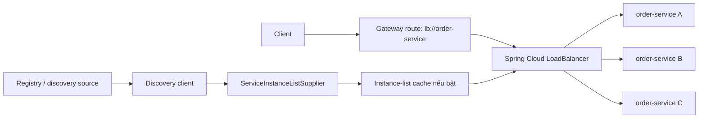
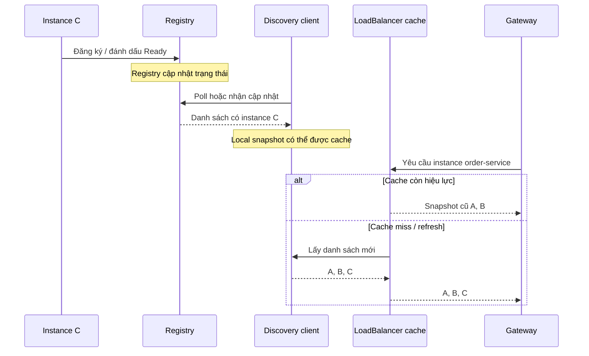
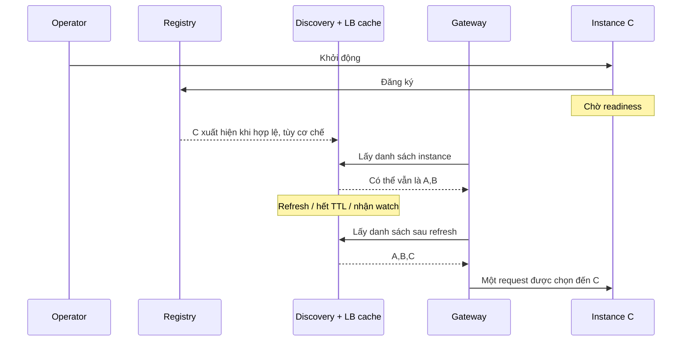

# Tương tác giữa khám phá dịch vụ, cache và thay đổi danh sách instance

Trong hệ thống microservices, một dịch vụ không còn gắn vĩnh viễn với một địa chỉ IP:port. `order-service` có thể chạy ba instance lúc bình thường, mở rộng thành tám instance khi tải cao rồi giảm còn hai instance. Một pod có thể chuyển từ trạng thái sẵn sàng sang không sẵn sàng, một node có thể mất kết nối hoặc một phiên bản mới có thể được triển khai cuốn chiếu. **Spring Cloud Gateway** phải tiếp tục chuyển request tới những instance phù hợp trong khi thông tin về hạ tầng liên tục thay đổi.

Vấn đề không chỉ là “lấy danh sách instance từ registry”. Danh sách đó có thể được **cache ở nhiều lớp**, được lọc theo sức khỏe/vùng triển khai, thay đổi theo thời gian và không đồng bộ ngay lập tức giữa mọi Gateway. Nếu không hiểu các lớp này, ta dễ kết luận sai rằng route không hoạt động, cấu hình `lb://` bị lỗi hoặc hệ thống tự loại instance lỗi ngay khi một request thất bại.

Bài thuộc chương **Khám phá và cân bằng tải**, tập trung vào **tương tác giữa service discovery, cache và vòng đời danh sách instance**. Nội dung áp dụng trong kiến trúc API Gateway với route predicates, filter chain, service discovery, giới hạn lưu lượng, retry, circuit breaker, TLS và quan sát request.

> **Phạm vi:** Các ví dụ sử dụng **Spring Cloud Gateway Server WebFlux** cùng **Spring Cloud LoadBalancer**. Hành vi và prefix một số thuộc tính thay đổi theo phiên bản/starter. Những giá trị TTL, chu kỳ refresh và chính sách sức khỏe dưới đây là **ví dụ thiết kế**, không phải giá trị mặc định cố định của mọi phiên bản.

## 1. Ba khái niệm cần tách riêng

**Service discovery** giải quyết câu hỏi *“Dịch vụ tên `order-service` hiện có những endpoint nào?”*. **Load balancing** giải quyết câu hỏi *“Trong các endpoint đang được biết và đủ điều kiện, request này nên đến endpoint nào?”*. **Cache** giải quyết câu hỏi *“Danh sách đã lấy được giữ lại bao lâu, khi nào cần đọc lại và lớp nào đang cung cấp dữ liệu?”*.

| Thành phần | Đối tượng quản lý | Ví dụ | Không chịu trách nhiệm chính về |
| --- | --- | --- | --- |
| Service registry / control plane | Bản ghi và trạng thái đăng ký của instance | `orders-A:8081`, `orders-B:8082` | Chọn instance cuối cùng cho từng HTTP request |
| Discovery client | Truy vấn/theo dõi dữ liệu từ nguồn discovery | `DiscoveryClient` / `ReactiveDiscoveryClient` | Xác thực HTTP hay sửa URI path |
| Spring Cloud LoadBalancer | Cung cấp, lọc và chọn `ServiceInstance` cho service ID | `lb://order-service` → `orders-A:8081` | Quyết định route predicate `Path` |
| Cache danh sách instance | Bản snapshot instance theo service ID, tùy cấu hình | Lưu danh sách trong một khoảng TTL | Bảo đảm snapshot luôn là trạng thái tức thời |
| Spring Cloud Gateway route | Predicate, filter, đích logic | `Path=/api/orders/**`, `uri=lb://order-service` | Giữ danh sách địa chỉ backend luôn cập nhật |
| HTTP connection pool | Kết nối mạng đang mở/tái sử dụng đến upstream | TCP/TLS connection đến instance A | Cung cấp danh sách các instance đang sống |

**Không được đồng nhất route với instance.** Một route có thể có URI logic ổn định `lb://order-service` trong nhiều tháng, trong khi số instance phía sau thay đổi mỗi phút.



Sơ đồ minh họa luồng phụ thuộc; trong triển khai thật, vị trí cache và các supplier phụ thuộc cách Spring Cloud LoadBalancer được cấu hình. **Không có một “cache duy nhất” áp dụng cho mọi hệ thống.**

## 2. `lb://` kết nối Gateway với LoadBalancer như thế nào?

Một route Gateway đơn giản:

```yaml
spring:
  cloud:
    gateway:
      routes:
        - id: orders
          uri: lb://order-service
          predicates:
            - Path=/api/orders/**
          filters:
            - StripPrefix=1
```

Ví dụ `GET /api/orders/42` trải qua các bước:

1. Spring Security/WebFlux xử lý phần được cấu hình ở điểm vào. Nếu không bị chặn, Gateway xét route.
2. `Path=/api/orders/**` khớp request và route `orders` được chọn.
3. `StripPrefix=1` biến path chuyển tiếp thành `/orders/42`.
4. Routing/load-balancer filter nhận đích logic `lb://order-service` và yêu cầu LoadBalancer chọn một `ServiceInstance` của `order-service`.
5. LoadBalancer lấy danh sách instance qua chuỗi `ServiceInstanceListSupplier`, có thể đi qua discovery client, cache và bộ lọc.
6. Một instance được chọn; Gateway tạo URI đích vật lý (scheme/host/port thích hợp) rồi HTTP client kết nối hoặc tái sử dụng kết nối hợp lệ tới upstream.
7. Response được chuyển về client theo filter chain.

```text
Public URL:
    GET https://api.example.test/api/orders/42

Route logic:
    id=orders
    uri=lb://order-service
    StripPrefix=1

Danh sách instance mà LoadBalancer đang thấy:
    order-service-A:8081
    order-service-B:8082

Một lựa chọn khả dĩ:
    GET http://order-service-B:8082/orders/42
```

**Điểm cần phân biệt:** `lb://` không phải một hostname DNS thông thường. `order-service` là **service ID** được LoadBalancer dùng để lấy danh sách instance. Thành phần discovery/load-balancer phải được cài và cấu hình đúng; chỉ khai báo `lb://` không tự tạo registry.

Trong Spring Cloud Gateway Server WebFlux, việc giải quyết địa chỉ thường do filter load-balancer reactive (ví dụ `ReactiveLoadBalancerClientFilter` ở các dòng phiên bản có thành phần này). Tên lớp và chi tiết triển khai có thể khác giữa các bản, nhưng thứ tự khái niệm vẫn là **chọn route → lấy instance → chọn endpoint → proxy**.

### Khi không tìm thấy instance

Cần tách hai trường hợp:

| Tình huống | Ý nghĩa | Hướng điều tra |
| --- | --- | --- |
| Không có Gateway route khớp | `RoutePredicateHandlerMapping` không chọn được route | Predicate, route order, Security, cấu hình route |
| Route đã khớp nhưng LoadBalancer không có instance | Có service ID nhưng danh sách ứng viên rỗng/không khả dụng | Registry, discovery client, supplier, cache, health, tên service |

Trong nhiều phiên bản Gateway, trường hợp không có instance dẫn đến **HTTP 503 Service Unavailable**; có phiên bản/cấu hình cho phép dùng `404` thay thế. Vì vậy đừng lấy riêng mã HTTP để kết luận “không khớp route”. Hãy quan sát **route ID**, service ID, số instance và lỗi load-balancer.

## 3. Vòng đời dữ liệu discovery: từ thay đổi thật đến danh sách Gateway nhìn thấy

Giả sử instance mới `order-service-C` xuất hiện vào thời điểm `t0`. Nó không nhất thiết được mọi Gateway sử dụng ngay tại `t0`.



Hình trên cho thấy **độ trễ hội tụ (eventual consistency)**. Thời gian request đầu tiên có thể được chuyển tới C phụ thuộc nhiều biến:

- Instance có thực sự **ready** để nhận HTTP traffic chưa.
- Registry/control plane đã cập nhật thông tin chưa.
- Discovery client dùng poll, watch hay cơ chế push; còn snapshot nội bộ không.
- `ServiceInstanceListSupplier` có đọc kết quả mới chưa.
- Cache của Spring Cloud LoadBalancer có hết TTL hoặc bị refresh chưa.
- Bộ lọc zone/health/sticky policy có cho phép chọn C không.
- Thuật toán load-balancing có thực sự chọn C ở những request kế tiếp không.

Vì vậy **“registry hiển thị instance C” không đồng nghĩa “request kế tiếp chắc chắn đi vào C”**.

### Không có một TTL chung

Có thể cùng lúc tồn tại các lớp dữ liệu sau:

| Lớp | Thông tin được lưu | Ai thường cấu hình? | Tác động khi stale |
| --- | --- | --- | --- |
| Registry / control plane | Đăng ký, lease, readiness hoặc endpoint | Hệ thống Eureka, Consul, Kubernetes… | Registry vẫn liệt kê instance đã rời hoặc chưa liệt kê instance mới |
| Discovery client local | Kết quả poll/watch từ registry | Client integration và service discovery config | Gateway nhìn thấy snapshot cũ dù registry đã đổi |
| Spring Cloud LoadBalancer cache | Danh sách `ServiceInstance` theo service ID | Cấu hình cache/supplier của LoadBalancer | Vẫn chọn ứng viên từ danh sách trước đó |
| Gateway route cache | Danh sách **route definition/route object**, không phải instance list | Route locator/refresh Gateway | Route mới/bỏ route có thể chưa có hiệu lực |
| HTTP connection pool và DNS | Kết nối đã mở, hoặc kết quả phân giải địa chỉ | Reactor Netty, HTTP client, DNS resolver | Kết nối cũ có thể thất bại dù danh sách instance đã mới |

**TTL hiệu dụng** là kết quả phối hợp nhiều cơ chế; không thể chỉ giảm một thuộc tính cache và hứa rằng mọi Gateway lập tức thấy instance mới.

## 4. Service registry, DiscoveryClient và ServiceInstanceListSupplier

### Registry là nguồn dữ liệu, không phải nguồn sự thật tuyệt đối tại từng mili-giây

Các hệ sinh thái phổ biến có cách tổ chức khác nhau:

- **Eureka:** client/instance đăng ký, duy trì lease/heartbeat và có cơ chế đồng bộ thông tin registry; hết lease hoặc thay đổi trạng thái có thể cần thời gian để hội tụ.
- **Consul:** service registration và health checks ảnh hưởng danh sách service khả dụng; quá trình đồng bộ sang client tùy cấu hình.
- **Kubernetes:** Service/EndpointSlice và trạng thái readiness phản ánh tập endpoint đủ điều kiện theo controller/control plane; Spring Cloud Kubernetes hoặc các cơ chế discovery tích hợp đọc thông tin theo cách riêng.
- **SimpleDiscoveryClient:** danh sách instance tĩnh trong cấu hình, phù hợp phát triển/test; không phải registry động có heartbeat.

Không coi một công nghệ là chuẩn chung cho mọi trường hợp. Chẳng hạn, một instance vừa không sẵn sàng có thể bị Kubernetes loại khỏi endpoints sau khi trạng thái được cập nhật, nhưng Gateway vẫn còn snapshot cũ trong cache của client/LoadBalancer cho một khoảng thời gian.

### `ServiceInstanceListSupplier` là đường đi của danh sách

Spring Cloud LoadBalancer có khái niệm `ServiceInstanceListSupplier`, cung cấp danh sách `ServiceInstance` cho một service ID. Tùy hệ thống, supplier có thể:

1. Lấy danh sách thô từ `DiscoveryClient` hoặc `ReactiveDiscoveryClient`.
2. Cache snapshot danh sách.
3. Lọc instance theo zone, health hoặc metadata.
4. Áp dụng cơ chế lựa chọn có lưu ý tới ngữ cảnh request.

Những thành phần như `DiscoveryClientServiceInstanceListSupplier`, `CachingServiceInstanceListSupplier` và `HealthCheckServiceInstanceListSupplier` minh họa các trách nhiệm khác nhau. Thứ tự bọc supplier **rất quan trọng**: cache ở trước hay sau bộ lọc sức khỏe có thể tạo ra tập ứng viên và nhịp cập nhật khác nhau. Nếu tự cấu hình chuỗi supplier, hãy theo đúng hướng dẫn của phiên bản Spring Cloud LoadBalancer đang dùng thay vì ghép tùy ý nhiều lớp cache.

**Đừng nhầm health check của discovery với HTTP health check chạy trên mỗi request.** Registry hoặc supplier có thể cập nhật sức khỏe theo chu kỳ. Một request mới vẫn có thể đi vào instance vừa hỏng trước khi thông tin được cập nhật.

## 5. Cấu hình cache: cân bằng độ mới, chi phí và tính ổn định

Spring Cloud LoadBalancer hỗ trợ cơ chế cache danh sách service instance. Một số phiên bản hỗ trợ thuộc tính dạng:

```yaml
spring:
  cloud:
    loadbalancer:
      cache:
        enabled: true
        ttl: 30s
```

`30s` ở đây là **giá trị ví dụ**, không phải đề xuất cố định hay đảm bảo “instance thay đổi sẽ xuất hiện sau đúng 30 giây”. Cần kiểm tra tính hợp lệ/đơn vị thuộc tính và việc dùng cache trong **đúng phiên bản Spring Cloud LoadBalancer**. Khi sử dụng Caffeine, cần xem xét cách dependency và cấu hình spec của cache ảnh hưởng tới chính sách; không cộng cơ học các TTL khi chưa hiểu chuỗi supplier.

### Cache ngắn hay dài hơn?

| Lựa chọn | Lợi ích | Đánh đổi |
| --- | --- | --- |
| TTL ngắn | Giảm thời gian giữ danh sách cũ, hấp thụ scale-in nhanh hơn | Tăng tần suất truy vấn discovery, có thể gây tải/control-plane pressure |
| TTL dài | Giảm số lần đọc registry/client, ít thay đổi đột ngột | Giữ instance đã rời lâu hơn, nhận instance mới chậm hơn |
| Không dùng LoadBalancer cache | Có thể giảm một lớp stale | Vẫn có cache ở DiscoveryClient/registry; tăng truy vấn qua supplier |
| Cache cộng watch/push | Có thể cập nhật hiệu quả khi có sự kiện | Phụ thuộc cơ chế invalidation và độ tin cậy của nguồn sự kiện |

**Không có một giá trị TTL tối ưu chung.** Hệ thống có pod scale-in thường xuyên, request ngắn và registry khỏe có nhu cầu khác với hệ thống ít thay đổi hoặc control plane ở xa. Phải đo độ trễ hội tụ, tần suất đổi instance, mức lỗi ở thời điểm rolling deploy và chi phí registry trước khi quyết định.

### Tránh cache chồng cache vô tình

Một số discovery client **đã có cache riêng**. Nếu bên ngoài lại đặt `CachingServiceInstanceListSupplier`, hai lớp có thể cùng giữ snapshot cũ. Kết quả có thể là:

```text
Registry:                 [A, B, C]   (mới)
DiscoveryClient local:    [A, B]      (chưa refresh)
LoadBalancer cache:       [A, B]      (cache hit)
Gateway chọn:             A hoặc B
```

Ngay cả khi cache LoadBalancer hết hạn, nó có thể hỏi một DiscoveryClient **vẫn chưa nhận C**. Do đó giải pháp không phải lúc nào cũng là “giảm TTL của Gateway”.

Ở nhiều tích hợp, Spring Cloud LoadBalancer khuyến nghị cân nhắc **không bật thêm cache** khi discovery client đã caching hiệu quả. Nhưng cần đánh giá theo cơ chế thực tế và tài liệu phiên bản, không tắt mù quáng trong production.

## 6. Phân biệt route cache và instance cache

Spring Cloud Gateway có cơ chế lưu/cache định nghĩa route tùy route locator/cấu hình. Hai ví dụ:

**Trường hợp A — Định nghĩa route cố định:**

```yaml
- id: orders
  uri: lb://order-service
  predicates:
    - Path=/api/orders/**
```

Route `orders` vẫn đúng khi danh sách chuyển từ `[A,B]` thành `[B,C,D]`. **Không cần tạo route mới cho mỗi instance** nếu supplier của LoadBalancer có thể lấy được danh sách instance mới.

**Trường hợp B — Route được sinh từ discovery locator:**

Có hệ thống dùng `DiscoveryClientRouteDefinitionLocator` để sinh route dựa trên các **service ID** được discovery biết. Khi một **dịch vụ mới** xuất hiện hoặc tên dịch vụ bị bỏ, tập định nghĩa route được sinh có thể thay đổi. Việc cập nhật route cache và refresh cần xử lý riêng với danh sách instance của một service đang tồn tại.

| Thay đổi | Đối tượng thay đổi chính | Thứ cần kiểm tra |
| --- | --- | --- |
| `order-service` thêm instance D | Instance list của service ID cũ | Discovery, LoadBalancer supplier/cache |
| `order-service` mất instance A | Instance list của service ID cũ | Readiness, deregistration, cache, pool |
| Thêm service ID hoàn toàn mới `invoice-service` khi dùng discovery locator | Danh sách route có thể được sinh từ discovery | Discovery locator, route refresh/cache |
| Sửa `Path`/`RewritePath` của route `orders` | Route definition/config | Nguồn cấu hình và route refresh |
| Backend chuyển IP nhưng giữ service ID | Địa chỉ một instance | Discovery/client/supplier và connection pool |

**Một lệnh “refresh Gateway routes” không chắc làm mới cache instance của LoadBalancer.** Ngược lại, invalidation cache instance không tự tạo ra định nghĩa route mới. Đây là nguyên nhân phổ biến của thao tác vận hành tưởng đã refresh nhưng triệu chứng không đổi.

Nếu bật Actuator Gateway endpoints (ví dụ danh sách routes hoặc thao tác refresh ở phiên bản hỗ trợ), phải bảo vệ endpoint quản trị bằng xác thực/phân quyền và mạng nội bộ, không công khai cho client.

## 7. Mở rộng dịch vụ (scale-out): vì sao instance mới chưa có traffic?

Giả sử lúc `t0` LoadBalancer biết `[A,B]`. Operator tăng số instance thành `[A,B,C]`.



Ba nguyên nhân lớn khiến C chưa nhận request:

1. **C chưa Ready:** registry/endpoints chưa công bố C là ứng viên có thể dùng, hoặc health filter vẫn loại C.
2. **Cache stale:** có nơi còn giữ `[A,B]`, mặc dù registry đã có C.
3. **Thuật toán chọn:** C đã trong danh sách nhưng load balancer chưa chọn C trong số request quan sát được.

Đừng chỉ xem count trong registry; cần biết **danh sách mà Gateway thực sự nhìn thấy và instance mà load balancer chọn**.

### Độ trễ hội tụ có thể quan sát

Có thể đo thực nghiệm bằng ba mốc thời gian:

```text
t0 = instance C được đánh dấu Ready ở nguồn discovery
t1 = DiscoveryClient / supplier tại Gateway nhìn thấy C
t2 = lần đầu một request thực sự được gửi đến C

t1 - t0: thời gian cập nhật discovery/cache
t2 - t1: thời gian bị ảnh hưởng bởi thuật toán chọn/tải/traffic
```

Không lấy `t2-t0` rồi khẳng định toàn bộ là lỗi cache: khi lưu lượng rất thấp, C có thể đã sẵn sàng mà chưa được chọn. Có thể sử dụng metric/supplier instrumentation hoặc test cố định để phân biệt.

## 8. Thu hẹp dịch vụ (scale-in): rủi ro lớn hơn stale cache

Khi loại instance A khỏi cụm, các request vẫn có thể đi vào A trong một khoảng thời gian vì:

- Registry chưa cập nhật trạng thái/deregistration.
- DiscoveryClient hoặc LoadBalancer cache giữ snapshot có A.
- Một lựa chọn instance đã xảy ra trước khi A bắt đầu đóng.
- Client đang có request in-flight hoặc kết nối HTTP đã mở tới A.
- Readiness/termination không đủ thời gian cho request đang xử lý.

Một thứ tự scale-in hợp lý về nguyên tắc:

1. **Ngừng công bố A là sẵn sàng** hoặc deregister A theo cơ chế nền tảng.
2. Cho phép thời gian để các bên nhận cập nhật, kể cả cache đang dùng; sử dụng khoảng **drain** được đo và cấu hình phù hợp.
3. Ngừng nhận request mới, nhưng tiếp tục phục vụ request in-flight trong giới hạn timeout hợp lý.
4. Đóng kết nối/tài nguyên và kết thúc instance khi đã drain hoặc đến deadline bắt buộc.

```text
Không tốt:
    kill A ngay -> registry/client/cache vẫn biết A -> lỗi connect/timeout

Tốt hơn:
    A NotReady -> registry cập nhật -> clients hội tụ
       -> drain in-flight -> shutdown A
```

**Không có guarantee “zero error” chỉ từ deregister.** Gateway có thể vừa chọn A trước khi registry thay đổi, hoặc client có thể cancel. Để triển khai cuốn chiếu mượt, phối hợp readiness, preStop/termination grace (nếu trên Kubernetes), connection draining, retry an toàn, circuit breaker và metric.

### Kết nối HTTP đang mở là vấn đề khác cache danh sách

Ngay cả khi supplier loại A khỏi danh sách, một request **đã được gửi** tới A không tự động được chuyển sang B. Connection pool/Reactor Netty có thể còn kết nối tới A phục vụ request đang chạy. Cấu hình thời gian sống/idle của kết nối, timeout kết nối/response và graceful shutdown cần phù hợp với môi trường.

Không nên diễn giải “clear LoadBalancer cache” là “đóng hết TCP/TLS connections”. Hai lớp độc lập; nếu lỗi chỉ xuất hiện ở connection cũ hoặc TLS handshake, cần kiểm tra HTTP client/connection pool ngoài discovery.

## 9. Khi danh sách instance trống hoặc chỉ chứa instance lỗi

Có hai dạng rất khác nhau:

- **Danh sách rỗng:** supplier không biết instance nào hoặc bộ lọc đã loại hết.
- **Danh sách không rỗng nhưng không thực sự khả dụng:** supplier có A/B nhưng TCP connect thất bại, timeout, hoặc backend đã mất readiness mà client chưa cập nhật.

| Quan sát | Khả năng chính | Hướng hành động |
| --- | --- | --- |
| Route ID có, service ID đúng, số candidate = 0 | Lỗi discovery, service ID, filter health/zone, cache rỗng | Kiểm tra registry và supplier |
| Candidate có A/B nhưng connect refused | Instance chết hoặc host/port sai, stale cache | Kiểm tra endpoint, TTL, readiness, lifecycle |
| HTTP 503 ngay, không thấy upstream request | Có thể không có instance hoặc filter từ chối | Đối chiếu exception/filter/metrics |
| HTTP 504 sau thời gian dài | Timeout đến upstream hoặc timeout policy | Kiểm tra connect/response timeout và backend |
| Chỉ một số request lỗi trong rolling deploy | Chuyển trạng thái readiness/cache/connection drain | Đo theo instance được chọn và mốc triển khai |
| Có instance nhưng một vùng mất traffic | Zone preference/filter policy | Kiểm tra metadata zone và chính sách fallback |

**Không nên trả một response `200` giả chỉ vì LoadBalancer không tìm được instance.** Hợp đồng API phải phản ánh dịch vụ chưa sẵn sàng, hoặc cung cấp fallback thực sự phù hợp nghiệp vụ.

### 503 và 404 là dấu hiệu, không phải kết luận

Gateway có thể được cấu hình để trả `404` khi LoadBalancer không tìm được service instance ở một số phiên bản (ví dụ tùy chọn dạng `use404` trong nhóm load-balancer của Gateway). Ngược lại, một route không khớp cũng thường kết thúc bằng `404`. Vì vậy trong chẩn đoán, cần ghi rõ *Gateway đã có route ID chưa?* và *LoadBalancer có báo không có instance không?*.

## 10. Service ID, địa chỉ, scheme và TLS

Một `ServiceInstance` không chỉ có host/port; tùy tích hợp nó có thể mang service ID, metadata, zone và cờ secure. Khi Gateway chọn một instance từ `lb://service-id`, routing layer phải xây dựng đích vật lý tương ứng.

Những lỗi cấu hình dễ gặp:

- **Sai service ID hoặc khác quy tắc đặt tên:** route dùng `lb://order-service` nhưng discovery đăng ký tên khác; không có instance dù registry vẫn hoạt động.
- **Sai host/port của instance:** registry chứa địa chỉ chỉ truy cập được trong mạng khác.
- **Sai scheme/secure metadata:** backend yêu cầu TLS nhưng request kết nối như HTTP, hoặc ngược lại.
- **mTLS không được cấu hình:** chọn đúng instance không đảm bảo Gateway tin certificate hoặc có client certificate hợp lệ.
- **Certificate hostname/SNI không khớp:** IP/hostname do discovery trả có thể không phù hợp tên trong chứng chỉ; cần thiết kế discovery address và TLS validation nhất quán.

**Service discovery không tự giải quyết bảo mật.** Dữ liệu registry cần được bảo vệ, Gateway và service cần kiểm soát quyền truy cập và TLS phù hợp; không dùng metadata/header chưa xác minh làm căn cứ cấp quyền. Với các API có JWT, Spring Security xử lý xác thực/phân quyền **trước** khi route đưa request đến LoadBalancer.

## 11. Tương tác với retry, circuit breaker và rate limiting

### Retry không thay thế cập nhật instance list

Nếu A không phản hồi, policy retry có thể thử request lại. Tùy filter, thuật toán và cấu hình, lần thử tiếp theo **có thể** được chọn instance khác, nhưng không nên mặc định mọi retry đều đổi backend. Nếu snapshot chỉ chứa A, retry có thể tiếp tục thất bại dù policy thử nhiều lần.

Ba điều cần quản lý đồng thời:

1. **Độ mới của danh sách instance:** discovery/cache/health.
2. **Chính sách retry:** lỗi nào được retry, số attempt, backoff và ngân sách thời gian.
3. **Tính an toàn nghiệp vụ:** GET/HEAD và thao tác idempotent có đặc tính khác POST tạo thanh toán; retry sau timeout không chứng minh backend chưa xử lý.

Một `POST /payments` có thể đã ghi dữ liệu ở instance A trước khi Gateway bị timeout. Nếu retry sang B, side effect có thể bị lặp. Cần idempotency key và cơ chế chống xử lý trùng do dịch vụ nghiệp vụ đảm nhiệm.

### Circuit breaker bảo vệ khi upstream không ổn định

Circuit breaker có thể từ chối request hoặc dùng fallback khi tỷ lệ lỗi/độ trễ vượt ngưỡng, giúp giảm tải lên backend đang hỏng. Nó **không tự sửa danh sách instance** trong discovery và không thay thế readiness. Với một breaker đặt ở phạm vi cả route/service, lỗi của một instance có thể ảnh hưởng cách toàn route được nhìn nhận; cần cân nhắc granularity, timeout và metric.

### Rate limiter và traffic distribution

`RequestRateLimiter` có thể từ chối request theo user/API key/trục chính sách trước khi tốn tài nguyên gọi backend. Nhưng “chia đều request” qua A/B không đồng nghĩa “chia đều CPU” vì mỗi request có độ nặng khác nhau. Cache stale, session affinity, zone preference, instance weight và traffic mix có thể làm phân phối request lệch mạnh.

**Tách metric:** tỷ lệ `429` do rate limiter, `503` do không tìm được instance và `5xx` từ backend là ba nguyên nhân khác nhau, cần phân loại riêng khi vận hành.

## 12. Ví dụ cấu hình chạy thử không cần registry động

Để học cơ chế `lb://`, có thể cấu hình danh sách instance tĩnh qua `SimpleDiscoveryClient`, đồng thời cấu hình Spring Cloud LoadBalancer và Gateway phù hợp:

```yaml
spring:
  cloud:
    discovery:
      client:
        simple:
          instances:
            order-service:
              - uri: http://localhost:8081
              - uri: http://localhost:8082

    loadbalancer:
      cache:
        enabled: true
        ttl: 30s

    gateway:
      routes:
        - id: orders
          uri: lb://order-service
          predicates:
            - Path=/api/orders/**
          filters:
            - StripPrefix=1
```

Ví dụ cần các dependency tương ứng cho **Gateway WebFlux** và **Spring Cloud LoadBalancer** trong bộ phiên bản Spring Cloud tương thích. Tên thuộc tính chi tiết và tính năng SimpleDiscoveryClient nên được kiểm tra theo bản đang dùng; route property prefix có thể khác ở bản Gateway mới.

Cách thử:

1. Cho upstream A `localhost:8081` và B `localhost:8082` trả một header khác nhau, ví dụ `X-Test-Instance: A` hoặc `B`.
2. Gửi nhiều request `GET /api/orders/42` đến Gateway tại `localhost:8080`.
3. Quan sát request đi đến A/B; đừng suy luận thuật toán chỉ từ vài request mẫu.
4. Dừng A và xem kết quả lỗi, nhưng **không coi** cấu hình tĩnh này là bài test “registry đã loại A” — A vẫn được khai báo trong config.
5. Khi cần bài test động đúng nghĩa, dùng discovery fake thay đổi được danh sách hoặc registry test thật và kiểm soát mốc readiness/deregistration.

**Giới hạn bài lab:** `SimpleDiscoveryClient` từ cấu hình tĩnh không tự phản ánh việc process A tắt. Thay đổi danh sách trong file YAML cũng không nhất thiết được nạp lại tự động khi ứng dụng đã chạy; cần cơ chế reload/config refresh rõ ràng nếu muốn thay đổi instance list theo thời gian.

## 13. Kiểm thử độ mới dữ liệu và scale-in/scale-out

Một bài test chỉ xác nhận Gateway trả `200` khi có hai instance **chưa đủ**. Cần kiểm thử những chuyển trạng thái.

### Ma trận kiểm thử

| Kịch bản | Dữ liệu discovery ở đầu | Biến cố | Cần quan sát |
| --- | --- | --- | --- |
| Bình thường | `[A,B]` | Gửi nhiều request | Route chọn đúng, hai upstream có thể nhận request |
| Scale-out | `[A,B]` | C Ready và được thêm vào registry | Khi nào supplier thấy C; C bắt đầu có traffic khi nào |
| Scale-in | `[A,B,C]` | B NotReady/deregister | Có request mới tới B sau mốc đó không, trong bao lâu |
| Mất instance đột ngột | `[A,B]` | B chết trước deregister | Lỗi connect/timeout, retry/fallback, số lần chọn B |
| Registry chậm | `[A,B]` | Registry chưa cập nhật C | Gateway tiếp tục dùng A/B mà không tự suy ra C |
| Cache còn TTL | `[A,B]` | Registry trả `[A,B,C]` | Supplier/cache có thấy C ngay hay vẫn giữ snapshot cũ |
| Danh sách rỗng | `[]` | Request đến route `lb://` | Status/error classification cho “no instance” |
| Metadata zone đổi | `[A,B]` | A chuyển zone/metadata | Bộ lọc zone có cập nhật tập ứng viên không |
| Backend rolling update | `[A,B,C]` | Từng instance NotReady rồi Ready | Lỗi/latency theo từng giai đoạn và connection drain |

### Mẫu thiết kế test với supplier có thể kiểm soát

Đối với integration test WebFlux, có thể chuẩn bị một nguồn instance fake hoặc `ServiceInstanceListSupplier` riêng cho test:

```text
T0: test supplier trả [A, B]
    -> Gateway GET /api/orders/42
    -> verify một trong A/B nhận request

T1: test supplier đổi thành [A, B, C]
    -> nếu bật cache: chờ/invalidate theo chính sách test
    -> verify C xuất hiện trong tập ứng viên

T2: test supplier đổi thành [A, C]
    -> verify không chọn B sau khi cache/supplier đã hội tụ

T3: test supplier trả []
    -> verify Gateway báo lỗi no-instance theo cấu hình
```

Điểm quan trọng: **test phải kiểm soát cache**, nếu không các assertion có thể phụ thuộc đồng hồ và bị flaky. Có thể dùng TTL đủ ngắn trong môi trường test, một cơ chế cache/invalidation test hoặc đồng hồ ảo nếu thành phần hỗ trợ; không hard-code một khoảng `sleep` lớn và coi đó là bằng chứng mọi cluster đã hội tụ.

### Lệnh gửi request mẫu

```bash
# Gateway giả định chạy trên port 8080.
curl -i http://localhost:8080/api/orders/42

# Gửi nhiều request để quan sát header do từng upstream giả lập trả.
for i in 1 2 3 4 5; do
  curl -sS -D - -o /dev/null http://localhost:8080/api/orders/42
done
```

Nếu dùng PowerShell trên Windows, điều chỉnh cú pháp vòng lặp và sử dụng `curl.exe` khi `curl` là alias PowerShell. Khi có Spring Security, thêm token hợp lệ/thiết lập security test đúng cách; `401` xảy ra trước Gateway routing không kiểm tra được LoadBalancer.

## 14. Quan sát và chẩn đoán nhiều Gateway instance

Trong sản xuất thường có **nhiều replica Gateway**. Mỗi replica có thể sở hữu discovery client/cache/connection pool riêng:

```text
Registry tại một thời điểm: [A, B, C]

Gateway-1 local snapshot: [A, B, C]
Gateway-2 local snapshot: [A, B]
Gateway-3 local snapshot: [B, C]
```

Đây có thể là trạng thái **hội tụ tạm thời**, không nhất thiết là hỏng logic. Một request từ client đi qua load balancer trước Gateway đến replica-1 có thể thành công, trong khi request khác đến replica-2 gặp lỗi do chọn A đã rời. Cần xem log/metric có **Gateway instance ID** hoặc node/pod identity, không chỉ route ID.

### Dữ liệu vận hành nên thu thập

| Nhóm | Trường/metric hữu ích | Câu hỏi trả lời |
| --- | --- | --- |
| Route | Gateway replica, route ID, service ID, method, status | Request đã chọn route nào? |
| Discovery | Thời điểm snapshot, số instance, registry errors | Client đang biết bao nhiêu instance? |
| LoadBalancer | Tên instance được chọn, kết quả chọn/no-instance | Vì sao request đi vào A thay vì C? |
| Cache | Hit/miss, TTL/config, thời điểm refresh | Danh sách có đang stale không? |
| Health/readiness | Ready/NotReady, metadata zone | Ứng viên có đang phù hợp để nhận traffic? |
| HTTP client | Connect timeout, response timeout, connection reuse | Lỗi xuất hiện ở network hay lookup? |
| Retry/circuit breaker | Attempts, fallback, trạng thái breaker | Có lặp attempt hoặc từ chối sớm không? |
| Kết quả client | `429`/`502`/`503`/`504` và latency | Người dùng bị ảnh hưởng thế nào? |

Không phải mọi metric kể trên đều có sẵn với một tên cố định ở mọi phiên bản. Có thể sử dụng Micrometer/Actuator, tracing và custom instrumentation để bổ sung dữ liệu cần thiết. Không ghi Bearer token, cookie, toàn bộ request body hay thông tin nhạy cảm của client; route/instance metadata cũng cần được kiểm soát khi phơi bày ra bên ngoài.

### Quy trình chẩn đoán có thứ tự

1. **Xác nhận Gateway route có khớp.** Nếu không có route ID hoặc request bị Security chặn, đừng bắt đầu từ registry.
2. **Xác nhận service ID chính xác** trong URI `lb://` và tên được đăng ký ở discovery.
3. **Kiểm tra registry trực tiếp** tại thời điểm quan sát: instance nào đang registered/ready?
4. **Kiểm tra danh sách mà DiscoveryClient của một Gateway replica nhìn thấy.** Có khác registry không?
5. **Kiểm tra supplier/filter/cache ở LoadBalancer.** Danh sách cuối cùng được chọn từ đâu và đã refresh chưa?
6. **Kiểm tra instance thực sự được chọn**, URI vật lý, host/port/TLS và connection timeout.
7. **Đối chiếu mốc scale-out/scale-in** với readiness, cache refresh, retry và lỗi mạng.
8. **Lặp lại trên nhiều Gateway replica**, vì snapshot/cached result có thể khác nhau.
9. **Đưa ra thay đổi nhỏ có đo lường**, ví dụ điều chỉnh TTL hoặc drain; tránh clear tất cả cache và kết luận thiếu bằng chứng.

## 15. Những nhầm lẫn thường gặp

| Nhận định sai | Vì sao sai | Cách hiểu đúng |
| --- | --- | --- |
| “Route `lb://` phải refresh khi thêm pod” | Route trỏ tới service ID, không trỏ từng pod | Chỉ instance list thay đổi; route có thể giữ nguyên |
| “Registry có C nên request tới C ngay” | Discovery/client/supplier/cache có thể chưa hội tụ | Đo t0/t1/t2; phân biệt cập nhật và chọn instance |
| “Giảm TTL LoadBalancer là hết stale” | Registry và DiscoveryClient còn cache/poll riêng | Xem toàn bộ chuỗi dữ liệu |
| “Không thấy C có nghĩa load balancer sai” | C có thể chưa Ready hoặc chưa được thuật toán chọn | Kiểm tra candidate set và lựa chọn |
| “Deregister A là A hết nhận traffic lập tức” | Request in-flight và cache snapshot cũ còn tồn tại | Cần drain và graceful shutdown |
| “Retry sẽ luôn sang instance khác” | Tùy retry/supplier/algorithm và danh sách ứng viên | Test policy thực tế, không assume |
| “Có instance là phải trả 200” | Backend có thể lỗi, TLS sai, timeout | Quan sát cả lookup và HTTP client |
| “Actuator refresh route sẽ xóa cache instance” | Hai loại cache khác nhau | Refresh đúng lớp được chứng minh stale |
| “Cache instance hết hạn thì TCP connection cũ cũng đóng” | Pool kết nối có vòng đời riêng | Cấu hình/giám sát HTTP client riêng |
| “Đổi 503 thành 404 là sửa được discovery” | Chỉ thay biểu diễn lỗi HTTP | Phải xử lý nguồn không có instance |
| “Health filter đảm bảo không gọi instance chết” | Health là quan sát theo thời gian, có race | Chuẩn bị timeout/retry/fallback có giới hạn |

## 16. Bài tập tình huống và câu hỏi tự kiểm tra

### Tình huống: rolling deploy order-service

Đội vận hành có ba Gateway replica và hai instance backend A/B. Lúc 10:00, instance C đã Ready; lúc 10:02, A được đánh dấu NotReady và bắt đầu shutdown. Một nhóm request vẫn bị connection refused khi đi qua Gateway-2, trong khi Gateway-1 hoạt động tốt.

**Yêu cầu phân tích:**

1. Liệt kê những snapshot có thể tồn tại ở registry, DiscoveryClient và LoadBalancer cache của Gateway-2.
2. Vì sao Gateway-1 và Gateway-2 có thể trả kết quả khác nhau với cùng route `lb://order-service`?
3. Phép đo nào phân biệt “Gateway-2 còn chọn A vì cache stale” với “Gateway-2 đã chọn B nhưng B bị lỗi”?
4. Nếu tăng thời gian drain A, những loại lỗi nào có thể giảm? Những lỗi nào vẫn không được giải quyết?
5. Nếu giảm TTL cache, chi phí tăng thêm xảy ra ở lớp nào? Registry có thể chịu được tần suất truy vấn mới không?
6. Nếu request lỗi là `POST /payments`, cần điều kiện nghiệp vụ nào trước khi bật retry?
7. Nếu A có chứng chỉ TLS hết hạn, làm mới danh sách instance có đủ khắc phục không?
8. Vì sao chỉ gọi refresh route qua Actuator chưa chắc giải quyết stale instance list?

**Định hướng đáp án:** Trước hết xác định *request đã khớp route chưa*, sau đó thu thập danh sách instance **mà replica lỗi đang nhìn thấy**, instance đã được chọn, mốc readiness và lý do lỗi network. Không sửa TTL hoặc route cache chỉ vì symptom chung là HTTP `503`.

### Checklist triển khai trước production

- [ ] Service ID thống nhất giữa URI `lb://` và registry/discovery.
- [ ] Có readiness và deregistration phù hợp với cách triển khai.
- [ ] Đã biết từng lớp cache/snapshot và chu kỳ làm mới; tránh chồng cache không cần thiết.
- [ ] Cache TTL được chọn từ quan sát thực nghiệm, không sao chép tùy tiện.
- [ ] Có drain/termination grace cho scale-in/rolling deploy.
- [ ] Timeout kết nối/response, retry và circuit breaker có chính sách riêng, có giới hạn.
- [ ] Không retry thao tác ghi thiếu cơ chế idempotency.
- [ ] TLS/mTLS/hostname verification phù hợp URI vật lý được chọn.
- [ ] Metric/log đủ để phân biệt route-not-found, no-instance, connect timeout và upstream 5xx.
- [ ] Kiểm thử được sự thay đổi `[A,B] → [A,B,C] → [B,C]` trên nhiều Gateway replica.

**Ghi nhớ:** Service discovery cung cấp danh sách instance, LoadBalancer chọn ứng viên từ dữ liệu nó đang nhìn thấy, còn cache quyết định một phần độ mới của dữ liệu đó. **Route cache, instance cache và HTTP connection pool là các lớp khác nhau.** Khi backend scale-out/scale-in, hệ thống hội tụ theo thời gian; để Spring Cloud Gateway vận hành an toàn, cần phối hợp readiness, drain, TTL, health, timeout, retry, TLS và quan sát theo từng Gateway replica — không chỉ nhìn tên service trong URI `lb://`.

