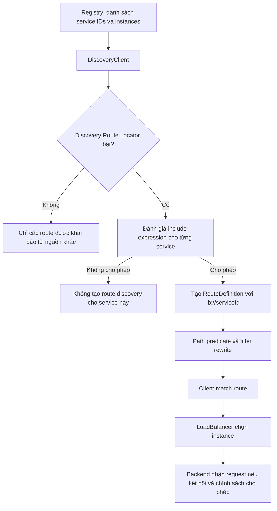

# Kiểm soát dịch vụ nội bộ được phép công bố qua discovery trong Spring Cloud Gateway

## 1. Vì sao service registry không phải danh sách API công khai?

Trong kiến trúc microservices, **Spring Cloud Gateway** là điểm vào HTTP chung. Gateway dùng **route predicate**, **filter chain**, biến đổi đường dẫn/header và **service discovery/load balancing** để chuyển request đến đúng dịch vụ. Các cơ chế xác thực, giới hạn lưu lượng, circuit breaker, retry, TLS và quan sát request giúp bảo vệ và vận hành cổng vào an toàn.

Giả sử registry có các dịch vụ sau:

| Service ID trong registry | Vai trò | Có nên công bố qua Gateway Internet? |
|---|---|---|
`catalog-api` | Danh mục sản phẩm cho khách hàng | Có, nhưng chỉ API được phê duyệt |
`orders-api` | Tra cứu/tạo đơn hàng | Có, sau khi áp dụng xác thực và phân quyền |
`billing-core` | Xử lý thanh toán nội bộ | Không công bố trực tiếp |
`internal-admin` | Quản trị hạ tầng | Không |
`config-server` | Cung cấp cấu hình dịch vụ | Không |
`edge-gateway` | Chính Gateway, nếu cũng đăng ký vào registry | Không tạo route vòng về chính nó |

**Một service xuất hiện trong registry không có nghĩa nó được phép có route công khai.** Registry trả lời câu hỏi “dịch vụ nào đang có instance và ở đâu?”; chính sách API Gateway phải trả lời câu hỏi khác: “client nào được gọi endpoint nào của dịch vụ đó, theo method, host và quyền nào?”.

Mục tiêu bài học là:

- Hiểu vì sao **DiscoveryClient Route Definition Locator** có thể tạo route ngoài ý muốn.
- Chọn phương án **tắt tự tạo route và khai báo allowlist rõ ràng** cho production.
- Nếu cần tự tạo route, giới hạn danh sách bằng `include-expression` và nắm rõ những giới hạn của cách này.
- Phân biệt **không có route**, **không tìm thấy instance** và **bị từ chối quyền**.
- Kiểm tra danh sách route thực tế, kiểm thử âm tính và áp dụng bảo vệ nhiều lớp khi registry thay đổi.

> **Phạm vi:** ví dụ dùng **Spring Cloud Gateway Server WebFlux 4.3+/5.x**, với namespace `spring.cloud.gateway.server.webflux.*`. Các dòng 4.2 trở về trước thường dùng `spring.cloud.gateway.*`. Gateway Server Web MVC có web stack/namespace riêng; không giả định cấu hình WebFlux được chuyển nguyên xi sang MVC.

## 2. Đường đi từ tên dịch vụ đến một route công khai



**DiscoveryClient** (ví dụ Eureka hoặc Consul client) cung cấp service IDs và danh sách instance. **DiscoveryClient Route Definition Locator** là thành phần *tùy chọn* tạo route definitions từ những IDs đó. **Spring Cloud LoadBalancer** tiếp tục quyết định instance nào sẽ nhận request đối với URI kiểu `lb://serviceId`.

Ba hành vi cần phân biệt:

1. **Đăng ký vào registry:** service tồn tại trong danh sách discovery; chưa có nghĩa client truy cập được.
2. **Tạo route ở Gateway:** URI và predicates được hình thành từ service ID; route có thể trở thành đường truy cập nếu Gateway được phơi ra mạng.
3. **Gọi được endpoint:** còn tùy host/path/method matching, kết nối tới instance, TLS, Spring Security, kiểm soát quyền và chính sách mạng.

### 2.1. Locator tắt mặc định; bộ lọc bao gồm mọi service nếu được bật

Theo cấu hình Gateway Server WebFlux 5.0/5.1:

| Property | Giá trị mặc định | Vai trò |
|---|---|---|
`spring.cloud.gateway.server.webflux.discovery.locator.enabled` | `false` | Bật/tắt tự tạo route từ discovery |
`spring.cloud.gateway.server.webflux.discovery.locator.include-expression` | `true` | Biểu thức SpEL quyết định service nào được tạo route |
`spring.cloud.gateway.server.webflux.discovery.locator.url-expression` | `'lb://'+serviceId` | URI đích được tạo cho từng service |
`spring.cloud.gateway.server.webflux.discovery.locator.lower-case-service-id` | `false` | Hỗ trợ chuyển service ID thành chữ thường trong pattern/filter được sinh |
`spring.cloud.gateway.server.webflux.discovery.locator.predicates` | Cấu hình mặc định của locator | Các điều kiện match route được sinh |
`spring.cloud.gateway.server.webflux.discovery.locator.filters` | Cấu hình mặc định của locator | Các filter cho route được sinh |

**Điểm dễ bỏ sót:** `enabled=false` là trạng thái an toàn hơn để bắt đầu. Khi ai đó đổi thành `enabled=true` mà **không giới hạn `include-expression`**, biểu thức mặc định `true` cho phép tạo route discovery cho các service mà locator nhìn thấy.

### 2.2. Đường dẫn tự tạo trông như thế nào?

Với service ID `catalog-api` và locator dùng cấu hình mặc định:

```text
Registry:
  catalog-api -> 10.1.0.12:8081, 10.1.0.13:8081

Route tự sinh (ý tưởng):
  Predicate: Path=/catalog-api/**
  URI:       lb://catalog-api
  Filter:    RewritePath bỏ đoạn /catalog-api trước khi proxy

Client:
  GET /catalog-api/products/42
       |
       v
Gateway chọn một instance catalog-api
       |
       v
Backend nhận GET /products/42
```

Tài liệu mô tả mặc định là `/{serviceId}/**` và filter `RewritePath` xóa prefix service ID. Nếu registry có `internal-admin` và locator không lọc, Gateway cũng có thể tạo route dạng `/internal-admin/**`. **Chỉ việc route tồn tại đã là một thay đổi bề mặt tấn công**, kể cả nếu backend cuối cùng vẫn kiểm tra quyền.

Không dùng danh sách tên của registry làm tài liệu API public; tên nội bộ có thể tiết lộ kiến trúc và thay đổi ngoài quy trình quản lý API.

## 3. Mô hình khuyến nghị: tắt auto-discovery locator, cho phép từng route

Cách kiểm soát dễ kiểm toán nhất cho Gateway Internet là:

- **Discovery client vẫn hoạt động** để lấy instances phục vụ `lb://`.
- **Discovery route locator bị tắt** để không tự xuất bản mọi service.
- **Route công khai được định nghĩa tường minh** bằng ID, host, path, method và URI `lb://`.
- Mỗi route có chính sách xác thực, phân quyền, rate limit, timeout và retry theo độ nhạy.

### 3.1. YAML ví dụ — chỉ công bố Catalog và Orders

```yaml
# Gateway Server WebFlux 4.3+/5.x
server:
  port: 8080

spring:
  application:
    name: edge-gateway
  cloud:
    gateway:
      server:
        webflux:
          discovery:
            locator:
              enabled: false
          routes:
            - id: public-catalog
              uri: lb://catalog-api
              predicates:
                - Path=/api/catalog/**
                - Method=GET
              filters:
                - StripPrefix=1
                - AddRequestHeader=X-Edge-Route, public-catalog

            - id: public-orders
              uri: lb://orders-api
              predicates:
                - Path=/api/orders/**
                - Method=GET,POST
              filters:
                - StripPrefix=1
                - AddRequestHeader=X-Edge-Route, public-orders
```

Với ví dụ này:

| Request | Route dự kiến | Backend path | Ghi chú |
|---|---|---|---|
`GET /api/catalog/products/42` | `public-catalog` | `/catalog/products/42` | `StripPrefix=1` bỏ `/api` |
`POST /api/catalog/products` | Không khớp route catalog | Không proxy qua route đó | Vì `Method=GET` |
`GET /api/orders/42` | `public-orders` | `/orders/42` | Cần xác thực/phân quyền |
`POST /api/orders` | `public-orders` | `/orders` | Chỉ được phép khi chính sách nghiệp vụ cho phép |
`GET /internal-admin/users` | Không có route được ví dụ này công bố | Không có downstream từ hai route trên | Không đồng nghĩa có thể bỏ bảo mật mạng/backend |
`GET /billing-core/invoices` | Không có route được ví dụ này công bố | Không gọi `billing-core` qua hai route trên | Không tự tạo route từ registry |

Các route trên chỉ là **phương án định tuyến**, chưa cấu hình đầy đủ JWT, CSRF/CORS hoặc quyền người dùng. `X-Edge-Route` là header theo dõi, **không phải chứng chỉ danh tính**; backend không nên tin một header như vậy từ client không đáng tin cậy.

**Vì sao không cần bật locator để dùng `lb://`?** Locator quyết định có **sinh route tự động** hay không; Spring Cloud LoadBalancer và DiscoveryClient mới là phần giúp một route đã khai báo **chọn instance**. Tắt locator không ngăn route tường minh dùng `lb://catalog-api`.

### 3.2. Dependencies: registry và load balancer

Gateway Server WebFlux mới dùng starter:

```xml
<dependency>
    <groupId>org.springframework.cloud</groupId>
    <artifactId>spring-cloud-starter-gateway-server-webflux</artifactId>
</dependency>
<dependency>
    <groupId>org.springframework.cloud</groupId>
    <artifactId>spring-cloud-starter-loadbalancer</artifactId>
</dependency>
```

Nếu chọn Eureka, thêm client phù hợp:

```xml
<dependency>
    <groupId>org.springframework.cloud</groupId>
    <artifactId>spring-cloud-starter-netflix-eureka-client</artifactId>
</dependency>
```

**Import Spring Cloud BOM** tương thích phiên bản Spring Boot trong dự án; không ghim version từng Spring Cloud starter khi BOM quản lý. Nếu dùng Consul hoặc một nguồn instance khác, chọn DiscoveryClient tương ứng **thay cho** Eureka client. Registry/server và cấu hình kết nối của nó phải tồn tại thực tế.

Trong Gradle, các khai báo cốt lõi tương ứng là:

```groovy
dependencies {
    implementation 'org.springframework.cloud:spring-cloud-starter-gateway-server-webflux'
    implementation 'org.springframework.cloud:spring-cloud-starter-loadbalancer'
    // Chỉ thêm nếu thực sự dùng Eureka:
    implementation 'org.springframework.cloud:spring-cloud-starter-netflix-eureka-client'
}
```

Không cần thêm `spring-boot-starter-web` vào Gateway Server WebFlux. Khi không tìm được instance, request qua `lb://` có thể thất bại, thường thấy `503 Service Unavailable` tùy cấu hình; đó là **lỗi tìm backend**, khác với **route không tồn tại**.

## 4. Khi buộc phải dùng locator tự động: allowlist bằng SpEL

Đôi khi số lượng API dịch vụ lớn và vòng đời thay đổi nhanh khiến nhóm vận hành muốn Discovery Locator tự sinh route. Trong trường hợp đó, cần **deny-by-default**: chỉ service ID có trong allowlist được đi tiếp.

### 4.1. Cấu hình allowlist chính xác theo service ID

Giả sử registry trả về các service ID **đúng chữ thường**: `catalog-api`, `orders-api`, `billing-core`, `internal-admin`. Cấu hình:

```yaml
spring:
  cloud:
    gateway:
      server:
        webflux:
          discovery:
            locator:
              enabled: true
              include-expression: "serviceId == 'catalog-api' || serviceId == 'orders-api'"
```

Giải thích:

1. `enabled: true` cho phép Discovery Locator tạo route.
2. `include-expression` là **Spring Expression Language (SpEL)** chạy cho từng service candidate; nó chỉ cho phép hai tên được liệt kê.
3. `||` là phép OR trong SpEL; so sánh tên chính xác giúp phát hiện dịch vụ mới không nằm trong danh sách phê duyệt.
4. Các property `predicates`, `filters` và `url-expression` không cấu hình nên dùng hành vi mặc định của locator.

| Service ID tìm thấy | Kết quả điều kiện | Có route auto-discovery? |
|---|---|---|
`catalog-api` | `true` | Có |
`orders-api` | `true` | Có |
`billing-core` | `false` | Không |
`internal-admin` | `false` | Không |
`config-server` | `false` | Không |
`edge-gateway` | `false` | Không |

**Cảnh báo:** `include-expression` giới hạn **service ID**, không chọn ra một tập endpoint an toàn bên trong service. Khi cho phép `catalog-api`, route mặc định `/catalog-api/**` có thể trỏ tới **mọi path** mà backend catalog chấp nhận, gồm các path quản trị nếu backend vô tình công bố chúng. Chỉ dùng allowlist này như **một lớp kiểm soát**, không như tường lửa phân quyền API hoàn chỉnh.

### 4.2. Những tình huống dễ sai với service ID

| Tình huống | Rủi ro | Cách xử lý |
|---|---|---|
Eureka trả `CATALOG-API` thay vì `catalog-api` | So sánh bằng `==` khác chữ hoa/thường, route dự kiến không được sinh | Kiểm tra tên thực trong registry; chuẩn hóa quy ước đặt tên hoặc dùng biểu thức có kiểm soát |
Đặt `lower-case-service-id: true` | Chỉ điều chỉnh chữ hoa/thường trong predicates/filters được sinh, không nên coi là phép biến đổi toàn bộ bối cảnh SpEL | Kiểm thử allowlist với service IDs mà DiscoveryClient thực sự trả |
Viết `serviceId.contains('api')` | Có thể cho lọt `internal-admin-api` hoặc service mới chưa phê duyệt | Dùng danh sách ID chính xác hoặc regex đã neo đầu/cuối và được review |
Dựa vào prefix `public-` trên tên | Người đăng ký service có thể vô tình hoặc cố ý đặt tên `public-internal` | Quản trị registry, quyền đăng ký và phê duyệt service ID |
Không đặt `include-expression` | Mặc định `true`, có thể tạo route cho mọi service nhìn thấy | Luôn cấu hình allowlist khi locator bật |
Chỉ ẩn route bằng Host predicate | Route vẫn được tạo; Host có thể bị client chủ động chọn | Xem Host như điều kiện định tuyến, không thay thế authentication/network policy |

### 4.3. Locator tự động có nên dùng cho cổng Internet?

**Không mặc định.** Với API public cần contract ổn định, URL có version, giới hạn method và kiểm soát endpoint, **route tường minh thường phù hợp hơn**. Allowlist locator hữu ích cho môi trường thử nghiệm hoặc mạng nội bộ được kiểm soát khi nhóm chấp nhận dạng URL theo service ID.

Đặc biệt, trong mô hình auto-discovery mặc định, một service ID mới được phê duyệt có thể làm xuất hiện route mới **mà không có pull request cập nhật danh sách routes YAML**. Vì vậy cần có quy trình review thay đổi allowlist, kiểm thử route được sinh và giám sát drift.

## 5. Khác biệt giữa allowlist service và allowlist endpoint

Một route cấp service có thể được dùng cho nhiều API với yêu cầu quyền khác nhau:

```text
catalog-api
  GET  /products/42                  Công khai
  POST /products                     Chỉ nhân viên vận hành
  GET  /internal/import-jobs         Chỉ nội bộ
  GET  /actuator/health              Phục vụ health probe
  POST /actuator/shutdown            Không nên được mở
```

Nếu Discovery Locator tạo route mặc định `/catalog-api/**`, Gateway không tự biết API nào trong đó là public. Sự có mặt của `catalog-api` trong allowlist **không** biến những endpoint nội bộ thành an toàn.

| Cấp quyết định | Câu hỏi phải trả lời | Công cụ hoặc cách kiểm soát |
|---|---|---|
**Service** | Dịch vụ nào được đưa vào bản đồ Gateway? | Tắt auto locator, hoặc `include-expression` allowlist |
**Route/endpoint** | Host, path và method nào được public? | Route definitions tường minh, `Path`/`Host`/`Method` predicates |
**Client identity** | Ai gọi API? | OAuth2 Resource Server, JWT, mTLS hoặc cơ chế xác thực phù hợp |
**Authorization** | Danh tính này được làm gì trên tài nguyên nào? | Spring Security ở Gateway **và/hoặc** backend theo nghiệp vụ |
**Traffic control** | Gọi bao nhiêu là hợp lệ? | `RequestRateLimiter`, quota theo client/tenant, WAF |
**Network** | Thành phần nào kết nối được registry/backend? | Private subnet, firewall, NetworkPolicy, security groups, TLS |
**Operations** | Ai được xem/sửa route runtime? | Actuator bảo vệ, quyền quản trị, audit log |

**Nguyên tắc bảo vệ nhiều lớp:** backend sở hữu dữ liệu nhạy cảm **vẫn phải phân quyền**. Không dựa vào việc route hiện chưa công khai làm ranh giới duy nhất: một cấu hình Gateway khác, lỗ hổng proxy hay thay đổi mạng có thể làm thay đổi đường truy cập.

## 6. Quyền truy cập registry và quyền đăng ký service

Ngay cả khi Gateway có allowlist, cần kiểm soát chính **service registry**:

- **Không expose giao diện API đăng ký/xóa service ra Internet** nếu không có yêu cầu và biện pháp bảo vệ được thẩm định.
- Chỉ cho phép workload hoặc người vận hành được cấp quyền đăng ký instance, thay service ID và cập nhật metadata.
- Ngăn việc đăng ký **instance giả** dưới tên đã nằm trong allowlist. Nếu kẻ tấn công điều khiển một instance của `catalog-api`, load balancer có thể gửi traffic tới đích không đáng tin.
- Bảo vệ kênh kết nối tới registry bằng network policy, TLS và authentication theo khả năng của hệ thống.
- Khi dùng nhiều môi trường `dev`/`staging`/`prod`, tránh trộn registry/namespace hoặc dùng chung credential khiến route production nhìn thấy service thử nghiệm.
- Phân tách cả **traffic tới backend**; service nội bộ không nên tự nhiên có public IP hoặc đường đi từ Internet chỉ vì nó đăng ký registry.

**Allowlist tên dịch vụ không giải quyết hoàn toàn rủi ro instance injection.** Bảo mật còn nằm ở việc **ai có thể khai báo vị trí instance cho tên đã được phép**, và Gateway có xác thực được đích kết nối hay không.

### 6.1. TLS và danh tính workload

Hai kết nối thường được quản lý riêng:

1. Client → Gateway: HTTPS/mTLS theo chính sách của API edge.
2. Gateway → backend: HTTPS/mTLS hoặc kết nối nội bộ được bảo vệ, tương thích cơ chế discovery và load balancing.

URI dạng `lb://catalog-api` đại diện cho **tên logic**; bản thân chuỗi `lb://` không bảo đảm đường truyền đến instance đã mã hóa hoặc danh tính backend được kiểm tra. Cần kiểm tra scheme của instance, TLS configuration của HTTP client, certificate validation và môi trường service mesh nếu có.

## 7. Tùy biến predicates và filters của các route discovery

Trong locator tự động, tài liệu mô tả mặc định:

```text
Path:    /{serviceId}/**
Filter:  RewritePath để xóa tiền tố /{serviceId}
URI:     lb://{serviceId}
```

Có thể tùy biến bằng `discovery.locator.predicates` và `discovery.locator.filters`. Nhưng đây là điểm dễ làm hỏng route:

> **Khi tự khai báo filters cho Discovery Locator, danh sách đó thay thế danh sách filter mặc định.** Nếu muốn vẫn bỏ prefix `/{serviceId}`, phải khai báo lại `RewritePath` hoặc filter tương đương. Nếu quên, backend có thể nhận `/catalog-api/products/42` thay vì `/products/42` rồi trả `404`.

Trong cấu hình nâng cao, các đối số của discovery-generated route có thể chứa **SpEL** dùng biến `serviceId`. Vì phải đi qua YAML, placeholder và quy tắc escape của regex replacement, hãy đối chiếu đúng tài liệu version và test path thực tế trước khi thay toàn bộ predicates/filters.

Ví dụ tối giản về **chỉ tùy chỉnh Path**, vẫn phải xem xét lại cấu hình rewrite tương ứng nếu API public thay prefix:

```yaml
# Minh họa cấu trúc, không phải cấu hình route hoàn chỉnh:
spring:
  cloud:
    gateway:
      server:
        webflux:
          discovery:
            locator:
              enabled: true
              include-expression: "serviceId == 'catalog-api'"
              predicates:
                - name: Path
                  args:
                    pattern: "'/preview/' + serviceId + '/**'"
```

**Không dùng trực tiếp đoạn này làm cấu hình production:** nếu chuyển tiền tố thành `/preview/catalog-api/**` mà không điều chỉnh filter rewrite tương ứng, backend có thể nhận path không mong muốn. Trong trường hợp cần URL public cố định `/api/catalog/**`, **route tường minh ở mục 3 đơn giản và an toàn hơn**.

## 8. Chỉ dẫn phiên bản: WebFlux mới so với cũ

Tên property đúng là điều kiện cần để chính sách thực sự có hiệu lực.

| Thành phần | Gateway WebFlux 4.2 trở về trước | Gateway WebFlux 4.3+/5.x |
|---|---|---|
Starter | `spring-cloud-starter-gateway` | `spring-cloud-starter-gateway-server-webflux` |
Route definitions | `spring.cloud.gateway.routes` | `spring.cloud.gateway.server.webflux.routes` |
Tự tạo route discovery | `spring.cloud.gateway.discovery.locator.enabled` | `spring.cloud.gateway.server.webflux.discovery.locator.enabled` |
Allowlist SpEL | `spring.cloud.gateway.discovery.locator.include-expression` | `spring.cloud.gateway.server.webflux.discovery.locator.include-expression` |
Đổi chữ thường service ID | `spring.cloud.gateway.discovery.locator.lower-case-service-id` | `spring.cloud.gateway.server.webflux.discovery.locator.lower-case-service-id` |
Tùy biến discovery route | `spring.cloud.gateway.discovery.locator.predicates` / `filters` | `spring.cloud.gateway.server.webflux.discovery.locator.predicates` / `filters` |

**Nâng cấp từ Gateway 4.2 lên 4.3+** không chỉ đổi starter: rà lại cả **namespace của discovery locator**. Một bản YAML trông có `include-expression` nhưng đặt sai namespace có thể **không được áp dụng**; không thể coi “không thấy lỗi khởi động” là bằng chứng rằng allowlist đang có hiệu lực.

Nếu chạy **Gateway Server Web MVC**, cần tham khảo properties và quy trình cấu hình dành riêng cho MVC. Không tự dùng `server.webflux` chỉ vì cùng ứng dụng Spring Cloud.

## 9. Xác minh chính sách bằng danh sách route thực tế

**Mục tiêu kiểm tra:** trong khi registry có cả `catalog-api`, `orders-api` và `internal-admin`, Gateway **chỉ chứa các route được phê duyệt**. Một test truy cập URL không đủ chứng minh không có route: `404` cũng có thể đến từ backend sau khi route đã khớp.

### 9.1. Bật Actuator Gateway ở chế độ đọc, không public Internet

Với Spring Cloud Gateway 5.x có Spring Boot Actuator, ví dụ:

```yaml
management:
  endpoint:
    gateway:
      access: read-only
  endpoints:
    web:
      exposure:
        include: health,info,gateway
```

Thêm dependency `spring-boot-starter-actuator` nếu chưa có. Property `access: read-only` được tài liệu Gateway khuyến nghị để không cho phép sửa/xóa/refresh routes qua actuator. **Đây không phải cơ chế authentication**; endpoint quản trị vẫn phải được bảo vệ bằng mạng riêng, Spring Security, vai trò vận hành và audit.

Sau khi đã cấu hình quyền truy cập phù hợp, người vận hành có thể kiểm tra từ mạng quản trị:

```bash
curl -i http://localhost:8080/actuator/gateway/routes
```

Nội dung JSON chính xác thay đổi theo phiên bản/format; hãy xem **route IDs, URI, predicates và filters** thay vì chỉ đếm số phần tử. Nếu Gateway có route tường minh từ YAML, route Java DSL hoặc nguồn dynamic khác, **chúng vẫn xuất hiện độc lập với việc tắt discovery locator**.

### 9.2. Ma trận kiểm thử dương tính và âm tính

**Phương án route tường minh** của mục 3:

```bash
# Route được duyệt: phải match nếu backend và policy phù hợp.
curl -i http://localhost:8080/api/catalog/products/42
curl -i http://localhost:8080/api/orders/42

# Không có route trực tiếp do locator tạo từ tên service nội bộ:
curl -i http://localhost:8080/internal-admin/users
curl -i http://localhost:8080/billing-core/invoices

# Kiểm tra cả đường dẫn tự sinh tiềm năng của service được phép:
curl -i http://localhost:8080/catalog-api/products/42
```

Trong môi trường chỉ có các route ở mục 3 và không có handler khác, ba request cuối thường trả `404` vì không route nào khớp. Không xem `404` đơn lẻ là kết luận cuối cùng; cần đối chiếu **route list, backend access log và nguồn response**.

**Phương án auto locator có allowlist** của mục 4:

```bash
# Hai route auto được phép sinh:
curl -i http://localhost:8080/catalog-api/products/42
curl -i http://localhost:8080/orders-api/orders/42

# Phải không có route discovery cho service bị cấm:
curl -i http://localhost:8080/internal-admin/users
curl -i http://localhost:8080/billing-core/invoices
```

Ở phương án này, kể cả khi service `catalog-api` được phép, bạn vẫn cần **kiểm thử âm tính trên các endpoint nội bộ của chính service đó**, ví dụ một path `/catalog-api/internal/maintenance` nếu backend có path này. Việc route match không nên cho phép người dùng thiếu quyền thực hiện hành động quản trị.

### 9.3. Checklist test bắt buộc khi cập nhật registry

| Tình huống kiểm thử | Kỳ vọng |
|---|---|
Registry xuất hiện một service mới `internal-tools` | Không tự xuất hiện public route nếu chưa phê duyệt |
Service ID `catalog-api` có thêm instance | Route vẫn chỉ đến những instance thuộc trust domain phù hợp |
Một service trong allowlist bị đổi tên | Không vô tình thay bằng tên gần giống; route chỉ được tạo khi được phê duyệt |
Gateway được khởi động lại/nạp lại route | Allowlist vẫn có hiệu lực và không có route thừa |
Eureka trả ID viết HOA | Kết quả include-expression và path được kiểm chứng theo ID thực |
Registry tạm mất kết nối | Xử lý route tồn tại/instance cache, timeout và fallback theo cấu hình; không tự mở rộng quyền |
Người dùng không có token | API bảo vệ trả 401/403 theo chính sách, không được proxy vào backend nhạy cảm |
Client gửi Host/header forwarding khác | Không vượt qua policy chỉ bằng cách giả Host, X-Forwarded-* |

Khi route nạp động, kết quả có thể chịu ảnh hưởng cache/refresh của locator và service discovery. **Không xem thao tác xóa service khỏi registry là cơ chế thu hồi quyền tức thì.** Khi có sự cố bảo mật, chặn tại mạng, Gateway policy và backend song song với cập nhật registry.

## 10. Quy trình phê duyệt đưa service ra API Gateway

Một quy trình có thể sử dụng trong review triển khai:

1. **Tạo hồ sơ API public**: service owner, mục đích, public URL, phiên bản, methods, dữ liệu nhạy cảm, SLA.
2. **Xác định quyền truy cập**: public, authenticated user, tenant-scoped, partner, admin hoặc internal-only. Không mặc định toàn service có cùng mức quyền.
3. **Chọn hình thức route**: ưu tiên khai báo tường minh; chỉ dùng auto discovery locator khi có lý do vận hành và allowlist.
4. **Review định tuyến**: kiểm tra `Path`/`Host`/`Method`, `StripPrefix`/`RewritePath`, URI `lb://`, tên service ID/case và service discovery instance scope.
5. **Thiết kế policy**: OAuth2/JWT/mTLS, authorization, rate limiting, timeout, retry idempotency và circuit breaker. Quyết định TLS giữa Gateway và backend.
6. **Kiểm soát metadata và mạng**: ai được đăng ký instance, ai được sửa routes, giới hạn public ingress, không expose actuator/registry.
7. **Kiểm thử dương tính và âm tính**: endpoint được phép thành công; endpoint nội bộ/không có quyền bị từ chối; route list không có service ngoài allowlist.
8. **Giám sát và thu hồi**: route ID/latency/status/5xx/429, log audit thay đổi allowlist, kiểm tra drift theo lịch và kế hoạch disable route khẩn cấp.

Tính năng **Retry** hay **CircuitBreaker** có thể thay kết quả khi service gặp sự cố; chúng không quyết định *dịch vụ nào được phép xuất hiện*. Các policy này phải được kiểm thử sau khi route được phê duyệt, không được dùng để che việc công bố nhầm backend.

## 11. Các lỗi thường gặp

| Dấu hiệu | Nguyên nhân có thể | Cách xử lý |
|---|---|---|
Tự nhiên xuất hiện route `/internal-admin/**` | Bật locator nhưng để `include-expression=true` | Tắt locator hoặc thêm allowlist chính xác; kiểm tra route runtime |
Allowlist viết rồi nhưng route nội bộ vẫn xuất hiện | Sai prefix config, còn route từ YAML/Java/dynamic locator khác | Đối chiếu phiên bản và **toàn bộ** nguồn route |
`catalog-api` không có route auto | Registry trả ID khác case/tên; expression không match | Xem service ID thực, kiểm tra SpEL và cấu hình lower-case |
Route được sinh nhưng request trả `503` | Không tìm được instance hoặc thiếu LoadBalancer | Kiểm tra `spring-cloud-starter-loadbalancer`, discovery, instance health |
Route match nhưng backend trả `404` | Discovery rewrite path bị mất khi thay filters | Khai báo lại `RewritePath` đúng tiền tố hoặc dùng route tường minh |
API nội bộ của một service allowlisted vẫn truy cập được | Chỉ lọc service ID, chưa giới hạn endpoints/authorization | Dùng route cụ thể và security policy; bảo vệ backend |
Client có thể giả header để vượt kiểm tra | Gateway/backend tin `X-Forwarded-*` hoặc header custom từ Internet | Chỉ tin proxy/workload được xác thực; xóa/ghi đè header không đáng tin |
Route còn hiệu lực sau khi service bị ngắt | Cache/refresh hoặc nguồn route khác vẫn tồn tại | Kiểm tra route runtime, refresh/redeploy theo quy trình, chặn ở backend/mạng |
Gateway gọi chính nó theo `lb://edge-gateway` | Locator tạo route cho Gateway khi Gateway cũng đăng ký registry | Loại khỏi allowlist; không tạo vòng định tuyến |
Không xem được `/actuator/gateway/routes` | Chưa có Actuator, chưa bật access/exposure hoặc bị Security chặn | Cấu hình read-only và quyền quản trị; không mở endpoint public |
Vẫn có lỗi phân quyền dù đã hạn chế route | Route scope không thay thế authn/authz | Kiểm tra security matcher và quyền tại backend |

## 12. Bài tập và đáp án

**Bài 1.** Registry có `catalog-api`, `orders-api` và `internal-admin`. Nhóm phát triển bật `discovery.locator.enabled=true` nhưng không đặt `include-expression`. Điều gì có thể xảy ra?

**Đáp án:** biểu thức mặc định là `true`, nên Gateway có thể tạo route discovery cho cả `internal-admin`, ví dụ `/internal-admin/**`. Phải tắt locator hoặc đặt allowlist để tránh công bố ngoài ý muốn.

**Bài 2.** Có muốn dùng `lb://catalog-api` nhưng không muốn URL `/catalog-api/**` tự xuất hiện, phải làm gì?

**Đáp án:** đặt `discovery.locator.enabled=false` và khai báo một route tường minh như `Path=/api/catalog/**`, `uri: lb://catalog-api`. DiscoveryClient và LoadBalancer vẫn có thể chọn instance cho route này.

**Bài 3.** Cấu hình `include-expression: "serviceId == 'catalog-api'"` đã giới hạn được tất cả endpoint nhạy cảm của `catalog-api` chưa?

**Đáp án:** chưa. Nó chỉ giới hạn **service ID được sinh route**, không lọc các URL con của service. Phải giới hạn route predicates/API contract, xác thực và phân quyền ở Gateway/backend.

**Bài 4.** Tại sao không nên dùng `serviceId.contains('api')` làm policy cho phép auto route?

**Đáp án:** tên như `internal-admin-api` cũng chứa `api`, có thể lọt vào. Dùng allowlist so sánh chính xác và kiểm soát việc đăng ký service ID.

**Bài 5.** Gateway bị trả `503` khi gọi `/api/orders/42`, nhưng Actuator cho thấy route `public-orders` tồn tại. Có phải route đã bị chặn bởi allowlist không?

**Đáp án:** không đủ căn cứ. `503` có thể do LoadBalancer không thấy instance hoặc backend không sẵn sàng. Route tồn tại chứng minh đã có định nghĩa, nhưng phải kiểm tra discovery, instances, kết nối TLS và chính sách lỗi.

**Bài 6.** Một instance lạ đăng ký được dưới tên `catalog-api` vốn nằm trong allowlist. Điều này có nguy hiểm không?

**Đáp án:** có. Allowlist kiểm tra **tên dịch vụ**, không xác thực bản thân mọi instance. Cần bảo vệ quyền đăng ký, mạng registry, TLS/mTLS và xác minh endpoint instance.

**Bài 7.** Vì sao `404` khi gọi `/internal-admin/users` chưa chắc chứng minh không có route lộ?

**Đáp án:** `404` cũng có thể do backend trả sau khi route khớp và proxy. Cần kiểm tra route list, route ID, logs và liệu backend đã nhận request hay chưa.

**Bài 8.** Bạn thêm `discovery.locator.filters` mới để gắn header nhận diện, rồi mọi request auto route nhận `404` từ backend. Nguyên nhân thường gặp?

**Đáp án:** việc khai báo filters tùy biến có thể **thay toàn bộ** danh sách filter mặc định, làm mất `RewritePath` vốn bỏ prefix service ID. Cần khôi phục filter rewrite phù hợp hoặc dùng route tường minh.

## 13. Tham khảo tài liệu chính thức

- [Spring Cloud Gateway 5.1 – Configuration Properties](https://docs.spring.io/spring-cloud-gateway/reference/5.1/configprops.html): `discovery.locator.enabled`, `include-expression`, `lower-case-service-id`, `url-expression` và tiền tố WebFlux mới.
- [Spring Cloud Gateway 5.0 – DiscoveryClient Route Definition Locator](https://docs.spring.io/spring-cloud-gateway/reference/5.0/spring-cloud-gateway-server-webflux/the-discoveryclient-route-definition-locator.html): `lb://serviceId`, route mặc định `/{serviceId}/**` và filter `RewritePath`.
- [Spring Cloud Gateway 5.0 – Actuator API](https://docs.spring.io/spring-cloud-gateway/reference/5.0/spring-cloud-gateway-server-webflux/actuator-api.html): cấu hình endpoint quản trị `read-only`.
- [Spring Cloud Gateway 4.1 – DiscoveryClient Locator](https://docs.spring.io/spring-cloud-gateway/reference/4.1/spring-cloud-gateway/the-discoveryclient-route-definition-locator.html): đối chiếu cấu hình trên các dòng Gateway cũ.
- [Spring Cloud LoadBalancer](https://docs.spring.io/spring-cloud-commons/reference/spring-cloud-commons/loadbalancer.html): lựa chọn service instance cho URI `lb://`.
- [Spring Security – Reactive OAuth2 Resource Server](https://docs.spring.io/spring-security/reference/reactive/oauth2/resource-server/index.html): xác thực token và bảo vệ endpoint Gateway WebFlux.

**Ghi nhớ:** **DiscoveryClient tìm dịch vụ; Discovery Locator tạo route; LoadBalancer chọn instance; Security quyết định ai được phép gọi.** Đối với Gateway công khai, ưu tiên **tắt tự sinh route và khai báo route được phê duyệt**. Nếu cần locator tự động, `include-expression` phải là allowlist rõ ràng, được kiểm thử cả các trường hợp bị từ chối. Đừng đánh đồng “service có trong registry” với “service được phép xuất bản”, và đừng coi ẩn route là biện pháp bảo mật duy nhất.
