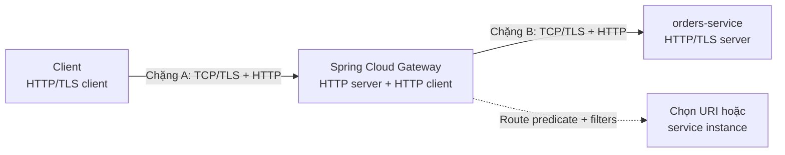

# Phân biệt kết nối client–gateway với kết nối gateway–dịch vụ

## 1. Bối cảnh và mục tiêu

**Spring Cloud Gateway** đóng vai trò cổng vào của hệ thống microservices: dùng **route predicate** để chọn tuyến, **filter chain** để chuyển đổi path/header, tích hợp khám phá dịch vụ, xác thực, rate limiting, circuit breaker, retry, TLS và theo dõi request. Một lỗi kiến trúc rất thường gặp là coi request được proxy như **một kết nối TCP/TLS duy nhất** từ client tới backend.

Thực tế, với API Gateway ở chế độ reverse proxy HTTP thông thường, có **ít nhất hai chặng kết nối độc lập**:

1. **Client → Gateway:** Gateway là **HTTP/TLS server**; client là **HTTP/TLS client**.
2. **Gateway → dịch vụ:** Gateway trở thành **HTTP/TLS client**; dịch vụ đích là **HTTP/TLS server**.

Mỗi chặng có địa chỉ mạng, handshake, chứng chỉ, timeout, connection pool, phương thức xác thực và giao thức HTTP riêng. Nếu phía trước còn CDN, WAF hoặc ingress, số chặng thực tế còn nhiều hơn.

Sau bài học thuộc chương **Kết nối và TLS**, bạn có thể:

- Vẽ đúng các chặng client → Gateway → backend và điểm **TLS termination**.
- Giải thích vì sao HTTPS từ client **không bảo đảm** HTTPS từ Gateway tới dịch vụ.
- Cấu hình riêng HTTPS **inbound** bằng Spring Boot và HTTPS **outbound** bằng Gateway HTTP client.
- Phân biệt **key store**, **trust store**, **SNI**, HTTP `Host`, mTLS và `Forwarded`/`X-Forwarded-*`.
- Đặt connect/response/handshake timeout đúng chặng; nhận biết pool kết nối phía downstream.
- Thực hành kiểm tra từng chặng, chứng chỉ và nguyên nhân lỗi trong vận hành.

> **Phạm vi phiên bản:** Các đoạn YAML cho Gateway Server WebFlux sử dụng cấu trúc thuộc tính **Spring Cloud Gateway 5.0.x** (ví dụ `spring.cloud.gateway.server.webflux.routes` và `spring.cloud.gateway.server.webflux.httpclient.*`), kết hợp Spring Boot 4.0.x tương thích. Ví dụ MVC được ghi rõ riêng. Dòng 4.x và một số trang tài liệu TLS cũ dùng `spring.cloud.gateway.httpclient.*`; trước khi triển khai cần so sánh với **danh sách configuration properties của đúng phiên bản dependency**. Không dùng lẫn hai namespace nếu chưa xác minh cơ chế chuyển đổi thuộc tính.

## 2. Hai chặng độc lập trong một request

### 2.1. Mô hình cơ bản



**Lưu ý với sơ đồ:** Mũi tên có thể đại diện cho **hai kết nối TCP khác nhau**, không phải Gateway kéo dài nguyên socket của client tới backend. HTTP request/response được Gateway nhận, định tuyến và chuyển tiếp theo cơ chế của runtime; request ID và nội dung có thể liên hệ với nhau nhưng kết nối mạng không có quan hệ một-một bắt buộc.

| Đặc điểm | Chặng A: Client → Gateway | Chặng B: Gateway → dịch vụ |
|---|---|---|
| Bên mở kết nối | Client, hoặc proxy/ingress ngay trước Gateway | HTTP client nội bộ của Gateway |
| Bên lắng nghe | Gateway HTTP server (`server.port`) | Dịch vụ trên host/port đích |
| Đích kết nối | DNS/IP public hoặc private của Gateway/ingress | Host/port trong `uri` route, hoặc instance do `lb://` chọn |
| Người gửi HTTP request | Client (hoặc ingress) | Gateway |
| Server certificate khi dùng TLS | Chứng chỉ của Gateway/ingress | Chứng chỉ của **dịch vụ đích** |
| Bên xác thực server certificate | Client hoặc ingress | Gateway HTTP client |
| mTLS client certificate (nếu bật) | Client trình chứng chỉ cho Gateway/ingress | Gateway có thể trình **chứng chỉ riêng** cho backend |
| Connection reuse/pool | Do client, proxy và server inbound điều phối | Do HTTP client/connection pool của Gateway điều phối |
| Timeout cần xét | Client/ingress timeout, server idle/keep-alive | Connect, TLS handshake, response, pool acquisition, read |
| IP mà server nhìn thấy | Gateway thấy peer ngay trước nó | Backend thường thấy IP mạng của Gateway |

Ví dụ request:

```text
Client:
  GET https://api.example.test/api/orders/42

Chặng A:
  client:ephemeral-port -> gateway:8443
  TLS server identity: api.example.test
  HTTP request-target: /api/orders/42

Gateway:
  route orders -> https://orders.internal.test:9443
  filter StripPrefix=1 -> /orders/42

Chặng B:
  gateway:ephemeral-port -> orders.internal.test:9443
  TLS server identity: orders.internal.test
  HTTP request-target: /orders/42
```

Việc thay đổi path từ `/api/orders/42` thành `/orders/42` là tác dụng của **GatewayFilter**, không phải đặc tính của TLS. TLS bảo vệ dữ liệu **trên từng kết nối**; route/filters quyết định **HTTP message** được gửi đi.

### 2.2. Connection pool không tương đương số request

Ở phía backend, Gateway Server WebFlux sử dụng HTTP client dựa trên Reactor Netty và có thể **tái sử dụng kết nối** từ pool. Vì vậy:

- Một kết nối client có thể gửi nhiều HTTP request theo keep-alive; một request có thể đi đến backend instance khác sau load balancing.
- Một kết nối **Gateway → backend** có thể phục vụ nhiều request tuần tự (HTTP/1.1 keep-alive) hoặc nhiều stream tùy HTTP version và cấu hình.
- Khi client A ngắt kết nối, không được giả định mọi kết nối pool outbound cũng bị đóng ngay; ngược lại một kết nối outbound mới không nhất thiết đòi hỏi kết nối inbound mới.
- Backend thường nhìn thấy **IP Gateway/sidecar/NAT**, không trực tiếp thấy IP gốc của client ở tầng socket.

Hai chặng còn có thể chạy **HTTP version khác nhau**: client ↔ ingress qua HTTP/2, ingress ↔ Gateway qua HTTP/1.1 và Gateway ↔ backend qua HTTP/1.1. Không kết luận “end-to-end HTTP/2/gRPC” chỉ vì phía client đã thương lượng HTTP/2 thành công.

## 3. Các mô hình triển khai TLS

### 3.1. HTTPS vào Gateway, HTTP ra backend

```text
Client -- TLS/HTTPS --> [Gateway] -- HTTP --> orders-service
                 TLS kết thúc tại Gateway
```

Gateway có chứng chỉ hợp lệ để **nghe HTTPS**, giải mã HTTP request rồi mở kết nối **không mã hóa** tới backend. Mô hình này có thể xuất hiện trong mạng nội bộ bị giới hạn nghiêm ngặt, nhưng **không phải mã hóa toàn tuyến**.

### 3.2. HTTPS vào Gateway, HTTPS ra backend (re-encryption)

```text
Client == TLS A ==> [Gateway] == TLS B ==> orders-service
          Gateway giải mã TLS A,
          sau đó tạo một phiên TLS B mới
```

**Hai phiên TLS độc lập:** Gateway phải có **server certificate/private key** phù hợp phía inbound, đồng thời có **trust material** đủ để xác minh chứng chỉ phía backend. Nếu backend yêu cầu **mTLS**, Gateway còn cần **client certificate/private key** riêng cho outbound.

### 3.3. TLS kết thúc ở ingress trước Gateway

```text
Client == HTTPS ==> [Ingress/LB] -- HTTP hoặc HTTPS --> [Gateway] --> backend
                    TLS termination
```

Ở đây, “client → Gateway” theo góc nhìn **nghiệp vụ** có thể chứa **hai chặng mạng**: client → ingress và ingress → Gateway. Nếu ingress terminate TLS rồi gửi HTTP, Gateway không trực tiếp nhìn thấy handshake/chứng chỉ TLS của client. Đừng cấu hình `server.ssl.*` ở Gateway rồi mặc định rằng đó là chứng chỉ client đã nhận ở mép Internet. Hãy kiểm tra chính xác vị trí terminate TLS và kết nối nội bộ có được mã hóa lại hay không.

### 3.4. Bảng ma trận kết nối

| Client → Gateway | Gateway → backend | Ý nghĩa | Nhận xét vận hành |
|---|---|---|---|
| HTTP | HTTP | Cả hai chặng không có TLS tại Gateway | Chỉ phù hợp môi trường kiểm soát/lab; bảo vệ dữ liệu ở lớp khác nếu cần |
| HTTPS | HTTP | Mã hóa phía client nhưng **không mã hóa outbound** | Cần đánh giá chính sách bảo mật mạng nội bộ |
| HTTP | HTTPS | Gateway nhận HTTP nhưng xác thực/mã hóa phía backend | Có thể xảy ra sau ingress đã terminate TLS; chặng ingress → Gateway vẫn cần đánh giá |
| HTTPS | HTTPS | **Hai phiên TLS riêng** | Cần cấu hình cả chứng chỉ inbound và trust outbound |

**Không có quy tắc tự động** “route `uri: https://...` thì client phải dùng HTTPS”, hoặc “client đã dùng HTTPS thì upstream tự thành HTTPS”. Hai phía cấu hình độc lập.

## 4. Vai trò của chứng chỉ và cơ chế tin cậy

| Khái niệm | Chặng A | Chặng B |
|---|---|---|
| **Server key pair** | Gateway/ingress giữ private key để chứng minh danh tính server | Backend giữ private key riêng |
| **Server certificate** | Client kiểm chứng tên `api.example.test`, thời hạn, chuỗi CA | Gateway kiểm chứng tên `orders.internal.test`, thời hạn, chuỗi CA |
| **Trust store / CA** | Ở client hoặc ingress, để tin server certificate của Gateway | Ở Gateway HTTP client, để tin chứng chỉ backend |
| **mTLS client identity** | Client có thể trình certificate để Gateway xác thực | Gateway có thể trình certificate khác để backend xác thực |
| **SNI** | Client gửi tên server mong đợi khi TLS handshake | Gateway HTTP client gửi tên backend mong đợi |
| **HTTP Host / :authority** | Được client gửi trong HTTP message | Do HTTP client/filter tạo; có thể khác SNI |

**Key store** chứa private key và certificate chain cần thiết cho một bên **trình chứng chỉ**. **Trust store** chứa CA/certificate mà một bên dùng để **xác minh đối tác**. Một cấu hình inbound keystore **không tự tạo trust store outbound**.

Ví dụ:

- Certificate cho `api.example.test` không bảo đảm hợp lệ khi Gateway kết nối tới `orders.internal.test`.
- Backend dùng CA nội bộ thì client/ingress không nhất thiết tin CA đó; Gateway mới là bên cần trust nó cho chặng B.
- Khi Gateway truyền `Host: public.example.test` với `PreserveHostHeader`, **TLS SNI và hostname validation outbound vẫn thường dựa theo endpoint kết nối**; đừng nhầm HTTP Host với TLS identity.
- Dù cả hai chặng đều dùng mTLS, **client certificate của chặng A không tự động được Gateway chuyển thành client certificate trên chặng B**. Nếu cần truyền danh tính end-user, hãy dùng cơ chế có kiểm chứng như OAuth2/JWT token relay, hoặc identity propagation theo chính sách tin cậy — không chuyển PEM certificate bằng một header client tự khai.

### 4.1. TLS handshake và HTTP status xảy ra ở các lớp khác nhau

Nếu **TLS handshake chặng A thất bại** (client không tin cert, không khớp hostname, thiếu client cert khi mTLS bắt buộc), request HTTP có thể **chưa tới Gateway route predicate**. Lúc này client thấy lỗi TLS thay vì response HTTP `404`/`500` của Gateway.

Nếu **TLS handshake chặng B thất bại**, Gateway đã nhận request và chọn route nhưng HTTP client không kết nối an toàn được tới backend; caller thường nhận **lỗi nhóm 5xx** hoặc kết nối bị gián đoạn tùy exception handler/configuration. Không tự khẳng định chính xác một mã `502` hay `504` cho mọi bản Gateway.

## 5. Cấu hình inbound HTTPS: Gateway là server

### 5.1. Phân biệt `server.port` và route URI

Để Gateway **nghe HTTPS** trực tiếp, dùng cấu hình **Spring Boot server**, không phải cấu hình `httpclient` của Gateway. Ví dụ dưới đây dùng **PEM SSL bundle**: private key/chứng chỉ được provisioning sẵn dưới dạng secret bên ngoài repository.

```yaml
# application.yml của GATEWAY WebFlux.
server:
  port: 8443
  ssl:
    bundle: gateway-inbound

spring:
  ssl:
    bundle:
      pem:
        gateway-inbound:
          keystore:
            certificate: file:/run/secrets/tls/gateway.crt
            private-key: file:/run/secrets/tls/gateway.key
  cloud:
    gateway:
      server:
        webflux:
          routes:
            - id: catalog-insecure-upstream-demo
              uri: http://127.0.0.1:8081
              predicates:
                - Path=/api/demo/**
              filters:
                - StripPrefix=2
```

Điều kiện trước khi chạy:

- `gateway.crt` chứa certificate chain phù hợp hostname **client sẽ truy cập** (demo có thể dùng `localhost`; production cần tên miền chính thức).
- `gateway.key` là private key tương ứng, không được commit vào Git hoặc log. Quyền đọc file chỉ cấp cho tài khoản chạy Gateway.
- Backend `http://127.0.0.1:8081` có endpoint `GET /healthz`. Route ở trên đưa `/api/demo/healthz` thành `/healthz`.
- Nếu Gateway chạy trong container còn backend chạy **ngoài container**, `127.0.0.1` ở route trỏ về **container Gateway**, không tự trỏ về máy host. Cần thay URI bằng địa chỉ thực tế có thể truy cập từ Gateway.

Khi chạy như trên, client dùng **HTTPS tại `:8443`** nhưng Gateway dùng **HTTP tại `:8081`**. Đây là tình huống cố ý để minh họa sự **độc lập của hai chặng**, không phải cấu hình bảo mật production cho backend.

### 5.2. Cách cấu hình keystore truyền thống

Spring Boot cũng hỗ trợ `PKCS12` hoặc `JKS` thông qua `server.ssl.key-store`. Ví dụ **thay thế** cho `server.ssl.bundle` ở trên:

```yaml
# Chọn MỘT trong hai phương án inbound: SSL bundle hoặc keystore.
server:
  port: 8443
  ssl:
    enabled: true
    key-store: file:/run/secrets/tls/gateway.p12
    key-store-type: PKCS12
    key-store-password: THE_PASSWORD_FROM_SECURE_CONFIGURATION
```

Chuỗi `THE_PASSWORD_FROM_SECURE_CONFIGURATION` là **placeholder**, không phải mật khẩu thực. Trong ứng dụng, cấp mật khẩu qua secret manager, biến môi trường hoặc hệ thống cấu hình bảo mật. Không copy password thật vào tài liệu, repo hay console. **Không gộp** `server.ssl.bundle` và `server.ssl.key-store` trong cùng một ví dụ rồi giả định Boot sẽ tự phối hợp chúng.

### 5.3. Inbound mTLS nếu muốn xác thực client bằng certificate

Ở chặng A, nếu chính Gateway terminate TLS và muốn buộc **client trình chứng chỉ**, Spring Boot có tùy chọn:

```yaml
# Minh họa các trường liên quan; cần bổ sung trust material thích hợp.
server:
  ssl:
    client-auth: NEED
```

`NEED` yêu cầu client certificate hợp lệ và một **trust store** để Gateway xác minh certificate ấy. Chỉ đặt `client-auth: NEED` mà không provision trust anchor đúng là chưa hoàn tất mTLS. Nếu **ingress mới là nơi terminate TLS**, cấu hình này trên Gateway chỉ áp dụng cho client TLS trực tiếp của Gateway (có thể là ingress), **không tự xác thực người dùng ngoài Internet**.

## 6. Cấu hình outbound HTTPS: Gateway là client

### 6.1. Route URI chọn scheme kết nối tới backend

```yaml
# Phần cấu hình tuyến trong ứng dụng Gateway WebFlux.
spring:
  cloud:
    gateway:
      server:
        webflux:
          routes:
            - id: orders-secure-upstream
              uri: https://orders.internal.test:9443
              predicates:
                - Path=/api/orders/**
              filters:
                - StripPrefix=1
```

Đây là cấu hình **chặng B**: Gateway kết nối đến `orders.internal.test:9443` bằng HTTPS, và backend nhận path `/orders/**` sau `StripPrefix=1`. Nó **không làm Gateway tự động nghe HTTPS** trên cổng inbound; muốn vậy phải có cấu hình mục 5 hoặc TLS ở một ingress.

Trong lab, hostname `orders.internal.test` là tên minh họa; môi trường chạy Gateway phải phân giải được tên này thành IP backend và backend phải phục vụ TLS với certificate có **Subject Alternative Name (SAN)** phù hợp. Nếu DNS không phân giải hoặc certificate chỉ hợp lệ với tên khác, request có thể thất bại dù YAML được parse đúng.

### 6.2. Trust CA nội bộ cho HTTP client WebFlux

Backend dùng certificate phát hành bởi **CA công khai đã được JVM tin cậy** có thể hoạt động theo default trust store. Backend dùng **CA nội bộ** thì Gateway HTTP client cần có trust material phù hợp.

Một phương án trong Gateway 5.0.x là **outbound SSL bundle**. Đây là cấu hình **bổ sung vào ứng dụng Gateway**, độc lập với bundle inbound của mục 5:

```yaml
# application.yml, dùng khi Gateway gọi HTTPS backend được CA nội bộ ký.
spring:
  ssl:
    bundle:
      pem:
        orders-outbound:
          truststore:
            certificate: file:/run/secrets/tls/orders-ca.crt
  cloud:
    gateway:
      server:
        webflux:
          httpclient:
            ssl:
              ssl-bundle: orders-outbound
```

- `orders-outbound` chứa **CA/chứng chỉ tin cậy** cho Gateway HTTP client, không phải chứng chỉ **Gateway dùng làm TLS server**.
- Thuộc tính `spring.cloud.gateway.server.webflux.httpclient.ssl.ssl-bundle` được liệt kê trong **configuration properties** 5.0.x.
- Nếu bundle áp vào **HTTP client dùng chung**, mọi HTTPS upstream của client ấy có thể chịu cùng chính sách trust. Với nhiều CA/backend tách biệt, cần thiết kế trust boundary phù hợp, tránh gom CA không cần thiết.
- Certificate trust đúng **không bỏ qua hostname validation**: server certificate vẫn cần hợp lệ cho tên backend được kết nối, còn hạn sử dụng và chuỗi certificate phải hợp lệ.

Một phương án **khác** trong tài liệu Gateway là dùng `spring.cloud.gateway.server.webflux.httpclient.ssl.trusted-x509-certificates` để khai báo danh sách certificate tin cậy. Chọn **một chiến lược trust rõ ràng** theo phiên bản; tránh trộn cấu hình bundle và list certificate rồi không biết nguồn trust nào đang được dùng.

> **Không dùng** `spring.cloud.gateway.server.webflux.httpclient.ssl.use-insecure-trust-manager: true` ở production. Tùy chọn này vô hiệu hóa xác minh certificate chain theo trust manager không an toàn và có nguy cơ bị tấn công trung gian (MITM). Nếu gặp lỗi `PKIX path building failed` hoặc `unable to find valid certification path`, hãy provision đúng CA, chain và hostname thay vì tắt kiểm tra.

### 6.3. Outbound mTLS: Gateway cần client key riêng

Nếu backend yêu cầu **mTLS**, chỉ thêm CA trust là chưa đủ. Gateway còn cần **client certificate và private key** để trình với backend. Trong SSL bundle PEM dành cho outbound, có thể khai báo cả `keystore` và `truststore`:

```yaml
# Thay thế định nghĩa orders-outbound chỉ có truststore ở mục 6.2.
spring:
  ssl:
    bundle:
      pem:
        orders-outbound-mtls:
          keystore:
            certificate: file:/run/secrets/tls/gateway-client.crt
            private-key: file:/run/secrets/tls/gateway-client.key
          truststore:
            certificate: file:/run/secrets/tls/orders-ca.crt
  cloud:
    gateway:
      server:
        webflux:
          httpclient:
            ssl:
              ssl-bundle: orders-outbound-mtls
```

Đây là **định danh TLS outbound của Gateway**, độc lập với certificate `api.example.test` dành cho inbound. Backend phải trust CA cấp `gateway-client.crt` và có policy gắn danh tính certificate với quyền gọi API. Không truyền private key outbound cho client, không giả định token người dùng được thay thế hoàn toàn bởi mTLS.

### 6.4. Vì sao Host header không thay SNI?

Giả sử route có:

```yaml
uri: https://orders.internal.test:9443
filters:
  - name: SetRequestHostHeader
    args:
      host: public.example.test
```

Đây là **đoạn trích của một route**. Filter đặt HTTP `Host` downstream thành `public.example.test`, nhưng **network target vẫn là `orders.internal.test:9443`**. TLS SNI và chứng chỉ dùng để xác thực backend thường dựa trên **hostname của endpoint kết nối**, không tự đổi theo Host request.

Backend virtual host có thể cần cả SNI lẫn Host đúng; nếu không khớp có thể xuất hiện lỗi TLS, `404` hoặc `421 Misdirected Request`. Hãy kiểm thử riêng việc kết nối TLS và HTTP virtual host, không sửa bằng cách tắt hostname verification.

## 7. Timeout và connection pool ở hai chặng

### 7.1. Phân biệt các loại timeout

| Loại timeout / giới hạn | Áp dụng ở đâu? | Ý nghĩa |
|---|---|---|
| **Client timeout** | Client → Gateway | Client hết thời gian chờ response của Gateway |
| **Ingress idle/response timeout** | Nếu có proxy phía trước Gateway | Proxy có thể ngắt request trước khi Gateway hoàn tất |
| **Outbound connect timeout** | Gateway → backend | Thời gian tối đa để tạo TCP connection đến host/port backend |
| **Outbound TLS handshake timeout** | Gateway → HTTPS backend | Thời gian tối đa để hoàn thành TLS handshake sau khi đã kết nối |
| **Outbound response timeout** | Gateway HTTP client → backend | Giới hạn chờ response theo cấu hình Gateway |
| **Pool acquire timeout** | Gateway HTTP client | Thời gian chờ lấy connection từ pool khi đạt giới hạn |
| **Backend processing timeout** | Bên trong dịch vụ | Dịch vụ có thể chậm do DB, I/O hoặc công việc nặng |

Ví dụ **cấu hình outbound của WebFlux 5.0.x**:

```yaml
spring:
  cloud:
    gateway:
      server:
        webflux:
          httpclient:
            connect-timeout: 3000
            response-timeout: 10s
            ssl:
              handshake-timeout: 5s
            pool:
              type: fixed
              max-connections: 200
              acquire-timeout: 2000
```

Các số trên **chỉ là giá trị lab minh họa**, không phải cấu hình tối ưu cho mọi hệ thống:

- `connect-timeout` dùng **mili-giây** (3000 = 3 giây).
- `response-timeout` toàn cục là **Duration**, có thể viết `10s`.
- `ssl.handshake-timeout` là một **Duration** theo bảng cấu hình 5.0.x.
- Với `pool.type: fixed`, `max-connections` và `acquire-timeout` kiểm soát việc cấp phát connection phía **Gateway → backend**; chúng **không giới hạn số TCP connection phía client**.

Route cụ thể có thể có `metadata.connect-timeout` và `metadata.response-timeout` tính bằng **mili-giây**, khác kiểu Duration của global `response-timeout`. Chẳng hạn:

```yaml
# Bên trong cấu hình một route WebFlux.
metadata:
  connect-timeout: 1000
  response-timeout: 5000
```

Điều chỉnh theo SLA, percentile latency, retry budget và tải đồng thời. Một request có thể bị client hoặc ingress timeout **trước** khi outbound response-timeout của Gateway hết hạn.

### 7.2. Connection reuse và cân bằng tải

Khi dùng `uri: lb://orders-service`, cần Spring Cloud LoadBalancer và một nguồn `ServiceInstance` (ví dụ discovery). Gateway chọn instance, rồi **mở/tái sử dụng** kết nối đến IP/port instance ấy.

**Điều then chốt:** scheme của chặng B phụ thuộc URI route và metadata bảo mật của `ServiceInstance` (ví dụ `isSecure`) theo cơ chế LoadBalancer, **không suy từ HTTPS inbound**. Dịch vụ được discovery đăng ký là HTTP có thể được gọi qua HTTP dù client vào Gateway bằng HTTPS; nếu kỳ vọng re-encryption phải kiểm chứng thực tế scheme/port/certificate downstream.

Khi instance chết hoặc DNS đổi, connection pool có thể còn những kết nối cũ đang idle. Kết hợp connection lifetime/idle eviction, health check, timeout và retry có giới hạn. Không retry tự động thao tác tạo đơn hàng/thanh toán trừ khi đã đảm bảo idempotency.

## 8. Thực hành: HTTPS inbound không đồng nghĩa HTTPS outbound

### 8.1. Chuẩn bị ứng dụng backend đơn giản

Tạo một ứng dụng Spring Boot có dependency **Spring Web MVC**, cấu hình `server.port: 8081` và controller thử nghiệm sau:

```java
package com.example.demo;

import java.util.Map;
import jakarta.servlet.http.HttpServletRequest;
import org.springframework.boot.SpringApplication;
import org.springframework.boot.autoconfigure.SpringBootApplication;
import org.springframework.web.bind.annotation.GetMapping;
import org.springframework.web.bind.annotation.RestController;

@SpringBootApplication
@RestController
public class BackendApplication {

    public static void main(String[] args) {
        SpringApplication.run(BackendApplication.class, args);
    }

    @GetMapping("/healthz")
    public Map<String, String> health(HttpServletRequest request) {
        return Map.of(
            "status", "UP",
            "scheme", request.getScheme(),
            "peerIp", request.getRemoteAddr(),
            "host", request.getHeader("Host")
        );
    }
}
```

Backend cần một file cấu hình riêng:

```yaml
# application.yml của BACKEND DEMO, không phải Gateway.
server:
  port: 8081
spring:
  application:
    name: backend-demo
```

Khi chạy backend, kiểm tra trực tiếp:

```bash
curl --noproxy '*' -i http://127.0.0.1:8081/healthz
```

Response body dự kiến có `"scheme":"http"`. Đây là **giao thức trên kết nối đến backend**. Nếu backend chạy cùng host, `peerIp` thường là loopback; trong Docker/Kubernetes, backend có thể thấy IP pod/node/NAT của Gateway.

### 8.2. Bật HTTPS trên Gateway và route tới backend HTTP

Ở một **ứng dụng Spring Cloud Gateway Server WebFlux** riêng, chọn dependency `spring-cloud-starter-gateway-server-webflux`. Dùng cấu hình `server.ssl.bundle: gateway-inbound` cùng route ở mục 5, với certificate/key đã được cấp cho hostname `localhost` trong lab và có trust root cho client.

**Không cần sửa backend thành HTTPS** cho phép thử đầu tiên. Sau khi khởi động Gateway, dùng:

```bash
# Dùng CA/chứng chỉ lab được client thực sự tin cậy.
# Đảm bảo certificate Gateway có SAN=DNS:localhost.
curl --noproxy '*' --cacert /path/to/gateway-ca.crt \
  -i 'https://localhost:8443/api/demo/healthz'
```

Nếu cấu hình đúng và cả hai tiến trình đang chạy, phản hồi có thể là:

```http
HTTP/1.1 200 OK
Content-Type: application/json

{"status":"UP","scheme":"http","peerIp":"127.0.0.1","host":"127.0.0.1:8081"}
```

Giá trị `peerIp` và `host` là **minh họa**, không bảo đảm cố định qua mọi OS/runtime. Điều có ý nghĩa là:

- **Client thành công qua HTTPS** ở `:8443`, chứng minh chặng A có TLS.
- **Backend nhìn thấy `scheme=http`** khi route URI `http://127.0.0.1:8081`, chứng minh chặng B **không có TLS**.
- Route đã đổi `/api/demo/healthz` thành `/healthz` do `StripPrefix`; TLS không thực hiện rewrite path.

**Không dùng `curl -k` hoặc `--insecure` để “chứng minh TLS an toàn”.** Các tùy chọn ấy bỏ qua xác minh chứng chỉ phía client, che lỗi SAN/CA thực tế. Nếu chỉ đang gỡ lỗi handshake, mọi phép thử thiếu xác minh phải được đánh dấu rõ là **không chứng minh độ tin cậy**.

### 8.3. Bước nâng cao: chuyển backend sang HTTPS

Để kiểm tra chặng B đã được bảo vệ, chuẩn bị backend riêng lắng nghe `https://orders.internal.test:9443`, có certificate với SAN phù hợp và được ký bởi CA mà Gateway trust. Sau đó dùng route HTTPS và SSL bundle outbound của mục 6.

Thử xác nhận upstream **từ chính môi trường chạy Gateway** trước:

```bash
# Lệnh chỉ hoạt động khi hostname trỏ tới backend,
# backend :9443 đang lắng nghe HTTPS và CA file hợp lệ.
curl --noproxy '*' --cacert /path/to/orders-ca.crt \
  -i 'https://orders.internal.test:9443/healthz'
```

Sau đó mới gọi Gateway qua HTTPS inbound. Nếu client → Gateway hoạt động nhưng gateway → backend lỗi, hãy kiểm tra **DNS, cổng, CA, SAN, TLS SNI và mTLS** của chặng B — không thay đổi certificate inbound khi lỗi nằm ở outbound.

### 8.4. Kiểm tra certificate từng chặng bằng OpenSSL

```bash
# Chặng A: kiểm tra TLS server của Gateway.
openssl s_client -connect localhost:8443 \
  -servername localhost \
  -verify_hostname localhost \
  -CAfile /path/to/gateway-ca.crt

# Chặng B: kiểm tra TLS server của backend từ môi trường Gateway.
openssl s_client -connect orders.internal.test:9443 \
  -servername orders.internal.test \
  -verify_hostname orders.internal.test \
  -CAfile /path/to/orders-ca.crt
```

Quan sát certificate chain, hostname, thời hạn và mã xác minh cuối cùng. `openssl s_client` là **phép kiểm TLS trực tiếp**, không tự xác nhận route predicate/filter trong Spring Cloud Gateway. Với backend yêu cầu mTLS, phép thử còn cần client certificate/private key phù hợp, được cung cấp an toàn. Các ví dụ trên không cung cấp những secret đó.

## 9. Forwarded headers: TLS đầu tiên có thể đã kết thúc trước Gateway

### 9.1. Vì sao backend đôi khi thấy scheme là HTTP?

Giả sử:

```text
Browser -- HTTPS --> Ingress -- HTTP --> Gateway -- HTTP --> orders-service
```

Người dùng nhìn thấy khóa HTTPS trên trình duyệt nhưng Gateway và backend chỉ nhìn thấy HTTP ở **chặng kết nối trực tiếp của mình**. Ingress có thể ghi:

```http
X-Forwarded-Proto: https
X-Forwarded-Host: api.example.test
X-Forwarded-For: 203.0.113.18
```

Hoặc header chuẩn `Forwarded: for=...;proto=https;host=...`. Đây là **metadata mô tả kết nối trước proxy**, không phải bằng chứng rằng connection Gateway → backend được mã hóa. Đừng nhầm `X-Forwarded-Proto: https` với một TLS handshake đang diễn ra trên chặng B.

### 9.2. Chỉ tin forwarded headers từ proxy đáng tin

Header HTTP có thể do client tự đặt. Nếu client gọi Gateway trực tiếp và gửi `X-Forwarded-Proto: https`, điều đó **không biến HTTP thành HTTPS**. Tương tự, `X-Forwarded-For` không tự chứng minh IP gốc.

Tài liệu Gateway Server WebFlux 5.0.x có thuộc tính `spring.cloud.gateway.server.webflux.trusted-proxies` để khai báo **regex xác định proxy đáng tin** khi xử lý `Forwarded`/`X-Forwarded-*`. Cấu hình regex phải theo **topology thật**, đi kèm:

1. Network policy/firewall bảo đảm Gateway chỉ chấp nhận traffic cần thiết từ ingress tin cậy.
2. Ingress **xóa hoặc chuẩn hóa** các header forwarded do client tự gửi.
3. Gateway/backend chỉ sử dụng forwarded headers theo chính sách xác thực nguồn rõ ràng.
4. Test cả trường hợp request đi qua ingress và cố gắng gọi trực tiếp Gateway với header giả.

**Thông tin phiên bản bảo mật:** Spring công bố **CVE-2026-47825** về việc chuyển tiếp `X-Forwarded-For`/`Forwarded` từ proxy không tin cậy trong một số cấu hình, ảnh hưởng **Gateway 5.0.0–5.0.1**, được sửa ở **5.0.2** của nhánh này. Khi xử lý danh tính, IP allowlist hoặc forwarded scheme, hãy dùng **bản đã vá phù hợp** và kiểm tra thông báo bảo mật của nhánh triển khai; không chỉ thêm regex mà bỏ qua việc cập nhật dependency.

### 9.3. Ảnh hưởng tới redirect, cookie và bảo mật

Một backend thấy HTTP nhưng client thật sự truy cập HTTPS qua ingress có thể cần **public scheme** để tạo redirect chính xác, link tuyệt đối, cookie `Secure` hoặc HSTS. Tuy nhiên, việc tin nhầm `X-Forwarded-Proto`/`Host` từ client có thể gây **open redirect** hoặc giả mạo domain.

Hãy cấu hình trusted proxy, canonical public base URL và chính sách tạo URL phù hợp. Quan trọng hơn, `X-Forwarded-Proto` **không thay** Spring Security hoặc TLS trên chặng phía sau.

## 10. Gateway Server WebFlux và Web MVC: đường outbound khác nhau

| Khía cạnh | Gateway Server WebFlux | Gateway Server Web MVC |
|---|---|---|
| HTTP server inbound | Spring Boot WebFlux, thường Reactor Netty | Spring Boot Servlet container, ví dụ Tomcat |
| HTTP client outbound | Reactor Netty HTTP client | Spring Boot `RestClient` infrastructure |
| HTTPS inbound | Spring Boot `server.ssl.*` / `server.ssl.bundle` | Spring Boot `server.ssl.*` / `server.ssl.bundle` |
| TLS outbound | `spring.cloud.gateway.server.webflux.httpclient.ssl.*` | `spring.http.client.ssl.bundle` và `spring.ssl.bundle.*` |
| Outbound timeout/pool | Gateway WebFlux `httpclient.*`, Reactor Netty pool | Spring Boot `spring.http.client.*`, phụ thuộc HTTP client được chọn |
| Filter Java | `GatewayFilter` / `GlobalFilter` | WebMvc.fn `HandlerFilterFunction` / before/after filter |

**Ví dụ riêng cho Gateway Server Web MVC 5.0.x** gọi backend HTTPS qua CA nội bộ:

```yaml
# Chỉ áp dụng cho ứng dụng Gateway Server Web MVC.
spring:
  http:
    client:
      ssl:
        bundle: mvc-backend-trust
      connect-timeout: 5s
      read-timeout: 30s
  ssl:
    bundle:
      pem:
        mvc-backend-trust:
          truststore:
            certificate: file:/run/secrets/tls/internal-ca.crt
  cloud:
    gateway:
      server:
        webmvc:
          routes:
            - id: orders-mvc
              uri: https://orders.internal.test:9443
              predicates:
                - Path=/api/orders/**
              filters:
                - StripPrefix=1
```

Đây là **một ví dụ độc lập**, không ghép cả starter WebFlux và MVC vào cùng ứng dụng. Cấu hình inbound TLS vẫn là cấu hình **Spring Boot server** của MVC; `spring.http.client.ssl.bundle` chỉ giải quyết HTTP client outbound. Bộ timeout, connection reuse và SSL support phụ thuộc client implementation của Boot/MVC đang chạy, nên kiểm tra tài liệu theo phiên bản.

## 11. Vận hành: xác định chặng nào đang lỗi

### 11.1. Bảng chẩn đoán theo lớp

| Hiện tượng | Chặng nghi vấn | Cách xác minh |
|---|---|---|
| Client báo `CERTIFICATE_VERIFY_FAILED` khi gọi Gateway | A | CA/trust store phía client, SAN domain Gateway, expiry, ingress certificate |
| Browser báo TLS handshake failed, Gateway không có log route | A hoặc TLS ở ingress | Kiểm tra handshake trước HTTP, SNI và cấu hình terminate TLS |
| Client kết nối HTTPS Gateway được nhưng nhận lỗi 5xx khi proxy | B hoặc backend | Gọi backend trực tiếp từ môi trường Gateway, xem route URI, DNS, TLS và timeout |
| Gateway log lỗi `PKIX path building failed` khi gọi HTTPS backend | B | Trust CA/chain phía outbound, kiểm tra tên chứng chỉ và JVM/client SSL bundle |
| Gateway outbound kết nối TCP bị từ chối | B | Port/backend listener, security group, container network, service instance |
| Gateway outbound TLS handshake timeout | B | TLS negotiation, proxy/firewall, backend tải cao, TLS handshake timeout |
| Gateway response timeout nhưng TCP/TLS đã thành công | B hoặc xử lý backend | Thời gian xử lý dịch vụ, query DB, response-timeout, retry budget |
| Backend log client IP là IP Gateway | B bình thường | Socket peer là Gateway; nếu cần IP gốc dùng trusted forwarded policy |
| Backend trả redirect sang `http://` dù client vào HTTPS | Ingress/HTTP metadata | Kiểm tra forwarded proto, trusted proxy, canonical public URL |
| `lb://service` trả lỗi không tìm thấy instance | Discovery/LoadBalancer | Kiểm tra service registry, instance host/port/isSecure, dependency |
| HTTPS hoạt động với một service nhưng lỗi service khác | B | So sánh DNS, SAN, CA, mTLS client certificate, route metadata riêng |

### 11.2. Thứ tự điều tra có thể lặp lại

1. **Xác định đường đi thực tế:** client → CDN/WAF → ingress → Gateway → service; ghi từng host/port và TLS termination point.
2. **Xác minh chặng A:** client có thực sự nối HTTPS tới Gateway hay chỉ tới ingress? Certificate nào được trình? Host/SNI có khớp?
3. **Xác minh route:** route ID, predicate, upstream URI, filter như `StripPrefix`, service instance được chọn.
4. **Xác minh chặng B:** từ môi trường Gateway thử DNS, TCP, TLS và HTTP endpoint của backend; kiểm tra CA, SNI/SAN.
5. **So sánh timeout:** client, ingress, Gateway outbound connect/TLS/response, backend; không chỉ tăng tất cả giá trị.
6. **Kiểm tra policy:** Spring Security/JWT/mTLS, circuit breaker, retry, rate limiter có thể chặn hoặc biến đổi response trước/sau HTTP proxy.
7. **Gắn request ID:** log/trace route ID, thời điểm vào/ra, upstream status và độ trễ; không log token, private key hoặc dữ liệu nhạy cảm.

### 11.3. Checklist bảo mật và khai thác

- [ ] Mỗi chặng có **TLS policy rõ ràng**, không dựa vào HTTPS chặng khác.
- [ ] Inbound server certificate đúng SAN/tên miền, có quy trình cấp phát và **gia hạn trước expiry**.
- [ ] Outbound CA trust, hostname validation và TLS versions/ciphers phù hợp với backend.
- [ ] Inbound mTLS và outbound mTLS dùng đúng certificate/key/trust anchor riêng.
- [ ] Không bật `use-insecure-trust-manager` trên production.
- [ ] Private key/password nằm trong secret store, được hạn chế quyền và có chính sách rotation.
- [ ] Proxy/ingress làm sạch forwarded headers; Gateway chỉ tin proxy được cấu hình rõ.
- [ ] Cập nhật các bản vá bảo mật của Spring Cloud Gateway/Boot.
- [ ] Connect/handshake/response timeout, pool capacity và retry budget được tải thử.
- [ ] Tracing, metrics, request ID và cảnh báo certificate expiry/connection errors hoạt động.
- [ ] Endpoint Actuator/admin không lộ ra Internet ngoài mục đích vận hành.

## 12. Bài tập và câu hỏi tự kiểm tra

**Bài 1 — Xác định TLS:** Client gọi `https://api.example.test`, Gateway route tới `http://orders:8080`. Chặng nào có TLS? Vì sao không thể gọi đây là end-to-end TLS?

**Bài 2 — Re-encryption:** Gateway có server certificate `api.example.test` và muốn gọi backend `https://orders.internal.test` do CA nội bộ ký. Gateway cần thêm loại trust material nào, cho chặng nào?

**Bài 3 — Certificate client:** Người dùng gửi mTLS certificate tới Gateway. Nếu backend cũng yêu cầu mTLS, certificate người dùng có tự động được dùng trong TLS handshake thứ hai không? Thiết kế cần gì?

**Bài 4 — Ingress:** Browser kết nối HTTPS tới ingress, ingress kết nối HTTP tới Gateway. Gateway log `scheme=http`. Điều đó có mâu thuẫn với việc browser sử dụng HTTPS không?

**Bài 5 — Host và SNI:** Gateway route `https://orders.internal.test` nhưng filter đặt `Host: public.example.test`. Gateway xác minh hostname certificate của endpoint nào, và vì sao HTTP Host không đủ khẳng định TLS đúng?

**Bài 6 — Timeout:** Connect timeout outbound 3 giây, handshake timeout 5 giây, response timeout 10 giây; ingress đặt timeout 7 giây. Khi backend xử lý mất 9 giây, đâu là một nguyên nhân khiến client bị ngắt trước Gateway response timeout?

**Bài 7 — Discovery:** Khi dùng `lb://orders-service`, client đã gọi HTTPS vào Gateway. Có đủ cơ sở khẳng định Gateway gọi HTTPS tới service instance không? Cần kiểm tra gì?

**Bài 8 — Debug:** Client nhận lỗi TLS ngay khi mở `https://localhost:8443`; Gateway không có route log. Bạn kiểm tra những gì trước khi đụng tới `StripPrefix` hay `Retry`?

### Gợi ý đáp án

1. Có TLS ở chặng A; chặng B là HTTP chưa mã hóa. Vì mỗi chặng độc lập, HTTPS phía client không đủ bảo đảm mã hóa tới backend.
2. Trust store/CA nội bộ dành cho **Gateway HTTP client outbound**; còn chứng chỉ `api.example.test` là cho **Gateway server inbound**.
3. Không. Gateway cần **client identity TLS outbound riêng** (certificate/private key) và backend trust CA phát hành certificate đó; danh tính end-user truyền qua cơ chế xác thực/ủy quyền thích hợp.
4. Không mâu thuẫn. TLS của browser kết thúc tại ingress; Gateway chỉ thấy kết nối HTTP từ ingress, trừ khi ingress tái mã hóa.
5. TLS client thường xác minh certificate cho `orders.internal.test` theo URI kết nối. HTTP Host là thông tin tầng HTTP và có thể khác SNI; cần xác minh cả hai lớp.
6. Ingress timeout **7 giây** có thể ngắt chặng A sớm hơn response timeout outbound **10 giây**, dù Gateway vẫn đang chờ backend.
7. Chưa đủ. Xem `ServiceInstance.isSecure`, URI sau LoadBalancer, port, TLS trust/certificate thực và access log upstream.
8. Chứng chỉ inbound, SAN/hostname, CA trust của client, cổng HTTPS, SNI, ingress terminate TLS và lỗi TLS handshake; route predicate/filter chạy sau bước này.

## Tài liệu tham khảo chính thức

- [Spring Cloud Gateway 5.0 — TLS and SSL, Server WebFlux](https://docs.spring.io/spring-cloud-gateway/reference/5.0/spring-cloud-gateway-server-webflux/tls-and-ssl.html) — chứng chỉ HTTPS inbound, outbound trust và TLS handshake.
- [Spring Cloud Gateway 5.0 — Configuration Properties](https://docs.spring.io/spring-cloud-gateway/reference/5.0/configprops.html) — tên thuộc tính `server.webflux.httpclient`, SSL bundle, pool và timeouts theo phiên bản.
- [Spring Cloud Gateway 5.0 — HTTP Timeouts Configuration](https://docs.spring.io/spring-cloud-gateway/reference/5.0/spring-cloud-gateway-server-webflux/http-timeouts-configuration.html) — timeout toàn cục và metadata từng route.
- [Spring Cloud Gateway 5.0 — HttpHeadersFilters WebFlux](https://docs.spring.io/spring-cloud-gateway/reference/5.0/spring-cloud-gateway-server-webflux/httpheadersfilters.html) — `Forwarded`, `X-Forwarded-*` và `trusted-proxies`.
- [Spring Cloud Gateway 5.0 — Server Web MVC TLS and SSL](https://docs.spring.io/spring-cloud-gateway/reference/5.0/spring-cloud-gateway-server-webmvc/tls-and-ssl.html) — `RestClient`, `spring.http.client.ssl.bundle` và trust material.
- [Spring Boot — SSL Bundles](https://docs.spring.io/spring-boot/reference/features/ssl.html) — cấu hình PEM/JKS bundle cho server và client.
- [Spring Boot — Embedded Web Servers and HTTPS](https://docs.spring.io/spring-boot/4.0/how-to/webserver.html) — `server.ssl.bundle` và cấu hình HTTPS inbound.
- [Spring Cloud Gateway — Security Advisory CVE-2026-47825](https://spring.io/security/cve-2026-47825/) — forwarded headers từ proxy không tin cậy và những bản phát hành đã vá.
- [RFC 8446 — TLS 1.3](https://www.rfc-editor.org/rfc/rfc8446) và [RFC 9110 — HTTP Semantics](https://www.rfc-editor.org/rfc/rfc9110) — phân biệt bảo mật transport và ngữ nghĩa HTTP.
