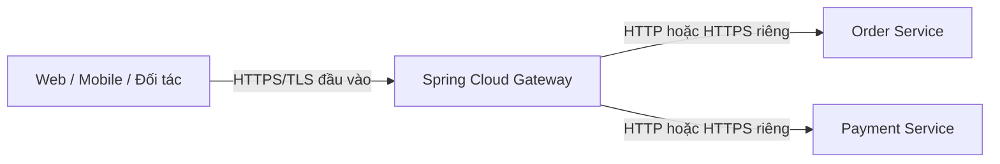
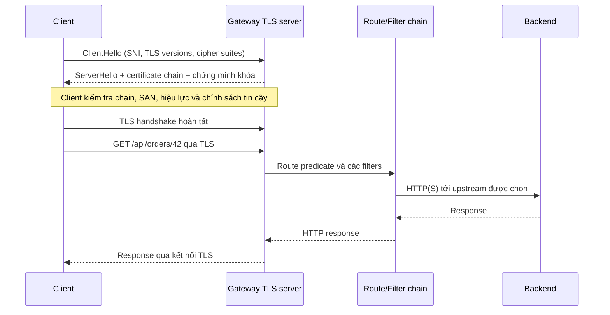
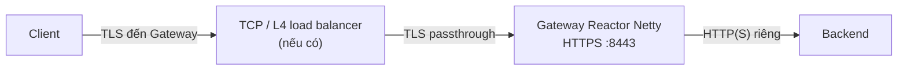
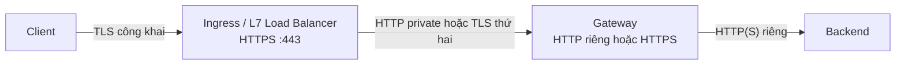
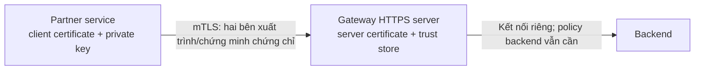

# Cấu hình TLS đầu vào và chứng chỉ của gateway

## Mục tiêu bài học

Trong chương **Kết nối và TLS**, bài này hướng dẫn thiết lập **HTTPS/TLS đầu vào (inbound TLS)** cho **Spring Cloud Gateway**: từ việc hiểu chứng chỉ và chuỗi tin cậy đến cấu hình server, thử kết nối, triển khai phía sau load balancer/ingress và vận hành gia hạn chứng chỉ.

Sau khi học, bạn có thể:

- Phân biệt kết nối **client → gateway** và **gateway → backend**; biết chứng chỉ nào được trình bày trên từng chặng.
- Giải thích vai trò của private key, leaf certificate, intermediate CA, root CA, SAN, hostname verification và SNI.
- Bật HTTPS trực tiếp trên **Spring Cloud Gateway Server WebFlux** bằng cấu hình `server.ssl` của Spring Boot với PKCS#12.
- Biết một lựa chọn khác: cấu hình PEM thông qua **Spring Boot SSL bundles**, tùy phiên bản.
- Thiết kế TLS termination tại gateway, tại ingress/load balancer hoặc TLS trên cả hai chặng.
- Hiểu sự khác biệt giữa TLS server authentication và **mutual TLS (mTLS)** với client certificate.
- Kiểm tra HTTPS bằng `curl`/OpenSSL, xử lý lỗi handshake và thiết kế quy trình cấp mới, gia hạn, thay thế chứng chỉ an toàn.

**Phạm vi:** các ví dụ Java/runtime tập trung vào **Spring Cloud Gateway Server WebFlux** chạy trên Spring Boot và Reactor Netty. Một số đường dẫn property/phương thức thay đổi theo phiên bản Spring Boot/Spring Cloud Gateway; hãy kiểm tra dependency cụ thể của dự án trước khi đưa cấu hình vào production. Cấu hình outbound TLS tới backend là một chủ đề **khác** với inbound TLS.

## 1. TLS đầu vào bảo vệ đoạn nào?

API Gateway nằm ở rìa hệ thống microservices. Client có thể là trình duyệt, ứng dụng di động, đối tác hoặc một dịch vụ nội bộ. Khi client truy cập `https://api.example.com`, nó cần một kết nối được mã hóa và xác thực đầu bên kia bằng TLS.



Trong sơ đồ trên:

- **Inbound TLS:** client bắt tay TLS với Gateway, xem và kiểm tra chứng chỉ **Gateway trình bày**.
- **Outbound TLS:** Gateway đóng vai trò HTTP client khi gọi Order Service/Payment Service. Nếu chặng đó sử dụng HTTPS, Gateway phải kiểm tra chứng chỉ của **backend**, bằng cấu hình tin cậy phù hợp cho HTTP client.
- **Route predicate/filter chain:** chỉ bắt đầu xử lý một HTTP request sau khi kết nối đã được thiết lập và HTTP server đọc được request. Một lỗi TLS handshake có thể xảy ra **trước cả khi có request để chọn route**.

**Bật `server.ssl` ở gateway không tự bật HTTPS hoặc xác minh chứng chỉ cho các kết nối outbound.** Đồng thời, một route khai báo `uri: lb://order-service` chỉ thể hiện cách tìm backend logic; nó không tự bảo đảm toàn bộ đường đi có mã hóa.

### 1.1. Ba mục tiêu bảo mật của TLS

1. **Confidentiality (bí mật):** lưu lượng trên kết nối TLS được mã hóa, giảm rủi ro bị đọc trộm trong quá trình truyền.
2. **Integrity (toàn vẹn):** TLS phát hiện dữ liệu bị sửa đổi trái phép trên kết nối.
3. **Authentication (xác thực đầu bên kia):** chứng chỉ cho client căn cứ để kiểm tra server đang kết nối có sở hữu tên miền và khóa tương ứng hay không.

TLS không tự bảo đảm **người dùng đã đăng nhập** hoặc **được phép truy cập đơn hàng**. Authentication/authorization ứng dụng vẫn cần Spring Security/OAuth2/JWT hoặc phương án khác; backend vẫn phải kiểm tra quyền theo nghiệp vụ. TLS cũng không tự làm rate limiting, circuit breaker, retry hay tracing.

## 2. Những khái niệm chứng chỉ phải hiểu trước khi cấu hình

### 2.1. Private key, chứng chỉ server và chuỗi CA

| Thành phần | Vai trò | Cách quản lý |
| --- | --- | --- |
| **Private key** | Khóa bí mật mà server sử dụng để chứng minh quyền sở hữu khóa trong TLS handshake | Bảo vệ tuyệt đối; không commit Git, không ghi log, hạn chế quyền đọc |
| **Leaf/server certificate** | Chứng chỉ server chứa public key, danh tính DNS/IP và thời hạn | Được server gửi trong handshake; không phải bí mật |
| **Intermediate CA certificate** | Chứng chỉ của CA trung gian giúp xây dựng đường tin cậy | Thường được server gửi cùng leaf để client dựng chain |
| **Root CA certificate** | Điểm neo tin cậy của client | Thường đã có trong trust store của client; không mặc định cần gửi root trong chain |
| **Trust store** | Danh sách CA/chứng chỉ mà một đầu kết nối tin cậy | Ở client để xác minh server; ở server khi muốn xác minh chứng chỉ client trong mTLS |
| **Key store** | Nơi chứa private key và chứng chỉ của chính server (có thể cùng chain) | Ở Gateway khi Gateway trực tiếp kết thúc TLS |

Một gateway muốn trình bày chứng chỉ hợp lệ cần **private key khớp với public key trong leaf certificate**, chứng chỉ đúng tên miền và chuỗi CA có thể được client tin tưởng.

Ví dụ client kết nối:

```text
https://api.example.com/orders/42
```

Chứng chỉ server phải có tên phù hợp trong **Subject Alternative Name (SAN)**, chẳng hạn `DNS:api.example.com`. Trường Common Name (CN) **không nên được coi là thay thế cho SAN**. Một chứng chỉ cho `admin.example.com` không tự hợp lệ với `api.example.com`.

Wildcard như `*.example.com` có quy tắc phạm vi riêng: nó không tự khớp mọi cấp con sâu hơn. Cần chọn danh sách SAN phản ánh đúng những host mà client sử dụng.

### 2.2. Handshake diễn ra trước Gateway filters



Nếu certificate hết hạn, CA không được tin cậy hoặc SAN không phù hợp, client có thể từ chối kết nối trước bước `RoutePredicateHandlerMapping`. Vì thế **không thể mong một `GlobalFilter` bình thường ghi đầy đủ nguyên nhân của mọi lỗi TLS handshake**.

### 2.3. SNI và việc chọn chứng chỉ

**Server Name Indication (SNI)** là thông tin tên host mà nhiều client gửi trong TLS handshake, cho phép một server/proxy có thể chọn chứng chỉ phù hợp với host. SNI **không thay thế hostname verification**: client vẫn phải kiểm tra chứng chỉ nhận được khớp host đích.

Nếu một Gateway phục vụ nhiều tên miền/chứng chỉ, có thể cần bộ chọn chứng chỉ theo SNI ở ingress/proxy hoặc khả năng tương đương của server đang dùng. Một cấu hình `server.ssl.key-store` với một key alias không tự trở thành bộ quản lý chứng chỉ cho vô hạn host.

## 3. Hai kiến trúc TLS đầu vào thường gặp

### 3.1. Gateway trực tiếp kết thúc TLS



Gateway giữ **private key và chứng chỉ của tên miền công khai**; chính Gateway trả lời TLS handshake. Cách này hợp lý khi không có một ingress TLS termination phía trước, hoặc khi cần TLS passthrough.

Ưu điểm:

- Gateway trực tiếp sở hữu chính sách TLS server và chứng chỉ.
- Có thể bật xác thực client certificate ở listener Gateway nếu cần mTLS.
- Không phải tin `X-Forwarded-Proto` để biết kết nối client–Gateway đã có TLS hay chưa.

Chi phí:

- Phải phân phối và bảo vệ private key cho các Gateway replicas.
- Phải vận hành gia hạn/thay chứng chỉ đúng hạn, thử handshake và bảo đảm rollout không gây gián đoạn.
- Phải mở/định tuyến đúng cổng HTTPS, theo dõi TLS handshake và bảo mật runtime.

### 3.2. TLS termination tại ingress/load balancer



Trong mô hình này, **ingress** giữ private key và chứng chỉ public-facing; client kiểm tra chứng chỉ của ingress, không phải chứng chỉ một Gateway instance nằm phía sau. Gateway có thể chỉ lắng nghe HTTP trên mạng được bảo vệ, hoặc bật HTTPS để **mã hóa lại chặng ingress → Gateway**.

**TLS termination ở ingress không mặc nhiên làm chặng ingress → Gateway an toàn.** Cần đánh giá trust boundary, network policy, mTLS/service mesh nếu có, chính sách của tổ chức và yêu cầu bảo vệ dữ liệu.

Nếu Gateway chỉ nhận HTTP từ proxy tin cậy, những giá trị như scheme/host công khai có thể được chuyển thông qua `Forwarded` hoặc `X-Forwarded-*`. Cần cấu hình cách xử lý forwarded headers **chỉ đối với proxy tin cậy**; không cho client tự giả mạo các header này để ảnh hưởng URL tạo ra, redirect, kiểm soát truy cập hoặc log.

### 3.3. Chọn nơi kết thúc TLS dựa vào trách nhiệm

| Tiêu chí | Terminate tại Gateway | Terminate tại ingress |
| --- | --- | --- |
| Chứng chỉ public | Cài trên Gateway | Cài trên ingress |
| Private key public | Mỗi Gateway replica hoặc kho bí mật nó sử dụng | Do ingress/certificate manager quản lý |
| HTTPS redirect ở rìa | Cần listener/edge phù hợp; `server.ssl` riêng không tự tạo HTTP listener | Thường được cấu hình ở ingress/edge |
| mTLS của client ngoài | Gateway kiểm tra client certificate nếu trực tiếp nhận handshake | Ingress kiểm tra; cần hợp đồng truyền danh tính đã xác minh đến Gateway |
| Quan sát TLS handshake công khai | Gateway/server metrics | Ingress/load balancer metrics |
| TLS giữa proxy và Gateway | Không có proxy L7 hoặc TLS passthrough | Lựa chọn HTTP private, HTTPS hoặc mTLS riêng |

Trong production, việc **có cả ingress và Gateway** không có nghĩa tự động phải bật hai lần TLS, cũng không có nghĩa được bỏ bảo vệ chặng nội bộ. Hãy thiết kế dựa trên mạng, trách nhiệm cert, latency, vận hành và chính sách an toàn.

## 4. Bật HTTPS trực tiếp trên Spring Cloud Gateway

**Spring Cloud Gateway Server WebFlux** chạy trên Spring Boot. Khi ứng dụng dùng embedded Reactor Netty, HTTPS listener được cấu hình qua các property **server SSL của Spring Boot** — không phải qua route predicate hoặc `GatewayFilter`.

### 4.1. Cấu hình PKCS#12 keystore

Ví dụ `application.yml`:

```yaml
server:
  port: 8443
  ssl:
    enabled: true
    key-store: file:/etc/gateway/tls/gateway.p12
    key-store-type: PKCS12
    key-store-password: ${GATEWAY_KEYSTORE_PASSWORD}
    key-alias: gateway
```

Ý nghĩa:

| Property | Giá trị ví dụ | Công dụng |
| --- | --- | --- |
| `server.port` | `8443` | HTTPS listener của Gateway. Cổng 8443 thuận tiện cho local/container; public thường được map từ 443 |
| `server.ssl.enabled` | `true` | Bật SSL/TLS cho embedded HTTP server |
| `server.ssl.key-store` | `file:/etc/gateway/tls/gateway.p12` | Nơi server đọc keystore |
| `server.ssl.key-store-type` | `PKCS12` | Kiểu container chứa private key và certificate chain |
| `server.ssl.key-store-password` | `${GATEWAY_KEYSTORE_PASSWORD}` | Tham chiếu password qua environment/secret provider, không viết plaintext vào YAML |
| `server.ssl.key-alias` | `gateway` | Chọn entry private key/certificate khi keystore có nhiều entry |

Lưu ý:

- File `/etc/gateway/tls/gateway.p12` phải tồn tại **ở môi trường runtime của Gateway** và process có quyền đọc. Đây là ví dụ đường dẫn Linux/container, không phải một file có sẵn.
- Keystore cần có **private key entry**, không phải chỉ chứa public certificate. Nếu file chỉ có certificate/trust entries, TLS server không có khóa để trình bày.
- Nếu private key entry có password riêng, một số cấu hình cần thêm `server.ssl.key-password`; kiểm tra loại store và cách tạo entry.
- Không commit certificate kèm private key, password, kube Secret manifest với dữ liệu thật hoặc tập tin `.p12` vào source control.
- `server.port: 8443` với cấu hình SSL **không tự mở thêm cổng HTTP 8080**. Muốn phục vụ HTTP chỉ để redirect sang HTTPS phải có lớp proxy/listener phụ được cấu hình rõ.

Sau khi khởi động đúng, client thử:

```bash
curl --cacert /path/to/trusted-ca.pem \
  https://api.example.com:8443/api/orders/42
```

`--cacert` trỏ tới CA/chứng chỉ phù hợp với trust chain, không trỏ tới private key. Nếu cert dùng CA public đã được hệ điều hành/client tin cậy, `curl` thông thường có thể đủ. `404` từ một path không có route **không nhất thiết là lỗi TLS**: nếu client đã nhận HTTP response qua HTTPS, handshake đã thành công.

### 4.2. Một route mẫu phía sau TLS

```yaml
server:
  port: 8443
  ssl:
    enabled: true
    key-store: file:/etc/gateway/tls/gateway.p12
    key-store-type: PKCS12
    key-store-password: ${GATEWAY_KEYSTORE_PASSWORD}
    key-alias: gateway

spring:
  cloud:
    gateway:
      routes:
        - id: orders
          uri: lb://order-service
          predicates:
            - Path=/api/orders/**
          filters:
            - StripPrefix=1
```

Đoạn cấu hình này minh họa một **Gateway Server WebFlux có HTTPS đầu vào** và một route sử dụng `lb://`. Để chạy đầy đủ:

1. Gateway có keystore và secret password hợp lệ.
2. Route được nạp đúng theo **namespace của phiên bản Spring Cloud Gateway đang dùng**.
3. Có Spring Cloud LoadBalancer cùng nguồn danh sách instance cho `order-service`, hoặc đổi route sang HTTP URI tĩnh của backend thử nghiệm.
4. Port 8443 được publish/map đúng; firewall và load balancer cho phép kết nối theo thiết kế.

**Quan trọng:** chính `server.ssl` bảo vệ **client → Gateway**. URI `lb://order-service` là cấu hình định tuyến và khám phá dịch vụ, không nói client của Gateway sẽ xác minh chứng chỉ backend như thế nào.

## 5. Tạo chứng chỉ thử nghiệm cục bộ (không dùng production)

Để thực hành, có thể tạo một chứng chỉ **self-signed** có SAN cho `localhost`, sau đó đóng gói thành PKCS#12. Các lệnh sau chỉ mang tính minh họa và cần công cụ OpenSSL trên máy thực hành:

```bash
# Bước 1: tạo private key và self-signed certificate 30 ngày.
openssl req -x509 -newkey rsa:3072 -sha256 -nodes \
  -days 30 \
  -keyout gateway.key \
  -out gateway.crt \
  -subj "/CN=localhost" \
  -addext "subjectAltName=DNS:localhost,IP:127.0.0.1"

# Bước 2: đóng gói key/cert thành PKCS#12 cho server.
openssl pkcs12 -export \
  -inkey gateway.key \
  -in gateway.crt \
  -name gateway \
  -out gateway.p12
```

OpenSSL sẽ yêu cầu **export password** ở bước 2. Hãy đưa password vào secret manager/environment variable dành cho local, không ghi trực tiếp vào source code hoặc tài liệu chạy production.

Ví dụ để test trên máy có chứng chỉ `localhost`, sửa đường dẫn trong config cho phù hợp với nơi đặt `gateway.p12` và khởi động Gateway. Sau đó:

```bash
# Self-signed certificate là trust anchor chỉ cho thử nghiệm này.
curl --cacert gateway.crt \
  https://localhost:8443/api/orders/42

# Xem certificate do server trình bày.
openssl s_client -connect localhost:8443 \
  -servername localhost \
  -showcerts

# Xem SAN, issuer, subject và validity của file cert.
openssl x509 -in gateway.crt -noout \
  -subject -issuer -dates -ext subjectAltName
```

**Không sử dụng self-signed certificate này cho Internet production.** Certificate công khai cần được cấp theo chính sách PKI đáng tin cậy, có SAN đúng DNS được công bố, private key được bảo vệ, chain đúng và cơ chế tự động gia hạn.

### 5.1. Kiểm tra hostname mà không bỏ qua xác minh

Muốn kiểm tra `api.example.test` ở địa chỉ `127.0.0.1`, có thể dùng:

```bash
curl --resolve api.example.test:8443:127.0.0.1 \
  --cacert /path/to/trusted-ca.pem \
  https://api.example.test:8443/api/orders/42
```

Điều này cho phép client kết nối đến IP test nhưng vẫn dùng **hostname `api.example.test`** cho TLS SNI/hostname verification. Chứng chỉ server phải có SAN tương ứng và CA của nó phải được tin cậy. Đây là cách kiểm tra tốt hơn việc bỏ xác minh chứng chỉ.

Tránh sử dụng `curl -k`/`--insecure` làm tiêu chí kiểm thử thành công: bỏ qua kiểm tra certificate có thể che lỗi chain/SAN và tạo cảm giác bảo mật giả.

## 6. Cấu hình PEM với Spring Boot SSL bundles

Với các phiên bản Spring Boot hỗ trợ **SSL bundles** (chẳng hạn dòng Spring Boot 3.1+), có thể khai báo trực tiếp certificate/private key dạng PEM thay cho PKCS#12:

```yaml
spring:
  ssl:
    bundle:
      pem:
        gateway:
          keystore:
            certificate: file:/etc/gateway/tls/fullchain.pem
            private-key: file:/etc/gateway/tls/privkey.pem

server:
  port: 8443
  ssl:
    bundle: gateway
```

Ý nghĩa:

- `fullchain.pem` thường chứa **leaf certificate và intermediate chain** cần thiết; không nên trộn private key vào file certificate.
- `privkey.pem` chứa **private key**, phải được hạn chế quyền đọc và phân phối bằng cơ chế secret an toàn.
- `server.ssl.bundle: gateway` yêu cầu embedded server sử dụng bundle đã được định nghĩa.
- **Không khai báo lẫn** các thuộc tính `server.ssl.bundle` và `server.ssl.key-store`/`server.ssl.key-store-password` cho cùng listener rồi giả định Boot sẽ tự hòa giải hai cấu hình.

Ưu điểm của bundle là thuận tiện khi certificate manager cấp file PEM trực tiếp. Tuy nhiên, không mặc định mọi phiên bản Spring Boot/Reactor Netty **tự hot-reload** khi file PEM đổi. Khả năng reload, tên property bổ sung và hành vi cập nhật kết nối phải được kiểm tra đúng phiên bản; khi chưa có cơ chế được xác minh, hãy thực hiện **rolling restart/redeployment** có kiểm tra availability.

## 7. TLS termination tại ingress: Gateway cần cấu hình gì?

Trong Kubernetes hoặc kiến trúc dùng reverse proxy, certificate công khai có thể nằm ở ingress:

```text
Client --HTTPS:443--> Ingress --HTTP:8080--> Gateway --HTTP(S)--> Backend
```

Nếu chấp nhận **HTTP private** cho chặng ingress → Gateway theo chính sách mạng:

```yaml
server:
  port: 8080
  ssl:
    enabled: false
```

Trong mô hình này, certificate dùng cho `api.example.com` được cài **tại ingress**, không phải trong Gateway. Gateway nên bị giới hạn truy cập chỉ từ ingress hoặc các thành phần được phép, bằng service/network policy/firewall. Không mở Gateway HTTP trực tiếp ra Internet ngoài ý muốn.

Nếu chính sách đòi hỏi mã hóa cả chặng ingress → Gateway:

```text
Client --HTTPS:443--> Ingress --HTTPS:8443--> Gateway --HTTP(S)--> Backend
```

Ingress phải **xác minh chứng chỉ Gateway** trên chặng upstream, và Gateway sử dụng inbound TLS theo cấu hình ở mục 4 hoặc 6. Đây là **TLS re-encryption**: có hai handshake độc lập, hai chính sách tin cậy độc lập. Chứng chỉ nội bộ có thể do private CA cấp, miễn là ingress tin đúng CA và kiểm tra đúng tên server.

### 7.1. `X-Forwarded-*` và URL công khai

Khi ingress kết thúc HTTPS rồi gọi Gateway qua HTTP, Gateway có thể cần biết client ban đầu dùng `https`. Spring Boot có property liên quan xử lý forwarded headers, ví dụ:

```yaml
server:
  forward-headers-strategy: framework
```

Tùy runtime, còn có lựa chọn xử lý native. **Property này không tự xác minh nguồn của header.** `Forwarded`, `X-Forwarded-Proto`, `X-Forwarded-Host` hoặc `X-Forwarded-For` phải được tin cậy **chỉ từ proxy do tổ chức kiểm soát**, và ingress cần loại bỏ/ghi đè giá trị giả mạo từ client ở ranh giới ngoài.

Nếu tin header do client tự gửi, ứng dụng có thể tạo sai redirect URL, ghi sai scheme/host, vi phạm chính sách HTTPS hoặc dùng sai địa chỉ IP trong rate limiting. Khi cấu hình `server.forward-headers-strategy`, luôn đi kèm kiểm soát network và trusted proxy chain.

### 7.2. Redirect HTTP sang HTTPS

Bật:

```yaml
server:
  port: 8443
  ssl:
    enabled: true
```

**không tự tạo cổng HTTP 80/8080 để trả 301/308 redirect**. Với hệ thống production, HTTPS redirect nên được xử lý ở edge/load balancer hoặc bằng listener HTTP được triển khai có chủ đích. Nếu cấu hình HSTS, chỉ phát trên kết nối HTTPS phù hợp và hiểu ảnh hưởng của `max-age`, `includeSubDomains`, `preload` đối với toàn bộ miền.

Không tạo redirect bằng cách đơn giản nối chuỗi từ `Host` hoặc `X-Forwarded-Host` chưa được tin cậy, vì có nguy cơ host-header injection/open redirect.

## 8. Mutual TLS (mTLS): yêu cầu chứng chỉ từ client

HTTPS thông thường cho phép client kiểm tra chứng chỉ **server**. Với **mTLS**, server còn yêu cầu và kiểm tra **client certificate** để xác thực một thành phần gọi API.



Mô hình này thường hữu ích cho đối tác B2B hoặc service-to-service có PKI riêng. Nó **không** thay thế phân quyền ứng dụng: một client certificate hợp lệ vẫn cần được ánh xạ tới đúng đối tác, scope, route hoặc quyền nghiệp vụ.

### 8.1. Mẫu cấu hình yêu cầu client certificate

Ví dụ một Gateway kết thúc TLS trực tiếp:

```yaml
server:
  port: 8443
  ssl:
    enabled: true
    key-store: file:/etc/gateway/tls/gateway.p12
    key-store-type: PKCS12
    key-store-password: ${GATEWAY_KEYSTORE_PASSWORD}
    key-alias: gateway

    client-auth: need
    trust-store: file:/etc/gateway/tls/trusted-clients.p12
    trust-store-type: PKCS12
    trust-store-password: ${GATEWAY_TRUSTSTORE_PASSWORD}
```

Trong cấu hình:

- **Key store của Gateway**: private key + certificate chain server dùng để trả lời client.
- **Trust store của Gateway**: các CA/chứng chỉ phù hợp để kiểm tra certificate do **client** trình bày.
- `server.ssl.client-auth: need`: yêu cầu client certificate tại TLS handshake; client không có certificate phù hợp thường không hoàn tất handshake.
- `server.ssl.client-auth: want`: có thể yêu cầu nhưng không bắt buộc certificate; không được coi là xác thực mTLS cưỡng chế.
- `server.ssl.client-auth: none` hoặc không bật client authentication: HTTPS chỉ cần server certificate.

Lựa chọn `need` thường áp dụng **ở cấp listener**, không thể mặc nhiên đổi thành “chỉ một route cần mTLS” bằng `Path` predicate: TLS handshake đã xảy ra trước route matching. Nếu chỉ một nhóm API yêu cầu mTLS, có thể phân tách hostname/listener/ingress policy hoặc một kiến trúc chuyên biệt khác.

### 8.2. Certificate hợp lệ không đồng nghĩa đủ quyền

Ngay cả sau khi TLS server xác minh client certificate với trust store, ứng dụng vẫn cần:

1. Xác định certificate nào tương ứng đối tác hoặc workload nào.
2. Ánh xạ danh tính đã xác minh với chính sách truy cập route và quyền.
3. Kiểm tra thời hạn, cơ chế thu hồi khi cần, khả năng xoay vòng certificate và trạng thái đối tác.
4. Đảm bảo backend không tin một header giả mạo chứa `client-cert` hoặc `client-id` do Internet client tự gửi.

Nếu mTLS terminate tại ingress, Gateway **không trực tiếp nhận client certificate trong handshake của kết nối client công khai**. Mọi thông tin danh tính được ingress truyền vào Gateway phải sử dụng một kênh đáng tin và chính sách xác minh cụ thể; không mặc định rằng một header `X-Client-Cert` từ HTTP request là bằng chứng mTLS thành công.

### 8.3. Kiểm thử mTLS

Giả sử môi trường test có CA và client certificate hợp lệ:

```bash
curl --cacert gateway-ca.pem \
  --cert partner-client.crt \
  --key partner-client.key \
  https://localhost:8443/api/partner/orders
```

Thử thêm trường hợp **không** cung cấp `--cert/--key`: listener cấu hình `client-auth: need` phải từ chối truy cập ở tầng TLS. Thử certificate do CA khác cấp, certificate hết hạn và certificate không được ánh xạ đúng quyền. Đừng chỉ kiểm tra HTTP status; nhiều thất bại mTLS xảy ra khi handshake chưa tạo HTTP response.

## 9. Cấu hình phiên bản TLS, HTTP/2 và chính sách an toàn

Mức nền nên là TLS hiện đại và do chính sách bảo mật của tổ chức quy định. Trong nhiều môi trường, cần hỗ trợ **TLS 1.2 và TLS 1.3**, đồng thời không cho phép SSL 3.0/TLS 1.0/TLS 1.1.

Ví dụ property Spring Boot Server SSL:

```yaml
server:
  port: 8443
  ssl:
    enabled: true
    key-store: file:/etc/gateway/tls/gateway.p12
    key-store-type: PKCS12
    key-store-password: ${GATEWAY_KEYSTORE_PASSWORD}
    enabled-protocols:
      - TLSv1.3
      - TLSv1.2
```

Lưu ý:

- Việc **thương lượng thành công TLS 1.3** còn phụ thuộc Java runtime, Reactor Netty/TLS provider, certificate/key và client. Đặt property không thể làm một runtime thiếu hỗ trợ trở nên hỗ trợ.
- Cipher suites nên theo chính sách hiện đại của nền tảng/runtime; tránh bật lại cipher/protocol yếu chỉ để phục vụ client quá cũ.
- Đừng ghi private key, password hoặc token vào JVM arguments và diagnostic logs theo cách làm lộ cho người dùng/máy chủ khác.
- Không dùng trust manager bỏ qua xác minh certificate trên chặng outbound để “sửa” lỗi TLS; phải sửa CA/chain/SAN và cấu hình trust chính xác.

### 9.1. HTTP/2 qua TLS

Trong các phiên bản Spring Boot/Reactor Netty có hỗ trợ, có thể cân nhắc:

```yaml
server:
  http2:
    enabled: true
```

HTTP/2 trên TLS yêu cầu sự hỗ trợ từ runtime/TLS provider và thương lượng **ALPN** phù hợp. Bật HTTP/2 **không tự tăng bảo mật certificate**, không thay xác thực, cũng không cho phép bỏ TLS nếu kiến trúc yêu cầu HTTPS.

Một hệ thống có thể nhận HTTP/2 tại Gateway nhưng gọi backend bằng HTTP/1.1; đây là hai chặng HTTP độc lập. Các header kết nối như `Transfer-Encoding` không thể được sao chép nguyên cho mọi phiên giao thức.

### 9.2. TLS chỉ mã hóa kết nối, không quyết định chính sách API

Sau handshake, request vẫn phải được xử lý đúng:

- Route predicates chọn API phù hợp.
- Gateway filters có thể sửa path/header, xác thực hoặc giới hạn lưu lượng.
- Spring Security/OAuth2/JWT xác minh danh tính và cấp quyền theo contract.
- Retry/circuit breaker/timeout bảo vệ khả năng phục hồi khi backend lỗi.
- Logging/metrics/tracing quan sát được request nhưng không làm lộ token, cookie, certificate private key hoặc dữ liệu nhạy cảm.

TLS giải quyết một lớp trong chuỗi phòng vệ này; không thể suy ra API “an toàn” chỉ vì biểu tượng ổ khóa trên trình duyệt xuất hiện.

## 10. Gia hạn, thay thế và bảo vệ chứng chỉ trong production

Certificate có thời hạn và phải được **xoay vòng trước ngày hết hạn**. Certificate rotation là một quy trình vận hành, không chỉ là thay file.

### 10.1. Quy trình thay chứng chỉ đề xuất

1. **Kiểm kê:** biết hostname/SAN, nơi terminate TLS, CA, loại keystore, owner, ngày hết hạn và các Gateway/ingress instances sử dụng.
2. **Cấp mới:** tạo key/chứng chỉ theo chính sách PKI, tránh tái sử dụng private key trái quy định; bảo đảm chain và SAN đúng.
3. **Phân phối an toàn:** dùng secret manager, Kubernetes Secret hoặc cơ chế tương đương; áp dụng quyền đọc tối thiểu, không đưa key vào Git hay log.
4. **Kiểm tra trước triển khai:** xác minh private key khớp cert, SAN, thời hạn, chain, hostname và quyền đọc của process.
5. **Triển khai tăng dần:** cập nhật các replicas theo rolling deployment hoặc cơ chế reload đã được **xác minh hỗ trợ**; giữ đủ replica khỏe để không ngắt toàn bộ dịch vụ.
6. **Kiểm tra sau triển khai:** kết nối với hostname/SNI đúng, kiểm tra certificate thực trình bày từ từng endpoint và giám sát lỗi handshake.
7. **Thu hồi/loại bỏ:** xóa quyền truy cập các key cũ theo quy trình, rà soát backup/secret history và xử lý trường hợp certificate bị lộ.

Không mặc định rằng cập nhật file mounted Secret khiến mọi phiên Reactor Netty tự động dùng certificate mới ngay lập tức. Tùy phiên bản và cách cấu hình, **có thể cần khởi động lại listener hoặc pod**. Nếu có tính năng hot reload, phải thử thật với đúng property, cách mount file và phiên bản sản phẩm.

### 10.2. Quản lý secrets và keystore

Một số thực hành nên áp dụng:

- Giữ `gateway.p12` hoặc `privkey.pem` trong thư mục/secret volume chỉ tài khoản chạy Gateway được đọc.
- Đọc password từ secret provider hoặc biến môi trường bảo vệ đúng cách; không hard-code vào `application.yml` được commit.
- Không xuất private key vào metrics, log, trace hoặc diagnostics; không đính kèm vào ticket hỗ trợ.
- Giới hạn quyền người có thể cập nhật cert và secret; ghi nhận thay đổi theo quy trình.
- Bảo vệ secret của **mọi replica**; tăng số bản sao cũng tăng số môi trường nắm giữ key.
- Tách certificate của môi trường dev/test/production; không dùng private key test cho public API.

### 10.3. Quan sát ngày hết hạn và handshake

Nên có dashboard/alert cho:

| Tín hiệu | Lý do |
| --- | --- |
| Số ngày còn tới khi certificate hết hạn | Chủ động gia hạn trước khi client bị từ chối |
| Hostname/SAN và issuer của certificate đang phục vụ | Phát hiện triển khai nhầm cert |
| TLS handshake failures theo listener | Thấy lỗi tương thích phiên bản, cipher, CA, client-auth |
| Lỗi 4xx/5xx và latency **sau khi** HTTP request đã vào Gateway | Phân biệt lỗi API với lỗi TLS |
| Kết quả rollout/reload certificate theo replica | Phát hiện chỉ một phần cụm dùng cert mới |
| Chỉ số outbound TLS tới backend | Phát hiện lỗi CA/hostname/handshake ở **chặng khác** |

Một metric HTTP request theo route sẽ không ghi nhận mọi handshake thất bại, vì route filter chain có thể chưa chạy. Cần kết hợp monitoring ở **TLS listener/ingress**, log cấu hình đúng mức và kiểm tra chủ động từ client.

## 11. Kiểm tra HTTPS/TLS từ phía client

### 11.1. Kiểm tra certificate chain và hostname

```bash
# Kiểm tra endpoint đang phục vụ cert nào.
openssl s_client \
  -connect api.example.com:443 \
  -servername api.example.com \
  -showcerts
```

`-servername` giúp chỉ rõ SNI. Đầu ra có thể cho thấy certificate chain, phiên bản TLS và thông tin về quá trình xác minh, nhưng **phải kiểm tra kết quả verify và hostname** theo công cụ/client đang dùng. Khi cần kiểm tra hostname bằng OpenSSL, sử dụng tùy chọn verify phù hợp với phiên bản công cụ và CA trust store được xác định.

Ví dụ ép kiểm thử TLS 1.2 và TLS 1.3 nếu client hỗ trợ:

```bash
openssl s_client \
  -connect api.example.com:443 \
  -servername api.example.com \
  -tls1_2

openssl s_client \
  -connect api.example.com:443 \
  -servername api.example.com \
  -tls1_3
```

Hai lệnh là các phép thử tương thích, không chứng minh toàn bộ cấu hình an toàn. Một handshake TLS 1.2 thành công cũng không bảo đảm cipher đang chọn đáp ứng chính sách tổ chức.

### 11.2. Kiểm tra HTTPS bằng `curl`

```bash
# Certificate do CA công khai đã được client tin cậy:
curl -v https://api.example.com/api/orders/42

# Certificate do private CA cấp:
curl -v --cacert ./trusted-root-ca.pem \
  https://api.example.com/api/orders/42

# Giải quyết host về IP test nhưng vẫn kiểm tra đúng tên miền:
curl -v --resolve api.example.com:443:192.0.2.10 \
  --cacert ./trusted-root-ca.pem \
  https://api.example.com/api/orders/42
```

`192.0.2.10` là địa chỉ ví dụ dành cho tài liệu. Trong môi trường thử nghiệm phải thay bằng IP thực đã được cấp. Nếu certificate hợp lệ, `curl` có thể trả HTTP `401`, `403` hay `404` do auth/route/backend: điều đó khác với thất bại TLS handshake.

### 11.3. Phân biệt lỗi TLS với lỗi HTTP từ Gateway

| Hiện tượng | Tầng phát sinh khả dĩ | Cách chẩn đoán |
| --- | --- | --- |
| `certificate verify failed` / `unknown CA` | CA chain/trust | Kiểm tra issuer, intermediate, root CA và trust store client |
| `hostname mismatch` | SAN sai hoặc kết nối bằng hostname khác | Kiểm tra `DNS`/`IP` trong SAN và SNI |
| Certificate expired / not yet valid | Hiệu lực cert hoặc đồng hồ hệ thống | Kiểm tra ngày chứng chỉ, thời gian runtime và quy trình rotation |
| `wrong version number` hoặc lỗi protocol | Nối HTTPS vào cổng HTTP, cấu hình TLS listener sai hoặc không tương thích | Kiểm tra port/proxy và protocol từng chặng |
| Handshake thất bại khi dùng mTLS | Client thiếu/sai certificate hoặc CA trust | Kiểm tra `client-auth`, client cert chain, trust store và policy |
| TLS thành công nhưng HTTP 404 | Route/path/backend | Kiểm tra route predicates, rewrite và URI đích |
| TLS thành công nhưng HTTP 401/403 | Xác thực/ủy quyền ứng dụng | Kiểm tra SecurityWebFilterChain, token, scope/role |
| HTTP 502/503 sau khi route match | Kết nối outbound/backend/discovery | Xem URI route, load balancing, TLS outbound, timeout và trạng thái upstream |
| Client thấy redirect sang HTTP | Ingress/forwarded headers/redirect config | Kiểm tra proxy tin cậy, URL scheme và HTTPS redirect |

**Lưu ý:** một số exception message giống nhau có thể xuất hiện ở nhiều lớp. Luôn xác định nơi TLS terminate và đối chiếu log của đúng listener/chặng, không chỉ dựa vào câu chữ một lỗi.

## 12. Những lỗi cấu hình dễ gặp

### 12.1. Keystore không có private key

Một file PKCS#12 chỉ chứa certificate công khai không đủ để server trả lời handshake. Kiểm tra loại entry và alias bằng công cụ phù hợp, chẳng hạn:

```bash
keytool -list -v -storetype PKCS12 \
  -keystore gateway.p12
```

Không đính kèm toàn bộ keystore hoặc password vào báo cáo lỗi. Cần xác nhận alias chứa `PrivateKeyEntry` và certificate chain phù hợp; thiếu alias hoặc password sai có thể làm server không khởi động được.

### 12.2. HTTPS đổ vào cổng HTTP

Nếu Gateway đang chạy:

```yaml
server:
  port: 8080
  ssl:
    enabled: false
```

nhưng load balancer gửi kết nối TLS trực tiếp tới 8080, hai phía nói hai giao thức khác nhau. Không thể “sửa” bằng cách thêm `RewritePath` hay `SetRequestHeader`; cần cấu hình đúng loại listener/terminator và port.

### 12.3. Thay cert tại ingress nhưng vẫn lỗi certificate ở client

Có thể một số ingress/load balancer replicas vẫn phục vụ chứng chỉ cũ, DNS trỏ tới endpoint khác hoặc SNI chọn sai certificate. Kiểm tra từng endpoint, hostname thật và SNI; đừng chỉ đọc file Secret mới để kết luận người dùng đã thấy cert mới.

### 12.4. Bật `client-auth: need` rồi tất cả browser không vào được

`need` yêu cầu client certificate ở **mọi handshake trên listener**. Trình duyệt/người dùng công khai thường không có certificate được CA nội bộ chấp nhận. Hãy thiết kế mTLS theo đối tác/workload hoặc listener/host riêng thay vì bật cưỡng chế mTLS cho toàn bộ API public.

### 12.5. Dùng chứng chỉ của backend làm chứng chỉ gateway

Chứng chỉ cho `orders.internal` không tự hợp lệ với `api.example.com`. Mỗi chặng TLS có **server name** của nó: client công khai xác minh host API Gateway/ingress; Gateway khi gọi backend HTTPS xác minh host đích theo cấu hình outbound.

### 12.6. Tắt xác minh chứng chỉ để hết lỗi

Những cơ chế bỏ qua CA/hostname verification chỉ che lỗi, không giải quyết nó. Chúng làm suy yếu bảo vệ trước man-in-the-middle. Cần sửa SAN, trust chain, SNI hoặc CA đúng thay vì biến cấu hình insecure thành mặc định production.

## 13. Checklist triển khai production

| Hạng mục | Câu hỏi cần trả lời |
| --- | --- |
| **Điểm kết thúc TLS** | Client TLS terminate tại Gateway, ingress hay L4 passthrough? |
| **Chặng nội bộ** | Ingress → Gateway và Gateway → backend dùng HTTP/HTTPS/mTLS theo ranh giới tin cậy nào? |
| **Hostname/SAN** | Chứng chỉ được cấp cho đúng DNS/IP mà client thực kết nối không? |
| **Chain** | Có leaf và intermediate cần thiết; CA của client có tin không? |
| **Private key** | Key được phân phối qua kho bí mật, giới hạn quyền và không nằm trong Git/log chưa? |
| **TLS policy** | Protocol/cipher suite đáp ứng baseline của tổ chức trên runtime thực tế chưa? |
| **mTLS** | Nếu yêu cầu client cert, có CA trust, identity mapping và authorization phù hợp chưa? |
| **HTTP redirect/HSTS** | Có listener hoặc ingress đảm trách; không tạo redirect từ header không tin cậy? |
| **Forwarded headers** | Chỉ trusted proxy được phép đặt/ghi đè và Gateway xử lý đúng? |
| **High availability** | Cert được cài đúng trên mọi replica; rollout/rollback không làm gián đoạn? |
| **Rotation** | Ai sở hữu renewal, alert ngày hết hạn, phương án reload/restart và kiểm tra sau cập nhật? |
| **Observability** | Có metrics handshake ở đúng terminator, HTTP status/latency/trace sau handshake? |
| **Thử nghiệm** | Đã chạy `curl`/OpenSSL với hostname đúng, SAN đúng/sai, cert hết hạn, mTLS nếu có? |

Các yêu cầu này nên đi cùng kiểm tra **route predicate**, filter chain, chuyển đổi path/header, authentication, rate limiting, retry, circuit breaker và timeout. Một certificate hợp lệ là điều kiện thiết yếu nhưng **không thay thế** quản trị và bảo vệ API.

## 14. Bài thực hành có đáp án

### Bối cảnh

Bạn vận hành Gateway với hai service:

```text
api.example.com
  /api/catalog/**  → Catalog Service
  /api/orders/**   → Order Service
```

Ứng dụng chạy trên Kubernetes. Hiện có ingress công khai phục vụ `https://api.example.com`, Gateway lắng nghe `http://gateway:8080` trong cụm.

**Câu hỏi:**

1. Client kết nối từ Internet nhìn thấy certificate của Gateway pod hay ingress?
2. Nếu thay `server.ssl.enabled=true` trên Gateway mà không sửa ingress upstream protocol/port thì điều gì có thể xảy ra?
3. Khi ingress → Gateway dùng HTTP, dữ liệu đoạn này có được TLS công khai bảo vệ không?
4. Nếu policy yêu cầu mã hóa giữa ingress và Gateway, cần những bước thiết kế nào?
5. Nếu client gửi `X-Forwarded-Proto: https`, Gateway có nên tin vô điều kiện không?
6. Nếu Gateway trực tiếp terminate HTTPS với `server.ssl.key-store`, server cần private key ở đâu?
7. Nếu đối tác B2B cần client certificate nhưng người dùng web công khai thì không, có nên bật `server.ssl.client-auth: need` trên mọi listener không?
8. HTTP 404 trả về qua `https://api.example.com` có chứng minh TLS đang lỗi không?
9. Khi route URI tới backend chuyển từ `http://` sang `https://`, liệu chứng chỉ inbound Gateway có tự giúp xác minh backend không?

**Đáp án:**

1. **Ingress**, vì ingress là điểm kết thúc TLS công khai.
2. Có thể xảy ra **protocol mismatch**: ingress vẫn gửi HTTP vào listener chỉ chấp nhận HTTPS; cần cấu hình lại backend protocol, port và trust.
3. **Không.** TLS của client kết thúc tại ingress. Chặng ingress → Gateway cần một chính sách mạng/TLS riêng.
4. Bật inbound TLS ở Gateway, cấp certificate nội bộ phù hợp host dùng bởi ingress, cấu hình ingress gọi HTTPS và **xác minh certificate Gateway**; kiểm thử end-to-end.
5. **Không.** Header phải do proxy tin cậy kiểm soát/ghi đè; không chấp nhận giá trị client giả mạo.
6. Trong **keystore có private key entry** được Gateway process đọc, kèm certificate chain; quản lý bằng secret an toàn.
7. **Không nên.** `need` ảnh hưởng toàn listener; nên tách chính sách mTLS cho nhóm đối tác bằng điểm vào/listener/ingress thích hợp.
8. **Không.** HTTP 404 chứng tỏ một HTTP response đã tới client; cần kiểm tra route matching và upstream để giải thích 404.
9. **Không.** Outbound TLS có trust và hostname verification riêng, ngoài phạm vi `server.ssl` inbound.

## Tổng kết

**TLS đầu vào** bảo vệ kết nối **client → điểm kết thúc TLS** của API Gateway. Nếu Spring Cloud Gateway Server WebFlux trực tiếp terminate HTTPS, hãy cấu hình `server.ssl` của Spring Boot bằng keystore PKCS#12 hoặc SSL bundle PEM thích hợp; certificate phải khớp hostname/SAN, có chain đúng và private key được bảo vệ. Nếu ingress terminate TLS, certificate công khai nằm tại ingress và chặng vào Gateway cần một thiết kế bảo mật riêng.

Vận hành an toàn không dừng ở việc bật HTTPS: cần **quản lý mTLS khi có yêu cầu**, xử lý forwarded headers chỉ từ proxy tin cậy, chọn TLS protocol hiện đại, theo dõi hạn chứng chỉ, xoay vòng không gián đoạn và kiểm tra bằng client thực mà **không bỏ xác minh certificate**. Hãy luôn phân biệt lỗi handshake với lỗi route/filter/backend và nhớ rằng inbound TLS **không tự bảo vệ outbound connections**. Đó là nền tảng cho một cổng vào microservices an toàn và có thể vận hành lâu dài.
