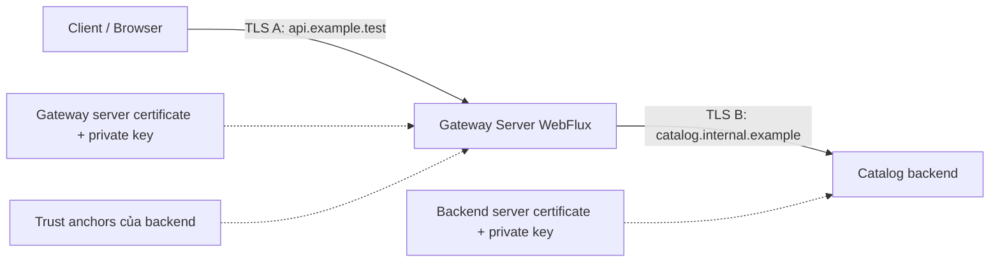
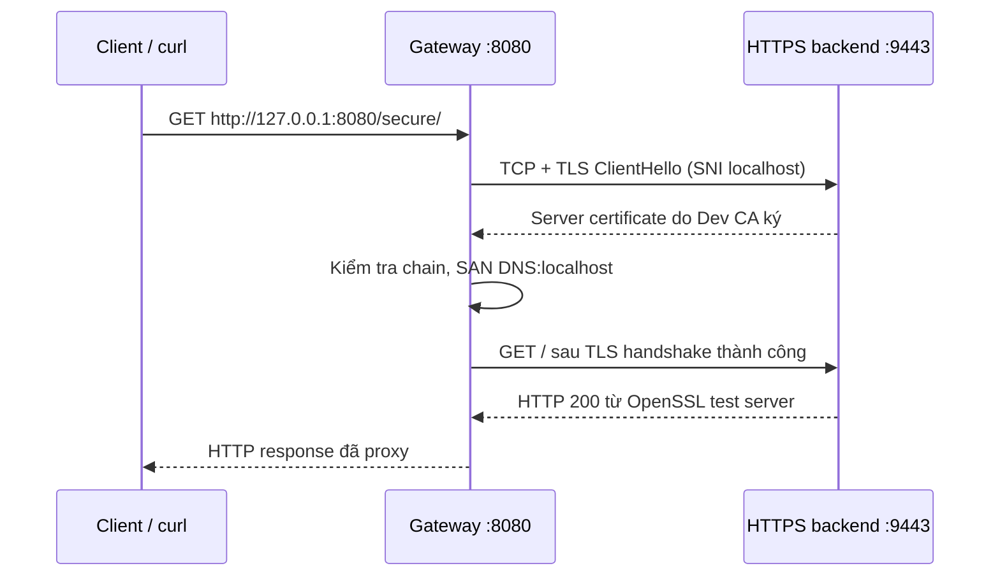

# Trust store, chứng chỉ phía sau và xác minh tên máy chủ

## 1. Bài toán: Gateway tin cậy backend HTTPS bằng cách nào?

Trong **SPRING_CLOUD_GATEWAY**, client gửi request đến API Gateway; Gateway chọn route predicate, thực hiện filter chain rồi proxy tới microservice. Khi đích là `https://catalog.internal.example:9443`, **Spring Cloud Gateway Server WebFlux** hoạt động như một **TLS client**. Trước khi gửi HTTP request và các header có thể chứa thông tin nhạy cảm, Gateway phải xác định máy chủ phía sau có danh tính hợp lệ.

Ba khái niệm không được đánh đồng:

- **Trust store / trust anchors** cho biết những CA hoặc chứng chỉ nào được phép làm gốc tin cậy khi kiểm tra chứng chỉ backend.
- **Certificate chain của backend** gồm chứng chỉ leaf do backend trình ra và các intermediate cần thiết để tạo đường tin cậy.
- **Hostname verification** kiểm tra tên host/IP mà Gateway kết nối có được nêu đúng trong **Subject Alternative Name (SAN)** của chứng chỉ leaf hay không.

Một chain được CA tin cậy ký **vẫn không đủ** nếu certificate chỉ dành cho `inventory.internal.example` nhưng Gateway đang gọi `catalog.internal.example`. Ngược lại, SAN khớp nhưng không có CA được tin cậy thì TLS cũng phải thất bại.

### Mục tiêu bài học

Sau bài này, bạn có thể:

1. Phân biệt TLS **client → Gateway** với TLS **Gateway → backend** và hiểu vai trò của trust store, keystore, certificate, private key.
2. Cấu hình danh sách chứng chỉ tin cậy cho Reactor Netty HttpClient của Gateway Server WebFlux.
3. Xác định sự khác nhau giữa kiểm tra **chain** và kiểm tra **hostname/SAN**, hiểu thêm vai trò SNI.
4. Thử nghiệm CA nội bộ và backend HTTPS cục bộ bằng OpenSSL, sau đó đi qua route Gateway.
5. Phân tích lỗi `PKIX path building failed`, `No subject alternative DNS name`, sai protocol và handshake timeout.
6. Vận hành TLS an toàn cùng service discovery, rate limit, retry, circuit breaker, quan sát request và quá trình xoay vòng chứng chỉ.

> **Phiên bản:** ví dụ dùng Spring Boot 3.5.x + Spring Cloud 2025.0.x / Gateway Server WebFlux 4.3.x. Prefix của **HttpClient outbound** là `spring.cloud.gateway.server.webflux.httpclient`. Một số tài liệu cũ ghi `spring.cloud.gateway.httpclient`: không trộn các prefix giữa release train. Bảng Configuration Properties của đúng phiên bản là nguồn để xác minh key hợp lệ.

## 2. TLS đầu vào khác TLS đầu ra



| Hướng | Vai trò Gateway | Cấu hình tiêu biểu | Ai xác minh peer? |
| --- | --- | --- | --- |
| Client → Gateway | TLS **server** | `server.ssl.*` (Spring Boot) | Client xác minh chứng chỉ Gateway. |
| Gateway → backend | TLS **client** | `spring.cloud.gateway.server.webflux.httpclient.ssl.*` | Gateway xác minh chain và hostname backend. |
| Gateway → backend có mTLS | TLS client **có xuất trình chứng chỉ client** | Ngoài trust anchors cần client key material | Hai đầu có thể phải xác minh chứng chỉ của nhau. |

Ví dụ cấu hình **chứng chỉ đầu vào** (giả định file và mật khẩu đã được cấp qua cơ chế bí mật):

```yaml
server:
  port: 8443
  ssl:
    enabled: true
    key-store: classpath:tls/gateway-identity.p12
    key-store-type: PKCS12
    # key-store-password: cung cấp qua cấu hình secret bảo vệ riêng
```

Cấu hình này **không tự thêm CA backend** vào trust của HttpClient. Ngược lại, cấu hình `httpclient.ssl.trusted-x509-certificates` cũng **không thay** chứng chỉ Gateway trình cho client.

### Keystore, truststore và PEM khác nhau như thế nào?

| Đối tượng | Thường chứa | Mục đích |
| --- | --- | --- |
| Server keystore | Chứng chỉ server **và private key** | Gateway/backend chứng minh danh tính với TLS client. |
| Client keystore | Chứng chỉ client **và private key** | Gateway trình chứng chỉ nếu backend yêu cầu mTLS. |
| Trust store | Chứng chỉ CA/trust anchors công khai, **không chứa private key** | Xác định những peer certificate chain được tin. |
| PEM `.crt`/`.pem` | Một hoặc nhiều chứng chỉ công khai, đôi khi private key nếu xuất riêng | Định dạng tệp; cần xem nội dung và cách được cấu hình. |
| PKCS12 `.p12` / JKS `.jks` | Kho Java có thể lưu private key/cert hoặc trust anchors | Định dạng kho, không tự biểu thị chức năng. |

Tránh đưa private key của CA hoặc backend vào classpath của Gateway khi chỉ cần **tin** backend. Chỉ phân phối **public CA certificate** sau khi đã xác minh nguồn và fingerprint.

## 3. Hai bước bắt buộc khi xác minh backend

### 3.1. Xác minh certificate chain

Một backend thông thường gửi:

```text
Leaf:      DNS:catalog.internal.example
   |
   v
Intermediate CA: Internal Issuing CA
   |
   v
Root CA: Internal Root CA (trust anchor đã được Gateway chấp nhận)
```

Gateway dùng trust anchors để xác minh chữ ký, mối liên hệ certificate chain và những ràng buộc có liên quan như thời hạn, mục đích `serverAuth`. Backend nên gửi **đầy đủ intermediate cần thiết**; không trông chờ TLS client tự tải certificate còn thiếu từ Internet.

Nếu không thể xây dựng đường tin cậy hợp lệ, log thường có `SSLHandshakeException` hoặc thông báo `PKIX path building failed` tùy TLS provider. Một trình duyệt có thể kết nối thành công trong khi Gateway Java lỗi vì **bộ CA tin cậy và đường kết nối không giống nhau**.

### 3.2. Xác minh tên máy chủ (hostname verification)

Đối với:

```text
Route target: https://catalog.internal.example:9443
Certificate SAN:
    DNS:catalog.internal.example
    DNS:catalog.svc.example.test
```

Tên `catalog.internal.example` khớp SAN. Nếu route đổi thành `https://10.20.1.8:9443` nhưng SAN **không có IP Address:10.20.1.8**, không được mặc định xem IP đó là danh tính hợp lệ của chứng chỉ.

Quy tắc thực hành:

- Chứng chỉ server hiện đại nên có **SAN**. Không dựa vào riêng `Subject CN`.
- SAN kiểu `DNS:name` dành cho tên DNS; khi kết nối bằng địa chỉ IP, cần SAN kiểu **`IP Address:...`** khớp địa chỉ đó.
- Wildcard `*.internal.example` không phải wildcard mọi cấp subdomain; hãy kiểm thử DNS name thực tế.
- Nếu chứng chỉ hết hạn, chưa có hiệu lực hoặc có mục đích sử dụng không đúng, chỉ thêm CA vào trust store không khắc phục được.
- Cấu hình HTTP `Host` header khác với tên TLS được xác minh: HTTP headers được gửi **sau TLS handshake**.

### 3.3. Server Name Indication (SNI)

Trong TLS, **SNI** giúp server có nhiều virtual host trên cùng một IP/cổng chọn certificate phù hợp. Reactor Netty HttpClient thường dùng remote hostname làm SNI. Nếu client kết nối qua IP hoặc tự tùy biến SNI sai, backend có thể trình **một certificate khác** với certificate bạn chờ đợi.

Phân biệt:

| Thành phần | Chức năng | Giá trị ví dụ |
| --- | --- | --- |
| URI hostname | Danh tính đích mà Gateway có ý định gọi | `catalog.internal.example` |
| SNI | Tên gửi trong TLS ClientHello để chọn virtual host | `catalog.internal.example` |
| Chứng chỉ SAN | Danh tính mà backend chứng minh | `DNS:catalog.internal.example` |
| HTTP `Host` header | Metadata HTTP sau handshake | `Host: catalog.internal.example` |

**SNI đúng không tự chứng minh chain hợp lệ, và chain hợp lệ không miễn trừ hostname verification.**

## 4. Cấu hình trust của Gateway Server WebFlux 4.3

### 4.1. Dùng trust mặc định của runtime Java

Nếu Gateway chưa được cung cấp danh sách trust riêng, tài liệu Spring Cloud Gateway mô tả việc dùng **trust store mặc định** (có thể bị thay đổi bằng system property `javax.net.ssl.trustStore`). Khi backend dùng CA công cộng được JDK tin cậy, thường không cần nhập thủ công certificate.

Hãy kiểm tra **JDK thực sự chạy trong container**, không chỉ JDK trên laptop: file `cacerts`, CA chính sách doanh nghiệp và TLS inspection proxy có thể khác nhau. Việc sửa trực tiếp `$JAVA_HOME/lib/security/cacerts` trong image thường khó bảo trì khi thay JDK; ưu tiên cơ chế phân phối trust có kiểm soát.

### 4.2. Cấu hình certificate PEM tin cậy của Netty HttpClient

Đối với backend dùng CA nội bộ đã được tổ chức cấp và xác minh:

```yaml
spring:
  cloud:
    gateway:
      server:
        webflux:
          httpclient:
            ssl:
              use-insecure-trust-manager: false
              trusted-x509-certificates:
                - classpath:certs/internal-root-ca.pem
              handshake-timeout: 10s
```

- `trusted-x509-certificates` chỉ tới certificate X.509 đáng tin cậy. File cần tồn tại trong classpath của ứng dụng theo location này.
- Chỉ đưa **public certificate** của CA nội bộ vào resources; không đưa `.key` hoặc private key.
- `handshake-timeout` đặt thời gian tối đa cho TLS handshake, không phải HTTP response timeout.
- `use-insecure-trust-manager: false` diễn tả rõ ý định **không** tin bừa.

**Cảnh báo:** khi cấu hình một tập trust riêng, không tự suy ra nó sẽ tự động **hợp nhất** với toàn bộ trust anchors mặc định của JVM. Nếu cần tin cả CA công cộng và CA nội bộ, phải thiết kế tập trust đúng cho tất cả upstream và kiểm thử từng loại kết nối.

Các ví dụ cũ có thể viết `trustedX509Certificates` dạng camelCase; nên ưu tiên **kebab-case** như bảng `spring.cloud.gateway.server.webflux.httpclient.ssl.*` chính thức.

### 4.3. Trust store PKCS12/JKS

Tổ chức có thể quản lý CA bằng file `gateway-truststore.p12`. Dùng Java `keytool` để nhập CA đã được kiểm tra nguồn gốc:

```bash
keytool -importcert -trustcacerts \
  -alias internal-root-ca \
  -file internal-root-ca.pem \
  -keystore gateway-truststore.p12 \
  -storetype PKCS12
```

Lệnh sẽ yêu cầu mật khẩu/kiểm tra fingerprint. Xem nội dung kho:

```bash
keytool -list -v \
  -keystore gateway-truststore.p12 \
  -storetype PKCS12
```

Một lựa chọn cấu hình toàn JVM là `javax.net.ssl.trustStore`, `javax.net.ssl.trustStoreType=PKCS12`, cùng mật khẩu được cung cấp qua hệ thống quản lý bí mật. **Không hard-code mật khẩu hoặc private key vào file Git** hay lệnh production có thể bị lộ qua process list.

### 4.4. SSL Bundle của Spring Boot

Spring Boot có thể tạo bộ trust certificate tên `backend-ca` từ PEM; Gateway Server WebFlux 4.3 có property `httpclient.ssl.ssl-bundle`:

```yaml
spring:
  ssl:
    bundle:
      pem:
        backend-ca:
          truststore:
            certificate: classpath:certs/internal-root-ca.pem
  cloud:
    gateway:
      server:
        webflux:
          httpclient:
            ssl:
              ssl-bundle: backend-ca
```

Đây là **cách thay thế** cho việc khai báo trực tiếp `trusted-x509-certificates`. Không bật chồng nhiều chiến lược trust cho cùng một client khi chưa hiểu thứ tự ưu tiên. Nếu dùng SSL Bundle, kiểm tra phiên bản Boot/Gateway và thực hiện test bắt tay TLS trong môi trường triển khai trước khi áp dụng.

### 4.5. Những cấu hình không dùng trong production

Không dùng `use-insecure-trust-manager: true` để làm biến mất lỗi `PKIX`: cấu hình đó cho phép tin chứng chỉ không được kiểm tra chain đúng cách và có thể khiến Gateway gửi token, cookie, header nội bộ tới một kẻ giả mạo backend.

Cũng không tự tắt hostname verification hay dùng một `TrustManager` chấp nhận mọi peer trong `HttpClientCustomizer`. **Cách khắc phục đúng là sửa CA, chain hoặc SAN/hostname**, không hủy rào chắn TLS.

## 5. Hostname verification trong Reactor Netty khi tự tùy biến SSL

Reactor Netty `HttpClient.secure()` và `secure(Consumer)` được API tài liệu mô tả là bật hostname verification theo mặc định. Tuy nhiên, khi ứng dụng tạo riêng **`SslProvider`** rồi gọi `secure(SslProvider)`, tài liệu Reactor Netty lưu ý việc xác minh hostname **không tự bật** trừ khi cấu hình `HttpClientSecurityUtils.HOSTNAME_VERIFICATION_CONFIGURER` cho provider.

Vì vậy, khi tùy biến client TLS ở mức thấp:

1. Xác định chính xác overload `secure(...)` và provider đang dùng.
2. Đảm bảo hostname verification vẫn bật, không chỉ xác minh chain.
3. Giữ SNI đúng với virtual host được gọi.
4. Kiểm thử **có chủ đích một chứng chỉ được trust nhưng SAN không khớp**; request phải thất bại.
5. Không sửa thuộc tính TLS để cố định hostname giả nhằm bỏ qua rủi ro của URI đích.

Nếu không thực sự cần customize SSL provider, **ưu tiên cấu hình Gateway chính thức** để giảm lỗi bảo mật khó phát hiện.

## 6. Thực hành: backend HTTPS với CA nội bộ

Thực hành tách biệt hai lớp TLS: **Gateway nhận HTTP trên cổng 8080** để tập trung vào yêu cầu xác minh **Gateway → backend HTTPS trên cổng 9443**. Dùng OpenSSL tạo CA thử nghiệm, cấp chứng chỉ backend có SAN và tạo HTTPS server đơn giản. Gateway phải tin đúng CA và gọi đúng hostname.

Điều kiện: **JDK 17+, Maven, OpenSSL, curl**; các command bên dưới dùng cú pháp **Bash** (Linux/macOS/Git Bash). Nếu chạy PowerShell, cần thay cách nối dòng theo cú pháp PowerShell, cách tạo file `printf` và chuyển hướng `/dev/null` bằng cú pháp tương ứng. Mọi tệp `tls/` của phần này được tạo **bởi người học trong môi trường thử nghiệm của họ**, không phải tệp thuộc module bài học.



### 6.1. Tạo một CA riêng cho bài thử

```bash
mkdir -p tls

openssl req -x509 -newkey rsa:3072 -sha256 -nodes -days 14 \
  -keyout tls/dev-ca.key \
  -out tls/dev-ca.crt \
  -subj "/CN=SCG Lab Root CA" \
  -addext "basicConstraints=critical,CA:TRUE" \
  -addext "keyUsage=critical,keyCertSign,cRLSign"
```

- `dev-ca.crt`: chứng chỉ CA **công khai** mà Gateway có thể dùng làm trust anchor.
- `dev-ca.key`: **private key của CA**; không đưa vào source control, container Gateway, classpath, artifact phát hành hoặc log.
- CA chỉ có thời hạn 14 ngày; đây là cấu hình học tập, không phải giải pháp PKI production.

### 6.2. Tạo certificate cho backend với SAN đúng

```bash
openssl req -new -newkey rsa:2048 -sha256 -nodes \
  -keyout tls/backend.key \
  -out tls/backend.csr \
  -subj "/CN=localhost"

printf 'subjectAltName=DNS:localhost\nextendedKeyUsage=serverAuth\nbasicConstraints=critical,CA:FALSE\n' \
  > tls/backend.ext

openssl x509 -req \
  -in tls/backend.csr \
  -CA tls/dev-ca.crt \
  -CAkey tls/dev-ca.key \
  -CAcreateserial \
  -out tls/backend.crt \
  -days 7 -sha256 \
  -extfile tls/backend.ext
```

Mã lệnh tạo:

- `backend.key`: khóa riêng của backend, **không** gửi sang Gateway.
- `backend.crt`: chứng chỉ máy chủ được CA thử nghiệm ký.
- SAN `DNS:localhost`: hợp lệ cho URI `https://localhost:9443` trong bài thực hành.
- **Cố ý không có** `IP Address:127.0.0.1`: kiểm thử âm tính ở phần sau sẽ chứng minh kết nối theo IP phải bị từ chối khi hostname verification hoạt động.

Kiểm tra dữ liệu chứng chỉ:

```bash
openssl x509 -in tls/backend.crt -noout -subject -issuer -dates
openssl x509 -in tls/backend.crt -noout -ext subjectAltName
openssl x509 -in tls/dev-ca.crt -noout -fingerprint -sha256
```

Trong production, fingerprint CA phải được xác minh **qua kênh tin cậy độc lập** trước khi đưa vào trust store. Không import bất kỳ CA nào chỉ vì nó xuất hiện trong phản hồi từ server đang gặp lỗi.

### 6.3. Chạy HTTPS backend thử nghiệm

OpenSSL có HTTP test server cơ bản, tránh phải viết thêm một Spring Boot service:

```bash
openssl s_server \
  -accept 9443 \
  -cert tls/backend.crt \
  -key tls/backend.key \
  -www
```

Giữ tiến trình chạy ở **terminal A**. Mục đích chỉ để quan sát TLS và HTTP trong môi trường local; không công khai cổng 9443 ra Internet. Nếu môi trường mạng có nhiều interface, dùng firewall hoặc cấu hình bind phù hợp để chỉ cho phép kết nối thử nghiệm.

Trong **terminal B**, kiểm tra handshake **có kiểm tra CA và DNS name**:

```bash
openssl s_client \
  -connect localhost:9443 \
  -servername localhost \
  -CAfile tls/dev-ca.crt \
  -verify_hostname localhost \
  -verify_return_error < /dev/null
```

Kỳ vọng có `Verify return code: 0 (ok)`. Khi chỉ định `-verify_hostname`, OpenSSL so khớp SAN với tên `localhost`; `-CAfile` giúp xác minh chuỗi theo CA thử nghiệm.

Gọi trực tiếp qua curl **không dùng `-k`**:

```bash
curl -i --cacert tls/dev-ca.crt https://localhost:9443/
```

HTTP response thường là `200 OK` và một trang kiểm thử do `s_server -www` cung cấp. Nội dung HTML phụ thuộc phiên bản OpenSSL; bài học không phụ thuộc chi tiết trang này.

### 6.4. Khởi tạo Gateway Server WebFlux

Tạo ứng dụng Maven tối thiểu bằng Spring Initializr hoặc bằng `pom.xml` dưới đây. Chọn **một cặp Spring Boot/Spring Cloud tương thích**. Ví dụ dùng Boot `3.5.0`, Cloud `2025.0.0` để minh họa release train; khi triển khai thực, chọn patch được hỗ trợ, không giữ cố định bản vá đầu tiên một cách vô thời hạn.

```xml
<?xml version="1.0" encoding="UTF-8"?>
<project xmlns="http://maven.apache.org/POM/4.0.0"
         xmlns:xsi="http://www.w3.org/2001/XMLSchema-instance"
         xsi:schemaLocation="http://maven.apache.org/POM/4.0.0
                             https://maven.apache.org/xsd/maven-4.0.0.xsd">
    <modelVersion>4.0.0</modelVersion>

    <parent>
        <groupId>org.springframework.boot</groupId>
        <artifactId>spring-boot-starter-parent</artifactId>
        <version>3.5.0</version>
        <relativePath/>
    </parent>

    <groupId>com.example</groupId>
    <artifactId>gateway-tls-lab</artifactId>
    <version>0.0.1-SNAPSHOT</version>

    <properties>
        <java.version>17</java.version>
    </properties>

    <dependencyManagement>
        <dependencies>
            <dependency>
                <groupId>org.springframework.cloud</groupId>
                <artifactId>spring-cloud-dependencies</artifactId>
                <version>2025.0.0</version>
                <type>pom</type>
                <scope>import</scope>
            </dependency>
        </dependencies>
    </dependencyManagement>

    <dependencies>
        <dependency>
            <groupId>org.springframework.cloud</groupId>
            <artifactId>spring-cloud-starter-gateway-server-webflux</artifactId>
        </dependency>
    </dependencies>

    <build>
        <plugins>
            <plugin>
                <groupId>org.springframework.boot</groupId>
                <artifactId>spring-boot-maven-plugin</artifactId>
            </plugin>
        </plugins>
    </build>
</project>
```

Không gắn version riêng cho starter vì Spring Cloud BOM quản lý nó. Gateway Server WebFlux chạy trên **Reactor Netty**, không cần `spring-boot-starter-web` hoặc servlet WAR.

Tạo `src/main/java/com/example/gateway/GatewayApplication.java`:

```java
package com.example.gateway;

import org.springframework.boot.SpringApplication;
import org.springframework.boot.autoconfigure.SpringBootApplication;

@SpringBootApplication
public class GatewayApplication {
    public static void main(String[] args) {
        SpringApplication.run(GatewayApplication.class, args);
    }
}
```

### 6.5. Đặt CA vào resources và cấu hình route

Chỉ sao chép **public certificate CA** vào project Gateway. Nếu đang ở thư mục chứa `tls/` và `src/main/resources/`:

```bash
mkdir -p src/main/resources/certs
cp tls/dev-ca.crt src/main/resources/certs/dev-ca.crt
```

Nếu hai thư mục thực hành nằm ở vị trí khác, điều chỉnh đường dẫn theo thực tế. **Không** copy `tls/dev-ca.key` hay `tls/backend.key` vào Gateway.

Tạo `src/main/resources/application.yml`:

```yaml
server:
  port: 8080

spring:
  application:
    name: gateway-tls-lab
  cloud:
    gateway:
      server:
        webflux:
          httpclient:
            ssl:
              use-insecure-trust-manager: false
              trusted-x509-certificates:
                - classpath:certs/dev-ca.crt
              handshake-timeout: 10s
          routes:
            - id: tls-backend
              uri: https://localhost:9443
              predicates:
                - Path=/secure/**
              filters:
                - StripPrefix=1
                - AddResponseHeader=X-Gateway-Route, tls-backend
```

Các điểm chính:

1. Gateway **nhận HTTP** ở `8080` (chưa bật `server.ssl` cho inbound).
2. `trusted-x509-certificates` cấp trust anchor **riêng cho kết nối outbound** tới HTTPS backend.
3. `uri: https://localhost:9443` quyết định TCP/TLS đích và tên dùng để kiểm tra SAN.
4. `StripPrefix=1` đổi path `/secure/` thành `/` trước khi gửi tới OpenSSL backend.
5. `AddResponseHeader` tạo marker để nhận diện route; không có chức năng xác minh TLS.

Thông thường phần HttpClient SSL được dùng chung cho các kết nối proxy của Gateway; đây không phải cấu hình dành riêng cho route `tls-backend`. Khi cần nhiều nhóm CA với chính sách khác nhau, thiết kế trust model phù hợp thay vì thêm CA vô tội vạ.

### 6.6. Chạy Gateway và gọi qua cổng vào

Mở **terminal C** tại project Gateway:

```bash
mvn spring-boot:run
```

Hoặc sử dụng Maven Wrapper `./mvnw spring-boot:run` trên Linux/macOS, `mvnw.cmd spring-boot:run` trên Windows.

Mở **terminal D**:

```bash
curl -i http://127.0.0.1:8080/secure/
```

Khi thành công, client nhận HTTP response từ OpenSSL test server được Gateway proxy, thường là `200 OK`, kèm `X-Gateway-Route: tls-backend`. Thử nghiệm này chứng minh Gateway đã thực hiện HTTPS đến backend **dù client dùng HTTP tới Gateway**.

Nếu lỗi, xác minh lại file CA trên classpath, route URI, SAN trong cert, tiến trình `s_server`, đúng prefix Gateway và nguyên nhân gốc trong log.

## 7. Negative tests: chứng minh xác minh TLS không bị bỏ qua

Một hệ thống TLS an toàn phải thất bại đúng cách khi chain hoặc peer identity không phù hợp.

### 7.1. Không có CA tin cậy

Thử bỏ `trusted-x509-certificates` khỏi cấu hình bài lab rồi khởi động lại Gateway, nhưng giữ `use-insecure-trust-manager: false`.

Nếu CA lab **không** có trong trust store mặc định, request `/secure/` phải thất bại ở bước xác minh certificate chain. Bạn có thể thấy `SSLHandshakeException`, `PKIX path building failed` hoặc thông báo Netty TLS tương đương tùy provider. Gateway có thể trả nhóm HTTP **5xx**, không phải một HTTP error do backend nghiệp vụ trả về.

Khôi phục cấu hình CA sau phép thử.

### 7.2. Đúng CA nhưng sai tên backend

Giữ trust CA nhưng đổi route URI thành:

```yaml
uri: https://127.0.0.1:9443
```

Chứng chỉ demo chỉ chứa `DNS:localhost`, **không chứa `IP Address:127.0.0.1`**. Client TLS có hostname verification đúng phải **từ chối kết nối bằng IP này**, dù chain vẫn do CA được tin cậy ký.

Kiểm tra độc lập với OpenSSL:

```bash
openssl s_client \
  -connect 127.0.0.1:9443 \
  -CAfile tls/dev-ca.crt \
  -verify_ip 127.0.0.1 \
  -verify_return_error < /dev/null
```

Hoặc với curl:

```bash
curl -i --cacert tls/dev-ca.crt https://127.0.0.1:9443/
```

Kết quả phải là lỗi so khớp IP/SAN. Nếu Gateway **vẫn** proxy thành công khi hostname không khớp, kiểm tra lại `use-insecure-trust-manager`, custom `SslProvider` và khả năng **hostname verification bị tắt**. Không dùng phép thử này để chứng minh mọi thứ an toàn chỉ vì CA được trust.

**Cách sửa:** cấu hình URI sử dụng DNS name có trong SAN và có khả năng phân giải chính xác; nếu nghiệp vụ thực sự cần URI bằng IP, phát hành chứng chỉ chứa IP SAN hợp lệ theo chính sách.

### 7.3. Sai protocol hoặc backend không lắng nghe

- Tắt `s_server` rồi gọi lại `/secure/`: thường là `Connection refused` hoặc timeout, xảy ra trước khi certificate verification hoàn tất.
- Đổi URI thành `http://localhost:9443` trong khi 9443 đang chờ TLS: client gửi HTTP plaintext đến một TLS listener, gặp lỗi protocol. Không phải lỗi trust store.
- Đổi URL thành `https://localhost:9555` khi không có listener: lỗi kết nối, không phải SAN mismatch.

Những phép thử này giúp tránh cách chẩn đoán sai "cứ lỗi 5xx là sửa chứng chỉ".

## 8. Phương pháp chẩn đoán sự cố TLS

| Triệu chứng | Nguyên nhân thường gặp | Cách kiểm tra |
| --- | --- | --- |
| `PKIX path building failed` | CA không được trust; thiếu intermediate; container dùng trust store khác. | Xem chain server gửi, kiểm tra CA đang dùng và cấp đúng anchor. |
| `No subject alternative DNS name matching ...` | Host của URI không có trong DNS SAN. | Kiểm tra `openssl x509 -ext subjectAltName`, sửa URI hoặc cấp lại cert. |
| `No subject alternative names matching IP address ...` | Kết nối bằng IP nhưng SAN chỉ có DNS name. | Dùng hostname hợp lệ hoặc IP SAN được cấp đúng. |
| `certificate expired` / `not yet valid` | Thời hạn cert sai hoặc thời gian hệ thống bị lệch. | Xem `notBefore/notAfter`, đồng bộ thời gian. |
| `certificate_unknown` / `bad_certificate` | Peer từ chối cert; có thể do mTLS/chain/policy. | Xác định phía nào gửi TLS alert, kiểm tra cả hai hướng khi dùng mTLS. |
| Handshake timeout | Mạng chậm, TLS endpoint treo, proxy hoặc timeouts quá ngắn. | Kiểm tra TCP, TLS logs, metrics, timeout tương ứng. |
| `NotSslRecordException` / `wrong version number` | HTTP và HTTPS dùng sai scheme/cổng. | Kiểm tra `uri`, listener, proxy và TLS termination. |
| `Connection refused` | Không có server lắng nghe host/port. | Kiểm tra backend process, firewall, port. |
| `UnknownHostException` | DNS hoặc service discovery không trả hostname hợp lệ. | Kiểm tra tên DNS, nguồn discovery, resolve từ môi trường Gateway. |
| Client thấy 5xx từ Gateway | Có thể là TLS, timeout, filter, hoặc upstream HTTP. | Lần theo **root cause** và trace; không kết luận chỉ từ status. |

### Các lệnh quan sát backend thật

Xem certificate chain backend gửi:

```bash
openssl s_client \
  -connect catalog.internal.example:443 \
  -servername catalog.internal.example \
  -showcerts < /dev/null
```

Kiểm tra **cả CA và hostname**, không chỉ TCP/TLS có bắt tay:

```bash
openssl s_client \
  -connect catalog.internal.example:443 \
  -servername catalog.internal.example \
  -CAfile internal-root-ca.pem \
  -verify_hostname catalog.internal.example \
  -verify_return_error < /dev/null
```

Xem chi tiết một cert:

```bash
openssl x509 -in backend.crt -noout -subject -issuer -dates
openssl x509 -in backend.crt -noout -ext subjectAltName
openssl x509 -in backend.crt -noout -fingerprint -sha256
```

`openssl s_client` **không luôn kiểm tra hostname nếu bạn không yêu cầu** `-verify_hostname`/`-verify_ip`. Một TLS handshake hoàn tất không phải bằng chứng hostname verification đã qua.

Nếu browser mở backend thành công nhưng Gateway lỗi, kiểm tra sự khác nhau giữa trust store của browser/JVM, proxy TLS inspection, SNI và certificate chain. Không dùng `curl -k` làm tiêu chí thành công trong kiểm thử bảo mật.

## 9. Timeout, Netty connection pool và certificate rotation

Gateway Server WebFlux sử dụng Reactor Netty HttpClient và connection pool khi gửi request. TLS handshake xảy ra khi thiết lập kết nối an toàn mới; với connection reuse, không phải request nào cũng bắt tay lại.

Một số thuộc tính 4.3:

```yaml
spring:
  cloud:
    gateway:
      server:
        webflux:
          httpclient:
            connect-timeout: 3000
            response-timeout: 15s
            ssl:
              handshake-timeout: 10s
              close-notify-flush-timeout: 3s
              close-notify-read-timeout: 0s
```

Các giá trị là **minh họa**. Theo bảng cấu hình 4.3, `connect-timeout` dùng milliseconds, các timeout `ssl` sử dụng kiểu Duration. Đừng lẫn connect timeout (TCP), handshake timeout (TLS), response timeout (HTTP), và timeout khi đóng TLS (close_notify).

### Xoay vòng CA/certificate không gây gián đoạn

1. Xác minh CA mới, thông báo lịch thay đổi và đặt thời hạn đủ để các instance cập nhật.
2. Phân phối trust anchors mới tới Gateway **trước** khi backend chuyển chứng chỉ; kiểm thử trên canary.
3. Triển khai server certificate mới có SAN, chain và thời hạn đúng; kiểm tra TLS/SNI.
4. Theo dõi handshake errors, 5xx, latency và backend logs.
5. Gỡ CA cũ khi đã xác nhận mọi instance không còn phụ thuộc vào nó.
6. Xác định rõ việc thay đổi file PEM/SSL bundle **có được Netty HttpClient nạp lại không**; đừng mặc định chỉ sửa file trên đĩa là đủ. Có thể phải thay mới ứng dụng/kết nối theo kế hoạch.

Không để private key của CA hoặc backend vào log, artifact/container Gateway; kho secret và quyền truy cập cần tách biệt.

## 10. Liên hệ với các tính năng vận hành Gateway

### 10.1. Service discovery và `lb://`

Nếu route dùng `lb://catalog-service`, Spring Cloud LoadBalancer chọn `ServiceInstance` dựa trên discovery. Scheme HTTPS outbound và host được dùng cho TLS phụ thuộc thông tin instance (ví dụ `isSecure`) cùng cấu hình route. Vì vậy:

- Một instance được công bố bằng **IP** nhưng chứng chỉ chỉ có SAN DNS có thể gây lỗi hostname verification.
- Không suy ra Gateway → backend là HTTPS chỉ vì client → Gateway dùng HTTPS.
- Cần thống nhất service registry, DNS, SNI, SAN và cấu hình trust trong mọi môi trường.
- Nếu chọn đích động qua header do client gửi mà không allowlist, có thể tạo open proxy/SSRF; TLS không thay thế kiểm soát đích.

### 10.2. Xác thực, rate limit, retry và circuit breaker

- **TLS server authentication** xác minh backend; **Spring Security WebFlux/OAuth2** xác minh client/user và phân quyền. Hai nhiệm vụ độc lập.
- Rate limiting bảo vệ Gateway và backend khỏi quá tải; không sửa lỗi certificate.
- Retry có thể phát lại request khi lỗi nhưng không giải quyết CA sai, certificate hết hạn hoặc SAN mismatch. Tránh retry mù quáng request ghi dữ liệu.
- Circuit breaker có thể ghi nhận lỗi kết nối/TLS và kích hoạt fallback theo chính sách; fallback không thay việc sửa trust đúng.
- Không gửi JWT, API key hoặc header riêng tư tới một upstream chưa được TLS xác minh đúng.
- TLS termination, `Forwarded` và `X-Forwarded-*` cần ranh giới trusted proxies; một Host header giả mạo không được thay thế danh tính TLS.

### 10.3. Quan sát request

Nên ghi route ID, service ID, HTTP status, connect/handshake latency, số lỗi TLS và độ tuổi certificate mà không đưa token, private key hoặc toàn bộ URL chứa dữ liệu nhạy cảm vào log. Chỉ bật TLS/Netty wiretap debug có kiểm soát trong môi trường chẩn đoán; log TLS chi tiết có thể lớn và chứa metadata nội bộ.

## 11. Checklist nghiệm thu và câu hỏi tự kiểm tra

| Kiểm tra | Tiêu chí đạt |
| --- | --- |
| Gateway inbound và outbound | Phân biệt rõ `server.ssl` với `httpclient.ssl`. |
| Certificate chain | Backend gửi leaf/intermediate phù hợp, có trust anchor đã được xác minh. |
| Hostname/SNI | URI đích, SNI và SAN khớp đúng DNS/IP theo chính sách. |
| Cấu hình 4.3 | Dùng `spring.cloud.gateway.server.webflux.httpclient.ssl`, không lẫn prefix cũ. |
| Bảo mật | Không có trust-all, không bỏ hostname verification, không lưu private key trong Gateway trust resources. |
| Positive test | Với CA và hostname đúng, route HTTPS trả kết quả backend qua Gateway. |
| Negative test | Thiếu CA hoặc SAN sai phải bị từ chối; không fallback âm thầm sang HTTP. |
| Vận hành | Có timeouts, cảnh báo certificate expiry và quy trình rotation. |

**1. Gateway có `server.ssl.key-store` hợp lệ; tại sao route HTTPS tới backend vẫn lỗi PKIX?**

Vì `server.ssl` cung cấp danh tính của **Gateway ở cổng vào**, không tự cài CA backend vào trust store của HttpClient outbound.

**2. Tại sao thêm CA vào trust store vẫn không sửa lỗi `No subject alternative DNS name`?**

Vì trust chain và hostname verification là **hai kiểm tra riêng**. Cần sửa DNS name trong URI hoặc cấp chứng chỉ với SAN thích hợp.

**3. Chỉ thay HTTP Host header có sửa được lỗi khi Gateway gọi `https://10.10.1.8` nhưng cert chỉ có SAN DNS không?**

Không. Host header nằm ở HTTP sau TLS handshake; peer identity phải được xác minh ở TLS.

**4. Khi dùng `lb://catalog-service`, Gateway có tự lấy scheme HTTPS từ kết nối client tới Gateway không?**

Không. Scheme outbound phụ thuộc cấu hình route/instance và LoadBalancer, không đồng nhất với TLS inbound.

**5. Tại sao `openssl s_client -connect ...` thành công chưa chắc chứng minh hostname hợp lệ?**

Vì không phải lời gọi `s_client` nào cũng yêu cầu kiểm tra tên. Cần dùng `-verify_hostname`/`-verify_ip` cùng CA đúng.

**6. Có nên bật `use-insecure-trust-manager` để chữa nhanh lỗi PKIX trong production không?**

Không. Cần cấp CA đáng tin, sửa chuỗi chứng chỉ hoặc cấu hình trust đúng.

**7. Nếu chỉ thay file CA trên đĩa, có chắc Gateway lập tức dùng CA mới không?**

Không. SSL context, connection pool và khả năng reload có vòng đời riêng; cần kiểm chứng phiên bản và triển khai rotation có kiểm soát.

## Kết luận

Với Spring Cloud Gateway Server WebFlux, an toàn của kết nối **Gateway → backend HTTPS** phụ thuộc đồng thời vào **trust anchors, certificate chain và hostname verification**. Trust store xác định **ai được tin**, trong khi SAN của certificate xác định **peer có đúng danh tính mà URI đích chỉ đến hay không**. Hãy dùng đúng prefix cấu hình HttpClient 4.3, kiểm thử cả trường hợp thành công và thất bại, theo dõi TLS handshake/expiration và quản lý certificate rotation. **Không tắt xác minh CA hoặc hostname để che lỗi cấu hình**: một Gateway vận hành an toàn phải bảo vệ cả request route/filter lẫn điểm kết nối đến microservice phía sau.

### Tài liệu tham khảo chính thức

- [Spring Cloud Gateway Server WebFlux 4.3 — TLS and SSL](https://docs.spring.io/spring-cloud-gateway/reference/4.3/spring-cloud-gateway-server-webflux/tls-and-ssl.html)
- [Spring Cloud Gateway 4.3 — Configuration Properties](https://docs.spring.io/spring-cloud-gateway/reference/4.3/configprops.html)
- [Spring Cloud Gateway Server WebFlux 4.3 — Global Filters](https://docs.spring.io/spring-cloud-gateway/reference/4.3/spring-cloud-gateway-server-webflux/global-filters.html)
- [Spring Boot — SSL Bundles](https://docs.spring.io/spring-boot/reference/features/ssl.html)
- [Reactor Netty HttpClient API — hostname verification](https://projectreactor.io/docs/netty/1.2.18/api/reactor/netty/http/client/HttpClient.html)
- [Reactor Netty — HTTP Client / SNI](https://projectreactor.io/docs/netty/release/reference/http-client.html)
- [Spring Cloud — đối chiếu release train](https://spring.io/projects/spring-cloud/)
