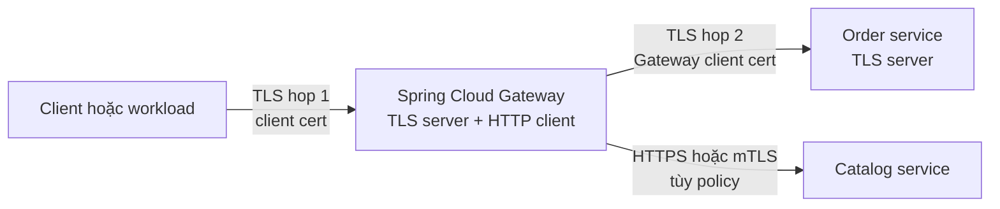
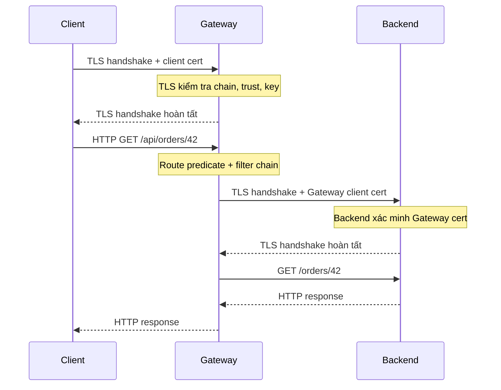
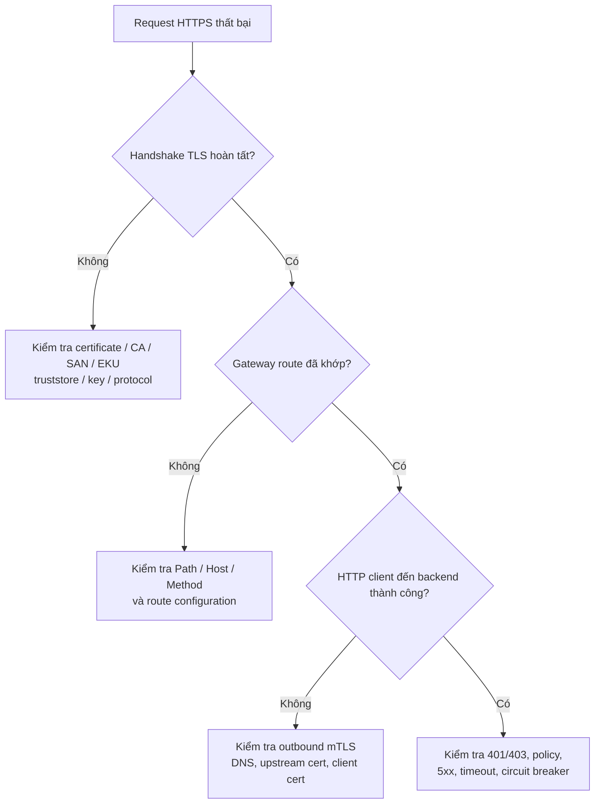

# Xác thực hai chiều mTLS khi triển khai Spring Cloud Gateway và các phiên bản hỗ trợ

Trong kiến trúc microservices, **Spring Cloud Gateway** tiếp nhận request từ client, khớp route predicate, chạy filter chain, biến đổi đường dẫn/header và chuyển tiếp tới backend. Để các kết nối này an toàn, HTTPS thông thường chỉ xác thực **máy chủ** với phía gọi. **Mutual TLS (mTLS)** bổ sung bước xác thực **chứng chỉ của client** ngay trong TLS handshake: hai đầu kết nối đều trình bày và kiểm tra danh tính mật mã của nhau.

Điểm dễ nhầm nhất là Gateway vừa là **server** đối với client/ingress, vừa là **HTTP client** đối với microservice. Vì thế mTLS có thể xảy ra ở **hai kết nối TLS độc lập**, với certificate, key và trust store khác nhau. Bật mTLS một chiều không tự bật chiều còn lại.

Bài thuộc chương **Kết nối và TLS** của module `SPRING_CLOUD_GATEWAY`, dành cho việc triển khai cổng vào microservices an toàn cùng các cơ chế xác thực, rate limiting, circuit breaker, retry và quan sát request.

> **Phiên bản tham chiếu:** Ví dụ chính dùng **Spring Cloud Gateway Server WebFlux 5.0.x**, Spring Cloud release train **2025.1.x** và Spring Boot **4.x** (với các bản vá tương thích). Trong Gateway 5.0, cấu hình HTTP client dùng `spring.cloud.gateway.server.webflux.httpclient`, còn route dùng `spring.cloud.gateway.server.webflux.routes`. Các ví dụ cũ dùng `spring.cloud.gateway.httpclient`/`spring.cloud.gateway.routes` không nên chép nguyên sang 5.0. **Server Web MVC** có cấu hình outbound HTTP client khác, nêu ở phần phiên bản.

## 1. Mục tiêu học tập

Sau bài này bạn có thể:

1. Giải thích điểm khác giữa TLS một chiều, mTLS và xác thực/ủy quyền ở tầng ứng dụng.
2. Vẽ đúng các mối quan hệ **client ↔ Gateway**, **ingress ↔ Gateway** và **Gateway ↔ upstream** khi triển khai.
3. Phân biệt **keystore/key material** với **truststore/trust material**, certificate chain, CA, SAN và EKU.
4. Bật `server.ssl.client-auth: need` để Gateway kiểm tra certificate của client khi Gateway trực tiếp kết thúc TLS.
5. Cấu hình HTTP client outbound của Gateway dùng certificate/key riêng để kết nối backend yêu cầu mTLS.
6. Kiểm thử cả trường hợp có và không có certificate bằng `curl`/`openssl`, không vô hiệu hóa kiểm tra certificate.
7. Nhận diện giới hạn giữa TLS identity và Spring Security authorization, lên kế hoạch xoay vòng certificate/trust anchor.

## 2. Hai chiều TLS có thể áp dụng mTLS



### 2.1. Client → Gateway: Gateway là TLS server

Gateway trình **server certificate** để client xác minh hostname, CA và chuỗi chứng chỉ. Nếu bật mTLS, Gateway còn **yêu cầu certificate của client** và kiểm tra certificate đó có thuộc tập CA được tin cậy hay không.

| Phía | Cần có | Dùng để |
|---|---|---|
| Gateway (TLS server) | Server private key + server certificate/chain | Chứng minh endpoint Gateway với client |
| Gateway (TLS server) | Truststore chứa CA/cert client được phép | Xác thực client certificate |
| Client | Truststore hoặc CA bundle tin Gateway server | Xác thực server certificate |
| Client | Client private key + client certificate/chain | Chứng minh client sở hữu private key |

Mục tiêu của `server.ssl.client-auth: need` là **bắt buộc** client có certificate được tin cậy ở cấp TLS. Nếu client thiếu certificate, thông thường TLS handshake không thành công **trước khi** HTTP request được route.

### 2.2. Gateway → backend: Gateway là TLS client

Gateway cũng phải xác thực certificate của backend. Nếu backend yêu cầu mTLS, nó gửi thêm yêu cầu client certificate; Gateway sử dụng **private key + certificate riêng cho outbound**.

| Phía | Cần có | Dùng để |
|---|---|---|
| Backend (TLS server) | Server key + certificate/chain | Chứng minh backend với Gateway |
| Backend (TLS server) | Truststore chứa CA cấp client cert cho Gateway | Xác thực certificate của Gateway |
| Gateway (TLS client) | Trust material tin CA backend | Xác thực server certificate và chuỗi CA |
| Gateway (TLS client) | Client key + client certificate/chain | Chứng minh danh tính Gateway với backend |

Hai kết nối trên thường dùng **certificate khác nhau**, vì vai trò, CA, phạm vi tin cậy, rotation và yêu cầu EKU có thể khác.

**`uri: https://orders.internal.example` chỉ bảo đảm dùng HTTPS**, chưa nói backend yêu cầu client certificate hay Gateway có sẵn certificate để trình. Trong Gateway, việc trình outbound client certificate được cấu hình ở **HTTP client SSL**, không phải một route predicate thông thường.

### 2.3. Cách TLS handshake có liên quan đến filter chain



Nếu kết nối TLS đã tồn tại trong connection pool, Gateway **không handshake lại cho từng request**. Vì vậy việc đổi certificate, CA hoặc policy có thể chỉ thể hiện khi tạo kết nối mới. Mọi hành vi rotation phải được thử với cả kết nối mới lẫn kết nối đang tái sử dụng.

## 3. TLS thường, `want` và `need` khác gì nhau?

Trong Spring Boot, cấu hình `server.ssl.client-auth` có các chế độ:

| Giá trị | Trạng thái | Ý nghĩa |
|---|---|---|
| `none` | Không yêu cầu client certificate | HTTPS xác thực server; chưa phải mTLS bắt buộc |
| `want` | Yêu cầu nếu có | Có thể chấp nhận client **không có** certificate; **không phù hợp** để bắt buộc mTLS |
| `need` | Bắt buộc | Client phải cung cấp certificate hợp lệ và được tin cậy |

Chọn `need` tại điểm trực tiếp nhận TLS nếu mục tiêu bảo vệ kết nối là **mTLS bắt buộc**. `want` có ích trong quá trình chuyển tiếp hoặc dịch vụ hỗn hợp, nhưng không được dùng thay cho yêu cầu xác thực bắt buộc.

**TLS certificate validation và HTTP authorization là hai việc khác nhau.** Một client có certificate do CA tin cậy cấp chưa chắc được phép gọi `POST /api/payments`. Nếu CA cấp certificate cho nhiều workload, cần kiểm tra danh tính workload, scope/quyền, tenant và các policy tương ứng sau handshake.

## 4. Chứng chỉ, CA, SAN và hai kho khác nhau

Những khái niệm cần nắm:

- **Private key**: bí mật của mỗi bên; không chia sẻ giữa client và server, không đưa vào Git/image hoặc log.
- **Leaf certificate**: chứa public key và thông tin định danh của một endpoint; được ký bởi CA/trust anchor.
- **Certificate chain**: leaf và các intermediate CA để phía còn lại kiểm chứng đường tin cậy.
- **Keystore/key material**: certificate + **private key** mà endpoint dùng để chứng minh danh tính.
- **Truststore/trust material**: CA/certificate được **tin cậy** để kiểm chứng phía đối diện; truststore không có nghĩa chứa private key của phía đối diện.
- **SAN (Subject Alternative Name)**: hostname/IP hợp lệ của **server certificate**; client cần kiểm tra hostname gọi có khớp SAN.
- **EKU (Extended Key Usage)**: mục đích của certificate; server certificate nên có `serverAuth`, client certificate có `clientAuth` theo chính sách CA.
- **Certificate revocation**: chứng chỉ có thể cần bị thu hồi trước hạn; chain hợp lệ chưa tự đảm bảo đã kiểm tra CRL/OCSP hoặc danh sách revoke theo yêu cầu bảo mật.

Ví dụ gọi `https://orders.internal.example:9443` thì certificate của backend phải có SAN `DNS:orders.internal.example`. Không sửa lỗi SAN mismatch bằng cách tắt hostname verification.

**Một CA cho mọi thành phần** phù hợp với lab nhỏ, nhưng trong production có thể tách CA cho inbound clients, Gateway outbound identities và backend servers để tránh cấp quyền tin cậy quá rộng.

## 5. Các phiên bản và cách cấu hình tương ứng

mTLS là năng lực của **TLS stack và Spring Boot/HTTP client**, không phải một GatewayFilter đơn lẻ chỉ có ở phiên bản mới. Tuy nhiên **property và API kết nối outbound** đã thay đổi giữa các nhánh.

| Stack | Phiên bản/quan hệ | Cách áp dụng cần lưu ý |
|---|---|---|
| **Gateway Server WebFlux 5.0.x** | Spring Cloud 2025.1.x, Spring Boot 4.0.x/4.1.x theo release cụ thể | Dùng `server.ssl.*` cho inbound; `spring.cloud.gateway.server.webflux.httpclient.ssl.*` cho outbound |
| Gateway Server WebFlux 4.x | Spring Cloud 2025.0.x ↔ Boot 3.5.x hoặc train cũ hơn ↔ Boot tương ứng | Kiểm tra property prefix nhánh 4.x, đặc biệt `spring.cloud.gateway.httpclient.ssl.*` ở nhiều hướng dẫn cũ |
| Gateway Server Web MVC | Dùng WebMvc.fn / RestClient | Outbound TLS có đường cấu hình `spring.http.client.ssl.bundle` và `spring.ssl.bundle.*` trên tài liệu phiên bản tương ứng, **không** lấy nguyên HTTP client properties WebFlux |
| Custom Netty/RestClient/WebClient | Có thể có SSL context độc lập | Kiểm tra có kế thừa Spring Boot SSL bundle hay phải cấu hình riêng |

Spring Cloud release train **2025.1.x** tương thích với các bản Spring Boot 4.x đã được xác nhận. Ví dụ bản 2025.1.5 (phát hành tháng 11/2026) hỗ trợ Boot 4.0.x và 4.1.x; cần kiểm tra chính xác patch của BOM khi nâng cấp. Các train đã hết thời gian hỗ trợ không nên được chọn cho triển khai mới khi có thể nâng cấp.

Tham khảo **Spring Cloud compatibility matrix** để chọn Spring Boot và Spring Cloud BOM cùng nhánh. Một số trang TLS/SSL cũ vẫn hiển thị `spring.cloud.gateway.httpclient.ssl`; khi dùng Gateway 5.0 hãy đối chiếu **Configuration Properties 5.0** để tránh đặt sai prefix.

### 5.1. Dependency tối thiểu

Với Gateway Server WebFlux 5.0.x:

```xml
<dependency>
    <groupId>org.springframework.cloud</groupId>
    <artifactId>spring-cloud-starter-gateway-server-webflux</artifactId>
</dependency>
```

Dự án phải có **Spring Cloud BOM tương thích với Spring Boot** cùng Spring Boot parent/plugin. Spring Initializr là cách tạo project ban đầu an toàn hơn việc tự kết hợp phiên bản ngẫu nhiên. SSL là khả năng của HTTP runtime, không cần một “mTLS GatewayFilter starter” riêng. **Spring Security** là dependency riêng khi bạn cần ánh xạ certificate thành principal/quyền ứng dụng.

### 5.2. Tách loại cấu hình

| Vấn đề | Property quan trọng trong Gateway WebFlux 5.0 |
|---|---|
| HTTPS server certificate Gateway | `server.ssl.key-store` và password/type, hoặc `server.ssl.bundle` |
| Bắt buộc client certificate ở Gateway | `server.ssl.client-auth: need` và trust material inbound |
| Route đích HTTPS | `spring.cloud.gateway.server.webflux.routes[*].uri: https://...` |
| Gateway dùng client cert khi proxy | `spring.cloud.gateway.server.webflux.httpclient.ssl.key-store*` hoặc `ssl-bundle` |
| CA tin backend | `...httpclient.ssl.trusted-x509-certificates` hoặc truststore trong SSL bundle |
| TLS outbound handshake timeout | `...httpclient.ssl.handshake-timeout` |
| Không xác thực certificate backend | `...httpclient.ssl.use-insecure-trust-manager` — **không dùng production** |

**Phạm vi:** các cấu hình `httpclient.ssl.*` ở đây tác động lên HTTP client của Gateway Server WebFlux, thường dùng chung cho nhiều route. Nếu mỗi backend cần **một client identity/trust policy khác nhau**, phải thiết kế thêm client/route-specific customization, tách Gateway instance hoặc dùng service mesh, chứ không giả định có thể đặt một `ssl-bundle` riêng trong mọi `route.filters`.

## 6. Cấu hình mTLS inbound: client → Gateway

Cách cấu hình dễ kiểm tra là dùng **PKCS12**: một keystore chứa private key/certificate **của Gateway**, một truststore chứa **CA cấp certificate cho client**. Hai file này không thay thế cho nhau.

### 6.1. `application.yml` bằng `server.ssl.*`

```yaml
server:
  port: 8443
  ssl:
    enabled: true
    key-store: file:/run/secrets/gateway-server.p12
    key-store-type: PKCS12
    key-store-password: ${TLS_SERVER_KEYSTORE_PASSWORD}
    trust-store: file:/run/secrets/clients-truststore.p12
    trust-store-type: PKCS12
    trust-store-password: ${TLS_CLIENT_TRUSTSTORE_PASSWORD}
    client-auth: need
    enabled-protocols: TLSv1.3,TLSv1.2

spring:
  application:
    name: secure-gateway
  cloud:
    gateway:
      server:
        webflux:
          routes:
            - id: orders
              uri: http://localhost:9001
              predicates:
                - Path=/api/orders/**
              filters:
                - StripPrefix=1
```

**Giải thích chi tiết:**

- `server.port: 8443`: Gateway lắng nghe HTTPS trên cổng 8443.
- `key-store`: file PKCS12 chứa **Gateway server private key và certificate chain**.
- `trust-store`: file chứa các **CA/certificate client được tin cậy**; không phải private key của client.
- `client-auth: need`: bắt buộc certificate ở TLS handshake inbound.
- `enabled-protocols`: minh họa policy chỉ cho TLS 1.2/1.3; ciphers/protocol thực tế còn tùy JDK và chính sách vận hành.
- `uri: http://localhost:9001`: **chỉ** là HTTP backend để tách lab inbound; chưa có mTLS outbound.
- Biến môi trường `${...}` không được hardcode mật khẩu vào Git. Trong triển khai thực, cấu hình secret manager và quyền đọc file thích hợp.

Nếu private key bên trong PKCS12 có password khác password của keystore, có thể cần `server.ssl.key-password`. Không để cert và private key production trong `src/main/resources` hoặc đưa vào container image công khai.

### 6.2. Cấu hình inbound bằng SSL bundle PEM

Spring Boot hiện có **SSL bundles** giúp cấu hình certificate/key và trust material qua PEM mà không phải tự ghép PKCS12 trong mọi môi trường.

Ví dụ thay thế cho khối `server.ssl.key-store/trust-store` ở trên:

```yaml
server:
  port: 8443
  ssl:
    bundle: gateway-inbound
    client-auth: need

spring:
  ssl:
    bundle:
      pem:
        gateway-inbound:
          keystore:
            certificate: file:/run/secrets/gateway-server.crt
            private-key: file:/run/secrets/gateway-server.key
          truststore:
            certificate: file:/run/secrets/clients-ca.crt
```

SSL bundle `gateway-inbound` được Spring Boot gắn cho **embedded Netty web server** bằng `server.ssl.bundle`. Cặp `certificate`/`private-key` là key material của Gateway, `truststore.certificate` là CA tin client. Đây là **phương án thay thế**, không trộn với các khóa `server.ssl.key-store` truyền thống trong cùng ứng dụng nếu chưa hiểu quy tắc ưu tiên.

Nếu có intermediate CA, cần cấu hình chain đầy đủ và kiểm tra format PEM được cung cấp. Nếu nhiều client certificate được cấp bởi CA không được tin cậy trong bundle, TLS handshake sẽ thất bại, cho dù certificate đó còn hạn.

### 6.3. Inbound mTLS không tự tạo user/role ứng dụng

Spring Boot + Netty kiểm chứng certificate ở TLS layer. Điều này **không tự ánh xạ** X.509 subject thành user có vai trò `ROLE_ADMIN`, cũng không kiểm tra quyền đọc đơn hàng.

Với Gateway WebFlux có Spring Security, bạn có thể bật **Reactive X.509 authentication** để ánh xạ certificate thành một principal đã được hệ thống xác nhận. Thêm starter Security tương ứng Spring Boot BOM:

```xml
<dependency>
    <groupId>org.springframework.boot</groupId>
    <artifactId>spring-boot-starter-security</artifactId>
</dependency>
```

Sau đó cấu hình reactive security chain:

```java
import org.springframework.context.annotation.Bean;
import org.springframework.context.annotation.Configuration;
import org.springframework.security.config.Customizer;
import org.springframework.security.config.web.server.ServerHttpSecurity;
import org.springframework.security.web.server.SecurityWebFilterChain;

@Configuration
public class GatewayX509Security {
    @Bean
    SecurityWebFilterChain securityWebFilterChain(ServerHttpSecurity http) {
        return http
            .x509(Customizer.withDefaults())
            .authorizeExchange(exchanges ->
                exchanges.anyExchange().authenticated())
            .build();
    }
}
```

**Đoạn này là khung cấu hình**, không phải hoàn chỉnh cho mọi hệ thống. Spring Security cần một nguồn user hoặc `ReactiveAuthenticationManager` phù hợp để **chấp nhận/ánh xạ danh tính X.509**; theo mặc định principal extractor thường đọc **CN** từ certificate và authentication manager kiểm tra tài khoản tương ứng. Một certificate TLS hợp lệ không tự đảm bảo có account hợp lệ.

Trong hệ thống production, nên cân nhắc mapping theo **SAN URI/SPIFFE ID hoặc danh tính công việc chuẩn hóa** khi hạ tầng PKI hỗ trợ, thay vì tự mặc định CN là định danh duy nhất. Dù dùng X.509 hay JWT, backend vẫn cần authorization theo tài nguyên.

### 6.4. Nếu cần demo mapping account X.509 cụ thể

Ví dụ sau thay cho khung `@Bean SecurityWebFilterChain` ở trên và dùng user **demo-client** được tạo cho lab (không dùng cấu hình in-memory này như user directory production):

```java
import org.springframework.context.annotation.Bean;
import org.springframework.context.annotation.Configuration;
import org.springframework.security.authentication.ReactiveAuthenticationManager;
import org.springframework.security.config.web.server.ServerHttpSecurity;
import org.springframework.security.core.userdetails.User;
import org.springframework.security.core.userdetails.ReactiveUserDetailsService;
import org.springframework.security.provisioning.MapReactiveUserDetailsService;
import org.springframework.security.web.server.SecurityWebFilterChain;
import org.springframework.security.web.server.authentication.ReactivePreAuthenticatedAuthenticationManager;

@Configuration
public class DemoX509Security {
    @Bean
    SecurityWebFilterChain x509Chain(ServerHttpSecurity http) {
        ReactiveUserDetailsService users =
            new MapReactiveUserDetailsService(
                User.withUsername("demo-client")
                    .password("{noop}not-used-by-x509")
                    .roles("SERVICE_CLIENT")
                    .build());

        ReactiveAuthenticationManager manager =
            new ReactivePreAuthenticatedAuthenticationManager(users);

        return http
            .x509(x509 -> x509.authenticationManager(manager))
            .authorizeExchange(exchanges ->
                exchanges.anyExchange().authenticated())
            .build();
    }
}
```

Phần `password` trên chỉ thỏa cấu trúc `UserDetails` của lab; mTLS/X.509 **không xác thực bằng password đó**. Khi triển khai thực, thay bằng tài khoản/identity source, lifecycle, trạng thái tài khoản và policy quyền thật. Đừng đăng ký **cả hai** class `GatewayX509Security` và `DemoX509Security` trong cùng demo vì chúng tạo hai security chain và có thể cho kết quả khó dự đoán.

**Thứ tự kiểm thử:** trước hết xác nhận mTLS handshake thành công tại server; sau đó mới bật Spring Security X.509, vì HTTP `401`/`403` từ authorization khác với lỗi TLS handshake.

## 7. Cấu hình mTLS outbound: Gateway → backend

Khi Gateway proxy tới `https://orders.internal.example:9443`, Gateway phải xác minh **server certificate của order-service**. Nếu order-service bắt buộc client authentication, Gateway còn phải gửi **Gateway client certificate**.

### 7.1. Cấu hình bằng SSL bundle PEM cho HTTP client

Với **Gateway Server WebFlux 5.0.x**, một cách rõ ràng là khai báo SSL bundle chứa cả **client key material** và **trust material**, rồi tham chiếu từ HTTP client của Gateway:

```yaml
spring:
  ssl:
    bundle:
      pem:
        upstream-mtls:
          keystore:
            certificate: file:/run/secrets/gateway-outbound-client.crt
            private-key: file:/run/secrets/gateway-outbound-client.key
          truststore:
            certificate: file:/run/secrets/upstream-server-ca.crt

  cloud:
    gateway:
      server:
        webflux:
          httpclient:
            ssl:
              ssl-bundle: upstream-mtls
              handshake-timeout: 10s
              use-insecure-trust-manager: false
          routes:
            - id: orders-secure
              uri: https://orders.internal.example:9443
              predicates:
                - Path=/api/orders/**
              filters:
                - StripPrefix=1
```

Trong ví dụ:

- `upstream-mtls.keystore` là **cert + private key Gateway dùng khi làm client**.
- `upstream-mtls.truststore` là **CA để Gateway tin server certificate của order-service**.
- `httpclient.ssl.ssl-bundle: upstream-mtls` gắn bundle với Netty HTTP client của Gateway.
- `uri: https://...` kích hoạt TLS cho kết nối upstream; hostname phải khớp SAN trên server certificate.
- `handshake-timeout: 10s` giới hạn thời gian TLS handshake, không thay thế các timeout kết nối/response.
- `use-insecure-trust-manager: false` là cách thể hiện rõ rằng **không bỏ qua xác thực certificate**; false cũng là mặc định 5.0.

Đoạn này chỉ minh họa **outbound mTLS**. Nếu đồng thời muốn inbound mTLS, tích hợp khối `server.ssl.*` ở mục 6 bằng cách **hợp nhất đúng một gốc `spring:` trong YAML**, hoặc giữ các cấu hình ở các file profile riêng có thứ tự ưu tiên rõ ràng. Không dán hai tài liệu YAML có cùng root `spring:` mà không kiểm tra kết quả bind.

### 7.2. Cấu hình outbound bằng PKCS12

Một lựa chọn khác của HTTP client Server WebFlux 5.0.x là dùng keystore PKCS12 cho **client certificate** và danh sách CA tin backend:

```yaml
spring:
  cloud:
    gateway:
      server:
        webflux:
          httpclient:
            ssl:
              key-store: file:/run/secrets/gateway-outbound-client.p12
              key-store-type: PKCS12
              key-store-password: ${TLS_OUTBOUND_KEYSTORE_PASSWORD}
              trusted-x509-certificates:
                - file:/run/secrets/upstream-server-ca.crt
              handshake-timeout: 10s
              use-insecure-trust-manager: false
```

Đây cũng là **phương án thay thế**, không dùng chung với `ssl-bundle` cùng lúc nếu chưa kiểm tra thứ tự ưu tiên và cách HTTP client dựng SSL context.

Bản Gateway 5.0 liệt kê `key-store`, `key-store-password`, `key-store-type`, `ssl-bundle`, `trusted-x509-certificates` và `use-insecure-trust-manager` dưới `spring.cloud.gateway.server.webflux.httpclient.ssl`. Trong production, hãy kiểm tra thêm tải certificate chain, quyền đọc secret, SAN/hostname verification và tác động của connection pool.

### 7.3. Tránh hai lối đi sai thường gặp

**Sai 1: chỉ cấu hình `server.ssl.client-auth: need` rồi kỳ vọng backend thấy client cert Gateway.**

`server.ssl.*` chỉ áp dụng cho **inbound TLS server** của Gateway. Để đi qua mTLS outbound, phải cấu hình **HTTP client** riêng.

**Sai 2: chỉ đặt `uri: https://...` rồi coi đã bật mTLS.**

HTTPS chỉ nói rằng client (Gateway) đang dùng TLS. Nếu backend yêu cầu chứng chỉ client, Gateway phải có client key/cert phù hợp; nếu không TLS handshake thường thất bại.

**Không bao giờ dùng `use-insecure-trust-manager: true` trong production** để giải quyết lỗi CA hoặc SAN. Nó làm mất thuộc tính xác minh danh tính backend, khiến traffic có thể bị chặn/đọc/giả mạo bởi endpoint không tin cậy.

## 8. Triển khai thực tế: ingress, service mesh, TLS termination

Có nhiều topology hợp lệ; điều quan trọng là chỉ ra **thành phần nào kết thúc TLS** và **thành phần nào thực sự xác minh certificate**.

### 8.1. Gateway trực tiếp nhận HTTPS/mTLS

```text
Client --mTLS--> [Gateway :8443] --mTLS--> [Backend :9443]
```

Gateway có thể thực thi `server.ssl.client-auth: need` cho kết nối vào, và HTTP client SSL bundle cho kết nối ra. Phù hợp khi Gateway trực tiếp nhận TLS, có CA/key quản lý tập trung và backend chỉ cho phép Gateway truy cập.

### 8.2. Ingress/LB kết thúc mTLS ở ngoài Gateway

```text
Client --mTLS--> [Ingress] --TLS/mTLS--> [Gateway] --mTLS--> [Backend]
```

Ở đây **Ingress** mới là TLS server đối với client. Nếu từ Ingress đến Gateway chỉ dùng HTTP, Gateway **không thể tự kiểm chứng client certificate gốc** qua `server.ssl.client-auth: need`; TLS handshake inbound của client đã kết thúc tại ingress.

Cần xác định:

- Ingress yêu cầu client certificate, xác minh chain/trust/identity và chính sách truy cập;
- kết nối Ingress → Gateway được bảo vệ bằng mạng riêng và tốt nhất TLS/mTLS tùy threat model;
- nếu cần chuyển danh tính client vào Gateway, chỉ dùng **header có hợp đồng và nguồn đáng tin** (được ingress xóa/ghi lại), hoặc token/assertion có chữ ký; không tin header client tự gửi như `X-SSL-Client-Cert` hay `X-Client-DN`;
- Gateway chỉ nhận traffic từ ingress được phép; backend không nhận traffic tùy tiện đi vòng Gateway.

**Quan trọng:** Bật mTLS ở Ingress **không có nghĩa** Gateway đã có certificate client để trình với backend. Ingress → Gateway và Gateway → backend là hai TLS hop riêng biệt.

### 8.3. TLS passthrough hoặc sidecar/service mesh

- **TLS passthrough:** proxy truyền kết nối TLS xuyên suốt tới Gateway mà không giải mã. Khi đó Gateway có thể là điểm xác thực client certificate; ingress chỉ quyết định TCP/SNI routing theo khả năng.
- **Service mesh:** sidecar/ambient proxy có thể thực hiện workload mTLS ở tầng hạ tầng. Ứng dụng Gateway đôi khi chỉ thấy HTTP nội bộ tới sidecar; không suy luận rằng `server.ssl.client-auth` của Gateway là công tắc điều khiển mTLS mesh.
- **Re-encrypt:** ingress kết thúc TLS bên ngoài rồi mở kết nối TLS mới vào Gateway. Certificate/identity ở kết nối thứ hai không nhất thiết là certificate gốc của client.

Hãy ghi rõ trên sơ đồ triển khai: **client thật → TLS terminator → Gateway → backend**, loại CA mỗi kết nối, ai xoay vòng secret và ai chịu trách nhiệm policy. Không chỉ kiểm tra rằng URL bắt đầu bằng `https://` rồi kết luận có end-to-end mTLS.

## 9. Lab: tạo certificate ngắn hạn để thử mTLS inbound

Lab này giúp kiểm chứng trực tiếp rằng **Gateway từ chối client không có certificate**, còn client hợp lệ có thể thực hiện request đến một route. Certificate trong lab là certificate thử nghiệm, không dùng ở production.

**Yêu cầu:** JDK 17+ cùng phiên bản Spring Boot/Gateway phù hợp, OpenSSL và `keytool`; chạy các câu lệnh mẫu trên **Bash (Linux/macOS/WSL)** trong một thư mục thực hành riêng của người học. Trên Windows PowerShell có thể chạy các lệnh OpenSSL tương đương nhưng cần chỉnh cú pháp nối dòng/đường dẫn; các đoạn heredoc bên dưới là cú pháp Bash.

### 9.1. Tạo CA thử nghiệm

```bash
mkdir mtls-lab
cd mtls-lab

openssl req -x509 -newkey rsa:3072 -nodes \
  -keyout lab-ca.key -out lab-ca.crt \
  -sha256 -days 2 \
  -subj "/CN=Gateway Lab CA"
```

`lab-ca.key` là **CA private key**; chỉ nên ở trong lab offline, tuyệt đối không đưa vào source control. `lab-ca.crt` là CA public certificate có thể dùng để xây trust store.

### 9.2. Cấp server certificate cho `localhost`

```bash
openssl req -newkey rsa:3072 -nodes \
  -keyout gateway-server.key -out gateway-server.csr \
  -subj "/CN=localhost"

cat > gateway-server.ext <<'EOF'
subjectAltName=DNS:localhost,IP:127.0.0.1
extendedKeyUsage=serverAuth
keyUsage=digitalSignature,keyEncipherment
EOF

openssl x509 -req -in gateway-server.csr \
  -CA lab-ca.crt -CAkey lab-ca.key -CAcreateserial \
  -out gateway-server.crt -days 2 -sha256 \
  -extfile gateway-server.ext
```

`subjectAltName` giúp `curl https://localhost:8443` kiểm chứng đúng hostname `localhost`. `serverAuth` diễn đạt công dụng server TLS. Nếu tạo certificate chỉ với `CN=localhost` mà không có SAN, nhiều TLS client hiện đại sẽ từ chối kiểm tra hostname.

### 9.3. Cấp certificate cho client `demo-client`

```bash
openssl req -newkey rsa:3072 -nodes \
  -keyout demo-client.key -out demo-client.csr \
  -subj "/CN=demo-client"

cat > demo-client.ext <<'EOF'
extendedKeyUsage=clientAuth
keyUsage=digitalSignature
EOF

openssl x509 -req -in demo-client.csr \
  -CA lab-ca.crt -CAkey lab-ca.key -CAcreateserial \
  -out demo-client.crt -days 2 -sha256 \
  -extfile demo-client.ext
```

Trong lab, CA ký cả hai certificate cho tiện, nhưng **vai trò server/client vẫn khác**. Certificate client có `clientAuth`, certificate server có `serverAuth`. Các khóa `-nodes` tạo **private key không mã hóa**, chỉ chấp nhận cho lab ngắn hạn trong thư mục được bảo vệ; production phải dùng lưu trữ secret/key an toàn và quy trình rotation.

### 9.4. Chuyển server key sang PKCS12 và tạo client truststore

```bash
openssl pkcs12 -export \
  -inkey gateway-server.key \
  -in gateway-server.crt \
  -certfile lab-ca.crt \
  -name gateway-server \
  -out gateway-server.p12

keytool -importcert -noprompt \
  -alias lab-ca -file lab-ca.crt \
  -keystore clients-truststore.p12 \
  -storetype PKCS12
```

Hai lệnh có thể yêu cầu bạn **đặt password**. Đặt password không rỗng đủ mạnh và nhớ riêng giá trị của mỗi file; khi chạy Gateway, cung cấp qua biến môi trường. `gateway-server.p12` chứa server private key/chain; `clients-truststore.p12` chứa CA để Gateway kiểm tra client certificate.

Có thể kiểm tra metadata, không in private key:

```bash
keytool -list -keystore gateway-server.p12 -storetype PKCS12
keytool -list -keystore clients-truststore.p12 -storetype PKCS12

openssl x509 -in gateway-server.crt -noout -subject -issuer -dates -ext subjectAltName
openssl x509 -in demo-client.crt -noout -subject -issuer -dates -ext extendedKeyUsage
```

Không copy các file `*.key` hay `*.p12` chứa private key lên issue tracker hoặc vào Git. Xóa các file lab sau khi hoàn tất, theo chính sách của môi trường học tập.

### 9.5. Gắn file lab vào Gateway

Trong `application.yml` của **Gateway demo**, có thể dùng cấu hình `server.ssl.*` ở mục 6, nhưng thay hai đường dẫn certificate thành file trong working directory:

```yaml
server:
  port: 8443
  ssl:
    key-store: file:./gateway-server.p12
    key-store-type: PKCS12
    key-store-password: ${TLS_SERVER_KEYSTORE_PASSWORD}
    trust-store: file:./clients-truststore.p12
    trust-store-type: PKCS12
    trust-store-password: ${TLS_CLIENT_TRUSTSTORE_PASSWORD}
    client-auth: need
```

Chỉ sử dụng **một khối `server:`** trong YAML. Giữ route `orders` từ mục 6, hoặc ghép nó dưới root `spring.cloud.gateway.server.webflux.routes`. Nếu file nằm ngoài thư mục làm việc của ứng dụng, sử dụng đường dẫn `file:...` tuyệt đối chính xác.

Trên Bash, lấy password từ bàn phím mà không đưa vào command history:

```bash
read -rs -p "Password cho gateway-server.p12: " TLS_SERVER_KEYSTORE_PASSWORD
echo
export TLS_SERVER_KEYSTORE_PASSWORD

read -rs -p "Password cho clients-truststore.p12: " TLS_CLIENT_TRUSTSTORE_PASSWORD
echo
export TLS_CLIENT_TRUSTSTORE_PASSWORD
```

Khởi động Gateway bằng Maven wrapper trong thư mục project, bảo đảm đường dẫn `file:./...` trỏ tới nơi có hai file PKCS12:

```bash
./mvnw spring-boot:run
```

Trên Windows PowerShell 5.1, dùng `.\mvnw.cmd spring-boot:run` và thiết lập `$env:TLS_SERVER_KEYSTORE_PASSWORD`, `$env:TLS_CLIENT_TRUSTSTORE_PASSWORD` theo cơ chế secret của máy; không nhập password trực tiếp trong tài liệu được commit.

### 9.6. Backend echo để quan sát request khi TLS đã thành công

Nếu chưa có order-service lắng nghe `localhost:9001`, tạo file `LocalOrderBackend.java` trong thư mục lab:

```java
import com.sun.net.httpserver.HttpServer;
import java.net.InetSocketAddress;
import java.nio.charset.StandardCharsets;

public class LocalOrderBackend {
    public static void main(String[] args) throws Exception {
        HttpServer server = HttpServer.create(
            new InetSocketAddress("127.0.0.1", 9001), 0);

        server.createContext("/", exchange -> {
            String message =
                "path=" + exchange.getRequestURI().getRawPath() + "\n";
            byte[] bytes = message.getBytes(StandardCharsets.UTF_8);
            exchange.getResponseHeaders().set(
                "Content-Type", "text/plain; charset=utf-8");
            exchange.sendResponseHeaders(200, bytes.length);
            try (var out = exchange.getResponseBody()) {
                out.write(bytes);
            }
        });

        server.start();
        System.out.println("Backend http://localhost:9001");
    }
}
```

Chạy backend trong terminal khác:

```bash
java --add-modules jdk.httpserver LocalOrderBackend.java
```

Gateway route `Path=/api/orders/**` và `StripPrefix=1` chuyển request `/api/orders/42` thành `/orders/42`, backend echo trả `path=/orders/42`. TLS inbound của Gateway được thử độc lập vì kết nối Gateway → backend ở lab này vẫn là HTTP trên loopback.

### 9.7. Kiểm thử mTLS bắt buộc với `curl`

**Trường hợp A — không gửi client certificate:**

```bash
curl -v --cacert lab-ca.crt \
  https://localhost:8443/api/orders/42
```

Với `client-auth: need`, TLS handshake dự kiến thất bại hoặc kết nối bị đóng, trước khi Gateway có thể trả một HTTP response của backend. Tên TLS alert có thể khác theo TLS 1.2/1.3 và runtime; **không kỳ vọng chắc chắn HTTP 401 hoặc 403**.

**Trường hợp B — gửi client certificate hợp lệ:**

```bash
curl -i --cacert lab-ca.crt \
  --cert demo-client.crt \
  --key demo-client.key \
  https://localhost:8443/api/orders/42
```

Nếu certificate, route và backend hợp lệ, phản hồi có thể là:

```text
HTTP/1.1 200 OK
Content-Type: text/plain; charset=utf-8

path=/orders/42
```

Nếu đã bật **Spring Security X.509** ở mục 6.3, HTTPS handshake hợp lệ vẫn có thể dẫn đến **HTTP 401/403** nếu certificate không ánh xạ thành tài khoản/quyền hợp lệ. Đó là **kết quả khác** với lỗi handshake; hãy debug từng lớp riêng.

**Trường hợp C — xác minh handshake bằng OpenSSL:**

```bash
openssl s_client -connect localhost:8443 \
  -servername localhost \
  -verify_hostname localhost \
  -verify_return_error \
  -CAfile lab-ca.crt \
  -cert demo-client.crt \
  -key demo-client.key
```

Lệnh giúp xem certificate chain, SAN/hostname verification và trạng thái xác thực server. Khi thiếu/wrong client certificate, kiểm tra alert handshake từ phía Gateway. Đừng in private key và đừng tắt xác minh bằng `curl -k` hoặc `--insecure` để coi là thử nghiệm thành công.

### 9.8. Thử mTLS outbound riêng

Giả sử có một upstream HTTPS trên `localhost:9443` với **server cert SAN=localhost**, yêu cầu **client certificate** và tin CA cấp `demo-client.crt`. Có thể dựng một upstream thử bằng OpenSSL, nếu đã có certificate server tương ứng:

```bash
openssl s_server -accept 9443 \
  -cert gateway-server.crt \
  -key gateway-server.key \
  -CAfile lab-ca.crt \
  -Verify 1 \
  -www
```

`s_server` chỉ là TLS/HTTP endpoint kiểm tra, **không phải order-service production**. Trong lab có thể tái dùng certificate server/client vừa tạo để đơn giản hóa, nhưng production phải cấp **danh tính riêng cho Gateway outbound và backend**.

Trước khi cấu hình Gateway, kiểm tra backend TLS trực tiếp:

```bash
curl -i --cacert lab-ca.crt \
  --cert demo-client.crt --key demo-client.key \
  https://localhost:9443/
```

Sau đó sửa ví dụ outbound `upstream-mtls` từ mục 7.1 cho môi trường lab: certificate là `demo-client.crt`, private key là `demo-client.key`, CA trust là `lab-ca.crt`, và route `uri: https://localhost:9443`. Nếu dùng đồng thời inbound trên `8443`, client gọi Gateway cũng phải cung cấp certificate cho TLS hop thứ nhất. **Mỗi hop phải được kiểm thử riêng**; thông báo 502/5xx khi handshake upstream thất bại không có nghĩa client → Gateway thiếu certificate.

## 10. Kiểm thử trên môi trường triển khai: ma trận tối thiểu

| Phép thử | Kết quả mong đợi |
|---|---|
| Client không có certificate gọi Gateway inbound `need` | TLS handshake bị từ chối; thường không tới route HTTP |
| Client dùng cert được CA không tin hoặc cert hết hạn | Bị từ chối ở lớp TLS/PKI |
| Client hợp lệ, route khớp, backend khỏe | Request đi qua; HTTP status theo backend và policy bảo mật |
| Cert hợp lệ ở TLS nhưng user không có quyền ứng dụng | Có thể HTTP 403 từ authorization |
| Gateway outbound thiếu client cert, backend yêu cầu mTLS | Handshake Gateway → backend thất bại |
| Backend dùng server cert sai SAN so với hostname `uri` | Gateway phải từ chối server identity |
| Backend CA không nằm trong trust của Gateway | PKIX/trust validation thất bại |
| Nâng cấp Gateway, route vẫn dùng HTTP thay vì HTTPS | Không có TLS/mTLS ở upstream hop ấy |
| Ingress kết thúc client TLS, Gateway chỉ nhận HTTP | `server.ssl.client-auth` trên Gateway không thể kiểm tra cert gốc |
| Xoay vòng certificate/CA, kết nối cũ trong pool vẫn tồn tại | Cần thử cả connection mới, kết nối cũ và thời điểm refresh |

**Không coi `HTTP 200` đơn lẻ là chứng cứ mTLS thành công.** Hãy kiểm tra handshake, chứng chỉ peer, routing logs hoặc metrics của **TLS terminator thực tế** và chắc chắn không còn HTTP path đi vòng.

## 11. Certificate rotation, thu hồi và an toàn secret

mTLS không phải cấu hình một lần rồi quên. Certificate có ngày hết hạn; key có thể bị lộ; CA có thể thay đổi. Khi triển khai nhiều Gateway replica, cần đồng bộ lifecycle chứng chỉ và đường trust giữa các bên.

### 11.1. Một chiến lược rotation không gián đoạn

1. **Thêm CA mới vào trust material trước:** các bên tin được cả CA cũ và mới trong một khoảng chuyển tiếp.
2. **Cấp leaf certificate mới:** kiểm tra SAN, EKU, issuer, thời hạn, key usage và tên service chính xác.
3. **Triển khai có kiểm soát:** rollout certificate mới theo replica, kiểm tra request mới và connection pool cũ.
4. **Theo dõi handshake errors:** đếm lỗi theo route/upstream, tránh log private key hoặc full identity nhạy cảm.
5. **Thu hẹp trust:** khi toàn bộ endpoint đã chuyển sang certificate mới và connection cũ được xử lý, loại bỏ CA cũ theo kế hoạch.
6. **Thu hồi khóa bị lộ:** phối hợp CA/PKI, CRL/OCSP hoặc cơ chế thu hồi có hiệu lực trong hạ tầng, không chỉ chờ certificate hết hạn.

Spring Boot có khả năng **reload một số SSL bundle** khi file certificate thay đổi và consumer hỗ trợ reload. Với các bản Boot hiện đại, **Netty web server** là một consumer được tài liệu đề cập. Ví dụ PEM bundle:

```yaml
spring:
  ssl:
    bundle:
      pem:
        gateway-inbound:
          reload-on-update: true
          keystore:
            certificate: file:/run/secrets/gateway-server.crt
            private-key: file:/run/secrets/gateway-server.key
          truststore:
            certificate: file:/run/secrets/clients-ca.crt
server:
  ssl:
    bundle: gateway-inbound
    client-auth: need
```

**Cần kiểm tra chính xác phiên bản và consumer**: việc một SSL bundle hỗ trợ reload **không bảo đảm** mọi HTTP client, connection pool hoặc Netty channel đang mở sẽ áp dụng certificate mới ngay lập tức. Với outbound mTLS, thử handshake trên connection mới sau rotation, cân nhắc draining/rolling restart nếu HTTP client không tự cập nhật SSL context như mong muốn.

### 11.2. Quản lý bí mật đúng cách

- Đưa private key/keystore vào **Kubernetes Secret**, Vault, PKI/SPIFFE workload API hoặc hệ thống secret manager được phê duyệt; file phải có quyền đọc tối thiểu.
- Tránh bake private key vào container image hoặc commit `*.p12`/`*.key` vào Git. Đặc biệt không commit CA private key.
- Không dùng certificate self-signed lab trên production, không chia sẻ private key giữa môi trường dev/staging/prod.
- Không log raw `Authorization`, `Cookie`, `X-SSL-Client-Cert`, PEM, keystore password hoặc TLS key material.
- Theo dõi hạn certificate, giờ hệ thống, chain trung gian và thời gian gia hạn dự phòng.
- Tránh cấp CA tin cậy quá rộng; dùng CA/identity riêng theo trust domain và áp dụng quyền từng service.

### 11.3. Kiểm soát kết nối ngoài TLS

TLS chỉ xác thực/giữ bí mật **trên kênh truyền giữa hai endpoint**. Một thiết kế Gateway an toàn còn cần:

- Network policy/firewall chặn backend bị gọi vòng trực tiếp từ Internet.
- Spring Security xác thực và phân quyền người dùng/workload; mTLS certificate có thể là một factor, không thay thế authorization nghiệp vụ.
- JWT/OAuth2 khi cần delegated authorization, audience/scope và kiểm soát tenant.
- Rate limiting theo principal hoặc client workload **đã xác thực**, không theo một header client tự sửa.
- Timeout, circuit breaker, retry/backoff có giới hạn, đặc biệt tránh retry mù quáng `POST` không idempotent.
- Quan sát TLS handshake failures, connection pool, TLS protocol/cipher, route ID, backend status/latency; không ghi dữ liệu nhạy cảm.

## 12. Bảng chẩn đoán lỗi mTLS

| Triệu chứng | Lớp liên quan | Khả năng thường gặp | Hướng kiểm tra |
|---|---|---|---|
| Client không kết nối được Gateway `8443` | Listener/transport | Port sai, Gateway chưa bật TLS, firewall chặn | Xem process, port và `server.ssl.*` |
| `curl` không gửi cert và thấy TLS alert | Inbound mTLS | `client-auth: need` đang hoạt động | Gửi client cert/key hợp lệ; đây là kết quả mong đợi |
| Client gửi cert vẫn bị `bad_certificate`/`certificate_unknown` | Inbound trust | Client cert sai CA, hết hạn, sai EKU hoặc thiếu chain | Xem issuer/chain, truststore, certificate dates và handshake |
| `curl: (60) SSL certificate problem` | Client tin server | Gateway cert sai CA hoặc thiếu chain | Dùng `--cacert` đúng CA, kiểm tra certificate chain |
| Hostname mismatch khi gọi `localhost` | Server identity | Server certificate không có SAN `localhost` | Cấp lại cert với SAN, không dùng `-k` để che lỗi |
| HTTP `401` sau TLS handshake thành công | Application authentication | Spring Security không ánh xạ X.509 thành account hợp lệ | Kiểm tra X509 principal extractor/manager/user directory |
| HTTP `403` sau TLS handshake thành công | Application authorization | Principal có cert nhưng thiếu quyền | Kiểm tra role/policy và resource |
| Gateway trả `502`/`5xx` khi gọi backend HTTPS | Outbound TLS/proxy | Backend không kết nối được, thiếu client cert, backend CA không tin | Xem Gateway log và backend TLS handshake logs |
| `PKIX path building failed` | Outbound trust | Gateway không tin CA backend hoặc chain sai | Kiểm tra HTTP client truststore/bundle và issuer |
| `No subject alternative names matching ...` | Outbound hostname | Host trong `uri` khác SAN cert upstream | Sửa DNS/route hoặc cấp server cert đúng SAN |
| Gateway HTTP client vẫn dùng cert cũ | Rotation/pooling | SSL bundle/connection pool không reload như kỳ vọng | Tạo connection mới, thử rolling restart, kiểm tra consumer reload |
| mTLS hoạt động trên ingress nhưng Gateway HTTP backend vẫn mở | Deployment trust boundary | TLS dừng ở ingress; hop sau không được bảo vệ | Kiểm tra TLS termination, ingress → Gateway → backend |
| Có header `X-SSL-Client-Cert` nhưng không thấy TLS client identity | Spoofing | Header có thể do client tự gửi | Kiểm tra nguồn proxy đáng tin, ingress overwrite và network policy |
| Bật `use-insecure-trust-manager: true` thì “hết lỗi” | Security regression | Bỏ qua xác minh server identity | Khắc phục CA/SAN/trust thay vì giữ cấu hình không an toàn |

### 12.1. Phân biệt lỗi TLS handshake với lỗi HTTP



**HTTPS có thể thành công về mặt handshake nhưng ứng dụng vẫn trả lỗi.** Ngược lại, TLS handshake thất bại thường không tạo HTTP response có status code để GatewayFilter bắt hoặc rewrite. Vì thế không dùng retry filter để “chữa” lỗi certificate validation.

### 12.2. Công cụ hữu ích

**OpenSSL** giúp kiểm tra certificate mà không in private key:

```bash
openssl x509 -in gateway-server.crt -noout \
  -subject -issuer -dates -ext subjectAltName -ext extendedKeyUsage

openssl s_client -connect localhost:8443 \
  -servername localhost \
  -verify_return_error -verify_hostname localhost \
  -CAfile lab-ca.crt \
  -cert demo-client.crt -key demo-client.key
```

**curl** giúp thử chính HTTP request sau handshake:

```bash
curl -v --cacert lab-ca.crt \
  --cert demo-client.crt --key demo-client.key \
  https://localhost:8443/api/orders/42
```

**Actuator/metrics/logs** giúp quan sát routes, lỗi kết nối và TLS handshake theo thông tin runtime. Actuator `/actuator/gateway/routes` không tự chứng minh mTLS đã bật trên từng hop; phải kiểm tra cấu hình của chính TLS terminator và kết quả handshake.

## 13. Thực hành với service discovery và nhiều backend

Khi Gateway sử dụng service discovery/LoadBalancer:

```yaml
spring:
  cloud:
    gateway:
      server:
        webflux:
          routes:
            - id: orders-discovered
              uri: lb://order-service
              predicates:
                - Path=/api/orders/**
              filters:
                - StripPrefix=1
```

`lb://` không tự đồng nghĩa với TLS. Nó dựa vào Spring Cloud LoadBalancer và nguồn instance. Nếu instance được chọn có scheme HTTP thì hop tới instance có thể là **HTTP**; để có HTTPS/mTLS, cần cấu hình discovery/instance URI, scheme, load-balancer và HTTP client TLS phù hợp, đồng thời kiểm thử hostname certificate.

Trong Kubernetes, service DNS, ingress, sidecar và mesh có thể tạo các tên TLS khác nhau. Nếu định tuyến tới `https://order-service.namespace.svc.cluster.local`, server certificate phải hợp lệ cho hostname mà TLS client sử dụng. Nếu mesh xử lý workload mTLS trong sidecar, kiểm tra identity tại mesh policy thay vì giả định chứng chỉ nằm trong `server.ssl.*` của ứng dụng.

Khi có **nhiều upstream trust domains** (chẳng hạn order-service thuộc CA A, payment-service thuộc CA B), một SSL bundle outbound toàn cục có thể tạo độ tin cậy rộng hơn cần thiết. Tách Gateway instance, tách client cấu hình hoặc đưa chính sách TLS xuống hạ tầng tin cậy là những lựa chọn cần đánh giá theo rủi ro và khả năng vận hành.

## 14. Checklist đưa mTLS vào production

- [ ] Sơ đồ thể hiện **tất cả TLS terminators** và các hop HTTP/TLS giữa client, ingress, Gateway, service mesh và backend.
- [ ] Mỗi hop xác định rõ server certificate, client certificate (nếu mTLS), trust CA, SAN và chủ sở hữu secret.
- [ ] Chỉ các listener cần bắt buộc mTLS mới bật `client-auth: need`; không dùng `want` để thay cho policy bắt buộc.
- [ ] Client kiểm chứng server hostname và certificate chain; không bật insecure trust manager.
- [ ] Gateway có outbound client certificate khi backend yêu cầu, không chỉ `uri: https://...`.
- [ ] Đã kiểm tra property theo **phiên bản Gateway/Boot thực tế**, đặc biệt `spring.cloud.gateway.server.webflux.httpclient.ssl.*` của Gateway 5.0.
- [ ] Chứng chỉ có SAN, EKU, key usage, hạn dùng và chuỗi trung gian phù hợp.
- [ ] Private key, password, CA private key không vào Git/image/log, được quản lý bằng secret manager và ACL.
- [ ] Có cơ chế rotation/revocation, kiểm tra kết nối cũ và mới, theo dõi ngày hết hạn.
- [ ] Ingress xóa/ghi lại các header identity forwarded từ client; Gateway/backend chỉ tin nguồn đã xác minh.
- [ ] Backend không bị gọi vòng Gateway từ Internet và có phân quyền trên tài nguyên.
- [ ] Retry/circuit breaker/rate limiting không coi TLS handshake failure là lỗi nghiệp vụ có thể bỏ qua.
- [ ] Đã thử **ít nhất**: client không cert, client cert sai CA, cert hợp lệ, sai SAN backend, backend không yêu cầu/đòi cert và rollover certificate.
- [ ] Monitoring phân biệt TLS handshake error, HTTP 401/403, route 404 và proxy 5xx.

## 15. Câu hỏi tự kiểm tra

**Câu 1.** Vì sao cấu hình `server.ssl.client-auth: need` chưa đủ để bảo đảm backend nhận mTLS từ Gateway?

**Đáp án:** Nó chỉ yêu cầu certificate ở **TLS listener inbound của Gateway**. Outbound là kết nối TLS độc lập do HTTP client Gateway tạo; phải cấu hình client certificate/key và trust material cho HTTP client ấy.

**Câu 2.** Trong inbound mTLS, Gateway lưu private key của client ở đâu?

**Đáp án:** Gateway **không nên có private key của client**. Gateway giữ private key server của chính mình và **truststore** chứa CA/cert client được phép. Client tự giữ client private key.

**Câu 3.** `client-auth: want` có bắt buộc client certificate không?

**Đáp án:** Không. Với policy bắt buộc mTLS, dùng `need` tại TLS terminator thích hợp.

**Câu 4.** Gateway chạy sau ingress đã kết thúc TLS. Thêm `server.ssl.client-auth: need` vào Gateway có tự kiểm tra cert của client gốc không?

**Đáp án:** Không. Certificate client đã được ingress kiểm tra ở TLS hop đầu; Gateway chỉ thấy kết nối từ ingress, có thể là một TLS hop mới hoặc HTTP. Cần policy và identity propagation riêng, không tin header thô.

**Câu 5.** `use-insecure-trust-manager: true` có phải cách xử lý đúng khi gặp `PKIX path building failed` không?

**Đáp án:** Không. Nó bỏ kiểm chứng certificate backend. Hãy sửa CA/chain, truststore và SAN theo policy.

**Câu 6.** Nếu client gửi cert hợp lệ nhưng Spring Security trả HTTP 403 thì có phải mTLS đã lỗi không?

**Đáp án:** Không nhất thiết. TLS có thể thành công; tầng authorization của ứng dụng từ chối quyền truy cập.

**Câu 7.** `uri: lb://order-service` có mặc định thực hiện outbound mTLS không?

**Đáp án:** Không. Scheme/địa chỉ instance phải dẫn tới HTTPS, HTTP client cần client cert/trust phù hợp và LoadBalancer/discovery phải được cấu hình.

**Câu 8.** Vì sao sau khi xoay vòng certificate, một số request vẫn đi qua connection cũ?

**Đáp án:** Gateway có connection pool; certificate được chọn trong TLS handshake khi tạo kết nối. Kết nối đã thiết lập có thể được tái sử dụng và không handshake lại ngay.

**Bài thực hành:** Từ lab ở mục 9, (1) xác minh `curl` không certificate bị từ chối; (2) gọi thành công với `demo-client.crt`; (3) bật Spring Security X.509 và ánh xạ principal với account demo, phân biệt HTTP 401/403 với TLS alerts; (4) dựng backend yêu cầu client cert và cấu hình HTTP client SSL bundle; (5) vẽ lại sơ đồ khi thêm ingress TLS termination, đánh dấu certificate được xác minh ở đâu.

## 16. Tài liệu tham khảo chính thức

- [Spring Cloud — Compatibility Matrix / Release Trains](https://spring.io/projects/spring-cloud/).
- [Spring Cloud Gateway Server WebFlux — TLS and SSL](https://docs.spring.io/spring-cloud-gateway/reference/spring-cloud-gateway-server-webflux/tls-and-ssl.html) (đối chiếu prefix với bản Gateway 5.0 đang dùng).
- [Spring Cloud Gateway 5.0 — Configuration Properties](https://docs.spring.io/spring-cloud-gateway/reference/5.0/configprops.html) (đặc biệt `server.webflux.httpclient.ssl.*`).
- [Spring Cloud Gateway 5.0 — Route Configuration](https://docs.spring.io/spring-cloud-gateway/reference/5.0/spring-cloud-gateway-server-webflux/configuring-route-predicate-factories-and-filter-factories.html).
- [Spring Cloud Gateway 5.0 — Server Web MVC TLS and SSL](https://docs.spring.io/spring-cloud-gateway/reference/5.0/spring-cloud-gateway-server-webmvc/tls-and-ssl.html) (outbound dùng RestClient/SSL bundle khác WebFlux).
- [Spring Boot 4.0 — Common Application Properties, `server.ssl.*`](https://docs.spring.io/spring-boot/4.0/appendix/application-properties/).
- [Spring Boot 4.0 — SSL Bundles và reload](https://docs.spring.io/spring-boot/4.0/reference/features/ssl.html).
- [Spring Security 7.0 — Reactive X.509 Authentication](https://docs.spring.io/spring-security/reference/7.0/reactive/authentication/x509.html).
- [RFC 8446 — TLS 1.3](https://www.rfc-editor.org/rfc/rfc8446).
- [RFC 5280 — X.509 PKI certificate profile](https://www.rfc-editor.org/rfc/rfc5280).

**Ghi nhớ:** mTLS ở Gateway là bài toán **xác định và xác minh identity trên từng TLS hop**, không phải bật một filter duy nhất. Với Gateway Server WebFlux 5.0.x, dùng `server.ssl.client-auth: need` kèm certificate/truststore để bảo vệ inbound; dùng `spring.cloud.gateway.server.webflux.httpclient.ssl.*` cùng certificate/trust của HTTP client để bảo vệ outbound. Khi triển khai qua ingress hoặc mesh, hãy xác định đúng điểm kết thúc TLS, giữ bí mật private key, kiểm tra SAN/CA, thiết kế rotation và kết hợp Spring Security để phân quyền thực sự.
