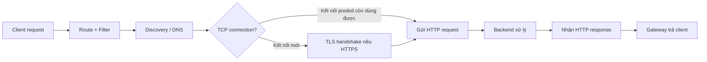
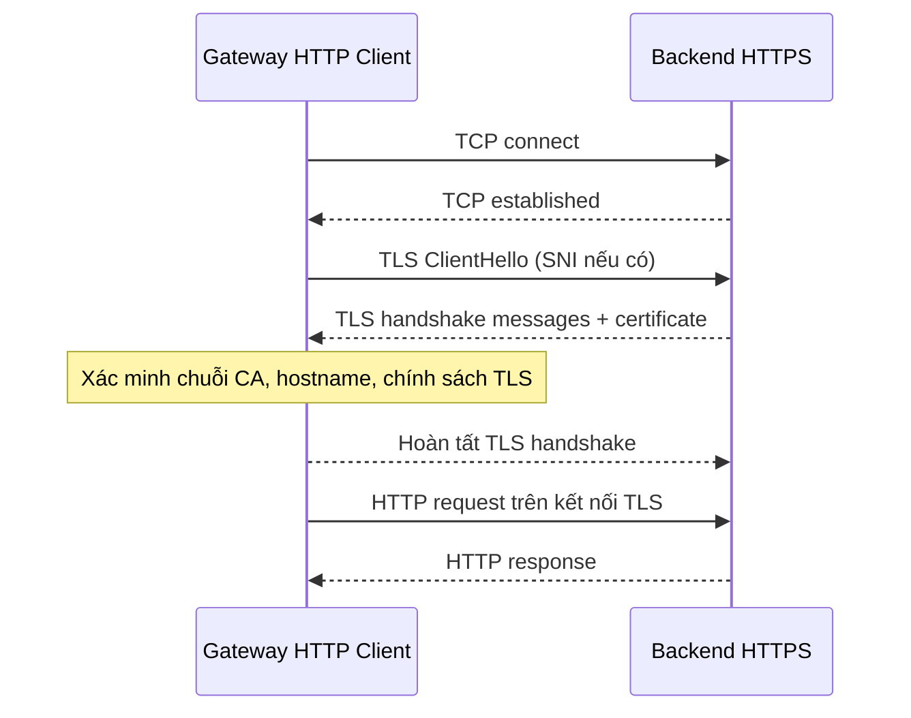
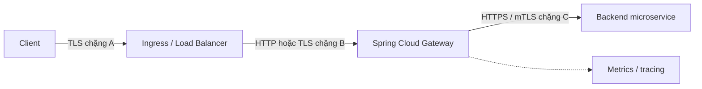
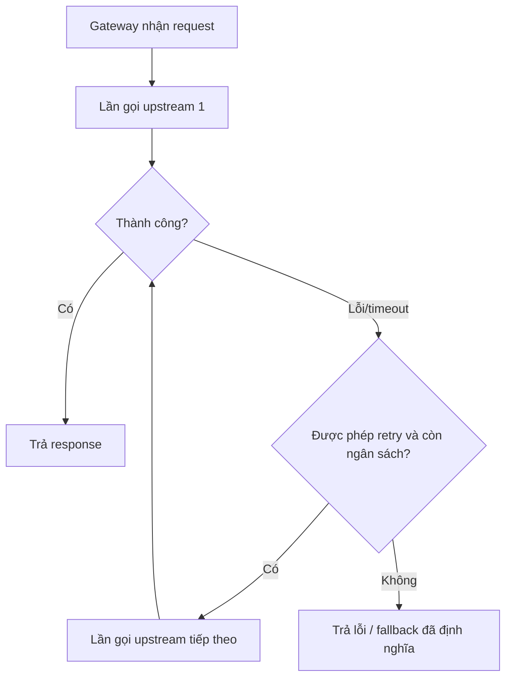
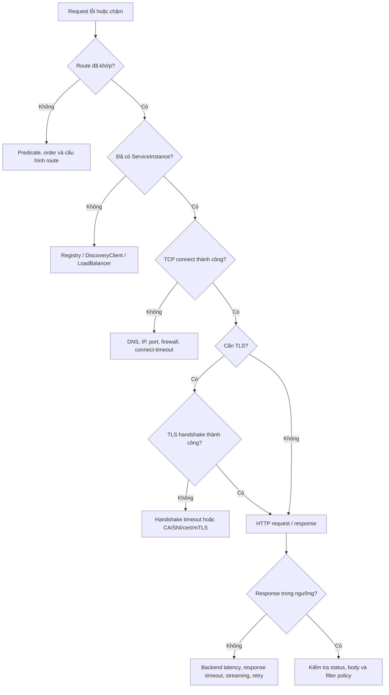

# Thời gian chờ kết nối, phản hồi và bắt tay TLS

Trong một hệ thống microservices, **Spring Cloud Gateway** có thể định tuyến đúng request nhưng client vẫn nhận lỗi vì không kết nối được đến backend, backend phản hồi quá chậm hoặc quá trình **TLS handshake** không hoàn tất. Ba tình huống này nhìn từ client đều có thể biểu hiện dưới dạng “gateway bị chậm”, nhưng xảy ra ở **những giai đoạn khác nhau** và cần cách chẩn đoán khác nhau.

Ví dụ, một request `GET /api/catalog/products/42` được route đến `lb://catalog-service`. Gateway phải tìm instance, mở hoặc tái sử dụng kết nối TCP, thiết lập TLS nếu upstream sử dụng HTTPS, gửi HTTP request, rồi đợi/đọc HTTP response. **Connect timeout**, **response timeout** và **TLS handshake timeout** bảo vệ những phần khác nhau trong chuỗi đó; đặt một trong ba không có nghĩa đã thiết lập **thời hạn tổng** cho mọi request.

Bài thuộc chương **Kết nối và TLS** của module **SPRING_CLOUD_GATEWAY**. Sau bài học, bạn có thể phân biệt các timeout, cấu hình chúng trong **Gateway Server WebFlux**, hiểu khác biệt giữa TLS đầu vào và TLS đi đến backend, thiết kế ngân sách độ trễ với retry/circuit breaker, cùng kiểm thử và quan sát lỗi trên một cổng API có route predicate, filter chain, biến đổi đường dẫn/header, service discovery, xác thực và giới hạn lưu lượng.

> **Giới hạn phiên bản:** Các ví dụ `spring.cloud.gateway.server.webflux.httpclient`, `RouteMetadataUtils` và `RouteLocatorBuilder` hướng đến **Spring Cloud Gateway Server WebFlux** ở những dòng sử dụng namespace WebFlux mới. Các bản WebFlux cũ thường dùng `spring.cloud.gateway.httpclient`; biến thể **Server Web MVC** có mô hình HTTP client và cấu hình khác. Luôn đối chiếu đúng Spring Boot, Spring Cloud release train, Gateway, Reactor Netty và tài liệu Configuration Properties của phiên bản triển khai.

## 1. Một request trải qua những giai đoạn nào?

Xem request HTTPS đến backend:

```text
Client
  |
  | HTTPS đến Gateway (nếu Gateway/Ingress nhận HTTPS)
  v
Spring Cloud Gateway
  | 1. Xác thực/chọn route và filter chain
  | 2. Tìm ServiceInstance (nếu route dùng lb://)
  | 3. DNS lookup (khi cần) và chọn địa chỉ đích
  | 4. TCP connect hoặc lấy kết nối đã mở từ pool
  | 5. TLS handshake (nếu là kết nối TLS mới)
  | 6. Gửi HTTP request và body
  | 7. Chờ/đọc HTTP response
  v
Backend microservice
```



**Không phải mọi request đều mở TCP connection hoặc bắt tay TLS mới.** HTTP connection pooling/keep-alive có thể tái sử dụng kết nối đã thiết lập. Với HTTP/2, nhiều stream có thể dùng chung một kết nối nếu cấu hình và hai đầu hỗ trợ. Do đó, chỉ một phần request chạm vào `connect-timeout` hoặc `handshake-timeout`, trong khi thời gian chờ/đọc response vẫn có thể ảnh hưởng các request dùng kết nối sẵn.

### Các chặng phải đo riêng

| Giai đoạn | Thành phần liên quan | Lỗi điển hình |
| --- | --- | --- |
| Ghép route | Predicate và `RouteLocator` | Không có route khớp; có thể trả `404` nếu không có handler khác. |
| Tìm instance | DiscoveryClient, LoadBalancer | Không có instance cho `lb://catalog-service`; thường gặp `503` theo cấu hình. |
| Phân giải địa chỉ | DNS resolver, mạng | DNS không trả kết quả hoặc trả IP không truy cập được. |
| Kết nối TCP | Reactor Netty HTTP client | `connect-timeout`, kết nối bị từ chối, mạng unreachable. |
| Bắt tay TLS | TLS engine/HTTP client | Chờ handshake quá lâu, sai chứng chỉ/CA/SNI, không tương thích giao thức. |
| Gửi HTTP request | HTTP client, request body | Kết nối đóng giữa chừng, ghi chậm, body quá lớn. |
| Chờ/nhận HTTP response | HTTP client và backend | `response-timeout`, upstream trả `5xx`, streaming bị ngắt. |
| Trả response về client | Gateway, ingress, mạng phía client | Client ngắt kết nối, proxy phía trước hết thời hạn. |

## 2. Ba loại timeout trọng tâm

| Timeout | Bảo vệ phần nào? | Không bảo đảm điều gì? |
| --- | --- | --- |
| **Connect timeout** | Thời gian cho thao tác mở **TCP connection** đến đích. | Không tự giới hạn toàn bộ DNS, TLS handshake, thời gian xử lý backend hoặc thời gian request tổng. |
| **TLS handshake timeout** | Thời gian dành cho **quá trình thương lượng TLS** trên một kết nối TLS mới. | Không sửa được chứng chỉ sai, CA không tin cậy, SNI/hostname không khớp hoặc backend chỉ hỗ trợ HTTP thường. |
| **Response timeout** | Giới hạn liên quan đến **việc chờ/đọc response HTTP** theo HTTP client. | Không nhất thiết là deadline end-to-end gồm discovery, connect, TLS, body upload, retry và toàn bộ thời gian streaming. |

Những timeout này **không thay thế nhau**. Đặt `connect-timeout` là 1 giây không khiến một backend trả chậm trong 30 giây bị cắt sau 1 giây nếu TCP connection đã hoàn tất. Ngược lại, đặt `response-timeout` là 3 giây không có nghĩa sẽ phát hiện ngay khi TLS handshake bị treo nếu timeout handshake được cấu hình khác.

### Ví dụ minh họa

Một ứng dụng giả định đặt:

```text
connect-timeout       = 1000 ms
TLS handshake timeout = 4000 ms
response-timeout      = 5 s
```

Các giá trị trên là **chỉ tiêu thử nghiệm minh họa**, không phải khuyến nghị mặc định cho mọi hệ thống. Nếu backend dùng HTTP thường, không có giai đoạn TLS handshake. Nếu HTTP connection đã được pool tái sử dụng, cả TCP connect và TLS handshake có thể không xảy ra cho request hiện tại.

Đừng cộng ba số thành một cam kết “request chắc chắn kết thúc sau 10 giây”. Những timeout đo **các pha khác nhau**, có thể có DNS/pool acquisition, truyền body, streaming, retry và proxy timeout khác; cơ chế bắt đầu/đặt lại bộ đếm cũng tùy HTTP client và phiên bản.

## 3. Connect timeout: mở kết nối TCP tới backend

Khi gateway cần kết nối mới đến một `ServiceInstance` hoặc host cụ thể, HTTP client thực hiện TCP connect. **`connect-timeout`** đặt giới hạn cho thao tác thiết lập kết nối theo khả năng của Reactor Netty.

Trong ví dụ route:

```yaml
id: catalog-route
uri: lb://catalog-service
predicates:
  - Path=/api/catalog/**
filters:
  - StripPrefix=2
```

Gateway chọn một instance, ví dụ `10.0.1.21:8443`. Kết nối có thể thất bại vì firewall chặn, địa chỉ mạng không tới được, port sai hoặc backend không lắng nghe. Những tình huống này không phải lúc nào cũng gây đúng một loại timeout:

- **Connection refused:** đích từ chối ngay, thường nhanh hơn ngưỡng timeout.
- **Connect timeout:** không hoàn tất TCP connect trong thời hạn.
- **DNS failure:** không phân giải được hostname trước khi connect; lỗi ở bước khác.
- **Pool acquisition delay:** HTTP client đang chờ kết nối trống; không đồng nghĩa connect TCP timeout.

### Connect timeout không nhất thiết bao trùm DNS

DNS resolution có thể xảy ra **trước khi** mở socket, và có cache/timeout riêng. Nếu thao tác DNS chậm, chỉ giảm `connect-timeout` không bảo đảm độ trễ tổng giảm tương ứng. Hãy đo DNS, connection pool và TCP connect độc lập khi chẩn đoán độ trễ kết nối.

### Connect timeout và LoadBalancer

`lb://catalog-service` chỉ xác định dịch vụ logic. LoadBalancer lấy danh sách `ServiceInstance` từ Eureka, Consul, Kubernetes hoặc nguồn khác và chọn một instance. Nếu danh sách rỗng, gateway có thể từ chối trước khi gọi TCP connect. Nếu instance tồn tại nhưng địa chỉ không thể truy cập, HTTP client mới phát sinh lỗi mạng/kết nối.

**Không dùng việc tăng `connect-timeout` để chữa lỗi service ID sai hoặc registry không có instance.** Cần kiểm tra đúng tầng.

## 4. Response timeout: phản hồi HTTP quá chậm

Sau khi kết nối và có thể đã hoàn tất TLS handshake, gateway gửi HTTP request đến backend. Backend có thể:

1. Chờ hàng đợi xử lý quá lâu trước khi gửi response.
2. Bắt đầu trả response nhưng ngừng gửi thêm dữ liệu.
3. Streaming dữ liệu liên tục, đôi khi rất lâu.
4. Trả lỗi `500` hoặc `503` nhanh — đây là **response hợp lệ về mặt giao thức**, không phải tự động là timeout.

`response-timeout` của Gateway WebFlux liên quan đến giới hạn chờ/đọc HTTP response ở Netty HTTP client. Reactor Netty mô tả response timeout theo khoảng thời gian cho phép giữa các thao tác đọc dữ liệu mạng trong quá trình nhận một response ở những phiên bản tương ứng. Vì vậy, **không nên coi nó là deadline tuyệt đối cho một streaming response hoặc toàn bộ request**; hãy thử với request/response thực tế.

### Tình huống so sánh

| Trường hợp | Điều nên quan sát | Không nên suy luận |
| --- | --- | --- |
| Backend không gửi response trong nhiều giây | Có thể chạm response timeout đã đặt. | Mọi trường hợp đều trả chính xác `504`. |
| Backend trả `500` sau 100 ms | HTTP 500 từ upstream, không phải do timeout. | Cần tăng response timeout để “sửa” `500`. |
| Backend gửi dữ liệu streaming định kỳ | Mỗi lần có dữ liệu có thể ảnh hưởng cách tính thời gian chờ đọc. | Toàn stream luôn bị cắt đúng tại tổng thời gian cấu hình. |
| Client upload body rất chậm | Có thể liên quan body receive/send, mạng và server timeout. | Response timeout một mình giới hạn toàn bộ quá trình upload. |

Mã HTTP mà client nhìn thấy khi lỗi timeout phụ thuộc exception mapping, error handler, gateway filter và upstream; có thể khác giữa release. Cần ghi nhận **exception class, elapsed time và route ID**, không gán cứng một status cho mọi timeout.

## 5. TLS handshake timeout: đã có TCP nhưng chưa xác lập TLS

Khi URI outbound sử dụng **HTTPS**, gateway phải thiết lập một phiên TLS với backend trên kết nối mới. Handshake bao gồm thương lượng giao thức/bộ mã, trao đổi thông tin cần thiết và xác minh chứng chỉ phía server theo cấu hình trust.



**Handshake timeout** giới hạn khoảng chờ hoàn thành handshake. Nó hữu ích khi:

- Đích TCP chấp nhận connection nhưng không hoàn tất TLS.
- Một proxy/middlebox hoặc backend bị treo trong quá trình thương lượng.
- Sự cố mạng làm handshake kéo dài.

Nhưng nếu backend gửi chứng chỉ không được tin cậy, gateway có thể nhận **`SSLHandshakeException` hoặc lỗi xác minh chứng chỉ** nhanh chóng, không cần đợi hết thời gian `handshake-timeout`. Tương tự, gọi `https://` vào cổng chỉ phục vụ HTTP thường có thể sinh lỗi giao thức như `NotSslRecordException` hoặc handshake failure, không nhất thiết là timeout.

### Handshake timeout không phải timeout xác thực của ứng dụng

TLS handshake xác lập kênh truyền và danh tính endpoint theo cấu hình. Nó khác với:

- Xác thực **JWT/OAuth 2.0** cho HTTP request.
- Kiểm tra **phân quyền** user có được xem đơn hàng hay không.
- Timeout khi gọi **Identity Provider** để lấy khóa/cấu hình.
- Chờ backend xử lý HTTP request sau khi TLS thành công.

Không tăng TLS handshake timeout để sửa lỗi JWT 401/403, ngược lại cũng không đổi filter JWT để chữa lỗi chứng chỉ.

## 6. TLS đầu vào và TLS đầu ra là hai cấu hình khác nhau

Trong mô hình có ingress/reverse proxy:



Mỗi chặng có thể được bảo vệ khác nhau:

| Chặng | Bên làm TLS server | Bên làm TLS client | Cấu hình trọng tâm |
| --- | --- | --- | --- |
| Client → Ingress | Ingress | Browser/mobile/client | Chứng chỉ public, TLS policy, client trust. |
| Ingress → Gateway | Gateway nếu dùng HTTPS | Ingress | `server.ssl.*` của Spring Boot nếu Gateway trực tiếp nhận TLS, hoặc chính sách hạ tầng tương ứng. |
| Gateway → Backend | Backend | **Gateway HTTP client** | `spring.cloud.gateway...httpclient.ssl.*`, trust manager, hostname/SNI, mTLS nếu cần. |

**Đặt `server.ssl.*` không tự cấu hình trust store cho kết nối outbound của Gateway HTTP client.** Và thêm CA tin cậy cho outbound client cũng không tự bật HTTPS ở cổng nhận request của Gateway.

### Khi ingress đã terminate TLS

Nếu client kết nối HTTPS đến ingress và ingress gọi gateway bằng HTTP trong mạng nội bộ, gateway **không thực hiện TLS handshake phía server cho chặng client → ingress**. Tuy nhiên, vẫn phải xem xét rủi ro truyền HTTP plaintext trên chặng ingress → gateway. Trong môi trường yêu cầu end-to-end encryption hoặc zero trust, có thể dùng HTTPS/mTLS ở chặng này thay vì mặc định tin toàn bộ mạng nội bộ.

Nếu gateway dùng `lb://` để chọn instance backend, cần kiểm tra thông tin `ServiceInstance` và chính sách chọn giao thức an toàn. URI `lb://catalog-service` **không tự bảo đảm kết nối backend là HTTPS**; cách xác định scheme/secure tùy thông tin instance và filter theo bản triển khai.

## 7. Cấu hình timeout toàn cục trên Gateway Server WebFlux

Ví dụ minh họa cho **dòng cấu hình có namespace Server WebFlux**:

```yaml
spring:
  cloud:
    gateway:
      server:
        webflux:
          httpclient:
            connect-timeout: 1000
            response-timeout: 5s
            ssl:
              handshake-timeout-millis: 4000
```

### Đọc đúng đơn vị

| Property minh họa | Giá trị | Đơn vị theo cấu hình WebFlux | Tác động |
| --- | --- | --- | --- |
| `httpclient.connect-timeout` | `1000` | Mili giây | TCP connect mới có thời hạn 1 giây. |
| `httpclient.response-timeout` | `5s` | `java.time.Duration` | Thời hạn liên quan việc chờ/đọc response 5 giây. |
| `httpclient.ssl.handshake-timeout-millis` | `4000` | Mili giây | TLS handshake mới có thời hạn 4 giây. |

Lưu ý **`connect-timeout` và `handshake-timeout-millis` dùng giá trị mili giây**, trong khi response timeout toàn cục trong tài liệu Gateway WebFlux được khai báo bằng **Duration**, chẳng hạn `5s`. Không sao chép `5000` vào `response-timeout` toàn cục rồi mặc định mọi phiên bản hiểu là 5 giây; dùng `5s` cho dễ đọc và đúng loại cấu hình.

Một số tài liệu WebFlux cũ dùng nhánh:

```yaml
spring:
  cloud:
    gateway:
      httpclient:
        connect-timeout: 1000
        response-timeout: 5s
        ssl:
          handshake-timeout-millis: 4000
```

Hai đoạn mô tả **cùng ý tưởng cấu hình ở các dòng khác nhau**, không phải khuyến nghị khai báo cả hai. Phiên bản Gateway/HTTP client thực tế có thể hỗ trợ tên hoặc mặc định khác; **khóa release train và kiểm tra Configuration Properties chính thức trước khi áp dụng**.

### Một số timeout khác dễ nhầm

| Khái niệm | Vai trò | Có phải ba timeout đang học? |
| --- | --- | --- |
| **TCP connect timeout** | Thời hạn mở kết nối. | Có. |
| **TLS handshake timeout** | Thời hạn thương lượng TLS. | Có. |
| **HTTP response timeout** | Giới hạn liên quan chờ/đọc response. | Có. |
| **DNS query timeout** | Chờ resolver trả địa chỉ. | Không; cần kiểm tra cấu hình DNS/resolver riêng. |
| **Connection pool acquire timeout** | Chờ lấy một connection từ pool. | Không; không đồng nghĩa TCP connect. |
| **Read/write timeout** | Giới hạn đọc/ghi I/O theo một chiến lược handler/client. | Không mặc nhiên trùng response timeout. |
| **Idle timeout** | Khoảng rảnh của connection, HTTP server hoặc proxy. | Không; cần thiết kế theo hạ tầng. |
| **`close-notify-flush-timeout` / `close-notify-read-timeout`** | Thời gian xử lý TLS close-notify khi đóng kết nối. | Không phải handshake timeout hoặc thời gian phản hồi backend. |
| **Circuit breaker TimeLimiter** | Giới hạn một lời gọi hoặc đoạn xử lý được bảo vệ theo cấu hình. | Không tự đồng nhất với HTTP client timeout. |
| **Ingress/client total timeout** | Giới hạn do tầng ngoài đặt cho request. | Là một ràng buộc độc lập. |

Không bật tất cả timeout thật ngắn chỉ vì muốn phản hồi nhanh. Một cấu hình phù hợp phải dựa trên latency SLO, khoảng cách mạng, TLS handshake mới/pooled, kích thước body, loại request và mức dự phòng cho retry.

## 8. Ghi đè timeout theo route

Một hệ thống thường cần response timeout khác nhau:

- API danh mục cần phản hồi nhanh.
- API báo cáo có thể cần thời gian xử lý lâu hơn.
- API tạo đơn hàng cần ngân sách vừa phải và không retry thao tác ghi một cách tùy tiện.

Gateway Server WebFlux hỗ trợ **timeout theo tuyến** qua `Route` metadata; tài liệu sử dụng hai khóa:

```text
connect-timeout
response-timeout
```

**Khác với response timeout toàn cục:** cả hai giá trị trong **metadata theo route** được biểu diễn bằng **mili giây** ở dòng WebFlux hỗ trợ cơ chế này.

### 8.1. YAML với hai route

```yaml
spring:
  cloud:
    gateway:
      server:
        webflux:
          routes:
            - id: catalog-route
              uri: http://localhost:8081
              predicates:
                - Path=/api/catalog/**
              filters:
                - StripPrefix=2
              metadata:
                connect-timeout: 800
                response-timeout: 2000

            - id: report-route
              uri: http://localhost:8082
              predicates:
                - Path=/api/reports/**
              filters:
                - StripPrefix=2
              metadata:
                connect-timeout: 1500
                response-timeout: 12000
```

Ở đây catalog có giới hạn kết nối **800 ms** và phản hồi **2.000 ms**; report có giới hạn kết nối **1.500 ms** và phản hồi **12.000 ms**. Đây là **giá trị POC giả định**, không phải SLA hay số đo hiệu năng của Gateway.

Một lỗi rất dễ mắc:

```yaml
metadata:
  response-timeout: 5
```

Giá trị `5` ở đây có nghĩa là **5 mili giây**, không phải 5 giây. Nếu muốn 5 giây trong metadata WebFlux, hãy dùng:

```yaml
metadata:
  response-timeout: 5000
```

### 8.2. Cấu hình bằng Java DSL

```java
import static org.springframework.cloud.gateway.support.RouteMetadataUtils
    .CONNECT_TIMEOUT_ATTR;
import static org.springframework.cloud.gateway.support.RouteMetadataUtils
    .RESPONSE_TIMEOUT_ATTR;

import org.springframework.cloud.gateway.route.RouteLocator;
import org.springframework.cloud.gateway.route.builder.RouteLocatorBuilder;
import org.springframework.context.annotation.Bean;
import org.springframework.context.annotation.Configuration;

@Configuration
public class GatewayRoutes {

    @Bean
    RouteLocator catalogRoute(RouteLocatorBuilder builder) {
        return builder.routes()
            .route("catalog-route", route -> route
                .path("/api/catalog/**")
                .filters(filters -> filters.stripPrefix(2))
                .uri("lb://catalog-service")
                .metadata(CONNECT_TIMEOUT_ATTR, 800)
                .metadata(RESPONSE_TIMEOUT_ATTR, 2000))
            .build();
    }
}
```

Đoạn Java DSL tạo route runtime trực tiếp và cần Spring Cloud LoadBalancer/nguồn `ServiceInstance` tương ứng cho `lb://catalog-service`. Không khai báo trùng route ID giữa YAML và Java DSL nếu chưa có chủ đích và kiểm thử thứ tự.

### 8.3. Vô hiệu hóa response timeout toàn cục cho một route?

Trong tài liệu Gateway Server WebFlux có hỗ trợ per-route response timeout, giá trị âm ở `metadata.response-timeout` có thể được dùng để **vô hiệu hóa response timeout toàn cục cho tuyến đó**:

```yaml
metadata:
  response-timeout: -1
```

Điều này **không vô hiệu hóa connect timeout, TLS handshake timeout, ingress timeout, client timeout, circuit breaker hoặc mọi giới hạn của network/backend**. Đặc biệt với streaming, cần đánh giá idle timeout và giới hạn của từng proxy. Không sử dụng `-1` làm cách chung để “chữa” một backend quá chậm mà chưa hiểu nguyên nhân và SLO.

### 8.4. Có per-route TLS handshake timeout không?

Không nên suy luận rằng vì WebFlux hỗ trợ `connect-timeout` và `response-timeout` ở route metadata thì cũng hỗ trợ một khóa chuẩn `metadata.handshake-timeout` tương đương. **TLS handshake timeout chủ yếu thuộc cấu hình HTTP client SSL**, và khả năng chỉnh khác nhau theo route phải được kiểm tra tài liệu/API hoặc thiết kế HttpClient riêng phù hợp phiên bản.

Nếu có nhiều nhóm backend cần TLS policy khác nhau (CA, client certificate, handshake timeout), cân nhắc tách gateway/client configuration hoặc topology rõ ràng thay vì thêm khóa metadata tự đặt rồi mặc định framework sẽ đọc.

## 9. Tin cậy chứng chỉ: timeout không sửa được trust

Một kết nối HTTPS an toàn cần **xác minh server certificate**, không chỉ hoàn thành handshake.

### 9.1. Các loại vấn đề phổ biến

| Triệu chứng | Nguyên nhân khả dĩ | Hướng xử lý |
| --- | --- | --- |
| Certificate không được tin | CA nội bộ chưa nằm trong trust store. | Thêm CA được phê duyệt vào cơ chế trust của outbound HTTP client. |
| Hostname mismatch | SAN của chứng chỉ không chứa tên hostname mà gateway kết nối. | Cấp chứng chỉ đúng tên DNS/route, kiểm tra hostname verification. |
| Chứng chỉ hết hạn | Vòng đời cert/rotation không được quản lý. | Gia hạn và triển khai cert, quan sát hạn dùng. |
| `NotSslRecordException` hoặc lỗi TLS protocol | Gọi HTTPS vào port chỉ hỗ trợ HTTP, hoặc proxy cấu hình sai. | Kiểm tra scheme, port và TLS termination. |
| `SslHandshakeTimeoutException` hoặc lỗi timeout tương tự | Server/proxy không hoàn tất handshake đúng thời hạn. | Xem TLS server, packet/network, độ trễ, CPU và handshake timeout. |
| Chỉ lỗi trên một instance | Cert/hostname/SNI hoặc cấu hình TLS của instance đó khác các instance còn lại. | Test từng instance qua cùng host policy, sửa rollout. |

**Không dùng trust-all/insecure trust manager trong production.** Bỏ kiểm tra chứng chỉ để “fix handshake” khiến gateway có thể kết nối tới server giả mạo và rò rỉ token, cookie hoặc dữ liệu API.

### 9.2. Private CA và trust store outbound

Với backend dùng CA nội bộ, gateway HTTP client phải biết tin cậy CA hoặc certificate tương ứng theo cơ chế được hỗ trợ. Một số dòng Gateway WebFlux cung cấp property kiểu `httpclient.ssl.trusted-x509-certificates` để chỉ định certificate PEM; cách truyền tài nguyên, format, tên property và vòng đời reload cần kiểm tra theo phiên bản.

Quy trình đúng về mặt vận hành:

1. Đội bảo mật cấp/duy trì CA hoặc chứng chỉ backend phù hợp.
2. Gateway được cấp **trust material** theo kênh cấu hình/secrets tin cậy.
3. URI backend sử dụng hostname được chứng chỉ cho phép, với SNI/hostname verification đúng.
4. Test thành công lẫn test chứng chỉ sai, chứng chỉ hết hạn và CA không tin.
5. Có kế hoạch xoay CA/certificate không làm gián đoạn tất cả connection mới.

Không đặt private key và mật khẩu keystore vào Git hay route metadata để tiện thao tác. Trust store và keystore phục vụ các mục đích khác nhau: **trust** để xác minh peer, **key material** để trình chứng chỉ/danh tính khi làm TLS server hoặc mTLS client.

### 9.3. TLS phiên bản, cipher và SNI

Nếu kết nối TLS thất bại, ngoài timeout cần kiểm tra:

- Giao thức TLS mà client/server hỗ trợ và chính sách cipher suite.
- TLS SNI được gửi với hostname nào; backend có reverse proxy nhiều vhost không.
- Chứng chỉ trả về ứng với hostname đó hay không.
- DNS/LoadBalancer có đưa gateway đến instance có cấu hình TLS khác nhau không.
- Proxy hoặc firewall có can thiệp vào TLS handshake không.

Thay thời gian chờ chỉ hữu ích khi **handshake hợp lệ nhưng quá chậm**, không giúp hai phía thương lượng được một giao thức/cipher không tương thích.

## 10. Mutual TLS và khác biệt chặng chứng thực

**mTLS (mutual TLS)** yêu cầu cả hai phía chứng minh danh tính bằng chứng chỉ theo chính sách. Khi gateway gọi backend:

```text
Gateway outbound TLS client             Backend TLS server
   - Trust CA của backend                - Trình server cert
   - Gửi client cert/key (nếu mTLS)       - Xác minh client cert của gateway
   - Xác minh server hostname/cert        - Áp policy service identity
```

Nếu backend bắt buộc client certificate mà gateway không gửi đúng, TLS handshake có thể thất bại. Đây là **lỗi cấu hình mTLS hoặc trust**, không mặc định là handshake timeout.

Ngược lại, nếu ingress bắt buộc client certificate trên đường client → ingress, điều đó không tự cấu hình mTLS cho đường gateway → backend. Cần thiết kế độc lập mỗi chặng.

### Trách nhiệm không được trộn

| Mục tiêu | Công cụ chính |
| --- | --- |
| Mã hóa và xác minh danh tính server/backend | TLS với CA trust và hostname verification. |
| Xác minh danh tính dịch vụ gateway với backend | mTLS hoặc service authentication phù hợp. |
| Xác minh client/người dùng cuối | OAuth 2.0/JWT, session hoặc cơ chế danh tính khác. |
| Quyết định user được phép đọc/sửa tài nguyên nào | Authorization tại gateway/backend theo nghiệp vụ. |
| Giới hạn số lần gọi API | Rate limiter theo identity/route; nhiều replica cần state phù hợp. |

## 11. Retry, circuit breaker và ngân sách thời gian

Gateway thường có filter `Retry` và `CircuitBreaker` bên cạnh HTTP client timeout. Nếu đặt timeout riêng lẻ mà không có chiến lược tổng, trải nghiệm client có thể tệ hơn mong đợi.

### 11.1. Ví dụ ngân sách thời gian

Một hệ thống có yêu cầu **client cần nhận kết quả trong 8 giây**. Bạn có thể cân nhắc những ràng buộc minh họa:

```text
Client / ingress total deadline:          8 s
Gateway HTTP client connect-timeout:      1 s
Gateway HTTP client TLS handshake:        3 s
Gateway HTTP response timeout:            4 s
Retry:                                    chỉ khi an toàn, có giới hạn
```

**Không được hiểu rằng 1 + 3 + 4 = 8 là chắc chắn đáp ứng deadline 8 giây.** DNS, pool acquisition, ghi request body, scheduling, processing, trace overhead, kết nối reuse và nhiều lần retry có thể kéo dài thời gian thực. Đặt **deadline end-to-end** riêng nếu kiến trúc yêu cầu bảo đảm thời hạn tổng, và phân phối ngân sách cho từng chặng có đo lường.

### 11.2. Retry có thể khuếch đại thời gian và tải



Hai vấn đề cần kiểm soát:

1. **Thời gian:** mỗi lần thử có thể chạm connect/TLS/response timeout; nếu không có deadline tổng, client có thể chờ lâu hơn nhiều lần gọi đơn.
2. **Tính đúng đắn:** backend có thể xử lý thành công `POST /payments` nhưng gateway bị mất response. Retry lần nữa có thể tạo thanh toán trùng nếu không có **idempotency key** và xử lý tương ứng ở backend.

Không tự động retry mọi lỗi TLS: một certificate không hợp lệ sẽ thường **không được sửa** bởi việc kết nối lại. Retry vô hạn chỉ tăng tải và che mất nguyên nhân.

### 11.3. Circuit breaker không thay timeout của HTTP client

`CircuitBreaker` đo/giới hạn hành vi lời gọi theo chính sách và có thể mở circuit khi tỷ lệ lỗi, slow-call hoặc các điều kiện định nghĩa bị vi phạm. HTTP client timeout vẫn cần để xử lý kết nối/đọc bị treo ở từng attempt.

Nếu dùng TimeLimiter cùng circuit breaker, phải kiểm tra nó áp vào đoạn xử lý nào, cách hủy subscription và việc kết nối upstream có thực sự được giải phóng không. **Hủy request ở một tầng không phải bằng chứng backend đã dừng xử lý.**

## 12. Connection pooling: timeout có thể ít xuất hiện hơn bạn nghĩ

Một nguyên nhân khiến POC khó tái hiện TLS handshake timeout là **connection reuse**:

- Request đầu tiên mở TCP connection và TLS handshake.
- Request thứ hai dùng connection còn sống từ pool và có thể không handshake lại.
- Backend đóng idle connection; request sau cần kết nối mới, lại có connect/handshake.
- Trong rolling deploy, instance mới có chứng chỉ sai; chỉ một phần traffic chọn instance đó mới lỗi.

### Những chỉ số cần xem

| Nhóm | Điều nên đo |
| --- | --- |
| Pool | Số connection đang dùng, idle, pending acquire, từ chối vì pool đầy. |
| TCP | Số lần mở connection, lỗi/refused, độ trễ connect. |
| TLS | Số handshake mới, thời gian handshake, lỗi cert/trust/hostname. |
| HTTP | Response latency, status, lỗi từ upstream và số request đang xử lý. |
| Discovery | Service ID, tập instance, sự phân phối request theo nhóm instance. |

Không đo handshake chỉ bằng cách gửi 100 request liên tiếp qua cùng một client rồi kết luận “TLS rất nhanh” nếu 99 request tái sử dụng kết nối sẵn. Trong test cần phân biệt **cold connections** và **warm connections**, ghi lại chính xác thông số pool và môi trường mạng.

## 13. Bài thực hành: ba trường hợp lỗi khác nhau

### 13.1. Chuẩn bị môi trường

Giả sử bạn có:

- Gateway Server WebFlux trên `http://localhost:8080`.
- Backend catalog mock cho route `/api/catalog/**`.
- Một backend HTTPS mock mang certificate hợp lệ cho **hostname thử nghiệm** có DNS/hosts tương ứng (không nhất thiết `localhost`).
- Khả năng giả lập backend trả chậm, từ chối kết nối hoặc nhận TCP nhưng không hoàn tất TLS trên môi trường thử nghiệm.

Không cần dựng Eureka hoặc Consul cho bài kiểm tra timeout cơ bản; route URI cố định đủ giúp phân lập lỗi. Khi chuyển sang `lb://catalog-service`, bổ sung LoadBalancer và nguồn instance để kiểm tra bước discovery độc lập.

### 13.2. Kiểm tra baseline

Route minh họa:

```yaml
spring:
  cloud:
    gateway:
      server:
        webflux:
          routes:
            - id: catalog-test
              uri: http://localhost:8081
              predicates:
                - Path=/api/catalog/**
              filters:
                - StripPrefix=2
              metadata:
                connect-timeout: 1000
                response-timeout: 3000
```

Cho backend lắng nghe `localhost:8081` và trả `GET /products/42` nhanh, sau đó gọi:

```bash
curl -i "http://localhost:8080/api/catalog/products/42"
```

Ghi route ID, status, elapsed time. Request thành công không chứng minh timeout đã được cấu hình đúng; phải tạo tình huống trễ/lỗi để xác minh.

### 13.3. Mô phỏng connect timeout

Trong **môi trường POC cô lập**, cấu hình một endpoint không hoàn tất kết nối TCP trong thời gian ngưỡng, chẳng hạn bằng network fault injection có kiểm soát. Gọi cùng request và ghi:

- Có đúng route `catalog-test` không.
- Có thực sự bắt đầu TCP connect tới IP/port đó không.
- Exception phát sinh là timeout, refused hay DNS failure.
- Thời gian phía gateway ghi nhận so với `connect-timeout`.

**Đừng chọn một IP ngẫu nhiên trên Internet để cố tình gây timeout**: host ngoài môi trường thử nghiệm có thể trả lỗi ngay, hoặc nhận request ngoài chủ đích. Một port không có listener thường sinh `Connection refused` nhanh, không phải connect timeout đúng nghĩa.

### 13.4. Mô phỏng response timeout

Khôi phục backend reachable, cho endpoint `/products/42` cố ý chờ **5 giây trước khi gửi HTTP response**, trong khi route có `response-timeout: 3000`.

```bash
curl -i "http://localhost:8080/api/catalog/products/42"
```

Quan sát response, log exception, elapsed time và liệu upstream đã nhận request hay chưa. Trường hợp này khác với connect timeout vì TCP đã mở và HTTP request đã đến backend.

Nếu backend streaming gửi dữ liệu định kỳ, cần một test khác để kiểm tra response timeout có áp như **read inactivity** hoặc cách đo khác của bản Reactor Netty/Gateway đang dùng; không dùng test response đơn lẻ để kết luận streaming sẽ dừng tại mốc cố định.

### 13.5. Mô phỏng TLS handshake timeout

Đặt upstream là HTTPS trong môi trường thử nghiệm, ví dụ:

```yaml
uri: https://catalog.test.internal:8443
```

Với một test server **chấp nhận TCP connection nhưng không hoàn tất TLS handshake**, quan sát handshake timeout được kích hoạt theo `handshake-timeout-millis` toàn cục.

**Phân biệt hai tình huống:**

- Nếu backend trả certificate sai CA/SAN, gateway có thể **fail TLS ngay** vì xác minh chứng chỉ; đó không phải handshake bị treo.
- Nếu test server không bao giờ hoàn tất handshake, timeout mới là kết quả muốn kiểm tra.

Thử trên hostname/certificate mock đã được thiết lập có chủ đích, không tắt certificate verification để làm test “thành công”.

### 13.6. Kiểm tra TLS bằng công cụ độc lập

Từ môi trường có đường mạng tương đương với gateway, có thể dùng:

```bash
openssl s_client \
  -connect catalog.test.internal:8443 \
  -servername catalog.test.internal \
  -verify_hostname catalog.test.internal \
  -verify_return_error
```

Lệnh chỉ là ví dụ chẩn đoán; thành công yêu cầu DNS, network, CA trust và openssl hỗ trợ các flag tương ứng. `openssl s_client` giúp xem certificate/handshake và SNI, **không chứng minh** các timeout của Gateway đã được áp. Để test gateway, phải gửi request qua gateway và xem log/metrics của HTTP client.

### 13.7. Dùng curl để tách client timeout khỏi gateway timeout

```bash
curl --connect-timeout 2 --max-time 10 -i \
  "http://localhost:8080/api/catalog/products/42"
```

Ở đây `--connect-timeout` là timeout TCP/TLS **của curl khi kết nối tới gateway**, còn `--max-time` là thời gian tổng mà **curl** cho phép. Chúng **không phải** các property kết nối **gateway → backend**. Nếu curl tự timeout trước, cần đo log gateway/backend để xác định gateway còn đang gọi upstream hay đã kết thúc.

### Bảng kết quả POC

| Case | Điều kiện chủ động tạo | Dấu hiệu cần đối chiếu |
| --- | --- | --- |
| T01 | Backend HTTP khỏe | Chọn route đúng, status/body bình thường. |
| T02 | TCP kết nối bị treo | Connect timeout, không bị nhầm với refused. |
| T03 | Cổng không có listener | `Connection refused` nhanh, không suy luận connect timeout. |
| T04 | DNS hostname sai | Lỗi phân giải tên, phân biệt TCP connect. |
| T05 | Backend nhận HTTP nhưng trả sau timeout | Response timeout, upstream đã nhận request. |
| T06 | Backend streaming có heartbeat | Quan sát hành vi response/read timeout thay vì giả định deadline tổng. |
| T07 | TCP nhận nhưng không hoàn tất TLS | TLS handshake timeout. |
| T08 | CA/cert/hostname không hợp lệ | TLS trust/hostname failure, không “chữa” bằng tăng timeout. |
| T09 | Connection được tái sử dụng | Không có handshake mới ở mọi request; so cold/warm. |
| T10 | Một instance trong `lb://` bị lỗi | Định danh instance được chọn, kiểm tra Discovery/LoadBalancer. |
| T11 | Bật retry có giới hạn | Tổng latency, số lần gọi backend và idempotency. |
| T12 | Hai gateway replica | Timeout/TLS configuration và chứng chỉ thống nhất. |

## 14. Chẩn đoán lỗi theo triệu chứng

| Triệu chứng client nhìn thấy | Cần điều tra trước | Không nên làm ngay |
| --- | --- | --- |
| Request trả `404` gần như lập tức | Route predicate, path/method, backend 404. | Tăng TLS handshake timeout. |
| Request trả `503`, không có instance | DiscoveryClient, `lb://serviceId`, LoadBalancer cache. | Tăng connect timeout để có instance. |
| Có instance nhưng lỗi kết nối | IP/port, firewall, DNS, route mạng, TCP timeout. | Giả định registry có record tức là backend khỏe. |
| Có lỗi `SSLHandshakeException` | CA/trust store, SAN, SNI, TLS protocol, mTLS. | Bật insecure trust manager. |
| Lỗi sau khi chờ TLS một khoảng | TLS handshake timeout và khả năng server phản hồi. | Đổi JWT parser hoặc route predicate. |
| Backend nhận request rồi phản hồi quá trễ | HTTP response timeout, backend latency, queue/DB. | Chỉ giảm connect timeout. |
| Chỉ lỗi request đầu tiên | Cold connection, DNS, TCP connect, TLS handshake. | Chỉ đo warm pool rồi kết luận không lỗi. |
| Chỉ lỗi khi tải cao | Connection pool, pending acquire, CPU/memory, upstream saturation. | Tăng mọi timeout vô hạn. |
| Kết nối HTTP thường chạy, HTTPS không chạy | Scheme/port, chứng chỉ, SNI, proxy TLS termination. | Bỏ qua certificate validation. |
| Có retry thì client chờ lâu hơn | Số attempt, budget timeout, retry filter và circuit breaker. | Retry mọi status/method không giới hạn. |
| 401/403 | Spring Security hoặc backend authorization. | Điều chỉnh TLS connect timeout. |
| 429 | Rate limiting/quota. | Thay HTTP client TLS configuration. |

### Một sơ đồ điều tra tối thiểu



Sơ đồ đơn giản hóa thứ tự quan sát. Với connection pool hoặc retry, một request có thể đi qua nhiều connection/attempt; cần xác định **attempt và upstream cụ thể** để chẩn đoán chính xác.

## 15. Quan sát timeout và TLS trong production

Một hệ thống chỉ ghi `HTTP 502`/`504` là chưa đủ để phân biệt lỗi DNS, connect, handshake hay response. Cần kết hợp:

- **Route ID** và service ID, ví dụ `catalog-route` → `catalog-service`.
- Instance/nhóm upstream được chọn, hostname/port ở log nội bộ có kiểm soát.
- Latency phân tách ingress, gateway, connect, TLS và backend khi công cụ hỗ trợ.
- Exception class/cause và HTTP status cuối cùng; không phân loại lỗi chỉ bằng status.
- Kết quả circuit breaker, số attempt retry và tổng elapsed time.
- Số connection pooled/idle/pending, lỗi acquire và timeout.
- Tracing/correlation xuyên gateway và backend, để biết request đã đến backend hay chưa.
- Dấu hiệu cert sắp hết hạn và sự không đồng nhất TLS giữa các instance.

Một log **minh họa**, không phải output mặc định của Gateway:

```text
traceId:          [trace ID]
routeId:          catalog-route
serviceId:        catalog-service
upstreamGroup:    catalog-region-a
connectionState:  new
failureStage:     tls-handshake
failureClass:     [loại exception thực tế]
elapsedMs:        [số đo]
status:           [status client nhận]
```

Spring Boot Actuator/Micrometer và tracing có thể cung cấp metric HTTP Gateway/Netty tương ứng, nhưng tên meter, tag và cách bật tùy phiên bản cùng registry metrics. **Không invent dữ liệu hoặc xem dấu vết trên là mặc định**; xác minh các metric đang thực sự phát ra ở ứng dụng.

### Bảo vệ thông tin trong log

Không ghi private key, toàn bộ chứng chỉ chứa thông tin nhạy cảm ngoài nhu cầu, bearer token, cookie/session, query string có dữ liệu riêng tư hoặc body người dùng vào log. Với metrics, tránh dùng full URL chứa ID đơn hàng/user ID làm tag; ưu tiên route ID và nhóm upstream có số lượng giá trị hữu hạn.

## 16. Những sai lầm thường gặp khi cấu hình

### “Đặt connect-timeout thấp sẽ giới hạn mọi request”

Không đúng. Connect timeout chỉ bảo vệ pha mở TCP connection; request dùng keep-alive connection có thể không thực hiện pha này. Cần response timeout, deadline tổng, giới hạn phía ingress/client và circuit breaker đúng mục đích.

### “TLS handshake timeout là thời gian kiểm tra JWT”

Không đúng. TLS xác lập phiên kênh bảo mật và peer identity, còn JWT được xử lý trong HTTP security chain. Certificate lỗi và token lỗi là hai nhóm cần chẩn đoán khác nhau.

### “Nếu SSLHandshakeException thì cứ tăng timeout”

Không đúng. Nếu CA không được tin, hostname không khớp hoặc client certificate sai, tăng timeout không giải quyết nguyên nhân. Cần sửa trust, certificate hoặc cấu hình TLS tương ứng.

### “Có HTTPS phía client là toàn bộ đường đi đã mã hóa”

Chưa chắc. Ingress có thể terminate TLS rồi gửi HTTP đến gateway; gateway cũng có thể gọi backend qua HTTP. Phải vẽ rõ mọi TLS hop và kiểm tra từng chặng.

### “Response-timeout là thời hạn tổng của request”

Không nên suy luận như vậy, nhất là khi có DNS, pooling, handshake, retry và streaming. Thiết kế deadline end-to-end riêng nếu yêu cầu SLA cần thời hạn tổng.

### “Route metadata có thể thiết lập mọi timeout Netty”

Không mặc định. Tài liệu WebFlux hỗ trợ các khóa per-route connect/response timeout; TLS handshake timeout chủ yếu là cấu hình SSL của HTTP client. Không tự bịa `metadata.tls-timeout` và coi đó là tính năng sẵn có.

### “Retry sẽ tự chữa tất cả lỗi kết nối”

Không. Nếu mọi instance có certificate sai, retry chỉ tạo thêm lỗi. Với POST/PUT/PATCH, còn phải kiểm soát idempotency và tải backend.

### “Không có lỗi khi chạy local nghĩa là production ổn”

Local thường có latency thấp, connection reuse khác, chứng chỉ đơn giản và không qua nhiều proxy. Phải test từ vùng mạng giống production, với cold/warm connections, backend được khám phá và lỗi từng tầng.

## 17. Checklist trước khi đưa vào môi trường thật

- [ ] Đã xác định tất cả TLS hop: client → ingress → gateway → backend, và chặng nào nhận HTTP thường.
- [ ] Chốt Spring Boot, Spring Cloud release train, Gateway Server WebFlux/MVC, Reactor Netty và starter tương thích.
- [ ] Kiểm tra property prefix và **đơn vị timeout** trong tài liệu đúng phiên bản; không trộn YAML của WebFlux cũ và mới.
- [ ] Đặt connect timeout cho kết nối mới, response timeout cho hành vi HTTP mong muốn, và TLS handshake timeout cho outbound HTTPS.
- [ ] Nếu dùng per-route metadata, xác nhận `connect-timeout`/`response-timeout` ở đơn vị **mili giây**.
- [ ] Không suy luận metadata route mặc định điều khiển được handshake timeout hoặc mọi thời gian chờ khác.
- [ ] Có chính sách trust CA, SAN/hostname verification, SNI và certificate rotation; không bật insecure trust manager.
- [ ] Nếu backend yêu cầu mTLS, gateway có client certificate/key và backend trust đúng service identity.
- [ ] Với `lb://`, kiểm tra instance secure/URI scheme và cấu hình TLS đồng nhất giữa backend replicas.
- [ ] Đặt timeout/pool/connection acquire phù hợp tải, đo cold/warm connection và có kế hoạch cho DNS/registry mất kết nối.
- [ ] Thiết kế **deadline tổng** ở client/ingress/gateway phù hợp SLO; giới hạn retry, tránh retry không an toàn với thao tác ghi.
- [ ] Circuit breaker/TimeLimiter phối hợp với HTTP client timeout, không che mất nguyên nhân và không tạo fallback rò rỉ dữ liệu.
- [ ] Có metrics/log/tracing phân biệt route, backend, lỗi connect/TLS/response, số lần retry và tổng latency.
- [ ] Thử ít nhất một lỗi TCP connect, một lỗi TLS handshake/certificate và một lỗi backend response chậm.
- [ ] Thử triển khai nhiều gateway/backend replicas và sự cố TLS của riêng một instance.
- [ ] Quản lý secrets/keystore/trust store bằng kênh bảo mật, có cơ chế rollout/rollback và cảnh báo cert hết hạn.

## 18. Câu hỏi tự kiểm tra

1. Vì sao `connect-timeout=1000` không bảo đảm một HTTP request sẽ kết thúc trong một giây?
2. Nêu khác biệt giữa kết nối bị từ chối, connect timeout, DNS failure và pool acquire timeout.
3. Vì sao request thứ hai trên connection keep-alive có thể không phải thực hiện TLS handshake mới?
4. TLS handshake timeout khác response timeout ở điểm bắt đầu/kết thúc nào?
5. Khi backend gửi một phần response đều đặn, vì sao không thể mặc định response timeout là deadline toàn bộ streaming?
6. So sánh kiểu/đơn vị của `httpclient.response-timeout: 5s` với `metadata.response-timeout: 5000` trong Gateway Server WebFlux.
7. Nếu một route có metadata `response-timeout: -1`, những timeout khác có được vô hiệu hóa theo không?
8. Vì sao sửa `server.ssl.*` của Gateway không nhất thiết sửa được kết nối TLS từ Gateway tới backend?
9. Phân biệt `SSLHandshakeException` do CA/SAN sai với timeout do handshake không hoàn tất.
10. Khi route dùng `lb://catalog-service`, vì sao phải kiểm tra thông tin instance secure và TLS của từng backend?
11. Khi gateway retry một `POST /payments` vì timeout, vì sao cần idempotency key ở backend?
12. Bạn sẽ đo những trường nào để biết lỗi 502/504 đến từ connect, TLS handshake hay HTTP response?

## 19. Tài liệu đối chiếu theo phiên bản

Các nguồn chính thức sau cần được đọc theo đúng bộ dependency của dự án; tên property và hành vi có thể thay đổi theo dòng Gateway và Reactor Netty:

- [Spring Cloud Gateway Server WebFlux — HTTP timeouts configuration](https://docs.spring.io/spring-cloud-gateway/reference/spring-cloud-gateway-server-webflux/http-timeouts-configuration.html)
- [Spring Cloud Gateway Server WebFlux — TLS and SSL](https://docs.spring.io/spring-cloud-gateway/reference/spring-cloud-gateway-server-webflux/tls-and-ssl.html)
- [Spring Cloud Gateway Server WebFlux — Global Filters](https://docs.spring.io/spring-cloud-gateway/reference/spring-cloud-gateway-server-webflux/global-filters.html)
- [Spring Cloud Gateway — Configuration Properties](https://docs.spring.io/spring-cloud-gateway/reference/configprops.html)
- [Spring Cloud Gateway Server Web MVC — Reference](https://docs.spring.io/spring-cloud-gateway/reference/spring-cloud-gateway-server-webmvc/index.html)
- [Reactor Netty — HTTP Client](https://projectreactor.io/docs/netty/release/reference/http-client.html)
- [Spring Boot — SSL](https://docs.spring.io/spring-boot/reference/features/ssl.html)

**Ghi nhớ:** Trong Spring Cloud Gateway, **connect timeout** giới hạn thời gian mở TCP connection, **TLS handshake timeout** giới hạn quá trình thiết lập TLS trên kết nối mới, còn **response timeout** liên quan đến việc chờ/đọc HTTP response. Ba giới hạn khác nhau này phải được cấu hình cùng với TLS trust/mTLS, LoadBalancer/discovery, retry/circuit breaker và một ngân sách thời gian end-to-end có đo lường. Mục tiêu không chỉ là “trả lỗi sớm”, mà còn **phân biệt đúng nơi lỗi và giữ cho cổng vào microservices an toàn, ổn định**.
