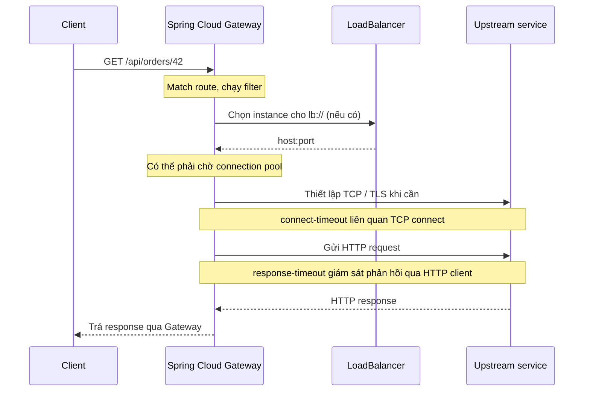
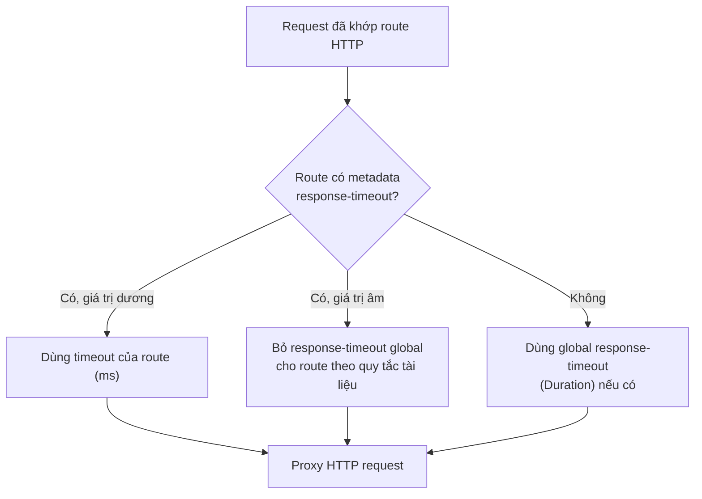

# Ghi đè thời gian chờ theo route metadata và đơn vị cấu hình

Một API Gateway có thể đồng thời phục vụ endpoint tra cứu sản phẩm cần phản hồi trong vài trăm mili giây và endpoint tạo báo cáo cần nhiều giây để backend hoàn tất. Nếu tất cả route dùng một ngưỡng thời gian chờ giống nhau, cấu hình quá ngắn sẽ làm hỏng request hợp lệ; cấu hình quá dài sẽ để client và tài nguyên gateway chờ các upstream đã gặp sự cố quá lâu.

**Spring Cloud Gateway Server WebFlux** cho phép đặt **HTTP connect timeout và response timeout ở mức toàn cục**, sau đó **ghi đè riêng cho từng route qua `metadata`**. Khả năng này giúp phân biệt các nhóm API theo đặc tính của backend mà vẫn tập trung quản trị qua route predicate và filter chain. Điểm quan trọng nhất là **đơn vị cấu hình khác nhau giữa thuộc tính toàn cục và metadata của route**: dùng sai đơn vị có thể làm thời gian chờ ngắn hơn hoặc dài hơn dự định hàng nghìn lần.

Bài thuộc chương **Kết nối và TLS** của module **SPRING_CLOUD_GATEWAY**. Khi xây dựng cổng vào microservices với định tuyến, biến đổi path/header, service discovery, xác thực, giới hạn lưu lượng, circuit breaker, retry, TLS và quan sát request, việc thiết lập timeout đúng ranh giới là một phần bắt buộc của vận hành an toàn.

Mục tiêu học tập:

1. Phân biệt `connect-timeout` và `response-timeout`; nhận diện những thời gian chờ **không** được hai tùy chọn này kiểm soát.
2. Cấu hình global timeout bằng đúng đơn vị và ghi đè qua `Route.metadata` trong YAML hoặc Java DSL.
3. Hiểu cách route metadata **ưu tiên** trước cấu hình global, cũng như ý nghĩa đặc biệt của `response-timeout: -1`.
4. Tránh nhầm lẫn timeout với lỗi service discovery, lỗi TLS, giới hạn connection pool, circuit breaker và retry.
5. Viết kịch bản kiểm thử hai route nhanh/chậm, đọc route metadata thực tế và diễn giải kết quả một cách có cơ sở.

> **Phạm vi và phiên bản:** Bài áp dụng cho **Spring Cloud Gateway Server WebFlux** sử dụng Reactor Netty HTTP client. Ví dụ chính sử dụng namespace của Gateway WebFlux **5.x**: `spring.cloud.gateway.server.webflux.httpclient` và `spring.cloud.gateway.server.webflux.routes`. Với Gateway WebFlux **4.3.x**, tài liệu dùng namespace cũ `spring.cloud.gateway.httpclient` và `spring.cloud.gateway.routes`. Một số đoạn ví dụ trong trang *Http timeouts configuration* của bản 5.x vẫn hiển thị namespace cũ; khi triển khai nên ưu tiên bảng configuration properties và route metadata của **đúng artifact đang chạy**, sau đó kiểm chứng bằng integration test. Server MVC có cơ chế HTTP client/timeout riêng, không áp dụng máy móc các property WebFlux ở đây.

## 1. Hai đồng hồ khác nhau: connect và response

Khi client gọi `GET /api/orders/42`, gateway phải tìm route, có thể chọn service instance, thiết lập hoặc lấy kết nối và chờ dữ liệu upstream. Những giai đoạn này không phải một khoảng thời gian đồng nhất.



**Connect timeout** giới hạn thời gian thiết lập **kết nối TCP tới địa chỉ upstream** khi cần một kết nối mới. Nếu mạng âm thầm không đáp ứng SYN hoặc đường truyền tới host bị “blackhole”, connect timeout có thể xảy ra. Nhưng nếu máy đích lập tức trả “connection refused”, request thất bại **ngay**, không đợi hết timeout.

**Response timeout** là giới hạn thời gian chờ phản hồi ở **HTTP client của gateway** đối với upstream. Nó giúp ngăn gateway chờ một backend quá lâu khi kết nối đã được xử lý và request đang được thực hiện. Cần xem chi tiết Reactor Netty và phiên bản cụ thể để phân biệt thời gian chờ phản hồi, khoảng không có I/O và hành vi với response streaming; không nên hiểu đây là một **deadline tổng từ lúc client gửi request tới lúc client nhận byte cuối cùng**.

### Các khoảng thời gian dễ bị nhầm

| Giai đoạn | Có được `connect-timeout` kiểm soát trực tiếp? | Có được `response-timeout` kiểm soát trực tiếp? |
| --- | --- | --- |
| Match predicate, chạy `GlobalFilter`/`GatewayFilter` | Không | Không phải toàn bộ thời gian xử lý filter |
| Chờ một connection rảnh trong pool | Không; có chính sách **pool acquire timeout** riêng | Không nên coi response timeout là giới hạn acquisition |
| DNS resolution / tìm instance `lb://` | Không thể coi TCP connect timeout là giới hạn tổng cho mọi bước này | Không |
| Thiết lập TCP connection mới tới upstream | **Có**, trong phạm vi HTTP client connect | Chưa phải toàn bộ quá trình phản hồi |
| TLS handshake tới HTTPS upstream | Không đồng nghĩa TCP connect; có cấu hình **TLS handshake timeout** | Không thay thế giới hạn handshake |
| Đợi dữ liệu HTTP response | Không | **Có**, theo ngữ nghĩa của Reactor Netty HTTP client |
| Custom filter gọi JDBC/HTTP đồng bộ | Không | Không, nếu công việc nằm ngoài phạm vi HTTP client |
| Toàn bộ lượt retry + backoff | Không | Không phải một tổng deadline cho tất cả attempts |
| Chờ client gửi request body / client đọc response chậm | Không | Không phải các timeout inbound/outbound end-to-end tổng quát |

**Quy tắc nhớ:** Connect timeout bảo vệ giai đoạn **mở kết nối**; response timeout bảo vệ giai đoạn **chờ phản hồi HTTP upstream**. Cả hai là timeout của HTTP client trong Gateway, không phải thay thế cho mọi loại timeout của hạ tầng.

## 2. Bảng đơn vị: điểm dễ sai nhất của cấu hình

Tài liệu Spring Cloud Gateway định nghĩa rõ:

- **Global `connect-timeout`: số mili giây (ms).**
- **Global `response-timeout`: kiểu `java.time.Duration`**, ví dụ `5s` hoặc `500ms`.
- **Per-route `metadata.connect-timeout`: số mili giây (ms).**
- **Per-route `metadata.response-timeout`: số mili giây (ms).**

| Nơi đặt | Key | Dạng đúng | Diễn giải |
| --- | --- | --- | --- |
| Global HTTP client | `connect-timeout: 1000` | Số nguyên, ms | 1 giây |
| Global HTTP client | `response-timeout: 5s` | `Duration` | 5 giây |
| Global HTTP client | `response-timeout: 750ms` | `Duration` | 750 mili giây |
| Route `metadata` | `connect-timeout: 300` | Số nguyên, ms | 0,3 giây |
| Route `metadata` | `response-timeout: 1200` | Số nguyên, ms | 1,2 giây |
| Route `metadata` | `response-timeout: 5000` | Số nguyên, ms | 5 giây |
| Route `metadata` | `response-timeout: -1` | Số âm đặc biệt | **Bỏ giới hạn response timeout global** cho route này |

### Ví dụ sai do nhầm đơn vị

```yaml
# Không dùng như cấu hình route: minh họa lỗi đơn vị
metadata:
  response-timeout: 5
```

Nếu người viết muốn **5 giây**, dòng trên đặt **5 mili giây**, có thể gây lỗi timeout hàng loạt ngay cả khi backend rất nhanh.

```yaml
# Theo tài liệu per-route, không dùng Duration string ở đây
metadata:
  response-timeout: 5s
```

Với route metadata, ví dụ chính thức dùng **giá trị số tính bằng mili giây**, không phải `Duration` string. Cách Spring binding/đọc metadata có thể khác tùy phiên bản và nguồn định nghĩa route; để tránh lỗi kiểu dữ liệu hoặc giá trị bất ngờ, hãy dùng `5000` cho 5 giây.

Trong trường hợp global:

```yaml
# Đúng ý định: Duration 5 giây trên HTTP client
response-timeout: 5s
```

**Phép đổi đơn vị cần nhớ:** `1s = 1000ms`; `0,5s = 500ms`; `30s = 30000ms`. Các giá trị trong ví dụ không phải ngưỡng tối ưu cho mọi hệ thống; chọn con số theo độ trễ backend, SLA, độ dài request, đặc tính mạng và khả năng phục hồi.

### Vì sao metadata dùng số nguyên?

Route `metadata` là một map thuộc route definition, có thể chứa nhiều thông tin kỹ thuật. `RouteMetadataUtils` cung cấp các hằng khóa như `CONNECT_TIMEOUT_ATTR` và `RESPONSE_TIMEOUT_ATTR`. Khi đọc các khóa này, cơ chế routing áp dụng diễn giải **mili giây** theo tài liệu, khác với việc Spring Boot bind global `response-timeout` thành `Duration`.

Đừng tự gắn thêm `ms` vào tên key trong metadata hoặc nhầm `metadata.responseTimeout` với `metadata.response-timeout`; dùng đúng hằng/snake-case dạng kebab theo tài liệu và quan sát metadata thực tế.

## 3. Cấu hình global timeout trong Gateway WebFlux 5.x

Với Spring Cloud Gateway Server WebFlux **5.x**, bảng configuration properties liệt kê thuộc tính HTTP client dưới namespace `spring.cloud.gateway.server.webflux.httpclient`.

Ví dụ:

```yaml
spring:
  cloud:
    gateway:
      server:
        webflux:
          httpclient:
            connect-timeout: 1000  # ms, giới hạn mở TCP connection mới
            response-timeout: 5s    # java.time.Duration, 5 giây
```

Ý nghĩa:

- Khi outbound HTTP client phải mở kết nối TCP, thời gian chờ kết nối được đặt **1000 ms**.
- Với route **không có override**, HTTP client áp dụng response timeout global là **5 giây** theo cơ chế của Reactor Netty/Gateway.
- Đây là policy áp dụng rộng cho các route HTTP/HTTPS proxy qua HTTP client tương ứng; các route nội bộ dạng `forward://`, WebSocket hoặc response tạo trước routing không tự được bao phủ giống nhau.
- Cấu hình này **không** thiết lập trực tiếp timeout cho client mobile, proxy ở trước gateway, JDBC của filter tùy biến hay HTTP client do backend tạo ra.

### Namespace của Gateway 4.3.x

Trên phiên bản **WebFlux 4.3.x**, cấu hình toàn cục quen thuộc là:

```yaml
spring:
  cloud:
    gateway:
      httpclient:
        connect-timeout: 1000
        response-timeout: 5s
```

Đổi namespace không thay đổi **đơn vị**: `connect-timeout` vẫn là ms, `response-timeout` vẫn là `Duration`.

> **Chú ý tài liệu 5.x:** Trang *Http timeouts configuration* hiện mô tả ví dụ dùng `spring.cloud.gateway.httpclient` như nhánh cũ; bảng *Configuration Properties* 5.x lại ghi `spring.cloud.gateway.server.webflux.httpclient`. Hãy sử dụng namespace đúng với version/starter đang chạy, xem config property có hiệu lực và kiểm thử timeout. Không bật cả hai cấu hình theo kiểu thử-và-sai rồi tưởng chúng cùng được áp dụng.

## 4. Ghi đè theo route metadata trong application.yml

Giả sử cần hai loại endpoint:

- `orders-fast`: tra cứu/tạo đơn, kỳ vọng phản hồi nhanh.
- `reports-slow`: truy vấn báo cáo hợp lệ lâu hơn.

Cấu hình Gateway WebFlux 5.x:

```yaml
spring:
  cloud:
    gateway:
      server:
        webflux:
          httpclient:
            connect-timeout: 1000
            response-timeout: 5s

          routes:
            - id: orders-fast
              uri: http://localhost:8081
              predicates:
                - Path=/api/orders/**
              filters:
                - StripPrefix=1
              metadata:
                connect-timeout: 400     # 400 ms
                response-timeout: 1200   # 1,2 giây

            - id: reports-slow
              uri: http://localhost:8082
              predicates:
                - Path=/api/reports/**
              filters:
                - StripPrefix=1
              metadata:
                connect-timeout: 1500    # 1,5 giây
                response-timeout: 15000  # 15 giây

            - id: catalog-inherit
              uri: http://localhost:8083
              predicates:
                - Path=/api/catalog/**
              filters:
                - StripPrefix=1
```

Backend ở `localhost:8081` được giả định có endpoint `/orders/**`, backend báo cáo ở `localhost:8082` có `/reports/**`, backend catalog ở `localhost:8083` có `/catalog/**`. Đây là sơ đồ thử nghiệm local, cần chạy server tương ứng mới kiểm chứng được.

### Đọc kết quả từ YAML

| Route | Connect timeout | Response timeout | Vì sao |
| --- | --- | --- | --- |
| `orders-fast` | 400 ms | 1.200 ms | Cả hai lấy từ metadata của route |
| `reports-slow` | 1.500 ms | 15.000 ms | Cả hai ghi đè cấu hình global |
| `catalog-inherit` | 1.000 ms | 5 giây | Không khai báo metadata tương ứng, kế thừa global |

Nếu một route chỉ có `metadata.response-timeout` mà không có `metadata.connect-timeout`, route đó **chỉ ghi đè response timeout**; connect timeout tiếp tục dùng giá trị global. Cấu hình theo route là **từng thuộc tính riêng biệt**, không bắt buộc thay cả cặp.

### Tại sao đặt trong metadata, không đặt trong filters?

Sai cách đặt:

```yaml
# Minh họa sai: response-timeout không phải tên GatewayFilter
filters:
  - ResponseTimeout=1200
```

Trong Gateway WebFlux, timeout HTTP client theo route được mô tả là **route metadata**, không phải một filter `ResponseTimeout` giả định. Một số filter khác có timeout riêng (ví dụ circuit breaker), nhưng đó là **cơ chế khác**.

## 5. Quy tắc ưu tiên và những trường hợp đặc biệt

Thứ tự áp dụng về mặt ý tưởng:

1. Nếu route được chọn có giá trị metadata hợp lệ cho một timeout, **sử dụng giá trị của route** cho timeout đó.
2. Nếu route không có giá trị này, **kế thừa global HTTP client**.
3. Nếu global cũng không được khai báo, sử dụng **mặc định của framework/transport ở phiên bản đang chạy**.



Bảng minh họa với global `response-timeout: 5s`:

| Metadata của route | Ý nghĩa đúng |
| --- | --- |
| Không có `response-timeout` | Kế thừa 5 giây |
| `response-timeout: 800` | Ghi đè thành 800 ms |
| `response-timeout: 12000` | Ghi đè thành 12 giây |
| `response-timeout: -1` | **Vô hiệu hóa global response timeout** cho route |
| `response-timeout: 0` | **Không dùng như cách chuẩn để vô hiệu hóa**; kiểm tra cách version xử lý giá trị không dương |
| `response-timeout: 5s` | Không đúng định dạng ms được tài liệu per-route mô tả |

**`-1` là quy tắc được tài liệu ghi rõ cho `response-timeout` theo route.** Không suy rộng rằng `connect-timeout: -1` cũng có ý nghĩa tương tự. Với connect timeout, dùng giá trị ms dương hợp lý và quản lý riêng các cấu hình kết nối khác.

### Vô hiệu hóa response timeout global cho một route

Có những API như long polling/streaming hoặc một báo cáo rất đặc biệt mà giới hạn phản hồi global không phù hợp. Tài liệu Spring Cloud Gateway hỗ trợ dùng metadata **âm**, ví dụ:

```yaml
- id: special-streaming
  uri: http://localhost:8084
  predicates:
    - Path=/api/stream/**
  filters:
    - StripPrefix=1
  metadata:
    connect-timeout: 800
    response-timeout: -1
```

Đây là **mảnh route** đặt trong `routes` theo namespace phù hợp.

**Cảnh báo:** `response-timeout: -1` chỉ bỏ giới hạn response timeout **global của Gateway HTTP client trong phạm vi route**; nó không có nghĩa request sẽ “chạy vô hạn” hoặc mọi timeout khác đã được tắt. Ingress/load balancer phía trước, client, Reactor Netty/connection pool, circuit breaker, upstream server và chính sách vận hành vẫn có thể giới hạn vòng đời request.

Trong production, ưu tiên một giới hạn dương **đủ lớn** nếu vẫn có thể dự đoán thời gian xử lý. Chỉ dùng `-1` khi hiểu rõ bản chất luồng và đã có cơ chế kiểm soát tài nguyên, cancellation, idle connection, giám sát và giới hạn end-to-end phù hợp.

## 6. Java DSL: RouteMetadataUtils và giá trị kiểu số

Ngoài YAML, có thể gắn metadata timeout bằng Java DSL của Spring Cloud Gateway Server WebFlux. Sử dụng hằng khóa từ `RouteMetadataUtils` để tránh gõ sai chuỗi:

```java
import static org.springframework.cloud.gateway.support.RouteMetadataUtils
    .CONNECT_TIMEOUT_ATTR;
import static org.springframework.cloud.gateway.support.RouteMetadataUtils
    .RESPONSE_TIMEOUT_ATTR;

import org.springframework.cloud.gateway.route.RouteLocator;
import org.springframework.cloud.gateway.route.builder.RouteLocatorBuilder;
import org.springframework.context.annotation.Bean;
import org.springframework.context.annotation.Configuration;

@Configuration(proxyBeanMethods = false)
public class GatewayTimeoutRoutes {

    @Bean
    RouteLocator timeoutRoutes(RouteLocatorBuilder builder) {
        return builder.routes()
            .route("orders-fast", r -> r
                .path("/api/orders/**")
                .filters(f -> f.stripPrefix(1))
                .uri("http://localhost:8081")
                .metadata(CONNECT_TIMEOUT_ATTR, 400)
                .metadata(RESPONSE_TIMEOUT_ATTR, 1200))
            .route("reports-slow", r -> r
                .path("/api/reports/**")
                .filters(f -> f.stripPrefix(1))
                .uri("http://localhost:8082")
                .metadata(CONNECT_TIMEOUT_ATTR, 1500)
                .metadata(RESPONSE_TIMEOUT_ATTR, 15000))
            .build();
    }
}
```

Trong Java DSL:

- Các khóa `CONNECT_TIMEOUT_ATTR` và `RESPONSE_TIMEOUT_ATTR` là hằng có sẵn, không phải tự định nghĩa.
- Giá trị `400`, `1200`, `1500` và `15000` đều là **mili giây**, dù bạn đang viết Java.
- `.metadata(...)` gắn thông tin vào **Route**, không gọi một hàm `Thread.sleep` và không thiết lập timeout của WebClient tùy biến.
- Backend vẫn nhận path đã qua `stripPrefix(1)`; metadata timeout không đổi path, Host header, JSON body hoặc URI service.

**Lưu ý khi trộn cấu hình:** Nếu bạn đã khai báo `orders-fast` trong YAML **và** tạo route cùng ID trong Java DSL, có nguy cơ trùng route ID hoặc các route chồng lấn với kết quả khó kiểm soát. Ví dụ trên là **cách thay thế** cho ví dụ YAML tương ứng, không phải yêu cầu bật cả hai đồng thời.

### Đọc metadata của route tại runtime

Có thể quan sát metadata qua route mà framework gắn vào `ServerWebExchange`:

```java
import org.springframework.cloud.gateway.route.Route;
import org.springframework.web.server.ServerWebExchange;

import static org.springframework.cloud.gateway.support
    .ServerWebExchangeUtils.GATEWAY_ROUTE_ATTR;

Route route = exchange.getAttribute(GATEWAY_ROUTE_ATTR);
if (route != null) {
    Object connectTimeoutMs =
        route.getMetadata().get("connect-timeout");
    Object responseTimeoutMs =
        route.getMetadata().get("response-timeout");

    // Chỉ dùng để debug trong môi trường thử nghiệm.
}
```

Đây là snippet minh họa đặt trong `GatewayFilter`/`GlobalFilter` sau route matching, không phải một lớp Java hoàn chỉnh. `Route.getMetadata()` là metadata của route đã chọn; có thể xuất hiện kiểu dữ liệu khác nhau tùy nguồn cấu hình. Không hiển thị mọi metadata cho client, vì metadata có thể mang thông tin vận hành nội bộ.

## 7. Global và route metadata không thay thế các timeout khác

Một Gateway production thường có **nhiều đồng hồ** hoạt động độc lập:

| Cơ chế | Lớp áp dụng | Điều khiển chủ yếu |
| --- | --- | --- |
| HTTP client `connect-timeout` | Gateway → upstream | Mở kết nối TCP mới |
| HTTP client `response-timeout` | Gateway → upstream | Chờ phản hồi upstream |
| Connection pool `acquire-timeout` | Reactor Netty connection pool | Đợi lấy kết nối trong pool |
| TLS `handshake-timeout` | Kết nối HTTPS outbound | Thời gian bắt tay TLS |
| Read/write timeout bổ sung | Transport tùy cấu hình | Khoảng chờ I/O cụ thể |
| Circuit breaker TimeLimiter | Resilience wrapper quanh publisher | Thời lượng/điều kiện mà policy circuit breaker cho phép |
| Retry backoff / số lần thử | Gateway filter/resilience | Khi nào và bao nhiêu lần gửi lại upstream |
| Server/ingress idle timeout | Client ↔ ingress ↔ gateway | Kết nối inbound hoặc upstream của reverse proxy |
| Client-side request timeout | Mobile/web/service gọi Gateway | Khoảng client sẵn sàng chờ |
| Timeout database hoặc SDK legacy | Backend/custom filter | Tài nguyên ngoài HTTP client Gateway |

Có một request có thể bị timeout từ **nhiều nơi**. Ví dụ:

- Global response timeout của Gateway là `5s`.
- Circuit breaker TimeLimiter được cấu hình `2s` cho route đó.
- Ingress đặt timeout `3s`.
- Client `curl --max-time 4`.

Thì request có thể kết thúc theo **ngưỡng kích hoạt đầu tiên trong luồng thực tế**, không phải mặc định đúng `5s`. Việc đặt route metadata `response-timeout: 15000` **không tự tăng** TimeLimiter, ingress timeout hoặc client timeout.

### Mối quan hệ với TLS

`https://` tới backend yêu cầu kết nối TCP, sau đó tiến hành TLS handshake. TCP connect có thể thành công nhưng TLS handshake vẫn lỗi vì chứng chỉ không tin cậy, hostname không khớp, giao thức TLS không tương thích hoặc bị timeout.

Không nên sửa lỗi TLS bằng cách tăng `response-timeout` rồi tắt kiểm tra chứng chỉ. Cần kiểm tra **certificate chain, SNI, truststore, mTLS và timeout handshake** theo đúng topology. Những giá trị này thường được cấu hình riêng cho outbound Reactor Netty HTTP client, không phải thông qua hai metadata trong bài.

### Mối quan hệ với `lb://`

Khi route dùng `uri: lb://order-service`, LoadBalancer phải chọn instance trước khi HTTP client kết nối. Nếu **không có instance** cho service ID, Gateway có thể trả `503` mặc định hoặc trạng thái khác theo cấu hình, **mà chưa hề mở TCP connection**. Tăng connect timeout không chữa được lỗi registry/LoadBalancer không có instance.

## 8. Route metadata ảnh hưởng đến retry và circuit breaker thế nào?

### 8.1. Mỗi lần thử có thể tốn một quỹ thời gian riêng

Giả sử route có:

```yaml
metadata:
  connect-timeout: 400
  response-timeout: 1200
```

Và một `Retry` filter được cấu hình cho một lỗi upstream phù hợp. Nếu request có **hai lần gửi upstream** (lần đầu + một lần thử lại), mỗi lần có thể chịu một response timeout riêng theo cơ chế thực thi, cộng thời gian backoff, chọn kết nối và xử lý khác.

```text
Tổng thời gian request từ góc nhìn client
  ≠ chỉ riêng metadata.response-timeout

Gần đúng để phân tích kịch bản có retry:
  xử lý trước route
  + attempt 1 (connect/response)
  + backoff
  + attempt 2 (connect/response)
  + xử lý response
  + độ trễ mạng/client
```

Đây là cách **phân rã thành phần độ trễ**, không phải công thức giới hạn tuyệt đối: một connection có thể được tái sử dụng, attempt có thể thất bại ngay, circuit breaker có thể chặn sớm hoặc client có thể hủy request trước.

**Thận trọng với POST/PUT/PATCH:** Retry có thể tạo thao tác ghi trùng nếu backend đã xử lý request nhưng gateway không nhận kịp response. Dùng idempotency key, chính sách retry theo HTTP method/status và xác minh khả năng replay request body trước khi bật retry.

### 8.2. Circuit breaker không đổi đơn vị metadata

`CircuitBreaker` có thể có TimeLimiter hoặc policy fallback riêng. Nó không đổi `response-timeout` từ mili giây sang giây và cũng không tự sửa một cấu hình metadata quá ngắn.

Nếu `response-timeout: 200`, backend khỏe nhưng phản hồi thường mất 300 ms, HTTP client có thể timeout trước khi circuit breaker kịp nhận một response thành công. Khi đó retry sai cách sẽ **nhân tải** cho backend khỏe, rồi làm latency toàn hệ thống xấu hơn.

### 8.3. Timeout không đảm bảo hủy mọi side effect

Khi Gateway bỏ đợi một response do timeout, service phía sau **có thể vẫn đang thực hiện** việc tạo đơn hoặc thanh toán. Đừng trả lời client rằng “giao dịch chắc chắn chưa diễn ra” nếu chưa có cơ chế idempotency/kiểm tra trạng thái nghiệp vụ. Đây là lý do timeout, retry và đối soát trạng thái phải được thiết kế cùng nhau.

## 9. Chọn giá trị timeout phù hợp từng loại route

Không có một con số tuyệt đối đúng cho mọi API. Hãy đo độ trễ thực tế và xác định **ngân sách thời gian** giữa client, ingress, gateway và backend.

| Loại endpoint | Đặc tính | Cách chọn timeout hợp lý |
| --- | --- | --- |
| `GET /catalog/products` | Thường nhanh, dễ cache | Response timeout tương đối ngắn; theo dõi p95/p99 |
| `GET /orders/{id}` | Đọc dữ liệu có yêu cầu xác thực | Chọn theo SLO và thời gian truy vấn backend |
| `POST /orders` | Thao tác ghi có side effect | Timeout vừa đủ; retry theo idempotency |
| `GET /reports/monthly` | Xử lý tổng hợp lâu | Route override dài hơn hoặc chuyển sang job async |
| Upload/download lớn | Có thể streaming lâu và body lớn | Phân biệt timeout chờ dữ liệu với thời gian toàn phiên; kiểm tra giới hạn transport |
| Long polling / SSE | Có thể chờ hoặc stream liên tục | Xem xét timeout đặc thù, heartbeat, cancellation; chỉ dùng `-1` có kiểm soát |

Một quy trình thực tế:

1. Đo latency `p50`, `p95`, `p99` theo **route ID và upstream** ở tải bình thường, tải cao và lúc backend degraded.
2. Chọn response timeout đủ cho hoạt động hợp lệ nhưng nhỏ hơn **ngân sách end-to-end** (trừ các trường hợp có thiết kế streaming riêng).
3. Chọn connect timeout dựa trên độ trễ mạng bình thường giữa Gateway và instance, không dựa vào thời gian chạy nghiệp vụ.
4. Kiểm tra các lớp ngoài: connection pool acquire, TLS handshake, load balancer, ingress và client timeout.
5. Với endpoint lâu, ưu tiên API async (`202 Accepted` + job/status endpoint) nếu không thể bảo đảm phản hồi trong ngân sách đồng bộ.
6. Kiểm thử khi downstream bị trì hoãn, không có instance, DNS/port lỗi, TLS lỗi và khi client hủy request.

**Ví dụ ngân sách minh họa:** Client giới hạn 8 giây, ingress 7 giây, Gateway route response timeout 5 giây, backend SLO p99 3 giây. Còn lại là thời gian mạng, nhận request, xử lý filter và dự phòng. Đừng xem sự chênh lệch giữa các số này là bảo đảm tự động; phải xác minh hành vi thực tế và cách các timeout được tính.

## 10. Kiểm thử bằng backend cố ý trì hoãn phản hồi

### 10.1. Chuẩn bị

Chạy Gateway WebFlux với route `orders-fast` (response timeout 1200 ms) và `reports-slow` (response timeout 15000 ms) như mục 4.

Ở backend thử nghiệm, tạo các endpoint `GET /orders/delay/{millis}` và `GET /reports/delay/{millis}` trả kết quả sau khoảng trì hoãn chỉ định. Với Spring WebFlux:

```java
import java.time.Duration;
import java.util.Map;

import org.springframework.web.bind.annotation.GetMapping;
import org.springframework.web.bind.annotation.PathVariable;
import org.springframework.web.bind.annotation.RestController;

import reactor.core.publisher.Mono;

@RestController
class DelayDemoController {

    @GetMapping({"/orders/delay/{millis}",
                 "/reports/delay/{millis}"})
    Mono<Map<String, Object>> delay(
            @PathVariable long millis) {

        if (millis < 0 || millis > 20000) {
            return Mono.error(new IllegalArgumentException(
                "millis must be between 0 and 20000"));
        }

        return Mono.delay(Duration.ofMillis(millis))
            .map(tick -> Map.<String, Object>of(
                "delayedMs", millis,
                "status", "ready"));
    }
}
```

Đây là **controller thử nghiệm**. `Mono.delay` không giữ một event-loop thread trong `Thread.sleep` trong lúc chờ; phù hợp để tạo tình huống upstream chậm một cách kiểm soát được. Trong ví dụ hai backend trên, có thể chạy controller này ở cả cổng `8081` và `8082`, hoặc dùng một backend thử nghiệm cho cả hai route.

### 10.2. Các lệnh thử

```bash
# Backend delay 500 ms; orders-fast cho phép 1200 ms
curl -i --max-time 10 \
  http://localhost:8080/api/orders/delay/500

# Backend delay 2500 ms; vượt 1200 ms của orders-fast
curl -i --max-time 10 \
  http://localhost:8080/api/orders/delay/2500

# Backend delay 2500 ms; dưới 15000 ms của reports-slow
curl -i --max-time 20 \
  http://localhost:8080/api/reports/delay/2500

# Backend delay 16000 ms; vượt 15000 ms của reports-slow
curl -i --max-time 25 \
  http://localhost:8080/api/reports/delay/16000
```

| Kịch bản | Timeout metadata | Kết quả mong đợi trong điều kiện thử nghiệm |
| --- | --- | --- |
| Orders delay 500 ms | 1200 ms | Có cơ hội trả response thành công nếu các lớp khác hoạt động tốt |
| Orders delay 2500 ms | 1200 ms | Response timeout ở Gateway có thể kích hoạt trước khi backend trả |
| Reports delay 2500 ms | 15000 ms | Có cơ hội trả response thành công |
| Reports delay 16000 ms | 15000 ms | Response timeout route có thể kích hoạt |
| Route không override response timeout | Global 5s | Thử với delay hai phía của mốc 5 giây |

Độ trễ tổng nhìn từ `curl` có thể lớn hơn con số metadata do TCP setup, filter, queue và các bước ngoài response timeout. Đừng khẳng định Gateway **luôn trả HTTP 504**: lỗi có thể được ánh xạ thành status khác bởi WebFlux exception handling, circuit breaker/filter tùy biến hoặc proxy phía trước.

### 10.3. Kiểm tra lỗi kết nối riêng

Thử một route tới host/port **không có server lắng nghe**. Trường hợp đó thường thất bại nhanh vì `Connection refused`, **không phải** connect timeout. Để kiểm tra TCP connect timeout đúng nghĩa, cần một môi trường mạng test được phép mô phỏng **không có phản hồi** ở tầng TCP (ví dụ firewall drop có kiểm soát), không dùng địa chỉ của bên thứ ba hoặc phá lưu lượng production.

**Đừng bật** luật firewall tùy ý trên máy chủ đang chạy nghiệp vụ chỉ để tái hiện timeout. Với CI, có thể dùng network fault injection có quản lý, stub/containers trong mạng test hoặc kiểm chứng bằng integration test chuyên biệt.

### 10.4. Quan sát thời gian bằng curl

Khi cần phân tích client side, có thể dùng:

```bash
curl -s -o /dev/null \
  -w "http=%{http_code} total=%{time_total}s\n" \
  --max-time 10 \
  http://localhost:8080/api/orders/delay/500
```

`time_total` đo toàn bộ thời gian từ góc nhìn `curl`, **không phải** `response-timeout` của Gateway. Để xác minh nguyên nhân, kết hợp route ID, timestamp, logs HTTP client, metrics kết nối và span tracing của Gateway.

## 11. Cách xem route metadata thực sự được nạp

Để tránh lỗi indentation YAML hoặc nhầm namespace, hãy quan sát **route definition có hiệu lực**.

Nếu bật Spring Boot Actuator Gateway endpoint cho môi trường quản trị, có thể xem danh sách route:

```bash
curl -s http://localhost:8080/actuator/gateway/routes
```

Nên tìm:

- Route ID `orders-fast` và `reports-slow`.
- URI upstream thực tế.
- Path predicates/filters.
- Metadata như `connect-timeout: 400` và `response-timeout: 1200` khi endpoint/phiên bản có trả trường này.

Không phải mọi phiên bản/định dạng Actuator đều hiển thị mọi metadata cùng cách; nếu không thấy, có thể dùng logging hoặc một filter quan sát nội bộ đọc `route.getMetadata()` (xem mục 6) trong môi trường test.

**Bảo mật endpoint:** Đừng public `/actuator/gateway/routes` trên Internet. Các bản Spring Boot/Gateway mới có property điều khiển mức truy cập quản trị (ví dụ read-only) và web exposure; phải theo đúng version đang chạy. Không dùng quyền refresh/thay route qua Actuator nếu chỉ cần đọc.

### Tại sao cấu hình có vẻ đúng nhưng không hoạt động?

Có thể do:

1. Dùng prefix `spring.cloud.gateway.httpclient` của 4.3 khi chạy starter 5.x yêu cầu `spring.cloud.gateway.server.webflux.httpclient`.
2. Đặt `metadata` dưới `filters` hoặc sai indentation, khiến route thiếu timeout.
3. Dùng `response-timeout: 5` với ý định 5 giây, nhưng thực tế là 5 ms.
4. Có **hai route cùng match** request và route khác được chọn theo order.
5. Test qua một ingress có timeout riêng ngắn hơn, hoặc `curl --max-time` ngắn hơn.
6. Route `lb://` không có instance, request thất bại trước khi HTTP client kết nối.
7. Bộ retry/circuit breaker có giới hạn riêng, kết quả khác con số của metadata.
8. Route đi qua nhánh `forward://`/WebSocket chứ không phải proxy HTTP thông thường.

Luôn xác minh **route ID đã được chọn** trước khi kết luận một timeout override bị bỏ qua.

## 12. Chẩn đoán lỗi timeout trong vận hành

| Triệu chứng | Nguyên nhân cần phân biệt | Hướng xử lý |
| --- | --- | --- |
| Request nào cũng timeout gần như tức thì | Route `response-timeout` tính bằng ms nhưng đặt giá trị quá nhỏ | Kiểm tra số ms, ví dụ `5` khác `5000` |
| Route reports timeout ở khoảng 5 giây dù metadata 15000 | Route khác được match, global đang áp dụng, ingress/TimeLimiter có ngưỡng 5s | Xác minh route ID, metadata runtime và timeout ở các lớp |
| HTTP client báo connection refused | Host/port không có process lắng nghe hoặc network từ chối | Kiểm tra instance và cổng, không chỉ tăng connect timeout |
| Lỗi chọn instance với `lb://` | Registry/LoadBalancer không có instance | Kiểm tra service ID, discovery, health và cấu hình load balancing |
| HTTPS backend lỗi handshake | Chứng chỉ/TLS/SNI/mTLS hoặc thời gian handshake | Kiểm tra outbound TLS, không nới response timeout một cách mù quáng |
| Gateway chậm trước khi gửi HTTP request | Blocking filter, DNS, pending connections hoặc queue | Quan sát event loop, HTTP client pool và trace timeline |
| Response timeout sau retry | Mỗi attempt chịu timeout riêng, retry/backoff cộng thêm độ trễ | Giới hạn retry, dùng idempotency và end-to-end deadline |
| Client đã ngắt nhưng backend vẫn xử lý | Cancellation không đồng nghĩa backend hủy side effect | Đối soát trạng thái, idempotency key và tracing |
| Route streaming lỗi khi bật 5s | Response timeout không phù hợp mẫu stream/độ trễ giữa data chunks | Thiết kế heartbeat/idle timeout, kiểm tra semantics streaming |
| Metadata `-1` nhưng request vẫn bị ngắt | TimeLimiter, ingress, client hoặc timeout khác vẫn tồn tại | Xác định tầng kết thúc thực tế; không cho rằng `-1` tắt mọi timeout |
| Đổi YAML nhưng không thấy tác động | Config chưa reload, route cache, profile/env override hoặc sai namespace | Xem effective config, restart/refresh theo quy trình an toàn |
| Bật timeout cao làm tăng pending requests | Backend chậm giữ nhiều kết nối và resource lâu hơn | Giảm tải, bounded queues, circuit breaker, giới hạn concurrency |

### Nguồn dữ liệu nên xem

- **Route ID, status và latency** theo route, đặc biệt `p95/p99`.
- **Upstream instance** được LoadBalancer chọn và độ trễ HTTP client.
- **Connection pool**: active, idle, pending acquire, timeout và khả năng bão hòa.
- **TLS/DNS errors** và log có stack exception tương ứng.
- **Retry count, circuit breaker state và cancellation**.
- **CPU/GC/event loop**: timeout do gateway quá tải không nhất thiết có nguyên nhân ở backend.

Tên metric chính xác thay đổi theo Reactor Netty, Micrometer và Spring Cloud Gateway version. Không gán nhãn metric bằng URL/ID tùy ý không giới hạn số lượng; tránh ghi token, cookie, query nhạy cảm hoặc toàn bộ body vào log.

## 13. Mối liên hệ với bảo mật, rate limiting và ổn định tài nguyên

Timeout là một **giới hạn vận hành**, không phải hàng rào bảo mật toàn diện.

- **Không thay xác thực/phân quyền:** Một route timeout ngắn không bảo vệ endpoint admin khỏi truy cập trái phép. Dùng Spring Security ở biên và kiểm tra quyền tài nguyên trong service.
- **Không thay rate limiting:** Ứng dụng có thể nhận hàng nghìn request/giây, mỗi request giữ tài nguyên 5 giây. Cần giới hạn số request, connection pool, pending queue và body size.
- **Không thay TLS:** HTTPS/mTLS yêu cầu xác minh chứng chỉ; tăng connect/response timeout không chữa sai truststore.
- **Không thay kiểm soát retry:** Một upstream timeout có thể gây retry storm nếu nhiều request đồng thời thử lại. Chọn retry theo HTTP method, idempotency và backoff có giới hạn.
- **Không chữa custom blocking filter:** `Thread.sleep()`, `RestTemplate`, JDBC đồng bộ hay `Mono.block()` trong `GlobalFilter` có thể làm nghẽn event loop ngoài phạm vi response-timeout của Netty HTTP client.
- **Không phải circuit breaker:** Circuit breaker quản lý trạng thái upstream và quyết định cho request đi qua hay chặn; timeout là một trong các loại tín hiệu lỗi có thể ảnh hưởng circuit breaker tùy cấu hình.

Khi nhiều request đồng thời tới backend chậm, tăng timeout đồng loạt có thể giữ connection/pending requests lâu hơn, làm tăng latency đuôi và áp lực bộ nhớ. Hãy đo thực tế và ưu tiên giảm nguyên nhân chậm ở service, cache, queue hoặc chuyển công việc dài sang async.

## 14. Bài tập áp dụng

### Bài tập 1 — Đổi đơn vị

Cho global:

```yaml
httpclient:
  connect-timeout: 250
  response-timeout: 3s
```

Route A:

```yaml
metadata:
  response-timeout: 6000
```

Route B:

```yaml
metadata:
  connect-timeout: 1200
```

**Đáp án:**

| Route | Connect timeout | Response timeout |
| --- | --- | --- |
| Route A | 250 ms từ global | 6 giây từ route |
| Route B | 1200 ms từ route | 3 giây từ global |

### Bài tập 2 — Phát hiện cấu hình sai

Một lập trình viên muốn route payment chờ tối đa 4 giây và đặt:

```yaml
metadata:
  response-timeout: 4
```

**Sai ở đâu?** `4` trong metadata là **4 ms**, không phải 4 giây. Cần sửa thành `4000`. Đồng thời, route payment cần chính sách retry/idempotency rõ ràng; không thể chỉ dựa vào response timeout để biết trạng thái giao dịch.

### Bài tập 3 — Vô hiệu hóa global cho streaming

Global `response-timeout: 5s`, route `/api/events/**` phải giữ một kết nối dài. Dùng:

```yaml
metadata:
  response-timeout: -1
```

**Giải thích:** Chỉ tắt global HTTP client response timeout theo quy tắc của Gateway cho route này. Vẫn cần kiểm soát heartbeat, idle timeout, client disconnect, giới hạn concurrency và proxy ở trước/sau Gateway. Nếu streaming có quy tắc kiểm soát khác, không nên mặc định bỏ timeout là phương án tối ưu.

### Bài tập 4 — Phân biệt connection refused và connect timeout

Bạn cấu hình `connect-timeout: 2000` và gọi tới `127.0.0.1:59999` khi không có server lắng nghe. Request thất bại sau 3 ms.

**Đó có phải cấu hình bị bỏ qua?** Không nhất thiết. Kết nối bị **từ chối ngay** thì không chờ hết 2000 ms. Timeout là **ngưỡng tối đa khi một thao tác chờ kéo dài**, không phải trì hoãn cố định cho mọi lỗi kết nối.

### Bài tập 5 — Trace có timeout nào?

Client có timeout 10s, ingress 8s, route response timeout 12s và circuit breaker TimeLimiter 3s. Backend phản hồi sau 6s.

**Thảo luận:** Request có thể bị ngắt ở khoảng 3s bởi TimeLimiter nếu policy đó thực sự bao quanh call, mặc dù metadata cho phép 12s. Cần kiểm tra filter ordering, cấu hình circuit breaker và trace, không kết luận lỗi ở Route Metadata.

## 15. Checklist khi đưa timeout per-route vào production

- [ ] Dùng đúng **Spring Cloud Gateway Server WebFlux** và namespace configuration theo version.
- [ ] Global `connect-timeout` là **ms**; global `response-timeout` là **Duration** như `5s`.
- [ ] Route `metadata.connect-timeout` và `metadata.response-timeout` đều là **ms**, không dùng `5s` cho per-route như ví dụ global.
- [ ] Khi muốn 5 giây ở metadata, dùng số nguyên `5000`.
- [ ] Chỉ dùng `response-timeout: -1` để bỏ global response timeout cho route khi đã đánh giá vòng đời và resource; không suy rộng sang connect timeout.
- [ ] Phân biệt override từng key: route không có một key sẽ kế thừa global key đó.
- [ ] Kiểm tra route matching/order để bảo đảm request thật sự đi vào route có metadata.
- [ ] Không đặt HTTP client timeout vào `filters` giả định hoặc vào cấu hình của backend service.
- [ ] Xác minh connection pool acquire, TLS handshake, ingress/client timeout và circuit breaker TimeLimiter riêng.
- [ ] Khi dùng `lb://`, kiểm tra discovery/LoadBalancer có instance trước khi quy lỗi cho connect timeout.
- [ ] Khi bật retry, tính tới backoff, số attempts và idempotency của thao tác ghi.
- [ ] Đo timeout bằng backend trì hoãn có kiểm soát và trace/metrics HTTP client, không chỉ nhìn status.
- [ ] Có kiểm thử giá trị biên dưới/trên ngưỡng, client cancel, upstream không phản hồi và TLS lỗi.
- [ ] Không tăng timeout vô hạn để che sự cố backend chậm hoặc logic blocking trên event loop.
- [ ] Giữ Actuator và thông tin route metadata ở mạng quản trị, tránh lộ cấu trúc service.
- [ ] Theo dõi `p95/p99`, connection pool saturation, retry/circuit breaker và tỷ lệ lỗi theo route.

## Kết luận

**Spring Cloud Gateway Server WebFlux** hỗ trợ đặt `connect-timeout` và `response-timeout` toàn cục rồi **ghi đè theo từng route bằng metadata**. Quy tắc quan trọng nhất là **toàn cục `connect-timeout` dùng mili giây, toàn cục `response-timeout` dùng `java.time.Duration`; trong metadata cả hai đều dùng mili giây**. `response-timeout: -1` có ý nghĩa đặc biệt: vô hiệu hóa giá trị global response timeout cho route cụ thể, không tắt mọi timeout khác trong hệ thống.

Hiểu đúng đơn vị, độ ưu tiên và phạm vi timeout giúp tránh lỗi cấu hình “5 ms thay vì 5 giây”, phát hiện backend bị chậm và phân biệt lỗi TCP/TLS, thiếu instance từ service discovery, bão hòa connection pool hay giới hạn circuit breaker. Kết hợp timeout theo route với predicate/filter chain, xác thực, rate limiting, retry có idempotency và observability giúp vận hành API Gateway ổn định khi nhiều microservice có thời gian phản hồi rất khác nhau.

## Tài liệu tham khảo

- [Spring Cloud Gateway Server WebFlux 5.x — Http timeouts configuration](https://docs.spring.io/spring-cloud-gateway/reference/spring-cloud-gateway-server-webflux/http-timeouts-configuration.html)
- [Spring Cloud Gateway Server WebFlux 4.3.x — Http timeouts configuration](https://docs.spring.io/spring-cloud-gateway/reference/4.3/spring-cloud-gateway-server-webflux/http-timeouts-configuration.html)
- [Spring Cloud Gateway 5.x — Configuration Properties](https://docs.spring.io/spring-cloud-gateway/reference/configprops.html)
- [Spring Cloud Gateway Server WebFlux — Route Metadata Configuration](https://docs.spring.io/spring-cloud-gateway/reference/spring-cloud-gateway-server-webflux/route-metadata-configuration.html)
- [Spring Cloud Gateway Server WebFlux — Global Filters](https://docs.spring.io/spring-cloud-gateway/reference/spring-cloud-gateway-server-webflux/global-filters.html)
