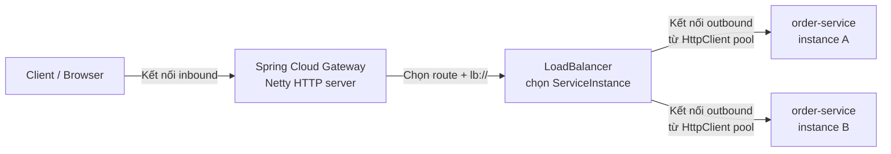
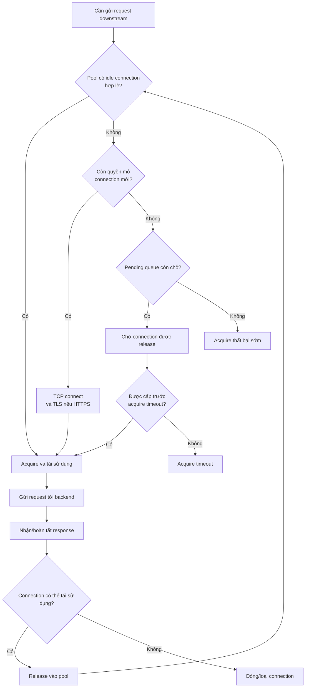
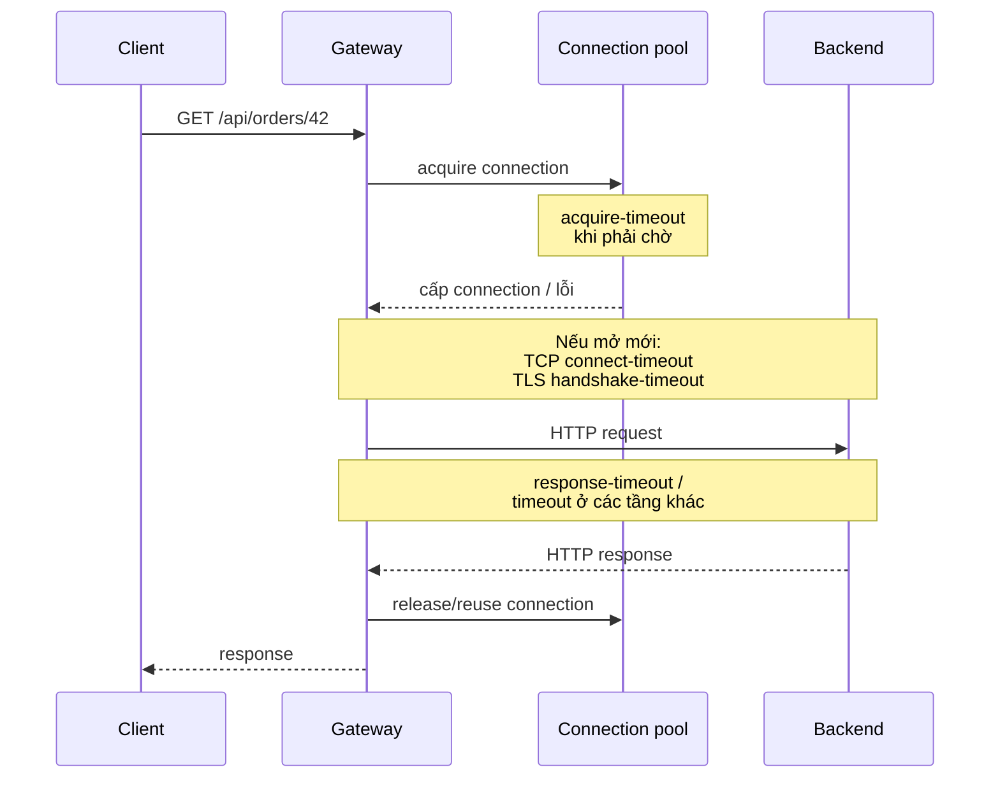
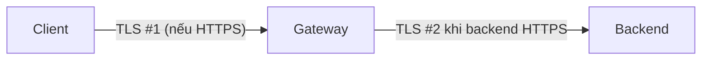

# Connection pool, giới hạn kết nối và hàng đợi chờ

Một API Gateway tiếp nhận nhiều HTTP request đồng thời nhưng không nhất thiết mở một kết nối TCP mới tới backend cho từng request. Với **Spring Cloud Gateway Server WebFlux**, khi chuyển tiếp qua Netty HTTP routing, Gateway sử dụng **Reactor Netty HttpClient**. Client này có thể **tái sử dụng các kết nối đang rảnh** trong *connection pool* để tiết kiệm thời gian thiết lập TCP/TLS và giảm tài nguyên tiêu thụ.

Tuy nhiên, khi backend chậm hoặc số request tăng nhanh, các kết nối trong pool có thể đều bận. Nếu pool có giới hạn, request mới phải **chờ được cấp phát kết nối**, hoặc thất bại khi vượt số lượng chờ/thời gian chờ. Hiểu cơ chế này là điều kiện quan trọng để tránh tình trạng Gateway vẫn chạy nhưng hàng loạt request tăng độ trễ, timeout hoặc trả lỗi ở tầng proxy.

Đây là nội dung thuộc chương **Kết nối và TLS** trong module **SPRING_CLOUD_GATEWAY**. Chủ đề gắn với hệ thống API Gateway sử dụng route predicate, filter chain, biến đổi đường dẫn/header và khám phá dịch vụ. Việc thiết kế connection pool đúng còn liên quan đến xác thực, giới hạn lưu lượng, circuit breaker, retry, TLS và quan sát request khi vận hành microservices an toàn.

> **Phạm vi:** Bài tập trung vào **kết nối outbound từ Gateway đến backend** khi sử dụng **Spring Cloud Gateway Server WebFlux** và Reactor Netty. Các ví dụ YAML phân biệt namespace Spring Cloud Gateway hiện hành với nhiều bản 4.x trước đó. Cấu hình, mặc định và chỉ số metric thay đổi theo phiên bản framework; hãy đối chiếu phiên bản Spring Cloud Gateway, Reactor Netty và embedded server thực tế trước khi áp dụng.

## 1. Phân biệt kết nối inbound và outbound

Tưởng tượng client gọi:

```http
GET /api/orders/42 HTTP/1.1
Host: api.example.test
```

Gateway chọn route `orders-api`, chuyển tới `lb://order-service` và Spring Cloud LoadBalancer chọn instance `10.2.0.15:8080`. Có **hai chặng mạng khác nhau**:

1. **Client → Gateway:** kết nối inbound do HTTP server phía Gateway tiếp nhận. Nếu có reverse proxy/ingress phía trước, còn thêm chặng client → ingress → gateway.
2. **Gateway → backend:** kết nối outbound do **Reactor Netty HttpClient** sử dụng để gửi request sau khi đã chọn route và đích.



**Giới hạn `max-connections` của HTTP client pool không phải giới hạn số client được phép kết nối tới Gateway.** Nó điều chỉnh việc Gateway cấp phát các kết nối **đi ra backend** theo cơ chế pool tương ứng. Muốn giới hạn kết nối vào hoặc bảo vệ HTTP parser, cần dùng cấu hình HTTP server, ingress, load balancer/WAF hoặc hạ tầng mạng phù hợp.

### 1.1. Bốn đại lượng dễ bị nhầm

| Đại lượng | Đếm gì? | Ví dụ |
| --- | --- | --- |
| **Inbound connections** | Các kết nối TCP từ client/proxy tới Gateway. | 300 kết nối đang mở vào cổng `8080` của Gateway |
| **Outbound active connections** | Các kết nối trong pool đang được sử dụng để giao tiếp với backend. | 50 kết nối đang bận tới một endpoint backend |
| **Outbound idle connections** | Các kết nối đã dùng xong, vẫn mở để tái sử dụng. | 20 kết nối keep-alive rảnh |
| **Pending acquisitions** | Các yêu cầu đang **đợi lấy kết nối** từ pool vì chưa thể được cấp ngay. | 80 request chờ kết nối cho downstream |

Số **HTTP request đồng thời** không luôn bằng số **TCP connection**. Với HTTP/1.1 thông dụng, một kết nối không multiplex nhiều request đồng thời như HTTP/2; với HTTP/2, một kết nối có thể phục vụ nhiều stream. Ngoài ra, WebSocket, streaming và những giao thức/chế độ đặc biệt có vòng đời chiếm dụng kết nối khác với request ngắn.

## 2. Connection pool hoạt động như thế nào?

**Connection pool** giữ và quản lý các kết nối tới remote endpoint. Khi một request cần gọi backend, Reactor Netty HttpClient thực hiện thao tác logic **acquire**:

1. Nếu có **kết nối idle hợp lệ**, có thể lấy để tái sử dụng.
2. Nếu không có idle và pool còn khả năng mở mới, client có thể **thiết lập kết nối** mới: DNS khi cần, TCP handshake và TLS handshake nếu dùng HTTPS.
3. Nếu mọi kết nối đã bận và pool đạt giới hạn, thao tác acquire có thể được đưa vào **hàng đợi pending**.
4. Khi một kết nối được **release** sau khi request hoàn thành và phù hợp để tái sử dụng, pool có thể cấp kết nối đó cho một yêu cầu đang chờ.
5. Nếu chờ quá lâu hoặc số yêu cầu pending vượt mức cho phép, acquire có thể **thất bại** trước khi HTTP request được gửi tới backend.



Sơ đồ là mô hình khái niệm, không phải mọi request đều trải qua các nhánh theo đúng số bước cố định. Pool có thể kiểm tra tình trạng connection, giới hạn tuổi thọ và chính sách leasing trước khi cấp. Nếu kết nối đã bị peer đóng, nó có thể bị loại và client cần kết nối khác.

### 2.1. Vì sao tái sử dụng connection cải thiện hiệu năng?

Mỗi kết nối mới có thể gây chi phí:

- **TCP handshake**, chịu ảnh hưởng của RTT giữa Gateway và backend.
- **TLS handshake** với backend HTTPS, gồm xác thực certificate và đàm phán thuật toán.
- **Kernel socket, file descriptor và buffer** phía Gateway/backend.
- **CPU/memory** cho mã hóa TLS và quản lý nhiều kết nối đồng thời.

Khi cùng một remote endpoint nhận nhiều request ngắn, giữ một lượng connection hợp lý để tái sử dụng giúp giảm chi phí lặp lại. Nhưng giữ **quá nhiều idle connection** cũng tiêu tốn tài nguyên; pool cần hạn mức và chính sách loại bỏ phù hợp với hành vi backend.

### 2.2. Pool không phải một hàng đợi tác vụ nghiệp vụ

**Pending acquire queue** chỉ lưu những yêu cầu **chờ một connection outbound**. Nó khác với:

- TCP accept backlog của HTTP server.
- Hàng đợi request của ingress/load balancer.
- Scheduler queue hoặc các tác vụ đang chờ thread.
- Hàng đợi xử lý job ở backend.
- Cơ chế token bucket của `RequestRateLimiter`.

Vì vậy, tăng số pending acquisitions **không tăng năng lực xử lý của backend**. Nó chỉ cho nhiều request hơn **chờ trước cổng vào backend**, và có thể làm độ trễ/phân bổ bộ nhớ xấu đi nếu backend không theo kịp.

## 3. Pool được phân chia theo đích, không phải một cổng chung cho mọi backend

Reactor Netty HttpClient thường duy trì các pool theo **remote host và port** cùng các chi tiết cấu hình kết nối liên quan. Trong tài liệu Reactor Netty, mặc định là pool **theo remote host**, hiểu tối thiểu là cặp hostname:port.

Ví dụ:

```text
Gateway instance G1
  Pool cho 10.2.0.15:8080  -> active / idle / pending riêng
  Pool cho 10.2.0.16:8080  -> active / idle / pending riêng
  Pool cho 10.2.0.30:8443  -> active / idle / pending riêng
```

Nếu route dùng `lb://order-service`, Spring Cloud LoadBalancer chọn một instance ở bước routing; kết nối thực tế có thể được acquire từ pool ứng với **đích đã phân giải**. Thêm một instance backend có thể tạo thêm một pool/nhóm connection tương ứng.

**Không suy luận rằng `max-connections: 100` là tổng tối đa 100 kết nối cho toàn bộ microservices và mọi Gateway replica.** Đối với pool FIXED, hạn mức này áp dụng theo pool/key mà provider sử dụng; tổng socket có thể lớn hơn khi có nhiều remote endpoints. Với **ba Gateway replica**, số kết nối outbound ở quy mô cụm còn được nhân theo lượng instance Gateway, phân phối lưu lượng và các nguồn kết nối khác.

### 3.1. Service discovery và kết nối đang giữ

Registry có thể xóa một instance khỏi danh sách khả dụng, nhưng điều đó không đồng nghĩa tất cả kết nối TCP đang tồn tại đến instance ấy sẽ biến mất ngay tại thời điểm đó. Pool, DNS, health checking và load balancer có chu kỳ cập nhật riêng.

Khi backend được drain hoặc hủy trong lúc triển khai:

- Hạn chế gửi request mới đến instance đang rút khỏi dịch vụ.
- Chờ xử lý những request đang chạy theo chính sách graceful shutdown.
- Kiểm tra các socket/connection idle có bị đóng đúng cách không.
- Cân nhắc `max-idle-time` và `max-life-time` để giảm tích lũy kết nối lâu đời.

Không dùng connection pool làm cơ chế thay thế health check, circuit breaker hoặc quá trình deregistration an toàn.

## 4. Ba kiểu pool: ELASTIC, FIXED và DISABLED

Spring Cloud Gateway có thuộc tính `httpclient.pool.type`. Tài liệu cấu hình Server WebFlux hiện hành mô tả các lựa chọn **`elastic`**, **`fixed`** và **`disabled`**, với mặc định hiện được tài liệu ghi là **`elastic`**. Không lấy mặc định của một `Reactor Netty HttpClient.create()` thuần rồi áp đặt cho mọi phiên bản Spring Cloud Gateway.

| Kiểu | Ý tưởng chính | Ưu điểm | Rủi ro/cần lưu ý |
| --- | --- | --- | --- |
| **`ELASTIC`** | Pool linh hoạt theo nhu cầu; có thể mở rộng số connection thay vì giữ hạn mức fixed được cấu hình như bên dưới. | Thuận tiện với tải thay đổi; ít phải chọn số cố định ban đầu. | Dễ tạo nhiều socket/TLS session trong cao điểm; cần bảo vệ bằng hạn mức tại các tầng khác. |
| **`FIXED`** | Đặt **giới hạn số connection** cho một pool; khi hết connection thì acquire có thể chờ. | Dự đoán tốt hơn việc sử dụng tài nguyên và có backpressure rõ ràng. | Đặt quá thấp tạo pending/timeout; quá cao làm quá tải downstream. |
| **`DISABLED`** | Không sử dụng cơ chế pool/reuse theo lựa chọn này. | Có thể hữu ích để cô lập lỗi pool trong chẩn đoán có kiểm soát. | Mất lợi ích keep-alive/reuse, tăng TCP/TLS handshakes và chi phí kết nối. |

**Phân biệt hai tầng mặc định:** Reactor Netty `HttpClient.create()` có mô hình `ConnectionProvider` riêng, trong khi Spring Cloud Gateway quản lý HTTP client/properties của nó. Mặc định thực tế còn phụ thuộc version và cách khởi tạo/customizer; muốn biết chắc phải kiểm tra cấu hình effective và metrics.

### 4.1. Khi nào chọn FIXED?

Pool FIXED thường phù hợp khi:

- Gateway có lưu lượng dự đoán được và backend cần một mức bảo vệ kết nối.
- Muốn theo dõi **active/idle/pending** và đặt thời hạn chờ rõ ràng.
- Có năng lực backend đã đo được và muốn tránh tăng socket đột ngột.
- Cần load test/tuning có thể lặp lại giữa các deployment.

Nhưng FIXED không thể tự bảo đảm SLA. Nếu service backend chỉ xử lý được 200 RPS mà Gateway nhận 1.000 RPS ổn định, hạn mức 50 hay 100 connection đều **không tạo thêm năng lực nghiệp vụ**; hệ thống phải scale, giảm lưu lượng, cache, hoặc từ chối sớm theo chính sách phù hợp.

### 4.2. Vì sao DISABLED không phải lựa chọn mặc định tốt cho production?

Khi không tái sử dụng connection, mỗi request có thể phải trả giá cho TCP và TLS setup. Với latency mạng hoặc QPS lớn, số kết nối mới/giây và CPU TLS có thể tăng mạnh. Chỉ sử dụng để điều tra một vấn đề cụ thể, đo trong môi trường an toàn và khôi phục cơ chế reuse khi thích hợp.

## 5. Các tham số cấu hình quan trọng của Gateway HttpClient pool

Trong tài liệu Spring Cloud Gateway Server WebFlux, nhóm thuộc tính là:

```text
spring.cloud.gateway.server.webflux.httpclient.pool.*
```

Bảng sau là các thuộc tính được tài liệu cấu hình chính thức mô tả:

| Thuộc tính | Ý nghĩa | Lưu ý |
| --- | --- | --- |
| **`type`** | `elastic`, `fixed` hoặc `disabled`. | Một số thuộc tính cap/wait chỉ có ý nghĩa với `FIXED`. |
| **`max-connections`** | Số connection tối đa trước khi bắt đầu pending acquire. | Tài liệu Gateway ghi **chỉ áp dụng cho `FIXED`**. |
| **`acquire-timeout`** | Thời gian tối đa để chờ acquire connection, **mili giây**. | Tài liệu Gateway ghi **chỉ áp dụng cho `FIXED`**. |
| **`max-idle-time`** | Thời gian tối đa connection được giữ ở trạng thái idle trước khi đủ điều kiện bị đóng. | Tùy version/binding có thể dùng Duration/đơn vị ms. |
| **`max-life-time`** | Tuổi thọ tối đa của connection trước khi đủ điều kiện bị loại. | Không đồng nghĩa tự động ngắt mọi request đang xử lý đúng thời điểm chạm ngưỡng. |
| **`eviction-interval`** | Chu kỳ kiểm tra loại connection nền. | Giá trị 0 thường tắt periodic eviction. |
| **`leasing-strategy`** | Chiến lược lấy lại idle connection, thường `fifo` hoặc `lifo`. | Hỗ trợ và mặc định theo version; tài liệu hiện hành ghi `fifo`. |
| **`metrics`** | Thu thập các chỉ số pool qua Micrometer khi được cấu hình. | Tài liệu hiện hành ghi mặc định `false`. |
| **`name`** | Tên connection pool dùng để nhận diện. | Giúp lọc chỉ số/diagnostics; không phải tên backend. |

**Không nhập nhằng với tùy chọn Reactor Netty cấp thấp:** `ConnectionProvider.builder(...).pendingAcquireMaxCount(...)` giới hạn **số yêu cầu được phép nằm trong queue**, nhưng thuộc tính này **không xuất hiện như một cấu hình `httpclient.pool.max-pending-acquires` phổ quát trong danh sách Gateway properties hiện hành**. Nếu muốn đặt queue length bằng API Reactor Netty, phải dùng cơ chế customization được phiên bản Gateway hỗ trợ và xác minh provider thực sự được dùng; không tự thêm khóa YAML không được framework bind rồi nghĩ queue đã có hạn mức.

## 6. Ví dụ cấu hình FIXED pool có giới hạn

### 6.1. Namespace Server WebFlux mới

Ví dụ minh họa:

```yaml
spring:
  cloud:
    gateway:
      server:
        webflux:
          httpclient:
            pool:
              type: FIXED
              name: gateway-outbound
              max-connections: 100
              acquire-timeout: 3000
              max-idle-time: 30s
              max-life-time: 5m
              eviction-interval: 30s
              metrics: true
          routes:
            - id: orders-api
              uri: lb://order-service
              predicates:
                - Path=/api/orders/**
              filters:
                - StripPrefix=1
```

Trong cấu hình ví dụ:

- `type: FIXED` chọn kiểu pool có giới hạn số connection.
- `max-connections: 100` là hạn mức trước khi bắt đầu chờ acquire, **không phải 100 request/giây**.
- `acquire-timeout: 3000` yêu cầu thời gian chờ acquire tối đa **3.000 ms** khi pool bị bận.
- `max-idle-time: 30s` giúp các connection nhàn rỗi đủ lâu được loại theo cơ chế pool.
- `max-life-time: 5m` giới hạn tuổi connection để giảm giữ socket quá lâu.
- `eviction-interval: 30s` bật kiểm tra loại connection định kỳ theo khả năng hỗ trợ.
- `metrics: true` bật thu thập metrics của pool khi có tích hợp Micrometer/registry phù hợp.
- Route `lb://order-service` cần Spring Cloud LoadBalancer cùng nguồn instance; nó **không ảnh hưởng trực tiếp đến khái niệm acquire timeout**.

**Các con số chỉ dành cho thực hành, không phải mặc định hoặc khuyến nghị production.** Ngưỡng tối ưu phụ thuộc QPS, thời gian backend xử lý, số instance, HTTP protocol, timeout, khả năng tài nguyên và mức chấp nhận queue của nghiệp vụ.

### 6.2. Namespace thường gặp trong Spring Cloud Gateway 4.x

Một số phiên bản trước đây sử dụng:

```yaml
spring:
  cloud:
    gateway:
      httpclient:
        pool:
          type: FIXED
          max-connections: 100
          acquire-timeout: 3000
          max-idle-time: 30s
          max-life-time: 5m
          metrics: true
      routes:
        - id: orders-api
          uri: http://localhost:9090
          predicates:
            - Path=/api/orders/**
          filters:
            - StripPrefix=1
```

Chọn **một** namespace tương ứng với Spring Cloud Gateway BOM và starter đang dùng; không đặt đồng thời cả hai vì có thể gây nhầm lẫn về cấu hình effective. URI `http://localhost:9090` ở ví dụ giúp thử pool với một backend cố định, tách khỏi vấn đề service discovery.

### 6.3. Lưu ý về đơn vị thời gian

Trong Spring Cloud Gateway, `acquire-timeout` được mô tả bằng **milliseconds**. Với ví dụ `3000` là ba giây, **không phải 3.000 giây**.

Các thuộc tính `max-idle-time` và `max-life-time` thường gắn với kiểu Duration, nên các giá trị có hậu tố như `30s`, `5m` giúp tránh đọc nhầm đơn vị khi phiên bản tương ứng hỗ trợ cách bind này. Nếu dùng số thuần, kiểm tra tài liệu version để tránh nhầm mili giây với giây.

Đặc biệt, đừng nhầm `acquire-timeout` với `connect-timeout` hoặc `response-timeout`: dù đều đo thời gian, chúng kiểm soát **các giai đoạn khác nhau**.

## 7. Pending acquire queue: hàng đợi chờ lấy kết nối

Với pool FIXED, giả sử:

```text
maxConnections = 3
Tất cả 3 connection đang bận xử lý HTTP/1.1

Request mới R4 -> pending
Request mới R5 -> pending
Request mới R6 -> pending
... khi có connection release thì một pending acquire có thể được phục vụ.
```

Một request đang chờ connection **chưa nhất thiết đã gửi request HTTP tới backend**. Do đó, backend có thể chưa nhìn thấy request trong logs, trong khi Gateway đã ghi nhận thời gian request kéo dài.

### 7.1. Hai giới hạn độc lập

Có **hai lý do** khiến một yêu cầu acquire thất bại:

1. **Pending queue đầy:** số yêu cầu đang chờ vượt `pendingAcquireMaxCount` hoặc cơ chế giới hạn tương đương của provider. Có thể bị từ chối **ngay**, không phải chờ hết timeout.
2. **Chờ quá lâu:** một yêu cầu đã được đưa vào queue nhưng không được cấp connection trước `pendingAcquireTimeout`/`acquire-timeout`; nó có thể thất bại vì timeout.

Lỗi acquire không phải là `429 Too Many Requests` theo định nghĩa. Gateway thường cần ánh xạ lỗi từ tầng Reactor Netty thành HTTP response thông qua cơ chế xử lý lỗi hiện có; **không cam kết một mã status cố định** chỉ vì queue đầy hoặc acquire timeout. Cần xem exception thực tế và cách ứng dụng xử lý lỗi.

### 7.2. Cơ chế giới hạn queue ở Reactor Netty cấp thấp

Trong API Reactor Netty:

```java
import reactor.netty.resources.ConnectionProvider;
import java.time.Duration;

ConnectionProvider provider = ConnectionProvider.builder("example-pool")
    .maxConnections(50)
    .pendingAcquireMaxCount(100)
    .pendingAcquireTimeout(Duration.ofSeconds(3))
    .maxIdleTime(Duration.ofSeconds(20))
    .maxLifeTime(Duration.ofMinutes(2))
    .build();
```

Đoạn mã minh họa cách **xây một Reactor Netty `ConnectionProvider`**. Nó **không tự gắn provider này vào Spring Cloud Gateway**. Muốn Gateway sử dụng provider tùy biến, cần triển khai theo điểm mở rộng của đúng phiên bản và kiểm tra HttpClient thực tế, tránh tạo một bean hoặc biến local mà routing filter không dùng.

Theo tài liệu Reactor Netty, ở builder cấp thấp:

- `pendingAcquireMaxCount(100)` cho tối đa 100 yêu cầu chờ ở queue của pool.
- `pendingAcquireTimeout(Duration.ofSeconds(3))` giới hạn thời gian chờ lấy connection.
- Giá trị `-1` với `pendingAcquireMaxCount` có ý nghĩa queue không giới hạn trong API tương ứng, nhưng **không nên dùng unbounded queue trong hệ thống chịu tải** nếu chưa kiểm soát tài nguyên ở các lớp khác.
- Với những phiên bản/API hỗ trợ, `pendingAcquireMaxCount(0)` cho hành vi không giữ queue: hết idle/max connections có thể fail fast.

Mặc định Reactor Netty thuần có thể có số lượng pending bằng bội số của số connection; ví dụ tài liệu mô tả mặc định `2 × maxConnections` với connection-provider builder. Tuy nhiên, **không áp đặt mặc định đó cho mọi chế độ và mọi phiên bản Gateway**.

### 7.3. Hàng đợi lớn có thể làm tăng độ trễ đuôi

Giả sử backend chỉ hoàn thành 100 request/giây và đã bão hòa. Nếu Gateway vẫn nhận 300 request/giây, sau mỗi giây có thể tích lũy thêm gần 200 request chờ. Queue lớn không chữa được vấn đề; nó có thể:

- Tăng p95/p99 latency và số request timeout.
- Giữ thêm đối tượng request, trace context và tài nguyên bộ nhớ.
- Gây hiệu ứng thác khi client timeout rồi retry, tạo thêm request.
- Khi backend phục hồi, đẩy một burst lớn xuống gây bão hòa lần nữa.

Đôi khi **fail fast có kiểm soát** ở edge/rate limiter/circuit breaker tốt hơn để client chờ lâu rồi thất bại. Nhưng quyết định này phụ thuộc SLA, idempotency và khả năng retry của client.

## 8. Phân biệt các timeout trong một request

Một request gateway → backend có nhiều giai đoạn cần quản lý:



| Timeout | Giai đoạn | Ví dụ nguyên nhân | Cách giải quyết |
| --- | --- | --- | --- |
| **`acquire-timeout`** | Chờ lấy một connection từ pool FIXED. | Mọi connection bận; pending lâu. | Đo active/pending, backend latency, điều chỉnh pool và chính sách chặn tải. |
| **`connect-timeout`** | Thiết lập TCP đến remote endpoint khi cần mở kết nối mới. | DNS/network/host không kết nối được, đường truyền chậm. | Kiểm tra địa chỉ, firewall, mạng và số kết nối mới. |
| **TLS handshake timeout** | Đàm phán TLS cho kết nối HTTPS mới. | Certificate/trust, network, TLS handshake quá chậm. | Kiểm tra TLS, certificates, truststore, CPU và handshake metrics. |
| **`response-timeout`** | Đợi phản hồi HTTP từ downstream theo semantics của HTTP client. | Backend chậm, network, response không kịp. | Tối ưu backend, đặt timeout phù hợp với SLA và circuit breaker. |
| **Client-side timeout** | Thời gian tổng mà caller chấp nhận chờ Gateway. | Caller ngừng chờ trước khi gateway/backend hoàn tất. | Xây timeout budget end-to-end; tránh Gateway giữ việc thừa. |

Một ví dụ cấu hình **không đồng nhất các timeout**:

```yaml
spring:
  cloud:
    gateway:
      server:
        webflux:
          httpclient:
            pool:
              type: FIXED
              max-connections: 100
              acquire-timeout: 3000
            connect-timeout: 3000
            response-timeout: 5s
            ssl:
              handshake-timeout: 10s
```

Ở đây:

- Có thể chờ **tối đa khoảng 3s để lấy connection** khi pool bận, tùy chính sách provider.
- Nếu cần tạo kết nối TCP mới, **connect timeout** là một ngưỡng riêng.
- Khi HTTPS, còn có **TLS handshake timeout** cho giai đoạn bắt tay.
- **Response timeout** liên quan tới phản hồi HTTP sau khi request được gửi.

**Không được cộng máy móc các số trên để kết luận “tổng request chắc chắn timeout sau 21 giây”.** Cách tính timer thực tế phụ thuộc điểm bắt đầu/kết thúc, filter chain, retry, redirect, giải pháp client và request cancellation. Khi cần hạn mức tổng end-to-end, thiết kế một **deadline/time budget** ở đúng tầng và kiểm thử.

### 8.1. Timeout của route và timeout của HTTP client

Spring Cloud Gateway có thể hỗ trợ metadata timeout theo route ngoài cấu hình HttpClient toàn cục. Khi có cấu hình theo route, phải xác định **mức nào được ưu tiên** trong version đang dùng và đo đúng hành vi, không chỉ xem file YAML.

Ví dụ, API đọc đơn hàng có SLA ngắn có thể cần response timeout thấp hơn API tạo báo cáo dài. Tuy nhiên, nếu cả hai chia chung connection pool, một service chậm vẫn có thể làm số connection đang bận tăng nhanh; timeout theo route không tự thay thế giới hạn pending queue.

## 9. Thiết lập max-connections theo tải thực tế

Không có công thức “mọi gateway cần `max-connections=1000`”. Một cách ước lượng sơ bộ dùng **Little's Law**:

\[
L = \lambda \times W
\]

Trong đó:

- `L`: số công việc/request **đồng thời đang xử lý** theo phạm vi đo.
- `\lambda`: tốc độ request trung bình trong cùng phạm vi, thường RPS.
- `W`: thời gian xử lý trung bình, tính bằng giây.

Ví dụ: backend nhận **300 RPS** với thời gian chiếm dụng kết nối trung bình **200 ms = 0,2 s**:

\[
L \approx 300 \times 0.2 = 60
\]

Đó là **khoảng 60 request đang xử lý đồng thời** ở mức trung bình, **không phải kết luận chắc chắn cần đúng 60 kết nối**. Với HTTP/1.1 keep-alive và mô hình một request in-flight mỗi connection, nó là một điểm xuất phát để đánh giá năng lực pool khi cả tải tập trung vào một remote endpoint. HTTP/2, retries, request streaming, cân bằng giữa instances và phân bố latency có thể thay đổi số kết nối cần thiết.

### 9.1. Cần tính theo endpoint/pool

Giả sử có hai backend instances phục vụ đều:

```text
order-service:
  instance A: 150 RPS × 0.2s ≈ 30 request đồng thời
  instance B: 150 RPS × 0.2s ≈ 30 request đồng thời
```

Nếu mỗi instance tương ứng với một pool, mỗi pool có thể cần xử lý trung bình khoảng 30 request đang bay, cộng thêm dư địa cho burst và biến động. Nhưng load balancer có thể không phân phối đều; instance mới có thể lạnh, instance cũ có nhiều connection idle, hoặc canary chỉ nhận một phần request.

**Đo theo từng remote endpoint và từng Gateway replica.** Chọn một con số max connections cho tất cả pool mà không xem cấu trúc traffic có thể khiến vài pool thừa kết nối, vài pool lại bão hòa.

### 9.2. Dùng độ trễ đuôi, không chỉ trung bình

Nếu backend có mean latency 200 ms nhưng p99 là 2 giây, tại thời điểm gặp burst nhiều request chậm, active connections có thể tăng vượt xa ước lượng dựa trên trung bình. Cần kiểm tra:

- Peak RPS và concurrent requests theo cửa sổ ngắn.
- Mean, p95, p99 latency **của backend** và **của Gateway**.
- Active/idle/pending connections theo remote endpoint.
- Số connection mới/giây, TCP connect errors, TLS handshake errors.
- Timeout/retry rate, tỷ lệ request bị hủy bởi client.

Nên bắt đầu từ một cấu hình được đo dưới tải giống production, theo dõi một khoảng an toàn, rồi điều chỉnh có kiểm chứng. **Tăng max-connections vô điều kiện** có thể chuyển nghẽn từ Gateway sang backend/database và gây tình trạng quá tải nghiêm trọng hơn.

## 10. HTTP/1.1, HTTP/2, WebSocket và streaming

### 10.1. HTTP/1.1

Trong mô hình HTTP/1.1 thông dụng, một connection đang xử lý request/response không được dùng để xử lý nhiều request đồng thời theo cách multiplex của HTTP/2. Vì vậy số kết nối bận thường có quan hệ chặt hơn với số request đang chờ response. Việc tái sử dụng connection giúp tránh mở kết nối mới cho request tiếp theo.

### 10.2. HTTP/2

HTTP/2 có thể truyền nhiều **streams** trên một TCP/TLS connection. Nếu Gateway và backend thực sự đàm phán được HTTP/2, một con số `max-connections` nhỏ không nhất thiết là cùng một giới hạn request đồng thời như khi dùng HTTP/1.1.

Đừng chỉ thấy client → Gateway dùng HTTP/2 rồi kết luận Gateway → backend cũng là HTTP/2. **Mỗi chặng là kết nối/giao thức riêng**; ALPN/TLS, cấu hình Reactor Netty và khả năng backend quyết định giao thức outbound.

### 10.3. Streaming, SSE và WebSocket

Các luồng phản hồi kéo dài như Server-Sent Events, tải tệp lớn, long polling hoặc WebSocket có thể giữ kết nối hoạt động lâu hơn API JSON ngắn. Với những route này:

- Dùng pool/request budget phù hợp, không trộn cách sizing với API dưới 100 ms.
- Theo dõi thời gian connection đang active và số session dài.
- Cân nhắc tách tuyến/nhóm Gateway hoặc chính sách tài nguyên nếu cần.
- **WebSocket routing** có đặc điểm kết nối nâng cấp riêng; không suy luận toàn bộ hành vi từ mô hình Netty HTTP request ngắn.

## 11. TLS ảnh hưởng đến pool ra sao?

Trong mô hình HTTPS:



Kết nối TLS từ client tới Gateway và từ Gateway tới backend là **hai phiên TLS khác nhau**. Nếu TLS kết thúc tại ingress trước Gateway, chặng ingress → Gateway lại có chính sách TLS riêng.

Khi reuse connection outbound HTTPS, Gateway có thể tránh **nhiều lần TCP/TLS handshake mới**. Điều đó cải thiện latency nhưng yêu cầu quản lý vòng đời:

- **Certificate verification:** Gateway phải xác thực certificate của backend theo chuỗi tin cậy phù hợp.
- **SNI và hostname:** cần kết nối đúng endpoint để TLS xác minh hostname; khi dùng `lb://`, cần kiểm tra URL/protocol và cách service name được sử dụng.
- **Truststore/SSL bundle:** cấu hình tin cậy theo version/stack; không bật chế độ vô hiệu hóa kiểm tra certificate trong production.
- **Idle timeout:** backend/mesh/NAT có thể đóng connection nhàn rỗi trước khi Gateway biết.
- **Life time:** giữ mãi connection có thể làm chậm việc chuyển sang hạ tầng mới hoặc làm tăng xác suất dùng socket cũ; cần chính sách vòng đời phù hợp.

Tài liệu Spring Cloud Gateway Server WebFlux có các thuộc tính HttpClient SSL như `handshake-timeout` và tùy chọn trust configuration. **Không sử dụng `use-insecure-trust-manager: true` trong production** vì việc này bỏ qua xác minh certificate remote.

### 11.1. Chọn max-idle-time so với backend idle timeout

Giả sử backend hoặc proxy giữa đường đóng connection sau **60 giây idle**. Nếu Gateway cố reuse một socket đã idle 120 giây, nó có thể gặp lỗi I/O do phía bên kia đã đóng.

Một nguyên tắc từ tài liệu Reactor Netty là chọn `maxIdleTime` của client **nhỏ hơn hoặc bằng** idle timeout của server đích, có dự phòng cho jitter và hành vi proxy/NAT. Ví dụ backend idle timeout 60s, Gateway có thể thử `max-idle-time: 30s` rồi đo kết quả.

**Không coi `max-idle-time` là timeout cho một request đang xử lý.** Nó áp dụng cho connection idle; request chậm cần được quản lý bằng response timeout/deadline thích hợp.

### 11.2. max-life-time không đồng nghĩa cắt ngang request đúng hạn

`max-life-time` là giới hạn tuổi connection để nó **đủ điều kiện bị loại** theo cơ chế pool. Trong Reactor Netty, các chính sách idle/life có thể được kiểm tra khi acquire/release và qua background eviction nếu bật. Vì vậy, nó không nên được sử dụng như công cụ hủy một request đang chạy ngay khi connection chạm tuổi tối đa.

Nếu cần shutdown/rollout an toàn, hãy kết hợp drain, readiness, load balancer cập nhật instance và timeout của request.

## 12. Quan sát connection pool bằng metrics

Tài liệu Reactor Netty cung cấp các chỉ số về connection provider, thường được xuất qua Micrometer khi bật:

| Metric/họ metric | Điều muốn quan sát |
| --- | --- |
| **`reactor.netty.connection.provider.active.connections`** | Số connection đang hoạt động. |
| **`reactor.netty.connection.provider.idle.connections`** | Số connection idle có khả năng được tái sử dụng. |
| **`reactor.netty.connection.provider.pending.connections`** | Số yêu cầu đang chờ acquire. |
| **`reactor.netty.connection.provider.total.connections`** | Tổng active + idle theo provider/pool. |
| **`reactor.netty.connection.provider.max.connections`** | Ngưỡng connection tương ứng khi metric có sẵn. |
| **`reactor.netty.connection.provider.max.pending.connections`** | Ngưỡng pending tương ứng khi metric có sẵn. |
| **Metric thời gian pending/acquire** | Độ trễ chờ connection; tên/kiểu metric phụ thuộc phiên bản. |

Trong cấu hình Gateway hiện hành:

```yaml
spring:
  cloud:
    gateway:
      server:
        webflux:
          httpclient:
            pool:
              metrics: true
```

Để xem dữ liệu thực tế, ứng dụng cần **Micrometer và một registry/exporter** phù hợp (ví dụ Prometheus qua Actuator theo cách cấu hình của dự án). Chỉ thêm `metrics: true` **không tự tạo dashboard**, không đảm bảo endpoint metric được công bố, và không nên mở actuator metrics công khai nếu chưa có cơ chế kiểm soát quyền.

### 12.1. Phân biệt metric pool và metric request

Một Gateway có:

- 90 active connections,
- 0 idle,
- 200 pending acquires,
- nhiều response `5xx`,
- p99 latency tăng,

đang cho dấu hiệu **pool bão hòa hoặc downstream chậm**. Nhưng chỉ số active/pending một mình chưa nói rõ nguyên nhân gốc: backend có thể quá tải, một route streaming giữ socket lâu, retry khuếch đại traffic, hoặc max-connections được chọn quá thấp.

Để kết luận, cần kết hợp metrics Gateway route, thời gian gọi downstream, metrics backend, lỗi TCP/TLS và logs theo route ID/instance.

### 12.2. Những cảnh báo vận hành nên có

- Pending acquisitions tăng kéo dài theo endpoint.
- Active connections chạm cap trong một thời gian đáng kể.
- Acquire timeout hoặc pending queue rejections tăng.
- Connect timeout và TLS handshake errors tăng bất thường.
- Số kết nối mới/giây tăng mạnh dù traffic không đổi (dấu hiệu reuse kém/stale).
- Idle connections nhiều nhưng hệ thống thiếu file descriptors/memory.
- Request p95/p99, retry rate và circuit-breaker opens tăng cùng lúc.

Tránh cảnh báo dựa trên một metric đơn độc. Ví dụ active đạt max trong vài giây có thể bình thường khi load burst và pending được xử lý nhanh; **pending kéo dài kèm latency/error tăng** mới cần điều tra ưu tiên.

## 13. Thí nghiệm với backend chậm

Để thấy rõ queue, hãy dựng một backend thử nghiệm **cố ý phản hồi chậm**. Một controller WebFlux đơn giản:

```java
package com.example.orders;

import java.time.Duration;
import java.util.Map;

import org.springframework.web.bind.annotation.GetMapping;
import org.springframework.web.bind.annotation.RequestMapping;
import org.springframework.web.bind.annotation.RestController;

import reactor.core.publisher.Mono;

@RestController
@RequestMapping("/orders")
public class OrdersDemoController {

    @GetMapping("/slow")
    public Mono<Map<String, String>> slow() {
        return Mono.delay(Duration.ofMillis(400))
            .map(tick -> Map.of("status", "ok"));
    }
}
```

Đoạn code này minh họa một endpoint trả chậm **không dùng `Thread.sleep()`** trên event loop. Cần có ứng dụng Spring Boot WebFlux thực sự chạy controller tại backend và Gateway được cấu hình trỏ tới nó.

### 13.1. Gateway cấu hình pool rất nhỏ để dễ quan sát

```yaml
spring:
  cloud:
    gateway:
      server:
        webflux:
          httpclient:
            pool:
              type: FIXED
              max-connections: 2
              acquire-timeout: 1000
              metrics: true
          routes:
            - id: orders-slow-demo
              uri: http://localhost:9090
              predicates:
                - Path=/api/orders/**
              filters:
                - StripPrefix=1
```

Kỳ vọng hành vi logic với **HTTP/1.1 thông thường và một backend instance**:

1. Hai request đầu có thể chiếm hai connection.
2. Những request đến cùng lúc sau đó có thể vào trạng thái pending.
3. Nếu connection được release đủ nhanh, một số request pending sẽ tiếp tục xử lý.
4. Nếu vượt thời gian chờ 1.000 ms, một số request có thể thất bại do acquire timeout.

**Không dự đoán chính xác request số 3 luôn chờ và request số 6 luôn lỗi.** Thứ tự subscribe, warm-up, kết nối idle, scheduling, số pool key, OS network và phiên bản Reactor Netty đều ảnh hưởng kết quả.

### 13.2. Tạo tải có kiểm soát

Nếu đã cài công cụ `hey` trong **môi trường test**, có thể thử:

```bash
hey -n 100 -c 20 -m GET http://localhost:8080/api/orders/slow
```

Lệnh này gửi 100 request với mức đồng thời mục tiêu 20. Chỉ dùng trên hệ thống được phép thử, không sử dụng trên production hoặc dịch vụ bên ngoài khi chưa có phê duyệt. Theo dõi:

- Độ trễ trung bình và p95/p99 của request qua Gateway.
- Số request thành công/thất bại và loại lỗi.
- `active/idle/pending connections` của pool.
- Số request đến backend thật.

Sau đó **giữ nguyên** backend/test load và thử tăng `max-connections` từ 2 lên 10 trong môi trường thử nghiệm. So sánh: pending giảm chưa chắc throughput backend tăng tương ứng; nếu backend chỉ xử lý được lượng cố định, tác động có thể chuyển từ chờ connection sang quá tải ở backend.

### 13.3. Ma trận thí nghiệm

| Cấu hình | Triệu chứng kỳ vọng | Cần kiểm tra |
| --- | --- | --- |
| FIXED, cap nhỏ, backend chậm | Active chạm cap; pending tăng | Acquire timeout/rejections |
| FIXED, cap cao hơn | Pending có thể giảm | Backend CPU, DB pool, latency có tăng không? |
| ELASTIC dưới burst | Có thể mở nhiều connection | Socket count, CPU TLS, file descriptors |
| DISABLED | Reuse kém; nhiều kết nối mới | TCP/TLS handshakes, latency |
| Max idle cao hơn idle timeout backend | Có thể gặp stale connection | Premature close, reset, retry có kiểm soát |
| Response timeout quá thấp | Request lỗi dù đã acquire thành công | Backend latency, response timeout |
| Retry bật quá nhiều | Tổng request đến backend tăng | Retry rate, idempotency, queue pressure |

**Chỉ thay một biến mỗi lượt thử** để có cơ sở so sánh. Một bài load test thành công phải đo cả Gateway lẫn backend, không chỉ nhìn số request trả thành công.

## 14. Chẩn đoán các lỗi thường gặp

### 14.1. “Pool acquire timeout” nhưng backend log không có request

**Khả năng cao:** request chưa lấy được outbound connection nên chưa được gửi tới backend. Kiểm tra pending acquisitions, active connections, response duration của những request đang chiếm kết nối và cap.

Không vội tăng `connect-timeout`: lỗi đang xảy ra **trước giai đoạn TCP connect hoặc trước khi lấy được connection tái sử dụng**.

### 14.2. “Connect timeout” dù pool còn nhiều idle

Có thể request được định tuyến tới một **remote host/instance khác** không có idle connection phù hợp, hoặc kết nối idle đã bị vô hiệu/đóng. Kiểm tra remote address, DNS, service discovery, network policy và tình trạng backend. Pool được quản lý theo remote endpoint; không có một kho socket chung để hoán đổi giữa mọi host.

### 14.3. “PrematureCloseException” hoặc reset ở tải cao

Có thể liên quan stale keep-alive connection, backend đóng socket, proxy idle timeout, kết nối chập chờn, shutdown instance hoặc quá nhiều kết nối mới. Tài liệu Reactor Netty lưu ý max-connections cực cao cũng có thể gây `PrematureCloseException` gắn với connect timeout khi hệ thống chịu tải mạnh.

Thử đo handshake/connect errors, backend idle timeout và đặt `max-idle-time` tương thích. Không tự khắc phục bằng tăng vô hạn cap hoặc bật retry không giới hạn.

### 14.4. Pending tăng dù đã nâng max-connections

Kiểm tra:

- Có đang dùng đúng `type: FIXED` không?
- Namespace config có đúng với phiên bản không?
- Gateway instance thực sự xử lý request đã nhận cấu hình mới chưa?
- Có nhiều remote endpoints và đang quan sát metric sai pool không?
- Backend latency và streaming duration có tăng theo số connection không?
- Retry hoặc các downstream dependencies có bị bão hòa không?
- HTTP client routing có customizer khác ghi đè ConnectionProvider không?

Một thay đổi trong YAML không đủ chứng minh pool runtime đã được thay đổi; cần đo và xác minh trên instance thực.

### 14.5. Retry khiến số connection chờ tăng bất thường

Nếu một request từ client có thể được thử 3 lần ở Gateway, request count ở backend có thể lớn hơn inbound count. Khi upstream chậm, retry làm tăng áp lực lên pool và tạo vòng lặp quá tải.

Giải pháp là **retry budget**, backoff hợp lý, circuit breaker, timeout phù hợp và idempotency cho thao tác ghi. Rate limiting ở đầu vào cũng giúp giảm tải; không coi retry là giải pháp mặc định cho pool saturation.

### 14.6. Nhiều 5xx nhưng active connection rất thấp

Chưa chắc pool nhỏ là nguyên nhân. Request có thể bị chặn sớm ở auth, route không có instance trong discovery, circuit breaker đang open, TLS certificate lỗi hoặc backend trả lỗi nhanh. Kiểm tra route ID, status origin, logs của từng tầng và trace end-to-end trước khi đổi connection pool.

## 15. Mối liên hệ với rate limiting, circuit breaker và bảo mật

| Cơ chế | Giải quyết gì? | Không thay thế được |
| --- | --- | --- |
| **Connection pool** | Quản lý socket outbound, reuse và pending acquire. | Auth, rate limiting, backend business concurrency limit. |
| **`RequestRateLimiter`** | Giới hạn tốc độ request theo key/quota. | Chất lượng/tình trạng TCP connection. |
| **Circuit breaker** | Dừng/giảm gọi backend khi có lỗi theo chính sách. | Cấu hình keep-alive và TLS trust. |
| **Retry** | Thử lại một số lỗi khi an toàn. | Tăng năng lực backend; không cứu được retry storm. |
| **Connect/response timeout** | Giới hạn thời gian cho những giai đoạn mạng/response. | Giới hạn số connection và số pending. |
| **Service discovery/LB** | Chọn service và instance đích. | Quản lý tài nguyên pool tại mỗi remote endpoint. |
| **TLS/mTLS** | Xác thực/bảo vệ kết nối giữa các hop. | Điều tiết số socket và pending queue. |

**Bảo mật không thể dựa vào pool.** Giới hạn connection không ngăn client giả mạo token, không phân quyền tài nguyên và không bảo vệ backend khi bypass Gateway. Cần đặt security policies ở Gateway/backend, network policy và certificate validation phù hợp.

Với API nhạy cảm như thanh toán, việc một thao tác POST đã được gửi đến backend nhưng client bị timeout **không cho phép kết luận thao tác chưa diễn ra**. Trước khi retry, cần idempotency key và chiến lược đối soát; nếu không, sự cố pool/timeout có thể dẫn tới tác dụng phụ lặp.

## 16. Checklist đưa pool vào vận hành

1. **Xác định phạm vi:** đang giới hạn inbound hay outbound? Đang dùng Netty HTTP routing hay một giao thức/handler khác?
2. **Xác minh phiên bản:** namespace `server.webflux.httpclient.pool` hay `httpclient.pool`, mặc định pool type và các thuộc tính hỗ trợ.
3. **Đo tải:** RPS, thời gian backend, concurrent requests theo từng endpoint và Gateway replica.
4. **Chọn pool type:** nếu muốn cap và acquire queue có kiểm soát, đánh giá FIXED; không để ELASTIC tăng kết nối thiếu giám sát.
5. **Chọn ngưỡng:** max-connections theo pool, acquire timeout và nếu cần giới hạn queue bằng API/provider thực sự hỗ trợ.
6. **Thiết kế idle/life:** phù hợp backend/LB/NAT idle timeout, TLS và chu kỳ drain/rollout.
7. **Thiết kế timeout budget:** phân biệt acquire, TCP connect, TLS handshake, response và deadline của client.
8. **Bật metrics:** active/idle/pending, connect/TLS errors, route/instance, latency p95/p99.
9. **Kiểm thử tải:** backend chậm, burst, retry, disconnect, instance mất khỏi discovery, shutdown, nhiều Gateway replicas.
10. **Chuẩn bị rollback:** ghi nhận cấu hình cũ và tiêu chí dừng khi latency/errors tăng sau điều chỉnh.

## 17. Tình huống tự kiểm tra

### Tình huống A — FIXED pool bão hòa

Pool có `max-connections=10`, cả 10 đều đang bận và có 50 request tiếp theo tới cùng backend.

**Hỏi:** Gateway có tự mở 50 connection mới không?

**Giải thích:** Với mô hình FIXED đã đạt cap, các yêu cầu acquire còn lại có thể vào queue hoặc bị từ chối theo giới hạn pending. Không nên kỳ vọng Gateway vượt qua cap chỉ vì có thêm request.

### Tình huống B — Nhầm giới hạn connection với RPS

`max-connections=20`, backend phản hồi trung bình trong 20 ms.

**Hỏi:** Có đúng Gateway chỉ được gửi tối đa 20 request/giây không?

**Giải thích:** Không. Connection được tái sử dụng liên tục; một connection có thể xử lý nhiều request **theo thời gian**. `max-connections` giới hạn số connection đồng thời theo pool, không phải rate limit tính trên giây.

### Tình huống C — Acquire timeout và response timeout

Một request đợi connection 2 giây, sau khi được cấp thì backend phản hồi sau 4 giây.

**Hỏi:** Timeout nào liên quan từng giai đoạn?

**Giải thích:** Thời gian chờ connection thuộc acquire timeout; thời gian đợi downstream phản hồi thuộc response timeout/các deadline khác. Không dùng một số `response-timeout` để suy ra nó luôn bao trùm cả thời gian đợi pool.

### Tình huống D — Hai instances sau LoadBalancer

Gateway gọi `lb://orders`; service có hai instance `10.0.0.1:8080` và `10.0.0.2:8080`, pool FIXED cap 30.

**Hỏi:** Tổng outbound connections cho orders chắc chắn tối đa 30 không?

**Giải thích:** Không. Pool được quản lý theo remote endpoint/context; mỗi instance có thể có pool tương ứng. Còn phải nhân theo nhiều Gateway replica.

### Tình huống E — Idle timeout bị lệch

Backend/mesh đóng socket sau 40 giây idle, Gateway giữ connection idle đến 2 phút.

**Hỏi:** Có nguy cơ gì?

**Giải thích:** Gateway có thể cố reuse socket đã bị peer đóng, gặp reset/premature close. Nên thử max idle time ngắn hơn timeout thực của hop ở giữa, đo lại lỗi.

### Tình huống F — ELASTIC trong giờ cao điểm

Số kết nối outbound tăng liên tục cùng lượng request pending ở backend.

**Hỏi:** Đổi sang FIXED với cap thấp có chắc làm backend khỏe ngay không?

**Giải thích:** Không. Nó có thể giới hạn bớt socket nhưng làm queue/timeout ở Gateway tăng. Cần điều tra backend throughput và giảm/điều tiết nguồn tải, đồng thời dùng circuit breaker, load balancing và scaling phù hợp.

### Tình huống G — Client dùng HTTP/2

Ứng dụng mobile gọi Gateway bằng HTTP/2 nhưng upstream chỉ nhận HTTP/1.1.

**Hỏi:** Có thể suy luận một TCP connection outbound chứa nhiều HTTP/2 streams không?

**Giải thích:** Không. Giao thức của mỗi hop riêng biệt; phải kiểm tra outbound protocol. Sizing pool phải dựa trên cách kết nối thực tế từ Gateway tới backend.

### Tình huống H — Có retry trên POST

Client gửi request thanh toán, backend đã ghi dữ liệu nhưng response timeout; Gateway thử lại và ghi trùng.

**Hỏi:** Đây có phải lỗi do cap pool thấp cần tăng max-connections không?

**Giải thích:** Không thể kết luận vậy. Bài toán chính là semantics của timeout/retry và idempotency; tăng pool có thể không giải quyết mà còn làm tăng tải.

## 18. Ghi nhớ

1. **Connection pool của Spring Cloud Gateway Server WebFlux chủ yếu quản lý kết nối outbound Netty HTTP client**. Đừng nhầm với inbound connections vào Gateway.
2. **Acquire → sử dụng → release** là vòng đời cơ bản. Khi pool FIXED hết connection, request có thể **chờ pending** hoặc thất bại do queue đầy/timeout.
3. **`max-connections` không phải RPS limit**, và không nhất thiết là tổng giới hạn toàn Gateway cluster; pool thường theo remote endpoint, còn nhiều Gateway replicas có pool riêng.
4. **`acquire-timeout`, `connect-timeout`, TLS handshake timeout và `response-timeout` kiểm soát các giai đoạn khác nhau**. Không cộng hoặc hoán đổi chúng tùy tiện.
5. **ELASTIC, FIXED, DISABLED có mục tiêu khác nhau**; mặc định và chi tiết phải kiểm tra ở phiên bản Gateway thực tế.
6. **Pending queue không tạo thêm throughput**. Queue quá lớn làm tăng latency và khuếch đại retry khi downstream chậm.
7. **Keep-alive/TLS cần idle và lifetime hợp lý**, đồng thời certificate vẫn phải được xác minh. Không dùng trust manager bất an toàn trong production.
8. **Đo theo route, instance và Gateway replica**, kết hợp pool metrics với latency, 5xx, DNS/TCP/TLS errors, retry và trạng thái backend.

**Kết luận thực hành:** Hãy chọn connection pool bằng **số liệu thực tế** thay vì một giá trị mặc định sao chép từ ví dụ. Giới hạn kết nối và thời gian chờ cần phối hợp với năng lực backend, service discovery, load balancing, rate limiting, circuit breaker, retry và SLA end-to-end. Một Gateway vận hành tốt không phải là Gateway mở được nhiều connection nhất, mà là Gateway giữ áp lực lên downstream trong ngưỡng an toàn, trả lỗi rõ ràng khi quá tải và duy trì độ trễ dự đoán được.

### Tài liệu tham khảo

- [Spring Cloud Gateway — Configuration Properties (Server WebFlux)](https://docs.spring.io/spring-cloud-gateway/reference/configprops.html): nhóm `spring.cloud.gateway.server.webflux.httpclient.pool.*`, các kiểu pool, timeout và metrics.
- [Spring Cloud Gateway 4.1 — Configuration Properties](https://docs.spring.io/spring-cloud-gateway/reference/4.1/configprops.html): nhóm `spring.cloud.gateway.httpclient.pool.*` trong các phiên bản trước.
- [Reactor Netty Reference Guide — HTTP Client, Connection Pool](https://projectreactor.io/docs/netty/release/reference/http-client.html): per-remote-host connection provider, active/idle/pending, max connections, pending acquire, eviction và connection pool metrics.
- [Reactor Netty API — ConnectionProvider.ConnectionPoolSpec](https://projectreactor.io/docs/netty/release/api/reactor/netty/resources/ConnectionProvider.ConnectionPoolSpec.html): API `maxConnections`, `pendingAcquireMaxCount`, `pendingAcquireTimeout` và giới hạn queue.
