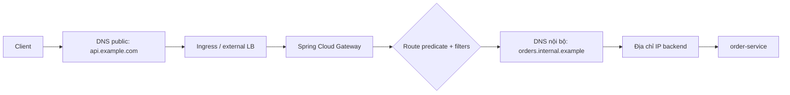
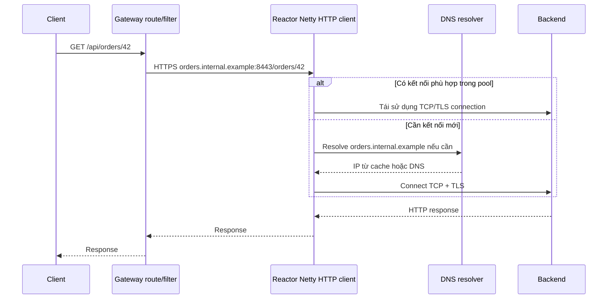
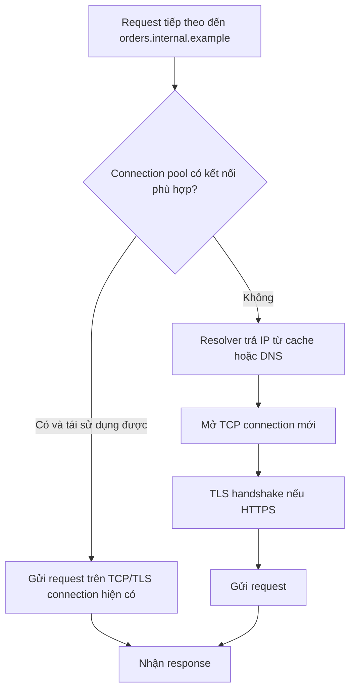
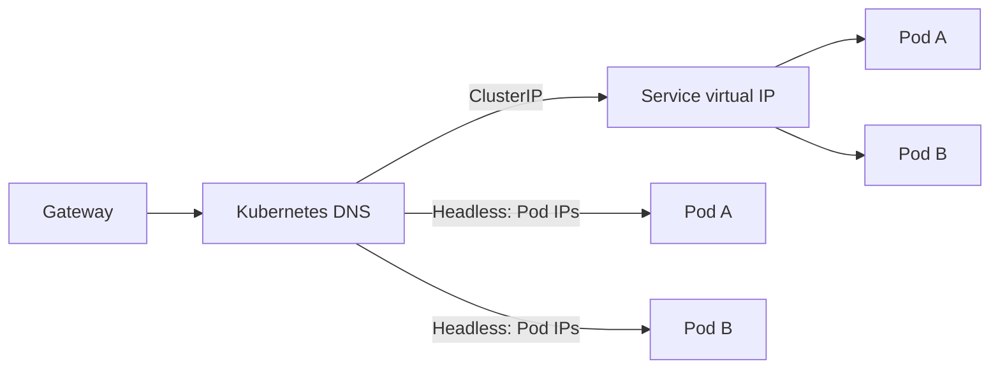
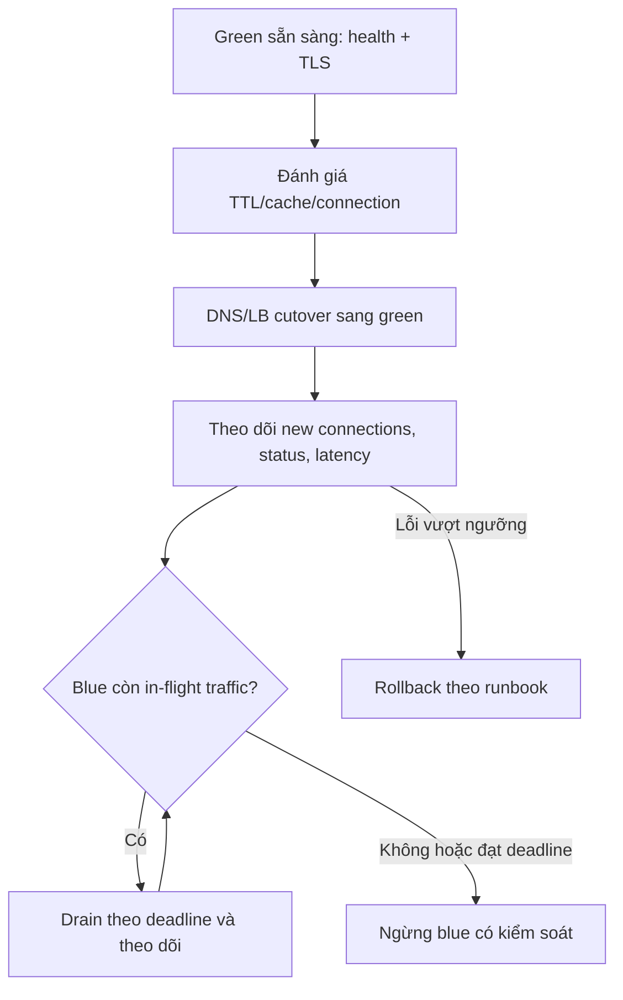

# Phân giải DNS và thay đổi địa chỉ dịch vụ

Trong **Spring Cloud Gateway**, client thường gọi một địa chỉ ổn định như `https://api.example.com`, trong khi Gateway phải chuyển request đến những backend có địa chỉ thay đổi theo triển khai, scale-out, failover hoặc bảo trì. Một route sử dụng `https://orders.internal.example` có thể hôm nay kết nối đến `10.20.1.10`, ngày mai đến `10.20.2.25`. Nếu backend chạy trên Kubernetes, tên service có thể giữ nguyên nhưng tập pod phía sau đã thay đổi nhiều lần.

**DNS (Domain Name System)** giúp tìm địa chỉ cho một tên miền, nhưng **đổi bản ghi DNS không làm mọi kết nối đang mở tự chuyển sang IP mới**. Độ trễ cập nhật còn phụ thuộc bộ nhớ đệm (cache), resolver mà Gateway sử dụng, việc tái sử dụng kết nối của Reactor Netty và cấu hình TLS. Đây là lý do một hệ thống có thể gặp lỗi kết nối sau khi đổi IP dù lệnh `nslookup` đã trả về địa chỉ mới.

Bài thuộc chương **Kết nối và TLS**, giải thích đầy đủ cách Spring Cloud Gateway WebFlux phân giải tên backend, cách DNS tương tác với service discovery và load balancing, ý nghĩa TTL/cache, rủi ro khi đổi địa chỉ và phương pháp kiểm thử failover an toàn. Các phần liên hệ với route predicate, filter chain, retry, circuit breaker, quan sát request và TLS/mTLS để xây dựng cổng vào microservices ổn định.

> **Phạm vi:** Nội dung dành cho **Spring Cloud Gateway Server WebFlux** sử dụng Reactor Netty làm HTTP client, với các phiên bản thư viện tương thích. Không áp dụng nguyên xi mã Java và cấu hình của WebFlux cho Gateway Server MVC. Tên thuộc tính/API resolver có thể thay đổi theo phiên bản; ví dụ cấu hình cần đối chiếu dependency thực tế trước khi đưa vào production.

## 1. Phân biệt DNS của client và DNS của Gateway

Một request đi qua Gateway có thể cần phân giải tên ở **hai phía hoàn toàn khác nhau**:

1. **Client → Gateway:** client phân giải tên public `api.example.com` để kết nối tới load balancer/ingress hoặc máy chạy Gateway.
2. **Gateway → upstream:** Gateway phân giải tên backend như `orders.internal.example` (nếu URI đích chứa hostname) hoặc chọn một địa chỉ qua Spring Cloud LoadBalancer.

Ví dụ:

```text
Client                    Public entry                 Spring Cloud Gateway             Upstream
   |                           |                                |                        |
   |-- DNS api.example.com --->|                                |                        |
   |-- HTTPS request --------->|---- forwarded request -------->|                        |
   |                           |                                |-- DNS orders.internal.example
   |                           |                                |      -> 10.20.1.10     |
   |                           |                                |-- HTTPS request ------>|
   |                           |                                |<-- HTTP response ------|
   |<-------------------------- response ------------------------|                        |
```

**Thay DNS public của `api.example.com` không giống thay DNS backend của `orders.internal.example`**. Tầng thứ nhất ảnh hưởng cách client tìm điểm vào; tầng thứ hai ảnh hưởng cách HTTP client bên trong Gateway tìm dịch vụ đích. Một lớp reverse proxy hoặc sidecar ở giữa có thể bổ sung cơ chế phân giải khác nữa.



**Những điều DNS không làm:** DNS không chọn route theo `Path`/`Method`, không xác thực JWT, không giới hạn lưu lượng, không đảm bảo server ở IP trả về còn khỏe và không tự kiểm tra chứng chỉ TLS. Những việc đó thuộc các lớp riêng.

## 2. Route chứa hostname: quá trình phân giải diễn ra ở đâu?

Giả sử Gateway định tuyến tới hostname cố định bằng cấu hình:

```yaml
spring:
  cloud:
    gateway:
      routes:
        - id: orders-by-dns
          uri: https://orders.internal.example:8443
          predicates:
            - Path=/api/orders/**
          filters:
            - StripPrefix=1
```

Khi nhận `GET /api/orders/42`, tiến trình có thể được diễn giải như sau:

1. WebFlux nhận request và Spring Security xử lý xác thực/phân quyền theo cấu hình.
2. `RoutePredicateHandlerMapping` xác định route `orders-by-dns` phù hợp với path công khai.
3. `FilteringWebHandler` chạy các Gateway filters đã ghép và sắp thứ tự; `StripPrefix=1` tạo path chuyển tiếp `/orders/42`.
4. HTTP routing dùng Reactor Netty HTTP client để gửi request tới hostname `orders.internal.example` trên cổng `8443`.
5. **Khi cần thiết lập kết nối mới**, resolver có thể dùng cache còn hiệu lực hoặc tra DNS để xác định địa chỉ IP.
6. TCP connection được thiết lập đến địa chỉ đã chọn; với URI HTTPS, client còn cần thực hiện TLS handshake và xác minh tên máy chủ theo chính sách TLS.
7. Gateway proxy request và response. Những request kế tiếp có thể **tái sử dụng connection hiện có**, không nhất thiết phải thực hiện DNS query mới.



**Không được hiểu “mỗi HTTP request = một lần DNS lookup”.** Khi giữ kết nối HTTP keep-alive hoặc HTTP/2, nhiều request có thể đi trên một kết nối đã được tạo từ địa chỉ DNS cũ. DNS TTL chủ yếu ảnh hưởng **những lần cần phân giải tiếp theo**, không tự chuyển một kết nối đang mở sang backend khác.

### Prefix cấu hình phụ thuộc phiên bản

`spring.cloud.gateway.routes` là prefix quen thuộc của các phiên bản Gateway WebFlux truyền thống. Một số phiên bản/starter Spring Cloud Gateway Server WebFlux mới dùng nhóm `spring.cloud.gateway.server.webflux.routes`. Khi triển khai, chọn prefix của **phiên bản thực sự đang chạy**, xác nhận route đã nạp và không nhầm lỗi cấu hình route với lỗi DNS.

## 3. DNS thực sự cung cấp những dữ liệu nào?

DNS trả về **bản ghi**, không trả về bảo đảm nghiệp vụ. Một số loại phổ biến:

| Loại bản ghi | Ví dụ | Ý nghĩa trong bài toán Gateway |
| --- | --- | --- |
| `A` | `orders.internal.example → 10.20.1.10` | Tên miền tới IPv4 |
| `AAAA` | `orders.internal.example → 2001:db8::10` | Tên miền tới IPv6 |
| `CNAME` | `orders.internal.example → orders-blue.internal.example` | Bí danh tới tên khác; sau đó cần giải quyết tên đích |
| `SRV` | Bản ghi service/port cho một số giao thức | Không tự động được HTTP client dùng như danh sách backend chỉ vì route URI là HTTP/HTTPS |
| `TXT` | Metadata dạng chuỗi | Không mặc định được Gateway dùng để chọn địa chỉ routing |

Một hostname có thể có nhiều bản ghi `A`/`AAAA`. DNS server hoặc resolver có thể trả kết quả theo thứ tự thay đổi, nhưng **DNS round-robin không tương đương load balancer có health check, weighted policy hoặc circuit breaker**. HTTP client còn có chiến lược chọn/khởi tạo kết nối riêng, nên không thể suy ra request sẽ chia đều cho mọi IP.

### DNS TTL là gì?

Bản ghi có **time to live (TTL)**, thông thường tính theo giây, chỉ thời gian dữ liệu có thể được lưu lại bởi resolver/cache theo chính sách. Ví dụ:

```text
orders.internal.example.  30  IN  A  10.20.1.10
```

TTL `30` gợi ý cache có thể giữ kết quả trong một khoảng tương ứng; **không phải lời hứa** rằng đúng sau 30 giây toàn bộ Gateway instance sẽ chuyển sang địa chỉ mới. Nhiều lớp cache có thể áp dụng giới hạn tối thiểu/tối đa, cache phía trước có thể đang giữ kết quả riêng và kết nối HTTP cũ vẫn tồn tại.

### DNS negative caching

Nếu truy vấn tên chưa tồn tại, resolver có thể lưu **kết quả âm** (ví dụ `NXDOMAIN`) trong một khoảng thời gian. Khi service mới vừa được tạo, một Gateway đã hỏi quá sớm có thể tiếp tục thấy lỗi dù bản ghi sau đó xuất hiện.

Ngược lại, tăng thời gian negative cache quá dài có thể làm kéo dài việc không tìm thấy backend. Cần phân biệt:

- `NXDOMAIN`: tên miền không tồn tại theo kết quả DNS.
- `NODATA`: tên tồn tại nhưng không có bản ghi thuộc loại được hỏi.
- DNS timeout/SERVFAIL: resolver không trả kết quả hợp lệ kịp thời.
- DNS trả IP nhưng TCP connect bị từ chối: **đã qua bước DNS**, lỗi ở kết nối.

Đây là các kiểu lỗi khác nhau; dùng riêng HTTP status của client để đoán nguyên nhân thường không đủ.

## 4. Cache DNS ở nhiều tầng, không chỉ một thuộc tính TTL

Tùy hệ điều hành, runtime và môi trường triển khai, các lớp sau có thể tồn tại:

| Lớp | Ví dụ | Có thể giữ dữ liệu gì? | Khi sai lệch |
| --- | --- | --- | --- |
| DNS authoritative/control plane | DNS zone nội bộ | Bản ghi đang được công bố | Thay đổi chưa được publish hoặc bản ghi mới sai |
| Recursive/caching DNS | CoreDNS, corporate resolver | Câu trả lời A/AAAA/CNAME và kết quả âm | Các Gateway có thể nhận đáp án cũ dù authoritative đã đổi |
| Resolver trong tiến trình | Reactor Netty/Netty DNS resolver | Kết quả tra cứu theo chính sách cache của resolver | Kết nối mới vẫn sử dụng IP cũ |
| JVM/OS resolver khi được sử dụng | `InetAddress`, DNS cache của môi trường | Kết quả tên miền và negative cache | Hành vi khác Netty nếu thực tế dùng provider khác |
| HTTP connection pool | Reactor Netty pooled connections | **Kết nối TCP/TLS đã nối tới một IP** | Request kế tiếp tái sử dụng kết nối cũ dù DNS hiện trả IP mới |
| Service discovery/load balancer | `DiscoveryClient`, `ServiceInstanceListSupplier` | Danh sách instance logic | Danh sách instance stale, không đồng nghĩa cache DNS |

**Không tự áp dụng quy tắc cache `networkaddress.cache.ttl` của JVM để kết luận hành vi của Reactor Netty.** Reactor Netty HTTP client thường sử dụng resolver bất đồng bộ dựa trên Netty; quy tắc JVM `InetAddress` liên quan khi đường đi phân giải thực sự sử dụng JVM resolver. Cần xác định resolver đang dùng trước khi thay các thuộc tính cache.

### Tại sao chỉnh TTL rồi vẫn thấy IP cũ?

Một kịch bản:

```text
09:00:00  Gateway tạo TCP/TLS connection tới 10.20.1.10.
09:00:10  DNS đổi A record thành 10.20.2.25, TTL=30s.
09:00:40  Resolver cache mới có thể trả 10.20.2.25.
09:01:00  Gateway vẫn có connection keep-alive tới 10.20.1.10.
09:01:02  Request được gửi trên connection cũ, chưa cần DNS query.
```

Mốc thời gian chỉ minh họa, không phải hành vi mặc định xác định bằng giây của Gateway. **TTL hết hạn không chủ động đóng connection pool**, còn việc làm mới DNS thường không bắt buộc mọi kết nối đang sống phải được dựng lại.

Khi cần chuyển traffic khỏi IP cũ, cần phối hợp **DNS + chính sách tuổi thọ/idle của connection + drain backend**, không chỉ cập nhật record.

## 5. DNS khác gì Spring Cloud service discovery?

Hai route trông tương tự nhưng có **cơ chế chọn địa chỉ khác nhau**:

```yaml
spring:
  cloud:
    gateway:
      routes:
        - id: orders-dns
          uri: https://orders.internal.example:8443
          predicates:
            - Path=/dns/orders/**

        - id: orders-lb
          uri: lb://order-service
          predicates:
            - Path=/lb/orders/**
```

| Thuộc tính | Route URI hostname `https://...` | Route URI `lb://order-service` |
| --- | --- | --- |
| Đích logic | Một hostname/cổng cụ thể | Một service ID |
| Nguồn ứng viên | DNS resolver trả IP cho hostname | LoadBalancer lấy `ServiceInstance` qua discovery/supplier |
| Cache đáng chú ý | DNS resolver, recursive DNS, connection pool | Discovery client, danh sách instance cache, và có thể DNS cho hostname instance |
| Có metadata instance/zone/weight theo discovery? | Không tự có từ DNS A/AAAA | Có thể, nếu tích hợp metadata và chính sách hỗ trợ |
| Nếu thêm backend mới | Có thể đổi hoặc thêm bản ghi A/AAAA, hoặc LB phía sau tên | Cập nhật danh sách `ServiceInstance` |
| TLS | Kiểm tra theo hostname/URI và cấu hình SSL | Phải xử lý scheme, hostname vật lý, trust và certificate của đích được chọn |

**`lb://` không phải DNS lookup trực tiếp của service ID.** Spring Cloud LoadBalancer chọn instance cho service ID. Nếu instance chứa **hostname**, HTTP client vẫn có thể cần phân giải hostname đó thành IP; nếu instance chứa địa chỉ IP, bước phân giải tên cho endpoint đó có thể không cần. Vì vậy một hệ thống `lb://` **vẫn có thể gặp lỗi DNS** ở tầng tên máy của instance.

Ngược lại, DNS hostname có thể trỏ đến **một load balancer nội bộ**. Lúc ấy Gateway chỉ cần phân giải địa chỉ LB; chính LB mới phân phối traffic tới nhiều backend. Không suy ra mỗi bản ghi A/AAAA là một pod/service instance.

### Route cache không phải DNS cache

Spring Cloud Gateway có cơ chế lưu định nghĩa route tùy phiên bản và route locator. Nếu route `orders-dns` vẫn trỏ tới cùng tên `orders.internal.example` nhưng bản ghi A thay đổi, **không nhất thiết phải refresh route** để đọc IP mới; vấn đề nằm ở resolver/cache/connection. Nếu sửa hẳn `uri`, `Path` hoặc filter, **route definition** mới là nơi cần nạp lại.

Một lần refresh route qua Actuator không được bảo đảm đồng thời xóa cache DNS, cache discovery hoặc đóng TCP connection cũ. Luôn xác định **lớp nào đang giữ giá trị cũ** trước khi dùng thao tác làm mới.

## 6. Reactor Netty resolver trong Gateway WebFlux

Spring Cloud Gateway Server WebFlux thường dùng Reactor Netty `HttpClient` để kết nối upstream. Reactor Netty có thể sử dụng DNS resolver bất đồng bộ và cho phép cấu hình một số chính sách như:

- Thời hạn thấp nhất/cao nhất cho cache DNS (`cacheMinTimeToLive`, `cacheMaxTimeToLive`).
- Thời hạn cache kết quả âm (`cacheNegativeTimeToLive`).
- Timeout cho DNS query (`queryTimeout`).
- Cách sử dụng DNS server, search domain, loại địa chỉ IPv4/IPv6 theo cấu hình resolver được hỗ trợ.

### Ví dụ tùy chỉnh resolver

Đối với các phiên bản Gateway WebFlux có giao diện `HttpClientCustomizer` và Reactor Netty hỗ trợ `resolver(spec -> ...)`, có thể cấu hình bằng Java:

```java
import java.time.Duration;

import org.springframework.cloud.gateway.config.HttpClientCustomizer;
import org.springframework.context.annotation.Bean;
import org.springframework.context.annotation.Configuration;

@Configuration
public class GatewayDnsConfig {

    @Bean
    HttpClientCustomizer dnsResolverCustomizer() {
        return httpClient -> httpClient.resolver(spec -> spec
            .queryTimeout(Duration.ofSeconds(3))
            .cacheMinTimeToLive(Duration.ZERO)
            .cacheMaxTimeToLive(Duration.ofSeconds(30))
            .cacheNegativeTimeToLive(Duration.ofSeconds(5)));
    }
}
```

**Đây là cấu hình mẫu, không phải thông số production được khuyến nghị cho mọi hệ thống.** Hãy xác minh `HttpClientCustomizer` nằm trong module/namespace của phiên bản Gateway đang dùng, các phương thức của `NameResolverSpec` tồn tại ở Reactor Netty tương ứng, và Gateway thực sự sử dụng client đã custom. Với một số tổ hợp phiên bản/starter, cách cung cấp `HttpClient` hoặc cấu hình resolver có thể khác.

Ý nghĩa các tham số:

| Tham số | Giá trị minh họa | Ý nghĩa |
| --- | --- | --- |
| `queryTimeout` | 3 giây | Giới hạn chờ truy vấn DNS riêng lẻ |
| `cacheMinTimeToLive` | 0 giây | Không buộc giữ bản ghi lâu hơn TTL thấp từ DNS theo chính sách tối thiểu này |
| `cacheMaxTimeToLive` | 30 giây | Giới hạn thời gian cache dương ở resolver này, theo API |
| `cacheNegativeTimeToLive` | 5 giây | Giới hạn cache câu trả lời âm tại resolver này |

Những tham số này **không** đảm bảo backend bị đổi IP sẽ được phục vụ từ địa chỉ mới sau chính xác 30 giây. Cần tính đến DNS upstream, CNAME, việc sử dụng connection pool và sự khác nhau giữa các Gateway replica.

### Giới hạn của việc điều chỉnh cache

- TTL quá ngắn: tăng truy vấn DNS, có thể làm gateway phụ thuộc nhiều hơn vào DNS server và chịu thêm độ trễ khi mở connection mới.
- TTL quá dài: giữ IP cũ lâu, gây lỗi khi backend đã bị loại hoặc failover sang IP khác.
- Negative TTL quá dài: kéo dài lỗi nếu hostname được tạo sau lần truy vấn thất bại.
- Tăng `queryTimeout`: không sửa bản ghi sai và có thể tăng thời gian client chờ.
- Chỉ cấu hình resolver ở một HTTP client không đảm bảo **mọi** thư viện kết nối trong ứng dụng dùng cùng cache.

Nếu môi trường đã có một load balancer ổn định đằng sau tên DNS, chính sách cân bằng có thể được tập trung ở tầng LB; việc ép Gateway refresh DNS quá thường xuyên chưa chắc mang lại lợi ích.

## 7. Connection pooling quyết định khi nào DNS cần được tra lại

Reactor Netty HTTP client có thể tái sử dụng các kết nối HTTP/1.1 keep-alive hoặc HTTP/2. Connection pool được quản lý theo nhiều đặc tính như endpoint, transport, scheme và cấu hình client. Một kết nối đang được tái sử dụng **đã gắn với một remote socket address cụ thể**.



Giả sử DNS thay địa chỉ từ `10.20.1.10` sang `10.20.2.25`:

- Connection đang mở tới `10.20.1.10` **không tự đổi peer** thành `10.20.2.25`.
- Một connection mới **có thể** đến IP mới khi resolver đã cập nhật.
- Connection cũ có thể tiếp tục phục vụ nếu backend cũ còn hoạt động; nếu backend dừng, lần dùng lại có thể lỗi và cần connection mới.
- Với HTTP/2, nhiều stream trên một connection có thể làm việc chuyển traffic diễn ra chậm hơn trực giác “một request/một kết nối”.
- Connection pool có timeout/giới hạn tuổi thọ/idle riêng; DNS TTL không tự là `maxLifeTime` của connection.

### Kế hoạch chuyển IP không gián đoạn

Khi đổi địa chỉ dịch vụ, hãy giữ backend cũ phục vụ trong một **khoảng drain** phù hợp với TTL và connection lifecycle, nếu hạ tầng cho phép. Đo thực tế thời điểm kết nối mới chuyển sang IP mới và thời điểm còn request in-flight trên IP cũ. Không có một khoảng chờ cố định an toàn cho mọi hệ thống vì TTL có thể bị nhiều cache điều chỉnh, và request streaming có thể kéo dài.

**Không khuyến nghị “clear hết pool” như thao tác mặc định**: đóng đột ngột toàn bộ kết nối có thể tăng TLS handshake, gây connection storm hoặc cắt request đang chạy. Nếu cần thay đổi pool/config, phải có rolling update và đánh giá tác động.

## 8. Kubernetes: Service DNS, ClusterIP và headless Service

Khi Gateway chạy trong Kubernetes, có ít nhất hai mô hình thường gặp.

### Service thông thường có ClusterIP

Ví dụ service DNS:

```text
orders.default.svc.cluster.local
    -> 10.96.42.15  (ClusterIP)
```

Trong mô hình này, tên `orders.default.svc.cluster.local` thường trả về **địa chỉ Service ảo** tương đối ổn định, không phải danh sách từng Pod IP. Khi pod backend thay đổi từ `[A,B]` sang `[B,C]` nhưng Service vẫn giữ nguyên ClusterIP, kết quả DNS có thể **không thay đổi**. Việc phân phối tới pod phụ thuộc cơ chế Service, EndpointSlice và dataplane của Kubernetes/CNI.

Vì vậy, nếu pod B bị thay bằng C mà Gateway vẫn phân giải cùng một ClusterIP, **đừng tìm lỗi chỉ trong DNS cache**. Cần kiểm tra EndpointSlice, readiness, kube-proxy hoặc dataplane của nền tảng, conntrack và kết nối đang mở.

### Headless Service

Với một Service dạng headless (`clusterIP: None`), DNS có thể trả nhiều địa chỉ endpoint/pod:

```text
orders-headless.default.svc.cluster.local
    -> 10.244.1.18
    -> 10.244.2.23
```

Thêm/bớt pod có thể thay đổi tập bản ghi IP mà resolver nhìn thấy. Lúc này DNS TTL/cache và thứ tự chọn địa chỉ ảnh hưởng rõ hơn đến việc tiếp cận instance mới. Tuy nhiên, không mặc định HTTP client sẽ cân bằng request đều giữa các IP; kết nối được reuse và cách resolver chọn địa chỉ vẫn quan trọng.

### Sơ đồ hai mô hình



**Lưu ý tên miền:** `.svc.cluster.local` là dạng thường gặp nhưng không phải cluster nào cũng dùng domain `cluster.local`. Search domain và `ndots` của Pod cũng ảnh hưởng số truy vấn DNS phát sinh từ tên ngắn, bao gồm chuỗi truy vấn thất bại trước khi tìm được tên cuối cùng.

Với Kubernetes, cần tách rõ ba vấn đề: tên DNS đã phân giải được chưa, Service/EndpointSlice có backend Ready không, và kết nối thực tế đến backend có thành công không.

## 9. TLS: đổi IP không được làm mất xác minh tên máy chủ

**DNS trả IP, còn TLS xác thực peer theo danh tính đã được cấu hình.** Khi route là:

```yaml
uri: https://orders.internal.example:8443
```

Gateway cần tin chuỗi chứng chỉ do backend trình bày và thực hiện **hostname verification** phù hợp với tên `orders.internal.example` (hoặc tên đã xác định theo chính sách TLS của client). Việc DNS đổi sang `10.20.2.25` không có nghĩa certificate được phép chỉ chứa IP đó; cách phổ biến là certificate có Subject Alternative Name (SAN) cho **tên DNS** được sử dụng.

```text
URI:                https://orders.internal.example:8443
DNS hiện trả:       10.20.2.25
TCP peer:           10.20.2.25:8443
Danh tính TLS:      orders.internal.example
Certificate SAN:    DNS:orders.internal.example
```

Kết nối HTTPS chỉ thành công khi cả **network route, TLS trust chain và xác minh hostname** phù hợp. Không tắt xác minh chứng chỉ hoặc dùng trust-all trong production để “sửa nhanh” lỗi sau khi chuyển IP.

### SNI và đổi backend

TLS **Server Name Indication (SNI)** giúp server biết hostname client muốn kết nối khi nhiều tên dùng chung một IP. Cấu hình HTTP/TLS client thường dựa vào hostname để chọn SNI phù hợp. Nếu đổi URI từ hostname sang IP trần, hoặc registry cung cấp IP trong khi certificate chỉ hợp lệ cho DNS name, kết quả handshake/hostname verification có thể khác.

Khi dùng `lb://order-service`, LoadBalancer có thể đưa ra instance với host là IP hoặc một tên cụ thể. Cần xác định cách Gateway tạo URI HTTPS thực tế, hostname được xác minh và SNI gửi đi. **Service ID không mặc định là tên certificate của backend**.

Nếu dùng **mutual TLS (mTLS)**, ngoài việc Gateway xác minh backend, backend còn xác minh certificate client của Gateway. Thay đổi địa chỉ/backend mới có thể thất bại vì truststore, identity hoặc SAN/client certificate policy, dù DNS đã đúng.

### Inbound TLS và outbound TLS là hai kênh khác nhau

Client có thể kết nối HTTPS đến ingress/Gateway, còn Gateway dùng HTTP hoặc HTTPS đến backend. Việc bật HTTPS phía client **không tự bảo đảm** kết nối Gateway–backend được mã hóa hoặc có mTLS. Khi chẩn đoán lỗi TLS, phân biệt lỗi ở kết nối nào; DNS public và DNS upstream cũng thường là hai tập bản ghi khác nhau.

## 10. Lập kế hoạch đổi địa chỉ backend an toàn

Ví dụ đội vận hành muốn chuyển `orders.internal.example` từ `10.20.1.10` (blue) sang `10.20.2.25` (green).

### Một quy trình triển khai có kiểm soát

1. **Chuẩn bị backend mới:** green chạy, lắng nghe đúng cổng, vượt health/readiness check, có certificate hợp lệ cho hostname/SNI dự kiến và tiếp nhận request test.
2. **Xác minh kết nối trước khi chuyển:** từ môi trường mạng của Gateway, kiểm tra IP/port/TLS đến green; đừng chỉ kiểm tra từ laptop của operator.
3. **Đánh giá TTL và cache:** biết authoritative TTL, recursive resolver, Reactor Netty resolver và vòng đời HTTP connection pool. Nếu cần giảm TTL trước cutover, làm việc này **trước đủ lâu** để các cache đang giữ TTL cũ có cơ hội hết hạn.
4. **Chuyển record hoặc thay địa chỉ tại load balancer:** giữ blue chạy để request tới IP cũ còn được xử lý trong giai đoạn hội tụ.
5. **Quan sát nhiều Gateway replica:** xem IP được resolver trả, remote endpoint của connection mới, lỗi DNS/TCP/TLS và kết quả request.
6. **Drain blue:** ngừng nhận kết nối mới theo khả năng hạ tầng, cho phép request/connection cũ hoàn tất trong deadline hợp lý.
7. **Đóng blue:** chỉ sau khi quan sát traffic và áp dụng giới hạn thời gian vận hành chấp nhận được.
8. **Giữ phương án rollback:** biết cách đưa DNS/địa chỉ cũ trở lại; nhớ rằng rollback cũng chịu tác động TTL/cache và connection pool.



**Không được hứa cutover tức thời chỉ dựa trên TTL.** TTL không chủ động đóng kết nối, bộ nhớ đệm có thể khác nhau giữa các instance Gateway, và backend có thể đang xử lý request dài hoặc WebSocket/streaming.

### Blue/green với nhiều bản ghi A

Có thể tạm thời công bố cả hai IP để kiểm tra quá trình chuyển tiếp, nhưng **nhiều A record không bảo đảm tỷ lệ traffic**. Một client có thể giữ connection lâu với blue, client khác chủ yếu dùng green. Nếu cần chia traffic có trọng số/canary có thể quan sát, nên dùng cơ chế load balancer có quản lý chính sách và sức khỏe thay vì chỉ dựa vào thứ tự bản ghi DNS.

## 11. Timeout và phân loại lỗi: đừng gộp DNS với HTTP 5xx

Một request đến upstream có thể thất bại ở nhiều bước khác nhau:

| Giai đoạn | Ví dụ lỗi | Dấu hiệu | Hành động |
| --- | --- | --- | --- |
| DNS lookup | `UnknownHostException`, DNS query timeout | Chưa có IP hợp lệ để connect | Kiểm tra tên, DNS server, cache, search domain |
| TCP connect | `ConnectException`, connect timeout | Đã có địa chỉ nhưng không kết nối được | Kiểm tra IP, cổng, firewall, endpoint sẵn sàng |
| TLS handshake | `SSLHandshakeException`, hostname mismatch | TCP có thể đã nối, TLS bị từ chối | Kiểm tra truststore, SAN, SNI, mTLS, protocol/cipher |
| HTTP request write | Connection reset, stream error | Body/chunk chưa gửi xong | Kiểm tra keep-alive, backend đóng kết nối, cancellation |
| HTTP response wait | Response timeout | Backend không trả đủ/kịp | Kiểm tra timeout budget, upstream load và logs |
| HTTP response | Upstream trả `503` hoặc `504` | Đã nhận response HTTP | Phân loại lỗi backend, không nhầm với lỗi DNS |
| LoadBalancer selection | Không có `ServiceInstance` cho `lb://` | Có route nhưng không có ứng viên | Kiểm tra registry/supplier/cache và service ID |

**HTTP status không có ánh xạ cố định một-một với exception.** `502`, `503` hoặc `504` mà client thấy phụ thuộc error handler và policy Gateway; có lỗi khiến kết nối bị ngắt khi response đã commit, không còn status cuối cùng có thể gửi. Không khẳng định mọi DNS timeout chắc chắn là `504` hay mọi `UnknownHostException` tự trả `503`.

### Phân biệt các ngân sách thời gian

- **DNS query timeout:** thời gian chờ tên được phân giải.
- **TCP connect timeout:** thời gian mở kết nối đến IP/port.
- **TLS handshake timeout:** thời gian thương lượng TLS với peer.
- **Response timeout:** thời gian chờ HTTP response theo cấu hình client.
- **Request deadline tổng:** thời gian toàn bộ hành trình được phép tiêu tốn, có thể bị ảnh hưởng bởi retry, circuit breaker và các filter khác.

Đặt từng timeout độc lập mà không có **deadline tổng** có thể khiến client chờ quá lâu khi kết hợp DNS retry, TCP timeout và nhiều HTTP attempt. Timeout quá ngắn lại gây false positive khi resolver, mạng hoặc backend chịu tải cao.

## 12. Retry, circuit breaker và rate limiting trong sự cố DNS

### Retry chỉ có ích khi nguyên nhân có thể hết

Nếu một DNS lookup tạm thời thất bại, việc thử lại **có giới hạn** đôi khi thành công khi resolver hồi phục. Nhưng nếu hostname sai hoặc cache âm vẫn còn hiệu lực, retry ngay liên tục thường chỉ tạo thêm tải và latency.

Với request đã bắt đầu gửi upstream, cần phân biệt **request chưa đến backend** với **request có thể đã được xử lý nhưng response bị mất**. Đối với `POST` tạo đơn/thanh toán, retry thiếu idempotency key có thể tạo giao dịch trùng; DNS failure và TCP failure không tự chứng minh thao tác an toàn để lặp.

### Circuit breaker không sửa cache DNS

Circuit breaker có thể từ chối sớm hoặc trả fallback khi downstream lỗi nhiều, giảm tác động lên hệ thống. Nó **không đổi bản ghi DNS**, không bắt buộc connection cũ kết thúc và không làm resolver nhận IP mới nhanh hơn. Khi circuit breaker mở, số request đến upstream giảm; có thể khiến quá trình quan sát phục hồi cần health probes/half-open policy rõ ràng.

### Rate limiter là một lớp khác

`RequestRateLimiter` thường dùng để giới hạn lượng request trước khi tốn tài nguyên của upstream, nhưng `429 Too Many Requests` do quota khác bản chất với DNS lookup failure. Dashboard cần phân biệt:

- Rate-limit rejection ở Gateway.
- DNS resolution failure.
- Connect/TLS failure.
- Upstream HTTP `5xx`.
- Client cancellation và timeout.
- Circuit breaker short-circuit.

Nếu các loại lỗi bị gộp chung thành “Gateway 5xx”, đội vận hành có thể chỉnh nhầm TTL trong khi nguyên nhân là TLS certificate hoặc backend quá tải.

## 13. Chẩn đoán DNS từ đúng môi trường của Gateway

Một lệnh `nslookup` trên laptop người vận hành **không đủ** để chứng minh Gateway nhìn thấy cùng một IP. Gateway có thể chạy trong VPC/subnet khác, dùng split-horizon DNS, DNS server của Kubernetes, service mesh hoặc network proxy.

### Các lệnh kiểm tra cơ bản

Trong môi trường có công cụ tương ứng:

```bash
# Xem câu trả lời DNS hiện tại (kết quả phụ thuộc resolver được dùng).
nslookup orders.internal.example

# Nếu có dig: xem bản ghi và TTL tại resolver được hỏi.
dig orders.internal.example A
dig orders.internal.example AAAA
dig orders.internal.example CNAME

# Kiểm tra HTTP từ mạng có khả năng truy cập backend.
curl -v --connect-timeout 3 https://orders.internal.example:8443/health
```

Những lệnh này cho thông tin hữu ích nhưng **không nhất thiết dùng cùng resolver/cache hoặc connection pool với Reactor Netty trong ứng dụng**. Để chẩn đoán chính xác, cần kết hợp logs/metrics của tiến trình Gateway.

Khi trên Kubernetes, chạy từ một Pod có cùng namespace/network policy/DNS setting, hoặc vào Gateway Pod nếu container có sẵn công cụ và bạn được quyền thực hiện:

```bash
# Thay <gateway-pod>, <namespace> bằng giá trị thật.
kubectl exec -n <namespace> <gateway-pod> -- \
  nslookup orders.default.svc.cluster.local
```

Không giả định image ứng dụng luôn cài `nslookup`/`dig`. Có thể dùng một debug Pod được cấu hình tương đương mạng/DNS; không thay đổi production image chỉ để chạy một lệnh chẩn đoán.

### Kiểm tra TLS tới một IP cụ thể mà vẫn giữ hostname

Khi chuyển blue/green, có thể cần kiểm tra green **trước khi DNS public/nội bộ đổi**. `curl --resolve` cho phép thử hostname/cổng với IP được chỉ định mà vẫn sử dụng hostname trong URL để thực hiện Host/SNI/certificate check theo cách của curl:

```bash
curl -v \
  --resolve orders.internal.example:8443:10.20.2.25 \
  https://orders.internal.example:8443/health
```

Đây là bài kiểm tra network/TLS hữu ích, nhưng **không chứng minh DNS của Gateway đã cập nhật**; `--resolve` cố tình bỏ qua phân giải DNS thông thường cho hostname/cổng đó. Không dùng `-k`/`--insecure` để “chứng minh TLS ổn” vì nó bỏ kiểm tra chứng chỉ.

### Thu thập dữ liệu cho từng request lỗi

Khi có thể, log có cấu trúc nên cho thấy:

| Trường quan sát | Tại sao hữu ích |
| --- | --- |
| Gateway replica/pod ID | Mỗi replica có thể có cache/connection pool khác nhau |
| Route ID và URI logic | Phân biệt route-not-found với upstream networking |
| Hostname/service ID của upstream | Biết Gateway cần phân giải tên nào |
| Remote IP/port thực tế | Biết kết nối đã được chọn đến IP mới hay cũ |
| DNS lookup latency/result/error nếu có instrumentation | Phân loại DNS failure và TTL |
| Connect/TLS/response duration | Tìm giai đoạn tăng độ trễ |
| Exception class/root cause | Phân biệt UnknownHost/connect/SSL/timeout |
| HTTP status cuối cùng và upstream status nếu có | Không nhầm lỗi mạng với response từ backend |
| Attempt/retry count, breaker state | Tránh xem các lần thử lại như một request độc lập |
| Trace/correlation ID | Theo dõi xuyên Gateway và backend |

Không phải mọi trường đều có metric tích hợp sẵn với tên cố định. Reactor Netty, Micrometer, tracing, Actuator và custom instrumentation có thể cung cấp từng phần; hãy chọn cấu hình quan sát phù hợp phiên bản và hạn chế lưu thông tin nhạy cảm.

## 14. Kiểm thử thay đổi IP và tính nhất quán giữa các Gateway replica

Một bài test chỉ kiểm tra “DNS trả IP hiện tại” chưa đủ. Cần mô phỏng **thay đổi địa chỉ trong khi application còn sống**.

### Kịch bản lab

Giả sử:

- Hostname backend: `orders.test.internal`.
- Blue: `10.20.1.10:8443`.
- Green: `10.20.2.25:8443`.
- DNS ban đầu trỏ blue, sau đó cập nhật sang green.
- Gateway chạy hai replica, có cùng route `uri: https://orders.test.internal:8443`.

Chuẩn bị mock/stub server ở hai đích với response marker:

```http
HTTP/1.1 200 OK
X-Test-Backend: blue
```

và:

```http
HTTP/1.1 200 OK
X-Test-Backend: green
```

Để test hợp lệ với HTTPS, cả hai server cần cấu hình certificate phù hợp hostname `orders.test.internal` và trust configuration của Gateway. Trong bài lab cô lập có thể dùng CA thử nghiệm được tin cậy bởi Gateway test, **không cần tắt hostname verification**.

### Trình tự thử nghiệm

1. **T0:** DNS trả blue; gửi nhiều GET, xác nhận response marker blue, biết connection pool đã được tạo.
2. **T1:** đổi DNS sang green; tiếp tục gửi GET ngay. Quan sát một số request còn dùng blue do cache/pool — đó có thể là hành vi kỳ vọng.
3. **T2:** sau khoảng hội tụ của resolver, tạo **kết nối mới có kiểm soát** theo điều kiện bài lab và xác nhận green nhận traffic. Không chỉ dựa vào số giây ngủ cố định.
4. **T3:** giữ blue phục vụ tới khi request in-flight/drain hoàn tất, sau đó dừng blue. Quan sát tỷ lệ connect reset/timeout.
5. **T4:** thử đảo DNS về blue để đánh giá rollback khi green lỗi; ghi nhận độ trễ hội tụ và connection pool.
6. **T5:** lặp trên replica Gateway khác; so sánh thời điểm từng replica thấy IP mới.

Một môi trường test ổn định nên dùng DNS server/fake resolver có thể đổi record và điều khiển thời gian/caching rõ ràng. Khi có thể, **test cả DNS lookup và HTTP connection reuse**, vì test chỉ mock phương thức resolve sẽ bỏ qua nguyên nhân lớn nhất khiến traffic còn đi tới IP cũ.

### Ma trận kiểm thử

| Tình huống | Kỳ vọng chính | Điều cần chứng minh |
| --- | --- | --- |
| DNS A ổn định, backend khỏe | Request đi tới IP phù hợp | Route, resolver, TCP/TLS hoạt động |
| DNS đổi IP, keep-alive còn sống | Có thể còn traffic tới IP cũ | TTL không đóng connection |
| DNS đổi IP, kết nối mới | Sau hội tụ dùng IP mới | Resolver cập nhật và kết nối đến green |
| DNS trả NXDOMAIN trước khi tên được tạo | Có thể chịu negative cache | Thời gian hồi phục theo resolver |
| DNS server timeout | Lỗi DNS được phân loại | Không nhầm với response timeout |
| A đúng nhưng cổng sai | TCP connect lỗi | Không chỉnh TTL để sửa port |
| IP mới có certificate sai SAN | TLS hostname verification thất bại | Không vô hiệu xác minh TLS |
| Một Gateway replica chưa hội tụ | Một phần request vẫn tới blue | Cache/pool theo replica |
| `lb://` với instance host cần DNS | Vẫn có DNS lookup cho host vật lý | Phân biệt discovery và DNS |
| Kubernetes ClusterIP giữ nguyên khi pod đổi | DNS Service name không nhất thiết thay | Kiểm tra EndpointSlice/dataplane |
| Backend cũ được drain đúng cách | Ít lỗi hơn khi cutover | Mối liên hệ drain và connection reuse |
| Request POST gặp connect/response error | Không retry mù quáng | Idempotency và biết request đã đến backend chưa |

### Tránh test phụ thuộc thời gian một cách mong manh

Một assert kiểu “sau `Thread.sleep(30000)` phải chắc chắn chuyển sang green” dễ thất bại vì cache, TTL tối thiểu, startup jitter, connection reuse, DNS server và scheduler khác nhau. Tốt hơn là đo mốc **record được publish → resolver nhận mới → connection mới đến green** và đặt deadline test phù hợp với cấu hình đang kiểm chứng.

## 15. Các lỗi thiết kế phổ biến

| Nhận định/lỗi | Vấn đề | Cách xử lý |
| --- | --- | --- |
| “Đổi DNS là mọi request lập tức sang IP mới” | Cache và connection pool còn địa chỉ cũ | Thiết kế giai đoạn hội tụ/drain |
| “TTL=30 nghĩa là tối đa 30 giây không còn traffic blue” | Kết nối keep-alive/HTTP2 có thể tồn tại lâu hơn | Theo dõi connection và in-flight traffic |
| “`nslookup` trên laptop đúng nên Gateway cũng đúng” | Split DNS, resolver/network khác | Kiểm tra từ môi trường Gateway và app telemetry |
| “Chỉnh `networkaddress.cache.ttl` luôn sửa Reactor Netty DNS” | Có thể không dùng JVM resolver | Xác định resolver HTTP client đang dùng |
| “Refresh Gateway route sẽ đổi mọi DNS entry” | Route cache và DNS cache khác nhau | Làm mới đúng lớp; kiểm tra pool |
| “`lb://` thì không còn vấn đề DNS” | Instance hostname vẫn cần phân giải | Tách service discovery với DNS endpoint |
| “Có nhiều A record nên request chia đều” | DNS không bảo đảm LB theo request/health | Dùng LB phù hợp mục tiêu phân phối |
| “IP mới trả lời TCP là TLS chắc chắn hợp lệ” | SAN/SNI/trust/mTLS độc lập | Kiểm tra HTTPS với hostname đúng |
| “Tắt hostname verification giúp failover nhanh hơn” | Làm mất xác thực peer, tạo rủi ro MITM | Sửa certificate/trust và hostname |
| “Không có Pod traffic tức là DNS stale” | ClusterIP có thể giữ nguyên; readiness/endpoint khác | Kiểm tra Service/EndpointSlice và dataplane |
| “Retry lỗi DNS liên tục sẽ tự sửa” | Negative cache hoặc tên sai vẫn còn | Backoff, budget và sửa nguyên nhân |
| “HTTP 503 luôn là không có instance” | Có thể do filter/upstream/network mapping | Dùng route ID, exception và resolver telemetry |
| “Dùng IP literal làm ổn định Gateway” | Bỏ DNS nhưng tăng coupling và rủi ro certificate | Dùng hostname/service discovery có chính sách đúng |

## 16. Bài tập: chuyển backend thanh toán sang cụm mới

Bạn vận hành Gateway với hai route:

- `GET /api/payments/{id}` đọc trạng thái thanh toán từ `https://payments.internal.example:8443`.
- `POST /api/payments` tạo thanh toán trên cùng backend; có idempotency key do hệ thống nghiệp vụ kiểm tra.
- Cụm blue ở `10.30.1.10` và green ở `10.30.2.20`.
- DNS hiện trỏ blue, TTL hiện tại do DNS quản lý. Gateway có thể tái sử dụng HTTPS connections.
- Cụm green dùng certificate mới; hệ thống có nhiều Gateway replica.

**Yêu cầu:** Đề xuất kế hoạch chuyển IP không bỏ mất khả năng xác minh TLS, không gây retry thanh toán trùng và có thể phân biệt lỗi DNS, TLS, TCP, backend HTTP.

### Phương án phân tích

1. Kiểm tra green từ network của Gateway bằng hostname `payments.internal.example` và IP mới, bảo đảm certificate SAN/trust/mTLS hợp lệ.
2. Đánh giá authoritative TTL, resolver của Reactor Netty, negative cache và chính sách tuổi thọ/idle của connection pool. Không chỉ dựa vào lệnh DNS từ laptop.
3. Giữ blue phục vụ trong thời gian chuyển đổi. Sau khi DNS đổi, quan sát từng Gateway replica xem connection mới tới blue hay green.
4. Gắn metric/trace tách riêng DNS resolution, TCP connect, TLS handshake, upstream status và HTTP status cuối cùng.
5. Với `GET`, chọn retry/backoff có giới hạn khi phù hợp. Với `POST`, chỉ retry khi idempotency key và contract backend cho phép; timeout không chứng minh chưa tạo giao dịch.
6. Drain blue theo lượng request/connection còn hoạt động; chuẩn bị rollback và hiểu rằng đổi DNS ngược cũng có độ trễ hội tụ.

### Câu hỏi tự kiểm tra

1. Vì sao thay bản ghi `A` không chuyển TCP connection hiện có sang IP mới?
2. DNS TTL và connection pool `maxLifeTime` khác nhau như thế nào?
3. Vì sao `networkaddress.cache.ttl` không nên được xem là công tắc duy nhất của DNS cache trong Gateway WebFlux?
4. Với route `lb://order-service`, lúc nào HTTP client vẫn cần phân giải DNS?
5. Kubernetes Service `ClusterIP` và headless Service khác nhau thế nào về kết quả DNS?
6. Tại sao nhiều Gateway replica có thể thấy IP mới ở thời điểm khác nhau?
7. `UnknownHostException` khác `ConnectException` và `SSLHandshakeException` ở giai đoạn nào?
8. Dùng `curl --resolve` kiểm tra được điều gì, và điều gì **không** được xác nhận bằng lệnh đó?
9. Vì sao không nên dùng `-k` hoặc trust-all để vượt lỗi chứng chỉ khi chuyển IP?
10. Khi cutover IP cho API POST, vì sao phải xem xét idempotency ngay cả khi lỗi xuất hiện trong giai đoạn network?
11. Vì sao route refresh không nhất thiết xóa DNS cache hoặc đóng HTTP pool?
12. Dữ liệu quan sát tối thiểu nào giúp xác định request lỗi vì resolver cũ, kết nối cũ hay upstream thật sự không khỏe?

**Ghi nhớ:** DNS giúp Gateway tìm địa chỉ cho **hostname**; service discovery và LoadBalancer là cơ chế lựa chọn instance theo **service ID**; còn Reactor Netty connection pool quyết định **khi nào kết nối mới phải được tạo và có thể cần phân giải lại tên**. Khi địa chỉ backend đổi, cần phối hợp TTL/cache, vòng đời connection, readiness/drain, TLS hostname verification, retry an toàn và giám sát theo từng Gateway replica. **DNS đã trả IP mới không đồng nghĩa toàn bộ traffic đã rời IP cũ.**

