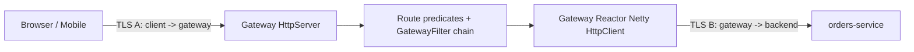

# HttpClientCustomizer và tùy biến Reactor Netty HttpClient trong Spring Cloud Gateway

## 1. Khi nào cần tùy biến HTTP client của API Gateway?

Trong kiến trúc microservices, **Spring Cloud Gateway** tiếp nhận HTTP request, chọn route bằng predicate, thực thi **filter chain**, biến đổi path/header, khám phá dịch vụ qua `lb://` và chuyển tiếp tới backend. Các tính năng xác thực, giới hạn lưu lượng, circuit breaker, retry, TLS và quan sát request cùng vận hành trên đường đi này.

Ở **Gateway Server WebFlux**, các route dùng HTTP/HTTPS thông thường được proxy thông qua **Reactor Netty `HttpClient`** ở phía *outbound*. Đây là nơi Gateway mở kết nối TCP, thực hiện TLS handshake nếu cần, quản lý connection pool, gửi request và đọc response từ dịch vụ phía sau.

Bạn có thể cần tùy biến HttpClient khi:

- Backend nằm sau mạng có độ trễ biến động: cần đặt **connect timeout**, **response timeout** hoặc TLS handshake timeout.
- Có nhiều request đồng thời: cần quản lý **connection pool**, thời gian chờ lấy connection và kết nối nhàn rỗi.
- Backend dùng HTTPS với CA nội bộ hoặc mTLS: cần cấu hình certificate trust, client key và xác minh hostname.
- Doanh nghiệp có outbound HTTP proxy, egress policy hoặc yêu cầu quan sát lỗi TCP/TLS chi tiết.
- Các property Spring Cloud Gateway chưa biểu diễn hết tính năng Reactor Netty mà ứng dụng cần.

Hai cách cấu hình bổ sung nhau: **properties `spring.cloud.gateway.server.webflux.httpclient.*`** (ưu tiên khi đã được hỗ trợ) và **Java `HttpClientCustomizer`** (extension point khi cần chi tiết nâng cao).

> **Phạm vi và phiên bản:** bài này tập trung **Spring Cloud Gateway Server WebFlux 4.3+/5.x**. WebFlux 4.2 trở về trước thường dùng property prefix `spring.cloud.gateway.httpclient.*`. Gateway Server Web MVC có web stack và HTTP client khác, không dùng `HttpClientCustomizer` WebFlux với cùng kỳ vọng.

## 2. Inbound HttpServer khác outbound HttpClient

Một client có thể dùng HTTPS kết nối Gateway, nhưng Gateway lại mở **kết nối HTTPS độc lập** xuống backend:



| Chiều kết nối | Thành phần | Cấu hình điển hình | Mục đích |
|---|---|---|---|
Client → Gateway (**inbound**) | Reactor Netty `HttpServer`, Spring Boot | `server.port`, `server.ssl.*` | Gateway lắng nghe HTTPS và trình server certificate |
Gateway → Backend (**outbound**) | Reactor Netty `HttpClient` của Gateway | `spring.cloud.gateway.server.webflux.httpclient.*` và `HttpClientCustomizer` | Pool, TCP, TLS trust, proxy, response timeout |
Tên logic → instance | DiscoveryClient, Spring Cloud LoadBalancer | Registry, `lb://service-id` | Tìm instance đích; bản thân `lb://` không bật TLS |
Chính sách theo route | Route metadata và GatewayFilters | `Path`, `StripPrefix`, `Retry`, `CircuitBreaker` | Chọn backend, sửa request, xử lý lỗi riêng route |

**Không nhầm lẫn:** `server.ssl.enabled=true` không cung cấp tự động CA/mTLS cho Gateway khi nó gọi backend. Ngược lại, `HttpClientCustomizer` không đổi cổng lắng nghe hay chứng chỉ mà browser thấy. Nếu route URI là `http://orders.internal:8081`, kết nối outbound có thể không được mã hóa dù client vào Gateway qua HTTPS.

## 3. `HttpClientCustomizer`: extension point và cách đăng ký

Gateway Server WebFlux cung cấp interface ở package `org.springframework.cloud.gateway.config`:

```java
import org.springframework.cloud.gateway.config.HttpClientCustomizer;
import reactor.netty.http.client.HttpClient;

// Hình dạng API của interface:
// HttpClient customize(HttpClient httpClient);
```

Phương thức `customize(HttpClient)` **nhận một client do Gateway tạo rồi trả về HttpClient đã cấu hình**. Spring sử dụng các bean `HttpClientCustomizer` khi chuẩn bị Netty HTTP client để proxy. Customizer không phải `GlobalFilter`; nó **không được gọi cho từng request** và không phải nơi kiểm tra JWT hoặc đọc HTTP body.

### 3.1. Bean Java tối thiểu

Ví dụ đặt timeout thiết lập TCP là 3 giây, response timeout của Reactor Netty là 8 giây:

```java
package com.example.gateway.config;

import java.time.Duration;

import io.netty.channel.ChannelOption;
import org.springframework.cloud.gateway.config.HttpClientCustomizer;
import org.springframework.context.annotation.Bean;
import org.springframework.context.annotation.Configuration;

@Configuration(proxyBeanMethods = false)
public class OutboundHttpClientConfig {

    @Bean
    HttpClientCustomizer gatewayOutboundCustomizer() {
        return httpClient -> httpClient
            .option(ChannelOption.CONNECT_TIMEOUT_MILLIS, 3_000)
            .responseTimeout(Duration.ofSeconds(8));
    }
}
```

Trong ví dụ, `ChannelOption.CONNECT_TIMEOUT_MILLIS` có đơn vị **mili giây** và chỉ kiểm soát bước **thiết lập kết nối TCP**. `responseTimeout(Duration)` ở Reactor Netty là **giới hạn khoảng thời gian giữa các thao tác đọc mạng khi nhận response**; nó không phải một deadline tổng duy nhất bao trùm DNS, pool, TCP, TLS, retry và toàn bộ thời gian trả body. Điều này đặc biệt quan trọng với SSE và download lớn.

Các phương thức Reactor Netty dùng mô hình tùy biến trả về đối tượng client mới/được làm giàu; cần **return kết quả đã tùy biến**:

```java
// Đúng:
return httpClient.responseTimeout(Duration.ofSeconds(8));

// Dễ sai: kết quả tùy biến không được trả về.
// httpClient.responseTimeout(Duration.ofSeconds(8));
// return httpClient;
```

Không `block()`, gọi I/O chặn hay tự thực hiện request trong `customize(...)`. Extension point này phục vụ **cấu hình HTTP client**, không xử lý payload của request hiện tại.

### 3.2. Tránh `tcpConfiguration`/`SO_TIMEOUT` trong code mới

Ví dụ cũ trên mạng đôi khi dùng:

```java
// Phong cách cũ, chỉ dùng để nhận diện khi bảo trì:
return httpClient.tcpConfiguration(tcpClient ->
    tcpClient.option(ChannelOption.CONNECT_TIMEOUT_MILLIS, 3000));
```

`tcpConfiguration(...)` đã bị **deprecated** ở nhiều dòng Reactor Netty mới. Ưu tiên API trực tiếp trên `HttpClient`:

```java
return httpClient.option(ChannelOption.CONNECT_TIMEOUT_MILLIS, 3000);
```

Không dùng `ChannelOption.SO_TIMEOUT` như cách mặc định để kiểm soát HTTP response trong mô hình Netty non-blocking: đó không phải cách thay thế đáng tin cậy cho `HttpClient.responseTimeout(Duration)`.

### 3.3. Phạm vi thực tế của customizer

- Route `uri: http://...` hoặc `https://...` dùng Netty HTTP routing chịu tác động của outbound client.
- Route `lb://orders-service` sau khi LoadBalancer giải quyết thành URI HTTP/HTTPS phù hợp cũng đi qua đường proxy HTTP đó.
- `forward:...`, WebSocket hoặc handler tùy chỉnh có thể đi qua **cơ chế routing khác**; không giả định mọi request dùng cùng HttpClient.
- `WebClient.create()` do ứng dụng tự tạo và HTTP client của một microservice khác không tự dùng `HttpClientCustomizer` của Gateway.

Vì customizer áp dụng rộng lên HTTP client Gateway, **không đưa một token tĩnh, header Authorization hoặc hostname cố định** vào tất cả request outbound. Dùng Spring Security, TokenRelay hoặc filter theo route với audience/scope đúng.

## 4. Ưu tiên properties Gateway cho nhu cầu phổ biến

### 4.1. Namespace thay đổi giữa các dòng phiên bản

| Cấu hình | WebFlux 4.2 trở về trước | WebFlux 4.3+/5.x |
|---|---|---|
TCP connect timeout | `spring.cloud.gateway.httpclient.connect-timeout` | `spring.cloud.gateway.server.webflux.httpclient.connect-timeout` |
Response read timeout | `spring.cloud.gateway.httpclient.response-timeout` | `spring.cloud.gateway.server.webflux.httpclient.response-timeout` |
Connection pool | `spring.cloud.gateway.httpclient.pool.*` | `spring.cloud.gateway.server.webflux.httpclient.pool.*` |
TLS outbound | `spring.cloud.gateway.httpclient.ssl.*` | `spring.cloud.gateway.server.webflux.httpclient.ssl.*` |
Outbound proxy | `spring.cloud.gateway.httpclient.proxy.*` | `spring.cloud.gateway.server.webflux.httpclient.proxy.*` |
Netty client wiretap | `spring.cloud.gateway.httpclient.wiretap` | `spring.cloud.gateway.server.webflux.httpclient.wiretap` |

Đặt property đúng prefix theo release train và starter. Gateway có thể vẫn khởi động bình thường khi một property bị khai báo sai namespace, vì vậy phải xác nhận **hành vi thực tế** hoặc thuộc tính đã bind.

### 4.2. Cấu hình minh họa không cần Java

```yaml
# application.yml cho Gateway Server WebFlux 4.3+/5.x
server:
  port: 8080

spring:
  application:
    name: edge-gateway
  cloud:
    gateway:
      server:
        webflux:
          httpclient:
            connect-timeout: 3000
            response-timeout: 8s
            pool:
              type: fixed
              max-connections: 200
              acquire-timeout: 5000
              max-idle-time: 30000
              max-life-time: 180000
              metrics: true
            ssl:
              handshake-timeout: 10s
              use-insecure-trust-manager: false
            wiretap: false
          routes:
            - id: catalog
              uri: https://catalog.internal.example:8443
              predicates:
                - Path=/api/catalog/**
              filters:
                - StripPrefix=1
```

Các số trên là **điểm bắt đầu minh họa** để học cách cấu hình, không phải sizing mặc định cho mọi production. `connect-timeout`, `pool.acquire-timeout`, `pool.max-idle-time` và `pool.max-life-time` dùng **mili giây** theo Gateway properties; `response-timeout` và `ssl.handshake-timeout` là `Duration` (ví dụ `8s`, `10s`).

**Tránh cấu hình trùng:** nếu `response-timeout`/`connect-timeout` đã nằm trong YAML, không cần lặp lại cùng một chính sách trong `HttpClientCustomizer`. Nếu nhiều nguồn cùng cấu hình một option, đừng suy đoán thứ tự thắng; kiểm tra version và hành vi đã áp dụng.

### 4.3. Chọn thuộc tính hay customizer?

| Yêu cầu | Ưu tiên | Khi nào cần customizer? |
|---|---|---|
Timeout TCP/response | `httpclient.*` hoặc metadata theo route | Khi cần hook Reactor Netty sâu hơn |
Giới hạn connection pool | `httpclient.pool.*` | Khi cần lifecycle/custom ConnectionProvider đặc biệt |
CA, TLS handshake, SSL bundle | `httpclient.ssl.*` | Khi config chuẩn chưa đủ và có quy trình review bảo mật |
Proxy outbound | `httpclient.proxy.*` | Khi phải sử dụng cơ chế đặc thù có kiểm soát |
Header request theo một route | `AddRequestHeader`/`SetRequestHeader` | Không nên dùng global HttpClient header |
JWT, phân quyền | Spring Security Resource Server/TokenRelay | Không dùng customizer thay thế authn/authz |
Quan sát latency/status | Actuator, Micrometer, tracing | Khi cần callback Netty ở mức kết nối |
Wire logging | `httpclient.wiretap` trong môi trường kiểm soát | Khi cần chính sách logging có redaction đặc biệt |

## 5. Các loại timeout không thay thế nhau

```text
Client gửi request
    |
    +-- Route predicate / GatewayFilters
    |
    +-- Chờ connection trong pool ----> pool acquire timeout
    |
    +-- Discovery / DNS --------------> discovery/DNS controls
    |
    +-- Mở TCP socket ----------------> connect timeout
    |
    +-- TLS handshake (nếu HTTPS) ----> TLS handshake timeout
    |
    +-- Gửi request body --------------> body/flow control
    |
    +-- Chờ và đọc HTTP response -----> response read timeout
    |
    +-- Trả response cho client ------> inbound flow / client disconnect
```

| Timeout | Phạm vi | Cấu hình điển hình |
|---|---|---|
Pool acquire | Thời gian chờ lấy connection rảnh/cấp mới | `pool.acquire-timeout: 5000` với fixed pool |
TCP connect | Kết nối đến địa chỉ backend đã chọn | `connect-timeout: 3000` |
TLS handshake | Thương lượng TLS khi kết nối HTTPS | `ssl.handshake-timeout: 10s` |
Response read | Khoảng chờ dữ liệu phản hồi qua mạng | `response-timeout: 8s` |
Retry/backoff | Các lần phát lại request do filter `Retry` | Cấu hình retry riêng, không phải tổng deadline |
End-to-end | Tổng thời gian từ client qua Gateway đến backend và trở lại | Cần thiết kế SLA/deadline riêng nếu nghiệp vụ yêu cầu |

Với SSE hoặc download streaming, response đọc được theo nhiều khối. **Khoảng lặng dài** giữa các sự kiện có thể vượt `responseTimeout` và gây timeout dù stream vẫn đúng về nghiệp vụ. Ngược lại, nếu backend liên tục trả một ít dữ liệu, response read timeout không nhất thiết giới hạn **tổng** thời gian xử lý.

### 5.1. Timeout riêng theo route: đơn vị phải thật rõ

Gateway Server WebFlux cho phép thiết lập timeout riêng qua `metadata`:

```yaml
spring:
  cloud:
    gateway:
      server:
        webflux:
          httpclient:
            connect-timeout: 3000   # Global: milliseconds
            response-timeout: 8s    # Global: Duration
          routes:
            - id: reports
              uri: https://reports.internal.example:8443
              predicates:
                - Path=/api/reports/**
              metadata:
                connect-timeout: 2000
                response-timeout: 15000
              filters:
                - StripPrefix=1
```

**Khác biệt quan trọng:** `connect-timeout` và `response-timeout` trong `metadata` **đều tính bằng mili giây** (trong ví dụ: 2 giây và 15 giây). `response-timeout` toàn cục ở `httpclient` lại được khai báo dưới dạng `Duration` như `8s`. Tài liệu còn nêu route response timeout âm có thể tắt global timeout; chỉ dùng khi có deadline/quy tắc khác và hiểu rủi ro treo kết nối.

### 5.2. Java DSL thiết lập metadata cho route

```java
import org.springframework.cloud.gateway.route.RouteLocator;
import org.springframework.cloud.gateway.route.builder.RouteLocatorBuilder;
import org.springframework.context.annotation.Bean;
import static org.springframework.cloud.gateway.support.RouteMetadataUtils.CONNECT_TIMEOUT_ATTR;
import static org.springframework.cloud.gateway.support.RouteMetadataUtils.RESPONSE_TIMEOUT_ATTR;

@Bean
RouteLocator reportRoute(RouteLocatorBuilder builder) {
    return builder.routes()
        .route("reports", r -> r.path("/api/reports/**")
            .filters(f -> f.stripPrefix(1))
            .uri("https://reports.internal.example:8443")
            .metadata(CONNECT_TIMEOUT_ATTR, 2000)
            .metadata(RESPONSE_TIMEOUT_ATTR, 15000))
        .build();
}
```

Đây là đoạn minh họa **trong class cấu hình Spring**, không phải file Java đầy đủ. Không đăng ký đồng thời route YAML và Java DSL trùng ID trong một thử nghiệm.

## 6. Connection pool: hiệu năng đi đôi với giới hạn tài nguyên

Mở TCP và bắt tay TLS cho từng request tốn CPU, network và latency. **Connection pooling** cho phép Gateway tái sử dụng kết nối đã thiết lập tới backend.

| Thuộc tính `httpclient.pool.*` | Ý nghĩa | Lưu ý |
|---|---|---|
`type` | `fixed`, `elastic` hoặc `disabled` theo phiên bản | `fixed` giúp đặt trần tài nguyên |
`max-connections` | Số connection tối đa trong fixed pool | Không đồng nghĩa giới hạn tổng RPS |
`acquire-timeout` | Mili giây được chờ lấy connection | Có thể lỗi acquire khi tải cao |
`max-idle-time` | Thời gian nhàn rỗi tối đa của connection | Nên tương thích idle timeout của backend/LB |
`max-life-time` | Tuổi thọ tối đa của connection | Khác timeout của một HTTP request |
`eviction-interval` | Chu kỳ kiểm tra connection cần loại | Dọn nền, không phải deadline chính xác |
`leasing-strategy` | `fifo` hay `lifo` | Quyết định connection rảnh nào được chọn |
`metrics` | Thu thập pool metrics bằng Micrometer | Cần cấu hình metrics registry và quyền truy cập |

**Pool quá nhỏ:** request chờ connection, tăng latency p95/p99, pending acquire timeout dù backend vẫn còn CPU. **Pool quá lớn:** nhiều socket/TLS session, file descriptors, direct memory và tải backend tăng; có thể gây bão kết nối. HTTP/2 multiplexing cũng làm quan hệ giữa số connection và request concurrent khác HTTP/1.1.

Không chọn `max-connections` chỉ dựa vào số request/giây. Hãy đo **active/idle/pending connections**, thời gian chờ acquire, độ trễ downstream, số Gateway replicas và giới hạn backend rồi mới sizing.

## 7. TLS outbound: tin CA, xác minh hostname và mTLS

### 7.1. Encryption không đồng nghĩa với xác thực đúng backend

Khi Gateway dùng `uri: https://orders.internal.example:8443`, HTTP client phải xác minh certificate của phía backend. Với certificate do CA nội bộ cấp, cần cung cấp trust material phù hợp. Khi backend yêu cầu **mTLS**, Gateway còn phải trình **client certificate và private key** của chính mình.

| Nhu cầu | Cấu hình liên quan | Ý nghĩa |
|---|---|---|
Trình server certificate cho client ở Gateway inbound | `server.ssl.*` | TLS giữa client và Gateway |
Tin certificate/CA của backend | `httpclient.ssl.trusted-x509-certificates` hoặc trust store/bundle | Xác minh certificate chain backend |
Xác minh tên backend | URI HTTPS, certificate SAN, SNI/hostname verification | Bảo đảm gọi đúng service được định danh |
Trình certificate của Gateway cho backend (mTLS) | Client keystore hoặc SSL bundle có private key | Backend xác thực workload Gateway |
Giới hạn thời gian bắt tay | `httpclient.ssl.handshake-timeout` | Giới hạn chờ TLS handshake |

**Tuyệt đối không bật `use-insecure-trust-manager: true` để “chữa nhanh” lỗi certificate trong production.** Cách này bỏ kiểm tra độ tin cậy của chứng chỉ backend và có thể tạo điều kiện cho kết nối tới đích giả mạo. Kênh vẫn có mã hóa nhưng không còn bảo đảm danh tính đối tác.

### 7.2. Tin CA nội bộ qua PEM

Giả sử một CA nội bộ được mount ở `/etc/gateway/certs/backend-ca.pem` trong container:

```yaml
spring:
  cloud:
    gateway:
      server:
        webflux:
          httpclient:
            ssl:
              use-insecure-trust-manager: false
              trusted-x509-certificates:
                - /etc/gateway/certs/backend-ca.pem
              handshake-timeout: 10s
          routes:
            - id: secure-orders
              uri: https://orders.internal.example:8443
              predicates:
                - Path=/api/orders/**
              filters:
                - StripPrefix=1
```

`backend-ca.pem` chỉ là **đường dẫn minh họa**, phải được cung cấp bằng volume/secret hoặc cơ chế phân phối certificate an toàn ở môi trường thật. Nếu không cung cấp trusted certs riêng, client thường dùng default trust store (có thể bị ảnh hưởng bởi thuộc tính JVM như `javax.net.ssl.trustStore`). Đừng nhầm **trust CA** với **private key**.

Ngay cả khi CA được tin, HTTPS backend certificate vẫn phải hợp lệ với **hostname** được Gateway sử dụng. Nếu `uri` trỏ trực tiếp tới IP mà certificate chỉ có DNS SAN của service, cần thiết kế DNS/URI/instance metadata hợp lý, thay vì tắt hostname verification.

### 7.3. SSL bundle để cấu hình outbound mTLS

Các dòng Gateway WebFlux mới cung cấp property `httpclient.ssl.ssl-bundle` để tham chiếu **Spring Boot SSL bundle**. Ví dụ một bundle PEM có client certificate và CA:

```yaml
# Ví dụ cấu trúc cho Spring Boot/Gateway có hỗ trợ SSL bundles.
# Các file phải tồn tại thực tế và được bảo vệ quyền đọc.
spring:
  ssl:
    bundle:
      pem:
        backend-client:
          keystore:
            certificate: file:/etc/gateway/certs/client.crt
            private-key: file:/etc/gateway/secrets/client.key
          truststore:
            certificate: file:/etc/gateway/certs/backend-ca.pem
  cloud:
    gateway:
      server:
        webflux:
          httpclient:
            ssl:
              ssl-bundle: backend-client
```

Ý nghĩa: `keystore` chứa danh tính/cặp khóa của **Gateway với vai trò TLS client**; `truststore` chứa chứng chỉ/CA Gateway dùng để kiểm tra backend. `ssl-bundle: backend-client` yêu cầu tên bundle tồn tại và phiên bản Spring Boot/Gateway tương thích. Trong triển khai thật, cần xem xét certificate chain, bảo mật private key, kế hoạch xoay vòng certificate và khả năng reload của phiên bản đang chạy; **không mặc định việc sửa file PEM tự cập nhật ngay mọi connection đang pool**.

**mTLS workload không thay thế OAuth2/JWT của người dùng.** Khi một route yêu cầu phân quyền tài nguyên, backend vẫn cần kiểm tra identity, scopes/claims hoặc cơ chế kiểm soát tương đương.

### 7.4. HTTPS inbound phải cấu hình riêng

Ví dụ Gateway lắng nghe HTTPS ở 8443:

```yaml
server:
  port: 8443
  ssl:
    enabled: true
    key-store: classpath:gateway-keystore.p12
    key-store-type: PKCS12
    key-store-password: ${GATEWAY_KEYSTORE_PASSWORD}
```

Đây là **server key store** ở đầu vào. Nó không tự trở thành client certificate cho kết nối Gateway → backend. Password ở trên được nạp từ biến môi trường/secret, **không ghi mật khẩu thật vào file cấu hình**. Cần cung cấp certificate chain hợp lệ với DNS public của Gateway.

## 8. Outbound proxy và chính sách egress

Nếu hệ thống buộc Gateway đi qua một HTTP proxy để truy cập một số backend:

```yaml
spring:
  cloud:
    gateway:
      server:
        webflux:
          httpclient:
            proxy:
              type: http
              host: outbound-proxy.internal.example
              port: 3128
              non-proxy-hosts-pattern: 'localhost|.*\.svc\.cluster\.local'
```

Đây là **proxy cho Gateway gọi backend**, khác với proxy/ingress ở phía trước Gateway và khác `Forwarded`/`X-Forwarded-*` headers. Nếu proxy yêu cầu credential, cấp `username`/`password` từ nguồn secrets, không hard-code.

Đối với route động hoặc cho phép client tác động URI đích, phải có **egress allowlist**, kiểm soát DNS, địa chỉ link-local/metadata endpoint và hostnames được phép, nhằm tránh SSRF. Đừng dùng `HttpClientCustomizer` để vô điều kiện chuyển mọi request qua proxy hoặc host khác mà không kiểm tra ranh giới tin cậy.

## 9. Quan sát HttpClient không làm lộ body/token

### 9.1. Wiretap inbound khác outbound

```yaml
spring:
  cloud:
    gateway:
      server:
        webflux:
          httpclient:
            wiretap: false
          httpserver:
            wiretap: false
```

- `httpclient.wiretap` ghi thông tin Netty ở hướng **Gateway → backend**.
- `httpserver.wiretap` ghi thông tin ở hướng **client → Gateway**.
- Khi bật wiretap còn cần log level tương ứng của Reactor Netty; không phải cứ đặt `true` là chắc chắn có log trong mọi cấu hình logger.

Wiretap có thể ghi **headers, authorization token, cookie, query và body nhạy cảm** tùy logging mode. Chỉ bật tạm thời trong môi trường kiểm soát, giới hạn quyền đọc log, có redaction và quy trình tắt. Không sử dụng wiretap như cơ chế quan sát mặc định cho Gateway production đang xử lý dữ liệu khách hàng.

### 9.2. Callback vòng đời ở Reactor Netty

`HttpClientCustomizer` có thể đăng ký các callback gọn nhẹ:

```java
package com.example.gateway.config;

import org.slf4j.Logger;
import org.slf4j.LoggerFactory;
import org.springframework.cloud.gateway.config.HttpClientCustomizer;
import org.springframework.context.annotation.Bean;
import org.springframework.context.annotation.Configuration;

@Configuration(proxyBeanMethods = false)
public class OutboundEventsConfig {
    private static final Logger log =
        LoggerFactory.getLogger(OutboundEventsConfig.class);

    @Bean
    HttpClientCustomizer outboundEvents() {
        return client -> client
            .doOnConnected(connection ->
                log.debug("outbound_connected channel={}",
                    connection.channel().id().asShortText()))
            .doOnResponse((response, connection) ->
                log.debug("outbound_response status={}",
                    response.status().code()));
    }
}
```

**Chú ý khi đọc log:**

1. `doOnConnected` có thể xảy ra một lần rồi connection được **pool tái sử dụng** cho nhiều HTTP requests; không dùng số connection events để đếm số request.
2. `doOnResponse` quan sát khi headers response đã đến, **không nhất thiết toàn bộ body đã được nhận**.
3. Callback Netty có thể chạy trên **event loop**: không gọi API blocking, truy vấn database hay `Thread.sleep` trong callback.
4. Không log header chứa token, body, cookie, thông tin người dùng hoặc URI có query nhạy cảm; log channel ID/status ở mức DEBUG chỉ là ví dụ.

Ví dụ ở mục 3 và mục này có thể được gộp trong **một** customizer cho cấu hình production dễ kiểm toán. Nếu nhiều bean cùng sửa một option, cần xác minh thứ tự và giá trị có hiệu lực theo phiên bản, không dựa vào thứ tự phát hiện class.

### 9.3. Metrics quan trọng

| Dữ liệu theo dõi | Mục đích |
|---|---|
Route ID, status, latency p95/p99 | Khoanh vùng route chậm/lỗi |
Connect failures, connect duration | Firewall, backend không mở port |
TLS handshake errors/certificate failures | CA, DNS/SAN, certificate hết hạn, mTLS |
Pool active/idle/pending connections | Pool thiếu connection hoặc tài nguyên bị giữ lâu |
Acquire timeouts | Chờ pool quá lâu |
HTTP 5xx, cancel, retries | Backend quá tải, client rời đi, tác động retry |
Direct memory, file descriptors, JVM heap | Chi phí pooled buffers và sockets |
Circuit breaker/fallback metrics | Tỷ lệ backend không đáp ứng |

Actuator/Micrometer và metrics của Reactor Netty phụ thuộc dependency, cấu hình và phiên bản. Khi đặt `pool.metrics: true`, cần metrics registry tương ứng. **Không gắn nhãn metrics bằng raw path chứa ID, token hoặc dữ liệu có cardinality cao**.

## 10. Những thay đổi HttpClient dễ gây sự cố

### 10.1. Không thay client do Gateway đưa vào bằng `HttpClient.create()`

```java
// Không nên: bỏ qua nhiều cấu hình Gateway đã dựng.
@Bean
HttpClientCustomizer unsafe() {
    return ignored -> reactor.netty.http.client.HttpClient.create();
}
```

Thay toàn bộ client có thể làm mất connection provider, TLS, proxy, metrics hoặc tùy chọn đã được Gateway chuẩn bị. **Customizer nên bổ sung trên tham số `client`**, không tự dựng client hoàn toàn khác nếu không có thiết kế thay thế được kiểm chứng.

### 10.2. Không đặt bearer token chung ở tầng Netty

`HttpClient.headers(...)` hỗ trợ thêm header mặc định, nhưng nếu bạn đặt `Authorization: Bearer ...` cho toàn bộ client outbound, credential có thể bị gửi sai service hoặc sai audience. Dùng Spring Security, TokenRelay hoặc cơ chế xác thực service-to-service **đúng route**, không dựa vào một token toàn cục.

### 10.3. Tránh `followRedirect(true)` không kiểm soát

Nếu outbound client tự theo redirect, Gateway có thể gọi host khác thay vì trả 3xx cho client như hợp đồng API; đồng thời phát sinh rủi ro tương tác với header nhạy cảm và chính sách egress. Khi muốn chỉnh `Location` của response backend, cân nhắc `RewriteResponseHeader` hoặc `RewriteLocationResponseHeader` với allowlist host và scheme phù hợp.

### 10.4. Đừng tăng timeout để che backend chậm

Tăng response timeout lên nhiều phút có thể khiến connection giữ lâu hơn, queue của pool dài hơn và tạo thêm tải khi retry. Trước khi điều chỉnh, phân loại nguyên nhân: chờ pool, DNS, TCP, TLS, backend CPU/DB, streaming, body lớn hoặc circuit breaker. Chọn deadline gắn với SLA thay vì một con số “đủ lớn”.

## 11. Thực hành cấu hình và kiểm thử

### 11.1. Dự án và route thử nghiệm

Ứng dụng Gateway Server WebFlux cần Spring Boot/Spring Cloud BOM tương thích và starter tương ứng:

```xml
<dependency>
    <groupId>org.springframework.cloud</groupId>
    <artifactId>spring-cloud-starter-gateway-server-webflux</artifactId>
</dependency>
<dependency>
    <groupId>org.springframework.boot</groupId>
    <artifactId>spring-boot-starter-actuator</artifactId>
</dependency>
```

Gateway ở cổng 8080 sẽ gọi một backend **thử nghiệm** ở cổng 8081:

```yaml
server:
  port: 8080

spring:
  cloud:
    gateway:
      server:
        webflux:
          httpclient:
            connect-timeout: 1000
            response-timeout: 2s
          routes:
            - id: local-test
              uri: http://localhost:8081
              predicates:
                - Path=/test/**
              filters:
                - StripPrefix=1
```

Backend phải có các endpoint `GET /ok`, `GET /delay` (cố tình chậm) và `GET /stream` (SSE, gửi event). Gateway **không tự tạo endpoint** ở backend.

Để tạo backend thử nghiệm bằng Spring WebFlux, có thể dùng controller:

```java
import java.time.Duration;
import org.springframework.http.MediaType;
import org.springframework.web.bind.annotation.GetMapping;
import org.springframework.web.bind.annotation.RestController;
import reactor.core.publisher.Flux;
import reactor.core.publisher.Mono;

@RestController
class SlowBackendController {
    @GetMapping("/ok")
    Mono<String> ok() {
        return Mono.just("ok");
    }

    @GetMapping("/delay")
    Mono<String> delay() {
        return Mono.delay(Duration.ofSeconds(4))
            .map(ignore -> "delayed");
    }

    @GetMapping(value = "/stream", produces = MediaType.TEXT_EVENT_STREAM_VALUE)
    Flux<String> stream() {
        return Flux.interval(Duration.ofSeconds(5))
            .map(i -> "event-" + i);
    }
}
```

Controller này phải được đặt trong **ứng dụng backend riêng**, chạy ở 8081 với dependency WebFlux. Với cấu hình Gateway `response-timeout: 2s`, endpoint `/delay` và stream có khoảng lặng dài giúp quan sát response read timeout.

### 11.2. Dùng `curl` xác minh

```bash
# Phản hồi nhanh
curl -i http://localhost:8080/test/ok

# Có thể timeout nếu backend chờ 4 giây trước khi trả
curl -i http://localhost:8080/test/delay

# Quan sát streaming; khoảng lặng 5 giây có thể vượt timeout 2 giây
curl -N -i http://localhost:8080/test/stream
```

**Không khẳng định lỗi timeout luôn có status HTTP 504.** Status/body cuối cùng phụ thuộc loại exception, response commit, Gateway handler và các filters. Nếu backend không chạy, `/ok` cũng thất bại do connection refused; cần phân biệt lỗi TCP và lỗi đọc response.

### 11.3. TLS inbound và outbound

Nếu Gateway lắng nghe tại `https://localhost:8443` với CA dùng trong thử nghiệm:

```bash
curl --cacert gateway-ca.pem -i https://localhost:8443/test/ok
```

Certificate của Gateway phải khớp hostname client dùng; `gateway-ca.pem` chỉ là tên file mẫu. Không coi `curl -k` (bỏ kiểm tra certificate) là test TLS an toàn.

Kiểm tra TLS backend độc lập:

```bash
openssl s_client \
  -connect orders.internal.example:8443 \
  -servername orders.internal.example \
  -showcerts </dev/null
```

`openssl s_client` giúp quan sát certificate chain và handshake của backend, nhưng nó không chứng minh JVM/Gateway đã được cấp đúng trust store/SSL bundle. Sau đó phải gọi route thật để xác minh TLS cấu hình bên trong Gateway.

### 11.4. Ma trận fault injection

| Tình huống | Dấu hiệu dự kiến | Nơi khoanh vùng |
|---|---|---|
Backend đóng port | Connection refused trước HTTP response | Route host/port, connect error |
Backend giữ im lặng sau request | Response timeout | Backend latency, `response-timeout` |
CA backend không nằm trong trust store | TLS certificate validation failure | Trust cert, SSL bundle |
Certificate không khớp hostname | Lỗi hostname verification | Route URI, SAN, SNI, DNS |
Backend bắt buộc mTLS nhưng Gateway thiếu client cert | TLS handshake/authentication error | Client key store, mTLS policy |
Fixed pool hết connection | Pending acquire, latency hoặc acquire timeout | Pool size và pool metrics |
`lb://` route không tìm thấy instance | Thường là 503 hoặc chính sách lỗi tương ứng | DiscoveryClient, LoadBalancer |
Backend trả HTTP 401 | TCP/TLS đã có thể thành công; lỗi thuộc tầng API | JWT/audience/scopes/permission |
Client hủy SSE | Stream cancel, chưa có response hoàn chỉnh | Cleanup, backpressure, timeout |

### 11.5. Checklist trước khi áp dụng production

1. Chọn **một nguồn cấu hình** chính cho timeout/pool; thêm customizer chỉ khi cần.
2. Kiểm thử thời gian chờ pool, DNS, TCP, TLS, TTFB và tổng latency dưới nhiều mức tải.
3. Giữ xác minh certificate và hostname, lưu khóa riêng trong secret store, kiểm tra rotation.
4. Kiểm thử không có instance `lb://`, backend chậm, connection reset và retry/circuit breaker.
5. Tách chính sách response timeout cho API bình thường, SSE và file download.
6. Đảm bảo wiretap đã tắt, logs/metrics không lộ PII, token hoặc body.
7. Có phương án rollback vì một `HttpClientCustomizer` global có thể ảnh hưởng **tất cả route outbound HTTP**.

## 12. Lỗi thường gặp và cách xử lý

| Hiện tượng | Nguyên nhân cần kiểm tra | Cách giải quyết |
|---|---|---|
Customizer không có tác dụng | Sai starter/stack Web MVC, bean không đăng ký, route không dùng NettyRoutingFilter | Kiểm tra dependency, component scan và route URI |
Java cảnh báo `tcpConfiguration` deprecated | Copy ví dụ Reactor Netty cũ | Chuyển sang `HttpClient.option(...)` hoặc API hiện hành |
Connect timeout đã đặt nhưng request vẫn chờ lâu | Chờ pool, DNS, TLS hoặc backend; connect chỉ đo TCP | Theo dõi từng giai đoạn, không tăng bừa timeout |
SSE đột ngột ngắt | Khoảng lặng giữa events vượt `response-timeout` | Tạo heartbeat hoặc dùng timeout theo route |
HTTPS lỗi dù `server.ssl` đã cấu hình | Chỉ cấu hình TLS inbound, chưa xử lý TLS outbound | Bổ sung URI HTTPS, trust/client cert outbound |
TLS handshake lỗi | CA sai, hostname/SAN sai, thiếu mTLS client cert | Kiểm tra truststore, bundle, DNS, certificate |
Gateway thấy `503` với `lb://` | Không có instance hoặc thiếu LoadBalancer | Kiểm tra discovery và health các instances |
Pool pending tăng mạnh | Backend chậm hoặc `max-connections` không phù hợp | Đo thời gian acquire, active/idle và năng lực backend |
Memory/CPU tăng sau khi nâng pool | Quá nhiều TCP/TLS connections, Netty buffers | Giới hạn concurrency, load test và kiểm tra direct memory |
`curl` kết nối TLS thành công nhưng Gateway thất bại | Truststore JVM/Gateway khác trust của curl | Test trực tiếp qua Gateway và xác minh client bundle |
Header Authorization đi sai backend | Customizer gắn header toàn cục | Dùng auth per-route, kiểm tra audience/scopes |
Lỗi sau nâng cấp Gateway | Prefix property hoặc Reactor Netty API đổi | Đối chiếu release train, configprops và starter |

## 13. Câu hỏi luyện tập và đáp án

**Bài 1.** Client tới Gateway qua HTTPS nhưng route có `uri: http://orders.internal:8081`. Liệu dữ liệu Gateway → backend đã được TLS bảo vệ?

**Đáp án:** không. `server.ssl` chỉ bảo vệ inbound. Outbound URI `http://` không tự có TLS; cần kiến trúc kết nối backend an toàn và URI/certificate phù hợp.

**Bài 2.** Muốn connect timeout chung 2 giây, response timeout 6 giây trên WebFlux 5.x, có bắt buộc Java không?

**Đáp án:** không. Dùng `spring.cloud.gateway.server.webflux.httpclient.connect-timeout: 2000` và `response-timeout: 6s`. Chỉ thêm `HttpClientCustomizer` khi cần API Reactor Netty ngoài properties.

**Bài 3.** Customizer gọi `httpClient.responseTimeout(Duration.ofSeconds(5)); return httpClient;`. Vì sao dễ sai?

**Đáp án:** vì kết quả tùy biến phải được trả về. Viết `return httpClient.responseTimeout(Duration.ofSeconds(5));`.

**Bài 4.** SSE gửi event cách nhau 15 giây nhưng response timeout là 5 giây. Điều gì có thể xảy ra?

**Đáp án:** HTTP client có thể ngắt stream khi vượt khoảng chờ đọc dữ liệu. Cần heartbeat hoặc cấu hình route-specific timeout phù hợp.

**Bài 5.** `lb://orders-service` có đảm bảo TLS/mTLS đến instance đã chọn không?

**Đáp án:** không. `lb://` giải quyết tên service/instance; TLS phụ thuộc scheme đích, client SSL configuration và certificate backend.

**Bài 6.** Vì sao `use-insecure-trust-manager: true` là lựa chọn nguy hiểm?

**Đáp án:** nó bỏ xác minh độ tin cậy certificate backend, làm tăng nguy cơ giả mạo đích. Hãy cấu hình CA, trust store/bundle và kiểm tra hostname đúng.

**Bài 7.** Fixed pool `max-connections=20`, có 100 request đồng thời và backend chậm. Vì sao có thể timeout dù network không lỗi?

**Đáp án:** nhiều request phải chờ lấy connection, có thể vượt `acquire-timeout`. Cần đo pending/active connections và backend latency; không tăng pool vô hạn.

**Bài 8.** Tại sao không nên thêm static bearer token cho mọi request trong `HttpClientCustomizer`?

**Đáp án:** credential có thể bị gửi tới route/host không cùng audience hoặc trust domain. Dùng Spring Security, TokenRelay hoặc service credentials theo từng route.

## 14. Tài liệu tham khảo chính thức

- [Spring Cloud Gateway Server WebFlux – The HttpClientCustomizer](https://docs.spring.io/spring-cloud-gateway/reference/spring-cloud-gateway-server-webflux/http-client.html): interface, phương thức `customize` và đăng ký bean.
- [Spring Cloud Gateway 5.1 – Configuration Properties](https://docs.spring.io/spring-cloud-gateway/reference/5.1/configprops.html): `server.webflux.httpclient.*`, timeout, pool, proxy, TLS, wiretap.
- [Spring Cloud Gateway – Http timeouts configuration](https://docs.spring.io/spring-cloud-gateway/reference/spring-cloud-gateway-server-webflux/http-timeouts-configuration.html): timeout toàn cục và metadata theo route.
- [Spring Cloud Gateway – TLS and SSL](https://docs.spring.io/spring-cloud-gateway/reference/spring-cloud-gateway-server-webflux/tls-and-ssl.html): TLS inbound/outbound, trust cert và handshake.
- [Reactor Netty – HTTP Client Reference](https://docs.spring.io/projectreactor/reactor-netty/docs/current/reference/html/http-client.html): response timeout, kết nối, pool, proxy, hooks và TLS.
- [Reactor Netty – HttpClient API](https://docs.spring.io/projectreactor/reactor-netty/docs/current/api/reactor/netty/http/client/HttpClient.html): `option`, `responseTimeout`, `doOnResponse` và API thay `tcpConfiguration`.
- [Spring Boot – SSL Bundles](https://docs.spring.io/spring-boot/reference/features/ssl.html): khai báo và tiêu thụ keystore/truststore bundle.

**Ghi nhớ:** **`HttpClientCustomizer` điều chỉnh Reactor Netty client mà Gateway dùng để gọi backend**, không điều chỉnh HTTPS listener của Gateway. Ưu tiên properties `spring.cloud.gateway.server.webflux.httpclient.*` cho những thiết lập phổ biến; dùng Java customizer cho nhu cầu thực sự nâng cao. Hiểu rõ **pool acquisition, TCP connect, TLS handshake, response read timeout**, giữ kiểm tra certificate/hostname và quan sát hành vi thực tế trước khi thay đổi ở production.
