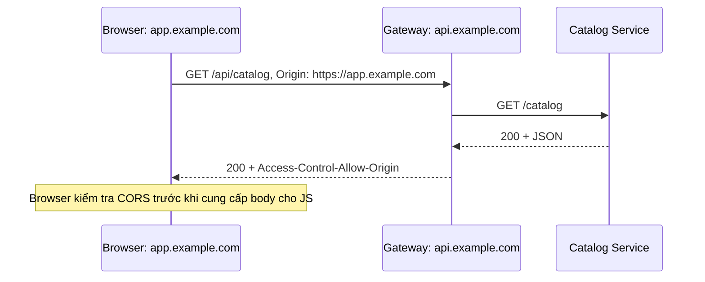
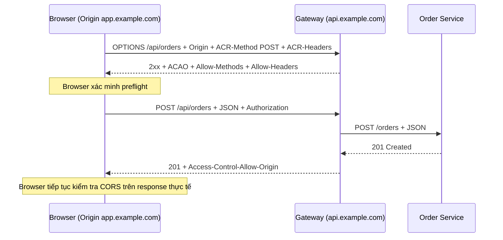
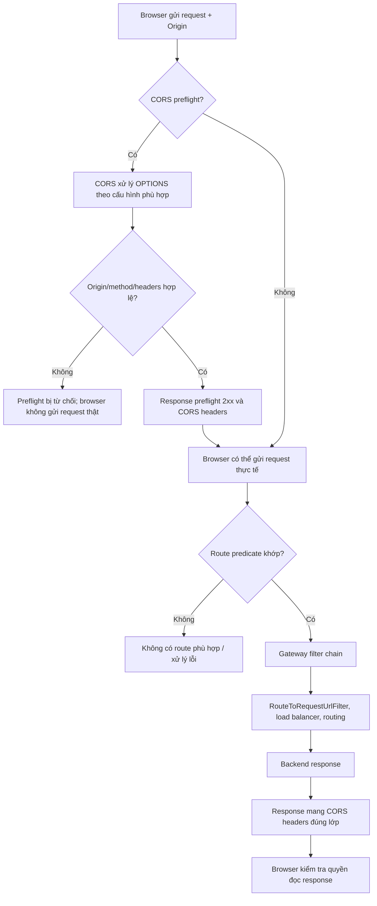

# Same-origin, cross-origin và vai trò CORS tại Spring Cloud Gateway

Một ứng dụng frontend được mở tại `https://app.example.com` có thể cần đọc dữ liệu từ API tại `https://api.example.com`. Dù hai địa chỉ thuộc cùng một hệ thống và có thể cùng đi qua một API Gateway, chúng vẫn là **hai origin khác nhau**. Trình duyệt áp dụng **same-origin policy** và chỉ cho mã JavaScript của trang đọc response cross-origin nếu máy chủ đích cho phép bằng **CORS** (*Cross-Origin Resource Sharing*).

Trong module `SPRING_CLOUD_GATEWAY`, CORS là phần quan trọng khi cổng vào microservices cung cấp API cho SPA, portal và các ứng dụng web. Gateway vừa quản lý route predicate, filter chain, biến đổi path/header, khám phá dịch vụ; vừa có thể trở thành nơi thống nhất chính sách CORS cho client browser. Việc cấu hình CORS cần phối hợp với xác thực, rate limiting, circuit breaker, retry, TLS và observability, nhưng không được nhầm CORS với những cơ chế bảo mật đó.

Bài học thuộc chương **CORS**, tập trung vào ba câu hỏi:

1. **Same-origin và cross-origin khác nhau như thế nào?**
2. **Trình duyệt kiểm tra CORS khi nào, đặc biệt với preflight `OPTIONS`?**
3. **Spring Cloud Gateway Server WebFlux nên đặt chính sách CORS ở đâu và kiểm thử ra sao để tránh lỗi/bỏ lọt bảo mật?**

> **Phạm vi:** Ví dụ dành cho **Spring Cloud Gateway Server WebFlux**, không phải Gateway Server MVC. Tên starter và namespace cấu hình thay đổi giữa các thế hệ Spring Cloud Gateway; phải đối chiếu phiên bản Spring Boot/Spring Cloud thực tế. Hostname `example.com` và các cổng localhost chỉ là dữ liệu minh họa.

## 1. Origin là gì? So sánh same-origin và cross-origin

**Origin** của một URL về cơ bản được xác định bằng bộ ba:

```text
origin = scheme + hostname + port
```

Ví dụ:

```text
https://app.example.com:443/dashboard
        └───── origin ──────┘
```

Path (`/dashboard`), query string (`?tab=reports`) và fragment (`#overview`) **không thuộc origin**. Cổng mặc định thường được chuẩn hóa: `https://app.example.com` và `https://app.example.com:443` cùng origin, nếu xét URL bình thường với HTTPS.

Lấy `https://app.example.com` làm origin của một trang:

| URL đích | Same-origin? | Vì sao? |
| --- | --- | --- |
| `https://app.example.com/profile` | **Có** | Cùng scheme, host và cổng HTTPS mặc định. |
| `https://app.example.com:443/api` | **Có** | Cổng `443` chính là cổng HTTPS mặc định. |
| `https://api.example.com/orders` | **Không** | Khác hostname (`api` so với `app`). |
| `http://app.example.com/profile` | **Không** | Khác scheme (`http` so với `https`). |
| `https://app.example.com:8443/api` | **Không** | Khác port. |
| `https://partner.example.net/api` | **Không** | Khác hostname/domain. |

### 1.1. Same-origin policy bảo vệ điều gì?

**Same-origin policy (SOP)** là tập hợp quy tắc của trình duyệt nhằm ngăn mã từ một origin tự do đọc dữ liệu nhạy cảm thuộc origin khác. Ví dụ, một script từ `https://app.example.com` không được mặc nhiên đọc JSON trả về từ `https://api.bank.example` chỉ vì người dùng đang đăng nhập cả hai nơi.

Tuy nhiên, SOP không có nghĩa “browser không bao giờ gửi request cross-origin”:

- Trình duyệt từ lâu có thể tải ảnh, stylesheet hoặc điều hướng đến origin khác theo các quy tắc riêng.
- Một biểu mẫu HTML hoặc một request dạng được phép có thể **được gửi** đi, dù script không được phép đọc response.
- Với `fetch`/XHR, browser kiểm tra CORS để quyết định có cung cấp response cho script hay không; một số request còn cần **preflight** trước khi request thực tế được gửi.

Do đó, **CORS chủ yếu là một cơ chế cho phép trình duyệt chia sẻ response giữa các origin theo chính sách của server**, chứ không phải tường lửa ngăn tất cả request không hợp lệ đi tới API.

### 1.2. “Same-site” không đồng nghĩa “same-origin”

“Site” thường được xét theo scheme và miền đăng ký (*registrable domain*) trong các cơ chế web hiện đại, còn origin tính **hostname đầy đủ và port**. Vì vậy `https://app.example.com` và `https://api.example.com` có thể là **same-site** nhưng vẫn **cross-origin**.

Phân biệt này ảnh hưởng đến:

- CORS: kiểm soát khả năng script truy cập response giữa các **origin**.
- Cookie `SameSite`: sử dụng khái niệm **site**, không phải bộ ba origin hoàn toàn giống CORS.
- CSRF: cần chính sách chống gửi request trái ý người dùng, không được suy ra an toàn chỉ từ CORS.

Không nên dùng việc “hai subdomain thuộc cùng công ty” để kết luận không cần CORS.

## 2. CORS là gì, và CORS không phải là gì?

CORS là tập hợp **HTTP request/response headers** và quy tắc browser sử dụng khi script thực hiện request tới origin khác. Thông thường frontend không “bật CORS” để được quyền đọc API: **server của API** phải công bố origin nào được phép.

Ví dụ frontend ở `https://app.example.com` gọi:

```javascript
const response = await fetch(
  "https://api.example.com/api/products/42"
);
const product = await response.json();
console.log(product);
```

Trình duyệt có thể gửi:

```http
GET /api/products/42 HTTP/1.1
Host: api.example.com
Origin: https://app.example.com
```

Gateway/API phản hồi:

```http
HTTP/1.1 200 OK
Content-Type: application/json
Access-Control-Allow-Origin: https://app.example.com
Vary: Origin

{"id":42,"name":"Java Book"}
```

Với chính sách phù hợp, browser cho script của `app.example.com` đọc body JSON.

Nếu response không có `Access-Control-Allow-Origin` hợp lệ, script có thể bị báo lỗi CORS dù **request đã tới server và server đã xử lý thành công**. Đây là khác biệt quan trọng khi debug bằng log/metrics.

**CORS không đảm nhiệm các việc sau:**

| Cơ chế | CORS có thay thế được không? |
| --- | --- |
| Xác thực JWT/session/API key | **Không.** Một origin được phép chưa chứng minh người dùng là ai. |
| Phân quyền đọc đơn hàng hoặc tài nguyên theo user | **Không.** Backend vẫn phải kiểm tra quyền nghiệp vụ. |
| Chống CSRF | **Không.** Một request cross-origin vẫn có thể được gửi trong những điều kiện nhất định. |
| Chặn `curl`, Postman hoặc script server-to-server | **Không.** Các client đó không chịu SOP như browser. |
| Giới hạn tốc độ request | **Không.** Cần rate limiting riêng. |
| Bảo mật kết nối | **Không.** Cần HTTPS/TLS và cấu hình trust/mTLS. |
| Chuyển tiếp service `lb://...` hay retry/circuit breaker | **Không.** Đó là nhiệm vụ của Gateway routing/reliability. |

Một origin `https://app.example.com` được phép theo CORS vẫn có thể gửi request chưa xác thực và nhận `401 Unauthorized`. Khi cấu hình CORS đúng, browser **có thể đọc** response 401 đó; CORS không buộc API phải trả 200.

## 3. Request cross-origin không phải lúc nào cũng có preflight

Cách trình duyệt thực thi CORS phụ thuộc method, các request headers mà code dùng và content type. Có hai luồng điển hình:

1. **Request đáp ứng điều kiện CORS-safelisted**: browser gửi request thực tế, sau đó kiểm tra response CORS để quyết định có cho JavaScript đọc hay không.
2. **Request cần preflight**: browser gửi `OPTIONS` kiểm tra quyền trước; nếu server cho phép, browser mới gửi request thực tế.

Trong mô tả thường gặp, trường hợp (1) được gọi là **simple request**, nhưng các tiêu chí chính xác là quy tắc *CORS-safelisted* của trình duyệt; không nên hiểu đơn giản rằng “mọi GET đều không preflight”.

### 3.1. Ví dụ GET cơ bản

Frontend:

```javascript
const res = await fetch(
  "https://api.example.com/api/catalog"
);
```

Giả sử không có header tùy biến ngoài những header được cho phép. Browser gửi `GET` kèm `Origin` và đánh giá `Access-Control-Allow-Origin` trong response; thông thường **không cần preflight**.



Quan trọng: nếu Gateway/backend thực hiện hành động có tác dụng phụ với một GET (đây là thiết kế API không tốt), **CORS không có nghĩa hành động ấy chưa từng xảy ra** chỉ vì response bị browser chặn.

### 3.2. Khi nào thường có preflight?

| Request từ frontend | Có thể cần preflight? | Nguyên nhân |
| --- | --- | --- |
| `GET` không có request header tùy biến | Thường không | Có thể thỏa điều kiện safelisted. |
| `GET` kèm `Authorization: Bearer ...` | **Có** | `Authorization` không phải request header CORS-safelisted. |
| `POST` với `Content-Type: application/json` | **Có** | JSON không thuộc nhóm content type safelisted cho request. |
| `POST` với `application/x-www-form-urlencoded` và header được phép | Thường không | Có thể thỏa điều kiện safelisted. |
| `PUT` hoặc `DELETE` | **Có** | Method không thuộc nhóm method safelisted. |
| `POST` kèm `X-Request-Id` do code tự gửi | Thường có | Custom header không nằm trong nhóm safelisted. |

Việc browser gửi preflight còn có thể bị ảnh hưởng bởi cache preflight, môi trường browser và chính sách khác. **CORS preflight cache** khác với cache HTTP thông thường của response ứng dụng.

## 4. Preflight OPTIONS hoạt động như thế nào?

Ví dụ SPA ở `https://app.example.com` muốn gửi JSON và bearer token:

```javascript
await fetch("https://api.example.com/api/orders", {
  method: "POST",
  headers: {
    "Content-Type": "application/json",
    "Authorization": "Bearer <access-token>"
  },
  body: JSON.stringify({ sku: "BOOK-42", quantity: 2 })
});
```

Trước request `POST`, browser thường gửi:

```http
OPTIONS /api/orders HTTP/1.1
Host: api.example.com
Origin: https://app.example.com
Access-Control-Request-Method: POST
Access-Control-Request-Headers: authorization, content-type
```

Ba header cần nhận diện:

| Header phía request | Ý nghĩa |
| --- | --- |
| `Origin` | Origin thực hiện request theo ngữ cảnh browser. |
| `Access-Control-Request-Method` | Method mà browser dự định dùng cho request thực tế. |
| `Access-Control-Request-Headers` | Những tên request header phi-safelisted mà browser dự định gửi. |

Một response preflight cho phép có thể trông như:

```http
HTTP/1.1 200 OK
Access-Control-Allow-Origin: https://app.example.com
Access-Control-Allow-Methods: GET, POST, OPTIONS
Access-Control-Allow-Headers: Authorization, Content-Type
Access-Control-Max-Age: 1800
Vary: Origin, Access-Control-Request-Method, Access-Control-Request-Headers
```

Trình duyệt kiểm tra các thông tin đó và mới tiếp tục gửi request POST **nếu hợp lệ**. Status của preflight thành công có thể là 200 hoặc một mã 2xx khác theo hạ tầng; **không buộc phải là 204**.



**Preflight không phải request nghiệp vụ.** Gateway có thể xử lý `OPTIONS` trong lớp CORS trước khi gọi Order Service. Không nên đòi backend tạo đơn hàng hay giải mã JSON từ preflight: request `OPTIONS` **không mang body JSON của POST dự kiến**.

### 4.1. Preflight được chấp nhận chưa bảo đảm POST thành công

Kể cả khi preflight được phép:

- Spring Security có thể trả `401/403` cho request POST thực tế.
- `RequestRateLimiter` có thể trả `429`.
- Load balancer có thể không tìm thấy instance, dẫn đến `503`.
- Backend có thể trả `400` do JSON không hợp lệ hoặc `500` do lỗi nghiệp vụ.

CORS chỉ quyết định browser được tiếp tục và đọc response ra sao. Vì vậy, request thực tế vẫn cần **`Access-Control-Allow-Origin` phù hợp trên response**, kể cả khi status lỗi. Cho phép preflight nhưng thiếu CORS header ở response 401/429/503 có thể khiến frontend chỉ thấy một lỗi CORS chung chung thay vì status cần xử lý.

### 4.2. Lưu ý về credentials trên preflight

Request preflight do browser phát sinh thông thường **không gửi cookie hoặc bearer token ứng dụng như request thực tế**. Preflight vẫn phải được xử lý theo quy tắc CORS; nếu lớp xác thực yêu cầu JWT trên mọi `OPTIONS`, browser có thể không qua được để gửi request thật.

Không nên vì vậy **vô hiệu hóa toàn bộ bảo mật cho mọi method**. Cần tích hợp CORS đúng thứ tự với Spring Security và giới hạn chính sách origin/method/header tại đúng endpoint.

## 5. Các header CORS quan trọng

CORS dùng các header của cả request và response. Có thể nhớ theo nhóm:

| Header | Hướng | Ý nghĩa |
| --- | --- | --- |
| `Origin` | Request | Origin của ngữ cảnh browser gửi request. |
| `Access-Control-Request-Method` | Preflight request | Method dự kiến của request thực tế. |
| `Access-Control-Request-Headers` | Preflight request | Danh sách header dự kiến cần được phép. |
| `Access-Control-Allow-Origin` | Response | Origin được server cho phép đọc response, hoặc `*` khi thích hợp. |
| `Access-Control-Allow-Methods` | Preflight response | Những method được chấp nhận trong preflight. |
| `Access-Control-Allow-Headers` | Preflight response | Những request header được chấp nhận. |
| `Access-Control-Allow-Credentials` | Response | Cho phép browser cung cấp response với chế độ credentials khi dùng giá trị `true` và cấu hình phù hợp. |
| `Access-Control-Max-Age` | Preflight response | Thời gian browser có thể cache kết quả preflight, tính bằng giây, trong giới hạn browser. |
| `Access-Control-Expose-Headers` | Response thực tế | Header response phi-safelisted mà JS được phép đọc. |
| `Vary: Origin` | Response/cache | Báo cache rằng response có thể thay đổi theo `Origin`; preflight còn có thể cần vary theo method/header được yêu cầu. |

### 5.1. `Access-Control-Allow-Origin`

Một response:

```http
Access-Control-Allow-Origin: https://app.example.com
```

cho phép browser ở chính origin đó đọc response khi các điều kiện CORS khác thỏa mãn. **Origin phải khớp** về scheme, hostname và port. `https://app.example.com` không tự bao gồm `http://app.example.com` hoặc `https://partner.example.com`.

Header này không phải danh sách phân tách bằng dấu phẩy của nhiều origin. Để cho phép nhiều origin cụ thể, server thường đối chiếu `Origin` trong **allowlist**, rồi trả **một origin phù hợp** trên từng response.

```http
Origin: https://partner.example.com
Access-Control-Allow-Origin: https://partner.example.com
Vary: Origin
```

`Vary: Origin` đặc biệt quan trọng khi response đi qua CDN/reverse proxy cache, vì không muốn response cho origin A được phát lại với CORS header sai cho origin B.

### 5.2. `Access-Control-Allow-Methods` khác Method route predicate

`Access-Control-Allow-Methods: GET, POST` mô tả method browser được phép sử dụng trong ngữ cảnh **CORS**. Nó **không tạo route GET/POST**, không thay thế `Method` predicate và không bỏ qua kiểm tra method ở backend.

Ví dụ CORS có thể cho phép POST nhưng route chỉ khai báo `Method=GET`; request thực tế vẫn không khớp route POST đó. Cấu hình phải nhất quán ở cả ba lớp: CORS, route mapping và endpoint nghiệp vụ.

### 5.3. `Access-Control-Allow-Headers`

Nếu frontend gửi `Authorization` hoặc `X-Request-Id`, response preflight phải cho phép những header được yêu cầu theo chính sách. Nếu thiếu `Authorization` trong danh sách hợp lệ, browser có thể chặn request trước khi bearer token được gửi.

Ví dụ:

```http
Access-Control-Allow-Headers: Authorization, Content-Type, X-Request-Id
```

Header này không bắt backend tin các giá trị được gửi. Một giá trị `X-User-Id` hoặc `X-Role` do browser tự khai vẫn không có quyền lực bảo mật chỉ vì CORS cho phép tên header đó.

### 5.4. `Access-Control-Expose-Headers`

JavaScript không được đọc mọi response header cross-origin chỉ vì API trả chúng. Một tập header response được browser cho đọc theo mặc định; những header ứng dụng khác cần được **expose**.

Giả sử API tạo tài nguyên và trả:

```http
HTTP/1.1 201 Created
Location: /api/orders/9001
X-Request-Id: req-123
Access-Control-Allow-Origin: https://app.example.com
Access-Control-Expose-Headers: Location, X-Request-Id
```

Khi đó frontend có thể đọc:

```javascript
const res = await fetch("https://api.example.com/api/orders", {
  method: "POST",
  headers: { "Content-Type": "application/json" },
  body: JSON.stringify({ sku: "BOOK-42", quantity: 2 })
});

const createdUrl = res.headers.get("Location");
const requestId = res.headers.get("X-Request-Id");
```

`Access-Control-Expose-Headers` **không gửi thêm header** và không cho phép frontend gửi header request. Nó chỉ điều khiển khả năng **đọc header response** đã tồn tại.

## 6. Credentials: cookie, Authorization và giới hạn của ký tự `*`

Khi browser gửi request cross-origin kèm credentials, ví dụ cookie qua `fetch(..., { credentials: "include" })`, chính sách CORS cần đáp ứng yêu cầu chặt hơn.

Frontend:

```javascript
const response = await fetch(
  "https://api.example.com/api/account/me",
  { credentials: "include" }
);
```

Response phù hợp cho origin `app.example.com` có thể là:

```http
Access-Control-Allow-Origin: https://app.example.com
Access-Control-Allow-Credentials: true
Vary: Origin
```

**Không** cấu hình:

```http
Access-Control-Allow-Origin: *
Access-Control-Allow-Credentials: true
```

rồi mong browser cho JavaScript đọc credentialed response. Wildcard `*` **không được chấp nhận cho `Access-Control-Allow-Origin` trong luồng credentials**.

### 6.1. `credentials: "include"` không đảm bảo cookie luôn được gửi

Cookie còn phụ thuộc domain, path, `Secure`, `SameSite`, browser third-party cookie policy và kết nối HTTPS. Ví dụ cookie cross-site có thể cần `SameSite=None; Secure`, nhưng điều đó **không buộc** browser phải gửi cookie nếu người dùng hoặc browser chặn third-party cookie.

CORS allowlist có thể đúng nhưng ứng dụng vẫn nhận 401 vì cookie không đi cùng request. Khi debug cần kiểm tra tab Network, chính sách cookie, origin/site và authentication riêng.

### 6.2. Bearer token thường tạo preflight

Một frontend gửi header `Authorization: Bearer ...` trong request cross-origin thường tạo preflight vì tên header không safelisted, bất kể `fetch` đặt chế độ cookie nào. CORS phải cho phép header `Authorization`; sau đó API vẫn xác thực token bằng Spring Security hoặc cơ chế backend thích hợp.

**Cho phép header Authorization không có nghĩa token hợp lệ**, và CORS không tự quyết định scope/quyền của token.

### 6.3. CORS không thay CSRF protection

Một trang từ origin tấn công có thể kích hoạt một số **request gửi đi** dù không đọc được response. Nếu endpoint sử dụng cookie session làm xác thực và thiếu cơ chế chống CSRF, hành vi nghiệp vụ có thể vẫn bị thực hiện dưới một số điều kiện.

Để bảo vệ request có tác dụng phụ, cần thiết kế CSRF token hoặc cơ chế tương ứng, chính sách `SameSite` hợp lý, xác thực và kiểm tra quyền nghiệp vụ. **Đừng kết luận “đã chặn CORS nên miễn nhiễm CSRF”.**

## 7. Vì sao đặt CORS tại API Gateway?

Khi một frontend gọi nhiều microservice trực tiếp, mỗi service phải quản lý origin/method/header riêng. Nếu mọi API public được đưa qua một Gateway, áp chính sách CORS tại **điểm vào HTTP** thường giúp:

- Có **allowlist origin** được quản lý thống nhất.
- Xử lý preflight trước khi yêu cầu được chuyển tiếp qua `lb://service-id`.
- Phản hồi nhất quán với nhiều route dùng cùng domain `https://api.example.com`.
- Giảm mâu thuẫn giữa backend A, backend B và reverse proxy.
- Quan sát request theo route ID, HTTP status, latency và các nhánh lỗi.
- Kiểm soát thay đổi chính sách tập trung khi frontend được chuyển sang một hostname mới.

Tuy nhiên, **không phải mọi ứng dụng đều nên dùng đúng một policy**. Admin UI, API thanh toán và public catalog có thể có origin được phép khác nhau. Cấu hình quá rộng ở Gateway có thể vô hiệu hóa sự phân tách mong muốn.

### 7.1. Vị trí của CORS trong Gateway Server WebFlux

Spring Cloud Gateway Server WebFlux có cơ chế **`globalcors`** ở mức handler mapping và có thể có **CORS metadata theo route**. Tầng xử lý CORS này không nên bị hiểu đơn thuần là một `GatewayFilter` tự viết chạy cuối filter chain.



Sơ đồ là **luồng khái niệm**. CORS thực tế được Spring WebFlux/Gateway và Spring Security phối hợp theo handler/filter order; preflight có thể được hoàn tất mà không tới `GatewayFilter` hay backend. Cần kiểm thử cấu hình của phiên bản đang chạy.

### 7.2. Ba nơi dễ bị trùng lặp

| Nơi cấu hình | Khi nào phù hợp | Điều cần thận trọng |
| --- | --- | --- |
| Gateway `globalcors` | Baseline chung cho những API public dùng một tập origin. | Không mở quá rộng; có thể ảnh hưởng nhiều route. |
| Route metadata `cors` | Các route cần chính sách origin/method/header khác nhau. | Tránh cấu hình chồng lấn khó dự đoán với global CORS. |
| Spring Security/WebFlux/backend/ingress | Security web chain, trường hợp không match route, hệ thống không đi qua Gateway. | Phải có một nguồn chịu trách nhiệm rõ ràng; tránh nhiều `Access-Control-Allow-Origin` mâu thuẫn. |

CORS do backend thêm có thể bị Gateway hoặc proxy bổ sung một lần nữa. **Hai giá trị `Access-Control-Allow-Origin` trong cùng response thường khiến browser từ chối**, không phải “cho phép được nhiều hơn”.

## 8. Cấu hình CORS toàn cục tại Spring Cloud Gateway Server WebFlux

Ví dụ đặt Gateway tại `https://api.example.com` và chỉ cho phép frontend `https://app.example.com` truy cập các endpoint API cần thiết.

Một namespace ở các phiên bản Server WebFlux mới có dạng:

```yaml
spring:
  cloud:
    gateway:
      server:
        webflux:
          globalcors:
            cors-configurations:
              '[/**]':
                allowedOrigins:
                  - https://app.example.com
                allowedMethods:
                  - GET
                  - POST
                  - PUT
                  - DELETE
                allowedHeaders:
                  - Authorization
                  - Content-Type
                  - X-Request-Id
                exposedHeaders:
                  - Location
                  - X-Request-Id
                allowCredentials: true
                maxAge: 1800
          routes:
            - id: order-api
              uri: lb://order-service
              predicates:
                - Path=/api/orders/**
              filters:
                - StripPrefix=1
```

**Cách đọc cấu hình:**

1. `globalcors.cors-configurations` chứa ánh xạ từ pattern đường dẫn vào cấu hình CORS. Khóa `'[/**]'` được **quote** để YAML đọc chính xác như tên pattern, không hiểu dấu ngoặc vuông là cú pháp sequence.
2. `allowedOrigins` chứa origin chính xác được phép. Không tự suy ra `https://admin.example.com` cũng được phép.
3. `allowedMethods` chứa các method mà chính sách CORS sẽ cho phép ở giai đoạn browser kiểm tra. Danh sách này **không thay route predicates hay backend method handling**.
4. `allowedHeaders` cho phép những request headers được nêu trong preflight, gồm bearer token và JSON content type.
5. `exposedHeaders` cho phép JavaScript đọc `Location` và `X-Request-Id` từ response cross-origin.
6. `allowCredentials: true` hỗ trợ trường hợp frontend gửi cookies/credentials theo browser policy; vì vậy `allowedOrigins` phải được xác định an toàn.
7. `maxAge: 1800` đề nghị browser cache kết quả preflight trong khoảng 1800 giây, tùy giới hạn browser. Đây không phải cache JSON data của Order Service.

**Chỉ một số API cần cookie/session?** Khi đó không nên áp `allowCredentials: true` cho mọi origin/route chỉ vì tiện. Có thể phân chính sách CORS theo route hoặc path và sử dụng Bearer token với hợp đồng bảo mật phù hợp.

> **Kiểm tra version:** Trong nhiều phiên bản Spring Cloud Gateway WebFlux cũ, đường dẫn cấu hình thường là `spring.cloud.gateway.globalcors.cors-configurations` (không có `server.webflux`). Chọn **namespace đúng theo version** và xác minh cấu hình có được bind. Một YAML hợp lệ về cú pháp chưa chứng minh CORS đã hoạt động.

### 8.1. Tại sao không viết `allowedOrigins: "*"` mặc định?

Nếu API public không cần credentialed requests, `*` đôi khi có thể chấp nhận về mặt kỹ thuật. Nhưng với hệ thống có tài khoản, cookie, token hoặc origin không đáng tin, sử dụng allowlist chính xác giúp:

- Hạn chế origin nào có thể được browser cho phép đọc response.
- Tránh cấu hình wildcard không tương thích với credentialed fetch.
- Dễ kiểm kê frontend/partner được hỗ trợ và quản lý thay đổi.

CORS không bảo vệ API khỏi `curl` hoặc script ngoài browser, nên allowlist không phải lớp auth; nó chỉ là một phần chính sách browser access.

### 8.2. Không nhầm globalcors với `default-filters`

`globalcors` là cấu hình xử lý **CORS** ở tầng WebFlux/Gateway mapping. `default-filters` dùng để áp các `GatewayFilter Factory` như `StripPrefix`, `SecureHeaders` hoặc `SetResponseHeader` vào route.

Hai cơ chế có thể cùng tham gia một request nhưng **khác thời điểm và trách nhiệm**. Không nên cố mô phỏng toàn bộ preflight bằng cách dùng `AddResponseHeader=Access-Control-Allow-Origin, *` trong `default-filters`: cách này thiếu logic origin/method/header, dễ trùng header và có thể không xử lý request `OPTIONS` trước route matching.

## 9. Khi route predicate không khớp OPTIONS: `add-to-simple-url-handler-mapping`

Một lỗi phổ biến khi cấu hình CORS tại Gateway: route chỉ khớp `Method=GET` hoặc `Method=POST`, nhưng browser gửi preflight với **method HTTP là `OPTIONS`**. Nếu Gateway route predicate không khớp `OPTIONS`, preflight có thể không đi qua handler mapping của route mà bạn kỳ vọng.

Một số phiên bản Gateway Server WebFlux cung cấp tùy chọn **`globalcors.add-to-simple-url-handler-mapping`**. Khi bật, cấu hình CORS toàn cục cũng được đưa vào `SimpleUrlHandlerMapping` để hỗ trợ các request không được route predicate xử lý, đặc biệt là `OPTIONS` preflight.

Ví dụ cấu hình trong các nhánh sử dụng namespace `server.webflux`:

```yaml
spring:
  cloud:
    gateway:
      server:
        webflux:
          globalcors:
            add-to-simple-url-handler-mapping: true
            cors-configurations:
              '[/**]':
                allowedOrigins:
                  - https://app.example.com
                allowedMethods:
                  - GET
                  - POST
                allowedHeaders:
                  - Authorization
                  - Content-Type
                maxAge: 600
```

Ở nhánh cũ, property tương ứng thường nằm dưới `spring.cloud.gateway.globalcors.add-to-simple-url-handler-mapping`. **Hãy kiểm chứng tên property và ý nghĩa chính xác ở phiên bản dự án**, không sao chép cả hai namespace rồi mặc định một trong hai có hiệu lực.

Điểm cần nhớ:

- `Access-Control-Request-Method: POST` trong preflight không khiến request `OPTIONS` trở thành `POST` với mục đích route matching.
- Một response preflight thành công **không đồng nghĩa** route thực tế cho phép POST; khi browser gửi POST, predicate và backend vẫn phải được kiểm tra.
- Khi Spring Security tham gia, phải bảo đảm CORS được xử lý đúng thứ tự so với authentication. Chỉ bật property ở Gateway chưa chắc giải quyết được một `401` do SecurityWebFilterChain chặn trước đó.

## 10. CORS theo từng route qua metadata

Khi public catalog và admin API có các frontend khác nhau, cấu hình CORS tại **route metadata** có thể rõ ràng hơn dùng một allowlist rộng cho mọi path.

Ví dụ dưới đây minh họa CORS metadata cho route catalog:

```yaml
spring:
  cloud:
    gateway:
      server:
        webflux:
          routes:
            - id: catalog-api
              uri: lb://catalog-service
              predicates:
                - Path=/api/catalog/**
              metadata:
                cors:
                  allowedOrigins:
                    - https://shop.example.com
                  allowedMethods:
                    - GET
                  allowedHeaders:
                    - Content-Type
                  maxAge: 1200
              filters:
                - StripPrefix=1
```

Ý nghĩa:

- `catalog-api` chỉ công bố CORS cho origin `https://shop.example.com` theo cấu hình.
- Browser dùng `GET` đáp ứng policy có thể đọc response của route catalog.
- Route không mặc nhiên cho `https://admin.example.com` đọc response chỉ vì hostname cùng `example.com`.
- `allowedMethods: GET` là chính sách CORS; các route khác vẫn được phép khai báo method khác theo hợp đồng.
- Metadata `cors` phải nằm đúng trong route (không phải một filter tên `cors`).

**Phạm vi và sự tương tác:** Các phiên bản Gateway hỗ trợ route CORS metadata và cấu hình global CORS có thể có các quy tắc chọn/ghép khác nhau. Khi kết hợp, không nên **giả định chính sách được tự động hợp nhất theo AND hoặc OR**. Hãy kiểm thử với origin được phép và bị từ chối ở từng route, đặc biệt khi cùng path đã có `globalcors`.

Một thiết kế dễ quản trị là quy định rõ route nào dùng policy global, route nào dùng policy riêng, và giữ allowlist/tập method nhất quán với handler nghiệp vụ.

## 11. CORS và Spring Security WebFlux

Spring Security trong ứng dụng WebFlux có thể chặn request **trước khi Gateway route filter chain được thực thi**. Nếu filter xác thực yêu cầu bearer token cho cả `OPTIONS` preflight, browser không thể gửi request thực tế vì preflight chưa mang token như yêu cầu.

Cần phối hợp đúng **CORS processing** với **SecurityWebFilterChain**, sao cho:

1. CORS preflight của origin/method/header hợp lệ được xử lý theo chính sách, không bị coi là request nghiệp vụ phải đăng nhập.
2. Request thực tế vẫn được xác thực, phân quyền và kiểm tra CSRF khi cần.
3. Response `401`, `403` hoặc các status bảo mật khác vẫn có CORS header phù hợp để frontend đọc được kết quả nếu origin được phép.
4. Request từ origin không được phép không được browser cho đọc response, nhưng API vẫn áp các cơ chế bảo mật phía server như thường lệ.

### 11.1. Cấu hình CORS không đồng nghĩa bỏ xác thực

Một cấu hình **mang tính nguyên tắc** trong ứng dụng resource server:

```java
@Bean
SecurityWebFilterChain securityWebFilterChain(ServerHttpSecurity http) {
    return http
        // CORS phải được tích hợp với nguồn cấu hình được tin cậy
        // và phiên bản Spring Security của ứng dụng.
        .cors(Customizer.withDefaults())
        .authorizeExchange(exchanges -> exchanges
            .pathMatchers("/actuator/health").permitAll()
            .anyExchange().authenticated())
        .oauth2ResourceServer(oauth2 -> oauth2.jwt(Customizer.withDefaults()))
        .build();
}
```

Ví dụ minh họa Spring Security WebFlux với các import/bean/configurer thích hợp và **một nguồn CorsConfiguration** được tích hợp; nó không phải một ứng dụng đầy đủ có thể chạy chỉ bằng đoạn code này. Cách Security phát hiện nguồn CORS phụ thuộc setup (chẳng hạn `CorsConfigurationSource`/filter/handler mapping) và phiên bản cụ thể. Nếu bật Spring Security CORS mà chưa cung cấp/ghép cấu hình chính sách, **không thể mặc định** nó sẽ dùng toàn bộ `globalcors` của Gateway như mong muốn.

Nếu Security và Gateway đều tự phát CORS header, phải kiểm tra duplication và chọn nguồn có trách nhiệm rõ ràng. Trong một số kiến trúc, cấu hình WebFlux/Security là nơi thống nhất chính sách để bao phủ cả lỗi xác thực trước route matching; trong kiến trúc khác, cấu hình Gateway globalcors đủ cho các route đã chọn. Chọn mô hình sau khi kiểm thử end-to-end.

### 11.2. Vì sao không nên đặt `OPTIONS /** permitAll` rồi bỏ qua mọi thứ?

Cho phép preflight không cần token là một ý tưởng cần thiết, nhưng một rule `OPTIONS` rộng **không thay thế** CORS validation. Server vẫn phải kiểm tra origin, method và requested headers. Ngoài ra có những API dùng `OPTIONS` với mục đích khác; chỉ dựa vào HTTP method mà bỏ toàn bộ kiểm tra quyền có thể mở rộng bề mặt truy cập ngoài ý muốn.

Ưu tiên xử lý CORS đúng lớp; nếu cần quy tắc Security cho preflight, phải giới hạn rõ và kiểm tra hành vi với request thực tế.

## 12. Các status lỗi 401, 403, 404, 429 và 503 khi có CORS

Một SPA gửi request cross-origin có thể báo “CORS error” khi **status thật** là `401` hoặc `503` nhưng response thiếu header cho origin đó. Vì vậy các status quan trọng cần được thử:

| Tình huống | Tầng thường quyết định | CORS cần lưu ý |
| --- | --- | --- |
| `200` / `201` từ backend | Backend qua Gateway | Response phải có `Access-Control-Allow-Origin` phù hợp để JS đọc kết quả. |
| `401 Unauthorized` | Spring Security hoặc backend | Nếu frontend được phép đọc response, policy CORS phải bao phủ cả nhánh auth error. |
| `403 Forbidden` | Security, CSRF hoặc CORS rejection | Phân biệt từ chối CORS trước request với từ chối quyền nghiệp vụ. |
| `404` do không route khớp | WebFlux/Gateway mapping | CORS của riêng một route có thể không tham gia; cần xem lớp xử lý 404. |
| `429 Too Many Requests` | Rate limiter | Short-circuit có thể tạo response trước một GatewayFilter thêm header. |
| `503` do `lb://` không có instance | Load balancer/Gateway | Cần CORS ở lớp xử lý trước lỗi và kiểm tra response thực tế. |
| `503` từ backend | Backend | CORS của Gateway cần được áp nhất quán nếu định dùng một nguồn chịu trách nhiệm. |
| `302` / `307` redirect | Gateway/backend | Browser có thể áp chính sách CORS/redirect bổ sung; đích mới cũng cần policy phù hợp. |

Tránh “sửa” lỗi frontend bằng cách thêm `Access-Control-Allow-Origin: *` vào mọi response không xét credentials và origin. Cần biết **mã HTTP ban đầu đến từ đâu**, rồi đặt policy CORS ở lớp có thể xử lý nhánh đó.

Một request bị browser chặn bởi CORS không có nghĩa **Gateway chưa xử lý request**. Với request không cần preflight, backend có thể đã thực hiện side effect trước khi browser phát hiện response không được phép đọc.

## 13. Tránh nhiều nguồn thêm cùng header CORS

Giả sử backend trả:

```http
Access-Control-Allow-Origin: https://app.example.com
```

nhưng Gateway cũng thêm:

```http
Access-Control-Allow-Origin: *
```

hoặc hai giá trị cùng tên do các lớp khác nhau phát ra. Browser có thể coi response là **không hợp lệ** theo CORS.

Nguồn cấu hình có thể là:

- `globalcors` của Gateway.
- CORS metadata ở route.
- Spring Security/WebFlux `CorsWebFilter`.
- Controller hoặc `WebFilter` của backend.
- Reverse proxy/CDN/ingress tự thêm header.

**Nguyên tắc:** xác định một **nguồn sở hữu chính** cho policy được trình duyệt nhìn thấy. Nếu backend đã quản lý CORS cho cả các đường truy cập độc lập ngoài Gateway, vẫn cần quy tắc loại bỏ/tránh trùng ở edge và kiểm thử end-to-end.

`DedupeResponseHeader` có thể hữu ích trong một số cấu hình để tránh header CORS trùng lặp, nhưng **khử trùng lặp không thay thế việc quyết định đúng origin**. Hai policy khác nhau không thể trở thành chính sách bảo mật đúng chỉ vì chọn một giá trị tùy tiện.

### 13.1. CORS và cache/CDN

Khi server lựa chọn `Access-Control-Allow-Origin` dựa trên `Origin` request, hãy xét `Vary: Origin`. Preflight response có thể thay đổi theo `Access-Control-Request-Method` và `Access-Control-Request-Headers`, do đó cũng cần vary phù hợp với phương thức caching.

Đồng thời, `Access-Control-Max-Age` dành cho **preflight cache của browser**, không phải hạn dùng của response JSON trong CDN. Đừng dùng `maxAge` làm bằng chứng rằng dữ liệu API đã được cache an toàn.

### 13.2. CORS không sửa các vấn đề cache riêng tư

Nếu response chứa thông tin người dùng, cần `Cache-Control` phù hợp (chẳng hạn `private` hoặc `no-store` tùy hợp đồng), kiểm tra credentialed caching và backend authorization. Một CORS allowlist chính xác không tự ngăn cache trung gian lưu body bí mật dưới key sai.

## 14. Bảo mật origin: allowlist, wildcard, null và origin pattern

### 14.1. Cho phép chính xác những frontend được tin cậy

Ví dụ các frontend được hỗ trợ:

```text
https://app.example.com
https://admin.example.com
```

Tốt nhất khai báo **origin chính xác** khi số lượng frontend có thể quản lý được. `https://*.example.com` hay các biến thể pattern phải được cân nhắc kỹ vì bất kỳ subdomain bị chiếm quyền nào cũng có thể nằm trong phạm vi cho phép.

Nếu dùng `allowedOriginPatterns` trong phiên bản Spring Framework/Gateway hỗ trợ (đặc biệt khi phải dùng credentials), hãy chọn mẫu **hẹp**, kiểm thử mọi origin được chấp nhận và kiểm tra giá trị `Access-Control-Allow-Origin` thực tế. Không dùng pattern rộng như `*` kết hợp credentialed access để biến Gateway thành nơi phản chiếu mọi origin.

### 14.2. `Origin: null` không phải origin nội bộ đáng tin

Browser có thể gửi `Origin: null` trong một số ngữ cảnh như tài liệu sandboxed hoặc nguồn opaque origin. Nó **không** phải tín hiệu “request đến từ server nội bộ”. Cho phép `null` một cách rộng rãi có thể tạo đường đọc cross-origin ngoài dự kiến.

Khi phải hỗ trợ `Origin: null` vì sản phẩm cụ thể, cần thiết kế threat model và kiểm thử kịch bản sandbox/file origin có kiểm soát.

### 14.3. Không dùng `Origin` làm danh tính

Header `Origin` hữu ích với CORS nhưng không chứng minh người gửi là một user hoặc đối tác đã xác thực. Các HTTP client ngoài browser có thể tự tạo header `Origin` tùy ý. API vẫn phải kiểm tra token, mTLS, session và quyền truy cập ở nơi thích hợp.

### 14.4. HTTPS và proxy

CORS phân biệt `http://app.example.com` với `https://app.example.com`. Khi frontend đổi sang HTTPS, phải cập nhật allowlist đúng scheme. Nếu Gateway đứng sau reverse proxy kết thúc TLS:

- Browser vẫn gửi `Origin` của frontend public.
- Gateway có thể nhận kết nối HTTP nội bộ từ proxy.
- Host/scheme forwarding phải được cấu hình theo **proxy đáng tin** và policy của hạ tầng.
- Không lấy `X-Forwarded-Host` hoặc `Origin` do client tự khai làm căn cứ duy nhất để chọn upstream hoặc cấp quyền.

CORS không tự cấu hình TLS/mTLS tới backend; `lb://`, chứng chỉ, trust store và hostname validation là nhiệm vụ của tầng kết nối.

## 15. Phân biệt CORS với CSP, CORP, CSRF và reverse proxy

| Cơ chế | Điều kiểm soát chính | Không được nhầm với |
| --- | --- | --- |
| **CORS** | Browser có thể cho script đọc response cross-origin và gửi loại request được cho phép theo giao thức CORS. | Xác thực, phân quyền, chống CSRF. |
| **Same-origin policy** | Giới hạn truy cập giữa các origin trong trình duyệt. | Một firewall chặn mọi cross-origin network request. |
| **CSP** (Content Security Policy) | Giới hạn nguồn tài nguyên/script mà một trang được phép tải hoặc thực thi. | Một cấu hình CORS trên API đích. |
| **CORP** (Cross-Origin-Resource-Policy) | Chính sách browser cho một số kiểu tài nguyên được phép tải cross-origin/cross-site. | `Access-Control-Allow-Origin`. |
| **CSRF protection** | Ngăn request có tác dụng phụ được kích hoạt trái ý người dùng, thường trong bối cảnh cookie session. | Chỉ chặn JS đọc response bằng CORS. |
| **Spring Security** | Xác thực và phân quyền request ở phía server. | Allowlist origin của CORS. |
| **API Gateway routing** | Tìm route, sửa URI/header, chọn instance và chuyển tiếp request. | Cho JavaScript quyền đọc mọi response. |

Có thể giảm số request cross-origin bằng cách cung cấp frontend và API dưới cùng một origin qua reverse proxy/BFF, ví dụ `https://app.example.com/api/**` và `https://app.example.com/`. Nhưng **same-origin không xóa bỏ nhu cầu authentication, CSRF, rate limiting hay bảo mật backend**.

Nếu ứng dụng cần cross-origin thật, cấu hình CORS là giải pháp chính thống, không tắt security của browser hay dùng proxy không kiểm soát để lách chính sách.

## 16. Kiểm thử CORS bằng curl và trình duyệt

Giả sử API Gateway thử nghiệm chạy tại `http://localhost:8080` và chỉ cho phép frontend `http://localhost:3000`. Đây là **origin khác** do port khác (3000 so với 8080).

### 16.1. Kiểm tra GET không preflight

```bash
curl -i "http://localhost:8080/api/catalog" \
  -H "Origin: http://localhost:3000"
```

Tìm response header như:

```http
Access-Control-Allow-Origin: http://localhost:3000
Vary: Origin
```

Có thể thiếu `Vary` ở một số trường hợp/cấu hình, nhưng khi allow-origin động theo Origin thì cần xem xét chính sách cache thích hợp. Nếu backend trả 404/500, vẫn cần đọc header và log để phân biệt lỗi nghiệp vụ với CORS.

**Lưu ý:** `curl` **không thực thi CORS policy như browser**. Nó có thể đọc response ngay cả khi `Access-Control-Allow-Origin` không có. Lệnh chỉ giúp xem header và mô phỏng HTTP request.

### 16.2. Mô phỏng preflight JSON có Authorization

```bash
curl -i -X OPTIONS "http://localhost:8080/api/orders" \
  -H "Origin: http://localhost:3000" \
  -H "Access-Control-Request-Method: POST" \
  -H "Access-Control-Request-Headers: authorization, content-type"
```

Phản hồi đúng chính sách nên có status 2xx phù hợp và các header cho phép origin/method/header:

```http
HTTP/1.1 200 OK
Access-Control-Allow-Origin: http://localhost:3000
Access-Control-Allow-Methods: GET, POST
Access-Control-Allow-Headers: Authorization, Content-Type
Access-Control-Max-Age: 600
```

Đây là **ví dụ kết quả mong muốn**, không phải output bắt buộc của mọi phiên bản/config. Nếu server trả 401 cho preflight, kiểm tra Spring Security filter order và CORS source. Nếu trả 404, kiểm tra global CORS handler mapping, `Method` route predicate và tùy chọn xử lý `OPTIONS`.

### 16.3. Kiểm tra request POST thực tế

```bash
curl -i "http://localhost:8080/api/orders" \
  -H "Origin: http://localhost:3000" \
  -H "Content-Type: application/json" \
  -H "Authorization: Bearer test-token" \
  -d '{"sku":"BOOK-42","quantity":2}'
```

Lệnh này **không tự gửi preflight** vì `curl` không phải browser. Response `401` với token giả là điều bình thường nếu auth hoạt động; cần kiểm tra CORS headers trên response đó nếu muốn frontend được phép đọc trạng thái xác thực.

Dùng **dữ liệu kiểm thử không nhạy cảm**; không dán token production vào ví dụ hoặc log.

### 16.4. Kiểm tra origin không được phép

```bash
curl -i "http://localhost:8080/api/catalog" \
  -H "Origin: https://untrusted.example"
```

Response của server có thể vẫn có HTTP status nghiệp vụ. Nhưng nó **không được phát header `Access-Control-Allow-Origin` cho phép origin không đáng tin** nếu policy đúng. Browser ở origin đó sẽ không cho script đọc response. Không dựa vào việc `curl` vẫn in body để kết luận CORS bị vô hiệu.

### 16.5. Kiểm thử thực sự trong browser

Tại frontend thử nghiệm `http://localhost:3000`, dùng DevTools/Console:

```javascript
fetch("http://localhost:8080/api/catalog", {
  method: "GET"
})
  .then(async response => {
    console.log("status", response.status);
    console.log(await response.text());
  })
  .catch(error => console.error("Network/CORS error", error));
```

Trong tab **Network**, xem:

1. Có `OPTIONS` preflight hay không; headers `Origin`, `Access-Control-Request-Method` và `Access-Control-Request-Headers`.
2. Preflight trả status gì, có `Access-Control-Allow-*` phù hợp không.
3. Request thực tế có được gửi không, đến backend hay bị chặn trước.
4. Response thật có status `200/401/403/429/503` gì, và CORS header đã có chưa.
5. Có redirect, duplicate header, vấn đề cookie `SameSite` hay mixed content không.

Phải kiểm thử **bằng browser thật** vì chỉ `curl` không xác nhận browser sẽ cho code JavaScript đọc response.

## 17. Các lỗi CORS thường gặp và hướng xử lý

| Triệu chứng | Nguyên nhân có thể | Hướng kiểm tra |
| --- | --- | --- |
| `curl` gọi được API nhưng `fetch` báo CORS. | `curl` không kiểm tra SOP/CORS; browser có. | Xem `Origin` và `Access-Control-Allow-Origin` trong DevTools. |
| GET đơn giản chạy, POST JSON bị chặn. | POST JSON tạo preflight; `OPTIONS` hoặc allow-method/header chưa đúng. | Xem request `OPTIONS`, `Access-Control-Request-Headers`, CORS config. |
| OPTIONS trả 401/403 trước khi vào route. | SecurityWebFilterChain chặn preflight. | Đặt CORS đúng lớp và đúng thứ tự với Spring Security. |
| OPTIONS trả 404, GET/POST route có tồn tại. | Route `Method` không khớp OPTIONS; global CORS mapping chưa xử lý nhánh này. | Xem `globalcors`, tùy chọn `add-to-simple-url-handler-mapping`, route loading. |
| `Authorization` không được phép dù origin đúng. | `Access-Control-Allow-Headers` thiếu `Authorization`. | Bổ sung header được phép theo hợp đồng, vẫn giữ auth phía server. |
| Browser báo wildcard origin không hợp lệ khi gửi cookie. | `Allow-Origin: *` kết hợp credentialed request. | Cho phép origin chính xác và cấu hình credentials đúng. |
| Browser không gửi cookie dù `allowCredentials` true. | `SameSite`, `Secure`, domain/path, third-party cookie policy. | Kiểm tra Set-Cookie và request Cookies, HTTPS, fetch credentials. |
| Frontend thấy lỗi CORS khi API thực tế trả 401. | Response bị Spring Security chặn nhưng thiếu CORS header. | Kiểm tra security/CORS ordering và header trên 401 thực tế. |
| Response có hai `Access-Control-Allow-Origin`. | Gateway, backend/proxy/Security cùng thêm header. | Chọn nguồn sở hữu chính và loại trùng có kiểm soát. |
| Origin `app.example.com` được, `admin.example.com` bị chặn. | Chỉ cho phép origin đầu; khác hostname. | Thêm origin thứ hai nếu thực sự được ủy quyền. |
| Client không đọc được `Location` dù status 201. | Thiếu `Access-Control-Expose-Headers`. | Expose `Location` trên response phù hợp. |
| CORS hoạt động ở success nhưng lỗi 429/503 thì không. | Response phát từ nhánh short-circuit/fallback khác. | Kiểm thử toàn bộ trạng thái và đặt policy trước nhánh đó. |
| Đổi URL HTTPS lại bị lỗi CORS. | Scheme là một phần của origin; policy vẫn ghi HTTP. | Cập nhật allowlist origin chính xác. |
| CORS header sai khi qua CDN. | Cache không vary theo Origin, hoặc proxy ghi đè. | Kiểm tra `Vary`, CDN key, header cuối cùng. |
| Preflight chạy nhiều lần. | `Access-Control-Max-Age` thấp, browser cache cap hoặc biến thể method/header. | Kiểm tra max-age, request headers thực tế và behavior browser. |
| Route có metadata cors nhưng response vẫn không đúng. | Metadata/global policy chồng lấn hoặc phiên bản/namespace sai. | Xác nhận route đã nạp, config binding và response end-to-end. |

Khi frontend báo CORS, **đừng chỉ tắt authentication hoặc cho phép `*`**. Phân loại là lỗi **preflight**, **request thực tế** hay **response header**, rồi sửa đúng lớp.

## 18. Bài tập vận dụng có đáp án

### Bài 1 — Nhận diện cross-origin

Một SPA ở `https://app.example.com` gọi `https://api.example.com/api/products`. Hai URL đều dùng HTTPS và cùng domain cấp tổ chức. Có cần xét CORS không?

**Đáp án:** Có, vì hostname khác nên là **cross-origin**. Same-site không đồng nghĩa same-origin.

### Bài 2 — Dự đoán preflight

Frontend gửi:

```javascript
fetch("https://api.example.com/api/orders", {
  method: "POST",
  headers: {
    "Content-Type": "application/json",
    "Authorization": "Bearer ..."
  },
  body: '{"sku":"BOOK-42"}'
});
```

Có thường xuất hiện OPTIONS không, và preflight cần nêu gì?

**Đáp án:** Có. `Content-Type: application/json` và `Authorization` khiến request không thuộc nhóm safelisted. Preflight thường có `Origin`, `Access-Control-Request-Method: POST` và `Access-Control-Request-Headers: authorization, content-type`.

### Bài 3 — CORS và JWT

Gateway cho phép `https://app.example.com` và browser gửi POST với JWT sai. CORS thành công có buộc Gateway trả 200 không?

**Đáp án:** Không. CORS chỉ cho browser quyền gửi/đọc theo policy; JWT sai vẫn có thể trả **401**. Response 401 nên có CORS headers phù hợp để frontend của origin được phép xử lý lỗi.

### Bài 4 — Lỗi wildcard với credentials

Một API trả:

```http
Access-Control-Allow-Origin: *
Access-Control-Allow-Credentials: true
```

Frontend gọi bằng `fetch(..., { credentials: "include" })`. Cấu hình này đúng chưa?

**Đáp án:** Chưa. Browser không chấp nhận wildcard `*` cho credentialed CORS response. Cần trả origin cụ thể được allowlist và kiểm tra cookie/security policy.

### Bài 5 — Route Method POST nhưng preflight OPTIONS bị 404

Route có `Method=POST` và `Path=/api/orders`. Browser gửi OPTIONS kèm `Access-Control-Request-Method: POST` nhưng nhận 404. Lỗi có nhất thiết nằm ở backend không?

**Đáp án:** Không. Preflight có HTTP method **OPTIONS** nên route predicate có thể không khớp. Cần xem `globalcors`, handler mapping preflight và `add-to-simple-url-handler-mapping` khi phiên bản hỗ trợ, đồng thời kiểm tra Spring Security.

### Bài 6 — Backend có thể đã xử lý request dù browser báo CORS?

Frontend gửi một request không cần preflight, backend ghi dữ liệu và trả 200 nhưng thiếu `Access-Control-Allow-Origin`. Browser báo CORS. Dữ liệu backend có thể đã thay đổi chưa?

**Đáp án:** **Có thể đã thay đổi.** Browser kiểm tra quyền đọc response sau khi request được gửi và xử lý. CORS không phải lớp kiểm soát tác dụng phụ, không thay CSRF và auth.

### Bài 7 — Vì sao frontend không đọc được response header?

API trả status 201 kèm `Location: /api/orders/9001`, `Access-Control-Allow-Origin` chính xác, nhưng `response.headers.get("Location")` ở frontend trả null. Cần thêm gì?

**Đáp án:** Kiểm tra `Access-Control-Expose-Headers: Location`. Header Location không tự động thuộc mọi header response mà JavaScript cross-origin được phép đọc.

### Bài 8 — CORS và route discovery

Route có `uri: lb://catalog-service`, CORS allow-origin đúng, nhưng Gateway trả 503 vì load balancer không thấy instance. Có nên sửa `allowedOrigins` để hết 503 không?

**Đáp án:** Không. Lỗi nằm ở discovery/load balancing, không phải CORS. Cần kiểm tra service ID, instance supplier, readiness và kết nối; đồng thời xác minh response 503 vẫn có CORS headers cho frontend được phép.

### Bài 9 — CORS có thay thế CSRF?

Ứng dụng dùng cookie session và chỉ cho phép CORS từ `https://app.example.com`. Có thể bỏ toàn bộ CSRF protection cho thao tác POST đổi mật khẩu không?

**Đáp án:** Không. CORS hạn chế browser đọc response và quy định một số request được gửi, nhưng không chặn mọi request có thể gây tác dụng phụ. Cần bảo vệ CSRF, cookie và authorization theo threat model ứng dụng.

## 19. Checklist triển khai CORS trong Spring Cloud Gateway

- [ ] Liệt kê chính xác origin frontend được phép, phân biệt **scheme + host + port**.
- [ ] Không nhầm same-site với same-origin; không xem subdomain cùng công ty là tự động đáng tin.
- [ ] Đã xác định endpoint nào dùng cookie/session credentials và endpoint nào dùng bearer token.
- [ ] Không dùng `Access-Control-Allow-Origin: *` với credentialed fetch.
- [ ] Các `allowedMethods` và `allowedHeaders` phản ánh đúng nhu cầu frontend, không mở rộng vô hạn.
- [ ] Đã phân biệt CORS policy với `Method` route predicate và phương thức backend.
- [ ] `OPTIONS` preflight có thể được xử lý trước auth nghiệp vụ, kể cả khi route không match OPTIONS.
- [ ] Cấu hình `globalcors` / route `metadata.cors` sử dụng **đúng namespace phiên bản WebFlux**.
- [ ] Đã kiểm tra `add-to-simple-url-handler-mapping` khi preflight không được route predicate xử lý.
- [ ] Spring Security không chặn preflight hợp lệ nhưng vẫn xác thực/phân quyền request thực tế.
- [ ] CORS headers nhất quán trên 2xx, 401, 403, 404, 429, 503 và fallback/redirect khi cần.
- [ ] Không có các bản `Access-Control-Allow-Origin` trùng/mâu thuẫn do Gateway, backend hoặc proxy.
- [ ] Khi allow-origin phản hồi theo `Origin`, đã xét `Vary: Origin` và cache key của CDN.
- [ ] Chỉ expose response headers mà frontend thực sự cần đọc, như `Location` và correlation ID.
- [ ] Không dùng `Origin` làm bằng chứng danh tính; backend vẫn kiểm tra quyền tài nguyên.
- [ ] Cookie có `SameSite`, `Secure` và CSRF policy phù hợp; không giả định CORS bảo vệ CSRF.
- [ ] Đã kiểm thử cả request safelisted và request cần preflight bằng **browser thật**, không chỉ `curl`.
- [ ] Rate limiting, circuit breaker, retry, TLS và service discovery được debug riêng với CORS.
- [ ] Metrics/log/traces theo dõi route và status mà không lưu token/cookie hoặc dữ liệu nhạy cảm.

## 20. Tổng kết

**Same-origin** nghĩa là cùng scheme, hostname và port; **cross-origin** xuất hiện khi ít nhất một thành phần khác. Trình duyệt áp dụng **same-origin policy** để bảo vệ quyền đọc dữ liệu, còn **CORS** cho phép server công bố origin nào được truy cập response qua các header `Access-Control-*`. Một số request được gửi trực tiếp rồi mới kiểm tra response, trong khi request JSON/Authorization/PUT/DELETE thường cần **preflight OPTIONS** trước.

Trong **Spring Cloud Gateway Server WebFlux**, CORS có thể được quản lý tập trung bằng `globalcors` hoặc cấu hình theo **route metadata**; cần phối hợp với handler mapping, Spring Security và các nhánh response lỗi. Tránh wildcard đi cùng credentials, header trùng lặp, policy cache thiếu `Vary`, và đừng nhầm lỗi 401/503 của hệ thống thành “lỗi CORS” chỉ vì browser không đọc được response.

CORS là **cơ chế chia sẻ response an toàn theo chính sách browser**, không phải authentication, authorization, CSRF protection hay một filter routing. Khi giới hạn đúng origin, method và header, kiểm thử cả preflight lẫn request thực tế, và giữ ranh giới rõ với TLS, rate limiting, retry, circuit breaker cùng service discovery, `SPRING_CLOUD_GATEWAY` sẽ phục vụ các frontend cross-origin nhất quán mà không mở rộng quyền truy cập API ngoài dự kiến.
