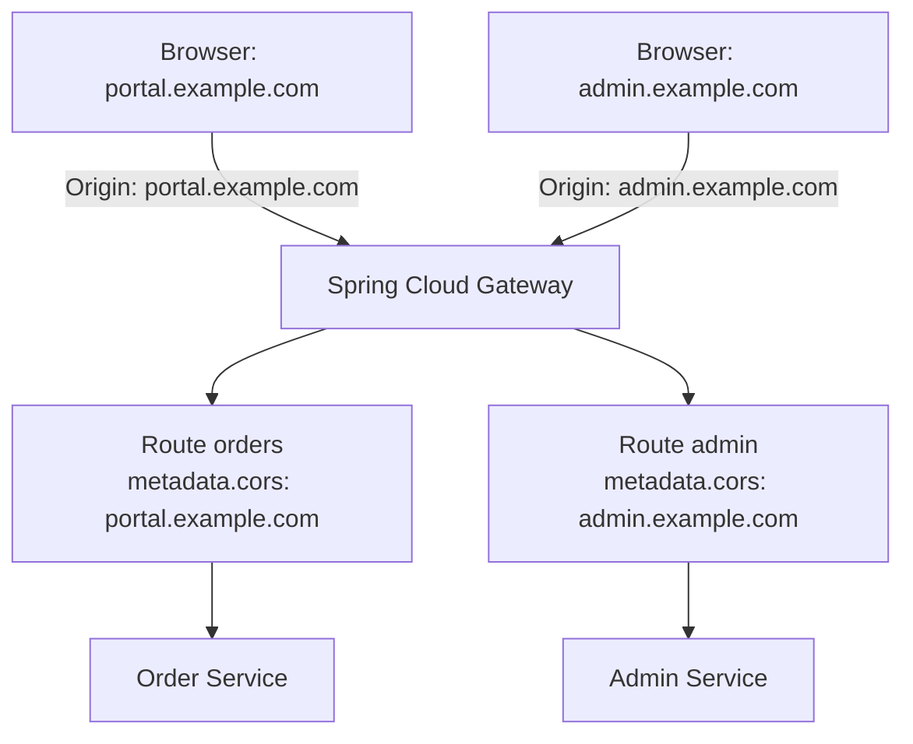
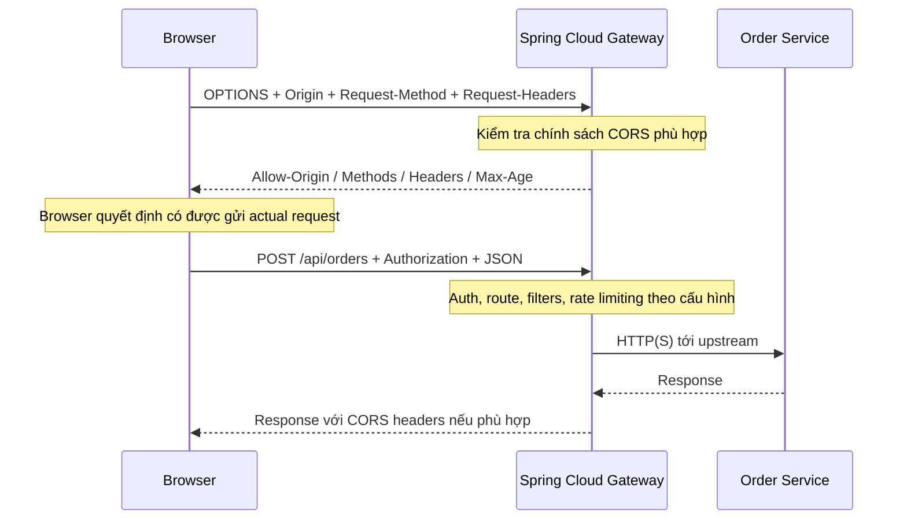

# Cấu hình CORS bằng metadata của từng tuyến

## Mục tiêu bài học

Trong chương **CORS**, bài học này hướng dẫn cấu hình **Cross-Origin Resource Sharing** theo **metadata của từng route** trong **Spring Cloud Gateway Server WebFlux**. Cách này hữu ích khi một API Gateway phục vụ nhiều microservices nhưng mỗi nhóm API có một tập frontend, HTTP methods và request headers được phép truy cập từ trình duyệt khác nhau.

Sau bài học, bạn sẽ:

- Giải thích **origin** là gì, browser gửi **preflight OPTIONS** khi nào và phản hồi CORS cần những header nào.
- Cấu hình `metadata.cors` trực tiếp trong route với `allowedOrigins`, `allowedMethods`, `allowedHeaders`, `exposedHeaders`, `allowCredentials` và `maxAge`.
- Tách chính sách CORS của các route khác nhau thay vì vô tình cho phép mọi origin trên toàn Gateway.
- Hiểu điểm khác nhau giữa **CORS theo route**, **global CORS**, cấu hình CORS của **Spring Security WebFlux** và header do backend trả về.
- Chẩn đoán trường hợp **OPTIONS không match route** vì `Method` predicate hoặc bị chặn bởi security filter.
- Áp dụng CORS cho các API có cookie/credential mà không tạo chính sách wildcard không an toàn.
- Kiểm thử bằng trình duyệt, `curl` và `WebTestClient`, đồng thời phân biệt lỗi CORS với lỗi TLS, xác thực, route hoặc upstream.

> Phạm vi: **Spring Cloud Gateway Server WebFlux** sử dụng `RoutePredicateHandlerMapping`, `GlobalFilter`, `GatewayFilterChain` và cấu hình route. Tên namespace YAML có thể thay đổi theo dòng Spring Cloud Gateway/Spring Boot; cần dùng namespace đúng với dependency triển khai. **CORS là cơ chế trình duyệt**, không phải tường lửa, xác thực hay phân quyền backend.

## 1. Vì sao một API Gateway cần chính sách CORS theo tuyến?

Giả sử hệ thống có các origin và API:

| Thành phần | Địa chỉ | Mục đích |
| --- | --- | --- |
| Website khách hàng | `https://portal.example.com` | Xem đơn hàng |
| Website quản trị | `https://admin.example.com` | Quản lý tài khoản và hệ thống |
| API Gateway | `https://api.example.com` | Điểm vào chung |
| Order Service | `lb://order-service` | Xử lý `/api/orders/**` |
| Admin Service | `lb://admin-service` | Xử lý `/api/admin/**` |

Hai website có thể cùng gọi Gateway, nhưng không nên có cùng quyền đọc response của mọi API bằng JavaScript:

```text
https://portal.example.com
    → https://api.example.com/api/orders/42
    → được phép theo chính sách CORS của route orders

https://portal.example.com
    → https://api.example.com/api/admin/users
    → không được mở quyền CORS của route admin

https://admin.example.com
    → https://api.example.com/api/admin/users
    → được phép theo chính sách CORS của route admin
```

Nếu chỉ có một cấu hình toàn cục `allowedOrigins: '*'`, Gateway không phân biệt được những nhu cầu frontend này. **Metadata CORS theo tuyến** đặt chính sách gần với route ID, path predicate, upstream và các filter tương ứng; người review cấu hình dễ nhìn thấy mỗi API được những origin nào sử dụng.



Sơ đồ minh họa **hai bộ quy tắc CORS**, không nói rằng mỗi trình duyệt chỉ có thể gửi request đến một route. CORS chủ yếu quyết định **trình duyệt có cho JavaScript của origin đó truy cập phản hồi hay không**. Gateway/backend vẫn cần xác thực và phân quyền theo nghiệp vụ.

## 2. Origin là gì?

**Origin** được xác định bởi bộ ba:

```text
scheme + hostname + port
```

Ví dụ:

| Địa chỉ của trang | So với `https://portal.example.com` |
| --- | --- |
| `https://portal.example.com` | Cùng origin |
| `http://portal.example.com` | Khác origin vì scheme |
| `https://portal.example.com:8443` | Khác origin vì port |
| `https://api.example.com` | Khác origin vì hostname |
| `https://admin.example.com` | Khác origin vì hostname |

Các đường dẫn khác nhau trên cùng scheme/host/port **không** tự tạo origin khác:

```text
https://portal.example.com/orders
https://portal.example.com/profile
```

hai địa chỉ trên vẫn cùng origin. Khi JavaScript tải từ `https://portal.example.com` gọi `https://api.example.com`, đó là **cross-origin request** dù hai host cùng nằm dưới `example.com`.

### 2.1. Same-Origin Policy và CORS

Trình duyệt có **Same-Origin Policy** để hạn chế trang từ một origin đọc dữ liệu ở origin khác. **CORS** là giao thức dựa trên HTTP headers giúp server cho phép một số trường hợp truy cập cross-origin được xác định rõ.

Ví dụ frontend:

```javascript
const response = await fetch(
  "https://api.example.com/api/orders/42",
  { method: "GET", mode: "cors" }
);

const order = await response.json();
```

Trình duyệt kiểm tra các header CORS trong phản hồi Gateway trước khi cho JavaScript đọc dữ liệu. Một chương trình `curl`, một backend HTTP client hoặc kẻ tấn công gọi API trực tiếp **không bị ràng buộc bởi cơ chế thực thi CORS của trình duyệt**. CORS không thể là tuyến phòng vệ duy nhất cho một API nhạy cảm.

### 2.2. CORS không đồng nghĩa CSRF, authentication hoặc authorization

- **CORS:** quy tắc trình duyệt cho phép hoặc chặn JavaScript đọc response cross-origin và điều khiển preflight.
- **Authentication:** xác minh người gọi là ai, ví dụ bearer token được kiểm tra hợp lệ.
- **Authorization:** kiểm tra người gọi có quyền truy cập route và dữ liệu cụ thể không.
- **CSRF protection:** ngăn thao tác ngoài ý muốn khi trình duyệt tự mang credential như cookie phiên.
- **TLS:** mã hóa và xác thực đầu kết nối HTTPS.

Một request cross-origin có thể vẫn được **gửi tới server** dù JavaScript không được phép đọc response, tùy loại request/preflight. Không xem CORS là lớp chặn tuyệt đối mọi thao tác ghi. Với ứng dụng dùng cookie, cần thiết kế CSRF và cookie policy riêng.

## 3. Trình duyệt thực hiện CORS request như thế nào?

### 3.1. Request không cần preflight

Một số cross-origin requests đáp ứng điều kiện **CORS-safelisted** có thể được gửi trực tiếp, không có preflight OPTIONS. Ví dụ minh họa:

```http
GET /api/orders/42 HTTP/1.1
Host: api.example.com
Origin: https://portal.example.com
```

Gateway có thể trả:

```http
HTTP/1.1 200 OK
Access-Control-Allow-Origin: https://portal.example.com
Content-Type: application/json

{"id":42,"state":"created"}
```

`Access-Control-Allow-Origin` cho browser biết origin nào được phép đọc response. Không phải mọi GET đều tránh preflight: thêm một header không thuộc nhóm safelisted, như `Authorization`, có thể khiến browser thực hiện preflight trước.

### 3.2. Preflight OPTIONS

Với request `POST` gửi JSON và `Authorization`, trình duyệt thường gửi một request **OPTIONS** trước:

```http
OPTIONS /api/orders HTTP/1.1
Host: api.example.com
Origin: https://portal.example.com
Access-Control-Request-Method: POST
Access-Control-Request-Headers: authorization,content-type
```

Nếu chính sách route cho phép, phản hồi preflight có thể chứa:

```http
HTTP/1.1 200 OK
Access-Control-Allow-Origin: https://portal.example.com
Access-Control-Allow-Methods: GET,POST
Access-Control-Allow-Headers: authorization,content-type
Access-Control-Allow-Credentials: true
Access-Control-Max-Age: 1800
```

Status thực tế của preflight có thể là **200 hoặc một status thành công phù hợp khác**, tùy framework và thiết lập. Không nên buộc code phải luôn nhận đúng 200 thay vì xác minh ý nghĩa của các CORS response headers.

Khi preflight hợp lệ, trình duyệt mới gửi request thực:

```http
POST /api/orders HTTP/1.1
Host: api.example.com
Origin: https://portal.example.com
Authorization: Bearer <access-token>
Content-Type: application/json

{"itemId":"book-42","quantity":1}
```

Trong Gateway, **preflight và actual request là hai HTTP requests riêng**. Preflight thường phải được trả lời ở tầng CORS mà không yêu cầu gửi một request nghiệp vụ xuống Order Service. Actual request vẫn đi qua xác thực, route, filters, load balancing và backend như thông thường.



**Điểm quan trọng:** `Access-Control-Request-Method: POST` chỉ mô tả method mà browser **muốn dùng sau preflight**. HTTP method của chính request preflight vẫn là **`OPTIONS`**. Điều này ảnh hưởng tới predicate `Method` của route, xem mục 7.

## 4. Metadata `cors` trên một route

Spring Cloud Gateway Server WebFlux hỗ trợ khai báo CORS **trực tiếp trong metadata của route**, dưới key `cors`. Với namespace cấu hình truyền thống thường thấy:

```yaml
spring:
  cloud:
    gateway:
      routes:
        - id: orders
          uri: lb://order-service
          predicates:
            - Path=/api/orders/**
          metadata:
            cors:
              allowedOrigins:
                - https://portal.example.com
              allowedMethods:
                - GET
                - POST
              allowedHeaders:
                - Authorization
                - Content-Type
                - X-Request-Id
              exposedHeaders:
                - X-Correlation-Id
              allowCredentials: true
              maxAge: 1800
```

Đây là ví dụ **đầy đủ cho một route**: `orders` được chọn theo `Path`, URI `lb://order-service` dùng service discovery/load balancing khi đã cấu hình dependency và nguồn instances thích hợp. Chính sách CORS nằm ở `metadata.cors`, **không phải một filter tên `Cors` trong `filters`**.

**Lưu ý phiên bản:** namespace `spring.cloud.gateway.routes` gắn với nhiều phiên bản Server WebFlux trước đây; các dòng mới có thể dùng namespace tách biệt cho `server.webflux`. Tên các trường CORS có thể giữ nguyên nhưng **không được sao chép prefix YAML giữa phiên bản** mà không đối chiếu tài liệu và kiểm tra route thực sự được nạp.

### 4.1. Ý nghĩa từng trường

| Trường metadata CORS | Giá trị ví dụ | Tác dụng |
| --- | --- | --- |
| `allowedOrigins` | `https://portal.example.com` | Danh sách origin được phép truy cập bằng JavaScript |
| `allowedMethods` | `GET`, `POST` | HTTP methods mà chính sách CORS cho phép |
| `allowedHeaders` | `Authorization`, `Content-Type` | Request headers mà browser có thể yêu cầu dùng trong preflight |
| `exposedHeaders` | `X-Correlation-Id` | Response headers mà JavaScript được phép đọc ngoài nhóm headers safelisted |
| `allowCredentials` | `true` | Cho phép cơ chế CORS với credential theo quy tắc trình duyệt |
| `maxAge` | `1800` | Thời gian cache kết quả preflight tính bằng giây; browser có thể áp giới hạn riêng |
| `allowedOriginPatterns` | `https://*.trusted.example.com` | Tùy chọn pattern matching origin trong Spring CORS, cần thận trọng hơn exact allowlist |

Không nên dùng `allowedOriginPatterns` rộng chỉ vì có nhiều subdomain: một subdomain bị chiếm quyền có thể trở thành origin được phép. Nếu số frontend ít và ổn định, **exact `allowedOrigins` là lựa chọn dễ audit hơn**.

### 4.2. Phân biệt `allowedHeaders` với `exposedHeaders`

Hai trường giải quyết **hai hướng khác nhau**:

```text
Browser → Gateway:
  Authorization: Bearer ...
  Content-Type: application/json

Gateway → Browser:
  X-Correlation-Id: req-123
```

- `allowedHeaders` trả lời: **browser có được gửi header đó trong actual cross-origin request không?** Browser có thể hỏi trước qua `Access-Control-Request-Headers`.
- `exposedHeaders` trả lời: **JavaScript có được đọc header đó từ response không?** Một response header có thể hiện diện trên mạng nhưng JavaScript không truy cập được nếu không thuộc nhóm safelisted và không được expose.

Ví dụ frontend:

```javascript
const response = await fetch(
  "https://api.example.com/api/orders/42",
  { headers: { Authorization: "Bearer <access-token>" } }
);

const requestId = response.headers.get("X-Correlation-Id");
```

Nếu response có header `X-Correlation-Id` nhưng policy không expose nó, `response.headers.get(...)` có thể trả `null` trong môi trường CORS. Ngược lại, thêm `X-Correlation-Id` vào `allowedHeaders` không tự tạo header ở response.

### 4.3. Chỉ khai báo CORS không tự tạo request/response header nghiệp vụ

Metadata CORS **không tự thêm** `Authorization`, `X-Request-Id` hay `X-Correlation-Id` vào request/response nghiệp vụ. Muốn tạo correlation ID, cần một filter hoặc công cụ observability riêng. Muốn relay token, cần cơ chế xác thực/token relay được cấu hình đúng. CORS chỉ quyết định **quyền truy cập từ trình duyệt theo origin/method/header**, không thực hiện nghiệp vụ của những header đó.

## 5. Ví dụ hai route với hai chính sách khác nhau

Xét Gateway có hai API:

```yaml
spring:
  cloud:
    gateway:
      routes:
        - id: orders-api
          order: -10
          uri: lb://order-service
          predicates:
            - Path=/api/orders/**
          metadata:
            cors:
              allowedOrigins:
                - https://portal.example.com
              allowedMethods:
                - GET
                - POST
              allowedHeaders:
                - Authorization
                - Content-Type
                - X-Request-Id
              exposedHeaders:
                - X-Correlation-Id
              allowCredentials: true
              maxAge: 1800

        - id: admin-api
          order: -10
          uri: lb://admin-service
          predicates:
            - Path=/api/admin/**
          metadata:
            cors:
              allowedOrigins:
                - https://admin.example.com
              allowedMethods:
                - GET
                - PUT
                - DELETE
              allowedHeaders:
                - Authorization
                - Content-Type
              exposedHeaders:
                - X-Correlation-Id
              allowCredentials: true
              maxAge: 300
```

`order: -10` giống nhau ở hai route **không gây vấn đề trong ví dụ** vì path predicates không giao nhau. Nếu route overlap, phải kiểm tra route priority và kết quả chọn tuyến như ở mục 9.

### 5.1. Dự đoán theo origin và path

| Browser origin | API cần gọi | Kỳ vọng chính sách của ví dụ |
| --- | --- | --- |
| `https://portal.example.com` | `/api/orders/42` | Cho phép nếu method/header phù hợp |
| `https://admin.example.com` | `/api/orders/42` | Không nằm trong allowed origins của `orders-api` |
| `https://admin.example.com` | `/api/admin/users` | Cho phép nếu method/header phù hợp |
| `https://portal.example.com` | `/api/admin/users` | Không nằm trong allowed origins của `admin-api` |
| `http://portal.example.com` | `/api/orders/42` | Không khớp vì scheme là HTTP |
| `https://portal.example.com:8443` | `/api/orders/42` | Không khớp vì port khác |
| `https://unknown.example.com` | Cả hai route | Không thuộc tập origin được khai báo |

Ngay cả khi `https://admin.example.com` được CORS của route `admin-api` cho phép, backend vẫn cần **xác thực và phân quyền quản trị**. CORS chỉ cho phép JavaScript truy cập response trong những điều kiện nhất định; không cấp quyền tài khoản.

### 5.2. Vì sao hai route nên có `maxAge` khác nhau?

Preflight có chi phí một vòng request OPTIONS. `Access-Control-Max-Age` cho phép browser cache kết quả trong một khoảng thời gian để giảm số preflight lặp lại.

- Với API ổn định, `maxAge: 1800` là lựa chọn minh họa giúp giảm preflight.
- Với chính sách API quản trị thường thay đổi, `maxAge: 300` có thể giảm thời gian browser giữ kết quả cũ.

Đây là **trade-off**, không phải chuẩn bắt buộc. Browser có thể áp mức trần riêng; thay đổi CORS policy cũng không nhất thiết lập tức xóa preflight cache của mọi browser đang mở.

### 5.3. CORS theo route hỗ trợ tách trách nhiệm

Trong quy trình review cấu hình, mỗi route có thể xác định:

1. **Chủ sở hữu:** team chịu trách nhiệm API và domain frontend.
2. **Trusted origins:** danh sách HTTPS origin cụ thể được phê duyệt.
3. **Methods:** chỉ những phương thức mà frontend thực sự cần.
4. **Request headers:** chỉ những header được API yêu cầu.
5. **Response headers:** chỉ expose header cần cho UI.
6. **Credentials:** có cần cookie/HTTP credentials hay không; nếu không thì tránh bật.
7. **Thử nghiệm:** preflight và actual request với origin được phép/không được phép.

Mọi thay đổi vào `metadata.cors` nên được review cùng route predicate và security policy để tránh một route mới vô tình mở hơn route cũ.

## 6. Credential, wildcard và `allowedOriginPatterns`

Đây là nhóm cấu hình dễ tạo lỗ hổng hoặc lỗi browser nhất.

### 6.1. Không kết hợp credentials với `allowedOrigins: '*'`

Cấu hình **không phù hợp**:

```yaml
metadata:
  cors:
    allowedOrigins: '*'
    allowCredentials: true
```

Trong mô hình CORS có credentials, browser không chấp nhận `Access-Control-Allow-Origin: *` cùng `Access-Control-Allow-Credentials: true`. Spring Framework cũng có cơ chế kiểm tra cấu hình origin wildcard khi credentials được bật; tùy phiên bản, cấu hình mâu thuẫn có thể bị từ chối hoặc gây lỗi.

Thay bằng danh sách origin được phép:

```yaml
metadata:
  cors:
    allowedOrigins:
      - https://portal.example.com
      - https://admin.example.com
    allowCredentials: true
```

Khi browser gửi:

```http
Origin: https://portal.example.com
```

response CORS thành công nên có **một** giá trị `Access-Control-Allow-Origin` thích hợp, ví dụ:

```http
Access-Control-Allow-Origin: https://portal.example.com
Access-Control-Allow-Credentials: true
```

Không gửi một chuỗi gồm nhiều origin cách nhau bằng dấu phẩy trong `Access-Control-Allow-Origin`. Khi có nhiều origin được chấp nhận, tầng CORS kiểm tra origin request rồi trả origin phù hợp.

### 6.2. Khi nào dùng `allowedOriginPatterns`?

Nếu tổ chức vận hành các frontend ở nhiều subdomain **đã được kiểm soát và phân quyền rõ**, Spring CORS hỗ trợ pattern:

```yaml
metadata:
  cors:
    allowedOriginPatterns:
      - https://*.apps.example.com
    allowedMethods:
      - GET
    allowedHeaders:
      - Authorization
    allowCredentials: true
```

Với một origin khớp pattern, CORS response có thể phản chiếu **origin thực đã được xác nhận phù hợp**, không trả `*` làm origin khi có credentials.

**Cảnh báo:**

- Chỉ dùng pattern khi tất cả subdomain thuộc phạm vi đó thực sự được phép; wildcard rất nguy hiểm nếu tenant, user hoặc đối tác có quyền tạo subdomain.
- Kiểm tra origin có scheme/port phù hợp; một origin HTTP không tự tương đương HTTPS.
- Không dùng pattern để thay thế xác thực người dùng hoặc quyền tenant.
- Kiểm thử với origin tương tự nhưng không được phép, tên miền có hậu tố lừa đảo và host do người ngoài kiểm soát.
- Nếu danh sách origin hữu hạn, allowlist chính xác vẫn dễ review hơn.

### 6.3. Cookie cross-origin và CSRF

Trong frontend dùng cookie:

```javascript
const response = await fetch(
  "https://api.example.com/api/orders/42",
  {
    method: "GET",
    mode: "cors",
    credentials: "include"
  }
);
```

`credentials: "include"` thể hiện ý định browser gửi/nhận credential theo policy của nó. Khi CORS request có credentials, server phải trả header CORS phù hợp; chỉ bật `allowCredentials: true` **không tự khiến cookie được gửi**.

Với **cross-site cookies**, môi trường browser hiện đại thường yêu cầu cấu hình cookie phù hợp như `SameSite=None; Secure`; cơ chế hạn chế third-party cookies của browser vẫn có thể chặn cookie. Không lẫn lộn **cross-origin** và **cross-site**: chúng dùng các quy tắc định nghĩa khác nhau.

**CORS không phải CSRF defense.** Một ứng dụng dùng cookie xác thực cần đánh giá bảo vệ CSRF, idempotency, `SameSite`, nguồn request được tin cậy và chính sách authorization riêng. `allowCredentials: true` chỉ là một phần của CORS, không phải nút bật bảo mật.

## 7. Vấn đề quan trọng: preflight là `OPTIONS`, không phải method đích

Giả sử route được khai báo:

```yaml
spring:
  cloud:
    gateway:
      routes:
        - id: reports-read
          uri: lb://report-service
          predicates:
            - Path=/api/reports/**
            - Method=GET
          metadata:
            cors:
              allowedOrigins:
                - https://portal.example.com
              allowedMethods:
                - GET
              allowedHeaders:
                - Authorization
```

Browser muốn gọi:

```http
GET /api/reports/42 HTTP/1.1
Origin: https://portal.example.com
Authorization: Bearer <token>
```

Do `Authorization` không phải request header safelisted, browser có thể gửi preflight:

```http
OPTIONS /api/reports/42 HTTP/1.1
Origin: https://portal.example.com
Access-Control-Request-Method: GET
Access-Control-Request-Headers: authorization
```

Tại giai đoạn route matching, predicate **`Method=GET`** nhìn vào method HTTP của request preflight là **`OPTIONS`** nên có thể **không match route**. Khi đó Gateway không chọn được route để sử dụng chính sách CORS nằm trong `metadata.cors` của `reports-read`.

Đây là lý do một số ứng dụng có route GET hoạt động từ `curl`, nhưng browser liên tục báo **preflight không thành công**.

### 7.1. Cách xử lý có chủ đích

Có các phương án tùy kiến trúc:

1. **Điều chỉnh route predicate** nếu việc mở rộng method matching là phù hợp với thiết kế API; phải cân nhắc rằng điều này cũng thay đổi cách match request thực, không chỉ preflight.
2. **Dùng chính sách global CORS được giới hạn theo path** để OPTIONS không match route vẫn có thể được CORS handler xử lý.
3. **Xử lý CORS tại ingress/WebFlux Security** trước route matching theo chính sách thống nhất, nếu hệ thống đã xác định một chủ sở hữu CORS ở lớp đó.

Không nên chỉ thêm `OPTIONS` vào backend handler rồi cho rằng đủ: browser có thể bị từ chối **trước khi Gateway định tuyến tới backend**.

### 7.2. `globalcors.add-to-simple-url-handler-mapping`

Trong các dòng Gateway Server WebFlux hỗ trợ cấu hình global CORS, property:

```yaml
spring:
  cloud:
    gateway:
      globalcors:
        add-to-simple-url-handler-mapping: true
```

cho phép áp dụng **global CORS configuration** tới các request mà Gateway route predicate không match, chẳng hạn preflight OPTIONS khi route chỉ match GET. Tuy nhiên, **chỉ bật flag chưa tạo ra một chính sách CORS đầy đủ**; cần khai báo `globalcors.cors-configurations` phù hợp và kiểm thử.

Ví dụ global CORS được **giới hạn theo path**:

```yaml
spring:
  cloud:
    gateway:
      globalcors:
        add-to-simple-url-handler-mapping: true
        cors-configurations:
          '[/api/reports/**]':
            allowedOrigins:
              - https://portal.example.com
            allowedMethods:
              - GET
            allowedHeaders:
              - Authorization
            maxAge: 300
```

Đây là **chính sách bổ sung ở mức path**, không còn chỉ là metadata của một route. Cần đảm bảo CORS global cho `/api/reports/**` **không mâu thuẫn** với `metadata.cors` của các route phục vụ path đó. Khi có nhiều route trùng path nhưng cần origin khác nhau theo `Host`, tenant hoặc auth policy, một global CORS path pattern quá rộng có thể vô tình mở quyền đọc cho origin ngoài dự kiến.

Nếu toàn hệ thống đã có `CorsWebFilter` hoặc policy CORS ở ingress, phải xác định **chính xác một nơi chịu trách nhiệm chính** hoặc cách phối hợp được kiểm thử; không chồng các chính sách một cách ngẫu nhiên.

## 8. CORS route metadata, global CORS, Spring Security và backend

Những nguồn cấu hình CORS này có **phạm vi khác nhau**:

| Nơi đặt cấu hình | Phạm vi áp dụng | Ưu điểm | Điều cần cảnh giác |
| --- | --- | --- | --- |
| **Route `metadata.cors`** | Route được chọn và metadata của nó | Chính sách sát route, review theo API | Preflight OPTIONS có thể không match predicate |
| **Gateway `globalcors`** | Các path được cấu hình chung | Giải quyết trường hợp nhiều route có cùng chính sách hoặc OPTIONS không match | Phạm vi quá rộng, mâu thuẫn với route-specific policy |
| **Spring Security WebFlux CORS** | Security web filter chain | CORS có thể được xử lý trước kiểm tra xác thực ở lớp security | Có thể conflict/duplicate với Gateway CORS nếu không thống nhất |
| **Ingress/reverse proxy** | Ở rìa trước Gateway | Một nơi xử lý preflight trước ứng dụng | Có thể che hoặc mâu thuẫn với policies khác |
| **Backend microservice** | Một service/backend riêng | Hợp lý nếu client gọi backend trực tiếp | Khi qua Gateway có thể tạo duplicate CORS headers |

### 8.1. Spring Security chạy ở vị trí nào?

Trong **Spring Security WebFlux**, security được tổ chức bằng `SecurityWebFilterChain`. Những WebFilters này có thể chạy **trước route matching của Spring Cloud Gateway**, không nằm trong một danh sách order chung với tất cả GatewayFilters.

Nếu security yêu cầu bearer token cho mọi request mà không xử lý CORS preflight hợp lý, browser OPTIONS thường **không có bearer token của actual request**, dẫn tới `401/403` trước khi chính sách CORS theo route được áp dụng.

Thực hành:

- Cho phép hoặc xử lý **preflight hợp lệ** tại tầng CORS/security đã được chọn, trước các ràng buộc xác thực của actual request.
- Giữ xác thực và phân quyền bắt buộc cho **actual HTTP request**; không dùng preflight thành cách vượt auth.
- Kiểm thử cả preflight không có Authorization và actual request có/không có Authorization.
- Không mặc định bật một cấu hình Security CORS chung sẽ tự đọc toàn bộ `metadata.cors` của Gateway; hai hệ thống cần được cấu hình để phối hợp đúng.

### 8.2. Tránh duplicate `Access-Control-Allow-Origin`

Nếu backend trả:

```http
Access-Control-Allow-Origin: *
```

nhưng Gateway cũng áp route metadata để trả:

```http
Access-Control-Allow-Origin: https://portal.example.com
Access-Control-Allow-Credentials: true
```

response cuối có thể chứa **hai giá trị `Access-Control-Allow-Origin`** hoặc chính sách mâu thuẫn. Trình duyệt thường từ chối response có giá trị không hợp lệ, ngay cả khi một trong hai origin đúng.

Spring Cloud Gateway có `DedupeResponseHeader` GatewayFilter Factory hỗ trợ loại bỏ giá trị header lặp, ví dụ:

```yaml
filters:
  - DedupeResponseHeader=Access-Control-Allow-Credentials Access-Control-Allow-Origin
```

Nhưng **dedupe chỉ là công cụ sửa duplicate**, không tự giải quyết câu hỏi "chính sách của tầng nào đúng?". Nếu một tầng trả `*` và một tầng trả origin cụ thể, việc giữ giá trị nào có thể ảnh hưởng bảo mật/khả năng hoạt động. Hướng tốt hơn là **xác định chủ sở hữu CORS** (thường gateway/ingress ở biên public API), rồi hạn chế backend tự phát ra CORS headers không phù hợp.

### 8.3. Header `Vary` và cache

Khi response CORS phụ thuộc `Origin`, `Access-Control-Request-Method` hoặc `Access-Control-Request-Headers`, hệ thống có thể cần `Vary` tương ứng để cache không lấy phản hồi của origin A đưa nhầm cho origin B. Spring CORS handler có thể thêm các giá trị `Vary` phù hợp, nhưng cần kiểm tra output qua toàn chuỗi proxy/CDN.

**Không cache nhầm dữ liệu có credentials**: CORS không thay thế `Cache-Control`, cache key, cookie handling hoặc các ràng buộc bảo mật của reverse proxy. Khi thay chính sách origin, preflight cache và CDN/browser cache có thể chưa hết hạn ngay.

## 9. Metadata CORS phụ thuộc route nào được chọn

Một Gateway có thể có route:

```yaml
routes:
  - id: api-generic
    order: -20
    uri: lb://generic-service
    predicates:
      - Path=/api/**
    metadata:
      cors:
        allowedOrigins:
          - https://generic.example.com

  - id: orders
    order: 0
    uri: lb://order-service
    predicates:
      - Path=/api/orders/**
    metadata:
      cors:
        allowedOrigins:
          - https://portal.example.com
```

Với request `/api/orders/42`, route `api-generic` có thể match trước do **order thấp hơn**, nên policy của `orders` có thể không được áp dụng như người thiết kế kỳ vọng. Không suy luận rằng route với path “cụ thể hơn” luôn tự thắng.

Hãy:

1. Xác định **route ID** thực tế được chọn theo predicate và `order`.
2. Đặt route cụ thể trước route rộng nếu hai route chồng lấn và chủ đích là vậy.
3. Tránh route wildcard chung làm mờ chính sách CORS của các service nhạy cảm.
4. Kiểm thử preflight và actual request trên **cùng path**, nhiều Origin và HTTP methods.
5. Theo dõi sự khác biệt giữa **không match route** và **bị CORS từ chối**, vì cách xử lý lỗi khác nhau.

Trong Spring Cloud Gateway Server WebFlux, route được chọn có thể được lưu trong exchange attribute `GATEWAY_ROUTE_ATTR`. Dữ liệu metadata là thông tin **định tuyến**, không phải bằng chứng request đã xác thực. Một route chọn đúng vẫn có thể bị security filter, rate limiter hoặc backend từ chối.

## 10. Bảo mật khi xây dựng CORS theo tuyến

### 10.1. Không phản chiếu mọi Origin một cách tùy tiện

Một số custom CORS filters lấy header request:

```text
Origin: https://untrusted.example
```

rồi tự ghi:

```text
Access-Control-Allow-Origin: https://untrusted.example
Access-Control-Allow-Credentials: true
```

mà **không kiểm tra allowlist**. Đây là việc cho phép origin bất kỳ đọc response có credentials nếu những điều kiện khác cho phép, có thể dẫn tới rò rỉ dữ liệu. Không tự echo Origin trừ khi nó đã được kiểm tra bằng chính sách đáng tin.

### 10.2. Không dùng CORS làm phân quyền

Một browser không được CORS cho phép có thể không đọc được response qua JavaScript, nhưng API vẫn có thể bị gọi từ `curl`, server-side HTTP client hoặc môi trường ngoài browser. Ngoài ra, request safelisted có thể tới server trước khi browser chặn đọc response.

Vì vậy:

- Route quản trị vẫn phải dùng Spring Security/OAuth2/JWT/mTLS hoặc một cơ chế xác thực phù hợp.
- Backend vẫn kiểm tra quyền thao tác trên tài nguyên cụ thể.
- `Host`/`Origin`/`Referer` không tự trở thành danh tính đáng tin.
- Cookies, CSRF, token audience/scope và trust boundary được thiết kế độc lập.
- Không đưa secret, session token hoặc thông tin cá nhân vào CORS response headers hoặc access logs.

### 10.3. Cấu hình chính xác, ít quyền nhất

| Quyết định | Khuyến nghị |
| --- | --- |
| Origin | Exact HTTPS allowlist khi có thể |
| Methods | Chỉ `GET`, `POST`, `PUT`... mà frontend thực sự cần |
| Request headers | Chỉ các header được phép, đặc biệt review `Authorization` |
| Exposed headers | Chỉ header frontend phải đọc; không expose token/cookie tùy tiện |
| Credentials | Chỉ bật nếu thực sự sử dụng và có chính sách cookie/CSRF |
| Patterns | Tránh wildcard subdomain rộng, đặc biệt khi tenant được tạo host |
| Preflight cache | `maxAge` cân bằng hiệu năng và tốc độ thay đổi policy |
| Ownership | Một nơi có trách nhiệm chính về CORS, tránh Gateway/backend/ingress mâu thuẫn |

Không vì giải quyết một lỗi trình duyệt mà đổi `allowedOrigins` từ một tên cụ thể sang `*` trên toàn Gateway khi có dữ liệu nhạy cảm.

### 10.4. CORS và những tính năng Gateway khác

CORS chỉ liên quan đến **khả năng trình duyệt gửi/đọc request cross-origin**, không tự:

- Chọn instance cho URI `lb://` hoặc kiểm tra service discovery.
- Sửa path bằng `RewritePath`/`StripPrefix`.
- Relay bearer token hoặc thiết lập danh tính đã xác thực.
- Cấp quyền theo resource, rate limit, circuit breaker hoặc retry.
- Bật TLS cho inbound/outbound connections.
- Tạo trace ID hoặc correlation ID có chuẩn.

Preflight được trả lời tại tầng CORS có thể **không đi qua toàn bộ GatewayFilter chain hoặc backend**, nên không suy ra metrics của route/backend sẽ đếm giống số OPTIONS nhìn thấy ở ingress. Cần quan sát preflight, actual request và outbound attempts theo những lớp phù hợp.

## 11. Kiểm thử CORS route metadata bằng `curl`

Trình duyệt là bên **thực thi** CORS. Tuy vậy, `curl` rất hữu ích để kiểm tra **response headers** mà Gateway trả về. Nó **không tự chặn** response theo chính sách CORS như browser.

Giả sử Gateway chạy ở `https://api.example.com`, route `orders-api` như mục 5.

### 11.1. Preflight hợp lệ

```bash
curl -i -X OPTIONS \
  'https://api.example.com/api/orders' \
  -H 'Origin: https://portal.example.com' \
  -H 'Access-Control-Request-Method: POST' \
  -H 'Access-Control-Request-Headers: authorization,content-type'
```

Kiểm tra response có các header phù hợp, ví dụ:

```http
Access-Control-Allow-Origin: https://portal.example.com
Access-Control-Allow-Methods: GET,POST
Access-Control-Allow-Headers: authorization,content-type
Access-Control-Allow-Credentials: true
Access-Control-Max-Age: 1800
```

**Không bắt buộc thứ tự, cách viết hoa, dấu cách trong danh sách header phải giống hệt ví dụ.** Điều quan trọng là browser nhận những quyền đúng theo policy, không có wildcard origin khi credentials được bật, và kết quả response không có header trùng/mâu thuẫn.

### 11.2. Preflight từ origin không được phép

```bash
curl -i -X OPTIONS \
  'https://api.example.com/api/orders' \
  -H 'Origin: https://untrusted.example' \
  -H 'Access-Control-Request-Method: POST' \
  -H 'Access-Control-Request-Headers: authorization,content-type'
```

Kỳ vọng: **không có kết quả CORS thành công cho origin đó**. Gateway/framework có thể trả `403 Invalid CORS request` hoặc một phản hồi khác tùy vị trí xử lý; không nên chỉ gắn phép kiểm tra với một status cố định. Điều kiện quan trọng là browser không nhận `Access-Control-Allow-Origin` chấp nhận origin không được phép.

### 11.3. Method hoặc header không được phép

```bash
# Method DELETE không nằm trong allowedMethods của orders-api:
curl -i -X OPTIONS \
  'https://api.example.com/api/orders/42' \
  -H 'Origin: https://portal.example.com' \
  -H 'Access-Control-Request-Method: DELETE'

# Header X-Admin-Override không nằm trong allowedHeaders:
curl -i -X OPTIONS \
  'https://api.example.com/api/orders/42' \
  -H 'Origin: https://portal.example.com' \
  -H 'Access-Control-Request-Method: GET' \
  -H 'Access-Control-Request-Headers: x-admin-override'
```

Hai trường hợp phải **không được preflight cho phép** theo policy. Nếu nhận phản hồi không như ý, kiểm tra xem một global CORS policy hoặc ingress đang cấp quyền rộng hơn metadata route hay không.

### 11.4. Actual request có `Origin`

```bash
curl -i \
  'https://api.example.com/api/orders/42' \
  -H 'Origin: https://portal.example.com' \
  -H 'Authorization: Bearer <test-token>'
```

Một actual request có thể trả 401 nếu token không hợp lệ, 404 nếu route/backend không có dữ liệu hoặc 503 nếu upstream unavailable. **Phải phân biệt những lỗi HTTP này với CORS.** Khi lỗi phát sinh trước khi route metadata được xử lý, response có thể thiếu CORS headers khiến browser hiển thị thông báo CORS thay vì chi tiết lỗi.

Đừng dùng `curl -k` để bỏ qua xác minh TLS như cách kiểm thử mặc định. Lỗi CA/SAN là vấn đề của HTTPS, không phải lỗi của cấu hình CORS.

## 12. Kiểm thử tự động bằng `WebTestClient`

Trong integration test đã khởi động Gateway và các backend thử nghiệm, có thể giả lập preflight:

```java
import org.junit.jupiter.api.Test;
import org.springframework.beans.factory.annotation.Autowired;
import org.springframework.http.HttpHeaders;
import org.springframework.test.web.reactive.server.WebTestClient;

class CorsRouteIntegrationTest {

    @Autowired
    WebTestClient webTestClient;

    @Test
    void allowsPortalToPostOrders() {
        webTestClient.options()
            .uri("/api/orders")
            .header(HttpHeaders.ORIGIN, "https://portal.example.com")
            .header(HttpHeaders.ACCESS_CONTROL_REQUEST_METHOD, "POST")
            .header(
                HttpHeaders.ACCESS_CONTROL_REQUEST_HEADERS,
                "authorization,content-type"
            )
            .exchange()
            .expectStatus().is2xxSuccessful()
            .expectHeader().valueEquals(
                HttpHeaders.ACCESS_CONTROL_ALLOW_ORIGIN,
                "https://portal.example.com"
            )
            .expectHeader().valueEquals(
                HttpHeaders.ACCESS_CONTROL_ALLOW_CREDENTIALS,
                "true"
            )
            .expectHeader().exists(
                HttpHeaders.ACCESS_CONTROL_ALLOW_METHODS
            );
    }

    @Test
    void doesNotAllowUntrustedOrigin() {
        webTestClient.options()
            .uri("/api/orders")
            .header(HttpHeaders.ORIGIN, "https://untrusted.example")
            .header(HttpHeaders.ACCESS_CONTROL_REQUEST_METHOD, "POST")
            .exchange()
            .expectHeader().doesNotExist(
                HttpHeaders.ACCESS_CONTROL_ALLOW_ORIGIN
            );
    }
}
```

Đây là **khung test minh họa**, không tự chạy nếu chưa có các annotation/dependency/context cần thiết. Ví dụ lớp test cần được cấu hình khởi động ứng dụng Gateway ở test runtime, inject `WebTestClient` phù hợp và cung cấp backend stub khi kiểm tra actual requests.

Nên test cả response từ backend có `Access-Control-Allow-Origin` để phát hiện duplicate headers, cũng như trường hợp `SecurityWebFilterChain` từ chối actual request. Một unit test chỉ kiểm tra YAML chứa chuỗi `cors` chưa chứng minh policy đã được áp dụng đúng.

### 12.1. Test bằng browser thật

Trong browser DevTools → Network:

1. Mở website ở `https://portal.example.com`.
2. Gửi `fetch` tới `https://api.example.com/api/orders/42`.
3. Nếu có preflight, tìm request **OPTIONS**, kiểm tra `Origin`, `Access-Control-Request-Method`, `Access-Control-Request-Headers` và phản hồi.
4. Kiểm tra actual request có được gửi không; nếu có, nó bị auth/route/backend từ chối ở đâu?
5. Kiểm tra response headers và thử đọc `X-Correlation-Id` qua `response.headers.get(...)` khi đã expose.
6. Thử lại bằng origin không được phép, browser có/không có credential và với cookie policy thực tế.

Thông báo trên console kiểu “blocked by CORS policy” có thể **che một lỗi upstream hoặc auth** vì browser không cho JS truy cập phản hồi. Không kết luận tất cả thông báo này do thiếu `allowedOrigins`; hãy kiểm tra Network, ingress/security logs và response headers tương ứng.

## 13. Ma trận kiểm thử trước production

| Trường hợp | Origin / request | Điều cần xác minh |
| --- | --- | --- |
| Allowed origin | Portal → orders | Có CORS headers phù hợp |
| Disallowed origin | Untrusted → orders | Không cấp quyền CORS |
| Route-specific separation | Portal → admin | Không bị policy orders mở nhầm |
| Khác scheme | `http://portal.example.com` | Không khớp origin HTTPS |
| Khác port | `https://portal.example.com:8443` | Không khớp nếu không có trong allowlist |
| Preflight GET | OPTIONS + `Request-Method: GET` | Được xử lý khi route/policy cho phép |
| Preflight POST JSON | OPTIONS + POST + `content-type` | Được xử lý theo allowedMethods/Headers |
| Method không cho phép | OPTIONS + DELETE | Không được preflight cho phép trên orders |
| Header không cho phép | OPTIONS + `x-admin-override` | Không được preflight cho phép |
| Cookie request | `credentials: include` | Allow-Origin cụ thể, Allow-Credentials phù hợp; cookie/CSRF riêng |
| Exposed header | JS đọc `X-Correlation-Id` | Đọc được khi server thực trả header và policy expose |
| `Method=GET` predicate | OPTIONS cho GET có Authorization | Không bị bỏ sót do route không match |
| Security chặn OPTIONS | Preflight không có token | Có đường xử lý CORS hợp lệ trước auth actual |
| Backend cũng trả CORS | Gateway + upstream | Không duplicate/mâu thuẫn CORS headers |
| Route chồng lấn | `/api/orders/**` và `/api/**` | Route ID/policy đúng theo order |
| Response 401/403 | Token không hợp lệ | Auth thật vẫn bị từ chối; CORS headers theo chính sách đã xác định |
| Response 5xx | Backend không khả dụng | Không nhầm lỗi backend thành lỗi Origin |
| Cache | Nhiều Origin lần lượt truy cập | `Vary`/cache key phù hợp, không trả nhầm credential content |
| TLS | HTTPS hợp lệ/không hợp lệ | Không dùng CORS để “sửa” lỗi chứng chỉ |

### 13.1. Dữ liệu quan sát cần có

Đối với Spring Cloud Gateway, nên ghi:

- **Route ID**, method, HTTP status, latency và error type đã được chuẩn hóa.
- Số preflight OPTIONS theo nhóm API khi có nhu cầu, nhưng không lẫn với số actual requests hoặc attempts tới backend.
- Lỗi bảo mật do Security WebFilterChain, lỗi CORS validation và lỗi upstream ở đúng tầng.
- Trace ID/correlation ID từ hệ thống observability được cấu hình; không cần log toàn bộ `Origin`, cookie hay `Authorization` một cách mặc định.

Lưu ý `Origin` có thể do client tạo tùy ý; nếu đưa trực tiếp vào metric labels sẽ gây **cardinality cao**. Với log, cân nhắc ghi kết quả **allowed/denied** và tên policy/route ổn định thay vì mọi origin raw.

## 14. Chẩn đoán lỗi CORS phổ biến

### Tình huống A — Preflight trả 404 dù route GET tồn tại

**Triệu chứng:** `curl GET /api/reports/42` match route, browser gửi OPTIONS rồi báo lỗi.

**Nguyên nhân khả dĩ:** route có `Method=GET`, OPTIONS không match nên `metadata.cors` không được dùng.

**Hướng xử lý:** kiểm tra predicate thực tế và cấu hình preflight ở globalcors/edge/security với path đủ hẹp; không chỉ đổi backend handler.

### Tình huống B — OPTIONS trả 401/403

**Triệu chứng:** browser chưa gửi actual request, chỉ thấy preflight bị từ chối.

**Nguyên nhân khả dĩ:** Spring Security hoặc ingress kiểm tra auth trước khi CORS xử lý preflight, mặc dù OPTIONS thông thường không mang bearer token của actual request.

**Hướng xử lý:** cấu hình đường preflight hợp lệ và phối hợp giữa Security WebFilterChain với CORS owner; giữ auth bắt buộc cho actual request.

### Tình huống C — CORS báo wildcard và credentials không tương thích

**Triệu chứng:** browser báo không thể dùng wildcard origin với credential mode.

**Nguyên nhân:** cấu hình `allowedOrigins: '*'` và `allowCredentials: true`, hoặc ingress/backend ghi đè policy.

**Hướng xử lý:** dùng exact allowed origins, kiểm tra `Access-Control-Allow-Origin` cuối cùng và tránh duplicate headers.

### Tình huống D — `Access-Control-Allow-Origin` bị lặp

**Triệu chứng:** response có hai giá trị origin hoặc giá trị `*, https://portal.example.com`.

**Nguyên nhân:** Gateway và backend/ingress/Spring Security cùng thêm CORS headers.

**Hướng xử lý:** xác định owner của CORS policy, bỏ cấu hình chồng chéo; chỉ dùng `DedupeResponseHeader` khi hiểu rõ giá trị nào được giữ và có test an toàn.

### Tình huống E — JS không đọc được `X-Correlation-Id`

**Triệu chứng:** DevTools hiển thị response header nhưng `response.headers.get("X-Correlation-Id")` trả `null`.

**Nguyên nhân:** header chưa được liệt kê trong `exposedHeaders` hoặc response đến từ đường xử lý khác chưa gắn CORS thích hợp.

**Hướng xử lý:** xác minh backend/Gateway đã thực trả header, và metadata `exposedHeaders` đúng route.

### Tình huống F — CORS thành công nhưng API trả 403

**Triệu chứng:** origin được phép, preflight thành công, actual request trả 403.

**Nguyên nhân:** policy authentication/authorization, CSRF hoặc backend từ chối. CORS hợp lệ **không cấp quyền tài nguyên**.

**Hướng xử lý:** kiểm tra Spring Security scopes, cookies, CSRF token, quyền người dùng và logs backend; không mở rộng allowedOrigins vô cớ.

### Tình huống G — Chỉ một số môi trường bị lỗi

**Triệu chứng:** dev `localhost:3000` hoạt động, staging `https://staging.portal.example.com` lỗi.

**Nguyên nhân khả dĩ:** origin khác scheme/host/port, namespace cấu hình phiên bản, ingress headers, route order hoặc policy cache.

**Hướng xử lý:** liệt kê exact origins theo môi trường, test với browser/SNI HTTPS thực tế và so sánh CORS response headers. Không bật `*` trên production chỉ để nhanh khắc phục.

## 15. Bài thực hành có đáp án

Giả sử Gateway có:

```yaml
routes:
  - id: payments-read
    uri: lb://payment-service
    predicates:
      - Path=/api/payments/**
      - Method=GET
    metadata:
      cors:
        allowedOrigins:
          - https://billing.example.com
        allowedMethods:
          - GET
        allowedHeaders:
          - Authorization
        exposedHeaders:
          - X-Correlation-Id
        allowCredentials: true
        maxAge: 600
```

Hãy dự đoán những tình huống sau:

1. JavaScript ở `https://billing.example.com` gửi GET có `Authorization`. Browser có thể gửi request nào trước actual GET?
2. Vì sao `Method=GET` có thể làm `metadata.cors` không áp dụng được cho preflight?
3. JavaScript ở `https://portal.example.com` gọi cùng API có được cấp quyền CORS không?
4. Client gọi API bằng `curl` từ server bên ngoài có bị browser CORS chặn không?
5. `allowCredentials: true` có thay thế JWT/scope và CSRF không?
6. Nếu sửa `allowedOrigins` thành `'*'`, còn `allowCredentials: true`, vấn đề gì xảy ra?
7. Nếu backend gửi `Access-Control-Allow-Origin: *` còn Gateway gửi origin cụ thể, cần kiểm tra điều gì?
8. `exposedHeaders` có tự tạo `X-Correlation-Id` không?
9. Nếu hệ thống có `globalcors` fallback cho OPTIONS, làm sao tránh policy rộng hơn route payments?

**Gợi ý đáp án:**

1. Browser có thể gửi **OPTIONS preflight** với `Origin`, `Access-Control-Request-Method: GET` và `Access-Control-Request-Headers: authorization`.
2. Vì method của **preflight là OPTIONS**, còn `Method=GET` chỉ match actual GET. Cần đường xử lý preflight phù hợp, chẳng hạn global CORS scoped theo path hoặc CORS ở lớp security/ingress đã được thiết kế.
3. **Không**, vì `https://portal.example.com` không nằm trong allowedOrigins của route.
4. **Không theo nghĩa browser CORS**; `curl` không thực thi Same-Origin Policy. API vẫn cần authentication/authorization và các kiểm soát khác.
5. **Không.** Credential CORS không xác thực người gọi và không bảo vệ CSRF.
6. **Cấu hình không phù hợp** với credentialed CORS. Dùng origin cụ thể hoặc pattern được kiểm soát và được framework hỗ trợ.
7. Kiểm tra response cuối có duplicate/conflicting CORS headers không; ưu tiên thống nhất nơi sở hữu policy thay vì dedupe tùy ý.
8. **Không.** Nó chỉ cho phép JS đọc header khi header thực có trên response.
9. Cấu hình global theo path đủ hẹp và cùng chính sách với route, kiểm thử cả origin bị từ chối và những route chồng lấn.

## Checklist triển khai

Trước khi công bố một route có `metadata.cors`, xác minh:

- [ ] Có danh sách **exact frontend origins** theo dev/staging/production; scheme và port chính xác.
- [ ] `allowedMethods`, `allowedHeaders`, `exposedHeaders` được giới hạn theo contract.
- [ ] Nếu `allowCredentials: true`, không dùng `allowedOrigins: '*'`; cookie/CSRF được thiết kế độc lập.
- [ ] Preflight OPTIONS được xử lý kể cả khi route có `Method` predicate.
- [ ] Spring Security không vô tình chặn preflight trước CORS; actual request vẫn được xác thực và phân quyền.
- [ ] CORS từ Gateway, backend và ingress không trùng/mâu thuẫn.
- [ ] Route order và các path/Host predicates chồng lấn đã được kiểm tra.
- [ ] Response lỗi 401/403/5xx cũng được kiểm thử từ browser.
- [ ] Cache, `Vary` và preflight `maxAge` phù hợp; không cache dữ liệu nhạy cảm sai origin.
- [ ] Có integration tests cho allowed/disallowed origins, methods, headers và credentials.
- [ ] Log/metrics không thu thập raw token, cookie hay origin không giới hạn cardinality.
- [ ] Namespace YAML và behavior được xác minh với phiên bản Spring Cloud Gateway thực tế.

## Tổng kết

**CORS bằng metadata của từng tuyến** cho phép Spring Cloud Gateway Server WebFlux định nghĩa **origin, method, request headers, exposed response headers, credentials và preflight cache** sát với mỗi route:

```yaml
metadata:
  cors:
    allowedOrigins:
      - https://portal.example.com
    allowedMethods:
      - GET
      - POST
    allowedHeaders:
      - Authorization
      - Content-Type
    allowCredentials: true
    maxAge: 1800
```

Ba nguyên tắc quan trọng nhất là: **(1)** route metadata chỉ có ích khi xử lý route/preflight phù hợp, đặc biệt lưu ý OPTIONS và `Method` predicate; **(2)** CORS từ Gateway, Security, ingress và backend phải được thống nhất để không có header mâu thuẫn; **(3)** CORS **không thay thế** xác thực, phân quyền, CSRF, TLS hay chính sách phục hồi. Kiểm thử cả preflight lẫn actual request ở browser và tại Gateway sẽ giúp hệ thống microservices có chính sách chia sẻ cross-origin rõ ràng, giới hạn và an toàn.
