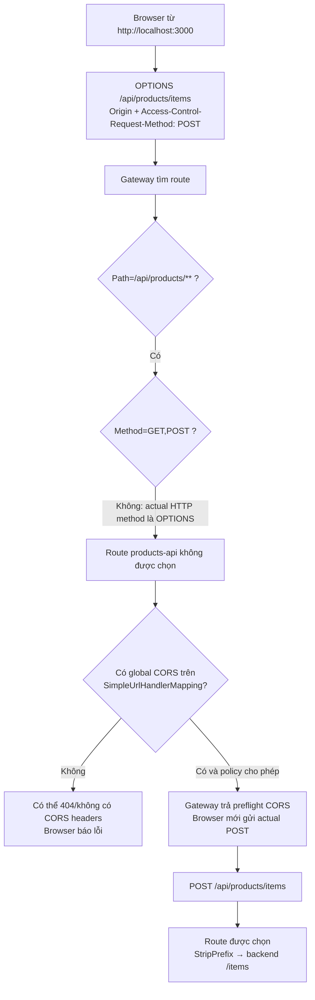
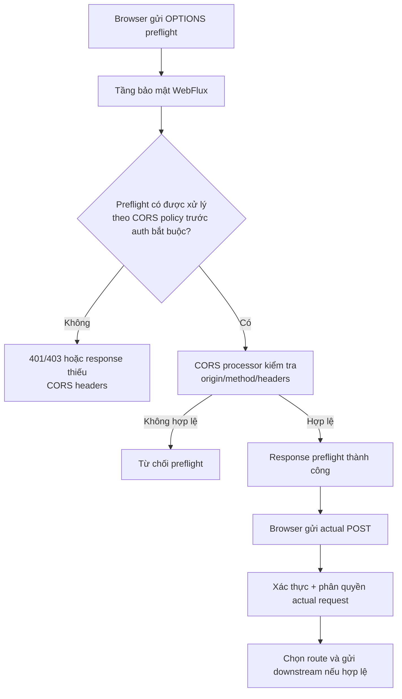
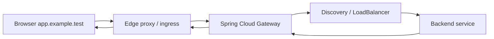

# Preflight không khớp route predicate và Simple URL Handler Mapping

**Chương:** CORS  
**Module:** `SPRING_CLOUD_GATEWAY` — Spring Cloud Gateway

Trong kiến trúc microservices, một ứng dụng web ở `http://localhost:3000` có thể gọi API qua **Spring Cloud Gateway** ở `http://localhost:8080`, còn Gateway chuyển request đến backend ở `http://localhost:8081`. Request API có thể đã cấu hình `Path`, `Method`, filter xử lý header/body, load balancing, xác thực, rate limiting, circuit breaker và retry. Tuy nhiên, trình duyệt vẫn báo **CORS error** trước cả khi request nghiệp vụ tới backend. Một nguyên nhân thường gặp là browser gửi **CORS preflight `OPTIONS`** nhưng route chỉ khớp `GET`/`POST`, nên Gateway không chọn route để áp dụng cấu hình CORS gắn với route ấy.

Bài học giải thích cơ chế **preflight không khớp route predicate**, vai trò của `RoutePredicateHandlerMapping` và `SimpleUrlHandlerMapping` trong **Spring Cloud Gateway Server WebFlux**, và thuộc tính cấu hình:

```properties
spring.cloud.gateway.server.webflux.globalcors.add-to-simple-url-handler-mapping=true
```

Chúng ta sẽ dựng backend HTTP nhỏ, khai báo route có `Method=GET,POST`, gửi preflight bằng `curl`, bật handler mapping bổ sung rồi kiểm chứng response. Từ đó phân biệt vấn đề CORS với 404, 401/403, lỗi downstream, TLS và chính sách bảo mật thực tế.

> **Phạm vi:** Ví dụ chính dành cho **Spring Cloud Gateway Server WebFlux** với prefix cấu hình của các dòng Spring Cloud hiện đại (ví dụ Spring Cloud 2025.0+/Gateway Server WebFlux 4.3+). Ở nhiều bản cũ, prefix là `spring.cloud.gateway.globalcors.*` và `spring.cloud.gateway.routes`. Server Web MVC và Proxy Exchange có pipeline/điểm cấu hình khác; không sao chép cơ chế `SimpleUrlHandlerMapping` của WebFlux sang các flavor khác mà không tra tài liệu phiên bản.

## 1. Mục tiêu học tập

Sau khi hoàn thành bài này, bạn có thể:

1. Phân biệt **same-origin**, **cross-origin**, **simple CORS request** và **preflight request**.
2. Giải thích vì sao `OPTIONS /api/products/items/42` có thể không khớp route `Path=/api/products/**` cộng `Method=GET,POST`.
3. Hiểu sự khác nhau giữa **route matching** và **CORS processing**, đặc biệt đường xử lý `SimpleUrlHandlerMapping`.
4. Viết cấu hình `globalcors.cors-configurations` cùng `add-to-simple-url-handler-mapping: true`.
5. Kiểm tra `Access-Control-Allow-Origin`, `Access-Control-Allow-Methods`, `Access-Control-Allow-Headers`, `Access-Control-Max-Age` và hành vi trên actual response.
6. Phân biệt lỗi policy CORS với Spring Security, backend, gateway filters, reverse proxy hoặc cấu hình TLS.
7. Thiết kế allowlist origins/methods/headers an toàn, không dùng CORS thay cho xác thực và phân quyền.

## 2. CORS là gì và browser gửi preflight khi nào?

**Origin** được xác định bởi **scheme + hostname + port**. Hai URL chỉ được xem là cùng origin khi cả ba thành phần này tương đương:

| Frontend | API Gateway | Quan hệ |
|---|---|---|
| `http://localhost:3000` | `http://localhost:3000` | Cùng origin |
| `http://localhost:3000` | `http://localhost:8080` | Khác origin vì port |
| `http://example.test` | `https://example.test` | Khác origin vì scheme |
| `https://app.example.test` | `https://api.example.test` | Khác origin vì hostname |
| `https://app.example.test` | Backend `http://localhost:8081` mà **browser không gọi trực tiếp** | Browser kiểm tra origin của URL nó gọi (Gateway), không dựa trên URI downstream |

CORS (*Cross-Origin Resource Sharing*) là cơ chế browser áp dụng khi JavaScript trên một origin cố đọc tài nguyên từ một origin khác. Server trả các HTTP response headers cho biết origin, method và request headers nào được phép. **CORS không phải hệ thống xác thực**; `curl`, backend-to-backend HTTP clients và nhiều ứng dụng không-browser không tự thực thi chính sách CORS của trình duyệt.

### 2.1. Preflight khác actual request

Browser có thể cần gửi một request `OPTIONS` để hỏi trước:

```http
OPTIONS /api/products/items HTTP/1.1
Host: localhost:8080
Origin: http://localhost:3000
Access-Control-Request-Method: POST
Access-Control-Request-Headers: content-type,x-client-id
```

Ba header quan trọng:

- `Origin`: origin của trang đang thực hiện request.
- `Access-Control-Request-Method`: **method của actual request dự kiến**, ở ví dụ là `POST`.
- `Access-Control-Request-Headers`: tên các request headers mà actual request muốn gửi, ví dụ `content-type` và `x-client-id`.

Preflight hỏi Gateway liệu request `POST` từ `http://localhost:3000` có được phép mang những header đó hay không. Nếu được chấp nhận, Gateway có thể trả response tương tự:

```http
HTTP/1.1 200 OK
Access-Control-Allow-Origin: http://localhost:3000
Access-Control-Allow-Methods: GET,POST
Access-Control-Allow-Headers: content-type,x-client-id
Access-Control-Max-Age: 600
Vary: Origin
```

Đây là **response minh họa**: HTTP status thành công có thể khác (ví dụ `200` hoặc `204`), giá trị/định dạng/các `Vary` headers phụ thuộc runtime và cấu hình. Không nên dùng chính xác một chuỗi status để định nghĩa CORS thành công. Điều quyết định với browser là các response headers CORS hợp lệ theo yêu cầu và quy tắc của nó.

Khi preflight được phép, browser mới có thể gửi **actual request**:

```http
POST /api/products/items HTTP/1.1
Host: localhost:8080
Origin: http://localhost:3000
Content-Type: application/json
X-Client-Id: lab-browser

{"sku":"SKU-42","quantity":1}
```

Response của **actual request** vẫn phải có header CORS phù hợp (đặc biệt `Access-Control-Allow-Origin`) để browser cho JavaScript đọc kết quả.

### 2.2. Không phải mọi request cross-origin đều có preflight

Một số request đáp ứng điều kiện “CORS-safelisted” có thể được browser gửi trực tiếp (chẳng hạn `GET` thông thường với các header được phép). Ngược lại, các trường hợp thường khiến browser preflight gồm:

- `PUT`, `PATCH`, `DELETE` hoặc method không thuộc tập được safelist;
- `POST` với `Content-Type: application/json`;
- Request có custom header như `X-Client-Id`;
- `Authorization` hoặc các request headers không thuộc safelist.

**Không nhầm:** preflight là `OPTIONS` **thực tế được gửi qua mạng**; `Access-Control-Request-Method: POST` chỉ mô tả method mà browser muốn dùng sau đó. Route predicate `Method=POST` xét HTTP method của request hiện tại, tức `OPTIONS` ở giai đoạn preflight, chứ không tự đổi nó thành POST.

### 2.3. Preflight hợp lệ khác OPTIONS thông thường

Một request `OPTIONS` **không có** `Origin` và `Access-Control-Request-Method` thường không phải CORS preflight. Cơ chế CORS của Spring kiểm tra bộ header phù hợp; không nên giả định bật cấu hình CORS sẽ khiến **mọi** request `OPTIONS` bất kỳ luôn trả cùng status/headers.

## 3. Vì sao preflight không khớp route predicate?

Xét route minh họa:

```yaml
- id: products-api
  uri: http://localhost:8081
  predicates:
    - Path=/api/products/**
    - Method=GET,POST
  filters:
    - StripPrefix=2
```

Request `POST /api/products/items` có thể khớp cả `Path` và `Method`. Nhưng preflight của chính request ấy là `OPTIONS /api/products/items`:

| Tiêu chí | Actual POST | Preflight OPTIONS |
|---|---|---|
| `Path=/api/products/**` | Khớp | Khớp |
| `Method=GET,POST` | Khớp | **Không khớp** vì method là `OPTIONS` |
| Route `products-api` được chọn | Có thể được chọn | Không được chọn bởi tập predicate trên |
| `StripPrefix=2` của route | Chạy khi route được chọn | **Không chạy** nếu không có route khớp |
| HTTP request đến backend | Có, nếu các tầng tiếp theo cho phép | Không được gửi xuống backend qua route này |

Ở Gateway Server WebFlux, `RoutePredicateHandlerMapping` cần tìm được route thỏa các predicate để chọn pipeline xử lý Gateway. Nếu predicate `Method` loại preflight, nó không tự dùng cấu hình metadata của route `products-api` để trả CORS response như một request đã khớp.



**Điểm cần nhớ:** lỗi CORS trong browser không chứng minh backend bị hỏng. Backend có thể chưa nhìn thấy `OPTIONS` và chưa được gọi; route cũng có thể đã trả `404` hoặc bị chặn bởi Security trước bước CORS.

### 3.1. Vì sao thêm filter vào route thường không giải quyết được?

`AddRequestHeader`, `SetResponseHeader` hoặc một GatewayFilter tùy chỉnh gắn **vào chính route `products-api`** không có cơ hội chạy nếu preflight không khớp predicates. Đặt `DedupeResponseHeader` trong route cũng không làm preflight không khớp trở thành request được chọn.

Bạn có thể sửa route để cho phép method `OPTIONS`, nhưng cách ấy cần cân nhắc việc OPTIONS có thể tiếp tục đi xuống backend, Spring Security có thể từ chối nó và nhiều route vẫn cần chính sách CORS khác nhau. Với vấn đề được tài liệu Gateway mô tả, một cách xử lý rõ ràng hơn là dùng **global CORS configuration trên Simple URL Handler Mapping**.

## 4. SimpleUrlHandlerMapping giúp gì?

Spring WebFlux dùng những `HandlerMapping` để tìm handler cho một HTTP exchange. Trong Gateway Server WebFlux có `RoutePredicateHandlerMapping` phục vụ việc tìm route; ngoài ra Spring còn có cơ chế URL handler mapping như `SimpleUrlHandlerMapping`.

Spring Cloud Gateway cung cấp thuộc tính:

```properties
spring.cloud.gateway.server.webflux.globalcors.add-to-simple-url-handler-mapping=true
```

Theo tài liệu chính thức, tùy chọn này cho phép **đưa cùng cấu hình global CORS sang Simple URL Handler Mapping**, để áp dụng cho các request không được route predicate của Gateway xử lý, đặc biệt preflight bị loại do `Method=OPTIONS`.

### 4.1. Giải thích đúng chức năng

| Khi để `false` (mặc định) | Khi đặt `true` |
|---|---|
Global CORS được áp dụng ở các điểm xử lý route tương ứng | Cấu hình global CORS còn được thêm vào Simple URL Handler Mapping |
| Preflight không khớp route có thể không nhận được CORS response mong muốn | Preflight có cơ hội được bộ xử lý CORS giải quyết dù route nghiệp vụ không được chọn |
| Không tự sinh một handler nghiệp vụ cho `OPTIONS` | Không cần backend có controller `@RequestMapping(method=OPTIONS)` để trả lời preflight được phép |

**Không được hiểu sai:** `add-to-simple-url-handler-mapping: true` **không** làm `Method=GET,POST` tự nhận `OPTIONS`, không tự thêm một route HTTP đến downstream, cũng không tự cho phép mọi origin hay method. Nó áp dụng **cấu hình CORS đã khai báo** tại một điểm xử lý bổ sung.

### 4.2. Global CORS policy phải tồn tại

Nếu chỉ đặt:

```yaml
globalcors:
  add-to-simple-url-handler-mapping: true
```

mà **không khai báo chính sách `cors-configurations`** phù hợp, Gateway không có danh sách origin/method/header mong muốn để cho phép preflight. Đây không phải “công tắc tắt mọi kiểm tra CORS”.

### 4.3. Preflight thành công không đồng nghĩa actual request được route

Với một pattern global CORS quá rộng như `[/**]`, CORS processor có thể chấp nhận preflight cho URL mà **không có route nghiệp vụ nào**. Browser sau đó gửi actual request, nhưng actual request vẫn có thể nhận `404` từ Gateway. Điều này không mâu thuẫn: CORS cho phép browser thử gọi; Gateway route vẫn được chọn theo các predicate riêng.

Khi hệ thống có nhiều nhóm API, nên giới hạn URL patterns của CORS policy và kiểm tra mapping/authorization của **actual requests**, không dùng “preflight 2xx” làm bằng chứng backend hoặc route đã tồn tại.

## 5. Cấu hình đầy đủ trong Gateway Server WebFlux

Đây là cấu hình lab minh họa trên **ứng dụng Gateway** chạy tại `8080`:

```yaml
server:
  port: 8080

spring:
  application:
    name: products-gateway
  cloud:
    gateway:
      server:
        webflux:
          globalcors:
            add-to-simple-url-handler-mapping: true
            cors-configurations:
              '[/api/products/**]':
                allowedOrigins:
                  - http://localhost:3000
                allowedMethods:
                  - GET
                  - POST
                allowedHeaders:
                  - Content-Type
                  - X-Client-Id
                  - Authorization
                exposedHeaders:
                  - X-Backend-Id
                allowCredentials: false
                maxAge: 600

          routes:
            - id: products-api
              uri: http://localhost:8081
              predicates:
                - Path=/api/products/**
                - Method=GET,POST
              filters:
                - StripPrefix=2
                - AddRequestHeader=X-Routed-Via, spring-cloud-gateway
```

### 5.1. Đọc từng trường cấu hình

| Cấu hình | Tác dụng |
|---|---|
| `globalcors.cors-configurations` | Khai báo các URL patterns và chính sách CORS dùng chung |
| `'[/api/products/**]'` | Áp dụng policy vào nhóm đường dẫn sản phẩm; dấu ngoặc vuông là cách biểu diễn map key khi bind trong YAML |
| `allowedOrigins` | Danh sách các origin browser được phép, bao gồm **scheme và port** |
| `allowedMethods` | Các HTTP methods **được yêu cầu bởi actual request**; ở đây GET/POST |
| `allowedHeaders` | Các request header names mà browser được phép đề xuất trong preflight |
| `exposedHeaders` | Những response headers ngoài nhóm safelisted mà JavaScript được phép đọc |
| `allowCredentials` | Có cho phép cơ chế CORS credentials hay không; demo đặt `false` |
| `maxAge` | Thời gian cache kết quả preflight tính bằng giây, browser có thể áp dụng giới hạn riêng |
| `add-to-simple-url-handler-mapping: true` | Giúp cấu hình CORS được áp dụng khi preflight không khớp route predicates |
| `Path=/api/products/**` | Chọn request theo URL path |
| `Method=GET,POST` | Route nghiệp vụ **không** chấp nhận OPTIONS như method thực tế |
| `StripPrefix=2` | Sau khi route khớp, `/api/products/items/42` thành `/items/42` |
| `AddRequestHeader` | Đặt dấu quan sát cho request được chuyển tiếp, không phải bảo mật |

**Vì sao không liệt kê `OPTIONS` trong `allowedMethods`?** Với preflight hỏi `Access-Control-Request-Method: POST`, Spring kiểm tra `POST` có nằm trong `allowedMethods` hay không. `OPTIONS` là method của cuộc **hỏi trước**; không nhất thiết phải cho phép `OPTIONS` như một method nghiệp vụ. Đồng thời, route `Method=GET,POST` vẫn không khớp `OPTIONS`; đây chính là lý do có handler mapping CORS bổ sung.

Nếu muốn chính sách áp dụng cho mọi route và URL, tài liệu Spring dùng map key `'[/**]'`. Trong môi trường public nên giới hạn pattern theo những API thực sự được quản lý để không phản hồi preflight tích cực cho các URL không dự kiến công khai.

### 5.2. Đặt config đúng namespace và release train

| Dòng ứng dụng | Prefix thường thấy |
|---|---|
| Gateway Server WebFlux hiện đại | `spring.cloud.gateway.server.webflux.globalcors.*` |
| Gateway Server WebFlux phiên bản cũ | `spring.cloud.gateway.globalcors.*` |
| Gateway Server Web MVC | Cơ chế cấu hình CORS phù hợp Server MVC; không mặc định giống WebFlux |

Trong dòng Spring Cloud Gateway mới, Maven starter WebFlux thường là:

```xml
<dependency>
    <groupId>org.springframework.cloud</groupId>
    <artifactId>spring-cloud-starter-gateway-server-webflux</artifactId>
</dependency>
```

Sử dụng Spring Cloud BOM tương thích Spring Boot mà dự án đã chọn. Nếu copy đúng nội dung YAML nhưng **sai prefix**, ứng dụng có thể vẫn khởi động, song Gateway không áp dụng các route/CORS properties như mong đợi. Hãy kiểm tra bản tài liệu và cấu hình thực tế thay vì kết luận do browser cache.

### 5.3. Metadata CORS theo route có thay thế được không?

Gateway Server WebFlux còn hỗ trợ CORS trong `metadata.cors` của route:

```yaml
- id: products-route-cors
  uri: http://localhost:8081
  predicates:
    - Path=/api/products/**
    - Method=GET,POST
  metadata:
    cors:
      allowedOrigins:
        - http://localhost:3000
      allowedMethods:
        - GET
        - POST
      allowedHeaders:
        - Content-Type
        - X-Client-Id
  filters:
    - StripPrefix=2
```

Đây là **ví dụ một route riêng**, không nên chép đè vào cấu hình lab ở trên trong khi giữ cùng path nếu chưa kiểm soát route order. Route metadata giúp đặt chính sách theo tuyến, nhưng **khi preflight `OPTIONS` không khớp `Method=GET,POST`, route này không được chọn**. Vì thế đừng xem chỉ thêm `metadata.cors` là lời giải đầy đủ cho trường hợp predicate không khớp; hãy xem lại `globalcors.add-to-simple-url-handler-mapping` hoặc thiết kế route/handler preflight phù hợp.

## 6. Dựng backend để chứng minh OPTIONS không cần đến downstream

Tạo một backend Spring Boot đơn giản để biết request nghiệp vụ có được forward hay không. Trên [Spring Initializr](https://start.spring.io/), tạo dự án Maven Java với dependency **Spring Web**, package `com.example.products`. Với Spring Boot 3.x dùng Java 17+; nếu dùng Boot 4.x, hãy chọn starter tương ứng do Initializr tạo.

### 6.1. Cấu trúc

```text
products-backend/
├── pom.xml
└── src/main/
    ├── java/com/example/products/
    │   ├── ProductsApplication.java
    │   └── ProductController.java
    └── resources/application.yml
```

`src/main/resources/application.yml` của **backend**:

```yaml
server:
  port: 8081
spring:
  application:
    name: products-backend
```

`ProductsApplication.java`:

```java
package com.example.products;

import org.springframework.boot.SpringApplication;
import org.springframework.boot.autoconfigure.SpringBootApplication;

@SpringBootApplication
public class ProductsApplication {
    public static void main(String[] args) {
        SpringApplication.run(ProductsApplication.class, args);
    }
}
```

`ProductController.java`:

```java
package com.example.products;

import jakarta.servlet.http.HttpServletRequest;
import java.util.LinkedHashMap;
import java.util.Map;
import org.springframework.http.HttpHeaders;
import org.springframework.http.MediaType;
import org.springframework.http.ResponseEntity;
import org.springframework.web.bind.annotation.GetMapping;
import org.springframework.web.bind.annotation.PathVariable;
import org.springframework.web.bind.annotation.PostMapping;
import org.springframework.web.bind.annotation.RequestBody;
import org.springframework.web.bind.annotation.RequestMapping;
import org.springframework.web.bind.annotation.RestController;

@RestController
@RequestMapping("/items")
public class ProductController {

    @GetMapping("/{sku}")
    public ResponseEntity<Map<String, Object>> find(
            @PathVariable String sku,
            HttpServletRequest request) {
        Map<String, Object> body = new LinkedHashMap<>();
        body.put("backend", "products-8081");
        body.put("sku", sku);
        body.put("method", request.getMethod());
        body.put("path", request.getRequestURI());
        body.put("gatewayMarker", request.getHeader("X-Routed-Via"));
        return ResponseEntity.ok()
                .header("X-Backend-Id", "products-8081")
                .body(body);
    }

    @PostMapping(consumes = MediaType.APPLICATION_JSON_VALUE)
    public ResponseEntity<Map<String, Object>> create(
            @RequestBody Map<String, Object> payload,
            HttpServletRequest request) {
        Map<String, Object> body = new LinkedHashMap<>();
        body.put("backend", "products-8081");
        body.put("method", request.getMethod());
        body.put("path", request.getRequestURI());
        body.put("payload", payload);
        body.put("gatewayMarker", request.getHeader("X-Routed-Via"));
        return ResponseEntity.ok()
                .header("X-Backend-Id", "products-8081")
                .body(body);
    }
}
```

Backend ở lab **không có handler OPTIONS dành riêng**. Đây là điểm hữu ích để kiểm tra việc Gateway có thể tự xử lý preflight. Spring Web ở backend vẫn có thể có xử lý OPTIONS chung; tuy nhiên trong luồng CORS preflight chuẩn của lab, mục tiêu là **không cần chuyển request OPTIONS xuống backend**.

### 6.2. Chạy backend và xác nhận API

Trong thư mục `products-backend`:

```bash
./mvnw spring-boot:run
```

Trên Windows:

```powershell
.\mvnw.cmd spring-boot:run
```

Khi server đã lắng nghe ở `8081`, thử:

```bash
curl -i http://localhost:8081/items/SKU-42
curl -i -X POST http://localhost:8081/items \
  -H "Content-Type: application/json" \
  --data '{"sku":"SKU-42","quantity":1}'
```

Phản hồi GET rút gọn:

```json
{
  "backend": "products-8081",
  "sku": "SKU-42",
  "method": "GET",
  "path": "/items/SKU-42",
  "gatewayMarker": null
}
```

Phản hồi POST có `payload.sku=SKU-42` và `path=/items`. Nếu direct backend chưa hoạt động, sửa backend trước khi thử CORS ở Gateway.

### 6.3. Chạy Gateway

Tạo ứng dụng **Gateway Server WebFlux** riêng ở `8080` với starter và Spring Cloud BOM phù hợp. Dùng toàn bộ `application.yml` phần 5; khởi động Gateway. Giữ cả backend và Gateway hoạt động trong lúc thử nghiệm.

Để so sánh, ở bước đầu có thể đặt `add-to-simple-url-handler-mapping: false`, sau đó đổi thành `true` và khởi động lại Gateway (hoặc làm mới cấu hình bằng cơ chế được hỗ trợ trong môi trường lab). Đừng thay đổi các giá trị `allowedOrigins`, `allowedMethods` hay `Path/Method` cùng lúc, vì như vậy sẽ khó quy kết kết quả cho thuộc tính cần học.

## 7. Kiểm chứng preflight với curl

Trong terminal thứ ba, gửi **preflight hợp lệ**:

```bash
curl -i -X OPTIONS "http://localhost:8080/api/products/items" \
  -H "Origin: http://localhost:3000" \
  -H "Access-Control-Request-Method: POST" \
  -H "Access-Control-Request-Headers: content-type,x-client-id"
```

### 7.1. Trước khi bật Simple URL Handler Mapping

Với `add-to-simple-url-handler-mapping: false`, request `OPTIONS` vẫn không khớp route `Method=GET,POST`. Tùy cấu hình WebFlux, handlers khác và Spring Security, client có thể thấy `404`, `403` hoặc một response không chứa CORS headers mong muốn. **Không cố định mã lỗi**; quan sát response thật và xem trong log backend liệu `OPTIONS` có đến hay không.

Điều cần ghi lại là **route business không được chọn** và browser không nhận đủ chính sách CORS hợp lệ cho preflight. Nếu request đã được một `CorsWebFilter` riêng xử lý hoặc có handler OPTIONS khác, kết quả có thể khác — hãy liệt kê toàn bộ các nơi đang cấu hình CORS trước khi diễn giải.

### 7.2. Sau khi bật `true`

Với cấu hình global CORS đầy đủ từ phần 5 và `add-to-simple-url-handler-mapping: true`, request trên có thể nhận response thành công từ Gateway với:

```http
HTTP/1.1 200 OK
Access-Control-Allow-Origin: http://localhost:3000
Access-Control-Allow-Methods: GET,POST
Access-Control-Allow-Headers: content-type,x-client-id
Access-Control-Max-Age: 600
Vary: Origin
```

Đây là **mẫu rút gọn**, không phải bản sao byte-by-byte: tên header case-insensitive; một số `Vary` headers khác hoặc status thành công khác có thể xuất hiện. Kiểm tra điều quan trọng là origin được phép, requested method là POST được phép và requested headers được phép. Phản hồi preflight thường **không có body nghiệp vụ**.

**Lưu ý:** danh sách `allowedMethods` trong response có thể bao gồm GET/POST; việc không thấy `OPTIONS` trong `Access-Control-Allow-Methods` không phải lỗi. Header này phản ánh các method nghiệp vụ có thể được gọi bằng CORS, không phải yêu cầu Gateway cho phép định tuyến actual OPTIONS qua backend.

### 7.3. Gửi actual POST

```bash
curl -i "http://localhost:8080/api/products/items" \
  -H "Origin: http://localhost:3000" \
  -H "Content-Type: application/json" \
  -H "X-Client-Id: lab-browser" \
  --data '{"sku":"SKU-42","quantity":1}'
```

Gateway chọn route `products-api` vì HTTP method thực là POST, `StripPrefix=2` chuyển path thành `/items` và backend xử lý body. Phản hồi kỳ vọng có JSON:

```json
{
  "backend": "products-8081",
  "method": "POST",
  "path": "/items",
  "payload": {
    "sku": "SKU-42",
    "quantity": 1
  },
  "gatewayMarker": "spring-cloud-gateway"
}
```

Đồng thời, actual response cũng cần `Access-Control-Allow-Origin: http://localhost:3000` để JavaScript trên browser đọc được response; `X-Backend-Id` có thể được đọc bởi JavaScript vì đã có `exposedHeaders: X-Backend-Id`. Việc backend trả body đúng nhưng response **thiếu Allow-Origin** vẫn có thể gây CORS error ở browser.

### 7.4. Kiểm tra GET không nhất thiết có preflight

```bash
curl -i "http://localhost:8080/api/products/items/SKU-42" \
  -H "Origin: http://localhost:3000"
```

Với một browser GET thông thường không có custom header làm phát sinh preflight, request có thể được gửi trực tiếp. Route `Method=GET,POST` chọn GET; Gateway vẫn cần cung cấp CORS headers trên actual response. Vì vậy **không được chỉ kiểm tra OPTIONS** rồi kết luận mọi request cross-origin đều thành công.

### 7.5. Thử từ JavaScript browser

Trên một trang đang chạy tại `http://localhost:3000`, ví dụ minh họa:

```javascript
const response = await fetch("http://localhost:8080/api/products/items", {
  method: "POST",
  headers: {
    "Content-Type": "application/json",
    "X-Client-Id": "lab-browser"
  },
  body: JSON.stringify({ sku: "SKU-42", quantity: 1 })
});

console.log("status:", response.status);
console.log("backend:", response.headers.get("X-Backend-Id"));
console.log("body:", await response.json());
```

Trình duyệt thường gửi `OPTIONS` trước request này vì có `Content-Type: application/json` và custom header. Mở DevTools → Network và kiểm tra **hai HTTP entries**: preflight OPTIONS và actual POST (trừ khi browser đã cache kết quả preflight hợp lệ hoặc chính sách môi trường thay đổi hành vi). Nếu preflight bị từ chối, **actual POST có thể chưa được gửi**.

`curl` không tự chặn JavaScript như browser và không tự sinh preflight; lệnh cURL ở phần 7 là **mô phỏng thủ công HTTP exchange**. Muốn xác nhận hành vi browser, vẫn cần thử trong browser với origin đúng.

## 8. Ma trận kiểm thử CORS dương tính và âm tính

Không nên chỉ kiểm tra một preflight thành công. Một policy đúng phải **cho phép đúng những trường hợp đã phê duyệt** và từ chối những trường hợp ngoài hợp đồng API.

### 8.1. Origin không được phép

```bash
curl -i -X OPTIONS "http://localhost:8080/api/products/items" \
  -H "Origin: http://localhost:9999" \
  -H "Access-Control-Request-Method: POST" \
  -H "Access-Control-Request-Headers: content-type,x-client-id"
```

`http://localhost:9999` không nằm trong `allowedOrigins`. CORS processor không được cấp quyền như với `http://localhost:3000`. Tùy Spring/Gateway/security stack, bạn có thể thấy `403 Invalid CORS request` hoặc response khác không đáp ứng yêu cầu CORS. Đừng bắt buộc chỉ có một status: **kiểm tra không có một tổ hợp Allow-Origin/Allow-Credentials nào vô tình cho origin lạ truy cập bằng browser**.

### 8.2. Requested method không được phép

```bash
curl -i -X OPTIONS "http://localhost:8080/api/products/items" \
  -H "Origin: http://localhost:3000" \
  -H "Access-Control-Request-Method: DELETE"
```

Trong lab, `allowedMethods` chỉ có GET/POST nên preflight yêu cầu DELETE phải bị từ chối theo policy. Việc `Method=GET,POST` của route cũng không cho DELETE là lớp ràng buộc khác: **preflight policy và business route predicates phải nhất quán**, nhưng chúng không thay thế nhau.

### 8.3. Header không được phép

```bash
curl -i -X OPTIONS "http://localhost:8080/api/products/items" \
  -H "Origin: http://localhost:3000" \
  -H "Access-Control-Request-Method: POST" \
  -H "Access-Control-Request-Headers: x-unapproved-header"
```

Header `X-Unapproved-Header` không thuộc `allowedHeaders`. Browser không nên được phép dùng custom header này trong actual request theo policy của lab. HTTP header names không phân biệt hoa/thường: `x-client-id` khớp với `X-Client-Id`, còn `x-unapproved-header` thì không.

### 8.4. Request OPTIONS không có đủ header preflight

```bash
# OPTIONS thông thường, không phải CORS preflight hợp lệ.
curl -i -X OPTIONS "http://localhost:8080/api/products/items"

# Có Origin nhưng không có Access-Control-Request-Method.
curl -i -X OPTIONS "http://localhost:8080/api/products/items" \
  -H "Origin: http://localhost:3000"
```

Không dùng hai lệnh này làm test “preflight thành công” vì thiếu các dấu hiệu browser yêu cầu preflight. CORS processor và những handler khác có thể xử lý chúng theo cách khác. Luôn gửi **Origin + Access-Control-Request-Method** khi mô phỏng preflight thực sự.

### 8.5. URL không có route

```bash
curl -i -X OPTIONS "http://localhost:8080/api/products/unknown-path" \
  -H "Origin: http://localhost:3000" \
  -H "Access-Control-Request-Method: GET"
```

Vì global CORS của lab dùng pattern `/api/products/**`, request có thể được chấp nhận về **chính sách CORS** dù backend không có endpoint tương ứng. Sau đó, actual GET có thể tới backend và nhận `404`. **Preflight chỉ trả lời câu hỏi có được gửi actual method/header từ origin đó hay không**, không khẳng định endpoint nghiệp vụ tồn tại.

Thử thêm `/api/unknown/items` nằm **ngoài** policy pattern; nó không nên được cho phép chỉ vì `products-api` có policy. Nếu pattern toàn cục là `[/**]`, hành vi sẽ rộng hơn.

### 8.6. Bảng kết quả cần ghi lại

| Case | `Origin` | Method được đề xuất | Requested headers | Kết quả chính sách |
|---|---|---|---|---|
| Hợp lệ | `http://localhost:3000` | POST | `content-type,x-client-id` | Cho phép |
| Sai origin | `http://localhost:9999` | POST | `content-type` | Từ chối |
| Sai method | `http://localhost:3000` | DELETE | Không có | Từ chối |
| Sai header | `http://localhost:3000` | POST | `x-unapproved-header` | Từ chối |
| OPTIONS thông thường | Không có | Không có | Không có | Không phải preflight |
| URL khác policy | `http://localhost:3000` | POST | `content-type` | Không áp dụng chính sách products |

Khi ghi kết quả, lưu **HTTP status, các Access-Control-* response headers, route/backend log** và xác nhận actual request có được gửi hay không. Việc client `curl` nhận được body từ một API bị browser chặn **không chứng minh CORS đã mở**.

## 9. Spring Security và preflight

Một cấu hình CORS đúng ở Gateway vẫn có thể không hoạt động nếu **Spring Security** chặn `OPTIONS` trước khi CORS handler được áp dụng. Preflight của browser thường **không mang cookie phiên như actual request**, do đó một security filter yêu cầu mọi request đều đã đăng nhập có thể trả `401`/`403` và browser không gửi actual request.

### 9.1. Trình tự cần đạt



Spring Security cung cấp cơ chế tích hợp CORS cho reactive stack. Khi bật Security, phải **bảo đảm CORS được xử lý theo đúng thứ tự với Security**, dùng cấu hình tương thích WebFlux phiên bản hiện tại. Không chỉ trông chờ vào `globalcors.add-to-simple-url-handler-mapping` nếu request đã bị một security filter từ chối trước khi đến handler mapping.

### 9.2. Có nên permit OPTIONS?

Cho phép preflight `OPTIONS` đi qua một policy Security phù hợp là cách thường dùng để tránh browser bị chặn trước khi gửi actual request. Tuy nhiên:

- `permitAll()` với `OPTIONS` **không tự tạo** `Access-Control-Allow-Origin`, `Allow-Methods` hay `Allow-Headers`. Bạn vẫn cần chính sách CORS hợp lệ.
- Không cho phép actual `GET`/`POST` không xác thực chỉ vì preflight đã được cho phép. Xác thực/authorization của actual request vẫn phải thực thi.
- Không dựa riêng vào HTTP method: `OPTIONS` thông thường và preflight có cấu trúc header khác nhau; security configuration nên được review theo chức năng.
- Nếu dùng OAuth2, cookie session, JWT hoặc CSRF protection, cần kiểm tra những cơ chế ấy riêng, không coi CORS là bằng chứng login/permission.

Không có một mẫu `SecurityWebFilterChain` duy nhất phù hợp với mọi hệ thống. Với bài lab **không thêm Spring Security**, không cần thay đổi chính sách auth; với một Gateway đã có Spring Security, hãy dùng cấu hình CORS/Security chính thức theo phiên bản và không tắt xác thực production để “sửa CORS”.

### 9.3. CORS khác CSRF và authentication

| Cơ chế | Câu hỏi nó trả lời | Nó không bảo đảm |
|---|---|---|
| CORS | JavaScript từ origin nào được browser cho phép đọc response và gửi một số loại cross-origin requests? | Người dùng là ai hoặc được phép mua hàng |
| Authentication | Request gắn với principal/tài khoản/service nào đã được xác minh? | Tự động giới hạn cross-origin JavaScript |
| Authorization | Principal có được gọi API/thao tác dữ liệu này? | Browser được phép đọc response qua CORS |
| CSRF protection | Có thể ngăn thao tác trái ý muốn qua browser dùng trạng thái đăng nhập hiện hữu không? | Thay thế login/permission hoặc CORS policy |

CORS không ngăn các công cụ ngoài browser gọi API. Thậm chí với browser, một số cross-origin requests có thể được **gửi** dù browser không cho JavaScript đọc response. Vì vậy, không dùng “origin không được phép” làm firewall hoặc kiểm soát quyền dữ liệu.

## 10. Credentials, wildcard và origin policy

Trong lab, `allowCredentials: false`. Khi một ứng dụng cần gửi cookie xác thực cross-origin, bài toán phức tạp hơn:

```javascript
// Chỉ là ví dụ cú pháp browser, không phải yêu cầu phải dùng cookie.
fetch("https://api.example.test/orders", {
  method: "GET",
  credentials: "include"
});
```

Nếu thực sự dùng cross-origin credentials:

1. Cấu hình `allowCredentials: true` khi hợp đồng security cho phép.
2. Sử dụng **origin cụ thể** trong `allowedOrigins`, ví dụ `https://app.example.test`.
3. **Không kết hợp `allowedOrigins: '*'` với `allowCredentials: true`**. Spring Framework từ chối tổ hợp không hợp lệ này trong cơ chế cấu hình CORS; trình duyệt cũng không chấp nhận wildcard Allow-Origin cho credentialed request.
4. Nếu cần pattern origin động, xem `allowedOriginPatterns` của Spring và hạn chế pattern rất chặt. Pattern rộng không tự trở nên an toàn chỉ vì không dùng dấu `*` trực tiếp trong `allowedOrigins`.
5. Cấu hình `SameSite`/`Secure`/domain/path của cookie theo nhu cầu thực, và đánh giá CSRF. CORS allow-credentials **không bảo đảm cookie sẽ được gửi**: browser còn áp các chính sách cookie và quyền riêng tư.

### 10.1. `Access-Control-Allow-Credentials` không tự gửi cookie

`Access-Control-Allow-Credentials: true` là **response header** nói với browser liệu response của credentialed CORS request có thể được expose theo policy hay không. Nó không tạo phiên đăng nhập, không cấp quyền và không bắt browser gửi cookie nếu chính sách cookie hoặc `credentials` mode không cho phép.

### 10.2. Phân biệt allowedHeaders và exposedHeaders

| Cấu hình | Hướng dữ liệu | Ví dụ |
|---|---|---|
| `allowedHeaders` | Browser muốn gửi **request headers** đến API | `Content-Type`, `X-Client-Id`, `Authorization` |
| `exposedHeaders` | JavaScript muốn đọc **response headers** ngoài nhóm safelisted | `X-Backend-Id`, `X-Correlation-Id` |

Nếu `X-Backend-Id` có trong response nhưng chưa được `exposedHeaders` cho phép, JavaScript có thể không đọc được bằng `response.headers.get("X-Backend-Id")` dù DevTools hoặc `curl` nhìn thấy header ấy. Đây là sự khác nhau giữa **header có trên mạng** và **header được browser cho phép chương trình đọc**.

### 10.3. `Origin` không phải bằng chứng danh tính

Một chương trình HTTP ngoài browser có thể tự gửi header `Origin`. Dựa vào `Origin: https://trusted.example` để cấp quyền thao tác dữ liệu là thiết kế không an toàn. Mọi endpoint quan trọng vẫn phải xác thực token/session/service identity và áp dụng authorization; CORS chỉ là một lớp kiểm soát hành vi browser.

## 11. CORS ở Gateway, backend và các proxy khác

Một request từ browser có thể đi qua:



Nếu **cả Gateway và backend** cùng thêm `Access-Control-Allow-Origin`, response có thể mang nhiều giá trị/duplicate headers mà browser không chấp nhận. Một môi trường có CDN/ingress tự thêm CORS headers càng dễ gây xung đột.

### 11.1. Xác định lớp chịu trách nhiệm CORS

| Vị trí xử lý | Ưu điểm | Điều cần kiểm soát |
|---|---|---|
| Gateway | Tập trung một chính sách cho các API đi qua Gateway; preflight có thể được trả tại edge | Policy phải phù hợp từng API và URL path; không tự thay authentication |
| Backend | Service tự quản lý policy cho các client gọi trực tiếp | Dễ phát sinh duplicate headers nếu Gateway cũng thêm; có thể phải hỗ trợ preflight tới backend |
| Ingress/reverse proxy/CDN | Có thể xử lý preflight trước Gateway, giảm tải | Cấu hình phải đồng bộ với Gateway/backend, auth và cache |

Trong bài lab, **Gateway là nơi xử lý CORS**, còn backend chỉ cung cấp API nghiệp vụ và header `X-Backend-Id`. Đó là một kiến trúc dễ quan sát, không phải quy định rằng mọi production deployment đều phải xử lý CORS tại Gateway.

### 11.2. DedupeResponseHeader không chữa lỗi route OPTIONS

Spring Cloud Gateway có `DedupeResponseHeader` để xử lý những header response trùng lặp ở các tuyến có nhu cầu. Ví dụ minh họa:

```yaml
filters:
  - DedupeResponseHeader=Access-Control-Allow-Credentials Access-Control-Allow-Origin
```

Tuy nhiên, filter này thuộc **GatewayFilter chain của route đã chọn**. Nếu preflight không khớp route `Method=GET,POST` thì **không thể trông chờ filter của chính route ấy chạy** để sửa preflight. Cách tốt hơn là thống nhất nơi phát sinh CORS headers; chỉ dùng dedupe khi hiểu rõ nguồn lặp và thứ tự xử lý.

### 11.3. `Vary` và cache

Khi response CORS phụ thuộc `Origin` hoặc request preflight headers, các thành phần cache/CDN phải phân biệt đúng biến thể. Spring CORS processing có thể đưa vào các `Vary` headers như:

```http
Vary: Origin
Vary: Access-Control-Request-Method
Vary: Access-Control-Request-Headers
```

Không loại bỏ hoặc ghi đè `Vary` tùy tiện khi có shared cache. Nếu cache response với `Access-Control-Allow-Origin` cho origin A rồi trả lại cho origin B, có thể làm hỏng trải nghiệm, tạo false negatives, hoặc gây rủi ro tùy cách cache và chính sách credential.

## 12. Tác động đến route predicates và các Gateway filters khác

`SimpleUrlHandlerMapping` xử lý preflight **không đồng nghĩa** toàn bộ filter chain của route nghiệp vụ đã chạy. Cần phân biệt trách nhiệm:

| Thành phần | Khi preflight không khớp `Method=GET,POST` | Khi actual POST khớp route |
|---|---|---|
| `Path` và `Method` predicates | Route nghiệp vụ không được chọn | Được đánh giá và route có thể được chọn |
| Global CORS + simple URL handler mapping | Có thể xử lý CORS theo policy | CORS xử lý cho actual request |
| `StripPrefix` hoặc `RewritePath` gắn route | Không chạy | Thay đổi path downstream |
| `AddRequestHeader`/`RemoveRequestHeader` gắn route | Không chạy | Tác động request gửi backend |
| `RequestRateLimiter` gắn route | Không chạy qua route đó | Chạy theo filter/policy nếu route được chọn |
| `CircuitBreaker`/`Retry` gắn route | Không chạy qua route đó | Có thể tác động request downstream |
| `RequestSize`/`ReadBody` tùy cách cấu hình | Không nên giả định chạy | Tùy predicate/filter và method route |
| `lb://products-service` | Không chọn instance qua route đó | LoadBalancer chọn instance khi route được chọn |
| `https://backend` và TLS outbound | Không có kết nối backend theo route ấy | Gateway thiết lập kết nối outbound phù hợp |

### 12.1. Có ảnh hưởng đến rate limiting?

Giới hạn lưu lượng **gắn dưới route** có thể không đếm các preflight được `SimpleUrlHandlerMapping` xử lý. Nếu một hệ thống cần phòng chống lượng `OPTIONS` bất thường, phải thiết kế kiểm soát ở lớp nhận request hoặc proxy/ingress thích hợp, ngoài giới hạn nghiệp vụ theo route. Đồng thời cần tránh tính preflight là một thao tác nghiệp vụ của người dùng khi lựa chọn quota.

### 12.2. Có nên retry OPTIONS?

Một preflight hợp lệ thường được **CORS processor tại Gateway** trả lời, không cần gửi tới backend nên không có lý do áp dụng Retry/CircuitBreaker của tuyến API để “sửa” nó. Nếu preflight bị chặn ở Security hoặc policy origin/method không khớp, retry đến cùng endpoint không làm chính sách thay đổi.

Nếu backend xử lý OPTIONS trực tiếp trong một kiến trúc khác, cần review riêng; không coi mọi OPTIONS là idempotent business call phải được route/retry như GET.

### 12.3. TLS và mixed content khác CORS

Nếu trang chạy HTTPS nhưng JavaScript cố gọi một API HTTP không an toàn, browser có thể chặn do **mixed content** trước khi request tới Gateway. Thêm CORS headers không giải quyết thiếu TLS.

`http://localhost:3000` và `http://localhost:8080` là hai origin khác nhau dù cùng chạy trên máy local. Nếu gateway nhận HTTPS từ browser và gọi backend HTTP nội bộ, CORS xét **origin frontend và Gateway URL browser gọi**, chứ không so sánh browser với URL backend ẩn phía sau. Chính sách TLS outbound của `https://`/`wss://` phải được kiểm tra riêng.

### 12.4. Service discovery không sửa path CORS

Chuyển `uri: http://localhost:8081` thành `lb://products-service` không làm route `Method=GET,POST` tự khớp `OPTIONS`, cũng không làm xuất hiện `Access-Control-Allow-Origin`. Service discovery quyết định **backend instance**, trong khi CORS quyết định **quyền truy cập response từ browser**, ở những tầng khác nhau.

## 13. Chẩn đoán lỗi CORS theo từng tầng

| Dấu hiệu | Nguyên nhân thường gặp | Kiểm tra |
|---|---|---|
| Browser báo CORS, backend không có log request | Preflight không khớp route hoặc bị chặn trước Gateway handler | Network tab: OPTIONS status/headers; kiểm tra `Method` |
| OPTIONS 404, actual POST direct bằng curl hoạt động | `Method=GET,POST` loại `OPTIONS` | Kiểm tra `globalcors.add-to-simple-url-handler-mapping` |
| Đã bật `true` nhưng preflight vẫn lỗi | CORS map sai prefix, URL pattern không khớp, Security chặn, Origin/method/header không được phép | Đọc response status, headers, logs của đúng Gateway instance |
| OPTIONS 401/403 khi bật Spring Security | Security xử lý trước khi CORS preflight được cho phép | Cấu hình reactive Security CORS và preflight order |
| OPTIONS được 2xx nhưng actual request 404 | URL thực không khớp route hoặc backend handler thiếu | Xem `Path`, `Method`, `StripPrefix` và backend mapping |
| OPTIONS được 2xx nhưng actual POST 401/403 | Actual request thiếu credential hoặc không đủ quyền | Kiểm tra authentication/authorization, không mở rộng CORS vô điều kiện |
| `Access-Control-Allow-Origin` không có hoặc sai | `allowedOrigins` thiếu origin chính xác (scheme/host/port) | So sánh `Origin` thực với config |
| `Access-Control-Allow-Headers` không chấp nhận request | Custom header không thuộc `allowedHeaders` | Xem `Access-Control-Request-Headers` |
| Browser từ chối dù cURL nhìn thấy response | Browser thực thi CORS; cURL không | Dùng DevTools và kiểm tra response headers preflight/actual |
| Browser chặn credentialed CORS | `allowCredentials`, wildcard origin hoặc cookie SameSite/Secure không hợp lệ | Xem credentials mode, ACAO/ACAC và cookie attributes |
| Duplicate `Access-Control-Allow-Origin` | Gateway/backend/proxy cùng thêm CORS headers | Quy định một lớp chịu trách nhiệm chính, xem đường response |
| HTTP/HTTPS khác origin ngoài dự kiến | Scheme/port khác hoặc mixed content | So sánh đầy đủ origin, TLS và URL fetch |
| Đổi policy nhưng browser vẫn dùng kết quả cũ | Preflight được cache theo `maxAge` hoặc qua proxy | Dùng phiên/test mới, kiểm tra cache và headers |
| GET được còn POST JSON không được | GET không preflight, POST JSON cần preflight | Gửi OPTIONS với requested method POST |
| OPTIONS trả status không phải 200 | Implementation khác có thể dùng 204; hoặc là lỗi | Đọc toàn bộ CORS headers trước khi kết luận |
| Response chỉ lỗi qua một Gateway instance | Cấu hình/prefix/release train khác giữa các replica | Kiểm tra từng instance và deployment version |

### 13.1. Quy trình debug đáng tin cậy

1. **Xác minh origin** thật của frontend: scheme, hostname và port; đừng đoán từ URL production.
2. **Xem DevTools Network:** browser có gửi OPTIONS không, method nào được đề xuất, headers nào và status thực tế là gì.
3. **Tái hiện bằng cURL:** gửi `OPTIONS` với `Origin`, `Access-Control-Request-Method` và `Access-Control-Request-Headers` tương ứng.
4. **Kiểm tra route predicate:** `Path`, `Method` và thứ tự route; xác định vì sao preflight có/không khớp.
5. **Kiểm tra cấu hình CORS:** đúng prefix WebFlux version, URL pattern, origin, method, header và `add-to-simple-url-handler-mapping`.
6. **Kiểm tra Security:** có filter auth/CSRF chặn OPTIONS trước CORS handler không.
7. **Kiểm tra actual request:** POST/GET có đi tới đúng backend, response có ACAO và status/backend body đúng không.
8. **Kiểm tra proxy/cache:** có ingress, CDN, backend hoặc một filter khác thêm/xóa CORS headers không.

Đừng chữa mọi lỗi bằng `allowedOrigins: '*'` hoặc bỏ authentication. Cần xác định **tầng nào** gây lỗi và chỉ thay đổi cấu hình ở tầng đó.

## 14. Quan sát và vận hành an toàn

Một Gateway phục vụ nhiều microservices cần quan sát cả route business lẫn preflight:

| Metric/log nên theo dõi | Ý nghĩa |
|---|---|
| Số request OPTIONS theo path pattern | Đo lưu lượng preflight, phát hiện bất thường |
| Phân bố preflight thành công/thất bại | Phát hiện thay đổi CORS policy hoặc frontend |
| `Origin` thuộc allowlist / bị từ chối (theo nhóm được kiểm soát) | Kiểm tra origin policy, tránh log Origin tùy ý có cardinality lớn |
| Route ID của actual GET/POST | Xác nhận request nghiệp vụ được chọn đúng |
| Status 401/403/404/5xx theo tầng | Tách Security, routing, downstream và CORS |
| TLS handshake/connection errors | Phân biệt lỗi mạng/protocol với lỗi policy CORS |
| CORS response headers trên Gateway/backend/ingress | Kiểm tra thiếu/trùng header và cache `Vary` |
| Tracing/correlation ID | Liên kết actual request với backend (preflight thường được xử lý tại Gateway) |

Không dùng raw Origin do client tự gửi, token, cookies hoặc tên header động tùy ý làm metric label. Khi log preflight, nên chuẩn hóa pattern/path và reason code; bảo vệ log theo policy riêng tư. `traceparent`/`tracestate` và Micrometer Observation có thể hỗ trợ quan sát, nhưng không mặc định preflight có cùng trace ID hoặc cùng đường đi với actual request.

### 14.1. Đếm request ở backend không phản ánh số preflight

Với cấu hình chuẩn của bài lab, một lần người dùng bấm nút có thể tạo hai HTTP exchanges ở Gateway (OPTIONS rồi POST), nhưng backend **chỉ thấy POST**. Nếu backend ghi một log và frontend thấy hai dòng Network, đó không phải bug “request bị duplicate” do retry. Ngược lại, nếu backend nhận nhiều POST, cần xem retry/client resubmit hoặc vấn đề ứng dụng, không gán mặc định cho CORS.

### 14.2. Quản trị chính sách theo nhiều môi trường

Trong dev, origin thường là `http://localhost:3000`. Trên staging/production, nên tạo allowlist cụ thể theo địa chỉ chính thức `https://app.staging.example.test`, `https://app.example.test` và xác minh không vô tình mở mọi subdomain/port. Không chuyển nguyên wildcard từ lab lên production khi hệ thống xử lý session hoặc credential.

Review CORS mỗi khi frontend domain, API gateway hostname, scheme/port, authentication method hoặc headers tùy biến thay đổi. Đồng thời cần đồng bộ cấu hình ở mọi replica Gateway; một replica thiếu `add-to-simple-url-handler-mapping` có thể tạo lỗi lúc có lúc không, khó tái hiện trên browser.

## 15. Bài thực hành mở rộng

Các bài sau chỉ thực hiện trong **môi trường lab cô lập**, dùng dữ liệu giả và có thể thay đổi cấu hình Gateway. Thử từng mục một, ghi kết quả rồi khôi phục cấu hình gốc để không làm lẫn các biến số.

### Bài 1 — Tắt rồi bật simple URL handler mapping

1. Giữ `Path=/api/products/**` và `Method=GET,POST`.
2. Đặt `add-to-simple-url-handler-mapping: false`, thử preflight POST có `Origin` và `Access-Control-Request-Method`.
3. Ghi status, `Access-Control-Allow-Origin` và backend log.
4. Chuyển thành `true`, khởi động lại Gateway và gửi đúng request cũ.
5. Giải thích sự khác nhau khi CORS được áp dụng ngoài route predicate.

**Điểm cần trả lời:** thêm simple handler mapping **không thay đổi `Method` predicate**, vậy tại sao OPTIONS có thể được xử lý?

### Bài 2 — Phân biệt allowedMethods với Method predicate

Trong global CORS policy, tạm thời chỉ cho `allowedMethods: [GET]` nhưng vẫn để route `Method=GET,POST`. Gửi preflight đề xuất `POST` và actual `POST` bằng `curl`.

Giải thích tại sao browser **không được phép** gửi actual POST dựa trên CORS policy, nhưng `curl` (không thực thi CORS) vẫn có thể trực tiếp POST đến route nghiệp vụ. Khôi phục `allowedMethods` gồm GET/POST.

### Bài 3 — So sánh Origin khác port

Thay `Origin: http://localhost:3000` bằng `Origin: http://localhost:3001`. Chứng minh hai origin khác nhau dù hostname giống nhau. Sau đó cân nhắc điều gì xảy ra khi frontend deploy lên HTTPS domain mới.

### Bài 4 — Kiểm tra custom headers và exposed headers

Gửi preflight hỏi `X-Client-Id` (được phép) rồi hỏi `X-Admin-Token` (chưa cho phép). Sau đó đọc response `X-Backend-Id` từ JavaScript bằng `response.headers.get` và giải thích vai trò của `exposedHeaders`.

### Bài 5 — Thử CORS với Security trong lab riêng

Bổ sung một policy Spring Security reactive vào Gateway thử nghiệm, yêu cầu actual POST phải có quyền thích hợp. Xác định cách xử lý preflight **trước khi bắt buộc đăng nhập**, đồng thời giữ actual POST phải xác thực. So sánh `401/403` do Security với response lỗi CORS. Không áp dụng cách “tắt hẳn Security” trên production để qua bài kiểm thử.

### Bài 6 — Định tuyến discovery không thay đổi CORS

Thay `uri: http://localhost:8081` bằng `lb://products-service` **chỉ sau khi** cấu hình Spring Cloud LoadBalancer và nguồn instances hợp lệ. Giữ nguyên `Path`, `Method` và global CORS. Kiểm tra preflight vẫn được Gateway xử lý, còn actual POST mới chọn instance; không coi `lb://` là thay thế cho CORS.

### Bài 7 — Kiểm tra kết quả trong browser

Chạy frontend thử ở `http://localhost:3000`, thực thi `fetch` phần 7 và quan sát DevTools:

- `OPTIONS` có xuất hiện không?
- Response preflight có đúng `Access-Control-Allow-*` không?
- Actual POST có được gửi không?
- Actual response có `Access-Control-Allow-Origin` không?
- Có thể đọc `X-Backend-Id` từ JavaScript không?

Thử tắt/bật preflight cache trong điều kiện bạn kiểm soát để tránh kết luận sai do browser tái dùng kết quả preflight trước đó.

### Bảng đánh giá kết quả

| Kiểm tra | Tiêu chí đạt |
|---|---|
| Hiểu origin | Phân biệt scheme/hostname/port, không nhầm backend URL với Gateway URL |
| Phân biệt preflight | Biết HTTP method thật là OPTIONS, còn requested method nằm trong header |
| Route predicate | Giải thích được vì sao `Method=GET,POST` không khớp OPTIONS |
| Simple handler mapping | Biết vai trò của `add-to-simple-url-handler-mapping: true` |
| Chính sách CORS | Khai báo đúng pattern, origins, methods và headers |
| Preflight hợp lệ | Trả các response headers phù hợp cho browser |
| Negative tests | Origin/method/header không được phép bị từ chối |
| Actual request | Backend nhận POST ở path đã được `StripPrefix` thay đổi |
| Security | Không dùng CORS thay auth/authorization hoặc CSRF protection |
| Observability | Phân biệt Gateway OPTIONS, downstream POST, cache và metrics |

## 16. Câu hỏi tự kiểm tra

**1. Frontend tại `http://localhost:3000` gọi Gateway `http://localhost:8080`. Có phải cross-origin không?**  
Có. Port là một thành phần của origin, nên `3000` khác `8080`.

**2. Browser muốn POST JSON và thêm `X-Client-Id`. Preflight dùng HTTP method nào?**  
HTTP method của preflight là **OPTIONS**, còn `Access-Control-Request-Method` mang giá trị **POST**.

**3. Vì sao route `Path=/api/products/**`, `Method=GET,POST` không nhận preflight?**  
Vì `Path` khớp nhưng `Method` kiểm tra `OPTIONS` của request hiện tại, không phải `POST` ở header đề xuất.

**4. `add-to-simple-url-handler-mapping: true` có sửa predicate `Method=GET,POST` không?**  
Không. Nó đưa global CORS configuration vào Simple URL Handler Mapping để preflight có thể được xử lý ngay cả khi route predicate không khớp.

**5. Chỉ bật thuộc tính simple handler mapping mà không có `cors-configurations` có cho phép mọi origin không?**  
Không. Cần chính sách CORS phù hợp; thuộc tính này không mở mọi origin hay method.

**6. Vì sao preflight thành công nhưng browser vẫn nhận 404 khi gửi actual request?**  
CORS chỉ cho phép thử gửi request cross-origin; route hoặc backend mapping của actual request vẫn có thể không tồn tại.

**7. `allowedMethods` có bắt buộc phải chứa OPTIONS để browser gửi preflight POST không?**  
Không. Khi hỏi `Access-Control-Request-Method: POST`, policy cần cho phép POST như actual method; preflight bản thân là OPTIONS.

**8. Có thể dùng `allowedOrigins: '*'` đồng thời `allowCredentials: true` không?**  
Không dùng tổ hợp này. Với credentialed CORS, cấu hình explicit origins, đánh giá cookie/CSRF và kiểm tra Spring CORS validation.

**9. Nếu Spring Security trả 401 cho OPTIONS trước khi CORS handler chạy, bật simple mapping có đủ không?**  
Không chắc. Phải bảo đảm Security và CORS được tích hợp/đặt đúng thứ tự; handler mapping không tự vượt qua Security filter đã từ chối request.

**10. Tại sao `curl` nhận JSON thành công nhưng browser vẫn báo CORS?**  
`curl` không thực thi quy tắc CORS của browser; có thể response thiếu/không hợp lệ `Access-Control-Allow-Origin` hoặc preflight thất bại.

**11. `Access-Control-Allow-Origin` từ Gateway và backend bị lặp, nên xử lý ở đâu?**  
Ưu tiên xác định một lớp chịu trách nhiệm chính về CORS; rà soát cả ingress/backend/Gateway. Dedupe response header có thể hỗ trợ một số trường hợp nhưng filter của route không tự xử lý preflight không khớp.

**12. Vì sao không thể dùng Origin để phân quyền API?**  
Origin là header có thể bị client ngoài browser tự khai và CORS không xác thực principal. Cần authentication/authorization ở lớp phù hợp.

## 17. Tổng kết

Trong **Spring Cloud Gateway Server WebFlux**, khi một route được cấu hình `Path=/api/products/**` và `Method=GET,POST`, browser preflight có HTTP method **OPTIONS** nên có thể **không khớp route predicate**. Nếu chỉ dựa vào CORS metadata/filter gắn với route, preflight chưa chắc được xử lý như mong muốn. Thuộc tính:

```properties
spring.cloud.gateway.server.webflux.globalcors.add-to-simple-url-handler-mapping=true
```

giúp áp dụng **global CORS configuration** cả trên `SimpleUrlHandlerMapping`, hỗ trợ trả lời preflight không được RoutePredicateHandlerMapping xử lý do method không khớp. Điều kiện để hoạt động đúng vẫn là khai báo chính sách `cors-configurations` cho origin, method, headers và URL pattern phù hợp, đồng thời bảo đảm Spring Security/proxy không chặn hoặc ghi đè kết quả trước khi CORS processor xử lý.

Khi debug, hãy đi theo thứ tự **browser Origin/preflight → Path/Method predicates → CORS handler mapping → Security → actual request/route → backend → response headers**. Preflight thành công không tự cho phép thao tác nghiệp vụ; xác thực, phân quyền, CSRF, rate limiting, TLS, circuit breaker, retry và service discovery vẫn phải được thiết kế ở đúng tầng. Đây là cách giữ một API Gateway vừa tương thích với browser vừa an toàn khi vận hành microservices.

## Tài liệu tham khảo chính thức

1. [Spring Cloud Gateway Server WebFlux — CORS Configuration](https://docs.spring.io/spring-cloud-gateway/reference/spring-cloud-gateway-server-webflux/cors-configuration.html) — tài liệu về global/per-route CORS và `add-to-simple-url-handler-mapping`.
2. [Spring Cloud Gateway — Configuration Properties](https://docs.spring.io/spring-cloud-gateway/reference/configprops.html) — tra prefix `spring.cloud.gateway.server.webflux.globalcors.*` theo phiên bản.
3. [Spring Cloud Gateway Server WebFlux — Route Predicate Factories](https://docs.spring.io/spring-cloud-gateway/reference/spring-cloud-gateway-server-webflux/request-predicates-factories.html) — `Path`, `Method`.
4. [Spring Framework WebFlux — CORS](https://docs.spring.io/spring-framework/reference/web/webflux-cors.html) — quy tắc CORS và `CorsConfiguration`.
5. [Spring Security — CORS (Reactive)](https://docs.spring.io/spring-security/reference/reactive/integrations/cors.html) — tương tác CORS với Security.
6. [MDN — Cross-Origin Resource Sharing (CORS)](https://developer.mozilla.org/en-US/docs/Web/HTTP/Guides/CORS) — preflight, credentialed requests và browser behavior.
7. [Fetch Standard — CORS Protocol](https://fetch.spec.whatwg.org/#http-cors-protocol) — định nghĩa nền tảng cho browser CORS processing.

> **Ghi chú về release train:** Các tài liệu cũ của Spring Cloud Gateway sử dụng prefix `spring.cloud.gateway.globalcors.add-to-simple-url-handler-mapping` thay vì prefix `spring.cloud.gateway.server.webflux.globalcors.add-to-simple-url-handler-mapping`. Trước khi triển khai, chọn đúng tài liệu tương ứng bản Gateway/Boot/Spring Cloud và kiểm thử bằng cả HTTP client lẫn trình duyệt. Nội dung này hoàn thành bài học STEP 4, chưa thay thế vòng QA học thuật hoặc kiểm tra bảo mật production.
