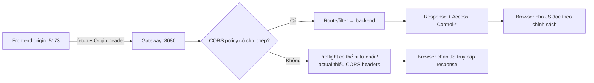
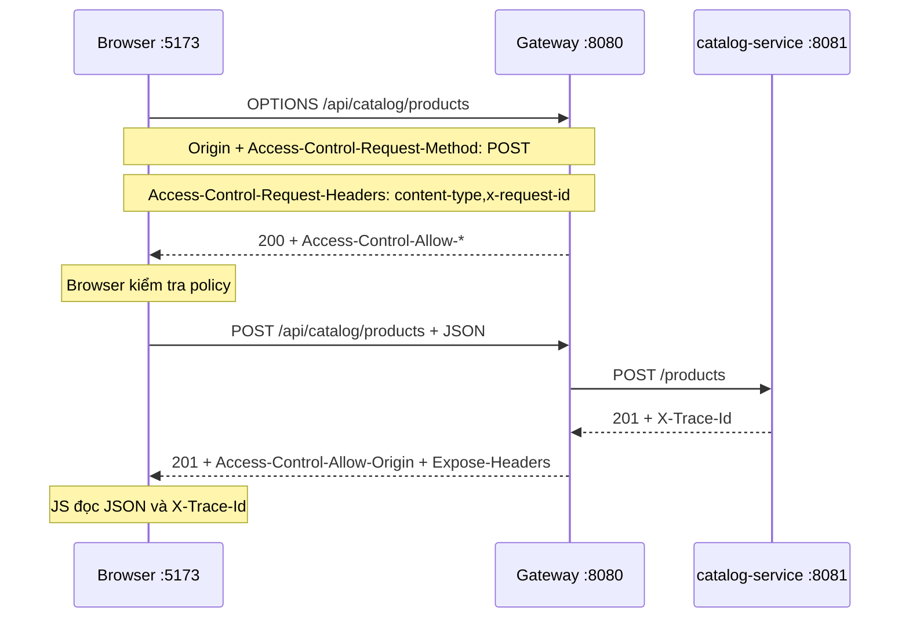

# Allowed origins, methods, headers và exposed headers

## 1. CORS nằm ở đâu trong Spring Cloud Gateway?

Trong ứng dụng microservices, **Spring Cloud Gateway** nhận request từ các client, chọn route qua **predicate**, chạy **filter chain** để thay đường dẫn/header và chuyển tiếp đến dịch vụ đích. Gateway cũng thường kết hợp khám phá dịch vụ, xác thực, rate limiting, retry, circuit breaker, TLS và metrics/tracing. Với **ứng dụng web chạy trong trình duyệt**, cần thêm chính sách **Cross-Origin Resource Sharing (CORS)** để quyết định những trang web nào được phép đọc response từ Gateway qua JavaScript.

Giả sử:

- Frontend: `http://localhost:5173` (chạy Vite hoặc một web server dev).
- Gateway: `http://localhost:8080`.
- Backend: `http://localhost:8081` (client không nên gọi trực tiếp backend trong kiến trúc này).

Frontend và Gateway có cùng hostname `localhost` nhưng **khác port**, vì vậy đây là **hai origin khác nhau**. Khi frontend dùng `fetch("http://localhost:8080/api/catalog/products/42")`, trình duyệt áp dụng CORS. Server-to-server client hoặc `curl` không tự thực thi chính sách chặn response giống browser.

Mục tiêu của bài thuộc chương **CORS** là hiểu chính xác bốn cấu hình:

1. **`allowedOrigins`:** trang web có origin nào được chấp nhận?
2. **`allowedMethods`:** trang web được gọi API bằng HTTP method nào?
3. **`allowedHeaders`:** trang web được gửi những **request header** nào trong cross-origin request?
4. **`exposedHeaders`:** JavaScript được đọc thêm những **response header** nào?

Bên cạnh đó, bài hướng dẫn **preflight `OPTIONS`**, `allowCredentials`, `maxAge`, cấu hình CORS toàn cục/từng route cho Gateway Server WebFlux, kiểm thử bằng `curl` và trình duyệt, rồi xử lý các lỗi thường gặp khi kết hợp Spring Security.

> **Phạm vi:** Các ví dụ cấu hình Gateway sử dụng **Spring Cloud Gateway Server WebFlux 5.0.x** với namespace `spring.cloud.gateway.server.webflux`. Dòng Gateway 4.x có thể dùng namespace `spring.cloud.gateway.globalcors` cũ; Gateway Server Web MVC dùng stack Servlet và cần đối chiếu tài liệu riêng. CORS tuân theo quy tắc của **trình duyệt + Spring Framework**, không phải một loại `GatewayFilter` thay thế được xác thực.

## 2. Định nghĩa đúng origin và cách trình duyệt quyết định

Một **origin** được xác định bằng bộ ba **scheme + hostname + port**:

```text
Origin = scheme://host:port

http://localhost:5173             # Frontend dev
http://localhost:8080             # Gateway dev: origin KHÁC do port
https://app.example.test          # Frontend production
https://api.example.test          # Gateway production: origin KHÁC do hostname
```

| URL 1 | URL 2 | Same-origin? | Lý do |
|---|---|---|---|
| `http://localhost:5173` | `http://localhost:5173/products` | Có | Path không thuộc định nghĩa origin |
| `http://localhost:5173` | `http://localhost:8080` | Không | Khác port |
| `http://localhost:5173` | `https://localhost:5173` | Không | Khác scheme |
| `https://app.example.test` | `https://api.example.test` | Không | Khác hostname |
| `https://app.example.test` | `https://app.example.test:443` | Có | Port HTTPS mặc định tương đương 443 |
| `http://127.0.0.1:5173` | `http://localhost:5173` | Không | Khác hostname theo origin |

**Origin không bao gồm path, query, fragment.** Vì thế `https://app.example.test/dashboard` không phải chuỗi hợp lệ để điền vào `allowedOrigins` khi muốn cho phép origin của website: dùng **`https://app.example.test`**.

### 2.1. CORS là quy tắc cho quyền đọc response trong browser

Một request có thể **được gửi tới server** nhưng JavaScript không được **đọc response** vì thiếu hoặc sai CORS headers. CORS không phải tường lửa: một ứng dụng ngoài trình duyệt, curl hay server khác vẫn có thể gọi API nếu không có xác thực/mạng chặn. Với request **không cần preflight**, trình duyệt thường gửi request thật rồi mới quyết định có cho script đọc kết quả hay không.



**Không nhầm CORS với CSRF, OAuth2, JWT hoặc mTLS.** CORS giới hạn quyền đọc response của các origin trong trình duyệt; **xác thực** kiểm tra ai gọi API và **phân quyền** kiểm tra người đó được làm gì. Một API nhạy cảm cần cả những chính sách bảo vệ độc lập này.

### 2.2. Các header của một trao đổi CORS

| HTTP header | Ai gửi? | Mục đích |
|---|---|---|
| `Origin` | Browser → Gateway | Origin của trang đang gọi API |
| `Access-Control-Request-Method` | Browser → Gateway trên **preflight OPTIONS** | HTTP method thực mà browser muốn gọi sau preflight |
| `Access-Control-Request-Headers` | Browser → Gateway trên **preflight OPTIONS** | Danh sách tên request headers thực muốn gửi |
| `Access-Control-Allow-Origin` | Gateway → Browser | Origin được phép đọc response |
| `Access-Control-Allow-Methods` | Gateway → Browser (thường preflight) | Các method được CORS cho phép |
| `Access-Control-Allow-Headers` | Gateway → Browser (thường preflight) | Các **request headers** được cho phép |
| `Access-Control-Expose-Headers` | Gateway → Browser trên actual response | Các **response headers** bổ sung mà JS được đọc |
| `Access-Control-Allow-Credentials` | Gateway → Browser | Cho phép browser hiển thị response của credentialed request khi chính sách phù hợp |
| `Access-Control-Max-Age` | Gateway → Browser trên preflight | Thời gian cache kết quả preflight tính bằng giây |

Lưu ý: `Origin` là request header về nguồn trang web, **khác** `Host` là authority của HTTP request gửi tới Gateway. `Host=api.example.test` không có nghĩa `Origin=https://api.example.test`.

## 3. Bốn nhóm cấu hình cốt lõi

### 3.1. allowedOrigins — chấp nhận origin nào?

`allowedOrigins` là danh sách **origin hợp lệ**, ví dụ:

```yaml
allowedOrigins:
  - https://app.example.test
  - http://localhost:5173
```

Một request có `Origin: http://localhost:5173` khớp cấu hình; server có thể trả:

```http
Access-Control-Allow-Origin: http://localhost:5173
Vary: Origin
```

**Không trả danh sách phân tách bằng dấu phẩy** trong một `Access-Control-Allow-Origin`. Header ấy chỉ nhận **một origin cụ thể**, giá trị `*` trong trường hợp được phép, hoặc giá trị `null` trong ngữ cảnh đặc biệt. Spring thường phản ánh origin **đã khớp** từ danh sách allowlist.

**Những lỗi phổ biến:**

- Ghi `https://app.example.test/dashboard`: có path nên không phải origin.
- Chỉ cho phép `https://app.example.test` nhưng frontend gọi từ `http://localhost:5173`: khác origin.
- Cho phép `http://localhost:5173` nhưng trình duyệt mở bằng `http://127.0.0.1:5173`: khác hostname.
- Ghi `https://*.example.test` trong **`allowedOrigins`** với kỳ vọng wildcard subdomain; cần xem **`allowedOriginPatterns`** ở mục 8.

### 3.2. allowedMethods — method thực tế được phép

`allowedMethods` là danh sách HTTP methods mà browser có thể dùng cho **actual cross-origin request**:

```yaml
allowedMethods:
  - GET
  - POST
  - PUT
```

Nếu preflight hỏi `Access-Control-Request-Method: POST`, CORS server sẽ kiểm tra **POST** có được phép hay không. Request preflight tuy dùng **`OPTIONS`** ở tầng HTTP, nhưng **không cần tự thêm OPTIONS vào `allowedMethods`** chỉ để chấp nhận preflight cho một GET/POST đã được cho phép. `OPTIONS` là phương thức của **request kiểm tra**, còn `Access-Control-Request-Method` nói phương thức **request thật**.

Đồng thời, `allowedMethods` **khác route predicate `Method`**. CORS cho phép POST không tự tạo route POST; nếu route chỉ có `Method=GET` thì actual POST vẫn không match route.

### 3.3. allowedHeaders — những request header nào được gửi?

`allowedHeaders` trả lời câu hỏi: “Frontend muốn gửi `Authorization`, `Content-Type`, `X-Request-Id` thì Gateway cho phép các **tên request header** ấy không?”

```yaml
allowedHeaders:
  - Authorization
  - Content-Type
  - X-Request-Id
```

Browser có thể gửi preflight:

```http
OPTIONS /api/catalog/products HTTP/1.1
Origin: http://localhost:5173
Access-Control-Request-Method: POST
Access-Control-Request-Headers: content-type,x-request-id
```

Nếu được cho phép, response preflight sẽ chứa `Access-Control-Allow-Headers` phản ánh/danh sách những request header phù hợp. Tên HTTP header **không phân biệt hoa/thường**.

**Quan trọng:** `allowedHeaders: [Authorization]` chỉ nói browser có thể gửi một header **có tên Authorization**; nó **không** xác minh bearer token. Việc kiểm tra chữ ký JWT, expiry, scope và quyền truy cập vẫn thuộc Spring Security hoặc dịch vụ bảo mật. `allowedHeaders` cũng không cho phép JavaScript tùy ý đặt các **forbidden request headers** như `Host` hay `Cookie`; browser quản lý chúng theo quy tắc riêng.

### 3.4. exposedHeaders — response headers JavaScript được nhìn thấy

`exposedHeaders` kiểm soát **response header đọc được từ JavaScript** ngoài nhóm CORS-safelisted response headers. Ví dụ:

```yaml
exposedHeaders:
  - X-Trace-Id
  - X-RateLimit-Remaining
```

Khi backend/Gateway thực sự trả `X-Trace-Id: trace-demo-42`, Spring CORS có thể thêm:

```http
Access-Control-Expose-Headers: X-Trace-Id, X-RateLimit-Remaining
```

Và frontend đọc:

```javascript
const response = await fetch("http://localhost:8080/api/catalog/products/42");
console.log(response.headers.get("X-Trace-Id"));
```

**Phải có cả hai điều kiện:** response thật chứa header `X-Trace-Id` **và** chính sách CORS exposure cho phép JS đọc nó. `exposedHeaders` **không tạo** header mới; để tạo header, dùng backend response hoặc `AddResponseHeader`/`SetResponseHeader` của Gateway.

Browser đã cho phép đọc một số response headers theo mặc định như `Cache-Control`, `Content-Language`, `Content-Length`, `Content-Type`, `Expires`, `Last-Modified` và `Pragma`. Không cần kê lại các tên đó chỉ vì muốn đọc chúng. Ngược lại, `Set-Cookie` là **forbidden response header name** với Fetch: thêm nó vào `exposedHeaders` **không cho phép** `response.headers.get("Set-Cookie")` đọc cookie.

### 3.5. Bảng phân biệt nhanh

| Cấu hình | Kiểm soát | HTTP header được sinh tương ứng | Không làm gì? |
|---|---|---|---|
| `allowedOrigins` | Nguồn website gọi | `Access-Control-Allow-Origin` | Không xác thực người dùng |
| `allowedMethods` | Method của actual request | `Access-Control-Allow-Methods` | Không tạo route/mapping backend |
| `allowedHeaders` | Tên request headers browser muốn gửi | `Access-Control-Allow-Headers` | Không thêm response header, không kiểm tra JWT |
| `exposedHeaders` | Tên response headers JS được đọc | `Access-Control-Expose-Headers` | Không cho phép request header, không tự tạo header |

## 4. Preflight và actual request: hai pha khác nhau

### 4.1. Vì sao trình duyệt cần preflight?

Một số cross-origin requests có thể được gửi **không cần preflight** (ví dụ GET không có custom request headers, đáp ứng các điều kiện CORS-safelisted). Những request có **method không thuộc nhóm simple**, **`Content-Type: application/json`**, hoặc **custom header** thường kích hoạt một request **OPTIONS** để browser hỏi trước.



Trong mô hình trên, **CORS preflight thường được xử lý tại Gateway/WebFlux CORS processor**, không cần gửi xuống backend, còn actual POST mới đi qua route/filter đến backend. Kết quả chính xác tùy các handler/security filter được cài đặt; nếu preflight bị chặn sớm thì actual request **không được browser gửi**.

### 4.2. Preflight OPTIONS không đồng nghĩa allowedMethods: [OPTIONS]

Giả sử route chứa `Method=GET,POST`. Preflight có HTTP method `OPTIONS`, nên predicate `Method` của route có thể **không khớp**. Gateway Server WebFlux cung cấp:

```yaml
spring:
  cloud:
    gateway:
      server:
        webflux:
          globalcors:
            add-to-simple-url-handler-mapping: true
```

Thuộc tính này khiến **global CORS configuration** còn được cung cấp cho simple URL handler mapping, hữu ích khi preflight không match `RoutePredicateHandlerMapping` chỉ vì method `OPTIONS`. Cấu hình trên là một **đoạn riêng**, cần có global CORS rules như mục 5 mới có ý nghĩa. Đừng chỉ thêm `OPTIONS` vào route method predicate rồi hy vọng chính sách CORS tự xuất hiện.

### 4.3. Browser xử lý response preflight như thế nào?

Ví dụ response preflight (giá trị, thứ tự header có thể khác theo runtime):

```http
HTTP/1.1 200 OK
Access-Control-Allow-Origin: http://localhost:5173
Access-Control-Allow-Methods: GET,POST
Access-Control-Allow-Headers: content-type,x-request-id
Access-Control-Allow-Credentials: true
Access-Control-Max-Age: 1800
Vary: Origin
Vary: Access-Control-Request-Method
Vary: Access-Control-Request-Headers
```

Khi browser xác định origin/method/request headers hợp lệ, nó có thể gửi actual request và lưu kết quả preflight trong **preflight cache** theo chính sách browser. `Access-Control-Max-Age: 1800` tính bằng **giây**; browser có quyền giới hạn thời gian cache theo chính sách riêng.

Nếu method hoặc request header không được cho phép, preflight thường bị **từ chối** và actual request **không được gửi**. Với Spring Framework, preflight không hợp lệ có thể trả `403 Invalid CORS request`, nhưng không nên xây ứng dụng phụ thuộc vào đúng một status hay thông điệp lỗi vì ingress/security và runtime có thể khác.

### 4.4. CORS response headers không thay HTTP authorization

HTTP `200` cùng `Access-Control-Allow-Origin` chỉ có nghĩa browser **được phép đọc response** theo CORS, không có nghĩa request đã được xác thực/phân quyền. HTTP `401` hoặc `403` cũng có thể cần CORS headers để frontend đọc body lỗi. Cấu hình CORS phải hoạt động đúng cho **đường thành công và lỗi**, không chỉ `200`.

## 5. Cấu hình CORS toàn cục trong Gateway Server WebFlux

### 5.1. Một ứng dụng Gateway có thể chạy thử

Đây là **file `application.yml` đầy đủ của Gateway demo**, dùng WebFlux:

```yaml
server:
  port: 8080

spring:
  application:
    name: cors-gateway-demo
  cloud:
    gateway:
      server:
        webflux:
          globalcors:
            # Cho phép CORS hoạt động cả khi preflight OPTIONS
            # không match Method=GET,POST của route bên dưới.
            add-to-simple-url-handler-mapping: true
            cors-configurations:
              '[/**]':
                allowedOrigins:
                  - http://localhost:5173
                  - https://app.example.test
                allowedMethods:
                  - GET
                  - POST
                allowedHeaders:
                  - Authorization
                  - Content-Type
                  - X-Request-Id
                exposedHeaders:
                  - X-Trace-Id
                  - X-RateLimit-Remaining
                allowCredentials: true
                maxAge: 1800
          routes:
            - id: catalog-route
              uri: http://localhost:8081
              predicates:
                - Path=/api/catalog/**
                - Method=GET,POST
              filters:
                - StripPrefix=2
```

Ví dụ phù hợp với Spring Cloud Gateway Server WebFlux 5.0.x và **không yêu cầu Java DSL** cho CORS: `globalcors.cors-configurations` là một **map từ URL pattern đến Spring Framework `CorsConfiguration`**.

Giải thích:

1. `'[/**]'` là **map key có pattern `/**`**; cặp dấu ngoặc vuông được quote để Spring Boot binder giữ đúng key URL pattern (theo cú pháp tài liệu Gateway).
2. `allowedOrigins` liệt kê **hai origin chính xác**; không mở mọi website với `*`.
3. `allowedMethods` cho phép GET và POST thực tế; route `Method=GET,POST` cũng cho phép hai method đó ở tầng route predicate.
4. `allowedHeaders` dành cho `Authorization`, `Content-Type` và `X-Request-Id` trong **request**. Khi backend không cần Authorization, header này có thể bỏ khỏi allowlist.
5. `exposedHeaders` cho JS đọc `X-Trace-Id` và `X-RateLimit-Remaining` nếu response thực có những header đó.
6. `allowCredentials: true` chỉ nên giữ nếu frontend cần request có cookie/credential và chính sách bảo mật đã được thiết kế (mục 8).
7. `maxAge: 1800` cho phép browser cache **kết quả preflight**, không thay cache HTTP response.
8. `add-to-simple-url-handler-mapping: true` xử lý ca preflight không khớp route có method predicate.
9. `StripPrefix=2` xóa hai segment `api` và `catalog`: backend `:8081` nhận `/products/42` thay vì `/api/catalog/products/42`.

**Vì sao có `allowedMethods` cả ở CORS và route?** Hai lớp quyết định khác nhau: CORS trả lời “browser ở origin này có quyền dùng method ấy không”; route predicate trả lời “Gateway có chọn route này với method ấy không”. Khi cần từ chối method khác, **định nghĩa nhất quán cả hai** và áp dụng authorization ở backend.

### 5.2. Thay `[/**]` bằng URL pattern hẹp hơn

Khi chỉ API `/api/**` cần được gọi cross-origin, có thể thay key:

```yaml
# Phần cors-configurations của WebFlux (không phải file độc lập).
cors-configurations:
  '[/api/**]':
    allowedOrigins:
      - https://app.example.test
    allowedMethods:
      - GET
      - POST
    allowedHeaders:
      - Content-Type
    exposedHeaders:
      - X-Trace-Id
```

Giới hạn pattern giúp tránh vô tình cho phép CORS trên endpoint quản trị/Actuator hoặc route khác. Tuy vậy, **pattern CORS không phải access-control rule**: request không có CORS hoặc client không phải browser vẫn có thể đến endpoint nếu network/security cho phép.

### 5.3. Bản API công khai không cần cookie

Nếu API hoàn toàn public và **không sử dụng credentialed requests**, chính sách có thể đơn giản hơn:

```yaml
# Chỉ trích đoạn CorsConfiguration cho một public read-only API.
allowedOrigins: '*'
allowedMethods:
  - GET
allowedHeaders:
  - Accept
allowCredentials: false
```

Với `allowedOrigins: '*'`, server có thể trả `Access-Control-Allow-Origin: *`. **Không kết hợp wildcard này với `allowCredentials: true`**: Spring Framework sẽ từ chối tổ hợp do tiêu chuẩn CORS không cho phép wildcard origin cho response có credentials.

**Cẩn thận:** “public API cho browser đọc từ mọi website” là một lựa chọn sản phẩm, không nên mặc định dùng `*` cho API trả thông tin cá nhân hoặc dữ liệu nội bộ.

## 6. CORS theo từng route bằng metadata

Nếu các route có frontend origin khác nhau, có thể khai báo CORS **riêng trên một route** bằng `metadata.cors`. Đây là **phương án thay thế** cho việc đặt policy global trên cùng đường dẫn; tránh lặp toàn bộ chính sách ở hai nơi khi không cần thiết.

```yaml
# Ví dụ độc lập: file application.yml cho Gateway Server WebFlux.
server:
  port: 8080

spring:
  cloud:
    gateway:
      server:
        webflux:
          routes:
            - id: order-route
              uri: http://localhost:8081
              predicates:
                - Path=/orders/**
              metadata:
                cors:
                  allowedOrigins:
                    - https://orders.example.test
                  allowedMethods:
                    - GET
                    - POST
                  allowedHeaders:
                    - Authorization
                    - Content-Type
                  exposedHeaders:
                    - X-Request-Id
                  allowCredentials: true
                  maxAge: 900
```

**Ý nghĩa:** route `order-route` chỉ quảng bá chính sách CORS liên quan tới website `https://orders.example.test`; không tự cho phép `https://app.example.test` của route catalog. Gateway documentation xác nhận route-specific CORS dùng **metadata key `cors`** và các thuộc tính giống `CorsConfiguration`.

**Điểm cần thử riêng:** preflight là HTTP `OPTIONS`. Nếu route còn predicate `Method=GET`, request preflight có thể không match route; lúc này nên **dùng global CORS policy có hỗ trợ simple URL handler mapping** hoặc cấu hình CORS/handler/security tương đương theo phiên bản. Chỉ nhìn metadata `cors` trong YAML không đủ kết luận OPTIONS đã được xử lý thành công.

### 6.1. Nên chọn global hay per-route?

| Tiêu chí | Global CORS | Route metadata CORS |
|---|---|---|
| Phạm vi | Mọi path khớp pattern global | Route cụ thể |
| Phù hợp | Nhiều API có cùng frontend origin/policy | Các route phục vụ những frontend khác nhau |
| Preflight không match route do method | Có `add-to-simple-url-handler-mapping` hỗ trợ | Cần kiểm tra riêng luồng OPTIONS và route predicate |
| Nguy cơ | Pattern `/**` rộng quá nhu cầu | Route mới có thể thiếu metadata CORS |
| Vận hành | Policy tập trung | Policy phân tán, cần test từng route |

Nếu vừa khai báo CORS tại Gateway vừa bật `@CrossOrigin`/CORS filter của **backend** được proxy, có thể xuất hiện **nhiều `Access-Control-Allow-Origin`** hoặc header mâu thuẫn. Browser có thể từ chối response có các giá trị ACAO trùng/không hợp lệ. Hãy quyết định rõ **lớp nào là nơi duy nhất phát CORS headers cho client** (thường là Gateway ở public edge) và tránh các cấu hình chồng chéo.

## 7. Thực hành backend echo và kiểm tra bằng curl

### 7.1. Tạo một backend có GET/POST để test

Tạo ứng dụng Spring Boot dùng dependency Spring Web (Servlet) chạy `:8081`. Lớp `CatalogApplication.java`:

```java
package com.example.catalog;

import java.util.Map;
import org.springframework.boot.SpringApplication;
import org.springframework.boot.autoconfigure.SpringBootApplication;
import org.springframework.http.HttpStatus;
import org.springframework.http.ResponseEntity;
import org.springframework.web.bind.annotation.GetMapping;
import org.springframework.web.bind.annotation.PathVariable;
import org.springframework.web.bind.annotation.PostMapping;
import org.springframework.web.bind.annotation.RequestBody;
import org.springframework.web.bind.annotation.RestController;

@SpringBootApplication
@RestController
public class CatalogApplication {

    public static void main(String[] args) {
        SpringApplication.run(CatalogApplication.class, args);
    }

    @GetMapping("/products/{id}")
    public ResponseEntity<Map<String, String>> get(@PathVariable String id) {
        return ResponseEntity.ok()
            .header("X-Trace-Id", "trace-demo-" + id)
            .header("X-RateLimit-Remaining", "99")
            .body(Map.of("id", id, "name", "Sample item"));
    }

    @PostMapping("/products")
    public ResponseEntity<Map<String, String>> create(
            @RequestBody Map<String, String> request) {
        return ResponseEntity.status(HttpStatus.CREATED)
            .header("X-Trace-Id", "trace-created-demo")
            .header("X-RateLimit-Remaining", "98")
            .body(Map.of(
                "id", "new-1",
                "name", request.getOrDefault("name", "Unnamed")));
    }
}
```

File `application.yml` của **backend**:

```yaml
spring:
  application:
    name: catalog-demo
server:
  port: 8081
```

Backend ví dụ **không khai báo CORS**: mọi chính sách CORS dành cho browser được cấu hình ở Gateway. Trong ứng dụng thật, backend cần bảo vệ kết nối nội bộ và xác thực/phân quyền nếu endpoint không public.

Khởi động backend và kiểm tra trực tiếp trước:

```bash
./mvnw spring-boot:run

# Chạy trong terminal khác:
curl -i 'http://localhost:8081/products/42'
```

Khi backend chạy đúng, response thường là `200 OK`, có `X-Trace-Id: trace-demo-42` và JSON `{"id":"42","name":"Sample item"}` (thứ tự trường có thể thay đổi).

### 7.2. Chạy Gateway và kiểm chứng GET

Tạo dự án Gateway riêng dùng `spring-cloud-starter-gateway-server-webflux` với Spring Boot/Spring Cloud BOM tương thích và cấu hình **mục 5.1**. Khởi động tại cổng `8080`, backend vẫn ở `8081`.

```bash
# Gọi cross-origin GET tới Gateway, giả lập Origin từ frontend dev.
curl -i \
  -H 'Origin: http://localhost:5173' \
  'http://localhost:8080/api/catalog/products/42'
```

Response dự kiến (rút gọn):

```http
HTTP/1.1 200 OK
Access-Control-Allow-Origin: http://localhost:5173
Access-Control-Allow-Credentials: true
Access-Control-Expose-Headers: X-Trace-Id, X-RateLimit-Remaining
X-Trace-Id: trace-demo-42
X-RateLimit-Remaining: 99
Content-Type: application/json

{"id":"42","name":"Sample item"}
```

**Hai điều xảy ra đồng thời:** route `StripPrefix=2` chuyển request tới `GET /products/42` của backend; CORS processor bổ sung response headers giúp browser được đọc response. Không được coi `X-Trace-Id` và `Access-Control-Expose-Headers` là cùng một thứ: header thứ nhất chứa **dữ liệu**, header thứ hai chứa **quyền đọc dữ liệu header đó**.

### 7.3. Kiểm chứng preflight cho POST JSON

Browser chuẩn bị gửi `POST` với JSON và custom header `X-Request-Id`, nên có thể gửi:

```bash
curl -i -X OPTIONS \
  -H 'Origin: http://localhost:5173' \
  -H 'Access-Control-Request-Method: POST' \
  -H 'Access-Control-Request-Headers: content-type,x-request-id' \
  'http://localhost:8080/api/catalog/products'
```

Phản hồi mong đợi là một **preflight thành công**, thường HTTP 200, có:

```http
Access-Control-Allow-Origin: http://localhost:5173
Access-Control-Allow-Methods: GET,POST
Access-Control-Allow-Headers: content-type,x-request-id
Access-Control-Allow-Credentials: true
Access-Control-Max-Age: 1800
```

Thứ tự/cách viết hoa, định dạng header có thể khác giữa bản Framework. **Không đòi hỏi body JSON ở preflight**; nó được xử lý như phép kiểm tra quyền trước actual request.

Sau đó gửi **actual POST**:

```bash
curl -i -X POST \
  -H 'Origin: http://localhost:5173' \
  -H 'Content-Type: application/json' \
  -H 'X-Request-Id: req-demo-1' \
  --data '{"name":"Bàn phím"}' \
  'http://localhost:8080/api/catalog/products'
```

Kết quả dự kiến là **`201 Created`** với body có `id` và `name`, kèm `Access-Control-Allow-Origin` và `Access-Control-Expose-Headers`. `curl` không tự gửi preflight; ở đây ta tự thực hiện **hai lệnh riêng** chỉ để kiểm tra server.

> Các lệnh và phản hồi là **hướng dẫn thực hành/kết quả dự kiến**, chưa được chạy trong tài liệu này. Nếu Gateway ở container khác, `localhost:8081` trong route phải được thay bằng địa chỉ backend mà container Gateway có thể truy cập.

## 8. Credentials, wildcard và allowedOriginPatterns

### 8.1. allowCredentials là quyết định bảo mật riêng

Khi frontend gửi request với `credentials: "include"`, browser có thể gửi cookies hoặc credentials thuộc phạm vi cho phép của browser. Để frontend được phép đọc response của **credentialed cross-origin request**, response cần:

```http
Access-Control-Allow-Origin: https://app.example.test
Access-Control-Allow-Credentials: true
```

Với request có credentials, **`Access-Control-Allow-Origin: *` không hợp lệ**. Spring Framework chủ động từ chối cấu hình `allowedOrigins: '*'` cùng `allowCredentials: true`, thay vì âm thầm phản hồi wildcard.

Một CORS policy cho credentials phải **giới hạn rõ origin**, kiểm soát CSRF, xác thực/phân quyền và cookie policy. `Access-Control-Allow-Credentials: true` tự nó không tạo cookie/session cũng không chứng minh request đã đăng nhập.

**Chú ý cookie:** để browser thực sự gửi cross-site cookies, còn cần chính sách `SameSite=None; Secure` khi phù hợp, HTTPS, domain/path cookie đúng, và browser có thể áp dụng quy tắc chặn third-party cookies. CORS đúng **không bảo đảm cookie sẽ được gửi**.

### 8.2. allowedOriginPatterns thay cho wildcard origins động

Spring Framework hỗ trợ `allowedOriginPatterns` để khớp các hostname theo mẫu:

```yaml
# Trích đoạn CorsConfiguration, KHÔNG khai báo cùng allowedOrigins: '*'.
allowedOriginPatterns:
  - https://*.example.test
allowedMethods:
  - GET
allowedHeaders:
  - Authorization
allowCredentials: true
```

Nếu một origin thực **khớp pattern**, Spring có thể phản hồi **origin cụ thể** trong `Access-Control-Allow-Origin`, không đưa cả pattern vào response. Vì vậy cấu hình kiểu này có thể kết hợp với credentials về mặt cơ chế.

Tuy nhiên, **pattern rộng có rủi ro đáng kể**: bất kỳ subdomain nào có thể khớp, kể cả subdomain bị chiếm quyền hoặc bị một người dùng khác kiểm soát. Trong môi trường multi-tenant, chỉ dùng khi có cơ chế quản lý hostname/tenant và đăng ký origin đáng tin; ưu tiên **danh sách origin cụ thể**.

Ví dụ, `https://*.example.test` không có nghĩa trình duyệt tự động tin `http://app.example.test`: scheme `https` vẫn là một phần của origin. Phải kiểm thử cả apex domain, subdomain nhiều cấp, tên host không được phép và port khác.

### 8.3. Wildcard allowedHeaders và allowedMethods có ngoại lệ

Spring `CorsConfiguration` cho phép wildcard `*` trong `allowedHeaders` và `allowedMethods`. Khi bật credentials, Spring có thể phản ánh **request method và request headers thực từ preflight** vào response thay vì đơn giản gửi `*`.

Tuy nhiên, đừng coi điều đó là một chính sách cho phép bất cứ điều gì an toàn: **`allowedHeaders: '*'` mở rộng phạm vi custom headers được browser yêu cầu**, còn `allowedMethods: '*'` mở rộng methods. Trình duyệt/các tiêu chuẩn Fetch còn có các quy tắc riêng với header như `Authorization`. Đối với API có credential, **ưu tiên nêu tường minh** `Authorization`, `Content-Type` và các custom headers cần thiết.

**`exposedHeaders: '*'` cũng cần thận trọng:** tài liệu Spring mô tả hành vi tạo wildcard kể cả khi `allowCredentials` bật trong một số tình huống, nhưng chuẩn Fetch và các trình duyệt có giới hạn riêng cho wildcard với credentialed requests. Để bảo đảm tương thích, **liệt kê những response headers cần expose**, ví dụ `X-Trace-Id` và `X-RateLimit-Remaining`.

### 8.4. Origin null không đồng nghĩa localhost

Browser có thể gửi `Origin: null` từ một số ngữ cảnh có opaque origin như trang `file://` hoặc iframe sandboxed. Không dùng `allowedOrigins: ["null"]` như một mẹo “cho phép môi trường local” nếu không có lý do bảo mật rõ ràng: nhiều ngữ cảnh khác cũng có thể phát sinh null origin. Để phát triển, hãy dùng origin chính xác như `http://localhost:5173`.

## 9. Kiểm thử trong browser: allowedHeaders khác exposedHeaders

Giả sử frontend thực chạy tại **`http://localhost:5173`** và Gateway ở **`http://localhost:8080`**. Trong DevTools Console của tab frontend, chạy:

```javascript
// Một GET cross-origin không cần custom request header.
const response = await fetch(
  "http://localhost:8080/api/catalog/products/42",
  { credentials: "include" }
);

console.log("HTTP status", response.status);
console.log("Trace header", response.headers.get("X-Trace-Id"));
console.log("Remaining", response.headers.get("X-RateLimit-Remaining"));
console.log("JSON", await response.json());
```

Với cấu hình mục 5 và backend đã chạy, `response.headers.get("X-Trace-Id")` có thể trả `trace-demo-42`. Nếu bỏ `exposedHeaders: [X-Trace-Id, ...]` trong chính sách, response network vẫn có thể chứa `X-Trace-Id` nhưng script **không đọc được header đó** (thường nhận `null`). Đây là phép thử đặc trưng của **exposed response headers**.

Tiếp theo thử POST JSON kèm custom request header:

```javascript
const postResponse = await fetch(
  "http://localhost:8080/api/catalog/products",
  {
    method: "POST",
    headers: {
      "Content-Type": "application/json",
      "X-Request-Id": "req-browser-1"
    },
    credentials: "include",
    body: JSON.stringify({ name: "Bàn phím" })
  }
);

console.log(postResponse.status);
console.log(postResponse.headers.get("X-Trace-Id"));
console.log(await postResponse.json());
```

Trong DevTools → Network, bạn có thể thấy **OPTIONS** được gửi trước actual **POST** do `Content-Type: application/json` và `X-Request-Id`. Nếu loại `X-Request-Id` khỏi `allowedHeaders`, browser có thể chặn POST **ngay ở preflight**, dù backend POST được khai báo hợp lệ.

**Lưu ý:** các ví dụ `fetch` phải chạy trong **một trang thực tế ở origin `http://localhost:5173`**, không phải thanh địa chỉ hoặc một tab `file://` có origin khác. `credentials: "include"` chỉ minh họa chế độ credentials; backend demo không tạo login session, nên đây **không phải bài thực hành xác thực cookie**.

### 9.1. So sánh lỗi trong Network và lỗi JavaScript

| Quan sát | Diễn giải |
|---|---|
| OPTIONS bị từ chối, không thấy POST | Preflight thất bại; browser không gửi actual request |
| GET trả 200 trong Network nhưng JS báo CORS error | Browser nhận response nhưng thiếu/sai CORS headers nên không cho script đọc |
| JS đọc JSON nhưng `headers.get("X-Trace-Id")` là `null` | Có thể quên `exposedHeaders`, backend không gửi header hoặc header bị proxy loại |
| OPTIONS đúng nhưng actual trả 401/403 | CORS cho phép gọi/đọc, **không có nghĩa** user đã được xác thực/phân quyền |
| `fetch(..., {mode:"no-cors"})` trả opaque response | Không phải giải pháp; JS vẫn không đọc body/header như response thường |

Không giải quyết lỗi CORS bằng việc tắt cơ chế an toàn trong browser hoặc extension vô hiệu hóa CORS. Sửa chính sách **phía Gateway/Server** và xác minh trong DevTools.

## 10. CORS với Spring Security, route predicates và filter chain

### 10.1. Vì sao Spring Security có thể chặn preflight?

Trên ứng dụng Gateway WebFlux có Spring Security, một `SecurityWebFilterChain` có thể yêu cầu authentication cho `/api/**`. Preflight thường **không mang cookie đăng nhập** và chưa phải actual request. Nếu security xử lý nó như API cần login trước khi CORS processor có cơ hội trả lời, browser thấy `401`/`403` cho OPTIONS và không gửi GET/POST.

Theo tài liệu Spring Security, **CORS cần được xử lý trước authorization của actual request**. Một cách là cấu hình `CorsWebFilter` / `CorsConfigurationSource` và tích hợp Security đúng phiên bản. Với Gateway, hãy xác định rõ chính sách CORS được áp dụng ở **HandlerMapping** hay **WebFilter** và tránh triển khai hai bộ xử lý CORS chồng lấn.

Trên phiên bản Security/WebFlux cụ thể, bạn có thể cần điều chỉnh security chain để **preflight được xử lý bởi CORS một cách an toàn**, trong khi actual request vẫn bị kiểm tra JWT/cookie/CSRF như bình thường. **Không dùng `permitAll("/api/**")` chỉ để làm OPTIONS hoạt động** — cách này vô tình bỏ bảo vệ API thật.

### 10.2. Cấu hình CORS bằng Java CorsWebFilter — phương án thay thế

Nếu cần toàn quyền kiểm soát CORS trong **Spring WebFlux**, có thể dùng `CorsWebFilter` của Spring Framework. Đây là **phương án Java độc lập**, **không nên đăng ký đồng thời** với `globalcors` Gateway ở mục 5 trên cùng pattern mà không có kiểm thử tích hợp:

```java
package com.example.gateway;

import java.util.List;
import org.springframework.context.annotation.Bean;
import org.springframework.context.annotation.Configuration;
import org.springframework.web.cors.CorsConfiguration;
import org.springframework.web.cors.reactive.CorsWebFilter;
import org.springframework.web.cors.reactive.UrlBasedCorsConfigurationSource;

@Configuration
public class CorsConfig {

    @Bean
    CorsWebFilter corsWebFilter() {
        CorsConfiguration cors = new CorsConfiguration();
        cors.setAllowedOrigins(List.of(
            "http://localhost:5173",
            "https://app.example.test"));
        cors.setAllowedMethods(List.of("GET", "POST"));
        cors.setAllowedHeaders(List.of(
            "Authorization", "Content-Type", "X-Request-Id"));
        cors.setExposedHeaders(List.of(
            "X-Trace-Id", "X-RateLimit-Remaining"));
        cors.setAllowCredentials(true);
        cors.setMaxAge(1800L);

        UrlBasedCorsConfigurationSource source =
            new UrlBasedCorsConfigurationSource();
        source.registerCorsConfiguration("/api/**", cors);
        return new CorsWebFilter(source);
    }
}
```

Khi dùng Spring Security, cần rà soát **thứ tự filter**, bean `CorsConfigurationSource` và cơ chế tích hợp `.cors(...)` của phiên bản Security. Một bean `CorsWebFilter` dùng để xử lý CORS **không mặc nhiên thay thế** JWT authentication, CSRF protection hoặc Gateway route configuration.

### 10.3. CORS không nên bị triển khai lặp ở nhiều lớp

Một đường request có thể đi qua:

```text
Browser → CDN/WAF → Ingress → Gateway → Backend
```

Nếu CDN thêm `Access-Control-Allow-Origin: *`, Gateway thêm một origin cụ thể, backend lại thêm ACAO khác, browser có thể từ chối dù API về logic trả 200. Chọn **một nguồn chịu trách nhiệm CORS ở biên được công khai**, quy định ai xử lý OPTIONS và ai thêm headers trên actual/errors; kiểm tra cache/proxy có giữ nguyên `Vary` hay không.

Một số cấu hình Spring Framework **kết hợp** CORS global/local theo phép hợp nhất, nhưng đừng dựa vào suy đoán về precedence: nếu có nhiều HandlerMappings, Spring Security, Gateway route metadata hay proxy headers, **thử request thật** để biết policy hiệu lực.

## 11. Server Web MVC có CORS nhưng không dùng nguyên cách cấu hình WebFlux

**Spring Cloud Gateway Server Web MVC** xây trên Servlet và WebMvc.fn, trong khi **Server WebFlux** dùng reactive HandlerMapping/WebFilter. Hai biến thể cùng tuân theo các nguyên tắc HTTP CORS (origins/methods/headers/exposed headers) nhưng **không nên sao chép namespace `spring.cloud.gateway.server.webflux.globalcors` vào ứng dụng MVC** rồi giả định nó được áp dụng.

Trong ứng dụng **Spring MVC thông thường**, có thể định nghĩa CORS bằng `WebMvcConfigurer`:

```java
package com.example.mvc;

import org.springframework.context.annotation.Configuration;
import org.springframework.web.servlet.config.annotation.CorsRegistry;
import org.springframework.web.servlet.config.annotation.WebMvcConfigurer;

@Configuration
public class MvcCorsConfig implements WebMvcConfigurer {

    @Override
    public void addCorsMappings(CorsRegistry registry) {
        registry.addMapping("/api/**")
            .allowedOrigins(
                "http://localhost:5173",
                "https://app.example.test")
            .allowedMethods("GET", "POST")
            .allowedHeaders("Authorization", "Content-Type", "X-Request-Id")
            .exposedHeaders("X-Trace-Id", "X-RateLimit-Remaining")
            .allowCredentials(true)
            .maxAge(1800);
    }
}
```

**Giới hạn cần lưu ý:** Đoạn trên minh họa API CORS của **Spring MVC**, không phải lời khẳng định mọi route của **Gateway Server Web MVC** nhất thiết nhận CORS từ bean này trong mọi bản phát hành. Đối với Gateway MVC, kiểm tra **cơ chế CORS được hỗ trợ bởi HandlerMapping/router/security của đúng phiên bản**, rồi test preflight và actual response trên route thật. Nếu triển khai một `CorsFilter` ở Servlet stack, chú ý tương tác với Spring Security để không xử lý CORS hai lần.

## 12. Kiểm thử âm tính: điều gì phải bị từ chối?

Chỉ test một origin hợp lệ và một GET thành công là chưa đủ. Với policy mục 5.1, thực hiện các phép thử sau. Kết quả **là kỳ vọng**, không phải request đã được thực thi.

### 12.1. Origin không trong danh sách

```bash
curl -i -X OPTIONS \
  -H 'Origin: https://unknown.example.test' \
  -H 'Access-Control-Request-Method: POST' \
  -H 'Access-Control-Request-Headers: content-type' \
  'http://localhost:8080/api/catalog/products'
```

Policy **không được** trả một response CORS chấp nhận `https://unknown.example.test`. Trong Spring, preflight không hợp lệ có thể trả 403. Với request thường, thiếu `Access-Control-Allow-Origin` hoặc bị từ chối cũng khiến browser không cho JS đọc response. Đừng chỉ nhìn status HTTP từ `curl` rồi kết luận browser sẽ chấp nhận request.

### 12.2. Method ngoài allowedMethods

```bash
curl -i -X OPTIONS \
  -H 'Origin: http://localhost:5173' \
  -H 'Access-Control-Request-Method: DELETE' \
  'http://localhost:8080/api/catalog/products/42'
```

`DELETE` không có trong `allowedMethods`, nên preflight phải bị từ chối theo CORS. Dù bạn thêm `DELETE` vào CORS policy, backend demo **không có** DELETE mapping và Gateway route demo chỉ cho `GET,POST`; vì vậy actual DELETE không tự biến thành API thành công.

### 12.3. Request header ngoài allowedHeaders

```bash
curl -i -X OPTIONS \
  -H 'Origin: http://localhost:5173' \
  -H 'Access-Control-Request-Method: POST' \
  -H 'Access-Control-Request-Headers: content-type,x-admin-override' \
  'http://localhost:8080/api/catalog/products'
```

`X-Admin-Override` không có trong `allowedHeaders`; browser không được chấp nhận gửi custom header ấy theo policy. **Kể cả khi đã thêm vào allowlist**, backend phải coi header từ client là dữ liệu **không tin cậy**, không phải quyền admin.

### 12.4. Response header có mặt nhưng không được expose

Giữ backend trả `X-Trace-Id` và tạm loại nó khỏi `exposedHeaders` ở môi trường lab. `curl -i` vẫn **hiển thị** `X-Trace-Id` vì curl không thực thi CORS. Trong trình duyệt, `response.headers.get("X-Trace-Id")` sẽ không đọc được header đó nếu nó không thuộc safelist. Đây là phép thử để phân biệt **exposure** với **sự tồn tại của header**.

### 12.5. Ma trận yêu cầu kiểm thử

| Ca | Origin | Method thực | Request headers | Kết quả CORS mong đợi |
|---|---|---|---|---|
| T1 | `http://localhost:5173` | GET | Browser safelisted | Được phép |
| T2 | `https://app.example.test` | POST | `Content-Type`, `X-Request-Id` | Được phép |
| T3 | `https://unknown.example.test` | GET | Không custom | Không được cho JS đọc |
| T4 | `http://localhost:5173` | DELETE | Không custom | Preflight bị từ chối |
| T5 | `http://localhost:5173` | POST | `X-Admin-Override` | Preflight bị từ chối |
| T6 | `http://127.0.0.1:5173` | GET | Không custom | Không khớp origin `localhost` |
| T7 | `http://localhost:5173` | POST | `Content-Type: application/json` | Preflight thành công, actual xử lý riêng |
| T8 | `http://localhost:5173` | GET | Không custom | JS đọc `X-Trace-Id` nếu backend trả và exposure cho phép |

**Lưu ý:** Chính sách `allowCredentials: true` chỉ có ý nghĩa khi frontend thật sự thực hiện credentialed fetch; test phải bao gồm **credentials mode**, cookie policy, authentication và CSRF theo kiến trúc đang dùng. Nguồn dữ liệu của backend demo là công khai; không lấy nó làm bằng chứng an toàn cho production.

## 13. Xử lý sự cố theo lớp

| Triệu chứng | Nguyên nhân thường gặp | Cách kiểm tra / xử lý |
|---|---|---|
| Browser báo **No Access-Control-Allow-Origin** | Chưa cấu hình CORS ở Gateway, sai key YAML, sai path pattern, origin không khớp | So sánh `Origin`, globalcors/route metadata và response headers |
| `OPTIONS` trả 404, actual GET chạy khi gọi curl | Route có `Method=GET` không match preflight `OPTIONS` | Xem `add-to-simple-url-handler-mapping`; không chỉ thêm OPTIONS mù quáng |
| `OPTIONS` trả 401 hoặc 403 ngay khi bật Spring Security | CORS bị security chain chặn trước xử lý preflight, hoặc policy CORS từ chối | Kiểm tra `CorsWebFilter`/Security CORS integration, phân biệt lý do auth và CORS |
| Preflight báo **method not allowed** | `allowedMethods` thiếu requested method | So sánh `Access-Control-Request-Method` và allowlist |
| Preflight báo **request header not allowed** | `allowedHeaders` thiếu Content-Type/Authorization/custom header | Đọc `Access-Control-Request-Headers`, cập nhật allowlist tối thiểu |
| Browser chặn credentialed request với ACAO `*` | Wildcard origin không hợp lệ với credentials | Dùng exact origins hoặc `allowedOriginPatterns` có kiểm soát |
| CORS policy thành công nhưng JS không thấy `X-Trace-Id` | Quên `exposedHeaders` hoặc response thật không có header | Kiểm tra browser DevTools và backend/Gateway response |
| `curl` thành công, browser không thành công | Curl không thực thi CORS browser; preflight, origin hoặc credentials khác | Dùng browser DevTools và kiểm tra OPTIONS/actual riêng |
| Có hai `Access-Control-Allow-Origin` | Backend/ingress/Gateway đều thêm CORS | Chọn một lớp tạo CORS headers; loại cấu hình trùng |
| Frontend ở `127.0.0.1` bị chặn nhưng `localhost` chạy | Khác origin hostname | Cho phép origin đúng đã được duyệt, tránh `*` cho API nhạy cảm |
| `Set-Cookie` hiện ở Network nhưng JS không đọc được | Fetch không cho JavaScript đọc `Set-Cookie` | Không cố expose cookie header; kiểm tra cookie policy đúng cách |
| CORS được phép nhưng API trả 401 | Chưa có token/session hợp lệ | Kiểm tra authentication; không nới CORS để chữa lỗi 401 |
| CORS được phép nhưng API trả 404/405 | Route predicate hoặc backend handler không khớp | Kiểm tra route method/path, `StripPrefix`, backend mapping |
| Một user thấy response CORS của origin khác | Cache/CDN thiếu xử lý `Vary: Origin` hoặc cache key sai | Kiểm tra Vary và cache policy ở mọi hop |
| Sửa YAML nhưng không đổi kết quả | Nhiều instance, profile khác, route config chưa reload | Xác minh config/instance thực, version và runtime logs |

### 13.1. Chú ý với proxy và cache

Nếu Gateway phản ánh một origin cụ thể trong `Access-Control-Allow-Origin`, response cache/proxy nên giữ `Vary: Origin` để tránh phân phối sai CORS header giữa các origin khác nhau. Với preflight, các yếu tố `Access-Control-Request-Method` và `Access-Control-Request-Headers` cũng có thể ảnh hưởng kết quả; `Vary` cần được bảo toàn.

Một CDN tự cache preflight hoặc thêm header CORS khác có thể khiến hành vi trình duyệt lệch với cấu hình Gateway. Quan sát request/response **trước và sau CDN/ingress** thay vì chỉ nhìn YAML phía Gateway.

### 13.2. Quan sát route và policy hiệu lực

Với Spring Boot Actuator được bật trong Gateway WebFlux, endpoint `/actuator/gateway/routes` và `/actuator/gateway/routedefinitions` có thể giúp xác minh route/metadata được nạp. Tuy nhiên, **CORS global mapping không đồng nghĩa với một GatewayFilter hiển thị trong danh sách filters**; để chứng minh policy hiệu lực, cần **gửi preflight và actual request thật** rồi xem response headers.

Không công khai Actuator, environment variables, token hoặc toàn bộ header request/response lên log; đặc biệt tránh lộ `Authorization` và `Cookie`. Khi điều tra, ưu tiên route ID, method/path, origin đã được chuẩn hóa, status và nguyên nhân từ chối.

## 14. CORS như một phần của bảo mật API Gateway

**CORS cho phép một origin đọc response; nó không xác minh người dùng.** Một API có thể cấu hình CORS đúng nhưng vẫn lộ dữ liệu nếu backend thiếu authorization. Các cơ chế của module giải quyết mục tiêu khác nhau:

- **Spring Security / OAuth2/JWT:** xác thực và phân quyền; không thay được bằng `allowedOrigins`.
- **CSRF protection:** đặc biệt quan trọng với API dùng cookie/session; CORS không tự chặn một request thay đổi trạng thái từ ngữ cảnh không mong muốn.
- **Rate limiting:** giới hạn tốc độ gọi theo key đáng tin, không coi Origin là định danh người dùng.
- **TLS:** bảo vệ kết nối HTTPS client → Gateway và/hoặc Gateway → backend; CORS không mã hóa dữ liệu.
- **Circuit breaker/retry:** kiểm soát lỗi downstream; không làm request từ origin lạ trở thành an toàn.
- **Service discovery:** chọn instance backend; không quyết định browser được phép gọi từ origin nào.
- **Observability:** đo route ID, preflight/actual status, latency, CORS reject rate mà không log cookie/token.

Checklist trước khi triển khai production:

1. Xác định **frontend origin thực** theo scheme/host/port, tách dev/staging/prod.
2. Giới hạn `allowedOrigins` hoặc `allowedOriginPatterns` có kiểm soát; tránh `*` cho API nhạy cảm.
3. Đồng bộ `allowedMethods` với HTTP routes, kiểm tra `allowedHeaders` chỉ chứa request headers thực cần.
4. Chỉ expose **response headers** mà UI cần, không kỳ vọng `Set-Cookie` được đọc từ JavaScript.
5. Đặt `allowCredentials` theo nhu cầu thực và kiểm tra cookie policy, SameSite/Secure/CSRF.
6. Bảo đảm preflight được xử lý đúng trước authorization, nhưng actual request vẫn phải xác thực/phân quyền.
7. Loại cấu hình CORS trùng tại CDN/ingress/Gateway/backend.
8. Giữ `Vary` đúng khi cache; test cả response lỗi.
9. Test browser thật, preflight `OPTIONS`, GET/POST, origin lạ, header lạ và credentials.
10. Theo dõi các thay đổi route/security và bổ sung test hồi quy CORS khi triển khai frontend mới.

## 15. Bài tập và câu hỏi tự kiểm tra

**Bài 1 — Origin.** Frontend chạy `http://localhost:5173`, Gateway chạy `http://localhost:8080`. Vì sao request được xem là cross-origin? Khi frontend đổi URL thành `http://127.0.0.1:5173`, policy chỉ liệt kê localhost có còn match không?

**Bài 2 — Preflight.** Browser gửi:

```http
OPTIONS /api/catalog/products HTTP/1.1
Origin: http://localhost:5173
Access-Control-Request-Method: POST
Access-Control-Request-Headers: content-type,x-request-id
```

Hãy giải thích `allowedOrigins`, `allowedMethods` và `allowedHeaders` được dùng để kiểm tra những giá trị nào. Có cần thêm `OPTIONS` vào `allowedMethods` không?

**Bài 3 — Exposed headers.** Backend trả `X-Trace-Id: abc123`. Gateway chỉ có `allowedHeaders: [X-Trace-Id]` nhưng không có `exposedHeaders`. `response.headers.get("X-Trace-Id")` của browser có đọc được header đó không? Phải sửa cấu hình nào?

**Bài 4 — Request header.** Frontend POST JSON và gửi `Authorization: Bearer ...` nhưng preflight báo `authorization is not allowed`. Bạn sẽ cập nhật property nào? Sau khi cập nhật, request có tự được xác thực không?

**Bài 5 — Credentials.** Policy có `allowedOrigins: '*'` và `allowCredentials: true`. Vì sao không hợp lệ? Viết phương án thay thế cho frontend duy nhất `https://app.example.test`.

**Bài 6 — Route Method.** Route có `Method=GET,POST`, nhưng preflight `OPTIONS` trả 404. Hãy giải thích khác biệt giữa method của preflight và actual request, rồi đề xuất property WebFlux global CORS phù hợp.

**Bài 7 — Cookie.** Đã nhận `Access-Control-Allow-Credentials: true` và origin hợp lệ nhưng cookie vẫn không được gửi trong cross-site fetch. Liệt kê ít nhất ba điều kiện khác cần kiểm tra.

**Bài 8 — Cache.** Hai frontend `https://a.example.test` và `https://b.example.test` cùng gọi một endpoint. Gateway phản ánh origin tương ứng nhưng CDN cache một response rồi trả chung. Header nào giúp cache phân biệt response theo origin, và cần kiểm tra gì ở proxy?

**Bài 9 — CORS không phải auth.** Một API chỉ có CORS allowlist cho `https://app.example.test` nhưng thiếu authentication. Một script chạy ngoài trình duyệt có thể gọi API bằng curl không? Phải thêm lớp bảo vệ nào?

**Bài 10 — Thiết kế policy.** Một Gateway có `/api/catalog/**` chỉ phục vụ frontend public `https://shop.example.test` và `/api/admin/**` dành cho SPA quản trị `https://admin.example.test`. Hãy chọn global CORS theo path hoặc route metadata, và xây dựng test ngăn frontend shop đọc response admin.

### Gợi ý đáp án

1. Port là một thành phần của origin; `:5173` khác `:8080`. `127.0.0.1` khác `localhost` nên policy phải liệt kê đúng origin được phép.
2. `allowedOrigins` so `http://localhost:5173`; `allowedMethods` so **POST** trong `Access-Control-Request-Method`; `allowedHeaders` so `content-type,x-request-id`. Không cần thêm `OPTIONS` chỉ để cho phép preflight của POST.
3. Không mặc định đọc được. `allowedHeaders` kiểm soát **request headers**; phải dùng `exposedHeaders: [X-Trace-Id]` để expose **response header** đó.
4. Thêm `Authorization` vào `allowedHeaders`. Điều này không xác minh bearer token; còn cần Spring Security/resource server và authorization.
5. Wildcard origin không hợp lệ cho credentialed response. Thay bằng `allowedOrigins: [https://app.example.test]` và `allowCredentials: true`; còn phải kiểm tra cookie/CSRF.
6. `OPTIONS` của preflight không match `Method=GET,POST`; có thể sử dụng `spring.cloud.gateway.server.webflux.globalcors.add-to-simple-url-handler-mapping: true` với global CORS config tương ứng và bảo đảm Security không chặn preflight.
7. `credentials: "include"` trong fetch; cookie domain/path; `SameSite=None; Secure` khi cross-site; HTTPS; chính sách browser chặn third-party cookies; session/auth phù hợp.
8. `Vary: Origin`; kiểm tra cache key và việc CDN/ingress giữ `Vary`. Preflight còn có thể phụ thuộc requested method/headers.
9. Có, vì curl/server client không bị browser CORS enforcement. Cần authentication, authorization, network ACL và bảo vệ endpoint nhạy cảm.
10. Nên đặt CORS theo từng prefix/route với exact origins; test origin shop tới admin bị từ chối CORS, đồng thời test **authorization** admin vẫn chặn kể cả request không có browser.

## Tài liệu tham khảo chính thức

- [Spring Cloud Gateway Server WebFlux 5.0 — CORS Configuration](https://docs.spring.io/spring-cloud-gateway/reference/5.0/spring-cloud-gateway-server-webflux/cors-configuration.html) — `globalcors`, `add-to-simple-url-handler-mapping` và `metadata.cors`.
- [Spring Cloud Gateway 5.0 — Configuration Properties](https://docs.spring.io/spring-cloud-gateway/reference/5.0/configprops.html) — tên namespace `spring.cloud.gateway.server.webflux.globalcors.*`.
- [Spring Framework — WebFlux CORS](https://docs.spring.io/spring-framework/reference/web/webflux-cors.html) — `CorsConfiguration`, `allowedOriginPatterns`, `allowCredentials` và `CorsWebFilter`.
- [Spring Framework — Spring MVC CORS](https://docs.spring.io/spring-framework/reference/web/webmvc-cors.html) — `CorsRegistry`, `WebMvcConfigurer` và xử lý preflight trên Servlet stack.
- [Spring Security — Reactive CORS](https://docs.spring.io/spring-security/reference/reactive/integrations/cors.html) — xử lý preflight trước Spring Security, cấu hình CORS cùng `SecurityWebFilterChain`.
- [MDN — Cross-Origin Resource Sharing (CORS)](https://developer.mozilla.org/en-US/docs/Web/HTTP/Guides/CORS) — preflight, actual request, credentials, browser behavior.
- [MDN — Access-Control-Allow-Headers](https://developer.mozilla.org/en-US/docs/Web/HTTP/Reference/Headers/Access-Control-Allow-Headers) — các header browser được phép gửi trong actual request.
- [MDN — Access-Control-Expose-Headers](https://developer.mozilla.org/en-US/docs/Web/HTTP/Reference/Headers/Access-Control-Expose-Headers) — response headers JS có thể đọc và giới hạn wildcard.
- [WHATWG Fetch Standard](https://fetch.spec.whatwg.org/) — mô hình CORS, credentials mode, forbidden response headers và browser enforcement.
