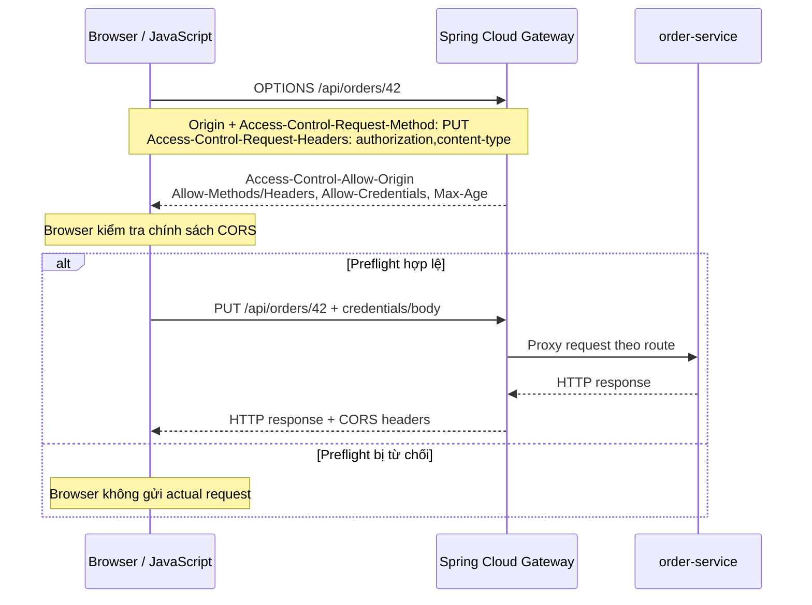
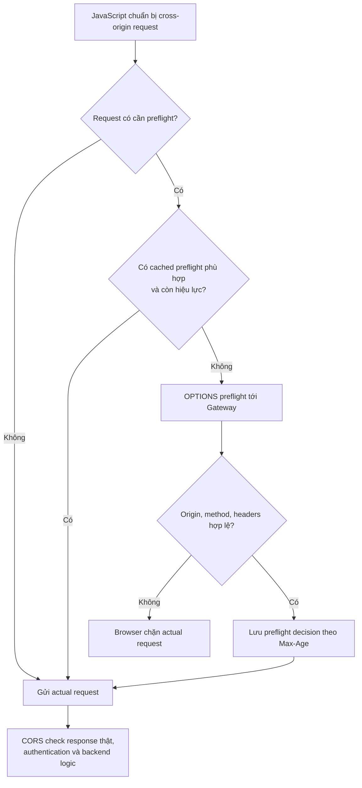

# Credentials, wildcard origin và thời gian cache preflight

Giả sử một ứng dụng web được tải từ `https://app.example.com` và gọi API qua `https://api.example.com` bằng **Spring Cloud Gateway**. Hai địa chỉ này khác **origin**, mặc dù có thể cùng thuộc một tổ chức. Khi browser gửi cookie đăng nhập kèm request, API phải trả các CORS response headers phù hợp để JavaScript phía web **được phép đọc** kết quả. Chỉ cần một cấu hình tưởng chừng tiện lợi như `allowedOrigins: "*"` kết hợp `allowCredentials: true` là cơ chế CORS sẽ trở nên không hợp lệ.

Cùng lúc, những request có method hoặc header cần kiểm tra trước sẽ phát sinh **preflight `OPTIONS`**. Nếu browser phải gửi preflight trước mỗi request, độ trễ và số request vào gateway tăng đáng kể. `maxAge` cho phép browser cache **quyết định preflight**, nhưng nó **không** cache response nghiệp vụ và **không** tạo thêm quyền truy cập cho website không được phép.

Bài thuộc chương **CORS** trong module **SPRING_CLOUD_GATEWAY**. Khi xây dựng API Gateway qua route predicate, filter chain, biến đổi đường dẫn/header và service discovery, cần kiểm soát chính xác CORS ở lớp biên, phối hợp với xác thực, rate limiting, circuit breaker, retry, TLS và observability. Trọng tâm bài này gồm ba khái niệm có quan hệ chặt chẽ: **credentials**, **wildcard origin** và **thời gian cache preflight**.

Sau khi học, bạn sẽ có thể:

1. Phân biệt `Origin`, CORS và xác thực/phân quyền; dự đoán khi browser cho phép JavaScript đọc response.
2. Cấu hình `allowCredentials` cùng `allowedOrigins` hoặc `allowedOriginPatterns` mà không mở quyền quá rộng.
3. Dùng `maxAge` đúng **đơn vị giây** và hiểu giới hạn bộ nhớ cache preflight của browser.
4. Thiết lập CORS toàn cục hoặc trên từng route của **Spring Cloud Gateway Server WebFlux**, bao gồm cách xử lý `OPTIONS` khi route predicate có điều kiện `Method`.
5. Kiểm thử bằng browser và `curl`, xác định nguyên nhân khi request bị chặn, cookie không được gửi hoặc preflight bị trả `401`/`403`.

> **Phạm vi phiên bản:** Các ví dụ chính dùng **Spring Cloud Gateway Server WebFlux 5.x**, với namespace `spring.cloud.gateway.server.webflux.globalcors` và `spring.cloud.gateway.server.webflux.routes`. Ở **Gateway Server WebFlux 4.3.x**, namespace thường là `spring.cloud.gateway.globalcors` và `spring.cloud.gateway.routes`. Ngữ nghĩa CORS dựa trên Spring Framework `CorsConfiguration`, nhưng cách binding/configuration cần kiểm tra đúng phiên bản, starter và lớp xử lý bảo mật của ứng dụng. Gateway Server MVC không dùng nguyên xi quy trình WebFlux được trình bày ở đây.

## 1. CORS là gì và browser thực sự bảo vệ điều gì?

**CORS (Cross-Origin Resource Sharing)** là cơ chế trao đổi HTTP headers cho phép một trang web có origin A truy cập có điều kiện tới tài nguyên ở origin B từ JavaScript. Trình duyệt áp dụng **same-origin policy** và CORS; HTTP client CLI hoặc service-to-service thông thường **không tự thực thi chính sách CORS giống browser**.

Một **origin** gồm ba thành phần:

```text
scheme + host + port

https://app.example.com       -> https, app.example.com, cổng mặc định 443
https://api.example.com       -> https, api.example.com, cổng mặc định 443
http://app.example.com        -> http, app.example.com, cổng mặc định 80
https://app.example.com:8443  -> https, app.example.com, cổng 8443
```

Trong bảng sau, tất cả request đều được thực hiện từ JavaScript của `https://app.example.com`:

| URL đích | Có cùng origin? | Lý do |
| --- | --- | --- |
| `https://app.example.com/api/orders` | Có | Scheme, host, port giống nhau |
| `https://api.example.com/orders` | Không | Khác hostname |
| `http://app.example.com/orders` | Không | Khác scheme `https` và `http` |
| `https://app.example.com:8443/orders` | Không | Khác port |
| `https://app.example.com:443/orders` | Có | Cổng 443 là mặc định của HTTPS |

`Origin` là header do browser gửi để cho server biết **nguồn gốc của JavaScript** đang yêu cầu truy cập. Origin không phải path đầy đủ; `https://app.example.com/dashboard` không phải là một origin khác `https://app.example.com/login`.

### CORS không phải authentication hoặc firewall

Nếu server không bật CORS, một attacker **vẫn có thể gọi endpoint** bằng `curl` hoặc từ một backend khác nếu endpoint truy cập được trên mạng. CORS chủ yếu kiểm soát **quyền đọc response của JavaScript trên trình duyệt** và một số luồng cross-origin liên quan. Nó không xác minh token, không kiểm tra user có quyền xem đơn hàng và không chống mọi hình thức CSRF.

Một số request cross-origin có thể **được gửi đi** ngay cả khi response sau đó bị browser chặn khỏi JavaScript. Vì vậy, service phải dùng authentication, authorization, CSRF defense phù hợp với cơ chế cookie và phương thức HTTP an toàn.

## 2. Những header CORS liên quan trực tiếp đến bài toán

| HTTP header | Hướng | Ý nghĩa |
| --- | --- | --- |
| `Origin` | Request | Origin của trang phát sinh request |
| `Access-Control-Request-Method` | Preflight request | Method mà browser dự định sử dụng cho request thật |
| `Access-Control-Request-Headers` | Preflight request | Các tên non-safelisted headers browser dự định gửi |
| `Access-Control-Allow-Origin` | Response | Origin được phép truy cập response, hoặc `*` trong trường hợp không có credentials |
| `Access-Control-Allow-Credentials` | Response | `true` cho biết cho phép browser chia sẻ response của credentialed request |
| `Access-Control-Allow-Methods` | Preflight response | Những method được cho phép |
| `Access-Control-Allow-Headers` | Preflight response | Những request headers được cho phép |
| `Access-Control-Expose-Headers` | Actual response | Những response headers bổ sung mà JavaScript được đọc |
| `Access-Control-Max-Age` | Preflight response | Số **giây** browser có thể cache quyết định preflight |
| `Vary: Origin` | Response/cache | Cho cache trung gian biết response khác nhau theo `Origin` |

**Cần phân biệt header đầu vào và đầu ra:** Client gửi `Origin`; gateway quyết định có trả `Access-Control-Allow-Origin` hay không. Không nên cho client tự quyết định quyền CORS bằng header hoặc query parameter khác do ứng dụng tự phát minh.

## 3. CORS preflight hoạt động thế nào?

Browser thường tự gửi **preflight** trước một cross-origin request có method hoặc request header cần kiểm tra theo quy tắc Fetch/CORS, ví dụ `PUT` với header `Authorization` và JSON `Content-Type: application/json`.



Ví dụ preflight:

```http
OPTIONS /api/orders/42 HTTP/1.1
Host: api.example.com
Origin: https://app.example.com
Access-Control-Request-Method: PUT
Access-Control-Request-Headers: authorization,content-type
```

Khi được phép, gateway có thể trả response có các header tương tự:

```http
HTTP/1.1 200 OK
Access-Control-Allow-Origin: https://app.example.com
Access-Control-Allow-Credentials: true
Access-Control-Allow-Methods: GET,POST,PUT
Access-Control-Allow-Headers: Authorization,Content-Type
Access-Control-Max-Age: 600
Vary: Origin
```

Status có thể là `200` hoặc một status thành công thích hợp tùy stack và cấu hình; phần quan trọng đối với browser là **quyết định CORS hợp lệ** qua headers. Preflight thường **không cần gọi backend** khi xử lý CORS tại gateway.

Theo Fetch/CORS, preflight thường **không mang cookie/credential application**, vì vậy **không bắt preflight phải có session đăng nhập**. Một số browser/cấu hình TLS client certificate có hành vi riêng không tuân hoàn toàn mô hình đó; đừng dùng đặc điểm này làm cơ chế xác thực nghiệp vụ.

### Preflight khác request thật

- Preflight hỏi “Origin này có được gửi method/header kia không?”.
- Request thật mới gửi dữ liệu nghiệp vụ tới service, ví dụ tạo đơn hoặc cập nhật profile.
- Browser còn kiểm tra CORS headers ở **response thật** khi JavaScript cần đọc nội dung.
- `Access-Control-Max-Age` chỉ cache **kết quả kiểm tra preflight**, không cache response `GET /orders` hay kết quả `POST`.

Một `GET` đơn giản không mang header tùy biến thường có thể **không cần preflight**, nhưng vẫn thuộc kiểm tra CORS đối với response.

## 4. Credentials là gì và khi nào bật allowCredentials?

Trong ngữ cảnh CORS, **credentials** có thể gồm cookie, HTTP authentication, và chứng chỉ TLS client. Với `fetch`, client web có thể yêu cầu gửi credentials cross-origin bằng:

```javascript
const response = await fetch(
  "https://api.example.com/api/orders/42",
  {
    method: "GET",
    credentials: "include"
  }
);

const order = await response.json();
```

`credentials: "include"` yêu cầu browser cân nhắc gửi cookie phù hợp đến URL đích và áp dụng các quy tắc CORS cho credentialed request. Cookie có thực sự được gửi hay không còn phụ thuộc domain, path, `Secure`, `SameSite` và **chính sách chặn third-party cookies của browser**.

Phía gateway, cấu hình Spring Framework là:

```yaml
allowCredentials: true
```

Khi CORS request được cho phép, server trả:

```http
Access-Control-Allow-Credentials: true
```

Header này chỉ có giá trị **`true`** khi được sử dụng; nếu không cho phép credentials, thông thường **bỏ header**, không đặt `false` với kỳ vọng browser sẽ diễn giải như một boolean đối xứng.

### Một số hiểu lầm phổ biến

1. **`allowCredentials: true` không tự xác thực user.** Nó cho phép trình duyệt chia sẻ response trong trường hợp credentials được dùng; authentication vẫn thuộc Spring Security/backend.
2. **Bật allowCredentials không buộc browser gửi mọi cookie.** Browser vẫn áp dụng Fetch credentials mode và chính sách cookie.
3. **Có Bearer token không đồng nghĩa được phép bỏ CORS.** Request có header `Authorization` thường cần preflight vì đây không phải safelisted request header; backend vẫn phải validate JWT.
4. **CORS không chống CSRF.** Với cookie auth, cần CSRF tokens, `SameSite` và chính sách method phù hợp.
5. **Không nên bật credentials cho toàn Internet** chỉ để sửa lỗi frontend. Origin nào được phép đọc response có thể ảnh hưởng dữ liệu cá nhân gắn với cookie của user.

## 5. Vì sao allowCredentials: true không được dùng với allowedOrigins: "*"?

Đây là ràng buộc nền tảng của Fetch/CORS:

```http
Access-Control-Allow-Origin: *
Access-Control-Allow-Credentials: true
```

Cặp response header trên **không hợp lệ cho credentialed request**. Browser không cho JavaScript truy cập response khi credentials mode yêu cầu chia sẻ bằng credentials nhưng `Access-Control-Allow-Origin` là wildcard `*`.

Trong Spring Framework, `CorsConfiguration` cũng **không chấp nhận** cấu hình `allowCredentials=true` đồng thời `allowedOrigins` chứa ký tự đặc biệt `*`. Việc cấu hình có thể bị từ chối/đánh dấu lỗi khi được kiểm tra, tùy thời điểm áp dụng config của phiên bản; không giả định nó luôn fail ngay lúc startup.

### Cấu hình sai

```yaml
# KHÔNG DÙNG: wildcard origin đi cùng credentials
allowedOrigins: "*"
allowCredentials: true
```

**Lý do bảo mật:** `Access-Control-Allow-Origin: *` nghĩa là bất kỳ trang web nào cũng có thể đọc response không gắn credentials trong phạm vi CORS. Nếu đi cùng cookie người dùng, việc cho phép origin quá rộng sẽ tạo rủi ro tiết lộ dữ liệu nhạy cảm.

### Cấu hình đúng: liệt kê origin cụ thể

```yaml
allowedOrigins:
  - https://app.example.com
  - https://admin.example.com
allowCredentials: true
```

Khi browser gửi `Origin: https://app.example.com`, CORS processor chỉ cho phép đúng origin đó và response có:

```http
Access-Control-Allow-Origin: https://app.example.com
Access-Control-Allow-Credentials: true
Vary: Origin
```

Không trả một header `Access-Control-Allow-Origin` chứa **hai origin ngăn cách bằng dấu phẩy**. Header CORS này có một origin cụ thể hoặc `*` (trường hợp không credentialed). Với nhiều origin được cho phép, server **lựa chọn origin của request nếu nằm trong allowlist**.

### Khi nào có thể dùng allowedOrigins: "*"?

Nếu API công khai, không dùng cookies hay credentialed cross-origin fetch, có thể cho phép mọi origin:

```yaml
allowedOrigins:
  - "*"
allowedMethods:
  - GET
allowCredentials: false
```

Đây là lựa chọn cho **dữ liệu thực sự công khai**, không phải shortcut để mở endpoint người dùng. Dù browser có thể đọc response từ mọi origin, backend vẫn kiểm soát quyền truy cập tài nguyên theo chính sách riêng.

## 6. allowedOriginPatterns: wildcard có kiểm soát và rủi ro đi kèm

Với ứng dụng có nhiều tenant subdomain, rất khó liệt kê từng origin bằng tay. Spring Framework cung cấp **`allowedOriginPatterns`**, khác với `allowedOrigins`.

Ví dụ:

```yaml
allowedOriginPatterns:
  - "https://*.customer.example.com"
allowCredentials: true
```

Khi pattern khớp `Origin: https://acme.customer.example.com`, Spring CORS processor trả **origin thực tế**:

```http
Access-Control-Allow-Origin: https://acme.customer.example.com
Access-Control-Allow-Credentials: true
Vary: Origin
```

Nó không cần trả `Access-Control-Allow-Origin: *`. Nhờ đó, cấu hình pattern có thể **tương thích về mặt giao thức** với credentials.

### So sánh wildcard origin

| Cấu hình | `allowCredentials` | Response `Access-Control-Allow-Origin` | Đánh giá |
| --- | --- | --- | --- |
| `allowedOrigins: ["*"]` | `false` | `*` | Phù hợp dữ liệu công khai khi chủ đích cho mọi origin |
| `allowedOrigins: ["*"]` | `true` | Không phải cấu hình hợp lệ | **Tránh** |
| `allowedOrigins: ["https://app.example.com"]` | `true` | Origin cụ thể khi match | Ưu tiên cho ứng dụng có cookie/session |
| `allowedOriginPatterns: ["https://*.customer.example.com"]` | `true` | Origin cụ thể đã match | Có thể dùng khi **kiểm soát được** tất cả subdomain |
| `allowedOriginPatterns: ["*"]` | `true` | Có thể phản chiếu origin cụ thể của mọi caller | **Rất nguy hiểm**, tương đương tin mọi origin về mặt chính sách |
| `allowedOriginPatterns: ["http://localhost:[3000,5173]"]` | `true` | Origin local có port khớp | Chỉ hợp lý trong profile phát triển, không triển khai vô ý vào production |

**Cảnh báo:** `allowedOriginPatterns: ["*"]` có thể vượt qua ràng buộc kỹ thuật “không dùng wildcard response header với credentials” bằng cách **phản chiếu Origin bất kỳ**. Điều này không có nghĩa bảo mật. Với cookie đăng nhập, nó có thể mở quyền đọc dữ liệu cho website tấn công. **Đừng dùng pattern `*` khi bật credentials trên API có dữ liệu người dùng.**

### Wildcard subdomain cũng cần một trust boundary

Pattern `https://*.customer.example.com` không phù hợp nếu attacker có thể tạo subdomain trong đó, hoặc một subdomain có nguy cơ bị takeover. Chỉ dùng pattern khi tất cả host nằm trong vùng tin cậy tương đương, có quy trình đăng ký subdomain, quản lý DNS và kiểm tra quyền.

Nếu mỗi tenant được phép có website riêng, policy CORS có thể cần **allowlist cụ thể theo tenant**. Việc lấy một host tùy ý từ `Origin` rồi echo nguyên thành `Access-Control-Allow-Origin` mà không xác minh chủ sở hữu là **anti-pattern**.

## 7. maxAge và Access-Control-Max-Age: phải tính bằng giây

Khi một preflight được chấp nhận, response có thể chứa:

```http
Access-Control-Max-Age: 600
```

`600` có nghĩa là **600 giây = 10 phút**. Trong `CorsConfiguration` của Spring Framework, thuộc tính YAML tương ứng là:

```yaml
maxAge: 600
```

Đây là **giây**, **không phải mili giây**.

| `maxAge` | Thời gian theo ý định | Lưu ý |
| --- | --- | --- |
| `0` | Không chủ đích cache preflight theo TTL này | Browser vẫn có quy tắc riêng về xử lý request |
| `30` | 30 giây | Dễ quan sát khi thử nghiệm thay policy |
| `300` | 5 phút | Giá trị trung bình cho ứng dụng thường xuyên gọi API |
| `600` | 10 phút | Ví dụ phổ biến, cân bằng hiệu năng và thay đổi policy |
| `3600` | 1 giờ | Giảm preflight nhưng làm policy đổi có độ trễ trong browser |
| `86400` | 24 giờ | Browser có thể áp đặt giới hạn thấp hơn; cần đánh giá rủi ro vận hành |

**Không nhầm** `maxAge: 600` với `Cache-Control: max-age=600` của response nghiệp vụ. `Access-Control-Max-Age` thuộc **cache preflight riêng của browser**, tách khỏi HTTP cache thông thường. Nó không cache JSON đơn hàng, không cache cookie, không bảo đảm backend sẽ phản hồi nhanh hơn và không loại bỏ kiểm tra CORS trên response thật.

### Browser có thể giới hạn giá trị tối đa

Ngay cả khi gateway trả `Access-Control-Max-Age: 86400`, browser **có thể cap TTL thực tế**, chẳng hạn theo phiên bản Chromium/Firefox hoặc chính sách trình duyệt. Đừng giả định 24 giờ luôn có hiệu lực. Thời gian cache cũng có thể kết thúc sớm do trình duyệt khởi động lại, cache bị xóa, partitioning hoặc thay đổi đặc điểm request.

Các yếu tố như **Origin, URL/mục tiêu, method, tập request headers, chính sách credentials và cache partition** ảnh hưởng khả năng dùng lại kết quả. Vì vậy, có `maxAge: 600` không đồng nghĩa “mọi request trong 10 phút tiếp theo đều không có OPTIONS”, nhất là khi API gồm nhiều endpoint, method hoặc header khác nhau.

### Đổi CORS policy có hiệu lực khi nào?

Khi bạn thu hẹp danh sách allowed origins/methods/headers, một browser có thể **vẫn giữ kết quả preflight cũ** trong khoảng TTL còn hiệu lực. Tuy nhiên, response thật vẫn cần pass CORS check, và backend authorization vẫn phải từ chối hành động không được phép.

Với chính sách thay đổi thường xuyên, đừng đặt TTL quá dài chỉ vì muốn giảm OPTIONS. Cân nhắc `maxAge` ngắn hơn trong giai đoạn rollout, test thay đổi policy và luôn giữ **server-side authorization** độc lập với preflight cache.

## 8. Cấu hình global CORS cho Spring Cloud Gateway WebFlux 5.x

Đây là ví dụ cho cổng API ở `https://api.example.com`, chỉ cho phép web app và admin app đáng tin gọi `/api/**` với credentials:

```yaml
spring:
  cloud:
    gateway:
      server:
        webflux:
          globalcors:
            add-to-simple-url-handler-mapping: true
            cors-configurations:
              '[/**]':
                allowedOrigins:
                  - https://app.example.com
                  - https://admin.example.com
                allowedMethods:
                  - GET
                  - POST
                  - PUT
                  - DELETE
                  - OPTIONS
                allowedHeaders:
                  - Authorization
                  - Content-Type
                  - X-Correlation-Id
                exposedHeaders:
                  - X-Request-Id
                allowCredentials: true
                maxAge: 600

          routes:
            - id: orders-api
              uri: http://localhost:8081
              predicates:
                - Path=/api/orders/**
              filters:
                - StripPrefix=1
```

**Ý nghĩa từng phần:**

- `globalcors.cors-configurations`: map từ URL pattern đến Spring Framework `CorsConfiguration`.
- `'[/**]'`: key map được quote để YAML/Spring binding hiểu pattern trên toàn gateway. Để hạn chế phạm vi, có thể dùng URL pattern thích hợp như `'[/api/**]'` và kiểm thử route/handler thực tế.
- `allowedOrigins`: danh sách origin cụ thể, **gồm scheme và host**, không kèm path.
- `allowedMethods`: method được phép trong CORS policy; không mặc định `GET` là đủ cho `PUT`.
- `allowedHeaders`: request headers mà browser có thể yêu cầu trong preflight.
- `exposedHeaders`: response headers bổ sung mà JavaScript được đọc, ví dụ `X-Request-Id`.
- `allowCredentials: true`: cho phép credentialed CORS request từ những origin đã cho phép.
- `maxAge: 600`: gợi ý cache preflight 10 phút.
- `add-to-simple-url-handler-mapping: true`: giúp áp dụng global CORS với request `OPTIONS` **không khớp route predicate** (đặc biệt khi route chỉ có `Method=GET`/`POST`).

**Lưu ý production:** Ví dụ dùng `'[/**]'` để minh họa toàn cục. Trong hệ thống có endpoint admin, actuator hay tài nguyên công khai với chính sách khác, nên thu hẹp URL pattern, tách policy và kiểm soát truy cập chặt hơn. Global CORS không đồng nghĩa mọi route trở thành public nếu backend có auth, nhưng một allowlist origin quá rộng vẫn tăng bề mặt truy cập dữ liệu bằng browser.

### Với Gateway WebFlux 4.3.x

Namespace tương ứng là:

```yaml
spring:
  cloud:
    gateway:
      globalcors:
        add-to-simple-url-handler-mapping: true
        cors-configurations:
          '[/**]':
            allowedOrigins:
              - https://app.example.com
            allowedMethods:
              - GET
              - POST
              - PUT
            allowedHeaders:
              - Content-Type
              - Authorization
            allowCredentials: true
            maxAge: 600
```

Đừng đặt global CORS 4.3.x vào prefix 5.x hoặc ngược lại nếu chưa xác minh phiên bản hỗ trợ. Hãy kiểm tra **effective config và response headers** thay vì chỉ nhìn `application.yml` thấy đúng indentation.

## 9. CORS theo route bằng metadata

Khi chỉ một route cần credentials, có thể gắn CORS **trực tiếp vào route metadata** với key `cors`:

```yaml
spring:
  cloud:
    gateway:
      server:
        webflux:
          routes:
            - id: orders-user
              uri: lb://order-service
              predicates:
                - Path=/api/orders/**
              filters:
                - StripPrefix=1
              metadata:
                cors:
                  allowedOrigins:
                    - https://app.example.com
                  allowedMethods:
                    - GET
                    - POST
                    - PUT
                  allowedHeaders:
                    - Authorization
                    - Content-Type
                  exposedHeaders:
                    - X-Request-Id
                  allowCredentials: true
                  maxAge: 300
```

Route `orders-user` chỉ nên được gọi bằng `lb://order-service` khi ứng dụng có Spring Cloud LoadBalancer và nguồn service instances/discovery phù hợp. Nếu không có hạ tầng đó trong môi trường test, thay bằng `http://localhost:8081`.

**CORS metadata theo route** được Gateway áp dụng trong quá trình route matching/handler mapping; nó không phải tên `GatewayFilter` mà bạn phải thêm vào `filters`. Trong tài liệu Gateway, khi route không có `Path` predicate, cấu hình CORS tương ứng có thể được ánh xạ với `/**`; tránh tạo route quá rộng chỉ vì thiếu Path.

### Global hay per-route?

| Tiêu chí | Global CORS | Route metadata CORS |
| --- | --- | --- |
| Phạm vi | Theo URL patterns trong `cors-configurations` | Gắn với route được chọn |
| Hợp với | API có cùng policy từ nhiều service | API cá nhân/admin và API public cần policy khác |
| Preflight `OPTIONS` không match route predicate | Có thể bật `add-to-simple-url-handler-mapping` | Phải xem route có được handler mapping chọn và tích hợp global/security ra sao |
| Dễ duy trì | Một nơi cấu hình cho nhiều route | Có thể lặp cấu hình khi nhiều route |
| Rủi ro | Phạm vi quá rộng vô tình áp dụng cho endpoint nhạy cảm | Route thiếu/match khác expected, preflight không được xử lý |

**Không cấu hình mâu thuẫn** giữa global CORS, route metadata, Spring Security WebFlux và CORS header do backend thêm. Nếu ứng dụng cần kết hợp, phải hiểu thứ tự/`CorsConfiguration.combine` và test response thực tế. Với thuộc tính đơn trị như `allowCredentials` và `maxAge`, cấu hình chi tiết hơn có thể ghi đè global theo quy tắc Spring Framework; không nên tưởng mọi trường đều chỉ “hợp nhất thành danh sách”.

## 10. Phối hợp Spring Security: preflight không được chặn vì thiếu cookie

Một cấu hình CORS đúng vẫn có thể thất bại nếu **Spring Security** chạy trước xử lý preflight và yêu cầu session/JWT ở mọi request.

Browser thường gửi preflight:

```http
OPTIONS /api/orders/42 HTTP/1.1
Origin: https://app.example.com
Access-Control-Request-Method: PUT
Access-Control-Request-Headers: authorization,content-type
```

Request này **không phải request thao tác nghiệp vụ** và thường **không chứa cookie của user**. Nếu security policy bắt `OPTIONS` phải có `JSESSIONID` hoặc Bearer token mới được đi tiếp, browser nhận `401`/`403` rồi không gửi actual `PUT`.

Spring Security WebFlux khuyến nghị **xử lý CORS trước Security**, ví dụ tích hợp `CorsWebFilter`/`CorsConfigurationSource` với chính sách xác định. Khi dùng Gateway global CORS, route metadata và Spring Security trong cùng ứng dụng, cần thống nhất **một chủ sở hữu chính sách CORS**, để tránh nhiều lớp cùng chèn headers hoặc xử lý khác nhau.

### Ví dụ với CorsWebFilter — cách thay thế cho chính sách global Gateway

Có thể dùng cấu hình Java WebFlux nếu muốn kiểm soát CORS ở lớp filter trước security. Đây là **một cách cấu hình thay thế**, **không** yêu cầu đăng ký đồng thời với global CORS/route metadata trong ví dụ ở mục 8 và 9:

```java
import java.util.List;

import org.springframework.context.annotation.Bean;
import org.springframework.context.annotation.Configuration;
import org.springframework.web.cors.CorsConfiguration;
import org.springframework.web.cors.reactive.CorsWebFilter;
import org.springframework.web.cors.reactive.UrlBasedCorsConfigurationSource;

@Configuration(proxyBeanMethods = false)
public class CorsWebFluxConfiguration {

    @Bean
    CorsWebFilter corsWebFilter() {
        CorsConfiguration cors = new CorsConfiguration();
        cors.setAllowedOrigins(List.of("https://app.example.com"));
        cors.setAllowedMethods(List.of("GET", "POST", "PUT"));
        cors.setAllowedHeaders(List.of(
            "Authorization", "Content-Type"));
        cors.setAllowCredentials(true);
        cors.setMaxAge(600L);

        UrlBasedCorsConfigurationSource source =
            new UrlBasedCorsConfigurationSource();
        source.registerCorsConfiguration("/api/**", cors);

        return new CorsWebFilter(source);
    }
}
```

Nếu sử dụng cách này, hãy kiểm tra việc tích hợp với security filter chain của **đúng Spring Security version** và đảm bảo preflight thực sự được xử lý trước kiểm tra authentication. `CorsWebFilter` không tự cấp quyền đọc đơn hàng: actual request vẫn cần token, backend vẫn phải kiểm tra ownership và quyền.

**Không chỉ sửa lỗi bằng `permitAll()` cho mọi `OPTIONS` rồi coi như xong CORS**. `permitAll` có thể cho request qua security, nhưng browser vẫn cần các `Access-Control-Allow-*` chính xác. Ngược lại, xử lý CORS thành công cũng không có nghĩa actual request không phải xác thực.

## 11. Cache preflight ảnh hưởng hiệu năng Gateway ra sao?

Một app SPA có thể gửi hàng chục request tới cùng API với `Authorization` và JSON `Content-Type`. Nếu mỗi lần đều có preflight, số HTTP request tới gateway tăng. Khi `Access-Control-Max-Age` cho phép browser tái sử dụng quyết định phù hợp, các preflight lặp lại có thể được giảm bớt.



Điều cần ghi nhớ:

- `maxAge` giảm **lưu lượng `OPTIONS` lặp lại** khi browser có thể reuse cache entry.
- Cache preflight là một cache **riêng**; nó không thay thế CDN cache, HTTP `Cache-Control` hoặc cache API response.
- Browser có thể **giới hạn TTL** và partition cache theo context; hai tab, hai origin hoặc hai tập request headers không nhất thiết dùng chung kết quả.
- CORS decision **không phải quyền user**. Nếu token hết hạn hoặc backend tước quyền, cached preflight không được phép biến request thất bại thành thành công.
- Với rate limiting, không dùng cache preflight như biện pháp bảo vệ duy nhất; actual requests vẫn phải được kiểm soát. Có thể cho preflight qua chính sách phù hợp mà không yêu cầu JWT, nhưng vẫn cần chống lạm dụng hạ tầng.
- Với API thường đổi CORS policy, TTL dài có thể gây khó debug vì browser còn nhớ kết quả trước đó.

**Ví dụ tính toán minh họa:** Một browser thực hiện 20 request đồng dạng trong vài phút. Nếu thiếu cache preflight và mọi request cần preflight, có thể có 20 preflight + 20 actual requests. Nếu một preflight được reuse hợp lệ, số OPTIONS có thể thấp hơn nhiều. Không áp dụng tỷ lệ này máy móc cho mọi URL/method/header vì browser quyết định key và TTL thực tế.

## 12. Cookies, SameSite, CSRF và TLS: các lớp ngoài CORS

Khi `allowCredentials: true` được bật cho app `https://app.example.com` gọi `https://api.example.com`, cần kiểm tra **chính sách cookie** và **bảo mật ứng dụng** độc lập:

| Thành phần | Câu hỏi cần giải quyết |
| --- | --- |
| Cookie `Domain` / `Path` | Browser có đưa cookie tới URL `api.example.com/api/orders` không? |
| `Secure` | Cookie có yêu cầu HTTPS không và request thực sự chạy qua TLS không? |
| `SameSite` | Đây là same-site hay cross-site theo quy tắc browser? Có cần `SameSite=None; Secure` không? |
| Chính sách third-party cookies | Browser hoặc môi trường có chặn cookie trong context này không? |
| CSRF | Với cookie auth, phương thức thay đổi trạng thái có yêu cầu CSRF token/biện pháp thay thế đúng không? |
| Authentication | JWT/session có được xác minh và hết hạn đúng quy tắc không? |
| Authorization | User có quyền trên đơn hàng hoặc tenant cụ thể không? |
| TLS giữa Gateway và backend | Kết nối nội bộ đã dùng HTTPS/mTLS theo yêu cầu vận hành chưa? |

**Same-origin và same-site không phải cùng một khái niệm.** `app.example.com` và `api.example.com` là **khác origin** nhưng có thể là **same-site** theo cách browser xác định site. Vì vậy không nên luôn yêu cầu `SameSite=None` chỉ vì hostname khác nhau. Ngược lại, nếu web chạy tại một site hoàn toàn khác, `SameSite=Lax`/`Strict` có thể khiến cookie không được gửi.

TLS bảo vệ nội dung trên kết nối. CORS kiểm soát việc chia sẻ response với JavaScript ở origin khác. Một HTTPS endpoint vẫn có thể bị cấu hình CORS sai, và CORS đúng không thể bù cho HTTPS/mTLS sai.

### WebSocket không tuân theo preflight CORS như fetch thông thường

WebSocket handshake có cơ chế `Origin` liên quan nhưng **không tự thực hiện preflight CORS theo cùng quy trình của Fetch XHR**. Với route `ws://` hoặc `wss://`, cần kiểm tra policy Origin của WebSocket handshake và authentication riêng, không dựa vào `maxAge` của CORS preflight để bảo vệ WebSocket.

## 13. Tránh trùng hoặc mâu thuẫn Access-Control-Allow-Origin

Trong gateway + backend, đôi khi cả hai cùng chèn CORS headers:

```text
Backend: Access-Control-Allow-Origin: https://app.example.com
Gateway: Access-Control-Allow-Origin: https://app.example.com
```

Nếu response đến browser chứa **hai giá trị** `Access-Control-Allow-Origin` hoặc một giá trị ghép sai, browser có thể từ chối response dù mỗi nơi tưởng cấu hình của mình là đúng.

**Ưu tiên:** Xác định một nơi chịu trách nhiệm CORS cho các API đi qua gateway. Nếu chính sách chỉ ở Gateway, backend nên tránh thêm CORS headers dư thừa trên luồng proxied response. Backend có thể vẫn cần CORS riêng nếu được browser truy cập trực tiếp theo một contract khác.

Spring Cloud Gateway có `DedupeResponseHeader` GatewayFilter Factory để loại bớt header phản hồi trùng lặp khi cần, ví dụ:

```yaml
filters:
  - name: DedupeResponseHeader
    args:
      name: Access-Control-Allow-Credentials Access-Control-Allow-Origin
      strategy: RETAIN_UNIQUE
```

Đây là **mảnh cấu hình route**, không phải lời giải thay thế cho thiết kế CORS. Nếu Gateway trả `*` còn backend trả origin cụ thể, việc chỉ “khử trùng” không xác minh policy nào được phép. Nên sửa cấu hình gốc để chỉ một policy CORS có hiệu lực, kiểm tra cả preflight và actual response.

### Vary và response caches

Khi `Access-Control-Allow-Origin` thay đổi theo `Origin` của request, response thường cần `Vary: Origin`. Nếu dùng CDN/cache trung gian, phải cấu hình cache key và xử lý `Vary` đúng, tránh trả response kèm CORS headers dành cho origin A tới origin B.

Khi xét preflight, các trường `Access-Control-Request-Method` và `Access-Control-Request-Headers` cũng có thể ảnh hưởng quyết định CORS; việc cache ở proxy trung gian cần tuân thủ ngữ nghĩa những headers đó. **Không cache response chứa thông tin người dùng một cách công khai chỉ vì CORS được bật.**

## 14. Kiểm thử bằng curl: preflight và actual request

Giả sử Gateway WebFlux 5.x dùng cấu hình mục 8 tại `localhost:8080`, route `/api/orders/**` đến backend thử nghiệm có `PUT /orders/42`.

### 14.1. Preflight hợp lệ

```bash
curl -i -X OPTIONS \
  http://localhost:8080/api/orders/42 \
  -H "Origin: https://app.example.com" \
  -H "Access-Control-Request-Method: PUT" \
  -H "Access-Control-Request-Headers: authorization,content-type"
```

Kiểm tra response có các trường phù hợp:

```http
Access-Control-Allow-Origin: https://app.example.com
Access-Control-Allow-Credentials: true
Access-Control-Allow-Methods: GET,POST,PUT,DELETE,OPTIONS
Access-Control-Allow-Headers: Authorization,Content-Type
Access-Control-Max-Age: 600
```

Giá trị thực tế có thể khác về **thứ tự liệt kê, chữ hoa/chữ thường của header, `Vary` hoặc status**. Chỉ cần nó đáp ứng chính sách và browser chấp nhận. Nếu Gateway xử lý preflight, backend không cần nhận request `OPTIONS` này.

### 14.2. Origin không được phép

```bash
curl -i -X OPTIONS \
  http://localhost:8080/api/orders/42 \
  -H "Origin: https://evil.example.net" \
  -H "Access-Control-Request-Method: PUT" \
  -H "Access-Control-Request-Headers: authorization,content-type"
```

Kỳ vọng **không có CORS decision cho phép origin không nằm trong allowlist**. Tùy handler, gateway có thể trả `403 Invalid CORS request` hoặc response khác; không khẳng định mọi phiên bản sẽ có cùng status.

### 14.3. Method hoặc header ngoài allowlist

```bash
# PATCH không có trong allowedMethods ví dụ
curl -i -X OPTIONS \
  http://localhost:8080/api/orders/42 \
  -H "Origin: https://app.example.com" \
  -H "Access-Control-Request-Method: PATCH"

# X-Unsafe-Test không nằm trong allowedHeaders
curl -i -X OPTIONS \
  http://localhost:8080/api/orders/42 \
  -H "Origin: https://app.example.com" \
  -H "Access-Control-Request-Method: PUT" \
  -H "Access-Control-Request-Headers: x-unsafe-test"
```

Hai request này không nên được cho phép nếu policy đúng như ví dụ. Hãy test từng yếu tố để xác định lỗi cấu hình, đừng tăng danh sách allowed headers/methods lên `*` vô điều kiện.

### 14.4. Actual request

```bash
curl -i -X PUT \
  http://localhost:8080/api/orders/42 \
  -H "Origin: https://app.example.com" \
  -H "Content-Type: application/json" \
  -H "Authorization: Bearer <test-token>" \
  -d '{"quantity":2}'
```

`curl` **không tự phát preflight và không thực thi CORS policy của browser**. Đây chỉ là cách xem HTTP headers/status thực tế. Với token giả, backend có thể trả `401`, nhưng response vẫn cần CORS headers thích hợp để frontend có thể đọc được status/body lỗi khi được phép.

### 14.5. Test thật trong browser

Trên trang `https://app.example.com`, thực hiện:

```javascript
const response = await fetch(
  "https://api.example.com/api/orders/42",
  {
    method: "PUT",
    credentials: "include",
    headers: {
      "Content-Type": "application/json"
    },
    body: JSON.stringify({ quantity: 2 })
  }
);

console.log(response.status);
```

Nếu hệ thống dùng JWT trong `Authorization` thay vì cookie, frontend phải truyền Bearer token theo cơ chế an toàn; đừng ghi token thực trong ví dụ/log. Với cookie session, kiểm tra cookie policy và cơ chế CSRF tương ứng.

Mở **DevTools → Network**, xem preflight `OPTIONS` và request thật, đối chiếu `Origin` và `Access-Control-Allow-*`. Gọi lại trong cùng điều kiện để quan sát browser có tái sử dụng cache preflight không. Khi cần thử thay policy, xóa cache/khởi tạo profile test mới hoặc thay URL một cách có kiểm soát; không dựa vào mỗi lần reload là chắc chắn xóa preflight cache.

## 15. Bảng lỗi thường gặp và hướng chẩn đoán

| Triệu chứng | Nguyên nhân cần kiểm tra | Cách xử lý |
| --- | --- | --- |
| Browser báo lỗi với `Access-Control-Allow-Origin: *` và credentials | `allowCredentials=true` cùng wildcard origin | Dùng allowlist origin cụ thể hoặc pattern giới hạn, không dùng `*` |
| Config CORS bị từ chối vì credentials | `allowedOrigins: ["*"]` kết hợp allowCredentials | Thay bằng danh sách origin cụ thể; kiểm thử Spring CorsConfiguration |
| Preflight trả `401` | Spring Security yêu cầu session/token trước khi xử lý CORS | Xử lý CORS trước auth, tích hợp CorsWebFilter/CorsConfigurationSource |
| Preflight không match route | Route `Method=GET`/`POST`, `OPTIONS` bị loại | Cân nhắc globalcors.`add-to-simple-url-handler-mapping: true` |
| OPTIONS trả `403` | Origin, method hoặc request headers không nằm trong allowlist | Đọc `Origin`, `Access-Control-Request-Method/Headers` và config thực tế |
| Actual request thành công ở server nhưng JS không đọc được | Actual response thiếu/đúp CORS headers hoặc origin không khớp | Kiểm tra headers của **response thật**, không chỉ preflight |
| Cookie không được gửi dù CORS cho phép | `fetch credentials`, `SameSite`, `Secure`, cookie domain/path, third-party blocking | Kiểm tra DevTools cookie diagnostics và policy theo site |
| CORS chỉ hỏng sau khi qua ingress/CDN | Proxy rewrite Origin/headers, cache thiếu `Vary: Origin`, duplicate CORS headers | Kiểm tra từng hop, xác định nơi sở hữu CORS |
| Truy cập qua `curl` thành công nhưng browser báo lỗi | curl không thực thi CORS hoặc không gửi preflight | Kiểm tra qua browser, mô phỏng OPTIONS để xem server headers |
| `maxAge: 600` nhưng vẫn thấy OPTIONS | Cache key khác, browser cap/clear cache, policy/header/method thay đổi | Dùng DevTools, so sánh request thực tế; đừng khẳng định cache hỏng |
| `maxAge: 600000` tưởng là 10 phút | Nhầm ms và giây | Dùng `600` cho 10 phút; tránh TTL quá lớn |
| API user cho mọi website đọc response | `allowedOriginPatterns: ["*"]` cùng credentials | Đổi sang allowlist tin cậy, test chống origin spoofing |
| Lộ endpoint admin qua CORS global quá rộng | URL pattern `[/**]` áp dụng cả vùng không dự kiến | Thu hẹp policy theo path/route, bảo vệ auth và mạng |
| WebSocket lỗi Origin | Tưởng CORS preflight xử lý WebSocket | Cấu hình policy Origin/handshake riêng cho WebSocket |
| Lỗi 502/503 bị hiểu nhầm là CORS | Backend unavailable, discovery/load balancer/TLS lỗi | Phân biệt routing error với CORS error; dùng route ID/trace |

**Quy trình debug theo thứ tự:** Xác minh origin scheme-host-port → xem preflight được gửi chưa → xem response preflight → xem actual request có được gửi không → xem actual response CORS headers → cuối cùng mới kiểm tra authentication, route ID, backend, discovery, TLS và cookie policy. Một lỗi có thể tồn tại ở nhiều lớp, vì vậy đừng sửa theo cảm tính bằng cách cho phép `*`.

## 16. Bài thực hành: chọn chính sách cho ba nhóm API

**Bối cảnh:** Gateway cung cấp ba nhóm endpoint:

1. `/api/public/catalog/**`: dữ liệu sản phẩm công khai, không cần cookie.
2. `/api/user/orders/**`: dữ liệu đơn hàng cá nhân của người dùng đăng nhập.
3. `/api/admin/**`: tính năng quản trị, chỉ dành cho web admin của tổ chức.

### Nhiệm vụ

- Với catalog công khai, có thể cho phép origin rộng hơn **nếu dữ liệu thực sự public** và không dùng credentials.
- Với đơn hàng cá nhân, chỉ cho phép `https://app.example.com`, bật credentials khi dùng cookie/session, áp dụng authorization tại backend.
- Với API quản trị, chỉ cho phép `https://admin.example.com` và kiểm tra quyền admin; không xem origin là căn cứ xác thực.
- Chọn `maxAge` khác nhau theo nhịp cập nhật policy, ví dụ catalog `600` giây và admin `120` giây.
- Bổ sung kịch bản preflight `OPTIONS`, missing cookie, origin lạ, method lạ, actual error response và policy đổi khi preflight cache chưa hết hạn.

### Mẫu route metadata cho API người dùng

```yaml
- id: user-orders
  uri: http://localhost:8081
  predicates:
    - Path=/api/user/orders/**
  metadata:
    cors:
      allowedOrigins:
        - https://app.example.com
      allowedMethods:
        - GET
        - POST
        - PUT
      allowedHeaders:
        - Authorization
        - Content-Type
      allowCredentials: true
      maxAge: 300
```

Đây là một **phần tử trong danh sách routes**, không phải cấu hình `application.yml` độc lập. Backend ví dụ cần nhận path mà route thực tế gửi tới; nếu cần bỏ prefix `/api/user`, hãy bổ sung `StripPrefix`/`RewritePath` riêng và kiểm thử.

### Bảng nghiệm thu

| Kịch bản | Kết quả mong đợi |
| --- | --- |
| Origin `https://app.example.com` truy cập orders bằng cookie hợp lệ | CORS cho phép đọc response nếu user có quyền và cookie được browser gửi |
| Origin `https://evil.example.net` gọi orders | Không có CORS permission để JavaScript ở origin đó đọc response |
| Browser preflight `PUT` + `Content-Type` tới orders | Được xử lý theo policy trước khi kiểm tra session của actual request |
| Browser preflight `PATCH` tới orders | Không được phép vì method không nằm trong allowedMethods |
| User thiếu quyền xem `orderId=42` | Backend trả lỗi authorization; CORS không được biến lỗi thành thành công |
| Đổi allowed origins khi preflight còn trong cache | Không được coi cache preflight là quyền user; actual response và backend vẫn kiểm tra |
| Catalog dùng `allowedOrigins: "*"` với `allowCredentials=false` | Phù hợp nếu dữ liệu thật sự public và không có cookie auth |
| Admin chỉ nhận `https://admin.example.com` | Origin đúng **chưa đủ**; vẫn bắt buộc xác thực và role/permission admin |

### Câu hỏi tự kiểm tra

**Câu 1.** Tại sao `allowCredentials=true` không đi với `allowedOrigins="*"`?

> Vì browser không chấp nhận `Access-Control-Allow-Origin: *` khi credentialed request cần được chia sẻ response. Spring CorsConfiguration cũng ngăn cấu hình này. Hãy chỉ định origin cụ thể hoặc pattern có giới hạn phù hợp.

**Câu 2.** `allowedOriginPatterns="*"` có an toàn hơn `allowedOrigins="*"` khi bật credentials không?

> Không. Nó có thể khiến server phản chiếu origin thực tế của bất kỳ website nào và vẫn trả `Access-Control-Allow-Credentials: true`. Chỉ dùng pattern khi thật sự kiểm soát tất cả origin được phép.

**Câu 3.** `maxAge: 600` là 600 ms hay 600 giây?

> 600 giây, tức 10 phút, trừ khi browser áp dụng giới hạn TTL thấp hơn.

**Câu 4.** Preflight cache có lưu response JSON đơn hàng không?

> Không. Nó chỉ lưu thông tin cho phép method/header/origin của CORS preflight trong cache riêng của browser.

**Câu 5.** Vì sao Spring Security có thể chặn preflight dù actual request có cookie?

> Preflight thường không gửi cookie/session credential. Nếu security yêu cầu login trước xử lý CORS, `OPTIONS` sẽ bị từ chối; cần đặt CORS trước kiểm tra authentication.

**Câu 6.** `app.example.com` và `api.example.com` khác origin có luôn là cross-site không?

> Không. Chúng khác host nên khác origin, nhưng có thể cùng site theo quy tắc browser. `SameSite` cookie và CORS là hai cơ chế khác nhau.

**Câu 7.** CORS đã cho phép origin `https://admin.example.com` thì user có được truy cập mọi đơn hàng không?

> Không. CORS chỉ điều khiển chia sẻ response với JavaScript; authentication, authorization và ownership dữ liệu thuộc các lớp bảo mật và service.

**Câu 8.** Dùng curl không thấy lỗi CORS, vậy cấu hình đã đúng chưa?

> Chưa thể kết luận. curl không áp dụng các kiểm tra CORS của browser và không tự gửi preflight; cần kiểm tra cả OPTIONS, actual headers và hành vi browser thật.

## 17. Checklist trước khi đưa CORS vào production

- [ ] Xác định **origin** chính xác theo scheme, host và port; không nhầm với path, domain cookie hoặc service ID.
- [ ] Nếu dùng credentials, **không** đặt `allowedOrigins: "*"`; ưu tiên danh sách origin cụ thể, có kiểm soát.
- [ ] Không dùng `allowedOriginPatterns: ["*"]` với credentials cho API người dùng; kiểm tra độ tin cậy của subdomain wildcard.
- [ ] Chọn `allowedMethods` và `allowedHeaders` đủ dùng; không mở `*` tùy tiện cho API nhạy cảm.
- [ ] `allowCredentials: true` chỉ dùng nếu có nhu cầu thực tế về credentials; kiểm tra `fetch credentials` và cookie policy.
- [ ] `maxAge` tính bằng **giây**, kiểm tra browser cap, cache partition và tác động của việc thay đổi policy.
- [ ] Không nhầm preflight cache với HTTP response cache; vẫn phải kiểm soát auth/authorization và CSRF.
- [ ] Chọn đúng namespace Gateway WebFlux 4.3.x hoặc 5.x; kiểm tra chính sách có hiệu lực bằng response thực tế.
- [ ] Khi route có `Method` predicate chặn `OPTIONS`, kiểm tra `add-to-simple-url-handler-mapping` hoặc giải pháp CORS thích hợp.
- [ ] Xử lý CORS trước Spring Security; không yêu cầu cookie/JWT ở preflight.
- [ ] Tránh gateway và backend cùng thêm các `Access-Control-Allow-*` mâu thuẫn; xác định một chủ sở hữu chính sách.
- [ ] Với origin động, bảo đảm `Vary: Origin` và các cache/proxy trung gian không trả response sai origin.
- [ ] Kiểm thử cả preflight lẫn actual response, origin hợp lệ/không hợp lệ, lỗi 401/403/5xx và browser DevTools.
- [ ] Kiểm tra `SameSite`, `Secure`, third-party cookie restrictions và TLS cho hop bên ngoài/bên trong.
- [ ] Không dùng CORS thay auth, rate limiting, circuit breaker, retry, network policy hoặc xác minh quyền trong backend.
- [ ] Theo dõi tỷ lệ OPTIONS, route ID, status, latency, lỗi auth và traces; không ghi token/cookie vào log.
- [ ] Đánh giá policy riêng cho WebSocket handshake, admin API và endpoint không được truy cập bằng browser.

## Kết luận

**CORS credentials**, **wildcard origin** và **preflight cache** liên quan trực tiếp tới quyền trình duyệt truy cập API qua **Spring Cloud Gateway**. Với request cần credentials, cấu hình đúng là cho phép **origin cụ thể** hoặc **`allowedOriginPatterns` được kiểm soát**, không dùng `allowedOrigins: "*"`. Đặc biệt, pattern `*` phản chiếu mọi origin không phải là giải pháp an toàn cho cookie-based API.

`maxAge` tương ứng `Access-Control-Max-Age` được tính bằng **giây** và chỉ giúp browser cache **quyết định preflight**, không cache kết quả nghiệp vụ hay thay thế xác thực. Khi triển khai Gateway Server WebFlux, hãy chọn global CORS hoặc route metadata phù hợp, xử lý `OPTIONS` trước Spring Security, kiểm tra cả response preflight lẫn actual, đồng thời giữ các cơ chế bảo vệ khác như TLS, rate limit, service authorization, CSRF và observability.

## Tài liệu tham khảo

- [Spring Cloud Gateway Server WebFlux — CORS Configuration](https://docs.spring.io/spring-cloud-gateway/reference/spring-cloud-gateway-server-webflux/cors-configuration.html)
- [Spring Cloud Gateway Server WebFlux 4.3.x — CORS Configuration](https://docs.spring.io/spring-cloud-gateway/reference/4.3/spring-cloud-gateway-server-webflux/cors-configuration.html)
- [Spring Cloud Gateway 5.x — Configuration Properties](https://docs.spring.io/spring-cloud-gateway/reference/configprops.html)
- [Spring Framework 7 — WebFlux CORS](https://docs.spring.io/spring-framework/reference/web/webflux-cors.html)
- [Spring Security — CORS integration for reactive applications](https://docs.spring.io/spring-security/reference/reactive/integrations/cors.html)
- [MDN — Cross-Origin Resource Sharing (CORS)](https://developer.mozilla.org/en-US/docs/Web/HTTP/Guides/CORS)
- [MDN — Access-Control-Allow-Credentials](https://developer.mozilla.org/en-US/docs/Web/HTTP/Reference/Headers/Access-Control-Allow-Credentials)
- [MDN — Access-Control-Max-Age](https://developer.mozilla.org/en-US/docs/Web/HTTP/Reference/Headers/Access-Control-Max-Age)
