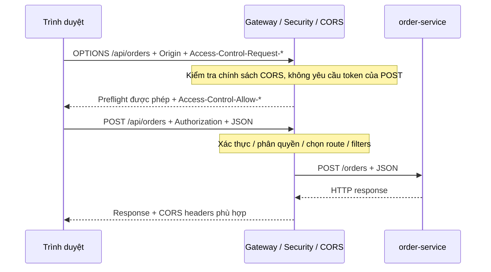
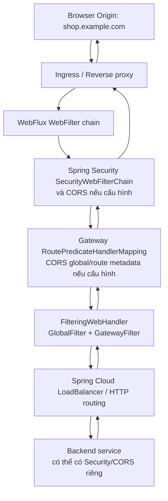
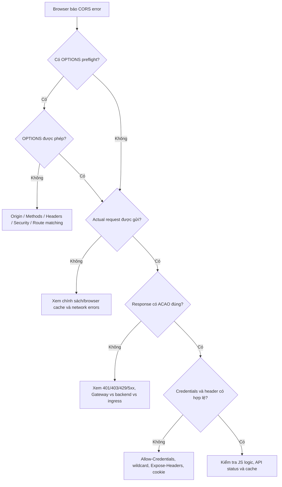

# Phối hợp CORS giữa gateway, Spring Security và dịch vụ phía sau

Một ứng dụng web chạy ở `https://shop.example.com` muốn gọi API `https://api.example.com/api/orders` qua **Spring Cloud Gateway**. Trình duyệt có thể báo lỗi CORS dù route đã đúng, backend đang khỏe và lệnh `curl` gọi được API. Một số lỗi chỉ xuất hiện khi gửi `Authorization`, khi dùng cookie đăng nhập hoặc khi backend trả `401`, `403` hay `429`. Nguyên nhân thường không phải chỉ thiếu một header, mà là **Gateway, Spring Security và microservice phía sau đang xử lý cùng chính sách CORS ở những tầng khác nhau**.

Trong module **SPRING_CLOUD_GATEWAY**, chúng ta đã có route predicate, filter chain, biến đổi path/header, discovery và load balancing. Bài thuộc chương **CORS** này giải thích cách phối hợp CORS với những cơ chế đó để cổng vào microservices an toàn: từ preflight, phản hồi của security chain đến chính sách CORS tập trung, ủy quyền API, rate limiting, circuit breaker, retry, TLS và observability.

**Mục tiêu học tập:**

1. Phân biệt CORS với xác thực, phân quyền, CSRF và bảo mật kết nối TLS.
2. Hiểu **preflight request** và **actual request** đi qua các tầng nào.
3. Chọn một **chủ sở hữu chính sách CORS** phù hợp khi sử dụng Gateway, Spring Security và backend.
4. Cấu hình CORS toàn cục, theo route hoặc trong Spring Security WebFlux mà không tạo phản hồi xung đột.
5. Chẩn đoán lỗi `OPTIONS`, header trùng lặp, cookie/credential và lỗi phát sinh trước khi định tuyến.
6. Kiểm thử cả tình huống thành công và lỗi thật bằng công cụ HTTP **và trình duyệt**.

> **Phạm vi phiên bản:** Các ví dụ chính dành cho **Spring Cloud Gateway Server WebFlux** với **Spring Security reactive**. Gateway Server Web MVC dùng Servlet `SecurityFilterChain` và cấu hình route/filter tương ứng, **không dùng nguyên** các API `ServerHttpSecurity`/`SecurityWebFilterChain`. Tên starter và namespace property như `spring.cloud.gateway.server.webflux.*` có thể khác ở các dòng Gateway cũ; phải đối chiếu phiên bản Spring Boot/Spring Cloud/Gateway thực tế.

## 1. Tình huống mở đầu: API hoạt động nhưng trình duyệt vẫn báo CORS

Giả sử:

| Thành phần | Địa chỉ giả định | Nhiệm vụ |
| --- | --- | --- |
| Frontend SPA | `https://shop.example.com` | Gọi API từ trình duyệt. |
| Spring Cloud Gateway | `https://api.example.com` | Chọn route, xác thực, quota và chuyển tiếp. |
| `order-service` | `http://order-service:8080` | Kiểm tra nghiệp vụ, đọc/tạo đơn hàng. |
| Discovery/LoadBalancer | `lb://order-service` | Chọn instance backend nếu được cấu hình. |

Frontend gọi:

```javascript
const response = await fetch("https://api.example.com/api/orders", {
  method: "POST",
  headers: {
    "Content-Type": "application/json",
    "Authorization": "Bearer <access-token>"
  },
  body: JSON.stringify({ productId: 42, quantity: 2 })
});
```

Vì request đến **origin khác** và có header/phương thức/kiểu nội dung không thuộc nhóm request đơn giản, trình duyệt thường gửi một **preflight OPTIONS** trước khi gửi POST thực. Nếu preflight bị Spring Security trả `401` vì không có bearer token, POST sẽ **không được gửi**.

Nếu preflight thành công nhưng POST trả `403` **không kèm CORS headers phù hợp**, JavaScript có thể chỉ thấy lỗi liên quan đến chính sách CORS; thông tin 403 thực tế khó đọc qua `fetch`. Điều này khiến việc sửa route hoặc tăng timeout trở nên vô ích.



Sơ đồ là **luồng thành công điển hình**. Không phải mọi cross-origin request đều có preflight: một GET đơn giản có thể đi thẳng đến actual request, nhưng browser **vẫn kiểm tra CORS trên response thật**. Tương tự, preflight được browser cache theo chính sách `Access-Control-Max-Age` có thể không xuất hiện trước mỗi lần gọi.

## 2. CORS là gì — và không phải gì?

**Cross-Origin Resource Sharing (CORS)** là cơ chế dựa trên HTTP headers cho phép một web server khai báo **origin nào được trình duyệt cho phép truy cập response** trong bối cảnh same-origin policy.

**Origin** được xác định bởi bộ ba:

```text
(scheme, hostname, port)
```

Ví dụ:

| Frontend origin | API origin | Có cross-origin không? | Giải thích |
| --- | --- | --- | --- |
| `https://shop.example.com` | `https://shop.example.com` | Không | Cùng scheme, host và port ngầm định. |
| `https://shop.example.com` | `https://api.example.com` | Có | Khác hostname. |
| `http://localhost:3000` | `http://localhost:8080` | Có | Khác port. |
| `http://api.example.com` | `https://api.example.com` | Có | Khác scheme. |
| `https://shop.example.com` | `https://shop.example.com:8443` | Có | Khác port. |

### CORS không thay thế bảo mật backend

- **Không phải authentication:** `Origin: https://shop.example.com` là giá trị client có thể tự gửi, không phải bằng chứng danh tính người dùng.
- **Không phải authorization:** cho phép một origin đọc response không có nghĩa mọi user ở origin đó được phép xem mọi đơn hàng.
- **Không phải firewall hoặc anti-SSRF:** `curl`, ứng dụng mobile và các HTTP client không phải browser có thể gửi request không chịu cơ chế CORS của trình duyệt.
- **Không phải CSRF protection:** cookie có thể đi cùng request theo chính sách browser; một số request cross-site vẫn có thể được gửi dù JavaScript không đọc được response.
- **Không phải TLS:** CORS không mã hóa dữ liệu; dùng HTTPS ở từng chặng theo chính sách của hệ thống.

**Kết luận bảo mật:** backend vẫn cần xác thực token/session, kiểm tra quyền đối với tài nguyên, validate input và chống tác dụng phụ trái phép. CORS là **một lớp quy tắc dành cho trình duyệt**, không phải “cửa khóa” của microservice.

## 3. Preflight request và actual request khác nhau thế nào?

### 3.1. Preflight OPTIONS

Với lời gọi POST JSON chứa `Authorization`, browser có thể tạo request:

```http
OPTIONS /api/orders HTTP/1.1
Host: api.example.com
Origin: https://shop.example.com
Access-Control-Request-Method: POST
Access-Control-Request-Headers: authorization,content-type
```

Đây là câu hỏi **“origin này có được gửi một request POST với các header này không?”**. Nó không phải lệnh tạo đơn hàng. Trình duyệt thông thường **không gửi bearer token của actual request vào header Authorization của preflight**; server không được thiết kế yêu cầu preflight có token đó.

Phản hồi CORS hợp lệ về ý tưởng có thể gồm:

```http
HTTP/1.1 200 OK
Access-Control-Allow-Origin: https://shop.example.com
Access-Control-Allow-Methods: GET, POST
Access-Control-Allow-Headers: Authorization, Content-Type
Access-Control-Allow-Credentials: true
Access-Control-Max-Age: 1800
Vary: Origin
Vary: Access-Control-Request-Method
Vary: Access-Control-Request-Headers
```

**`200 OK` chỉ là ví dụ**: preflight thành công có thể dùng một mã 2xx thích hợp tùy framework. Header `Access-Control-Allow-Credentials` chỉ cần khi chính sách/cách gọi sử dụng credential mode phù hợp; không nên thêm như một phép “sửa CORS” chung nếu API không cần credentialed cross-origin requests.

### 3.2. Actual request

Khi browser chấp nhận preflight, nó gửi POST thực:

```http
POST /api/orders HTTP/1.1
Host: api.example.com
Origin: https://shop.example.com
Authorization: Bearer <access-token>
Content-Type: application/json

{"productId":42,"quantity":2}
```

Response thật cũng phải đáp ứng chính sách CORS để JavaScript truy cập nó:

```http
HTTP/1.1 201 Created
Access-Control-Allow-Origin: https://shop.example.com
Vary: Origin
Content-Type: application/json

{"orderId":"demo-123"}
```

Nếu frontend dùng `credentials: "include"` để gửi cookie/credentials cross-origin, response cần phù hợp cơ chế credentialed CORS, bao gồm `Access-Control-Allow-Credentials: true` và **origin cụ thể** thay vì wildcard. Đồng thời cookie phải thỏa các quy tắc `SameSite`/`Secure` của browser.

### 3.3. Header CORS quan trọng

| Header | Bên gửi | Vai trò |
| --- | --- | --- |
| `Origin` | Browser/request | Origin của trang đang yêu cầu truy cập. |
| `Access-Control-Request-Method` | Browser, trong preflight | HTTP method của actual request dự kiến. |
| `Access-Control-Request-Headers` | Browser, trong preflight | Các tên header không đơn giản mà actual request muốn gửi. |
| `Access-Control-Allow-Origin` | Server response | Origin được phép đọc response theo CORS. |
| `Access-Control-Allow-Methods` | Server, preflight response | Các method được cho phép theo CORS. |
| `Access-Control-Allow-Headers` | Server, preflight response | Các request headers được cho phép theo CORS. |
| `Access-Control-Allow-Credentials` | Server response | Cho phép credentialed CORS khi được cấu hình phù hợp. |
| `Access-Control-Expose-Headers` | Server, actual response | Header response ngoài danh sách safelisted mà JavaScript được phép đọc. |
| `Access-Control-Max-Age` | Server, preflight response | Thời gian browser có thể cache kết quả preflight, còn tùy giới hạn của browser. |
| `Vary` | Server/intermediary | Báo cho shared cache những request headers ảnh hưởng đến response. |

**Đừng nhầm `Access-Control-Allow-Headers` với `Access-Control-Expose-Headers`.** Cái thứ nhất cho phép frontend **gửi** header như `Authorization`; cái thứ hai cho phép JavaScript **đọc** response header như `X-Request-Id`.

## 4. CORS được xử lý ở đâu trong một kiến trúc Gateway?

Một request qua WebFlux có thể đi qua các tầng:



**Trình tự chính xác** phụ thuộc vào filter order, handler mapping, security chain và cả việc preflight có được xử lý sớm hay không. Cần hiểu các điểm dễ xung đột:

1. **Spring Security có thể từ chối request trước khi Gateway chọn route.** Một route filter thêm response header quá muộn sẽ không sửa được response đó.
2. **Preflight có method `OPTIONS`.** Nếu route khai báo predicate `Method=GET` hoặc `Method=POST`, preflight có thể **không khớp route** dù actual request khớp.
3. **Gateway có thể trả preflight ngay tại CORS handler** mà không gọi backend.
4. **Backend cũng có thể tự thêm CORS headers** vào response thật, tạo header trùng hoặc mâu thuẫn với Gateway.
5. **Ingress/CDN** có thể thêm, xóa, cache hoặc ghi đè CORS headers; một cấu hình đúng trong Java chưa chứng minh response cuối cùng đúng.

Do đó, trước khi sửa YAML, hãy xác định **tầng nào sở hữu policy**, **tầng nào thực sự trả preflight**, và **ai gắn CORS headers trên response thành công/lỗi**.

## 5. Chọn một chủ sở hữu chính sách CORS

Không có một lựa chọn duy nhất cho mọi hệ thống, nhưng **nên có một nguồn chính sách rõ ràng cho từng public API**, tránh để ba tầng độc lập cùng phát phản hồi CORS với luật khác nhau.

| Mô hình | Nơi sở hữu CORS chính | Ưu điểm | Điều cần kiểm tra |
| --- | --- | --- | --- |
| **A. Spring Security/WebFlux ở gateway** | Security CORS configuration xử lý sớm trong gateway process. | Có thể xử lý preflight trước authentication và gắn CORS cho nhiều response `401/403`. | Không cấu hình lặp Gateway global/route CORS trên cùng path; test security error responses. |
| **B. Spring Cloud Gateway CORS** | Gateway `globalcors` hoặc route `metadata.cors`. | Policy gắn rõ với các public routes; thuận tiện cho API gateway. | Preflight không khớp route, Security chặn OPTIONS, lỗi phát sinh trước handler. |
| **C. Backend CORS** | Mỗi microservice tạo CORS headers. | Hợp lý khi backend được browser gọi trực tiếp theo hostname riêng. | Gateway có thể không forward preflight; các backend dễ lệch policy. |
| **D. Ingress/CDN CORS** | Edge proxy sở hữu policy và response headers. | Đặt quy tắc ở điểm biên đầu tiên. | Cache/Vary, lỗi ở gateway, rule ngoài app và quyền thay đổi cấu hình. |

**Khuyến nghị thực hành:** với Gateway có Spring Security reactive và các API yêu cầu xác thực, **phương án A thường dễ tạo hành vi nhất quán cho cả preflight lẫn phản hồi 401/403**, nếu nhóm vận hành muốn quản lý CORS ở security chain. Phương án B cũng phù hợp khi Gateway chủ trì policy và security/ingress được cấu hình để không chặn preflight; cần test riêng các lỗi bị trả về **trước** Gateway handler.

Không tự động bật A và B đồng thời cho cùng đường dẫn. Việc có hai bộ luật cùng xử lý CORS có thể tạo kết quả khó giải thích khi một bên cho phép origin nhưng bên kia từ chối hoặc sửa response.

### Khi backend vẫn cần CORS riêng

Nếu `order-service` có **một public hostname khác** cho browser gọi trực tiếp, nó có thể cần CORS trên public endpoint đó. Nhưng đối với traffic qua `https://api.example.com`, nên phân định:

- **Đường qua Gateway:** policy ở Gateway/Security/Ingress theo chủ sở hữu đã chọn.
- **Đường truy cập trực tiếp backend:** policy riêng cho public host nếu thật sự có và đã được phê duyệt.
- **Đường service-to-service:** CORS thường không phải cơ chế xác thực hay điều kiện cho HTTP client nội bộ.

Backend có thể vẫn dùng Spring Security và authorization trên mọi đường; chỉ **quyền quyết định CORS** mới cần được phân chia rõ.

## 6. Phương án A — Spring Security reactive làm chủ CORS

Trong WebFlux, dùng `SecurityWebFilterChain` và một `CorsConfigurationSource` phản ánh danh sách origin, method, header được phép. Security cần xử lý CORS **trước các kiểm tra xác thực có thể chặn preflight**.

### 6.1. Ví dụ cấu hình Java

Ví dụ sau minh họa **API stateless xác thực bằng bearer JWT**, không dùng cookie/session làm cơ chế đăng nhập. Nó cố ý tắt CSRF cho mô hình này; **không sao chép quyết định tắt CSRF sang một ứng dụng dùng session/cookie**.

```java
import java.util.List;

import org.springframework.context.annotation.Bean;
import org.springframework.context.annotation.Configuration;
import org.springframework.http.HttpMethod;
import org.springframework.security.config.Customizer;
import org.springframework.security.config.annotation.web.reactive.EnableWebFluxSecurity;
import org.springframework.security.config.web.server.ServerHttpSecurity;
import org.springframework.security.web.server.SecurityWebFilterChain;
import org.springframework.web.cors.CorsConfiguration;
import org.springframework.web.cors.reactive.CorsConfigurationSource;
import org.springframework.web.cors.reactive.UrlBasedCorsConfigurationSource;

@Configuration
@EnableWebFluxSecurity
public class GatewaySecurityConfiguration {

    @Bean
    CorsConfigurationSource corsConfigurationSource() {
        CorsConfiguration cors = new CorsConfiguration();
        cors.setAllowedOrigins(List.of("https://shop.example.com"));
        cors.setAllowedMethods(List.of("GET", "POST", "OPTIONS"));
        cors.setAllowedHeaders(List.of(
            "Authorization", "Content-Type", "X-Correlation-Id"));
        cors.setExposedHeaders(List.of("X-Request-Id"));
        cors.setAllowCredentials(false); // Ví dụ chỉ dùng bearer token, không cookie.
        cors.setMaxAge(1800L);

        UrlBasedCorsConfigurationSource source =
            new UrlBasedCorsConfigurationSource();
        source.registerCorsConfiguration("/api/**", cors);
        return source;
    }

    @Bean
    SecurityWebFilterChain securityWebFilterChain(
            ServerHttpSecurity http,
            CorsConfigurationSource corsSource) {

        return http
            .cors(cors -> cors.configurationSource(corsSource))
            .csrf(ServerHttpSecurity.CsrfSpec::disable)
            .authorizeExchange(exchanges -> exchanges
                .pathMatchers(HttpMethod.OPTIONS, "/api/**").permitAll()
                .pathMatchers(HttpMethod.GET, "/api/catalog/**").permitAll()
                .anyExchange().authenticated())
            .oauth2ResourceServer(oauth2 -> oauth2
                .jwt(Customizer.withDefaults()))
            .build();
    }
}
```

Để chạy ví dụ, ứng dụng cần dependency Spring Security/WebFlux OAuth2 Resource Server và **cấu hình issuer/JWK set** tin cậy cho JWT theo môi trường của bạn. Đoạn mã chỉ tập trung vào CORS và những security rule minh họa, **không cấp token và không định nghĩa mọi quyền nghiệp vụ**.

**Tại sao `setAllowCredentials(false)`?** Ví dụ frontend gửi bearer token qua header `Authorization` nhưng không dựa vào cookie/session cross-origin; `fetch` có thể dùng credential mode không bao gồm cookie. Nếu ứng dụng **thực sự dùng cookie hoặc `credentials: "include"`**, cần thiết kế và kiểm tra riêng `allowCredentials=true`, origin cụ thể, SameSite/Secure và CSRF.

### 6.2. Phân biệt hai việc trong Security

```java
.cors(cors -> cors.configurationSource(corsSource))
```

cho Security biết **cách xử lý CORS**. Còn:

```java
.pathMatchers(HttpMethod.OPTIONS, "/api/**").permitAll()
```

là quy tắc **authorization cho OPTIONS**. Một lệnh `permitAll` **không tự tạo** `Access-Control-Allow-Origin`, `Access-Control-Allow-Methods` hay `Access-Control-Allow-Headers`. Nó chỉ ngăn một quy tắc authorize thông thường chặn request đó khi đi tới bước tương ứng.

Với phương án A, thường nên **không cấu hình thêm `globalcors` hoặc `metadata.cors` của Gateway cho cùng URL**. Nếu policy cần khác nhau theo API, đăng ký nhiều `CorsConfiguration` theo path trong `CorsConfigurationSource`, hoặc tổ chức nhiều security chain có phạm vi rõ ràng và test thứ tự matching.

### 6.3. Lợi ích khi response là 401 hoặc 403

Với CORS được xử lý ở bước Security sớm, một actual request từ origin được phép nhưng thiếu/không đúng token có thể nhận `401 Unauthorized` **kèm CORS headers**. Browser khi ấy có thể quan sát status 401 ở JavaScript và xử lý đăng nhập/hiển thị lỗi phù hợp, thay vì chỉ báo “CORS error” vì thiếu header.

Tuy nhiên, response có thể được tạo bởi ingress, firewall hoặc proxy **trước khi vào Security**; Security không thể tự gắn CORS cho response chưa từng đi vào ứng dụng. Vì vậy vẫn phải kiểm tra toàn bộ chuỗi hạ tầng.

## 7. Phương án B — Spring Cloud Gateway sở hữu CORS

Gateway Server WebFlux có thể xử lý CORS ở mức **global** hoặc qua **metadata của route**. Cách này phù hợp khi bạn muốn chính sách truy cập browser phản ánh rõ ràng các public API mà Gateway công bố.

### 7.1. Cấu hình global CORS ở WebFlux

Ví dụ cho dòng WebFlux sử dụng namespace `spring.cloud.gateway.server.webflux.*`:

```yaml
spring:
  cloud:
    gateway:
      server:
        webflux:
          globalcors:
            add-to-simple-url-handler-mapping: true
            cors-configurations:
              '[/**]':
                allowedOrigins:
                  - https://shop.example.com
                allowedMethods:
                  - GET
                  - POST
                  - OPTIONS
                allowedHeaders:
                  - Authorization
                  - Content-Type
                  - X-Correlation-Id
                exposedHeaders:
                  - X-Request-Id
                allowCredentials: false
                maxAge: 1800

          routes:
            - id: orders-route
              uri: lb://order-service
              predicates:
                - Path=/api/orders/**
              filters:
                - StripPrefix=2
```

Ở YAML này:

- `globalcors.cors-configurations` định nghĩa chính sách CORS cho các đường dẫn được match theo pattern.
- `'[/**]'` cần được **đặt trong dấu nháy YAML** để giữ key pattern dạng literal.
- `allowedOrigins` liệt kê **origin chính xác**; không phải hostname backend.
- `allowedMethods` chỉ khai báo quyền CORS cho browser; nó **không** tự bổ sung route `POST` hoặc phân quyền Spring Security.
- `allowedHeaders` cho phép actual request mang `Authorization`, `Content-Type` và header custom phù hợp.
- `add-to-simple-url-handler-mapping: true` là tùy chọn được một số dòng Gateway WebFlux hỗ trợ để xử lý CORS cho request **không khớp route predicate** trong gateway handler mapping, đặc biệt preflight OPTIONS.
- `lb://order-service` vẫn cần Spring Cloud LoadBalancer và nguồn `ServiceInstance` thích hợp; CORS không liên quan đến việc khám phá backend.

Đoạn này không tự tạo backend `order-service` hoặc security policy. Nếu có Spring Security, cần thiết kế **OPTIONS không bị chặn sai**; tốt hơn nữa, xác nhận đường xử lý của `401/403` thực tế. Vì Gateway handler mapping có thể chạy sau Security, một response bị Security từ chối sớm **có thể không nhận CORS headers từ globalcors của Gateway**. Trong tình huống cần CORS nhất quán cho security errors, cân nhắc phương án A hoặc một lớp CORS được đặt sớm có chủ đích.

### 7.2. Prefix ở các dòng Gateway khác nhau

Một số tài liệu Gateway WebFlux trước đây dùng:

```yaml
spring:
  cloud:
    gateway:
      globalcors:
        add-to-simple-url-handler-mapping: true
        cors-configurations:
          '[/**]':
            allowedOrigins:
              - https://shop.example.com
            allowedMethods:
              - GET
              - POST
```

Đó là ví dụ **theo cấu trúc property của các dòng cũ**, không phải chỉ thị khai báo song song hai prefix. Cần xác minh starter WebFlux/MVC, version Spring Cloud Gateway và catalog Configuration Properties. Nếu cấu hình không bind, ứng dụng vẫn có thể khởi động nhưng preflight không có header bạn mong đợi.

### 7.3. Vì sao add-to-simple-url-handler-mapping quan trọng?

Giả sử route chỉ khớp:

```yaml
predicates:
  - Path=/api/orders/**
  - Method=POST
```

Browser preflight dùng `OPTIONS`, nên predicate `Method=POST` **không khớp**; route-specific processing có thể không được kích hoạt. Gateway WebFlux có cấu hình để thêm global CORS vào simple handler mapping cho trường hợp như vậy ở những phiên bản hỗ trợ.

**Nhưng có hai lưu ý:**

1. Thêm mapping cho CORS **không tự vượt qua Spring Security** nếu Security chặn OPTIONS trước handler mapping.
2. Preflight được trả lời theo **policy CORS áp dụng**; nó không phải bằng chứng route POST thực sự tồn tại hoặc backend sẵn sàng. Actual request vẫn phải qua route predicate, authentication và authorization.

## 8. CORS theo route bằng metadata

Gateway WebFlux có thể khai báo `cors` trong route `metadata`. Ví dụ một API catalog chỉ cho một storefront:

```yaml
spring:
  cloud:
    gateway:
      server:
        webflux:
          routes:
            - id: catalog-public
              uri: http://localhost:8081
              predicates:
                - Path=/api/catalog/**
              metadata:
                cors:
                  allowedOrigins:
                    - https://shop.example.com
                  allowedMethods:
                    - GET
                  allowedHeaders:
                    - Authorization
                    - X-Correlation-Id
                  exposedHeaders:
                    - X-Request-Id
                  maxAge: 1800
```

Đây là **route-level CORS metadata** được Gateway hiểu theo cấu hình tương ứng; nó khác một khóa metadata tùy ý như `owner: catalog-team` (không tự thực thi policy).

### Khi nào nên dùng metadata theo route?

- Các API công khai có **tập origin khác nhau** và đội vận hành muốn review policy ngay trong route definition.
- Route có contract trình duyệt đơn giản và không bị một tầng Security/Ingress khác trả response trước Gateway.
- Cần quản lý thay đổi route và CORS cùng nhau, có kiểm tra metadata và refresh/deployment đồng bộ.

### Hạn chế cần biết

Một metadata policy gắn với route thường chỉ hữu ích khi Gateway **tìm thấy route**. Với preflight OPTIONS không khớp route vì `Method=GET`/`POST`, bạn cần giải pháp CORS phù hợp ở mức global hoặc tầng sớm khác. Không mặc định `metadata.cors` của một route sẽ tự được dùng cho mọi preflight nếu predicate route không match.

Nếu nhiều route chồng lấn cùng path nhưng có metadata CORS khác nhau, kết quả còn phụ thuộc route matching và thứ tự. Cần test cả `Origin`, `Access-Control-Request-Method` và path thật để bảo đảm policy không vô tình mở rộng quyền cross-origin.

## 9. Tầng backend: tránh CORS headers trùng lặp

Giả sử Gateway đã trả:

```http
Access-Control-Allow-Origin: https://shop.example.com
```

Backend cũng trả:

```http
Access-Control-Allow-Origin: *
```

Khi response đi qua Gateway, trình duyệt có thể thấy hai giá trị `Access-Control-Allow-Origin` hoặc một giá trị ghép kiểu danh sách. Với header này, browser **không chấp nhận nhiều origin trong cùng một response** như một danh sách tùy ý. Kết quả là lỗi CORS dù cả hai tầng đều tưởng đang “cho phép”.

### Nguyên tắc quản trị

1. Quy định **một chủ sở hữu** phát CORS response headers cho public host `api.example.com`.
2. Nếu Gateway/Security sở hữu CORS, backend xử lý business/auth và không cần phát CORS cho traffic qua Gateway, trừ trường hợp đã có yêu cầu riêng.
3. Nếu backend cũng được browser gọi trực tiếp ở host khác, cấu hình CORS riêng theo **đường public truy cập đó**, không tự phát wildcard cho mọi request nội bộ.
4. Kiểm tra edge CDN/ingress có đang ghi đè hay thêm CORS headers nữa không.
5. Phân biệt **header không tồn tại**, **header bị lặp** và **header có giá trị sai** trước khi sửa.

### DedupeResponseHeader chỉ là lớp xử lý xung đột

Gateway WebFlux có `DedupeResponseHeader` filter để xử lý một số response headers bị trùng, ví dụ:

```yaml
filters:
  - name: DedupeResponseHeader
    args:
      name: Access-Control-Allow-Credentials Access-Control-Allow-Origin
      strategy: RETAIN_UNIQUE
```

Đây là **cấu hình filter rút gọn** để ghép vào route hoặc default-filters đúng namespace của phiên bản. Filter có các chiến lược xử lý giá trị như giữ giá trị đầu/cuối hoặc duy nhất theo khả năng hỗ trợ.

**Quan trọng:** dedupe không quyết định origin nào **được phép**. Nếu Gateway trả `https://shop.example.com` còn backend trả `*`, giữ giá trị “duy nhất” chưa chắc loại được sự mâu thuẫn chính sách. Cách tốt nhất là **chấm dứt phát trùng ở nguồn** và chỉ dùng dedupe làm giải pháp có chủ đích khi phải tích hợp hệ thống cũ, sau đó test response cuối.

### Đừng sửa CORS bằng AddResponseHeader thủ công

Tự thêm:

```yaml
filters:
  - AddResponseHeader=Access-Control-Allow-Origin, *
```

không phải một CORS policy đầy đủ: nó không kiểm tra origin, method, request headers, credential mode hay preflight. Nó còn có thể tạo header trùng với Spring Security hoặc backend. Nên dùng CORS processor của framework với policy rõ ràng, thay vì rải những lệnh thêm header khắp các route.

## 10. Origin, wildcard, credentials và cookie

### 10.1. Không dùng wildcard bừa bãi

`Access-Control-Allow-Origin: *` có thể phù hợp cho **một số tài nguyên công khai không có credentialed access**, nhưng không phù hợp khi cần cho browser gửi credentials bằng `credentials: "include"`. Theo mô hình credentialed CORS, server cần trả **origin cụ thể** được phép và `Access-Control-Allow-Credentials: true`.

Trong Spring, không cấu hình kiểu:

```yaml
allowedOrigins:
  - '*'
allowCredentials: true
```

rồi kỳ vọng framework hoặc browser chấp nhận. Các API cấu hình của Spring có quy tắc kiểm tra tương thích giữa wildcard `allowedOrigins` và `allowCredentials`.

Một số phiên bản Spring hỗ trợ `allowedOriginPatterns` để khớp mẫu origin, nhưng **mẫu quá rộng** về bản chất vẫn cho phép quá nhiều origin. Hãy ưu tiên danh sách origin chính xác và có kiểm soát, đặc biệt với ứng dụng dùng cookie/session.

### 10.2. Cookie cross-origin cần nhiều hơn CORS

Giả sử frontend dùng session cookie:

```javascript
const response = await fetch("https://api.example.com/api/me", {
  credentials: "include"
});
```

Để browser gửi cookie và cho JavaScript đọc response, cần xem xét đồng thời:

- CORS policy cho phép origin thực tế và credentials.
- Cookie có thuộc tính `SameSite`, `Secure`, `Domain` và `Path` phù hợp với ngữ cảnh cross-site/cross-origin.
- Chính sách tracking/cookie và giới hạn của browser.
- Spring Security có session authentication và **CSRF protection** phù hợp cho request thay đổi trạng thái.
- HTTPS giữa browser và endpoint nhận cookie.

Không tắt CSRF chỉ vì CORS đã kiểm tra `Origin`. CORS không đảm bảo tất cả request thay đổi trạng thái đều không thể phát sinh từ trang khác, và browser có các cơ chế khác nhau đối với request đơn giản/form submissions.

### 10.3. Bearer JWT qua Authorization header

Với SPA dùng:

```http
Authorization: Bearer <access-token>
```

header `Authorization` thường khiến cross-origin request cần preflight. CORS policy phải cho phép tên header `Authorization` nếu frontend thực sự gửi nó. Nhưng quyền truy cập API vẫn phụ thuộc:

1. JWT được xác minh đúng chữ ký/issuer/audience/hạn dùng.
2. Security chain cho phép path/method đối với identity đó.
3. Backend kiểm tra quyền nghiệp vụ với đơn hàng/sản phẩm cụ thể.

Đừng đặt `allowCredentials: true` chỉ vì có từ “Authorization” trong cấu hình. Việc có cần credentialed CORS response còn phụ thuộc **credentials mode/cách gửi credentials của browser**, không thay việc cấu hình JWT resource server.

### 10.4. Localhost và môi trường staging

`http://localhost:3000` và `http://localhost:5173` là **hai origin khác nhau**; `http://127.0.0.1:3000` cũng khác `http://localhost:3000`. Nên dùng danh sách dev origins chính xác trong profile phát triển; không copy wildcard dev sang production.

## 11. CORS trên các response lỗi: 401, 403, 429, 5xx

Một hệ thống tốt không chỉ xử lý preflight thành công mà còn để frontend nhận biết lỗi HTTP thực, khi request đến từ origin được phép.

| Kịch bản | Tầng có thể trả response | Vấn đề CORS cần kiểm chứng |
| --- | --- | --- |
| **401 Unauthorized** | Spring Security tại gateway hoặc backend | Browser có đọc được status 401 không, hay chỉ báo thiếu `Access-Control-Allow-Origin`? |
| **403 Forbidden** | Authorization ở gateway/backend | Policy CORS có được áp dù user không có quyền? |
| **429 Too Many Requests** | Gateway `RequestRateLimiter` hoặc ingress | Response quota có CORS headers, `Retry-After` có cần `Expose-Headers`? |
| **404 Not Found** | Không match route hoặc backend trả 404 | CORS từ route-specific policy có hoạt động khi không có route? |
| **503 Service Unavailable** | Không có `ServiceInstance`, circuit breaker/fallback hoặc backend | Lỗi có xảy ra trước hay sau CORS handler? |
| **502/504 và timeout** | Gateway HTTP client/ingress | Lỗi do bên nào tạo, bên đó có gắn/giữ CORS headers? |
| **5xx từ backend** | Microservice phía sau | Gateway/owner CORS phải xử lý response lỗi giống response thành công. |

**CORS không nên biến `401` thành `200`**, cũng không nên tiết lộ nội dung lỗi nhạy cảm. Nó chỉ cần bảo đảm browser từ **origin được phép** có thể quan sát response theo policy trong khi authentication/authorization thực sự vẫn được thi hành.

### Khi Security chặn trước Gateway route

Nếu Security trả `401` ngay tại `SecurityWebFilterChain`, filter `AddResponseHeader` hay `DedupeResponseHeader` **gắn với route** có thể **không được thực thi**. Đây là lý do chiến lược “thêm header ở mọi route” không đủ để bảo đảm frontend đọc được mọi response lỗi.

Kiểm tra đúng **vị trí sinh response**, không chỉ sửa YAML route rồi chờ lỗi CORS biến mất.

## 12. Route predicate, OPTIONS và filter chain

### 12.1. Khi predicate Method làm preflight không khớp

Giả sử:

```yaml
predicates:
  - Path=/api/orders/**
  - Method=POST
```

Browser preflight gửi `OPTIONS /api/orders/123` với `Access-Control-Request-Method: POST`. **HTTP method thật của preflight là OPTIONS**; Gateway không tự coi nó là POST để thỏa `Method=POST` predicate.

Bạn có các hướng:

1. **Security-owned CORS** xử lý preflight sớm theo path/origin/method được phép.
2. **Gateway global CORS** với cơ chế xử lý preflight không khớp route khi phiên bản hỗ trợ và security cho phép đi qua.
3. Thiết kế route/predicate phù hợp để request OPTIONS được xử lý, nhưng **không** chuyển mọi OPTIONS không kiểm tra xuống backend chỉ để sửa CORS.

Không mở thêm một route wildcard `OPTIONS /**` vô điều kiện nếu chưa xem các endpoint quản trị, path nhạy cảm và chính sách CORS tổng thể.

### 12.2. Path rewrite không đổi origin

Gateway có:

```yaml
predicates:
  - Path=/api/catalog/**
filters:
  - StripPrefix=2
uri: lb://catalog-service
```

`StripPrefix=2` làm backend nhận `/products/42` thay vì `/api/catalog/products/42`. Nhưng **browser nhìn thấy API origin `https://api.example.com`**, không nhìn thấy `lb://catalog-service` hoặc path backend. CORS policy cần được thiết kế theo **URL/origin công khai** và route request mà browser gọi, không dựa đơn thuần vào backend URI.

Nếu Spring Security kiểm tra path trước Gateway rewrite, hãy thiết kế security matcher theo **public path**. Backend vẫn xác thực/phân quyền với path nghiệp vụ riêng của nó. Một lỗi `403` từ backend có thể không liên quan gì đến CORS dù browser bị che status.

### 12.3. Header filter khác CORS processor

`SetRequestHeader`, `AddRequestHeader`, `RemoveRequestHeader` có thể thay request headers. Nhưng CORS processor đọc `Origin` và `Access-Control-Request-*` rồi quyết định phản hồi, không phải chỉ thêm một chuỗi header cố định.

Không tự tạo `Origin` hoặc coi `X-Forwarded-Host` là origin của browser. Nếu có ingress/reverse proxy, cần cấu hình trust đối với forwarded headers để Spring hiểu request một cách an toàn; chỉ tin header do proxy thuộc mạng được quản lý tạo ra.

## 13. CORS với service discovery, rate limit, retry và TLS

| Tính năng Gateway | Nhiệm vụ riêng | Điểm liên quan CORS |
| --- | --- | --- |
| **DiscoveryClient / `lb://`** | Tìm instance backend theo service ID. | Preflight nên được xử lý theo policy public API, không cần probe backend để biết origin có được phép hay không. |
| **Route predicate** | Ghép path/method/header/host. | OPTIONS có thể không khớp predicate của actual request. |
| **GatewayFilter / GlobalFilter** | Biến đổi path/header, đo metrics, hạn chế request. | Short-circuit có thể làm route-level header filter không chạy. |
| **Spring Security** | Authentication và authorization. | Cần xử lý preflight sớm và bảo đảm lỗi 401/403 có CORS nếu mong muốn. |
| **RequestRateLimiter** | Giới hạn quota theo identity/API key. | Preflight không mang token như actual request; lựa chọn có rate limit OPTIONS hay không phải rõ ràng. |
| **CircuitBreaker** | Bảo vệ khi backend lỗi/chậm. | Fallback/error response cần CORS headers từ đúng chủ sở hữu. |
| **Retry** | Thử lại upstream request theo điều kiện. | Preflight không nên bị lặp qua upstream chỉ để quyết định CORS; actual request vẫn phải an toàn/idempotent. |
| **TLS/HTTPS** | Mã hóa và xác minh kênh kết nối. | CORS phân biệt scheme trong origin; không thay certificate/mTLS. |
| **Observability** | Theo dõi route/status/latency/traces. | Cần phân biệt request OPTIONS preflight và actual, tránh nhầm hai request thành một giao dịch nghiệp vụ. |

### Rate limiting cho preflight

Một `OPTIONS` preflight thường không chứa bearer token hoặc cookie của actual request theo cách browser thực hiện CORS. Nếu `RequestRateLimiter` dùng identity từ JWT mà đặt trước nơi trả preflight, có thể:

- Trả lỗi do không tìm thấy key cho preflight.
- Tính quota bất thường cho cùng một hành động của user.
- Làm browser chặn actual request dù API chính còn quota.

Hãy quyết định chính sách quota rõ ràng: nếu preflight được xử lý sớm bằng CORS processor, route limiter phía sau có thể không thấy nó; nếu cần chống flood OPTIONS, dùng bảo vệ ở ingress/network phù hợp, không yêu cầu token của actual request.

### TLS, Host và Origin

Origin của frontend là **trang browser**, còn hostname upstream trong `lb://`/ServiceInstance là đích kết nối **Gateway → Backend**. CORS không làm TLS certificate của upstream hợp lệ và TLS handshake không chứng minh frontend origin được phép. Kiểm tra riêng TLS ở client → ingress → gateway → backend.

### Observability

Ghi ít nhất:

- `Origin` ở dạng **đã kiểm soát** hoặc nhóm origin thuộc allowlist (tránh nhận raw giá trị làm metric tag vô hạn).
- HTTP method thực `OPTIONS`/`POST`, `Access-Control-Request-Method` nếu là preflight.
- Public path/route ID và nơi response được tạo (Security, Gateway, backend, ingress).
- HTTP status, lỗi CORS bị từ chối do policy hay lỗi HTTP của actual request.
- Trace ID cho actual request; lưu ý preflight và actual request là **hai HTTP requests khác nhau**.

Không log bearer token, cookie hoặc body nhạy cảm để điều tra CORS.

## 14. CDN, cache và header Vary

Khi response thay đổi theo `Origin`, shared cache cần biết thông tin này. Header:

```http
Vary: Origin
```

giúp cache phân biệt các response có CORS policy khác nhau theo origin. Đối với preflight, có thể còn cần xét:

```http
Vary: Access-Control-Request-Method
Vary: Access-Control-Request-Headers
```

Framework CORS processor thường xử lý các header cần thiết theo trường hợp, nhưng **proxy/CDN hoặc cache policy custom có thể làm sai**. Không chỉ kiểm tra response tại ứng dụng rồi bỏ qua cache phía trước.

### Hai lớp cache không nên nhầm

| Loại | Nơi điều khiển | Ý nghĩa |
| --- | --- | --- |
| **Preflight cache** | Browser dựa trên `Access-Control-Max-Age` và các quy tắc riêng của nó. | Giảm số lần OPTIONS được gửi trước actual request. |
| **HTTP response cache/CDN** | Cache headers, `Vary`, cache key, gateway/edge. | Có thể tái sử dụng response HTTP theo policy riêng, không phải tự động do `Access-Control-Max-Age`. |

Với API dùng token/cookie và dữ liệu người dùng, không để CDN cache response nhạy cảm chỉ vì response có CORS headers. Cần cache-control, phân quyền và cache key đúng. Một cấu hình `Vary` sai có thể khiến response chứa origin của site A được phục vụ cho site B hoặc làm CORS lỗi khó tái hiện.

## 15. Các lỗi CORS thường gặp và cách chẩn đoán

| Triệu chứng | Nguyên nhân có thể | Cách kiểm chứng |
| --- | --- | --- |
| `curl` gọi OK nhưng browser lỗi | `curl` không thực thi CORS policy của browser. | Xem Network tab: preflight, actual response và CORS headers. |
| Preflight `OPTIONS` trả `401` | Security yêu cầu token cho OPTIONS. | Kiểm tra `SecurityWebFilterChain`, vị trí CorsWebFilter và policy OPTIONS. |
| OPTIONS trả `404` | Không khớp Gateway route do `Method=POST` hoặc mapping CORS không nhận. | Kiểm tra globalcors/simple URL handler mapping hoặc Security-owned CORS. |
| OPTIONS trả `403` | Origin/method/header bị policy từ chối hoặc Security deny. | So `Origin`, `Access-Control-Request-*`, log CORS processor. |
| Preflight thành công nhưng POST vẫn lỗi CORS | Actual response thiếu hoặc sai `Access-Control-Allow-Origin`. | Xem response thật, đặc biệt `401/403/429/5xx`. |
| Browser báo nhiều giá trị `Access-Control-Allow-Origin` | Gateway, backend hoặc ingress cùng phát header. | So từng tầng và chọn một owner, không dùng dedupe như giải pháp policy chính. |
| Browser từ chối cookie request dù origin đúng | Wildcard ACAO, thiếu credentials flag hoặc cookie `SameSite`/`Secure` không phù hợp. | Kiểm tra `credentials: "include"`, Set-Cookie và chính sách browser. |
| `Authorization` bị chặn ở preflight | `Access-Control-Allow-Headers` thiếu `Authorization`. | Xem `Access-Control-Request-Headers` và response OPTIONS. |
| Frontend không đọc được `X-Request-Id` | Thiếu `Access-Control-Expose-Headers`. | Xem response thật và `response.headers.get(...)`. |
| Lỗi chỉ xuất hiện trên một API route | Route metadata CORS khác global policy, predicate không khớp hoặc Security matcher khác. | So route ID, path và method. |
| Lỗi sau khi bật cache/CDN | Cache key/Vary hoặc header bị proxy thay đổi. | Bypass cache, so `Vary` và response cuối. |
| Lỗi chỉ trên browser, không phải app mobile | Mobile/native HTTP client không áp CORS như browser. | Xác định client runtime và security policy thật. |
| Lỗi khi backend trả 503 | Response do Gateway/ingress sinh trước hoặc sau CORS handler. | Xem nơi sinh response và lỗi discovery/timeout riêng. |

### Trình tự debug nhanh



Đừng đổi các bộ lọc `StripPrefix`/`RewritePath` hoặc cấu hình registry khi lỗi thực tế là Spring Security chặn OPTIONS, trừ khi route matching/path đang là nguyên nhân đã được chứng minh.

## 16. Thực hành A — Kiểm tra CORS bằng curl và browser

### 16.1. Môi trường POC

- Frontend chạy tại `http://localhost:3000`.
- Gateway Server WebFlux chạy tại `http://localhost:8080`.
- Mock backend catalog tại `http://localhost:8081` và/hoặc orders tại `http://localhost:8082`.
- Một route `/api/catalog/**` dùng `StripPrefix=2` và một route `/api/orders/**` dùng body POST.
- Chọn **một** trong hai phương án CORS: Security-owned hoặc Gateway-owned. Trong local POC, thay `https://shop.example.com` trong allowlist bằng `http://localhost:3000` cho đúng origin.

Không dùng backend public hay dữ liệu khách hàng thật để thử.

### 16.2. Preflight hợp lệ

```bash
curl -i -X OPTIONS \
  "http://localhost:8080/api/orders" \
  -H "Origin: http://localhost:3000" \
  -H "Access-Control-Request-Method: POST" \
  -H "Access-Control-Request-Headers: authorization,content-type"
```

Kiểm tra:

1. Response là mã phù hợp cho preflight thành công.
2. `Access-Control-Allow-Origin` cho phép `http://localhost:3000` theo policy.
3. `Access-Control-Allow-Methods` cho phép POST.
4. `Access-Control-Allow-Headers` cho phép `Authorization`, `Content-Type`.
5. Không có hai giá trị `Access-Control-Allow-Origin` mâu thuẫn.
6. Backend **không nhất thiết nhận OPTIONS** nếu CORS được xử lý ngay tại gateway.

`curl` ở đây chỉ giúp **kiểm tra HTTP headers**; chính browser mới thực hiện quyết định CORS cuối cùng.

### 16.3. Preflight từ origin không được phép

```bash
curl -i -X OPTIONS \
  "http://localhost:8080/api/orders" \
  -H "Origin: https://not-allowed.example" \
  -H "Access-Control-Request-Method: POST" \
  -H "Access-Control-Request-Headers: authorization,content-type"
```

Kỳ vọng là **origin này không được cấp quyền CORS**. Framework có thể trả lỗi hoặc không thêm `Access-Control-Allow-Origin`; chính sách và status cụ thể tùy thiết lập. Không cố trả một status cụ thể trong mọi phiên bản — điều quan trọng là browser không được phép đọc response theo origin không được phép.

### 16.4. Actual GET public

```bash
curl -i \
  -H "Origin: http://localhost:3000" \
  "http://localhost:8080/api/catalog/products/42"
```

Kiểm tra route `catalog` hoạt động, backend nhận path sau `StripPrefix` và response có CORS headers phù hợp. Nếu backend trả `404` do path sai, đó là **lỗi nghiệp vụ/route path**; không dùng wildcard ACAO để che vấn đề.

### 16.5. Actual request thiếu token hoặc token sai

```bash
curl -i \
  -H "Origin: http://localhost:3000" \
  "http://localhost:8080/api/orders/123"
```

Với route yêu cầu xác thực, response có thể là `401`. Kiểm tra **CORS headers vẫn được phát** theo phương án owner đã chọn (nếu mục tiêu là frontend đọc status lỗi). Với Security-owned CORS, bước CORS sớm thường giúp được việc này. Với Gateway-owned CORS, 401 có thể phát sinh trước route; test thực tế là bắt buộc.

### 16.6. Kiểm tra bằng browser

Mở trang từ `http://localhost:3000` và chạy:

```javascript
async function checkCatalog() {
  const response = await fetch(
    "http://localhost:8080/api/catalog/products/42",
    { mode: "cors" }
  );
  console.log("HTTP status:", response.status);
  console.log("Request id:", response.headers.get("X-Request-Id"));
  console.log("Body:", await response.text());
}
checkCatalog().catch(console.error);
```

Kiểm tra tab **Network** trong DevTools để thấy:

- Có preflight OPTIONS hay không, và vì sao.
- Browser gửi actual request nào.
- HTTP status và CORS headers của từng response.
- Có bị chặn do credentials, expose headers, policy origin hoặc mixed content không.

**Lưu ý:** fetch không tự ném lỗi chỉ vì status `401/403/500` nếu CORS cho phép đọc response; cần kiểm tra `response.ok`/`status`. Nếu CORS fail, JavaScript thường nhận network-like error và không truy cập được HTTP response cụ thể qua Fetch API.

## 17. Thực hành B — Mô phỏng xung đột Gateway và backend

Thực hiện ở môi trường POC:

1. Cấu hình **Security-owned CORS** tại gateway cho origin `http://localhost:3000`.
2. Cho mock backend trả thêm `Access-Control-Allow-Origin: *` trên actual response.
3. Gửi GET từ browser và ghi lại response headers cuối cùng.
4. Xóa CORS headers khỏi backend (hoặc tắt middleware CORS của backend đối với đường qua Gateway).
5. Gửi lại request và so kết quả.
6. Nếu cần tương thích tạm thời với backend cũ, thử `DedupeResponseHeader` **có kiểm chứng**, không dùng nó thay cho việc thống nhất chính sách.

Khi so sánh, quan sát cả `Access-Control-Allow-Credentials` và `Vary`. Nếu Gateway và backend cùng đặt một header với **giá trị khác nhau**, đừng giả định việc chỉ giữ một giá trị bất kỳ sẽ thỏa chính sách bảo mật.

### Ma trận POC nên lưu

| Mã | Trường hợp | Điều cần chứng minh |
| --- | --- | --- |
| C01 | GET đơn giản từ origin được phép | Actual response có ACAO đúng dù có thể không preflight. |
| C02 | POST JSON + Authorization | OPTIONS được xử lý trước, actual POST chạy khi token/quyền hợp lệ. |
| C03 | Preflight từ origin bị từ chối | Không cấp ACAO cho origin đó. |
| C04 | Preflight yêu cầu header không được phép | Browser không gửi actual request. |
| C05 | Preflight OPTIONS gặp route `Method=POST` | CORS owner xử lý phù hợp dù predicate POST không match. |
| C06 | Actual thiếu token | `401` được bảo vệ đúng; frontend được phép đọc status nếu policy yêu cầu. |
| C07 | Actual đủ token nhưng thiếu quyền | `403` không bị ngụy trang bởi thiếu CORS headers. |
| C08 | Vượt quota | `429` vẫn có hành vi CORS phù hợp theo owner. |
| C09 | Không có `ServiceInstance` | Phân biệt lỗi `503`/discovery với lỗi CORS headers. |
| C10 | Gateway + backend cùng phát ACAO | Phát hiện header trùng/mâu thuẫn; sửa tại owner. |
| C11 | `credentials: "include"` | Origin cụ thể, Allow-Credentials, cookie Secure/SameSite và CSRF. |
| C12 | Backend trả `X-Request-Id` | Browser đọc được khi `Expose-Headers` phù hợp. |
| C13 | CDN/cache ở phía trước | Response có `Vary` phù hợp, không lộ dữ liệu giữa origin/user. |
| C14 | Hai Gateway replicas | Cùng CORS policy, security chain và route config. |
| C15 | Path rewrite sang backend khác | Browser vẫn đánh giá public origin; không trộn host backend vào ACAO. |
| C16 | Preflight browser cache | Hiểu vì sao không thấy OPTIONS trước mọi actual request. |

## 18. Mẫu phân chia trách nhiệm cho đội phát triển

Một cách ghi quyết định kiến trúc CORS trong dự án:

| Câu hỏi | Quyết định mẫu cần ghi rõ |
| --- | --- |
| Public API hostname là gì? | `https://api.example.com` |
| Frontend origins được cho phép? | `https://shop.example.com`, và profile staging riêng. |
| Tầng nào sở hữu CORS? | Ví dụ Spring Security WebFlux trên gateway. |
| Tầng nào xử lý preflight? | CORS processor ở security chain trước authentication. |
| Backend có được thêm ACAO không? | Không cho đường qua Gateway; ngoại lệ phải được ghi rõ. |
| Khi 401/403/429/503 trả về? | Vẫn giữ CORS semantics cho origin được phép mà không đổi mã lỗi. |
| API có cookie/session không? | Nếu có, policy credentials/SameSite/Secure và CSRF riêng. |
| API có bearer JWT không? | Security xác thực JWT; preflight không bị buộc mang bearer token. |
| Có CDN không? | Review `Vary`/cache key và cache-control trên response nhạy cảm. |
| Ai review thay đổi origin? | Chủ sở hữu security/platform và frontend API contract. |
| Làm sao rollback? | Version hóa config, test trên từng replica và triển khai lại khi cần. |

Với những API có nhiều origin khác nhau theo route, thêm một cột **route ID → allowedOrigins/allowedMethods/allowedHeaders** và xác định nguồn cấu hình duy nhất. Đừng sử dụng metadata tùy biến chưa có consumer để thay một CORS processor thật.

## 19. Checklist production

- [ ] Đã xác định rõ public origin của frontend và public hostname của API, bao gồm scheme và port.
- [ ] Đã chốt một chủ sở hữu CORS cho từng public API: Spring Security, Gateway, backend hoặc edge.
- [ ] Nếu dùng Security-owned CORS, đã cấu hình `CorsConfigurationSource` và security matcher phù hợp; không lặp policy ở Gateway trên cùng path.
- [ ] Nếu dùng Gateway-owned CORS, đã kiểm tra `globalcors`/`metadata.cors` theo đúng phiên bản và xử lý OPTIONS không match route.
- [ ] Preflight không bị yêu cầu bearer token/đăng nhập như actual request; `permitAll OPTIONS` không bị nhầm với một CORS policy.
- [ ] AllowedOrigins, AllowedMethods và AllowedHeaders phản ánh đúng contract, không mở wildcard ngoài chủ đích.
- [ ] Credentialed CORS dùng origin cụ thể và chính sách cookie/CSRF tương ứng; không tắt CSRF cho session auth chỉ để sửa CORS.
- [ ] `Access-Control-Expose-Headers` chỉ liệt kê những response headers cần browser đọc và an toàn công khai.
- [ ] Gateway/backend/ingress không tạo ACAO/ACAC trùng hoặc mâu thuẫn.
- [ ] Đã test các response `200/201`, `401`, `403`, `404`, `429`, `502/503/504` và các lỗi do Spring Security trả sớm.
- [ ] Route predicate `Method`, `Path` và path rewrite không khiến preflight đi sai handler.
- [ ] `lb://`, discovery, TLS, timeout, circuit breaker, retry và rate limit được kiểm chứng độc lập với CORS.
- [ ] Nếu có CDN, đã kiểm tra `Vary`, cache key, cache-control và response nhạy cảm.
- [ ] Đã test bằng browser DevTools, không chỉ dùng `curl`/Postman.
- [ ] Có metrics/log theo route, method, status và CORS policy outcome mà không ghi token/cookie/raw body.
- [ ] Các replica gateway có policy nhất quán, có quy trình review, rollout, rollback và tài liệu theo phiên bản.

## 20. Câu hỏi tự kiểm tra

1. Hai URL `http://localhost:3000` và `http://localhost:8080` có cùng origin không? Vì sao?
2. Tại sao request `POST` có `Authorization` thường tạo preflight OPTIONS trước request thật?
3. Vì sao chỉ thêm `permitAll()` cho OPTIONS trong Spring Security chưa đủ để cấu hình CORS?
4. Khi Gateway route có `Method=POST`, vì sao preflight OPTIONS có thể không khớp dù `Access-Control-Request-Method: POST`?
5. Nếu Gateway gắn `Access-Control-Allow-Origin: https://shop.example.com` còn backend gắn `*`, browser có thể gặp lỗi gì?
6. Vì sao `DedupeResponseHeader` không nên được xem là một công cụ định nghĩa chính sách allowed origins?
7. Với API dùng cookie phiên, những yếu tố nào ngoài `allowCredentials=true` phải được kiểm tra?
8. Một bearer JWT đã có `Authorization` có thay thế được `Access-Control-Allow-Headers: Authorization` trong preflight không?
9. Vì sao một `401` thiếu CORS headers có thể bị frontend nhầm là lỗi CORS thay vì lỗi xác thực?
10. Khi browser gọi API qua `https://api.example.com` nhưng Gateway forward sang `lb://order-service`, CORS policy cần dựa vào origin/host nào?
11. Trong luồng `RateLimiter` trả `429` trước khi gọi backend, tầng nào phải đảm bảo response có CORS headers nếu frontend cần đọc `429`?
12. Vì sao `Access-Control-Max-Age` không có nghĩa CDN được cache response JSON của một user?
13. Spring Cloud Gateway Server Web MVC có thể dùng nguyên `SecurityWebFilterChain` trong bài không? Cần đổi sang cấu trúc nào?
14. Bạn sẽ dùng `curl` và DevTools theo những bước nào để phân biệt preflight fail với actual response fail?

## 21. Tài liệu tham khảo theo phiên bản

Các nguồn sau phục vụ đối chiếu **cú pháp, thứ tự xử lý và chính sách**. Khi triển khai, hãy mở tài liệu trùng release train, Spring Security/Framework và biến thể WebFlux/Web MVC đang chạy:

- [Spring Cloud Gateway Server WebFlux — CORS Configuration](https://docs.spring.io/spring-cloud-gateway/reference/spring-cloud-gateway-server-webflux/cors-configuration.html)
- [Spring Cloud Gateway Server WebFlux — DedupeResponseHeader GatewayFilter Factory](https://docs.spring.io/spring-cloud-gateway/reference/spring-cloud-gateway-server-webflux/gatewayfilter-factories/deduperesponseheader-factory.html)
- [Spring Cloud Gateway — Configuration Properties](https://docs.spring.io/spring-cloud-gateway/reference/configprops.html)
- [Spring Security Reactive — CORS](https://docs.spring.io/spring-security/reference/reactive/integrations/cors.html)
- [Spring Security Reactive — Authorization](https://docs.spring.io/spring-security/reference/reactive/authorization/authorize-http-requests.html)
- [Spring Framework WebFlux — CORS](https://docs.spring.io/spring-framework/reference/web/webflux-cors.html)
- [MDN — Cross-Origin Resource Sharing (CORS)](https://developer.mozilla.org/en-US/docs/Web/HTTP/Guides/CORS)
- [Spring Cloud Gateway Server Web MVC — Reference](https://docs.spring.io/spring-cloud-gateway/reference/spring-cloud-gateway-server-webmvc/index.html)

**Ghi nhớ:** **CORS là chính sách trình duyệt về quyền đọc response cross-origin, không phải authentication hay authorization.** Với Spring Cloud Gateway, cần quyết định **Gateway, Spring Security hay backend là nơi sở hữu CORS**, xử lý preflight OPTIONS trước những bước xác thực có thể từ chối, tránh trả CORS headers trùng lặp và kiểm tra cả response lỗi. Khi phối hợp chặt route predicate, filter chain, security, rate limit, discovery, TLS và quan sát request, frontend sẽ nhận được phản hồi HTTP đúng ngữ nghĩa mà không phải nới lỏng bảo mật để “sửa lỗi CORS”.
