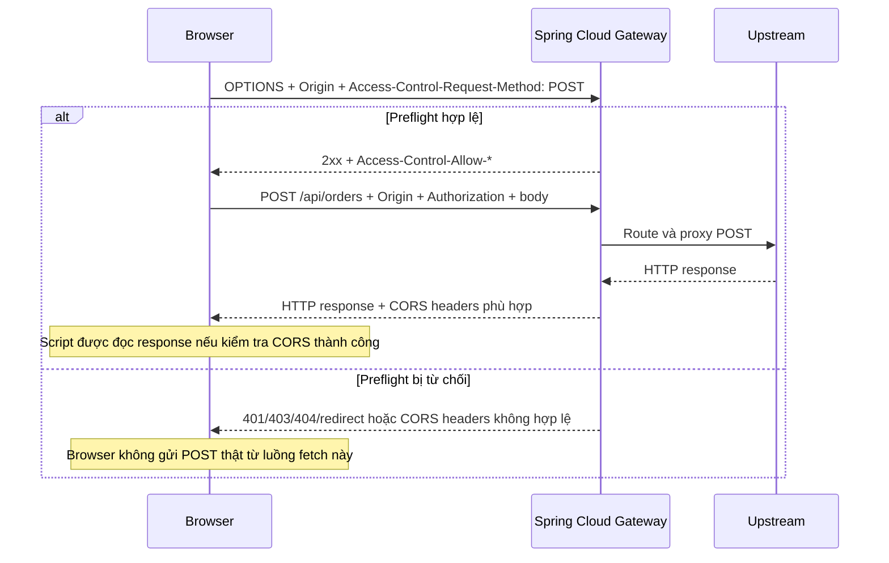
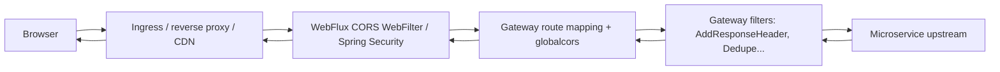
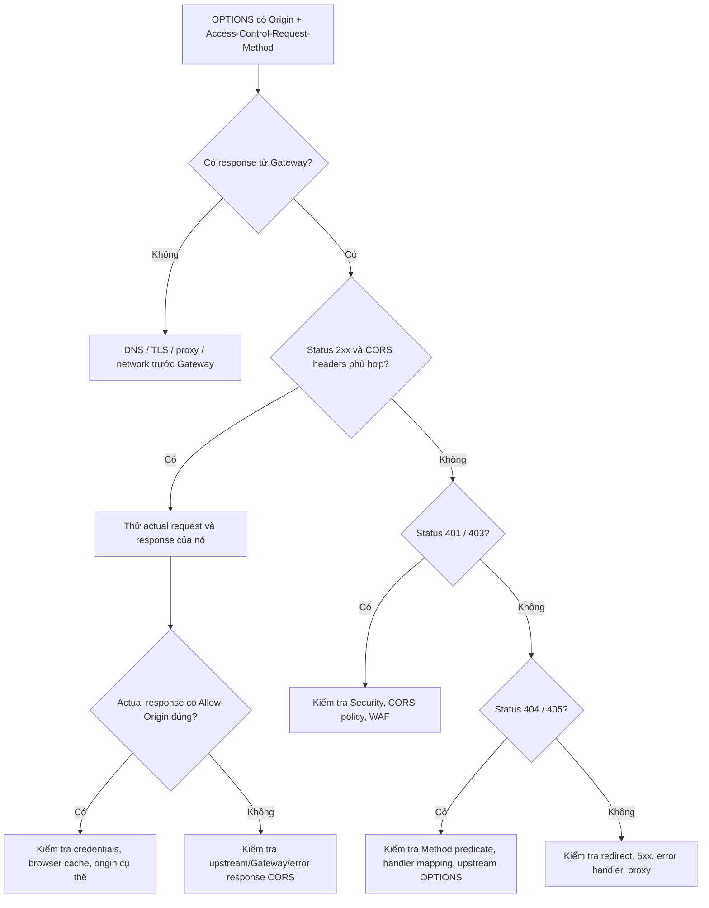

# Chẩn đoán header CORS bị trùng hoặc preflight bị từ chối

Trong hệ thống microservices, trình duyệt có thể chạy ứng dụng tại `https://app.example.test` nhưng gửi API request đến `https://api.example.test` qua **Spring Cloud Gateway**. Khi hai origin khác nhau, trình duyệt áp dụng **Cross-Origin Resource Sharing (CORS)** để quyết định JavaScript có được truy cập response hay không. Đặc biệt, với request có `Authorization`, header tùy chỉnh hoặc một số `Content-Type`, trình duyệt thường gửi request **preflight `OPTIONS`** trước request chính.

Hai nhóm lỗi dễ khiến đội vận hành Gateway mất thời gian là:

- **Header CORS bị trùng:** Gateway và upstream cùng tạo `Access-Control-Allow-Origin`, hoặc một filter bổ sung header lần nữa. Trình duyệt thấy nhiều giá trị, chẳng hạn hai origin hoặc `*` cùng một origin cụ thể, và từ chối cho script đọc response.
- **Preflight bị từ chối:** `OPTIONS` không khớp route predicate `Method`, bị Spring Security chặn, không có chính sách CORS phù hợp hoặc bị proxy/upstream chuyển hướng/trả lỗi.

Bài thuộc chương **CORS**, tập trung vào **quy trình chẩn đoán theo tầng**: tái hiện request, đọc đầy đủ headers và status, phân biệt nguyên nhân ở WebFlux/Security/Gateway/upstream, cấu hình một nguồn chịu trách nhiệm CORS, sử dụng `DedupeResponseHeader` đúng chỗ, và kiểm thử cả preflight lẫn request thật. Những kiến thức này gắn với route predicates, filter chain, chỉnh sửa path/header, service discovery và bảo mật cổng vào của Spring Cloud Gateway.

> **Phạm vi:** Các ví dụ sử dụng **Spring Cloud Gateway Server WebFlux**, Spring Security reactive khi được bật, và trình duyệt hiện đại. Cách đặt prefix cấu hình phụ thuộc phiên bản Gateway; Gateway Server MVC không dùng nguyên xi pipeline hay Java API được minh họa.

## 1. CORS quyết định gì — và không quyết định gì?

Một **origin** gồm ba thành phần: **scheme, hostname và port**. Hai URL khác nhau ở bất kỳ thành phần nào đều có thể là hai origin khác nhau:

| URL ứng dụng | URL API | Cùng origin? | Lý do |
| --- | --- | --- | --- |
| `https://app.example.test` | `https://app.example.test/api` | Có | Scheme, host, port giống nhau |
| `https://app.example.test` | `https://api.example.test` | Không | Host khác |
| `http://localhost:5173` | `http://localhost:8080` | Không | Port khác |
| `http://app.example.test` | `https://app.example.test` | Không | Scheme khác |
| `https://app.example.test` | `https://app.example.test:8443` | Không | Port khác cổng mặc định HTTPS |

CORS là **quy tắc do trình duyệt thực thi** khi JavaScript truy cập tài nguyên cross-origin. Server trả các response header cho biết origin/method/header nào được phép; trình duyệt diễn giải chúng. Một command-line client như `curl` không áp dụng cơ chế chặn CORS của browser nên có thể nhận HTTP `200` và body, ngay cả khi JavaScript trong trình duyệt bị báo lỗi CORS.

**CORS không phải hệ thống authentication/authorization.** Nó không thay thế xác minh JWT, kiểm tra scope, bảo vệ dữ liệu ở upstream hay CSRF protection đối với ứng dụng dùng cookie/session. Client không phải browser có thể gửi `Origin` giả hoặc bỏ `Origin`; vì vậy không sử dụng Origin như bằng chứng danh tính.

### Request bình thường và preflight

Ví dụ JavaScript cần gọi:

```javascript
const response = await fetch("https://api.example.test/api/orders", {
  method: "POST",
  headers: {
    Authorization: "Bearer <access-token>",
    "Content-Type": "application/json",
    "X-Request-Id": "req-123"
  },
  body: JSON.stringify({ productId: "sku-1", quantity: 2 })
});
```

Do request có các header/đặc điểm yêu cầu kiểm tra trước, browser thường gửi:

```http
OPTIONS /api/orders HTTP/1.1
Host: api.example.test
Origin: https://app.example.test
Access-Control-Request-Method: POST
Access-Control-Request-Headers: authorization,content-type,x-request-id
```

Đây là **một HTTP request riêng**. Method mà Gateway nhận là **`OPTIONS`**, không phải `POST`. Header `Access-Control-Request-Method: POST` chỉ cho biết browser dự định gọi `POST` sau khi preflight được cho phép.

Phản hồi preflight hợp lệ có thể trông như:

```http
HTTP/1.1 200 OK
Access-Control-Allow-Origin: https://app.example.test
Access-Control-Allow-Methods: GET,POST
Access-Control-Allow-Headers: authorization,content-type,x-request-id
Access-Control-Max-Age: 1800
Vary: Origin
Vary: Access-Control-Request-Method
Vary: Access-Control-Request-Headers
```

`200` chỉ là **một ví dụ**; một response 2xx hợp lệ khác như `204` cũng có thể dùng tùy handler. Các header `Vary` có thể được biểu diễn trên nhiều dòng hoặc gộp hợp lệ. Sau preflight thành công, trình duyệt mới gửi request `POST` thực tế (trừ khi kết quả preflight còn được cache ở browser).



**Điểm quan trọng:** Preflight thành công **chưa đủ**. Response của **request thật** cũng phải có `Access-Control-Allow-Origin` hợp lệ; nếu dùng credential mode yêu cầu, còn cần `Access-Control-Allow-Credentials` phù hợp.

## 2. Các thông báo lỗi CORS thường gặp

Trình duyệt có thể báo những lỗi khác nhau nhưng tất cả đều xuất hiện dưới nhãn “CORS”. Cần xem **Network tab** hoặc HTTP response thực tế để tách nguyên nhân.

| Dấu hiệu ở browser/HTTP | Gợi ý nguyên nhân | Kiểm tra đầu tiên |
| --- | --- | --- |
| `No 'Access-Control-Allow-Origin' header` | Response thiếu header cho origin đang gọi; có thể là 401/403/5xx từ lớp khác | Status, nơi sinh response, CORS owner |
| `contains multiple values` hoặc giá trị `*, https://app...` | Gateway và upstream đều đặt Allow-Origin; hoặc filter thêm trùng | Toàn bộ các giá trị `Access-Control-Allow-Origin` |
| Preflight status `401` | Security yêu cầu token cho `OPTIONS` | Security WebFilter chain và CORS handling |
| Preflight status `403` | Origin/method/header không được cho phép hoặc policy khác chặn | Policy CORS, Security, WAF/proxy |
| Preflight status `404` | `OPTIONS` không khớp route/handler hoặc path bị đổi sai | Route predicates, `globalcors`, handler mapping |
| Preflight status `405` | Một handler hoặc upstream không chấp nhận OPTIONS | Preflight có bị proxy xuống backend không |
| Redirect `301`/`302`/`307`/`308` | Proxy/ứng dụng đổi URL hoặc HTTP → HTTPS | `Location` và origin/URL cuối |
| `Access-Control-Allow-Credentials` thiếu | Request cần credentials nhưng server không cho phép | `credentials` mode, `allowCredentials` |
| `Access-Control-Allow-Origin: *` khi gửi credentials | Wildcard không hợp lệ cho credentialed CORS | Allowed origins và chính sách cookies/auth |
| Method/header không được cho phép | `Access-Control-Allow-Methods` hoặc `Access-Control-Allow-Headers` thiếu giá trị cần thiết | Preflight request thật |
| Preflight 2xx nhưng POST bị “CORS blocked” | Response của POST không có header CORS đúng, hoặc proxy/error handler tạo response khác | Kiểm tra cả OPTIONS và POST |
| CORS chỉ lỗi thỉnh thoảng | Các replica Gateway/upstream có policy khác, cache/proxy khác hoặc route chồng lấn | Gắn instance/route ID, so sánh response |

Một lỗi `CORS policy blocked` không tự chứng minh request **không đến backend**. Nếu preflight thất bại, browser thường không gửi actual request của lần gọi đó. Nhưng nếu actual request đã được gửi và chỉ **response** thiếu CORS header, backend có thể đã xử lý xong thao tác ghi dù JavaScript không được phép đọc response. Điều này rất quan trọng với `POST` tạo thanh toán/đơn hàng: không retry mù quáng chỉ vì browser báo lỗi CORS.

## 3. Nguồn sinh header CORS: tìm đúng lớp trước khi sửa

Một request có thể đi qua nhiều thành phần đều có khả năng ghi response headers:



Sơ đồ thể hiện các **điểm có thể tạo hoặc sửa header**, không khẳng định mọi cơ chế đều chạy cho mỗi request hoặc có trình tự cộng dồn cố định. Preflight có thể được xử lý sớm và **không đi qua route filters hoặc upstream**.

### Những chủ thể thường gặp

| Lớp | Có thể làm gì? | Rủi ro phổ biến |
| --- | --- | --- |
| Reverse proxy/Ingress/CDN | Thêm `Access-Control-Allow-*`, xử lý `OPTIONS`, cache preflight | Header bị thêm lần nữa ở Gateway, cache dùng sai Origin |
| `CorsWebFilter` của WebFlux | Xử lý request CORS sớm bằng cấu hình nguồn | Xung đột nếu Gateway/ứng dụng khác cũng cấu hình CORS |
| Spring Security reactive | Cho phép/chặn request, tích hợp xử lý CORS theo cấu hình | Chặn OPTIONS `401/403` trước khi Gateway route matching |
| `globalcors` của Gateway | Định nghĩa CORS policy gắn với handler mapping | OPTIONS không khớp `Method` route hoặc cấu hình prefix sai |
| CORS metadata trên route | Policy riêng theo route (nếu phiên bản hỗ trợ) | Route overlap, policy global/route khác nhau |
| `AddResponseHeader`/custom filter | Thêm header vào response của route | Gây trùng header đã có |
| Upstream service | Phản hồi với header do framework backend sinh | Backend và Gateway cùng phát `Access-Control-Allow-Origin` |
| Error handler/fallback | Tạo response `4xx/5xx` hoặc fallback | Bỏ quên header CORS ở nhánh lỗi |

**Nguyên tắc thiết kế:** Với cùng một public API và đường đi response, nên có **một nguồn chịu trách nhiệm CORS rõ ràng**, thường ở biên Gateway hoặc cơ chế CORS thống nhất ở trước nó. Backend không cần tự thêm CORS cho traffic nội bộ khi Gateway đã quản lý chính sách public browser.

Không phải cứ có hai cấu hình CORS là chắc chắn ra header trùng: một số thành phần có thể nhận biết response đã được xử lý và không thêm lại. Tuy nhiên, đó không phải hợp đồng có thể dựa vào khi các tầng framework/proxy/filters khác nhau. Phải kiểm tra **response cuối cùng**.

## 4. Khi nào một header thật sự bị “trùng sai”?

CORS không cấm mọi response header có nhiều giá trị. Phải xem **ngữ nghĩa từng trường**.

### `Access-Control-Allow-Origin` phải biểu diễn một origin được phép

Ví dụ sai:

```http
Access-Control-Allow-Origin: https://app.example.test
Access-Control-Allow-Origin: *
```

hoặc response bị proxy gộp thành:

```http
Access-Control-Allow-Origin: https://app.example.test, *
```

Browser **không** diễn giải danh sách này như “một trong hai origin được phép”. CORS response phải cung cấp một giá trị thích hợp, thường là **một origin cụ thể** phù hợp với request hoặc `*` trong trường hợp cho phép wildcard và không yêu cầu credentials theo các quy tắc áp dụng.

Ngay cả hai dòng Allow-Origin **giống nhau** cũng không nên được giữ:

```http
Access-Control-Allow-Origin: https://app.example.test
Access-Control-Allow-Origin: https://app.example.test
```

Một số stack gộp thành danh sách giá trị, khiến trình duyệt từ chối vì response không có một Allow-Origin duy nhất hợp lệ.

### `Access-Control-Allow-Credentials`

Giá trị `true` có ý nghĩa cho phép trình duyệt đưa credentials vào request cross-origin theo quy tắc CORS. Hai lần phát header cùng tên có thể gây lỗi khi proxy/brower xử lý. Không cấu hình `Access-Control-Allow-Credentials: true` chỉ vì “API có JWT”; hãy xem request có dùng cookies, HTTP auth, TLS client credentials hoặc fetch credentials mode nào, rồi áp chính sách phù hợp.

### Những header có thể có danh sách

`Access-Control-Allow-Methods` và `Access-Control-Allow-Headers` sử dụng danh sách token theo hợp đồng CORS. `Vary` là response header có thể mang nhiều trường, ví dụ `Origin`, `Access-Control-Request-Method`, `Access-Control-Request-Headers`. Việc lặp `Vary` không đồng nghĩa với lỗi “multiple values” của `Access-Control-Allow-Origin`.

Đừng áp một filter “xóa mọi header có nhiều giá trị” vì có thể phá ngữ nghĩa HTTP. Mục tiêu chẩn đoán là **chỉ sửa header CORS có nguồn ghi trùng và giá trị không hợp lệ**.

## 5. Quy trình chẩn đoán preflight bị từ chối

### Bước 1 — Ghi chính xác request trình duyệt gửi

Tại DevTools → Network, lọc theo `OPTIONS` hoặc URL API và xem:

- Request URL, scheme, host, port, path và query.
- `Origin`, ví dụ `https://app.example.test`.
- `Access-Control-Request-Method`, ví dụ `POST`.
- `Access-Control-Request-Headers`, ví dụ `authorization,content-type,x-request-id`.
- Response status, response headers, header `Location` nếu redirect.
- Có actual request `POST`/`PUT` theo sau hay không.

**Lưu ý:** Không phải mọi cross-origin request đều có preflight. Một số `GET` đơn giản chỉ cần CORS header trên **response thật**. Vì vậy không có request `OPTIONS` trong Network tab chưa chắc là lỗi.

### Bước 2 — Tái hiện bằng curl

Ví dụ Gateway local `http://localhost:8080` và frontend origin `https://app.example.test`:

```bash
curl -i -X OPTIONS 'http://localhost:8080/api/orders' \
  -H 'Origin: https://app.example.test' \
  -H 'Access-Control-Request-Method: POST' \
  -H 'Access-Control-Request-Headers: authorization,content-type,x-request-id'
```

`curl` trả lại **response headers thật**, kể cả các Allow-Origin lặp mà browser đang phàn nàn. Không dùng `curl -L` ngay khi điều tra redirect, vì tự động theo `Location` có thể che mất redirect ban đầu. Nếu cần xem chi tiết kết nối, dùng `curl -v` trong môi trường test và tránh in token thật vào log.

**Không diễn giải “curl gọi được” là CORS hợp lệ.** Curl không áp dụng kiểm tra CORS như trình duyệt; nó giúp xem HTTP response để tìm nguyên nhân.

### Bước 3 — Phân biệt request bị chặn ở đâu



Nếu preflight gặp `401`/`403` thì kiểm tra tầng **Security/CORS** trước khi đổ lỗi cho route predicate. Nếu gặp `404`/`405`, cần xác định Gateway có xử lý `OPTIONS` hay đã chuyển tiếp tới upstream.

### Bước 4 — Đối chiếu kết quả qua từng tầng

Nếu có quyền kiểm thử nội bộ, so sánh:

1. Response đi từ **backend trực tiếp** (không qua Gateway).
2. Response qua **Gateway trực tiếp** (nếu mạng cho phép).
3. Response qua **Ingress/CDN/public domain**.

Ví dụ:

| Backend | Gateway | Public edge | Nhận định ban đầu |
| --- | --- | --- | --- |
| Một Allow-Origin | Hai Allow-Origin | Hai Allow-Origin | Có thể Gateway thêm trùng |
| Không Allow-Origin | Một Allow-Origin | Hai Allow-Origin | Có thể Ingress/CDN thêm trùng |
| Một Allow-Origin | Một Allow-Origin | Một Allow-Origin | Header không bị nhân đôi, cần kiểm tra **giá trị** |
| `200` | `200` | `401` | Có thể Security/WAF ở edge chặn |
| OPTIONS không được gửi backend | Gateway trả 2xx | Edge trả redirect | Kiểm tra canonical URL/HTTPS redirect ở edge |

Đây là **suy luận theo chứng cứ**, không phải kết luận tự động: mỗi tầng còn có thể sửa/xóa/rewrite headers. Dùng correlation ID và log route/instance để đối chiếu cùng một request.

## 6. Vì sao `Method=POST` không khớp preflight `OPTIONS`?

Một route có thể khai báo:

```yaml
spring:
  cloud:
    gateway:
      routes:
        - id: orders-write
          uri: lb://order-service
          predicates:
            - Path=/api/orders/**
            - Method=POST
          filters:
            - StripPrefix=1
```

Browser gửi:

```http
OPTIONS /api/orders HTTP/1.1
Origin: https://app.example.test
Access-Control-Request-Method: POST
```

Ở bước route matching, predicate `Method=POST` nhìn vào HTTP method **`OPTIONS`** nên **không khớp**. Không thể “sửa” điều này bằng `StripPrefix`, `AddResponseHeader` hay một filter khác của route `orders-write`, vì các route filters chỉ được chạy **sau khi route được chọn**.

**Không nên mặc định thêm `Method=OPTIONS` vào mọi route** để đẩy preflight xuống backend. Với preflight browser, thường nên có CORS processor của WebFlux/Gateway trả lời sớm theo cấu hình public API; không bắt backend nghiệp vụ hiểu và chấp nhận OPTIONS cho từng endpoint.

Nếu chỉ sửa `Method=POST,OPTIONS`, backend vẫn có thể trả `405` hoặc response thiếu `Access-Control-Allow-*`. Khi route khác có `Path` rộng hơn, OPTIONS còn có thể khớp sai route. Cần kiểm tra thiết kế CORS tại chính lớp xử lý preflight.

## 7. Cấu hình `globalcors` cho Gateway WebFlux

Spring Cloud Gateway hỗ trợ cấu hình CORS cho các route/handler mapping. Với những phiên bản sử dụng prefix truyền thống, ví dụ:

```yaml
spring:
  cloud:
    gateway:
      globalcors:
        add-to-simple-url-handler-mapping: true
        cors-configurations:
          '[/**]':
            allowedOrigins:
              - https://app.example.test
            allowedMethods:
              - GET
              - POST
              - PUT
              - PATCH
              - DELETE
            allowedHeaders:
              - Authorization
              - Content-Type
              - X-Request-Id
            exposedHeaders:
              - X-Request-Id
            allowCredentials: true
            maxAge: 1800

      routes:
        - id: orders
          uri: lb://order-service
          predicates:
            - Path=/api/orders/**
            - Method=GET,POST
          filters:
            - StripPrefix=1
```

**Ý nghĩa quan trọng:**

- `cors-configurations` định nghĩa policy theo path pattern. Pattern `'[/**]'` được quote để YAML giữ nguyên ký tự đặc biệt; khi triển khai thật, nên thu hẹp phạm vi như `'/api/**'` nếu phù hợp API.
- `allowedOrigins` là danh sách origin được phép, **không** phải domain pattern không có scheme.
- `allowedMethods` liệt kê method mà browser **dự định gọi**, như POST. Phương thức HTTP thực của preflight là OPTIONS, nhưng không bắt buộc thêm OPTIONS vào `allowedMethods` chỉ để cho phép preflight `POST`.
- `allowedHeaders` phải phù hợp với `Access-Control-Request-Headers` thực tế. Có `Authorization` ở browser request là lý do thường gây preflight.
- `exposedHeaders` cho phép JavaScript truy cập các response header không nằm trong tập được expose mặc định; nó **không** thay `allowedHeaders`.
- `allowCredentials: true` chỉ nên bật khi ứng dụng thực sự cần credentialed cross-origin requests và origin được xác định rõ.
- `maxAge` là thời gian browser **có thể cache kết quả preflight**, không phải TTL cache service discovery hoặc route.
- `add-to-simple-url-handler-mapping: true` giúp CORS policy có thể được xử lý ở `SimpleUrlHandlerMapping` cho các request **không được Gateway route predicate match**, ví dụ preflight OPTIONS khi route chỉ nhận POST.

**Quan trọng về Security:** `globalcors` ở handler mapping **không bảo đảm** vượt qua Spring Security reactive WebFilter đang yêu cầu xác thực `OPTIONS` trước route mapping. Nếu Security chặn ở bước trước, phải tích hợp một cơ chế CORS chạy đủ sớm trong WebFilter/Security và tránh thêm header trùng ở các tầng.

**Quan trọng về phiên bản:** Một số bản Spring Cloud Gateway Server WebFlux mới dùng prefix `spring.cloud.gateway.server.webflux.globalcors` cùng `spring.cloud.gateway.server.webflux.routes`. Đừng trộn prefix giữa các thế hệ mà không kiểm tra metadata cấu hình/version, vì YAML có thể hợp lệ nhưng route hoặc CORS policy không được nạp. Các ví dụ trong bài mô tả cấu hình về mặt ý nghĩa; đối chiếu tài liệu đúng bản ứng dụng.

### Route-specific CORS

Một số phiên bản hỗ trợ CORS metadata trên route:

```yaml
spring:
  cloud:
    gateway:
      routes:
        - id: orders-read
          uri: http://localhost:8081
          predicates:
            - Path=/api/orders/**
          metadata:
            cors:
              allowedOrigins:
                - https://app.example.test
              allowedMethods:
                - GET
                - POST
              allowedHeaders:
                - Authorization
                - Content-Type
```

CORS metadata hữu ích khi route có policy riêng, nhưng yêu cầu một cách nhất quán để xử lý preflight không khớp route và sự phối hợp với Security. Không cấu hình một policy rộng ở `globalcors` rồi một policy khác ở route mà không hiểu cơ chế hợp nhất/ưu tiên của phiên bản đang dùng.

## 8. Nếu Spring Security từ chối OPTIONS trước Gateway routing

Một tình huống điển hình:

1. Browser gửi preflight không có Bearer token.
2. Spring Security được cấu hình `anyExchange().authenticated()`.
3. Request `OPTIONS` bị trả `401`.
4. Gateway route chưa được chọn; `globalcors` gắn với route mapping hoặc các Gateway route filters không thể giải quyết lớp chặn trước đó.

Một giải pháp là cấu hình **một CorsWebFilter** với `CorsConfigurationSource` đủ sớm trong WebFlux WebFilter chain, đồng thời bảo đảm Security không đánh chặn preflight trước cơ chế CORS.

Ví dụ triển khai CORS tập trung bằng WebFlux (thay vì cùng lúc dùng thêm Gateway `globalcors` cho chính API này):

```java
@Configuration
public class CorsAtEdgeConfiguration {

    @Bean
    @Order(Ordered.HIGHEST_PRECEDENCE)
    CorsWebFilter corsWebFilter() {
        CorsConfiguration cors = new CorsConfiguration();
        cors.setAllowedOrigins(
            List.of("https://app.example.test"));
        cors.setAllowedMethods(
            List.of("GET", "POST", "PUT", "PATCH", "DELETE"));
        cors.setAllowedHeaders(
            List.of("Authorization", "Content-Type", "X-Request-Id"));
        cors.setExposedHeaders(List.of("X-Request-Id"));
        cors.setAllowCredentials(true);
        cors.setMaxAge(1800L);

        UrlBasedCorsConfigurationSource source =
            new UrlBasedCorsConfigurationSource();
        source.registerCorsConfiguration("/api/**", cors);

        return new CorsWebFilter(source);
    }
}
```

Đoạn Java minh họa các kiểu `CorsConfiguration`, `CorsWebFilter`, `UrlBasedCorsConfigurationSource`, `Order`, `Ordered` và `List`; cần import từ Spring Framework, cấu hình phiên bản Spring Security và vị trí filter phù hợp. Nếu framework/security đã tự cung cấp CORS filter cho cùng đường dẫn, **không bổ sung bean thứ hai** chỉ để thử; phải xác định cơ chế nào đang xử lý request.

Trong hệ thống sử dụng OAuth2 Resource Server, có thể giữ rule phân quyền như:

```java
@Bean
SecurityWebFilterChain apiSecurity(ServerHttpSecurity http) {
    return http
        .authorizeExchange(exchanges -> exchanges
            .pathMatchers("/api/**").authenticated()
            .anyExchange().permitAll())
        .oauth2ResourceServer(oauth2 ->
            oauth2.jwt(Customizer.withDefaults()))
        .build();
}
```

Đây chỉ là minh họa Security policy; trong ứng dụng thật còn cần authorization theo method/scope, CSRF policy phù hợp, exception handling và cấu hình xác minh JWT. **CORS filter được sắp đủ sớm có thể giải quyết preflight trước Security**, còn actual request vẫn phải trải qua authentication/authorization.

Một cách cấu hình phổ biến khác là cấp quyền cho `OPTIONS` ở phạm vi preflight thích hợp, nhưng **`permitAll(OPTIONS)` chỉ tránh chặn ở Security, không tự tạo `Access-Control-Allow-Origin`**. Bắt buộc vẫn phải có CORS policy thực tế. Không mở toàn bộ ứng dụng bằng `anyExchange().permitAll()` để “sửa CORS”.

### CORS và CSRF không phải một

CORS hạn chế JavaScript từ origin khác đọc response; CSRF là rủi ro một website khác khiến browser gửi thao tác thay đổi trạng thái bằng credential sẵn có (đặc biệt cookie/session). Bật CORS đúng **không tự loại bỏ CSRF**. Với API Bearer token stateless, lựa chọn CSRF khác ứng dụng dùng session cookie; phải quyết định theo cơ chế xác thực thực tế.

## 9. Xử lý header trùng bằng `DedupeResponseHeader`

Spring Cloud Gateway có `DedupeResponseHeader` GatewayFilter Factory để loại bỏ giá trị trùng theo chiến lược cấu hình trên **response headers** của route đã chọn.

Ví dụ:

```yaml
spring:
  cloud:
    gateway:
      routes:
        - id: orders
          uri: http://localhost:8081
          predicates:
            - Path=/api/orders/**
          filters:
            - name: DedupeResponseHeader
              args:
                name: Access-Control-Allow-Credentials Access-Control-Allow-Origin
                strategy: RETAIN_FIRST
```

Các chiến lược thường gặp:

| Chiến lược | Ý nghĩa thực tế | Khi cần chú ý |
| --- | --- | --- |
| `RETAIN_FIRST` | Giữ giá trị đầu tiên | Giá trị đầu có thể là của upstream và **sai** với policy public |
| `RETAIN_LAST` | Giữ giá trị cuối | Giá trị cuối cũng có thể là policy sai hoặc wildcard |
| `RETAIN_UNIQUE` | Giữ các giá trị khác nhau | Với `Access-Control-Allow-Origin`, **nhiều origin khác nhau vẫn là response không hợp lệ** |

Tên header được liệt kê cách nhau bằng **dấu cách** trong tham số `name`. Nên sử dụng expanded YAML như trên để tránh nhầm dấu phẩy của shortcut với dấu phân cách giữa các tên header.

**Không coi DedupeResponseHeader là phương án chữa mọi lỗi CORS:**

1. Nó xử lý header ở **route filter chain**. Nếu preflight bị chặn bởi Security trước routing, filter này không chạy.
2. Nếu preflight được CORS processor trả lời sớm, route filter có thể không được thực thi; cấu hình Dedupe trên route không thể đảm bảo sửa header do ingress thêm sau đó.
3. Giữ một giá trị không đảm bảo đó là **giá trị đúng**. Nếu upstream trả `*` và Gateway trả origin cụ thể trong response credentialed, chọn nhầm `*` vẫn khiến browser chặn.
4. Filter chỉ xử lý những header được chỉ định, không sửa nguyên nhân gốc như hai nơi cùng quản lý CORS hoặc proxy cache sai.
5. Nếu response đã commit hoặc bị một tầng phía **sau Gateway** thêm header, route filter không thể thay đổi phần client cuối cùng nhìn thấy.

**Khuyến nghị:** Trước hết chọn rõ **một CORS owner** và bỏ cấu hình trùng ở upstream/ingress/filter tùy chỉnh. Dùng `DedupeResponseHeader` khi phải tích hợp backend không thể thay đổi ngay, đồng thời test giá trị cuối cùng chính xác. Với response từ Gateway error handler hoặc preflight xử lý sớm, cần sửa chính lớp đang tạo response thay vì chỉ thêm filter route.

## 10. Ví dụ: phân biệt trùng do upstream hay do Gateway

Giả sử backend `order-service` sử dụng CORS middleware riêng, phản hồi:

```http
HTTP/1.1 200 OK
Access-Control-Allow-Origin: *
Content-Type: application/json

{"orders":[]}
```

Trong khi Gateway thêm:

```yaml
filters:
  - AddResponseHeader=Access-Control-Allow-Origin,https://app.example.test
```

Sau khi proxy, client có thể nhìn thấy:

```http
Access-Control-Allow-Origin: *
Access-Control-Allow-Origin: https://app.example.test
```

Đó là một response **không có chính sách CORS hợp lệ duy nhất**. Đặc biệt khi browser gửi credentials, chỉ một origin cụ thể cùng `Access-Control-Allow-Credentials: true` mới phù hợp trong tình huống tương ứng; `*` không thể được giữ lại.

Các hướng giải quyết theo thứ tự ưu tiên:

1. **Loại bỏ nguồn ghi trùng:** Chọn Gateway làm CORS owner cho public API; tắt CORS middleware trên backend khi backend chỉ được gọi nội bộ. Không thêm `AddResponseHeader` thủ công nếu `globalcors` hoặc `CorsWebFilter` đã xử lý hợp lệ.
2. **Thống nhất policy ở nơi xử lý preflight và actual response:** Một nơi trả `Access-Control-Allow-Origin`, các tầng khác chuyển tiếp nguyên vẹn, không tự thêm.
3. **Nếu bắt buộc dùng Dedupe:** Xác minh thứ tự và giá trị nguồn, chọn `RETAIN_FIRST` hoặc `RETAIN_LAST` có căn cứ; kiểm thử mọi nhánh status, bao gồm 2xx, 401/403, 429 và 5xx.
4. **Nếu proxy/CDN thêm sau Gateway:** Sửa cấu hình proxy hoặc phân quyền CORS owner ở edge, vì Gateway không thể “xóa” một header được thêm sau khi response đã rời Gateway.

**Trường hợp cần cảnh giác:** Cơ chế phản ánh động giá trị `Origin` từ request (`echo Origin`) mà không kiểm tra allowlist có thể cho phép các website không mong muốn đọc response credentialed. Dedupe không giải quyết việc cấp quyền quá rộng; phải giới hạn origin tại chính CORS policy.

## 11. Kiểm tra cả actual request, không chỉ preflight

Sau khi preflight thành công, chạy request thực có `Origin`:

```bash
curl -i 'http://localhost:8080/api/orders/42' \
  -H 'Origin: https://app.example.test'
```

Nếu API cần Bearer token, trong bài test đã được cấp quyền có thể thêm `Authorization: Bearer ...` bằng nguồn bảo mật phù hợp; không chép token thật vào log, tài liệu hoặc shell history chung.

Response ví dụ hợp lệ:

```http
HTTP/1.1 200 OK
Access-Control-Allow-Origin: https://app.example.test
Access-Control-Allow-Credentials: true
Vary: Origin
Content-Type: application/json

{"id":42}
```

Một request khác có thể trả `401` vì token không hợp lệ. Khi ấy ứng dụng frontend vẫn cần **một response CORS hợp lệ** nếu muốn JavaScript đọc status/body lỗi. Nếu Security/error handler sinh `401` mà thiếu Allow-Origin, trình duyệt có thể chỉ hiển thị lỗi CORS, khiến lập trình viên tưởng Gateway định tuyến sai.

Tương tự, response `429` từ rate limiter, `503` do LoadBalancer không tìm được service instance hoặc `504` do upstream timeout có thể đi qua đường xử lý khác response `200`. Hãy kiểm thử CORS cho **các nhánh lỗi** chứ không chỉ happy path.

### CORS không đảm bảo backend đã xử lý request

Có hai trường hợp quan trọng cần phân biệt:

- **Preflight thất bại:** Browser không gửi actual request trong luồng fetch đó. Trường hợp này có thể sửa CORS trước khi nghiệp vụ được gọi.
- **Actual request đã gửi nhưng response bị chặn:** Backend có thể đã commit nghiệp vụ. Nếu JavaScript không đọc được response, hãy dùng request ID/idempotency key để truy vấn trạng thái hoặc đối soát trước khi retry.

Điều này đặc biệt quan trọng với POST tạo đơn, thu phí, hoàn tiền hoặc thao tác không idempotent. Không tự tạo một yêu cầu thanh toán mới chỉ vì console hiển thị chữ “CORS”.

## 12. Credentials, wildcard và danh sách origin

### Origin cụ thể khi dùng credentials

Nếu frontend dùng:

```javascript
fetch("https://api.example.test/api/me", {
  credentials: "include"
});
```

browser cần response có Allow-Origin phù hợp origin đang gọi, đồng thời `Access-Control-Allow-Credentials: true`. Không dùng:

```http
Access-Control-Allow-Origin: *
Access-Control-Allow-Credentials: true
```

vì wildcard Allow-Origin không hợp lệ cho credentialed CORS.

**Một số lưu ý:**

- `allowedOrigins` phải phản ánh **scheme + host + port**, ví dụ `http://localhost:5173` khác `https://localhost:5173`.
- Với nhiều origin cụ thể, server thường chọn **một origin phù hợp** và trả một `Access-Control-Allow-Origin` tương ứng với request, không trả một danh sách các origin trong cùng header.
- Khi cấu hình origin patterns, hãy kiểm tra semantics của `allowedOriginPatterns` trong phiên bản Spring đang dùng. Pattern quá rộng có thể vô tình cho phép subdomain chưa được kiểm soát.
- Bật `allowCredentials` cần xét cookie attributes như `SameSite`, `Secure`, chính sách third-party cookie của trình duyệt và CSRF. CORS cho phép đọc response **không tự bảo đảm browser sẽ gửi cookie**.
- `Access-Control-Expose-Headers` chỉ quyết định response header nào JavaScript có thể đọc; nó không bật quyền gửi `Authorization`.

### `Vary: Origin` và cache

Khi backend/Gateway phản hồi Allow-Origin khác nhau tùy request `Origin`, cache dùng chung (proxy/CDN) phải phân biệt những biến thể đó. `Vary: Origin` là một tín hiệu quan trọng; với preflight, `Vary` có thể còn chứa `Access-Control-Request-Method` và `Access-Control-Request-Headers`.

Ví dụ nguy hiểm: CDN cache response cho `https://admin.example.test` rồi trả nguyên `Access-Control-Allow-Origin: https://admin.example.test` cho `https://app.example.test`. Browser app sẽ chặn dù Gateway policy đúng. Vấn đề nằm ở **cache key/Vary tại CDN**, không phải `DedupeResponseHeader`.

Không xóa các `Vary` hợp lệ chỉ để làm response “gọn”; sẽ tăng rủi ro cache chéo origin và kết quả lúc được lúc không.

## 13. CORS với các lớp khác trong Spring Cloud Gateway

### Route predicate và thứ tự route

Preflight `OPTIONS` có thể không khớp route `Method=GET,POST`. Ngoài `Method`, các predicate như `Host`, `Header`, `Query` cũng có thể khiến route không khớp; CORS policy gắn route có thể không được áp dụng ở thời điểm bạn nghĩ. Một route bao phủ rộng với `order` ưu tiên hơn còn có thể bắt OPTIONS và proxy xuống dịch vụ không hỗ trợ nó.

**Chẩn đoán:** Quan sát route ID (nếu có), route order và CORS processor có chạy hay không. Đừng chỉ nhìn `Path`.

### Filter chỉnh sửa path/header

`StripPrefix`, `RewritePath` hay `AddRequestHeader` chạy trong Gateway filter chain **sau route matching**. Chúng không làm một preflight bị từ chối trước mapping trở nên hợp lệ. `AddResponseHeader` có thể gây trùng CORS header trong actual response, còn `DedupeResponseHeader` chỉ xử lý trong phạm vi chain và theo thứ tự thực thi.

### Spring Security

CORS xử lý Origin; Security xử lý danh tính/quyền. Cấu hình đúng cần bảo đảm preflight được trả lời không yêu cầu access token theo cách không cần thiết, trong khi actual `POST` vẫn phải kiểm tra JWT/scope. Không tắt Security, không tắt CSRF tùy tiện và không xem CORS allowlist là danh sách user được cấp quyền.

### Rate limiter, circuit breaker và retry

Một request OPTIONS thường không cần đến upstream nghiệp vụ. Nếu preflight đi qua route filter rồi bị rate limiter trả `429`, cần xác định có nên xử lý preflight sớm tại CORS layer không. Khi circuit breaker/fallback trả `503`, response lỗi vẫn cần header CORS đúng để frontend phân biệt lỗi dịch vụ. Retry không tự sửa preflight bị 403 và không bảo đảm response cuối cùng không có header trùng.

### Service discovery và TLS

Nếu `lb://order-service` không tìm được instance, có thể Gateway sinh `503`. Browser hiển thị “CORS blocked” nếu response lỗi không có Allow-Origin, che mất nguyên nhân gốc là discovery. Tương tự, DNS/TLS/upstream timeout có thể tạo `5xx` mà lớp CORS không xử lý nhất quán.

Hãy nhìn **HTTP status, route ID, error source và headers** đồng thời, không suy ra mọi lỗi CORS là cấu hình origin sai.

## 14. Kiểm thử tích hợp bằng WebTestClient

Một bộ test đáng tin cậy nên kiểm tra cả **preflight**, **actual response**, **số lượng Allow-Origin** và **request có đi đến upstream hay không**.

Ví dụ phần assertion với `WebTestClient` (giả sử đã khởi động Gateway, cấu hình CORS cho `https://app.example.test` và cho phép POST):

```java
@Test
void validPreflightHasExactlyOneAllowedOrigin() {
    var result = webTestClient.options()
        .uri("/api/orders")
        .header(HttpHeaders.ORIGIN, "https://app.example.test")
        .header(HttpHeaders.ACCESS_CONTROL_REQUEST_METHOD, "POST")
        .header(
            HttpHeaders.ACCESS_CONTROL_REQUEST_HEADERS,
            "authorization,content-type,x-request-id")
        .exchange()
        .expectStatus().is2xxSuccessful()
        .returnResult(Void.class);

    List<String> origins = result.getResponseHeaders()
        .get(HttpHeaders.ACCESS_CONTROL_ALLOW_ORIGIN);

    assertThat(origins)
        .containsExactly("https://app.example.test");
}
```

Đoạn trên minh họa một phần test, cần `WebTestClient`, thư viện assertion, `HttpHeaders`, các import và test fixture tương ứng. Khi preflight được xử lý ở Gateway, nên xác nhận **upstream không nhận OPTIONS**:

```java
// Pseudo-assertion ở mock upstream:
// verify rằng không có request OPTIONS /orders xuất hiện
wireMockServer.verify(0,
    optionsRequestedFor(urlPathMatching("/orders.*")));
```

API `optionsRequestedFor` và matcher cần có static import WireMock thích hợp. Hành vi upstream không bị gọi chỉ được yêu cầu khi kiến trúc thực sự **xử lý preflight sớm**, không phải khi có route chuyên dụng chuyển OPTIONS tới backend.

### Test cho origin bị cấm

```java
@Test
void disallowedOriginIsNotApproved() {
    var result = webTestClient.options()
        .uri("/api/orders")
        .header(HttpHeaders.ORIGIN, "https://evil.example.test")
        .header(HttpHeaders.ACCESS_CONTROL_REQUEST_METHOD, "POST")
        .exchange()
        .returnResult(Void.class);

    List<String> origins = result.getResponseHeaders()
        .get(HttpHeaders.ACCESS_CONTROL_ALLOW_ORIGIN);

    assertThat(origins)
        .doesNotContain("https://evil.example.test");
}
```

Test này chỉ minh họa kiểm tra **không phê duyệt Origin**. Tùy CORS processor/Security/handler mapping, status cho origin bị từ chối có thể khác. Nếu chính sách của ứng dụng quy định trả `403`, nên thêm assertion chính xác và kiểm tra backend không được gọi.

### Các trường hợp phải có trong ma trận test

| Test | Request | Kỳ vọng cần kiểm tra |
| --- | --- | --- |
| T1 | OPTIONS từ origin được phép, method POST | Response preflight 2xx và Allow-Origin duy nhất, chính xác |
| T2 | OPTIONS với `Authorization` được yêu cầu trong Access-Control-Request-Headers | `Access-Control-Allow-Headers` chấp nhận giá trị cần thiết |
| T3 | OPTIONS từ origin không được phép | Không phê duyệt origin, không gọi upstream nghiệp vụ |
| T4 | OPTIONS yêu cầu method `DELETE` không được phép | Không phê duyệt method |
| T5 | OPTIONS yêu cầu header không nằm trong allowlist | Không phê duyệt header đó |
| T6 | Actual GET từ origin hợp lệ | Response thành công có Allow-Origin hợp lệ |
| T7 | Actual POST cần JWT hợp lệ | Security cho phép, upstream nhận đúng body |
| T8 | Actual POST thiếu token | Security trả lỗi đúng và CORS xử lý nhất quán ở nhánh lỗi |
| T9 | Upstream tự thêm Allow-Origin | Response cuối cùng không có giá trị Allow-Origin trùng/sai |
| T10 | Upstream `5xx` hoặc fallback | Error response có CORS headers phù hợp nếu policy yêu cầu |
| T11 | Hai Gateway replica khác cấu hình | Phát hiện drift qua route/replica ID |
| T12 | Request với `credentials: include` | Allow-Origin cụ thể và Allow-Credentials phù hợp |
| T13 | Request có query/path rewrite | CORS áp theo path public đúng, route filter xử lý đúng actual request |
| T14 | CDN/Ingress đứng trước Gateway | Response public không bị thêm header lần nữa |

**Chỉ test response status là chưa đủ.** Preflight `200` có thể thiếu `Access-Control-Allow-Origin`, actual `200` có thể chứa hai Allow-Origin và vẫn bị browser chặn. Test phải kiểm tra **headers cụ thể** và khi cần, dùng trình duyệt thật để xác nhận hành vi client.

## 15. Runbook xử lý lỗi CORS trong production

Khi nhận incident “Frontend không gọi được API”, thực hiện theo thứ tự:

1. **Khoanh vùng:** Origin nào, URL nào, method nào, có credentials hay không, xảy ra mọi request hay chỉ một route/version?
2. **Lấy Network trace:** Có preflight OPTIONS không, status/headers của OPTIONS là gì, actual request có được gửi không?
3. **Tái hiện một request:** `curl -i -X OPTIONS` với **đủ** `Origin`, `Access-Control-Request-Method` và `Access-Control-Request-Headers`; kiểm tra số lượng/giá trị các header.
4. **Phân loại lỗi:** `401/403` do Security/CORS, `404/405` do route/handler, `3xx` do redirect, `5xx` do upstream/proxy hoặc response lỗi thiếu CORS.
5. **Tìm header owner:** Backend, Gateway `globalcors`/`CorsWebFilter`, route filter, ingress/CDN. Ghi rõ tầng nào thêm hoặc xóa header.
6. **Sửa tại lớp gốc:** Chọn một policy CORS chịu trách nhiệm; bỏ cấu hình trùng, đồng bộ origin/method/headers; chỉ dùng Dedupe trong phạm vi phù hợp.
7. **Kiểm thử bảo mật:** Origin không được phép vẫn bị chặn; JWT/scope/CSRF không bị mở lỏng; credentials không đi kèm wildcard.
8. **Kiểm thử happy path và nhánh lỗi:** 2xx, Security `401/403`, rate limit `429`, upstream `5xx`, timeout/fallback.
9. **Kiểm tra cache/replica:** Browser preflight cache theo `Max-Age`, CDN `Vary`, các Gateway replica và cấu hình rollout.
10. **Quan sát sau sửa:** Đo tỷ lệ preflight bị từ chối, số response có Allow-Origin không hợp lệ, lỗi frontend và request upstream; tránh log token/cookie.

### Bảng quyết định chẩn đoán nhanh

| Nếu thấy… | Làm tiếp… | Tránh làm… |
| --- | --- | --- |
| `401` cho OPTIONS | Kiểm tra thứ tự CORS trước Security | Tắt toàn bộ xác thực |
| `404` cho OPTIONS | Kiểm tra `Method` predicate và xử lý OPTIONS ngoài route | Chỉ thêm `StripPrefix` |
| Hai `Access-Control-Allow-Origin` | Xác định hai nguồn ghi, bỏ nguồn trùng | Giữ tùy tiện origin đầu/ cuối |
| `Access-Control-Allow-Origin: *` với credentials | Dùng allowed origin cụ thể có kiểm soát | Bật thêm Allow-Credentials nhưng giữ wildcard |
| Preflight 2xx, actual response bị chặn | Kiểm tra CORS headers của actual response và lỗi Security/upstream | Kết luận preflight đã giải quyết toàn bộ |
| Lỗi chỉ sau triển khai | So sánh Gateway replicas, config profiles, Ingress/CDN, cache | Giảm mọi timeout/TTL không có bằng chứng |
| `503` được browser báo như CORS | Kiểm tra instance discovery, upstream, error handler | Chỉ sửa allowedOrigins |
| POST có khả năng đã đến backend | Tra cứu request ID/idempotency state | Retry nghiệp vụ ngay chỉ vì console báo lỗi |

## 16. Bài thực hành: sửa trùng header và preflight 401

### Bối cảnh

Một SPA tại `https://app.example.test` gọi `POST https://api.example.test/api/orders` với Bearer token và JSON body. Hạ tầng có:

- Ingress chuyển TLS đến Gateway WebFlux.
- Spring Security JWT bảo vệ `/api/**`.
- Gateway route `Path=/api/orders/**`, `Method=POST`, `uri=lb://order-service`.
- Backend `order-service` tự trả `Access-Control-Allow-Origin: *`.
- Gateway có filter `AddResponseHeader=Access-Control-Allow-Origin,https://app.example.test`.
- Frontend thỉnh thoảng nhận lỗi `401` cho preflight và lỗi “multiple values” cho actual response.

### Phân tích

**Lỗi preflight `401`:** Browser gửi `OPTIONS` không mang Bearer token theo kiểu actual request. Nếu Security yêu cầu JWT trước CORS handler, preflight bị chặn. Đồng thời `Method=POST` không khớp OPTIONS. **Phải xử lý preflight ở CORS layer được sắp đúng chỗ**, không chỉ điều chỉnh route predicate.

**Lỗi header trùng:** Backend và Gateway cùng sinh Allow-Origin cho actual response. Cần chọn một nguồn chịu trách nhiệm public CORS, ví dụ Gateway/WebFlux CORS, và tắt middleware CORS ở backend nội bộ. Khi không thể thay backend ngay, có thể dùng `DedupeResponseHeader` sau khi đã kiểm tra giá trị và order; đừng để wildcard thắng trong credentialed request.

**Kiểm thử sau sửa:** OPTIONS được phê duyệt đúng origin, method, headers và không đến backend; POST vẫn cần token hợp lệ; actual response có đúng **một** `Access-Control-Allow-Origin: https://app.example.test`; origin lạ không được cấp phép; lỗi 401/429/503 vẫn có phản hồi phù hợp.

### Câu hỏi tự kiểm tra

1. Vì sao `Access-Control-Request-Method: POST` không làm preflight `OPTIONS` khớp route `Method=POST`?
2. Khi Gateway đã cấu hình CORS mà browser vẫn nhận `401` cho preflight, cần kiểm tra lớp nào trước tiên?
3. Hai dòng `Access-Control-Allow-Origin` giống nhau có nên được giữ không? Vì sao?
4. `DedupeResponseHeader=Access-Control-Allow-Origin` có thể sửa preflight bị chặn bởi Security không?
5. `RETAIN_FIRST` và `RETAIN_UNIQUE` khác nhau thế nào, và vì sao RETAIN_UNIQUE vẫn có thể không tạo Allow-Origin hợp lệ?
6. Vì sao frontend thấy lỗi CORS ở actual POST **không chứng minh** backend chưa xử lý giao dịch?
7. Khi `credentials: include`, vì sao Allow-Origin wildcard không phù hợp?
8. CORS và JWT authorization kiểm soát hai vấn đề gì khác nhau?
9. Vì sao chỉ dùng `curl` mà không kiểm tra browser Network tab có thể bỏ sót vấn đề?
10. `Vary: Origin` quan trọng thế nào khi CDN cache response cho nhiều frontend origin?
11. Vì sao error response `503` không có Allow-Origin có thể làm incident bị gán nhầm thành “lỗi CORS”?
12. Khi cấu hình CORS ở cả Gateway và reverse proxy, làm sao xác định tầng phát header trùng?

**Ghi nhớ:** Khi CORS lỗi, hãy chẩn đoán **preflight request thật**, **status/headers cuối cùng** và **lớp sở hữu policy**. `OPTIONS` không tự khớp route `Method=POST`; Spring Security có thể chặn trước Gateway routing; upstream, Gateway filter và proxy có thể cùng ghi `Access-Control-Allow-Origin`. Cấu hình một nguồn CORS có chủ đích, chỉ dùng `DedupeResponseHeader` khi phù hợp, giữ chính sách bảo mật độc lập và kiểm thử cả preflight lẫn actual response là cách sửa nguyên nhân thay vì che triệu chứng.

