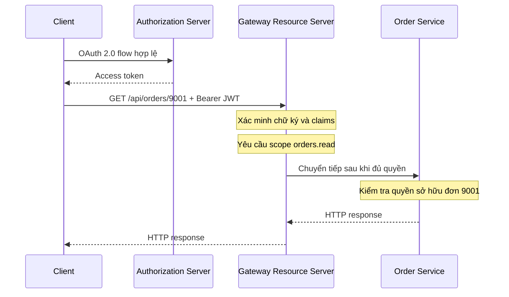
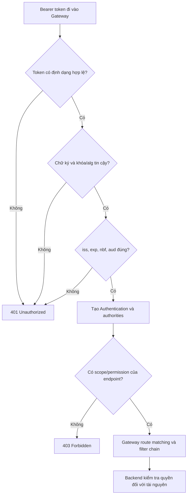

# OAuth 2.0 Resource Server và xác minh JWT trong Spring Cloud Gateway

Một API Gateway có thể xác định đúng tuyến `/api/orders/**` và đích `lb://order-service`, nhưng điều đó chưa trả lời được **người gọi là ai**, **token có hợp lệ không** và **người gọi được phép thao tác gì**. Khi công bố các API microservices, Gateway thường đóng vai trò điểm thực thi xác thực/phân quyền ban đầu. Trong **Spring Cloud Gateway Server WebFlux**, có thể dùng **Spring Security OAuth 2.0 Resource Server** để kiểm tra access token dạng **JWT** trước khi cho request đi vào chuỗi định tuyến.

Bài học thuộc chương **Xác thực và phân quyền** của module `SPRING_CLOUD_GATEWAY`. Chủ đề này bổ trợ cho route predicate, filter chain, biến đổi đường dẫn/header và khám phá dịch vụ; đồng thời đặt ranh giới với rate limiting, circuit breaker, retry, TLS và quan sát request để vận hành cổng vào microservices an toàn.

Sau bài học, bạn sẽ có thể:

- Phân biệt **Authorization Server**, **OAuth Client**, **Resource Server** và backend API.
- Hiểu vì sao **giải mã JWT không đồng nghĩa xác minh JWT**, và các kiểm tra chữ ký, issuer, audience, thời hạn là bắt buộc.
- Thiết lập **Spring Security reactive** cho Gateway, phân quyền theo scope và phân biệt 401 với 403.
- Bảo vệ backend khỏi danh tính giả mạo, quyết định cách truyền token và kiểm thử CORS, JWKS, key rotation.
- Chẩn đoán lỗi an ninh tách biệt với lỗi định tuyến hoặc không có instance.

> **Phạm vi:** Ví dụ sử dụng **Spring Cloud Gateway Server WebFlux** và Spring Security reactive. Biến thể Gateway Server MVC sử dụng pipeline bảo mật servlet khác. Cấu hình và một số API có thể thay đổi theo phiên bản Spring Boot, Spring Cloud và Spring Security; phải chọn bộ phiên bản tương thích. Mọi tên miền, khóa và token dưới đây chỉ mang tính minh họa.

## 1. OAuth 2.0 Resource Server là vai trò nào?

OAuth 2.0 là framework ủy quyền. Trong một luồng truy cập API, các vai trò chính gồm:

| Vai trò | Nhiệm vụ | Ví dụ |
| --- | --- | --- |
| **Resource Owner** | Chủ thể liên quan tới tài nguyên. | Người dùng sở hữu đơn hàng `9001`. |
| **OAuth Client** | Ứng dụng nhận và dùng access token theo flow thích hợp. | SPA, ứng dụng mobile, BFF hoặc machine-to-machine client. |
| **Authorization Server** | Phát hành token, cung cấp metadata/JWKS, kiểm soát chính sách cấp quyền. | `https://identity.example.com/realms/store`. |
| **Resource Server** | Nhận access token; xác minh token và thực thi quyền truy cập API. | Spring Cloud Gateway hoặc Order Service. |
| **API Gateway** | Cổng định tuyến và thực thi chính sách chung; có thể đồng thời là Resource Server. | `https://api.example.com`. |

**Resource Server không có nhiệm vụ phát hành token.** Cấu hình Gateway là OAuth 2.0 Resource Server không tự tạo trang đăng nhập, Authorization Code Flow, token endpoint hoặc hệ thống user. Những bước này thuộc Authorization Server và OAuth Client tương ứng.



Gateway có thể dừng request sớm với 401/403 trước khi backend nhận được HTTP request. Backend vẫn cần kiểm tra quyền nghiệp vụ trên từng tài nguyên, vì một scope rộng như `orders.read` không chứng minh user sở hữu mọi đơn hàng.

## 2. JWT gồm những gì và vì sao phải xác minh?

JWT (*JSON Web Token*) dạng JWS thường có ba phần:

```text
BASE64URL(header).BASE64URL(payload).BASE64URL(signature)
```

Ví dụ **header** đã giải mã:

```json
{
  "alg": "RS256",
  "typ": "JWT",
  "kid": "key-2026-11"
}
```

Ví dụ **payload** đã giải mã:

```json
{
  "iss": "https://identity.example.com/realms/store",
  "sub": "user-123",
  "aud": ["edge-api"],
  "scope": "catalog.read orders.read",
  "iat": 1795000000,
  "nbf": 1795000000,
  "exp": 1795003600
}
```

Những mốc thời gian là ví dụ; thời hạn thật phải tương ứng thời gian phát hành và clock của hệ thống.

| Trường | Ý nghĩa | Cần làm gì? |
| --- | --- | --- |
| `alg` | Thuật toán chữ ký JWT. | Decoder chỉ cho phép thuật toán đã thống nhất và an toàn. |
| `kid` | Định danh khóa dùng xác minh chữ ký. | Chọn khóa từ tập JWKS **đáng tin**; không tải URL tùy ý từ token. |
| `iss` | Định danh issuer. | Khớp issuer đã cấu hình. |
| `sub` | Chủ thể của token. | Dùng làm ngữ cảnh nhận dạng, không suy ra mọi quyền nghiệp vụ. |
| `aud` | Những API/đối tượng nhận mà token được phát hành cho. | Phải chứa audience API của Gateway theo hợp đồng. |
| `scope`/`scp` | Phạm vi quyền được cấp. | Ánh xạ sang authorities theo quy ước và kiểm tra từng endpoint. |
| `iat` | Thời điểm token được phát hành. | Hữu ích cho chính sách token lifetime. |
| `nbf` | Thời điểm sớm nhất token được dùng. | Kiểm tra thời gian, chỉ cho phép clock skew hợp lý. |
| `exp` | Thời điểm hết hạn. | Từ chối token hết hạn. |
| `jti` | Định danh token nếu issuer cung cấp. | Hỗ trợ audit/denylist nếu được thiết kế, không tự thu hồi token. |

**Base64URL không phải mã hóa bảo mật.** Người giữ JWT có thể đọc header và payload; chữ ký JWS bảo vệ tính toàn vẹn và nguồn phát hành **sau khi** xác minh với khóa tin cậy. Không đặt mật khẩu, secret, thông tin thanh toán nhạy cảm hoặc dữ liệu không nên lộ vào JWT.

### 2.1. Sai lầm: decode payload rồi tin claim `role`

Một đoạn code tự tách JWT theo dấu chấm, giải mã Base64URL và đọc `role=admin` **không chứng minh token được issuer phát hành**. Kẻ tấn công có thể tự tạo payload tùy ý. Việc cấp quyền chỉ được thực hiện sau khi decoder xác minh chữ ký, thuật toán, issuer, thời gian, audience và các kiểm tra claim khác theo contract.

Không chấp nhận `alg=none` hoặc tùy chọn thuật toán bất kỳ chỉ vì nó được khai trong header. Đừng dùng khóa ký lấy từ các địa chỉ `jku`/`x5u` do token chỉ định mà không có cơ chế tin cậy nghiêm ngặt.

### 2.2. Token dạng JWT khác token dạng opaque

Resource Server có thể sử dụng **JWT decoder** khi access token là JWT có chữ ký và hỗ trợ xác minh cục bộ; hoặc **opaque token introspection** khi token không thể/không nên xác minh cục bộ theo hợp đồng.

Hai mô hình khác nhau:

- **JWT:** kiểm tra chữ ký và claims bằng public key/JWKS; có thể tránh truy vấn Authorization Server trên mỗi request, nhưng việc thu hồi tức thời cần thiết kế bổ sung.
- **Opaque token:** Resource Server hỏi introspection endpoint của nhà phát hành theo cấu hình bảo mật và caching thích hợp; phụ thuộc nhiều hơn vào dịch vụ định danh lúc truy vấn.

Không dùng `jwt()` cho một token opaque chỉ vì token đó trông dài hoặc khó đọc.

## 3. Các bước kiểm tra một Bearer JWT

Với request:

```http
GET /api/orders/9001 HTTP/1.1
Host: api.example.com
Authorization: Bearer eyJ...<token-rut-gon>
```

Spring Security Resource Server cần thực hiện các bước có nghĩa:

1. Trích xuất Bearer token từ `Authorization` theo cách parser hỗ trợ.
2. Parse JWT và kiểm tra cấu trúc JOSE header/payload.
3. Xác định thuật toán/khóa trong tập khóa tin cậy, sau đó **xác minh chữ ký**.
4. Kiểm tra claim **`iss`**, **`exp`**, **`nbf`** và các ràng buộc thời gian khác.
5. Kiểm tra **`aud`** và token purpose cho API đang phục vụ.
6. Ánh xạ scope/claims thích hợp sang **`GrantedAuthority`** và tạo **`Authentication`**.
7. Đánh giá chính sách **path/method/authority** của Spring Security.
8. Nếu được phép, cho HTTP request đi tiếp tới Gateway route matching, filter chain và backend.



Trong WebFlux, **Spring Security sử dụng `WebFilter`/`SecurityWebFilterChain` ở tầng web**, khác với `GlobalFilter` và `GatewayFilter` của Spring Cloud Gateway. Request bị từ chối trước route matching có thể không xuất hiện trong log của một `GlobalFilter`, vì filter đó không được gọi.

### 3.1. Chữ ký, thuật toán và khóa

Với `RS256`, Authorization Server ký token bằng private key, còn Gateway xác minh bằng public key tương ứng. JWKS công bố các khóa công khai phù hợp. Đây là cách thuận tiện cho nhiều service vì chỉ Authorization Server giữ private key.

Không để JWT tự quyết định bất kỳ thuật toán nào Gateway sẽ tin. Khi cấu hình decoder hãy giới hạn thuật toán theo hợp đồng issuer, theo dõi key rotation và chỉ truy cập JWKS qua HTTPS/tập endpoint tin cậy.

### 3.2. Issuer khác audience

- **`iss`:** Token **do ai phát hành**?
- **`aud`:** Token **được phát hành cho API nào**?

Một token đúng chữ ký, đúng issuer nhưng `aud=["billing-api"]` không nên được chấp nhận tại `edge-api` nếu contract quy định Gateway cần `aud=edge-api`.

```text
Gateway expects issuer = https://identity.example.com/realms/store
Gateway expects audience = edge-api

JWT A: iss đúng, aud=edge-api     -> có thể hợp lệ
JWT B: iss đúng, aud=billing-api  -> phải từ chối tại Gateway
```

**Đừng mặc định chỉ khai báo `issuer-uri` sẽ kiểm tra đầy đủ audience.** Trong nhiều cấu hình Resource Server, issuer và timestamp có validators mặc định nhưng `aud` cần được kiểm tra bằng cấu hình/validator bổ sung theo phiên bản và token profile.

### 3.3. Thời hạn và clock skew

Token hết hạn theo `exp` hoặc chưa hợp lệ theo `nbf` phải bị từ chối. Các server có thể có sai lệch đồng hồ nhỏ; validator có thể cho phép một khoảng clock skew hợp lý. Không mở rộng skew vô hạn để chữa lỗi. Hãy đồng bộ NTP/clock giữa issuer, Gateway và backend và chọn access token TTL theo threat model.

## 4. Cấu hình Resource Server cho Gateway Server WebFlux

### 4.1. Dependency

Một dự án phù hợp cần:

- Spring Cloud Gateway **Server WebFlux starter** tương ứng phiên bản.
- Spring Security reactive cho WebFlux.
- Spring Boot OAuth 2.0 Resource Server starter (thông thường là `spring-boot-starter-oauth2-resource-server`).
- JWT decoder/Nimbus và các phụ thuộc được BOM quản lý.
- Spring Cloud LoadBalancer/discovery nếu route dùng `lb://service-id`, độc lập với bảo mật JWT.

Ví dụ Maven dependency cho Resource Server (Boot plugin/BOM quản lý version):

```xml
<dependency>
    <groupId>org.springframework.boot</groupId>
    <artifactId>spring-boot-starter-oauth2-resource-server</artifactId>
</dependency>
```

Không khai version Spring Security rời rạc bất tương thích với Spring Boot/Spring Cloud BOM của ứng dụng.

### 4.2. Khai báo issuer

```yaml
spring:
  security:
    oauth2:
      resourceserver:
        jwt:
          issuer-uri: https://identity.example.com/realms/store
```

`issuer-uri` là **định danh của nhà phát hành**, không phải URL đăng nhập và không phải token endpoint. Với issuer discovery phù hợp, Spring Security có thể tra metadata nhà phát hành để tìm `jwks_uri`, tạo decoder và kiểm tra claim issuer.

Tùy cách cấu hình và phiên bản, việc truy cập issuer metadata có thể xảy ra khi startup hoặc theo vòng đời decoder. Do đó cần cân nhắc sự phụ thuộc vào Identity Provider, DNS/TLS và quy trình khởi động.

### 4.3. Route không thay thế security

```yaml
spring:
  cloud:
    gateway:
      server:
        webflux:
          routes:
            - id: catalog-api
              uri: lb://catalog-service
              predicates:
                - Path=/api/catalog/**
              filters:
                - StripPrefix=1

            - id: order-api
              uri: lb://order-service
              predicates:
                - Path=/api/orders/**
              filters:
                - StripPrefix=1
```

Predicate `Path` chỉ chọn route; `StripPrefix` chỉ đổi đường dẫn; URI `lb://...` chỉ yêu cầu load balancer chọn service instance. **Không bước nào trong ba bước này xác minh Bearer JWT**. Spring Security ở tầng WebFlux chịu trách nhiệm xác thực/phân quyền trước khi request đi vào Gateway chain.

Ở các phiên bản Server WebFlux cũ, cấu hình route thường dùng `spring.cloud.gateway.routes` thay vì `spring.cloud.gateway.server.webflux.routes`. Chọn đúng namespace theo version để route thực sự được load.

## 5. Viết `SecurityWebFilterChain` bảo vệ API theo scope

Cấu hình Spring Security reactive sau bảo vệ một số endpoint công khai của Gateway:

```java
import org.springframework.context.annotation.Bean;
import org.springframework.context.annotation.Configuration;
import org.springframework.http.HttpMethod;
import org.springframework.security.config.Customizer;
import org.springframework.security.config.annotation.web.reactive.EnableWebFluxSecurity;
import org.springframework.security.config.web.server.ServerHttpSecurity;
import org.springframework.security.web.server.SecurityWebFilterChain;

@Configuration
@EnableWebFluxSecurity
public class GatewaySecurityConfig {

    @Bean
    SecurityWebFilterChain securityWebFilterChain(ServerHttpSecurity http) {
        return http
            // Chỉ dùng cho API stateless nhận Bearer token ở header,
            // không dựa vào cookie/session tự động đính kèm.
            .csrf(ServerHttpSecurity.CsrfSpec::disable)
            .authorizeExchange(exchanges -> exchanges
                .pathMatchers(HttpMethod.GET, "/actuator/health").permitAll()
                .pathMatchers(HttpMethod.GET, "/api/catalog/**")
                    .hasAuthority("SCOPE_catalog.read")
                .pathMatchers(HttpMethod.GET, "/api/orders/**")
                    .hasAuthority("SCOPE_orders.read")
                .pathMatchers(HttpMethod.POST, "/api/orders/**")
                    .hasAuthority("SCOPE_orders.write")
                .anyExchange().denyAll())
            .oauth2ResourceServer(oauth2 ->
                oauth2.jwt(Customizer.withDefaults()))
            .build();
    }
}
```

**Giải thích:**

1. `@EnableWebFluxSecurity` áp dụng cấu hình security theo mô hình WebFlux.
2. Rules khớp **path public ở Gateway**, trước bước `StripPrefix`/`RewritePath` tới backend.
3. `hasAuthority("SCOPE_catalog.read")` yêu cầu quyền đọc catalog khi GET.
4. Quyền đọc và ghi đơn hàng được tách theo method và scope.
5. `denyAll()` giúp chặn mặc định những route không có chính sách rõ ràng. Dự án thật cần khai báo các endpoint cần thiết theo contract.
6. `oauth2ResourceServer(...jwt(...))` bật xử lý Bearer JWT qua decoder cấu hình đúng.
7. `csrf(...disable)` **chỉ phù hợp** khi thực sự là API stateless Bearer-token và không dùng cơ chế cookie/session làm phương thức xác thực tự động. Nếu có BFF/browser login hoặc endpoint cookie session, phải thiết kế CSRF riêng.

Ví dụ public health check là lựa chọn minh họa; không nên mở `/actuator/**` cho mọi client. Endpoint health/readiness có thể đặt ở cổng management riêng hoặc giới hạn mạng.

### 5.1. `scope` trở thành `SCOPE_...` như thế nào?

Một JWT chứa:

```json
{
  "scope": "catalog.read orders.read"
}
```

Trong cấu hình Resource Server thường gặp, `JwtGrantedAuthoritiesConverter` ánh xạ `scope` hoặc `scp` thành:

```text
SCOPE_catalog.read
SCOPE_orders.read
```

Do đó `hasAuthority("SCOPE_orders.read")` khác `hasRole("orders.read")`. Spring Security có các quy ước prefix và role khác nhau, không nên trộn tùy ý.

Nếu issuer dùng claim `permissions` hoặc `realm_access.roles` thay vì `scope`, cần ánh xạ bằng converter có chủ đích. Không nâng một giá trị người dùng tự khai thành role quản trị nếu chưa có hợp đồng tin cậy rõ.

### 5.2. Tại sao kiểm tra cả method?

Một rule chỉ kiểm tra `/api/orders/**` với scope `orders.read` có thể cho phép một client đọc gửi `POST` ngoài ý muốn nếu các tầng sau không bảo vệ đủ chặt. Phân biệt GET/POST/DELETE/PUT và quyền tương ứng giúp audit dễ hơn.

Route predicate `Method=POST` cũng không thay thế Spring Security policy. Trường hợp security chấp nhận nhưng không có route sẽ có lỗi route; trường hợp route tồn tại nhưng security chặn thì backend không được gọi.

## 6. Tùy biến validator để kiểm tra audience

Khi token có `iss` và chữ ký hợp lệ nhưng có thể dành cho API khác, Gateway cần kiểm tra `aud`. Có thể tạo bean `ReactiveJwtDecoder` từ một JWKS URI đã được **người vận hành cấu hình tin cậy**, rồi kết hợp validators.

```java
import java.util.List;

import org.springframework.beans.factory.annotation.Value;
import org.springframework.context.annotation.Bean;
import org.springframework.context.annotation.Configuration;
import org.springframework.security.oauth2.core.DelegatingOAuth2TokenValidator;
import org.springframework.security.oauth2.core.OAuth2Error;
import org.springframework.security.oauth2.core.OAuth2TokenValidator;
import org.springframework.security.oauth2.core.OAuth2TokenValidatorResult;
import org.springframework.security.oauth2.jwt.Jwt;
import org.springframework.security.oauth2.jwt.JwtValidators;
import org.springframework.security.oauth2.jwt.NimbusReactiveJwtDecoder;
import org.springframework.security.oauth2.jwt.ReactiveJwtDecoder;

@Configuration
public class GatewayJwtDecoderConfig {

    @Bean
    ReactiveJwtDecoder jwtDecoder(
            @Value("${app.security.issuer}") String issuer,
            @Value("${app.security.jwk-set-uri}") String jwkSetUri,
            @Value("${app.security.audience}") String audience) {

        NimbusReactiveJwtDecoder decoder =
            NimbusReactiveJwtDecoder.withJwkSetUri(jwkSetUri).build();

        OAuth2TokenValidator<Jwt> issuerAndTime =
            JwtValidators.createDefaultWithIssuer(issuer);

        OAuth2TokenValidator<Jwt> audienceValidator = jwt -> {
            List<String> audiences = jwt.getAudience();

            if (audiences != null && audiences.contains(audience)) {
                return OAuth2TokenValidatorResult.success();
            }

            return OAuth2TokenValidatorResult.failure(
                new OAuth2Error(
                    "invalid_token",
                    "Token audience is not accepted",
                    null
                )
            );
        };

        decoder.setJwtValidator(
            new DelegatingOAuth2TokenValidator<>(
                issuerAndTime, audienceValidator
            )
        );

        return decoder;
    }
}
```

Cấu hình ứng dụng riêng cho bean:

```yaml
app:
  security:
    issuer: https://identity.example.com/realms/store
    jwk-set-uri: https://identity.example.com/realms/store/protocol/openid-connect/certs
    audience: edge-api
```

**Cần nắm rõ:**

- `ReactiveJwtDecoder` được dùng bởi Spring Security reactive; không dùng nhầm servlet `JwtDecoder` trong ứng dụng WebFlux.
- `withJwkSetUri(jwkSetUri)` đọc khóa từ URL **do cấu hình của server kiểm soát**, không từ URL trong JWT của client.
- `JwtValidators.createDefaultWithIssuer(issuer)` cung cấp kiểm tra issuer cùng các validator mặc định như thời gian theo phiên bản; `audienceValidator` thêm yêu cầu API audience.
- Hành vi thuật toán được decoder chấp nhận phải được xác minh và giới hạn theo hợp đồng issuer; không mở mọi thuật toán vì tính tương thích.
- Đây là **một phương án tùy biến**. Nếu Spring Boot/Spring Security của phiên bản đang chạy hỗ trợ cấu hình audience sẵn, có thể dùng thay cho bean custom nhưng phải xác minh thực sự có hiệu lực.
- Khi đã khai báo bean decoder, cần hiểu quan hệ với auto-configuration và không tạo nhiều cấu hình decoder mâu thuẫn.

### 6.1. Dùng `issuer-uri` và `jwk-set-uri` trực tiếp

Một cách cấu hình khác (không nhất thiết dùng đồng thời với bean custom ở trên):

```yaml
spring:
  security:
    oauth2:
      resourceserver:
        jwt:
          issuer-uri: https://identity.example.com/realms/store
          jwk-set-uri: https://identity.example.com/realms/store/protocol/openid-connect/certs
```

Tùy phiên bản, khai báo cả hai có thể giúp không cần gọi issuer discovery để tìm JWKS lúc khởi động nhưng vẫn kiểm tra issuer. JWKS endpoint vẫn cần khả dụng khi cần tải khóa mới. **Đừng hiểu việc thêm `jwk-set-uri` là tự động xác minh audience**.

## 7. JWKS, `kid` và key rotation

Authorization Server có thể phát hành nhiều khóa; JWT header có `kid` chỉ khóa phù hợp. Resource Server dùng tập **JSON Web Key Set (JWKS)** tin cậy để xác minh chữ ký.

Một quy trình rotation hợp lý:

1. Công bố public key mới trong JWKS, giữ key cũ một khoảng chuyển tiếp.
2. Authorization Server bắt đầu ký token mới bằng private key tương ứng.
3. Gateway/Resource Server refresh JWKS theo cache/decoder, nhận ra `kid` mới.
4. Sau khi token ký bằng khóa cũ hết hạn và cửa sổ chuyển tiếp hoàn thành, key cũ mới được gỡ.

Khi key mới xuất hiện nhưng JWKS/cache chưa cập nhật, client có thể nhận 401 hàng loạt dù token mới phát hành. Giải pháp là sửa quy trình key rotation, khả năng truy cập JWKS và refresh, **không tắt xác minh chữ ký**.

### 7.1. JWKS phải được tải qua kênh tin cậy

Kiểm tra DNS, HTTPS, chứng chỉ, hostname, trust store và khả năng truy cập issuer/JWKS từ môi trường chạy Gateway. Không dùng `-k`/bỏ kiểm tra TLS ở môi trường production để làm cho JWKS fetch “thành công”.

Một `kid` do client gửi chỉ có ý nghĩa lựa chọn **khóa đã được tin cậy từ JWKS cấu hình**, không phải quyền chỉ định một URL mới cho Gateway tải. Tự lấy `jku` từ token rồi tải khóa có thể tạo lỗ hổng SSRF và xác thực token giả mạo nếu không kiểm soát chặt.

### 7.2. JWT không tự có cơ chế thu hồi tức thời

Trong mô hình xác minh JWT offline, một token chưa hết hạn, được ký đúng khóa và vượt qua claims validation có thể vẫn được chấp nhận dù người dùng đã logout ở client, trừ khi có thêm denylist/revocation hoặc chính sách đặc biệt.

Để giảm rủi ro mất token, nên cân nhắc access token TTL ngắn, bảo vệ nơi lưu trữ, HTTPS, chính sách refresh/revocation và giám sát sử dụng bất thường. Không hứa rằng logout sẽ làm mọi JWT hết hiệu lực ngay lập tức nếu kiến trúc không hỗ trợ điều đó.

## 8. Phân biệt access token, ID token và refresh token

Trong hệ sinh thái OpenID Connect, client có thể nhận nhiều loại token:

| Token | Vai trò | Resource Server API xử lý ra sao? |
| --- | --- | --- |
| **Access token** | Ủy quyền truy cập API theo audience/scope. | Xác minh và phân quyền khi request gọi API. |
| **ID token** | Cung cấp thông tin về sự kiện xác thực cho OIDC client. | Không dùng thay access token chỉ vì cũng là JWT. |
| **Refresh token** | Cho phép client xin access token mới theo flow đã cấp. | Không gửi như Bearer token khi gọi API; bảo vệ riêng. |

Ví dụ ID token có `aud=web-client` còn access token có `aud=edge-api`. Nếu Gateway chỉ kiểm tra chữ ký từ issuer mà bỏ qua audience/purpose, nó có thể nhận nhầm ID token. Đây là một lý do quan trọng để kiểm tra đúng token profile, `aud` và các claim nhận dạng loại token nếu issuer quy định.

Không xem `typ=JWT` là bằng chứng “đây chắc chắn là OAuth 2.0 access token dùng cho API”.

## 9. Gateway phân quyền đến đâu, backend cần làm gì?

Giả sử người dùng `user-123` có access token hợp lệ chứa `orders.read`, rồi gọi:

```http
GET /api/orders/9001
Authorization: Bearer <valid-access-token>
```

Gateway có thể xác định token hợp lệ và người gọi có scope đọc đơn hàng, nhưng nó không nhất thiết biết **đơn 9001 thuộc ai**. Order Service phải kiểm tra quyền sở hữu, tenant và các ràng buộc dữ liệu.

| Kiểm soát | Vị trí thường phù hợp |
| --- | --- |
| Chữ ký JWT, issuer, expiry, audience khi nhận từ client | Gateway Resource Server; backend cũng xác minh hoặc nhận assertion tin cậy theo thiết kế. |
| Quyền vào nhóm API như `SCOPE_orders.read` | Gateway, và có thể lặp tại backend để phòng vệ nhiều lớp. |
| Người dùng có quyền trên order ID cụ thể? | Order Service sở hữu dữ liệu/quy tắc. |
| Tenant được phép xem tài nguyên? | Service nghiệp vụ với ngữ cảnh đã được xác thực. |
| Request rate limit theo principal đáng tin? | Gateway `RequestRateLimiter` và cơ chế bảo vệ backend. |
| Retry, timeout, circuit breaker | Gateway/HTTP client với chính sách an toàn và idempotency. |
| Kết nối tới backend có được bảo vệ? | Network policies, TLS/mTLS, trust boundaries của hạ tầng. |

**Không xem Gateway là hàng rào duy nhất** nếu backend có thể bị gọi từ mạng khác. Cần bảo vệ trực tiếp backend hoặc dùng assertions/mTLS/ủy quyền service-to-service có thể xác minh.

### 9.1. Không tin header danh tính do client tự gửi

Một request giả mạo:

```http
GET /api/orders/9001 HTTP/1.1
X-Authenticated-User: admin
```

Nếu backend tin `X-Authenticated-User` do bất kỳ client nào gửi, Gateway có thể bị lợi dụng. Khi cần truyền danh tính:

- Xóa/ghi đè header danh tính do client gửi tại ranh giới tin cậy.
- Chỉ tạo assertion/header từ `Authentication` đã xác minh, với hợp đồng rõ.
- Bảo vệ đường truy cập backend (network/mTLS) để bên thứ ba không thể tự gửi cùng header.
- Backend vẫn kiểm tra quyền tài nguyên và không cho giá trị path/body như `userId` thay thế danh tính đã xác thực.

## 10. Token forwarding và TokenRelay không giống Resource Server

Có hai chức năng thường bị nhầm:

**Resource Server** tại Gateway xác minh **Bearer token trong request đến**. Trong khi đó, **TokenRelay** là một GatewayFilter được dùng trong kịch bản OAuth2 Client phù hợp để chuyển một access token từ `OAuth2AuthorizedClient`/ngữ cảnh xác thực tới upstream.

Bật `oauth2ResourceServer().jwt()` **không tự tạo OAuth2 Client, AuthorizedClient repository hay cơ chế TokenRelay**. Nếu một route được proxy, header `Authorization` có được chuyển tiếp không còn phụ thuộc các header filters/policies được cấu hình; cần xem xét cẩn thận và không tự mặc định backend nhận đúng token như mong muốn.

### 10.1. Ba mô hình truyền danh tính

| Mô hình | Gateway | Backend |
| --- | --- | --- |
| **Cùng xác minh Bearer token** | Kiểm tra JWT trước routing; chuyển token theo hợp đồng tin cậy. | Xác minh token và các quyền phù hợp. |
| **Token exchange/delegation** | Xác minh token client rồi xin token mới dành cho service đích. | Xác minh token với audience của service. |
| **Assertion danh tính nội bộ** | Tạo assertion/header từ principal đã xác thực qua kết nối tin cậy. | Chỉ nhận từ Gateway/nguồn được ủy quyền, kiểm tra assertion và quyền tài nguyên. |

Nếu Gateway nhận token với `aud=edge-api` nhưng Order Service yêu cầu `aud=order-api`, không nên tắt kiểm tra audience ở Order Service để dùng chung token. Cần cơ chế token exchange, multi-audience được thiết kế hợp lệ hoặc hợp đồng ủy quyền khác.

### 10.2. Bearer token có thể bị phát lại nếu bị lộ

Nếu một token còn hạn bị lộ, người nắm giữ có thể sử dụng lại trừ khi áp dụng cơ chế ràng buộc bên gửi như DPoP/mTLS token binding theo profile được hỗ trợ và thực thi đúng. Do đó:

- Không đặt token vào URL query, access log, tracing attributes hoặc metric labels.
- Không trả raw JWT trong lỗi HTTP.
- Dùng HTTPS, kiểm soát hệ thống log và lưu trữ token.
- Thiết kế TTL, rotation, revocation và cảnh báo phù hợp mức độ rủi ro.

## 11. Phân biệt HTTP 401 và 403

| Status | Nguyên nhân thường gặp | Trường hợp minh họa |
| --- | --- | --- |
| **401 Unauthorized** | Thiếu hoặc không có chứng thực hợp lệ. | Không Bearer token, token sai chữ ký, hết hạn, sai issuer/audience. |
| **403 Forbidden** | Đã xác thực nhưng không đủ quyền. | Token hợp lệ có `catalog.read` nhưng gọi POST cần `orders.write`. |

Ví dụ 401:

```http
HTTP/1.1 401 Unauthorized
WWW-Authenticate: Bearer
```

Spring Security Bearer token error handling có thể thêm thông tin `WWW-Authenticate` như `error="invalid_token"` hoặc `error="insufficient_scope"` tùy tình huống; nội dung chi tiết phụ thuộc cấu hình. Không đưa khóa, token hoặc stack trace nhạy cảm vào lỗi trả cho client.

**Không nhầm 401/403 với 404/503 của Gateway:** 404 có thể do route không khớp hoặc backend không có tài nguyên; 503 có thể do `lb://` không có instance hoặc lỗi upstream. Token hợp lệ không bảo đảm service discovery có instance, và route tồn tại không chứng minh người gọi được phép vào.

### 11.1. Vì sao 404 cũng có thể xuất hiện khi token hợp lệ?

Spring Security có thể cho request đi qua, nhưng:

- Không có route nào khớp `Path`/`Method` → Gateway có thể trả 404.
- Route khớp, backend đã nhận request nhưng không có tài nguyên → backend trả 404.
- Một lớp bảo mật nghiệp vụ cố ý dùng 404 để không tiết lộ tài nguyên → cần hiểu hợp đồng cụ thể.

Không đổi mọi 403 thành 404 ở Gateway rồi xem đó là thay thế authorization của service nghiệp vụ.

## 12. CORS preflight và Spring Security WebFlux

Một SPA tại `https://app.example.com` gửi `POST` có header `Authorization` tới `https://api.example.com` thường kích hoạt **CORS preflight OPTIONS**:

```http
OPTIONS /api/orders HTTP/1.1
Origin: https://app.example.com
Access-Control-Request-Method: POST
Access-Control-Request-Headers: authorization, content-type
```

Preflight thường **không gửi access token của request thực tế**. Nếu Spring Security yêu cầu JWT ngay trên OPTIONS trước khi CORS xử lý, browser có thể không gửi POST thật.

Thiết kế cần:

1. Xác minh origin/method/header theo CORS policy đã được kiểm soát.
2. Cho phép **preflight hợp lệ** đi qua xử lý CORS đúng lớp, trước yêu cầu xác thực nghiệp vụ.
3. Vẫn yêu cầu JWT và `orders.write` cho request POST thật.
4. Đảm bảo response 401/403/429/503 có CORS headers phù hợp nếu frontend được phép đọc lỗi.
5. Tránh wildcard `Access-Control-Allow-Origin: *` cho credentialed CORS requests.

Spring Cloud Gateway Server WebFlux có cơ chế `globalcors` và metadata CORS theo route; Spring Security WebFlux có tích hợp CORS riêng. **Phải kiểm tra thứ tự và một nguồn cấu hình CORS có hiệu lực**, không chỉ bật `cors()` rồi giả định Spring Security sẽ tự dùng toàn bộ cấu hình Gateway.

### 12.1. Không tắt security chỉ để làm OPTIONS trả 200

Một rule cho phép `OPTIONS /**` quá rộng không tự kiểm tra `Origin`, `Access-Control-Request-Method` hoặc `Access-Control-Request-Headers`. CORS preflight cần được xử lý theo chính sách, còn các API OPTIONS thực sự phải được kiểm soát nếu có ý nghĩa nghiệp vụ.

## 13. CSRF và cookie session: giả định stateless phải rõ ràng

Trong ví dụ mục 5, `csrf(...disable)` chỉ phù hợp nếu API **thực sự sử dụng Bearer token ở header** và không phụ thuộc credential tự động gửi theo cookie/session.

Một ứng dụng BFF hoặc web app có cookie session khác về threat model:

- Browser tự gửi cookie theo domain/path/SameSite và chính sách client.
- Request từ nguồn khác có thể gây tác dụng phụ trong những tình huống nhất định.
- CORS chủ yếu kiểm soát quyền đọc response, **không thay thế CSRF protection**.
- CSRF token, cookie `Secure`/`HttpOnly`/`SameSite` và chính sách session cần được cấu hình hợp lý.

Nếu Gateway vừa phục vụ API stateless vừa dùng login web session, có thể cần nhiều `SecurityWebFilterChain` với matcher/order rõ ràng hoặc phân tách ứng dụng. Không áp mẫu `csrf(disable)` cho toàn bộ hệ thống một cách máy móc.

## 14. Kiểm thử request với curl

Giả sử Gateway chạy ở `http://localhost:8080` trong môi trường test (production dùng HTTPS), route catalog yêu cầu `SCOPE_catalog.read` và backend hoạt động.

### 14.1. Không có access token

```bash
curl -i "http://localhost:8080/api/catalog/products/42"
```

Dự kiến 401 do Spring Security chặn trước routing. Xác nhận backend **không nhận request**.

### 14.2. Token sai định dạng

```bash
curl -i "http://localhost:8080/api/catalog/products/42" \
  -H "Authorization: Bearer invalid.jwt.value"
```

Dự kiến 401. Lỗi có thể xảy ra từ bước parse trước khi kiểm tra chữ ký. Không log raw Authorization header.

### 14.3. Token hợp lệ nhưng sai scope

Dùng một access token từ **issuer thử nghiệm** được ký thật và có `aud=edge-api`, chưa hết hạn nhưng chỉ có `scope=orders.read`. Gửi GET catalog.

Dự kiến 403 vì JWT hợp lệ nhưng thiếu `SCOPE_catalog.read`. Nếu nhận 401, kiểm tra issuer, chữ ký, `aud` và `exp` trước khi điều tra mapping scope.

### 14.4. Token hợp lệ, đúng scope

```bash
curl -i "http://localhost:8080/api/catalog/products/42" \
  -H "Authorization: Bearer ${ACCESS_TOKEN}"
```

Hãy dùng biến môi trường `ACCESS_TOKEN` trong shell test; không dán token production vào tài liệu, issue hoặc log. Nếu vượt qua security, status cuối cùng còn phụ thuộc route và backend: có thể 200, 404, 503 hoặc mã lỗi nghiệp vụ.

### 14.5. Ma trận kiểm thử

| Token | Quyền | Request | Security kỳ vọng |
| --- | --- | --- | --- |
| Không có | — | `GET /api/catalog/products/42` | 401 |
| Sai chữ ký/định dạng | — | `GET /api/catalog/products/42` | 401 |
| Hết hạn | `catalog.read` | `GET /api/catalog/products/42` | 401 |
| Sai issuer | `catalog.read` | `GET /api/catalog/products/42` | 401 |
| Sai audience | `catalog.read` | `GET /api/catalog/products/42` | 401 nếu validator audience đã cấu hình |
| Hợp lệ | Chỉ `orders.read` | `GET /api/catalog/products/42` | 403 |
| Hợp lệ | `catalog.read` | `GET /api/catalog/products/42` | Qua security; kết quả backend tùy thực tế |
| Hợp lệ | `orders.read` | `POST /api/orders` | 403 |
| Hợp lệ | `orders.write` | `POST /api/orders` | Qua security; vẫn cần validation nghiệp vụ |

**Phân biệt “qua security” với “trả 200”.** Một request đã xác thực vẫn có thể không khớp route hoặc gặp backend không khả dụng.

## 15. Kiểm thử tự động với `WebTestClient` và `mockJwt`

Spring Security Test cung cấp hỗ trợ mock authentication để kiểm thử **chính sách path/method/authority** của WebFlux.

Ví dụ:

```java
import org.junit.jupiter.api.Test;
import org.springframework.beans.factory.annotation.Autowired;
import org.springframework.boot.test.autoconfigure.web.reactive.AutoConfigureWebTestClient;
import org.springframework.boot.test.context.SpringBootTest;
import org.springframework.security.core.authority.SimpleGrantedAuthority;
import org.springframework.test.web.reactive.server.WebTestClient;

import static org.springframework.security.test.web.reactive.server
    .SecurityMockServerConfigurers.mockJwt;

@SpringBootTest(webEnvironment = SpringBootTest.WebEnvironment.RANDOM_PORT)
@AutoConfigureWebTestClient
class GatewaySecurityTests {

    @Autowired
    WebTestClient webTestClient;

    @Test
    void insufficientScopeIsForbidden() {
        webTestClient.mutateWith(
            mockJwt().authorities(
                new SimpleGrantedAuthority("SCOPE_orders.read")
            )
        )
        .get()
        .uri("/api/catalog/products/42")
        .exchange()
        .expectStatus().isForbidden();
    }
}
```

Cần dependency `spring-security-test` và môi trường test tương thích. `mockJwt()` tạo principal/authorities giả lập để test authorization, **không phải bằng chứng Gateway đã xác minh chữ ký token thật**.

Để kiểm thử cryptography và claim validation, cần integration test với issuer/JWKS trong môi trường test và JWT được ký bằng test key; kiểm tra:

- Token đúng issuer/audience/key/expiry → qua validation.
- Chữ ký sai hoặc `kid` không có trong JWKS → từ chối.
- Sai `iss` hoặc `aud` → từ chối.
- `exp` đã qua hoặc `nbf` trong tương lai → từ chối.
- JWKS endpoint tạm lỗi hoặc key rotation → có quan sát và hành vi dự đoán được.

Nên kiểm tra response 401/403 **không gọi backend**, và CORS preflight không bị chặn nhầm.

## 16. Quan sát lỗi xác thực mà không lộ token

Một dashboard an ninh hữu ích cần phân biệt:

- Tỷ lệ `401` do token thiếu/sai/expired/invalid issuer/audience.
- Tỷ lệ `403` do scope thiếu hoặc resource authorization ở backend.
- Lỗi JWKS fetch/cache/rotation.
- 404 do route matching và 503 do thiếu instance `lb://`.
- 429 do rate limiting và sự cố circuit breaker/retry.

Có thể log **route/public path template**, HTTP method, status, latency, trace/correlation ID và **loại lỗi tổng quát**. Không ghi token đầy đủ, refresh token, session cookie, raw query nhạy cảm, PII từ claims hoặc private key.

Nếu một `GlobalFilter` không log các 401 do Spring Security tạo, không có nghĩa request không tới Gateway. Security có thể chặn **trước** `FilteringWebHandler`. Để quan sát authentication failure, hãy dùng instrumentation/logging thích hợp tại **Spring Security layer**, không chỉ `GlobalFilter`.

Đặc biệt, nếu làm rate limiting theo user, chỉ dùng principal đã xác thực hoặc danh tính đáng tin. Header `X-User-Id` tự khai từ client không thích hợp làm nguồn bảo mật.

## 17. Những lỗi thường gặp và cách kiểm tra

| Triệu chứng | Nguyên nhân có thể | Cách xử lý |
| --- | --- | --- |
| Mọi API đều trả 401. | Sai issuer/JWKS, Bearer token không được gửi, cấu hình security sai. | Kiểm tra `issuer-uri`, security chain, token và headers. |
| JWT có chữ ký đúng nhưng vẫn 401. | Sai issuer/audience, hết hạn hoặc `nbf` chưa tới. | Kiểm tra validators và đồng hồ server; không bỏ validation. |
| JWT có chữ ký đúng nhưng API khác cũng nhận. | Thiếu audience/token-purpose check. | Thêm kiểm tra `aud` theo API contract. |
| JWT hợp lệ nhưng 403. | Scope mapping thiếu `SCOPE_...` hoặc backend từ chối quyền tài nguyên. | Phân biệt 403 từ Gateway hay backend; kiểm tra authorities/ownership. |
| Sau rotation token mới bị 401. | `kid` mới chưa trong JWKS/cache, lỗi mạng/TLS. | Xem overlap keys, JWKS refresh, connectivity. |
| Browser preflight OPTIONS trả 401. | Security chạy trước CORS hoặc nguồn CORS sai. | Cấu hình CORS/Security đúng thứ tự, giữ POST bảo vệ. |
| Browser chỉ thấy CORS error thay vì 403. | Response lỗi thiếu `Access-Control-Allow-Origin` hợp lệ. | Kiểm tra CORS header trên nhánh security error. |
| Backend dùng header `X-User-Id` bị giả mạo. | Client có thể tự tạo header; backend không xác minh nguồn. | Xóa/ghi đè header, bảo vệ network/mTLS, xác thực backend. |
| TokenRelay không hoạt động dù Resource Server đã bật. | TokenRelay cần OAuth2 Client/AuthorizedClient setup. | Xác định rõ mô hình token forwarding và cấu hình phù hợp. |
| Backend không chấp nhận token Gateway đã chấp nhận. | Backend yêu cầu audience/scope khác. | Dùng token exchange hoặc hợp đồng token phù hợp, không bỏ kiểm tra audience. |
| Request đã có JWT nhưng nhận 404. | Route không khớp hoặc tài nguyên backend không tồn tại. | Kiểm tra route predicate/endpoint, không sửa decoder vô cớ. |
| Request đã có JWT nhưng nhận 503. | Load balancer không có instance hoặc upstream lỗi. | Kiểm tra `lb://`, discovery, readiness, TLS/network. |
| Cookie session gặp lỗ hổng CSRF. | Sao chép `csrf(disable)` từ mẫu Bearer stateless. | Thiết kế chính sách CSRF cho endpoints dùng session. |
| `mockJwt()` test “pass” nhưng token thật sai chữ ký được nhận. | Mock không kiểm tra crypto; cấu hình decoder runtime sai. | Integration test với test key/JWKS và signature thật. |

## 18. Bài tập thực hành có đáp án

### Bài 1 — Issuer và audience

Gateway yêu cầu `iss=https://identity.example.com/realms/store` và `aud=edge-api`. Token có chữ ký hợp lệ, issuer đúng nhưng audience là `billing-api`. Cho phép không?

**Đáp án:** Không. Token không dành cho Gateway API; audience validator phải từ chối dù chữ ký đúng.

### Bài 2 — Phân biệt 401 và 403

Request thứ nhất không có token; request thứ hai có JWT hợp lệ nhưng chỉ `orders.read` khi gọi `GET /api/catalog/products/42`. Status nào hợp lý?

**Đáp án:** Thường là 401 cho request thứ nhất, 403 cho request thứ hai do thiếu `SCOPE_catalog.read`.

### Bài 3 — Quyền sở hữu đơn hàng

User A có `orders.read` nhưng truy cập đơn hàng của User B. Gateway đã cho request qua. Backend có phải trả dữ liệu không?

**Đáp án:** Không. Scope chỉ là quyền nhóm API. Backend vẫn phải kiểm tra quyền sở hữu/tenant theo tài nguyên cụ thể.

### Bài 4 — ID token thay access token

Ứng dụng có ID token `aud=spa-client` và access token `aud=edge-api`. Có thể dùng ID token gọi Gateway vì cả hai đều có `alg=RS256` không?

**Đáp án:** Không. API Resource Server phải dùng access token dành cho API, xác minh đúng token purpose và audience.

### Bài 5 — Sự cố JWKS sau rotation

Authorization Server đổi khóa, JWT mới có `kid` chưa nằm trong JWKS cache của Gateway. Nên tắt signature verification để khôi phục nhanh?

**Đáp án:** Không. Kiểm tra JWKS công bố khóa, network/TLS, cache refresh và giai đoạn key overlap. Bỏ xác minh chữ ký tạo lỗ hổng nghiêm trọng.

### Bài 6 — Preflight và Authorization

Browser muốn gửi POST JSON kèm Bearer token. Preflight OPTIONS trả 401 vì không mang token. Có nên tắt toàn bộ Spring Security không?

**Đáp án:** Không. Cần tích hợp CORS đúng lớp để xử lý preflight hợp lệ, còn POST thực tế vẫn xác thực và kiểm tra `orders.write`.

### Bài 7 — TokenRelay

Có người nói bật Resource Server là Gateway tự lấy token OAuth2 Client từ session rồi gắn vào mọi request backend. Đúng không?

**Đáp án:** Không. Resource Server xác minh Bearer token nhận vào; TokenRelay thuộc cấu hình OAuth2 Client/AuthorizedClient và cần xử lý riêng, kể cả audience của backend.

### Bài 8 — `mockJwt()` có đủ kiểm thử chữ ký?

Test dùng `mockJwt()` khẳng định đã xác minh decoder từ chối token sai chữ ký. Kết luận đó có căn cứ không?

**Đáp án:** Không. Mock phù hợp test policy. Phải kiểm thử tích hợp với token ký bằng private key test và JWKS thật của môi trường test.

### Bài 9 — Rate limiting theo danh tính

Gateway sử dụng header `X-User-Id` do client gửi làm khóa rate limit, đồng thời backend dùng nó làm principal. Rủi ro?

**Đáp án:** Client có thể giả mạo danh tính và né quota. Phải dùng principal từ token đã xác minh, bảo vệ downstream trust boundary và không nhận header danh tính không đáng tin.

### Bài 10 — Session và CSRF

Gateway có API stateless Bearer nhưng đồng thời phục vụ login bằng cookie session. Có nên tắt CSRF cho mọi route?

**Đáp án:** Không. Các request phụ thuộc session cookie cần CSRF protection phù hợp; có thể tách security chains theo matcher và giới hạn rõ phạm vi.

## 19. Checklist trước khi vận hành

- [ ] Đúng Gateway **Server WebFlux** và dependencies Spring Boot/Spring Cloud/Spring Security tương thích.
- [ ] Phân biệt Resource Server xác minh token với Authorization Server phát token và OAuth2 Client dùng flow.
- [ ] Chỉ chấp nhận **access token** đúng token profile; không dùng ID token thay access token.
- [ ] Xác minh **chữ ký**, thuật toán tin cậy và public key từ issuer/JWKS đã cấu hình.
- [ ] Validators bao phủ `iss`, `exp`, `nbf` và **`aud`** đúng hợp đồng API.
- [ ] Clock được đồng bộ, TTL/skew hợp lý, có kế hoạch thu hồi hoặc giảm rủi ro token bị lộ.
- [ ] HTTPS/TLS cho issuer/JWKS và client–gateway; TLS/mTLS cho Gateway–backend theo threat model.
- [ ] Key rotation có thời gian overlap, JWKS caching và giám sát lỗi fetch/refresh.
- [ ] Ánh xạ scope sang authority rõ ràng, rules tách method/path và chặn mặc định.
- [ ] Backend vẫn kiểm tra quyền nghiệp vụ trên từng tài nguyên/tenant.
- [ ] Không tin `X-Authenticated-User` hoặc `X-User-Id` do client tự gửi.
- [ ] Đã quyết định token forwarding, token exchange hay assertion nội bộ cho từng service.
- [ ] CORS preflight OPTIONS không bị yêu cầu bearer token như POST thật; CORS headers có trên nhánh lỗi cần thiết.
- [ ] CSRF chỉ tắt ở những API stateless Bearer thích hợp; session/cookie có chính sách riêng.
- [ ] Đã phân biệt 401/403 do security với 404/503 do routing/discovery/backend.
- [ ] Logs và traces không chứa JWT, Authorization header, cookie hay claims nhạy cảm.
- [ ] Rate limiting, retry, circuit breaker, TLS và discovery được kiểm thử độc lập.
- [ ] Có tests với `mockJwt()` cho policy **và** JWT ký thật/test JWKS cho crypto.
- [ ] Có alert khi 401/403 tăng đột biến, JWKS không hoạt động hoặc nhiều request bị từ chối sau key rotation.

## 20. Tổng kết

**Spring Security OAuth 2.0 Resource Server** giúp **Spring Cloud Gateway Server WebFlux** kiểm tra Bearer access token JWT trước khi chuyển tiếp request. Một token được chấp nhận phải qua bước xác minh **chữ ký, thuật toán/khóa tin cậy, issuer, thời hạn, audience** và sau đó thỏa chính sách **scope/authority**. Khi token thiếu hoặc không hợp lệ, Gateway thường trả 401; khi token hợp lệ nhưng không đủ quyền, thường trả 403.

Gateway thích hợp để thực thi xác thực và phân quyền **coarse-grained** ở cổng vào; backend vẫn chịu trách nhiệm quyền trên tài nguyên cụ thể. JWKS cần kế hoạch rotation và cache; token forwarding cần kiểm tra audience; CORS, CSRF, TLS, rate limiting, circuit breaker, retry và service discovery là các lớp bổ sung, không thay thế JWT validation.

Nếu xác định rõ ranh giới giữa Spring Security, Gateway filter chain và backend, `SPRING_CLOUD_GATEWAY` có thể từ chối request không an toàn sớm, triển khai chính sách truy cập nhất quán giữa microservices và quan sát sự cố mà không làm lộ thông tin xác thực.
