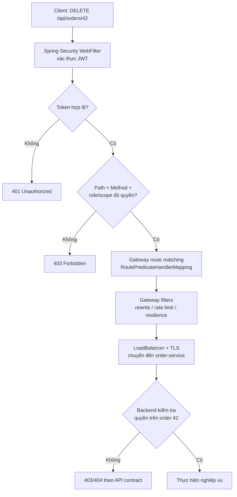
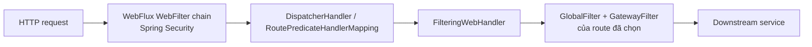

# Phân quyền theo đường dẫn, HTTP method, role và scope

Một API Gateway thường công bố nhiều API thông qua cùng một tên miền: đọc danh mục sản phẩm, tạo đơn hàng, hoàn tiền và quản trị hệ thống. Các request có thể đều đi qua một cổng vào, nhưng **quyền thực hiện từng thao tác không giống nhau**. Người dùng được xem đơn hàng không nhất thiết được tạo đơn; nhân viên hỗ trợ không tự động được quản trị toàn bộ hệ thống; một client có token hợp lệ cũng không nhất thiết có quyền gọi mọi endpoint.

Trong **Spring Cloud Gateway Server WebFlux**, **Spring Security** có thể thực thi chính sách truy cập ngay tại biên bằng **`SecurityWebFilterChain`** và các quy tắc của **`authorizeExchange`**. Quy tắc có thể dựa trên **đường dẫn HTTP**, **HTTP method**, **role** hoặc **scope** đã được chuyển thành `GrantedAuthority` của người gọi. Đây là lớp bảo vệ trước khi Gateway gửi request đến microservice.

Bài thuộc chương **Xác thực và phân quyền** của module **SPRING_CLOUD_GATEWAY**. Nó nối các chủ đề route predicate, filter chain, thay đổi đường dẫn/header và khám phá dịch vụ với xác thực, giới hạn lưu lượng, circuit breaker, retry, TLS và quan sát request để xây dựng API Gateway an toàn. Trọng tâm không chỉ là viết một danh sách quy tắc, mà còn là **đặt quy tắc ở đúng tầng, đúng thứ tự và đúng quyền đã được xác minh**.

> **Phạm vi:** Ví dụ dùng **Spring Cloud Gateway Server WebFlux** và **Spring Security Reactive** (`ServerHttpSecurity`, `SecurityWebFilterChain`). Không sao chép API `HttpSecurity`, `SecurityFilterChain` hoặc `authorizeHttpRequests` của Spring MVC/Servlet vào ứng dụng Gateway WebFlux. Cấu hình route minh họa theo namespace WebFlux của các phiên bản mới; một số dòng 4.x trước đây dùng `spring.cloud.gateway.routes`. Tên API và starter phải đối chiếu với bộ phiên bản Spring Boot/Spring Cloud đang sử dụng.

## 1. Tách bốn khái niệm: xác thực, phân quyền, route và downstream

| Khái niệm | Câu hỏi cần trả lời | Thành phần điển hình |
| --- | --- | --- |
| **Authentication — xác thực** | Người/công cụ gửi request là ai? Chứng thực có hợp lệ không? | Spring Security OAuth2 Resource Server, JWT decoder, opaque-token introspection |
| **Authorization — phân quyền** | Người đã xác thực có được gọi thao tác này không? | `authorizeExchange`, `hasRole`, `hasAuthority`, `ReactiveAuthorizationManager` |
| **Route matching — chọn tuyến** | Request này phải chuyển đến backend nào? | `RoutePredicateHandlerMapping`, `Path`/`Method`/`Host` route predicates |
| **Downstream authorization** | Người gọi có quyền đối với **tài nguyên cụ thể** ở backend không? | Chính sách nghiệp vụ trong `order-service`, `payment-service`, v.v. |

Ví dụ, một request:

```http
DELETE /api/orders/42 HTTP/1.1
Host: api.example.test
Authorization: Bearer <access-token>
```

có thể trải qua các bước:

1. **Xác thực:** kiểm tra access token và thiết lập `Authentication`.
2. **Phân quyền ở Gateway:** thao tác `DELETE` trên `/api/orders/**` có đòi hỏi `orders.delete` hay role đặc biệt không?
3. **Chọn route:** path khớp route `orders-api`, URI đích có thể là `lb://order-service`.
4. **Biến đổi request:** Gateway có thể `StripPrefix=1`, chuyển `/api/orders/42` thành `/orders/42`.
5. **Backend phân quyền theo dữ liệu:** đơn hàng 42 có thuộc tài khoản này, hoặc người gọi có quyền hủy đơn hay không?

**Không nhầm:** Một route predicate `Method=DELETE` chỉ làm request đủ điều kiện vào route; bản thân nó **không kiểm tra quyền xóa đơn hàng**. Ngược lại, quy tắc `hasAuthority("SCOPE_orders.delete")` có thể từ chối request trước khi Gateway gọi backend, nhưng không đủ thông tin để khẳng định mọi đơn hàng đều thuộc quyền người dùng.



Các mã `401`/`403` trong sơ đồ là kết quả điển hình theo cấu hình Resource Server. Hành vi thực tế chịu ảnh hưởng của authentication entry point, exception handling, security chain được chọn và những tầng proxy khác. Backend cũng có thể dùng `404` theo chính sách tránh tiết lộ tài nguyên không thuộc quyền truy cập.

## 2. Thiết kế ma trận phân quyền trước khi viết code

Giả sử Gateway công bố ba nhóm endpoint:

- `/actuator/health/**`: kiểm tra sức khỏe, công bố có kiểm soát.
- `/api/orders/**`: đọc, tạo, sửa và hủy đơn hàng.
- `/api/admin/**`: API quản trị.

Một ma trận chính sách mẫu:

| Path công khai | HTTP method | Ai được phép? | Quy tắc Gateway minh họa |
| --- | --- | --- | --- |
| `/actuator/health`, `/actuator/health/**` | `GET` | Được phép theo chính sách health endpoint | `permitAll()` |
| `/api/orders`, `/api/orders/**` | `GET` | Người/client có scope `orders.read` | `hasAuthority("SCOPE_orders.read")` |
| `/api/orders` | `POST` | Người/client có scope `orders.write` | `hasAuthority("SCOPE_orders.write")` |
| `/api/orders/**` | `PUT`, `PATCH` | Người/client có scope `orders.write` | `hasAuthority("SCOPE_orders.write")` |
| `/api/orders/**` | `DELETE` | Người/client có scope `orders.delete` | `hasAuthority("SCOPE_orders.delete")` |
| `/api/admin`, `/api/admin/**` | Các method được API hỗ trợ | Người có role `ADMIN` đã được ánh xạ hợp lệ | `hasRole("ADMIN")` |
| Các request chưa được khai báo | Bất kỳ | **Mặc định từ chối** | `anyExchange().denyAll()` |

Đây là ma trận **ví dụ về chính sách**, không phải quy chuẩn chung cho mọi sản phẩm. Những endpoint health nên được giới hạn thông tin/đường truy cập; không mặc định cho phép công khai tất cả Actuator endpoints. Với API thực tế, phải quyết định chính xác quyền của `HEAD`, `OPTIONS`, `TRACE`, `POST` và các trường hợp path không có dấu gạch chéo cuối.

### 2.1. Đừng dùng một quyền quá rộng cho mọi HTTP method

Cấu hình:

```java
.pathMatchers("/api/orders/**").authenticated()
```

chỉ đòi hỏi **người gọi đã xác thực**. Nó không phân biệt `GET` với `DELETE`. Nếu backend thiếu kiểm tra khác, người có token hợp lệ có thể thực hiện thao tác không được phép.

Tương tự:

```java
.pathMatchers("/api/orders/**").hasAuthority("SCOPE_orders.read")
```

cũng quá rộng nếu nó áp dụng cho mọi method: chỉ cần quyền đọc là request `POST`/`DELETE` có thể vượt qua chính sách của Gateway. Cách thiết kế tốt hơn là **liệt kê method cho từng thao tác** và có quy tắc từ chối mặc định.

### 2.2. Match đường dẫn công khai, không phải đường dẫn backend

Nếu route:

```yaml
filters:
  - StripPrefix=1
```

chuyển request từ `/api/orders/42` thành `/orders/42` ở downstream, quy tắc `authorizeExchange` của Spring Security **thường được đánh giá dựa trên request công khai ban đầu**: `/api/orders/42`. Spring Security WebFilter chạy trước Gateway route filters. Do đó:

```java
.pathMatchers(HttpMethod.GET, "/api/orders/**")
    .hasAuthority("SCOPE_orders.read")
```

phù hợp với URL client gửi; không đặt matcher duy nhất là `/orders/**` chỉ vì backend nhìn thấy đường dẫn đó. Cần test các path được đổi bằng `RewritePath`/`SetPath` và các route mới để tránh khoảng trống bảo mật.

## 3. Vai trò của SecurityWebFilterChain trong Gateway WebFlux

Spring Security reactive hoạt động qua **WebFilter chain** của WebFlux. Gateway có một chuỗi filter chuyên trách khác: **`GlobalFilter` và `GatewayFilter`** trong `FilteringWebHandler`.



Điểm cần ghi nhớ:

- **`SecurityWebFilterChain`** có thể bảo vệ request **trước khi route được chọn**. Nếu bị từ chối, không có lý do để giả định các Gateway filters của route vẫn chạy.
- **`GlobalFilter`** chỉ tham gia vào pipeline Gateway khi handler tương ứng xử lý request; không phải là một cách thay thế đầy đủ cho toàn bộ Spring Security chain.
- **`GatewayFilter` gắn riêng một route** chỉ áp dụng khi route ấy được chọn. Một route tổng quát thắng trước có thể bỏ qua filter bảo mật tự viết ở route chuyên biệt.
- **`order` của Gateway Route** không phải `@Order` của nhiều `SecurityWebFilterChain`, cũng không phải thứ tự `SecurityWebFiltersOrder`.

Đối với phân quyền theo URL/method tổng quát ở Gateway WebFlux, **ưu tiên Spring Security** thay vì tự đọc header `Authorization` và tự viết logic so sánh token trong một `GatewayFilter`.

### 3.1. Thứ tự các quy tắc trong authorizeExchange

Spring Security đánh giá những quy tắc được khai báo theo thứ tự; **quy tắc khớp đầu tiên** quyết định chính sách áp dụng.

**Ví dụ sai:**

```java
.authorizeExchange(exchanges -> exchanges
    .pathMatchers("/api/**").authenticated()
    .pathMatchers("/api/admin/**").hasRole("ADMIN")
    .anyExchange().denyAll()
)
```

Với request `GET /api/admin/users`, quy tắc `/api/**` đã khớp trước, khiến chính sách `hasRole("ADMIN")` phía sau **không được dùng**. Đây là một lỗi nghiêm trọng nếu tác giả kỳ vọng route admin luôn phải có quyền quản trị.

**Ví dụ đúng về nguyên tắc thứ tự:**

```java
.authorizeExchange(exchanges -> exchanges
    .pathMatchers("/api/admin", "/api/admin/**").hasRole("ADMIN")
    .pathMatchers("/api/**").authenticated()
    .anyExchange().denyAll()
)
```

Ví dụ thứ hai sửa thứ tự nhưng vẫn chỉ yêu cầu `authenticated()` cho API thông thường. Khi cần phân biệt quyền đọc/ghi, phải khai báo từng HTTP method như phần cấu hình đầy đủ bên dưới.

## 4. Role, scope và GrantedAuthority khác nhau như thế nào?

Trong Spring Security, quyền được đưa vào `Authentication.getAuthorities()` thường có dạng các chuỗi `GrantedAuthority`.

| Khái niệm | Ví dụ bên ngoài | Authority thường dùng trong Spring Security | Cách kiểm tra |
| --- | --- | --- | --- |
| **Role** | `ADMIN` | `ROLE_ADMIN` | `hasRole("ADMIN")` hoặc `hasAuthority("ROLE_ADMIN")` |
| **Scope OAuth2** | `orders.read` | `SCOPE_orders.read` | `hasAuthority("SCOPE_orders.read")` |
| **Scope OAuth2** | `orders.write` | `SCOPE_orders.write` | `hasAuthority("SCOPE_orders.write")` |
| **Authority tùy biến** | `tenant:manage` | Tùy quy ước mapper đáng tin cậy | `hasAuthority("tenant:manage")` |

**`hasRole("ADMIN")`** thường kiểm tra authority **`ROLE_ADMIN`**. Không viết `hasRole("ROLE_ADMIN")` theo kiểu thêm prefix hai lần. Nếu muốn khớp chính xác chuỗi authority đã có, dùng `hasAuthority("ROLE_ADMIN")`.

**`hasAuthority("SCOPE_orders.read")`** kiểm tra đúng chuỗi authority này; nó không tự thêm prefix. Với Spring Security OAuth2 Resource Server JWT, scope trong claim `scope`/`scp` thường được ánh xạ sang authorities có prefix **`SCOPE_`** theo mặc định.

### 4.1. Ví dụ JWT hợp lệ về mặt cấu trúc dữ liệu

Payload minh họa, **không phải token được ký hoặc chứng thực thật**:

```json
{
  "iss": "https://idp.example.test/issuer",
  "sub": "user-123",
  "aud": ["gateway-api"],
  "scope": "orders.read orders.write",
  "roles": ["SUPPORT"],
  "exp": 2000000000
}
```

Nếu JWT đã được xác minh theo issuer, khóa ký, thời hạn và chính sách audience:

- Scope `orders.read` có thể trở thành `SCOPE_orders.read`.
- Scope `orders.write` có thể trở thành `SCOPE_orders.write`.
- Claim `roles: ["SUPPORT"]` **không tự động** trở thành `ROLE_SUPPORT` trong mọi cấu hình Resource Server. Cần **converter role** theo cấu trúc claim của nhà phát hành token.
- Người có `SUPPORT` cũng **không tự động** có `ADMIN`, nếu hệ thống không định nghĩa quy tắc thừa kế quyền tương ứng.

**Không được tin role/scope từ header do client tự gửi**, chẳng hạn `X-Role: ADMIN` hoặc `X-Scope: orders.delete`. Khi dùng JWT, nguồn quyền phải đến từ token đã được xác thực và có issuer/audience đáng tin cậy; khi dùng opaque token, nguồn quyền phải từ kết quả introspection/identity provider hợp lệ.

### 4.2. Scope không đồng nghĩa role

Một token máy–máy có scope `orders.write` nhưng không gắn role người dùng. Nó có thể được cho phép gửi POST tới API nếu chính sách yêu cầu scope đó. Một người mang role `ADMIN` không tự nhiên có đủ mọi scope của một client OAuth2, trừ khi chính sách hệ thống **chủ động** quy định như vậy.

Khi thiết kế hệ thống lớn, role thường mô tả **vị trí/chức năng** của chủ thể, còn scope mô tả **phạm vi quyền** đã được cấp cho một access token. Mô hình thực tế có thể phức tạp hơn; phải viết rõ **role nào, scope nào và tổ hợp nào** được quyền thực thi một hành động.

## 5. Cấu hình Gateway như OAuth2 Resource Server dùng JWT

Để Gateway tự kiểm tra Bearer JWT, ứng dụng cần Spring Security cho WebFlux và thành phần OAuth2 Resource Server/JWT. Khi dùng Spring Boot, một bộ dependency thông dụng có:

```xml
<dependency>
    <groupId>org.springframework.boot</groupId>
    <artifactId>spring-boot-starter-security</artifactId>
</dependency>
<dependency>
    <groupId>org.springframework.boot</groupId>
    <artifactId>spring-boot-starter-oauth2-resource-server</artifactId>
</dependency>
```

Gateway Server WebFlux starter cần được chọn theo **phiên bản Spring Cloud Gateway** của dự án. Không dùng `spring-boot-starter-web`/Spring MVC một cách vô tình khi mục tiêu là Gateway Server WebFlux.

### 5.1. Chỉ định issuer URI của Identity Provider

```yaml
spring:
  security:
    oauth2:
      resourceserver:
        jwt:
          issuer-uri: https://idp.example.test/issuer
```

Đây là endpoint **minh họa**. Trong ứng dụng thật, sử dụng issuer URI do Identity Provider chính thức cung cấp qua HTTPS.

Với cấu hình Resource Server phù hợp, Spring Security có thể:

1. Xác định metadata và bộ khóa công khai/JWKs của issuer.
2. Xác minh chữ ký JWT bằng khóa tin cậy tương ứng.
3. Kiểm tra những điều kiện chuẩn như `exp`, `nbf`, `iss` theo cấu hình.
4. Chuyển claim `scope`/`scp` sang authorities có prefix `SCOPE_` theo mặc định.

**Kiểm tra audience riêng:** Một access token hợp lệ về chữ ký và issuer **chưa đủ** nếu nó được cấp cho API khác. Cần xác định quy tắc `aud` mà Gateway/backend chấp nhận và cấu hình validator phù hợp. Không nên mặc định cho rằng chỉ khai báo `issuer-uri` đã kiểm tra đầy đủ audience hoặc mọi claim nghiệp vụ.

**Không chấp nhận** JWT có chữ ký giả, không hợp lệ, `alg=none` hoặc token quá hạn chỉ vì payload JSON trông có `roles`/`scope` hợp ý. Parser đọc Base64 không phải quá trình xác thực.

## 6. Cấu hình SecurityWebFilterChain đầy đủ: path + method + role + scope

Ví dụ dưới đây minh họa một API **chỉ dùng Bearer token, không dùng cookie-session để xác thực**. Cấu hình role mapper lấy claim `roles` từ JWT đã được Resource Server xác minh, đồng thời **giữ lại các scope authorities mặc định**.

```java
package com.example.gateway.security;

import java.util.ArrayList;
import java.util.Collection;
import java.util.List;
import java.util.Set;

import org.springframework.context.annotation.Bean;
import org.springframework.context.annotation.Configuration;
import org.springframework.http.HttpMethod;
import org.springframework.core.convert.converter.Converter;
import org.springframework.security.config.annotation.web.reactive.EnableWebFluxSecurity;
import org.springframework.security.config.web.server.ServerHttpSecurity;
import org.springframework.security.core.GrantedAuthority;
import org.springframework.security.core.authority.SimpleGrantedAuthority;
import org.springframework.security.oauth2.jwt.Jwt;
import org.springframework.security.oauth2.server.resource.authentication.JwtAuthenticationConverter;
import org.springframework.security.oauth2.server.resource.authentication.JwtGrantedAuthoritiesConverter;
import org.springframework.security.oauth2.server.resource.authentication.ReactiveJwtAuthenticationConverterAdapter;
import org.springframework.security.authentication.AbstractAuthenticationToken;
import org.springframework.security.web.server.SecurityWebFilterChain;
import reactor.core.publisher.Mono;

@Configuration
@EnableWebFluxSecurity
public class GatewaySecurityConfiguration {

    @Bean
    SecurityWebFilterChain gatewaySecurity(ServerHttpSecurity http) {
        return http
            // Phù hợp cho API stateless chỉ chấp nhận Bearer token.
            .csrf(ServerHttpSecurity.CsrfSpec::disable)
            .authorizeExchange(exchanges -> exchanges
                .pathMatchers(HttpMethod.GET,
                    "/actuator/health", "/actuator/health/**").permitAll()

                // Khai báo route nhạy cảm TRƯỚC các mẫu tổng quát.
                .pathMatchers("/api/admin", "/api/admin/**")
                    .hasRole("ADMIN")

                .pathMatchers(HttpMethod.GET,
                    "/api/orders", "/api/orders/**")
                    .hasAuthority("SCOPE_orders.read")

                .pathMatchers(HttpMethod.POST, "/api/orders")
                    .hasAuthority("SCOPE_orders.write")

                .pathMatchers(HttpMethod.PUT, "/api/orders/**")
                    .hasAuthority("SCOPE_orders.write")
                .pathMatchers(HttpMethod.PATCH, "/api/orders/**")
                    .hasAuthority("SCOPE_orders.write")

                .pathMatchers(HttpMethod.DELETE, "/api/orders/**")
                    .hasAuthority("SCOPE_orders.delete")

                // Không mở quyền cho API mới theo mặc định.
                .anyExchange().denyAll()
            )
            .oauth2ResourceServer(oauth2 -> oauth2
                .jwt(jwt -> jwt.jwtAuthenticationConverter(jwtConverter()))
            )
            .build();
    }

    // Ví dụ giả định issuer đáng tin cậy có claim "roles": ["ADMIN"].
    private Converter<Jwt, Mono<AbstractAuthenticationToken>> jwtConverter() {
        JwtGrantedAuthoritiesConverter scopes = new JwtGrantedAuthoritiesConverter();
        JwtAuthenticationConverter converter = new JwtAuthenticationConverter();

        converter.setJwtGrantedAuthoritiesConverter(jwt -> {
            Collection<GrantedAuthority> result =
                new ArrayList<>(scopes.convert(jwt));

            List<String> roles = jwt.getClaimAsStringList("roles");
            if (roles != null) {
                for (String role : roles) {
                    // Chỉ ánh xạ role đã được định nghĩa trong policy.
                    if (Set.of("ADMIN", "SUPPORT").contains(role)) {
                        result.add(new SimpleGrantedAuthority("ROLE_" + role));
                    }
                }
            }
            return result;
        });

        return new ReactiveJwtAuthenticationConverterAdapter(converter);
    }
}
```

**Phạm vi của ví dụ:** Đây là cấu hình mẫu cho Java 17+ và Spring Security Reactive hỗ trợ các API nêu trên. Nó giả định token đến từ issuer đã tin cậy, claim `roles` là danh sách chuỗi và policy chỉ nhận role `ADMIN`/`SUPPORT`. Một Identity Provider khác có thể dùng claim tên khác hoặc cấu trúc lồng nhau như `realm_access.roles`; khi đó phải viết converter tương thích với **issuer đã được xác minh**, không sao chép converter này mà chưa xem claim thực tế.

**Về CSRF:** Chỉ tắt CSRF khi thiết kế **stateless Bearer API** không sử dụng cookie/session gửi tự động như chứng thực cho các thao tác thay đổi trạng thái. Với ứng dụng đăng nhập web bằng session cookie, việc tắt CSRF toàn cục có thể tạo lỗ hổng; cần áp dụng chính sách CSRF phù hợp.

**Về role mapper:** Spring Security Resource Server mặc định có thể chuyển scope thành `SCOPE_*`, nhưng **không tự quyết định claim roles của từng nhà cung cấp**. Converter ví dụ vừa bảo toàn scope mặc định vừa bổ sung `ROLE_*` từ claim đã thống nhất. Chỉ thêm những role cần thiết và xác minh audience/tenant/issuer; một tên role giống nhau ở nhiều issuer hoặc tenant có thể không có cùng mức tin cậy.

### 6.1. Vì sao anyExchange().denyAll() quan trọng?

Nếu dùng `anyExchange().authenticated()`, một endpoint mới có thể được mở cho **bất cứ token hợp lệ nào**, dù chưa có quyết định chính sách. Trong môi trường microservices phát triển nhanh, một service mới hoặc một route tự sinh từ Discovery Locator có thể tạo đường truy cập chưa được review.

`denyAll()` là chính sách **fail closed**: request không được một quy tắc rõ ràng cho phép sẽ bị từ chối. Khi thêm API, cần cập nhật ma trận quyền, chính sách và kiểm thử có chủ đích.

### 6.2. Tại sao GET/POST/DELETE có các quyền khác nhau?

Với cấu hình trên:

| Request | Authority cần có | Nếu token chỉ có `SCOPE_orders.read` |
| --- | --- | --- |
| `GET /api/orders/42` | `SCOPE_orders.read` | Có thể qua lớp Gateway |
| `POST /api/orders` | `SCOPE_orders.write` | `403` |
| `PATCH /api/orders/42` | `SCOPE_orders.write` | `403` |
| `DELETE /api/orders/42` | `SCOPE_orders.delete` | `403` |
| `GET /api/admin/users` | `ROLE_ADMIN` | `403` |
| `GET /actuator/health` | Không yêu cầu authority theo quy tắc minh họa | Có thể đi tới handler health |

Từ “có thể” là cố ý: còn có kiểm tra token hợp lệ, định tuyến, backend authorization và những filter/rate limit khác. Một request đủ quyền **không được đảm bảo** sẽ trả `200 OK`.

### 6.3. Khi cần cả role và scope

Một vài endpoint yêu cầu **đồng thời**:

- Role `ADMIN` xác nhận vai trò người quản trị.
- Scope `orders.delete` xác nhận token cụ thể được cấp quyền xóa.

Không viết hai quy tắc cùng path liên tiếp rồi tưởng framework sẽ tự kết hợp thành **AND**:

```java
// KHÔNG đúng nếu mục tiêu là yêu cầu đồng thời cả hai quyền:
.pathMatchers(HttpMethod.DELETE, "/api/admin/orders/**")
    .hasRole("ADMIN")
.pathMatchers(HttpMethod.DELETE, "/api/admin/orders/**")
    .hasAuthority("SCOPE_orders.delete")
```

Quy tắc khớp đầu tiên sẽ được dùng. Muốn kết hợp quyền, hãy dùng **một `ReactiveAuthorizationManager`** hoặc logic chính sách ở tầng phù hợp có thể kiểm tra cả hai điều kiện. Ví dụ phần lõi:

```java
import org.springframework.security.authorization.AuthorizationDecision;
import org.springframework.security.authorization.ReactiveAuthorizationManager;
import org.springframework.security.web.server.authorization.AuthorizationContext;

static ReactiveAuthorizationManager<AuthorizationContext>
    adminWithDeleteScope() {
    return (authentication, context) -> authentication.map(auth -> {
        boolean admin = auth.getAuthorities().stream()
            .anyMatch(a -> a.getAuthority().equals("ROLE_ADMIN"));
        boolean canDelete = auth.getAuthorities().stream()
            .anyMatch(a -> a.getAuthority().equals("SCOPE_orders.delete"));
        return new AuthorizationDecision(admin && canDelete);
    });
}
```

Gắn policy này vào **một** quy tắc, trước matcher admin tổng quát:

```java
.pathMatchers(HttpMethod.DELETE, "/api/admin/orders/**")
    .access(adminWithDeleteScope())
.pathMatchers("/api/admin", "/api/admin/**")
    .hasRole("ADMIN")
```

Đoạn mã là minh họa cách xây policy AND trong Spring Security Reactive. Khi tích hợp, đặt hàm trong class Java phù hợp, kiểm tra signature `ReactiveAuthorizationManager` của phiên bản đang dùng và kiểm thử trường hợp thiếu authentication, thiếu role, thiếu scope và đủ cả hai.

## 7. Cấu hình route Gateway phải thống nhất với đường dẫn security

Security khai báo chính sách cho các **URL công khai**. Gateway có thể route đến backend như sau:

```yaml
spring:
  cloud:
    gateway:
      server:
        webflux:
          routes:
            - id: admin-api
              order: -100
              uri: lb://admin-service
              predicates:
                - Path=/api/admin,/api/admin/**
              filters:
                - StripPrefix=1

            - id: orders-api
              order: -20
              uri: lb://order-service
              predicates:
                - Path=/api/orders,/api/orders/**
              filters:
                - StripPrefix=1
```

Với request `GET /api/orders/42`:

1. Spring Security đánh giá `GET` + `/api/orders/**` + `SCOPE_orders.read`.
2. Gateway chọn route `orders-api` sau khi request vượt qua security.
3. Filter `StripPrefix=1` chuyển path thành `/orders/42`.
4. Spring Cloud LoadBalancer tìm instance của `order-service` nếu có cấu hình discovery.
5. Backend kiểm tra quyền trên đơn hàng 42 và xử lý request.

**Cẩn thận:** Nếu Spring Security bảo vệ `/api/orders/**` nhưng Gateway còn một route khác đưa `/legacy/orders/**` tới cùng backend mà không có quy tắc quyền rõ ràng, bạn có thể có **đường bypass chính sách**. Với `anyExchange().denyAll()` ở ví dụ, đường công khai mới chưa khai báo sẽ bị từ chối; nhưng backend vẫn cần tự bảo vệ nếu có thể được gọi trực tiếp hoặc qua gateway khác.

Trong các bản 4.x dùng namespace `spring.cloud.gateway.routes`, thay phần cấu hình route theo tài liệu phiên bản đó. **Không đổi mã SecurityWebFilterChain thành Servlet API** chỉ vì namespace route đổi.

## 8. Phân quyền theo path: những trường hợp cần tính đến

### 8.1. Đường dẫn chính xác và đường dẫn con

Một API tạo đơn hàng có thể sử dụng `POST /api/orders`, còn API đọc một đơn là `GET /api/orders/42`. Mẫu `/api/orders/**` không nên được mặc định hiểu giống hệt `/api/orders` ở mọi phiên bản matcher và quy ước dấu slash. Vì thế ví dụ nêu rõ cả `/api/orders` và `/api/orders/**` ở những nơi cần bao phủ cả hai.

Kiểm thử ít nhất:

- `/api/orders`
- `/api/orders/`
- `/api/orders/42`
- `/api/orders/42/items`
- `/api/Orders/42` nếu môi trường có quy ước chữ hoa/thường

Không dựa vào giả định “mẫu path nhìn có vẻ khớp” mà bỏ qua kiểm thử matcher thực tế.

### 8.2. Catch-all có thể che quy tắc nhạy cảm

Nếu khai báo:

```java
.pathMatchers("/api/**").permitAll()
.pathMatchers("/api/admin/**").hasRole("ADMIN")
```

thì quy tắc tổng quát có thể khiến admin bị mở ngoài chủ đích. Đưa matcher nhạy cảm lên trước và tránh mở `permitAll()` cho cả vùng API khi chưa có lý do rõ ràng.

### 8.3. URL encoding, dấu phân cách và normalizing

Reverse proxy, Gateway và backend có thể có cách chuẩn hóa:

- Ký tự phần trăm encode trong path.
- Dấu slash lặp, trailing slash và trường hợp encoded slash.
- Segment dạng `.` hoặc `..` (nếu HTTP stack chấp nhận).
- Case sensitivity và path parameters theo framework.
- Prefix do ingress thêm vào hoặc bỏ đi trước Gateway.

Khi các tầng hiểu **khác nhau** về path, một request có thể được kiểm tra theo một đường nhưng được định tuyến/giải mã thành đường khác. Hãy dùng matcher và HTTP parser chuẩn, giới hạn dạng URL được chấp nhận, kiểm thử đầu vào biên và tránh tự decode/normalize path không nhất quán giữa các tầng.

### 8.4. Host/tenant và route discovery

Chỉ kiểm tra `/api/orders/**` chưa đủ trong gateway multi-tenant nếu cùng path phục vụ nhiều hostname/tenant khác nhau. Cần phân biệt ranh giới:

- Host/proxy phải được xác minh theo nguồn đáng tin cậy.
- Token phải có issuer, audience và tenant phù hợp.
- Backend phải kiểm tra người dùng có quyền trong tenant và tài nguyên đang yêu cầu.
- Route discovery/canary/fallback không được tạo đường đưa request tới service khác với mức bảo vệ yếu hơn.

Không chấp nhận `X-Tenant-Id` hoặc `X-User-Role` do client tùy ý gửi như bằng chứng quyền; nếu gateway cần truyền thông tin định danh cho backend, phải có giao thức tin cậy, xác thực nguồn và xử lý xóa/ghi đè header client giả mạo.

## 9. Phân quyền theo HTTP method: không xem GET và DELETE như nhau

HTTP method là thành phần quan trọng của hành động:

| Method | Thao tác thường gặp | Rủi ro khi phân quyền sai |
| --- | --- | --- |
| `GET` | Đọc dữ liệu | Lộ thông tin ngoài phạm vi |
| `HEAD` | Đọc metadata phản hồi không có body | Có thể tiết lộ sự tồn tại tài nguyên, headers hoặc kích thước |
| `POST` | Tạo tài nguyên hoặc khởi chạy tác vụ | Tạo dữ liệu, thanh toán, hành động có tác dụng phụ |
| `PUT`/`PATCH` | Sửa trạng thái tài nguyên | Ghi đè hoặc sửa dữ liệu không thuộc quyền |
| `DELETE` | Xóa/hủy | Tác dụng phụ không thể đảo ngược hoặc khó phục hồi |
| `OPTIONS` | Khám phá method/CORS preflight | Cần xử lý theo CORS policy, không phải quyền nghiệp vụ của POST |

Nếu route Gateway chỉ có `Path=/api/orders/**` nhưng không có `Method` predicate, **route có thể chuyển nhiều HTTP method** đến cùng backend. Vì vậy, đừng chỉ dùng `Method` predicate như biện pháp phân quyền; Spring Security và backend phải xác định method nào được gọi.

### 9.1. CORS preflight

Trình duyệt có thể gửi:

```http
OPTIONS /api/orders HTTP/1.1
Origin: https://shop.example.test
Access-Control-Request-Method: POST
Access-Control-Request-Headers: authorization,content-type
```

Preflight thường **không mang Bearer token** của request nghiệp vụ theo cách mà người học kỳ vọng. Nếu yêu cầu JWT cho mọi `OPTIONS` trước khi CORS được xử lý, trình duyệt có thể chặn API trước khi request POST được gửi.

Hãy cấu hình **CORS tại WebFlux/Spring Security hoặc Gateway** theo nguồn Origin, method và headers **được phép**, đồng thời kiểm tra thứ tự xử lý so với authentication. Không chỉ viết `OPTIONS /** permitAll` rồi coi CORS đã được cấu hình; `permitAll()` **không tự tạo** mọi header `Access-Control-Allow-*` hợp lệ.

**CORS không phải phân quyền backend**. Nó là cơ chế bảo vệ truy cập tài nguyên từ JavaScript trong trình duyệt theo chính sách origin. Client HTTP ngoài trình duyệt vẫn có thể gọi API nếu có mạng và token; Gateway/backend phải kiểm tra auth/authz.

### 9.2. Method không được khai báo

Với ma trận ở mục 2, request `POST /api/orders/42` không được cho phép bởi quy tắc `POST /api/orders`. Nó sẽ rơi vào `anyExchange().denyAll()` theo ví dụ. Từ chối rõ ràng giúp tránh phương thức ngoài contract vô tình đi vào backend.

Nếu muốn trả `405 Method Not Allowed` thay vì bị từ chối theo chính sách security, cần thiết kế cách phân biệt **method không hỗ trợ** với **thiếu quyền** tại tầng phù hợp. Đừng “cho qua authz” mọi method chỉ để backend trả 405, đặc biệt đối với API nhạy cảm.

## 10. Khi nhiều SecurityWebFilterChain tồn tại

Một ứng dụng có thể dùng nhiều `SecurityWebFilterChain` cho các miền đường dẫn khác nhau, ví dụ một chuỗi cho REST API dùng JWT và một chuỗi cho web UI dùng session.

Trong mô hình này:

- Có thể đặt `securityMatcher(...)` để xác định chuỗi nào nhận một nhóm request.
- Dùng `@Order` để quy định thứ tự xem xét **các security chains**.
- Spring Security chọn **một** `SecurityWebFilterChain` phù hợp cho mỗi request, thay vì tự cộng dồn mọi rule từ các chains.
- Bên trong chain được chọn, `authorizeExchange` tiếp tục đánh giá quy tắc theo thứ tự.

Đừng nhầm ba cấp thứ tự:

| Cấp | Đối tượng ưu tiên | Hậu quả nếu cấu hình sai |
| --- | --- | --- |
| **`@Order` trên security chain** | Chuỗi security nào bảo vệ request | Request rơi vào chain yếu hơn hoặc không phù hợp |
| **Thứ tự authorizeExchange** | Quy tắc path/method/role/scope nào thắng | Quy tắc rộng che quy tắc nhạy cảm |
| **`order` của Gateway Route** | Route backend nào được chọn | Request bị chuyển tới backend hoặc filter chain sai |

Khi dùng nhiều chains, cần một chính sách bao phủ cuối cùng: tránh để một nhóm URL nhạy cảm **không khớp security chain nào**. Với REST Gateway chỉ nhận JWT, thường một chain với `anyExchange().denyAll()` có thể dễ review hơn nhiều chains chồng lấn.

## 11. 401, 403, 404 và 429: phân biệt lỗi

Một request thất bại không đồng nghĩa Gateway route bị sai:

| Status | Ý nghĩa điển hình | Nơi có thể phát sinh |
| --- | --- | --- |
| **`401 Unauthorized`** | Không có chứng thực hợp lệ hoặc Bearer token bị từ chối | Spring Security Resource Server, backend |
| **`403 Forbidden`** | Đã xác thực nhưng không đủ quyền | Spring Security authorization, backend policy |
| **`404 Not Found`** | Không có route/handler hoặc backend không tìm thấy tài nguyên | Gateway handler mapping, backend |
| **`405 Method Not Allowed`** | Endpoint không hỗ trợ method theo handler contract | WebFlux handler hoặc backend |
| **`429 Too Many Requests`** | Request vượt chính sách giới hạn lưu lượng | `RequestRateLimiter`, proxy, backend |
| **`502`/`503`/`504`** | Lỗi upstream hoặc kết nối/timeout tùy cấu hình | Gateway, ingress, downstream |

Ví dụ cụ thể:

1. `GET /api/orders/42` **không có token** → thường nhận `401`.
2. Token hợp lệ chỉ có `SCOPE_orders.read`, gọi `DELETE /api/orders/42` → thường nhận `403`.
3. Token có `SCOPE_orders.delete` nhưng không được phép hủy đơn hàng thuộc người khác → backend nên từ chối theo chính sách tài nguyên.
4. Token hợp lệ nhưng Gateway không có route phù hợp → có thể trả `404` sau khi vượt security.
5. Token đủ quyền nhưng bị rate limiter chặn → `429` nếu policy áp dụng.

**Đừng viết lại mọi lỗi thành `401` hoặc `403`** ở Gateway: sẽ gây khó điều tra. Đo route ID (nếu đã chọn), HTTP status, nguồn response và thông tin lỗi đã được làm sạch để phân biệt nguyên nhân.

## 12. Cách kiểm thử phân quyền

Không chỉ kiểm thử “token hợp lệ trả `200`”. Cần kiểm thử trường hợp **có/không có JWT**, **đúng/sai scope**, **đúng/sai role**, **method khác**, **path nhạy cảm** và **route không mong đợi**.

### 12.1. Kiểm thử thủ công bằng curl

Các biến môi trường sau đại diện cho **token giả định đã được IdP cấp hợp lệ**. Không sử dụng token thật trong tài liệu, log, mã nguồn hoặc lệnh lưu lại trên nơi dùng chung.

```bash
# Không có token: thường 401.
curl -i http://localhost:8080/api/orders/42

# READ_TOKEN: access token hợp lệ có scope orders.read.
curl -i \
  -H "Authorization: Bearer $READ_TOKEN" \
  http://localhost:8080/api/orders/42

# READ_TOKEN không đủ quyền DELETE: thường 403.
curl -i -X DELETE \
  -H "Authorization: Bearer $READ_TOKEN" \
  http://localhost:8080/api/orders/42

# WRITE_TOKEN: access token hợp lệ có scope orders.write.
curl -i -X POST \
  -H "Authorization: Bearer $WRITE_TOKEN" \
  -H "Content-Type: application/json" \
  -d '{"sku":"BOOK-1","quantity":1}' \
  http://localhost:8080/api/orders
```

Trong hệ thống thực, không gửi POST hoặc DELETE có tác dụng phụ lên dữ liệu production chỉ để kiểm tra quyền. Sử dụng **backend stub**, dữ liệu kiểm thử và cơ chế kiểm soát idempotency phù hợp.

### 12.2. Kiểm thử rule với WebTestClient và mockJwt

Spring Security Test hỗ trợ `mockJwt()` cho `WebTestClient`, phù hợp để tập trung vào **phân quyền** mà không cần tự ký token thử nghiệm.

Ví dụ trong integration test đã cấu hình Spring Security test support và backend stub:

```java
import static org.springframework.security.test.web.reactive.server
    .SecurityMockServerConfigurers.mockJwt;

import org.springframework.security.core.authority.SimpleGrantedAuthority;

// Có quyền đọc: request vượt lớp authorization của Gateway.
webTestClient
    .mutateWith(mockJwt().authorities(
        new SimpleGrantedAuthority("SCOPE_orders.read")))
    .get().uri("/api/orders/42")
    .exchange()
    .expectStatus().isOk();

// Chỉ có quyền đọc: không được xóa.
webTestClient
    .mutateWith(mockJwt().authorities(
        new SimpleGrantedAuthority("SCOPE_orders.read")))
    .delete().uri("/api/orders/42")
    .exchange()
    .expectStatus().isForbidden();

// Có ROLE_ADMIN: được đi qua rule quản trị.
webTestClient
    .mutateWith(mockJwt().authorities(
        new SimpleGrantedAuthority("ROLE_ADMIN")))
    .get().uri("/api/admin/users")
    .exchange()
    .expectStatus().isOk();
```

**Lưu ý:** Đây là những đoạn assert minh họa, chưa phải test class hoàn chỉnh. Các phép mong đợi `200` giả định backend stub trả `200` và các filter khác không chặn; trong dự án thực tế có thể phù hợp hơn để kiểm tra **request đến backend stub** thay vì cố định mã `200`.

`mockJwt()` **không chứng minh chữ ký JWT được kiểm tra đúng**, cũng không chứng minh issuer/JWK/audience đã được cấu hình an toàn: nó cung cấp `Authentication` mô phỏng để test rule. Cần thêm integration/e2e test riêng sử dụng JWT được ký bằng khóa thử nghiệm và trường hợp token sai chữ ký, sai `iss`/`aud`, hết hạn hoặc chưa có hiệu lực.

### 12.3. Ma trận kiểm thử đề xuất

| Tình huống | Mong đợi ở lớp Gateway | Cần kiểm tra tiếp |
| --- | --- | --- |
| GET orders, không có Bearer token | `401` | Không chuyển request đến backend |
| GET orders, token chữ ký sai | `401` | Decoder/validator thực sự chạy |
| GET orders, chỉ có `orders.read` | Qua authorization | Backend kiểm tra quyền dữ liệu |
| POST orders, chỉ có `orders.read` | `403` | Không sinh đơn hàng |
| POST orders, có `orders.write` | Qua authorization | Backend kiểm tra payload và nghiệp vụ |
| DELETE orders, thiếu `orders.delete` | `403` | Không hủy dữ liệu |
| GET admin, có scope orders nhưng không có role ADMIN | `403` | Role converter không tự cấp ADMIN |
| GET admin, có `ROLE_ADMIN` đúng nguồn | Qua authorization | Backend vẫn kiểm tra quyền admin |
| DELETE admin/orders, chỉ có role hoặc chỉ có scope | `403` nếu policy yêu cầu cả hai | Test AND policy |
| GET endpoint chưa khai báo | Bị `denyAll` | Không vô tình mở route discovery mới |
| Request với path có dấu slash, encoding khác nhau | Không bypass rule | Matcher và backend hiểu path nhất quán |
| CORS preflight hợp lệ | Xử lý CORS đúng thiết kế | Origin/method/header allowlist |
| Request đã được đổi path bởi Gateway filter | Chính sách kiểm tra URL công khai | Không có đường vòng qua route khác |

### 12.4. Kiểm thử khi route hoặc service discovery thay đổi

Nếu Gateway tự sinh route từ Discovery Locator hoặc khi thêm route `/api/payments/**`, một quy tắc `anyExchange().denyAll()` giúp chặn request đến endpoint **chưa có chính sách**. Khi cần mở API đó, thực hiện:

1. Bổ sung nó vào ma trận đường dẫn/method.
2. Xác định scopes/roles và issuer/audience được chấp nhận.
3. Cập nhật `authorizeExchange` theo đúng thứ tự.
4. Kiểm tra route ID, filters và backend thực sự được gọi.
5. Test trường hợp người thiếu quyền và một route tương tự có thể bắt nhầm.

Không cho phép một pipeline deploy tự tạo route nhạy cảm mà không đánh giá tác động lên security policy.

## 13. Bảo vệ ranh giới Gateway ↔ backend

Ngay cả khi Gateway xác thực JWT và kiểm tra path/method/role/scope, **backend vẫn nên tự áp dụng phân quyền quan trọng**.

### 13.1. Lý do backend cần kiểm tra quyền trên tài nguyên

Gateway có thể biết người gọi có `SCOPE_orders.read` nhưng không biết:

- Đơn hàng `42` thuộc tenant nào.
- Người dùng có phải chủ sở hữu hay người được ủy quyền.
- Đơn hàng đã đóng và không còn cho phép chỉnh sửa hay chưa.
- Chính sách hoàn tiền có yêu cầu xác nhận bổ sung không.

Backend có dữ liệu nghiệp vụ để đưa ra quyết định này. Trường hợp cần bảo mật mạnh có thể kết hợp **role/scope tại Gateway** với **ABAC/RBAC hoặc ownership checks tại backend**. Không lấy thông tin `userId` từ path mà tin là đủ để xác định chủ sở hữu.

### 13.2. Token forwarding không đồng nghĩa TokenRelay mặc định

`oauth2ResourceServer().jwt(...)` giúp Gateway **xác thực Bearer JWT đến từ client**; nó không mặc nhiên định nghĩa cách mọi downstream phải tin cậy danh tính. Một số thiết kế chuyển tiếp nguyên header `Authorization` tới backend; những thiết kế khác dùng token exchange hoặc một định dạng chứng thực nội bộ.

**`TokenRelay` GatewayFilter Factory** gắn với các trường hợp Gateway đóng vai trò **OAuth2 Client** có authorized client/token phù hợp. Không nên mặc định rằng chỉ bật Resource Server JWT thì `TokenRelay` sẽ luôn có một OAuth2 authorized client để relay.

Những điểm cần quyết định rõ:

- Backend có tự validate JWT không? Có kiểm tra issuer, audience, lifetime, scope không?
- Token có được phép dùng cho backend này theo audience không?
- Có dùng OAuth2 Token Exchange để cấp token khác cho downstream không?
- Proxy/Gateway có xóa hoặc ghi đè những header danh tính do client tự đặt không?
- Gateway ↔ backend có network policy và TLS/mTLS theo yêu cầu không?

Không coi header `X-Authenticated-User` là chứng cứ quyền nếu nó có thể được client tự thêm hoặc request có đường gọi trực tiếp không qua Gateway.

### 13.3. Rate limiting, retry và circuit breaker có liên quan gì?

**Rate limiting:** người đã được xác thực vẫn có thể gọi quá nhiều request. Sử dụng `RequestRateLimiter` hoặc chính sách quota theo principal/client/tenant nếu phù hợp; `hasAuthority` không giới hạn số lần gọi.

**Retry:** một request đã qua authorization có thể bị thử lại với backend khi có lỗi. Với `POST`/`DELETE`, cần idempotency và retry budget; không vì token có quyền ghi mà cho phép lặp thao tác nguy hiểm ngoài chủ đích.

**Circuit breaker:** khi backend lỗi, Gateway có thể trả fallback; cần xác định response fallback có lộ dữ liệu không và những endpoint nhạy cảm nào không được hạ cấp chính sách khi lỗi.

**TLS:** bảo vệ kết nối tới Gateway và từ Gateway đến backend. TLS không tự cấp role/scope, còn token hợp lệ không tự thay thế yêu cầu bảo vệ dữ liệu trên đường truyền.

## 14. Những sai lầm thường gặp

### 14.1. Dùng HttpSecurity thay cho ServerHttpSecurity

`HttpSecurity` và `SecurityFilterChain` là API Spring Security **Servlet**. Trong Gateway Server WebFlux, nên dùng `ServerHttpSecurity` và `SecurityWebFilterChain`. Pha trộn hai cách cấu hình có thể khiến security không được áp dụng như kỳ vọng.

### 14.2. Đặt rule tổng quát lên trước rule admin

`/api/**` khớp cả `/api/admin/**`. Nếu rule `authenticated()` hoặc `permitAll()` đứng trước, rule `hasRole("ADMIN")` phía sau có thể không được dùng. Sắp xếp rule nhạy cảm trước rule rộng và thêm `denyAll()` ở cuối.

### 14.3. Nhầm ROLE_ADMIN với claim roles

JWT có `"roles": ["ADMIN"]` không nhất thiết được Spring Security tự map thành `ROLE_ADMIN`. Cần cấu hình converter cho **cấu trúc claim thật** của issuer đáng tin cậy; kiểm thử token có và không có role.

### 14.4. Bỏ mất scope mặc định khi custom converter

Nếu converter tự tạo **chỉ** `ROLE_*` từ claim roles, các scope có thể không còn trở thành `SCOPE_*`. Khi đó rule `hasAuthority("SCOPE_orders.read")` sẽ liên tục từ chối token vốn có scope hợp lệ. Kết hợp cả hai nguồn quyền khi chính sách cần cả hai.

### 14.5. Dùng scope để quyết định sở hữu dữ liệu

`SCOPE_orders.read` không có nghĩa người gọi được xem **mọi đơn hàng**. Gateway kiểm tra năng lực ở mức API, backend kiểm tra ownership và tenant cho từng tài nguyên. Với dữ liệu nhạy cảm, backend phải từ chối truy cập trái phép.

### 14.6. Chỉ kiểm tra issuer mà bỏ audience

Token có chữ ký hợp lệ của một IdP nhưng được cấp cho API khác không nên tự động được chấp nhận. Định nghĩa audience hợp lệ và dùng validator tương ứng; kết hợp kiểm tra tenant và client khi cần.

### 14.7. Xem CORS là authorization

Cho phép Origin trong CORS không có nghĩa caller được phép truy cập API. Máy chủ vẫn phải xác thực/phân quyền từng request. Ngược lại, token hợp lệ không đủ để trình duyệt vượt CORS preflight nếu chính sách Origin không cho phép.

### 14.8. Áp dụng bảo mật theo path sau rewrite

Spring Security WebFilter thường đánh giá request trước `StripPrefix`/`RewritePath`. Nếu bạn viết matcher theo backend path thay vì public path, rule có thể không khớp hoặc một rule rộng khác thắng.

### 14.9. Log token để chẩn đoán 401

Bearer token là credential. Không ghi toàn bộ `Authorization`, cookie, JWT hoặc query chứa token vào logs, traces, metrics hay error response. Chỉ ghi route ID, correlation ID, loại lỗi đã được làm sạch và thông tin cần thiết theo chính sách bảo mật.

### 14.10. Tin role/scope từ header hoặc JWT chưa xác thực

Client có thể tự gửi `X-Role: ADMIN` hoặc JWT payload giả. Chỉ ánh xạ quyền từ **Authentication** được tạo sau khi xác thực với issuer/keys/audience đáng tin cậy hoặc từ kênh nội bộ được xác thực, không từ chuỗi client cung cấp tùy ý.

## 15. Quan sát, audit và vận hành chính sách quyền

Một Gateway có thể theo dõi:

| Dữ liệu quan sát | Công dụng | Cảnh báo bảo mật |
| --- | --- | --- |
| HTTP path đã chuẩn hóa, method, route ID | Xác định rule/route áp dụng | Không log path/query chứa PII/token ngoài chủ đích |
| `401` theo API và issuer | Phát hiện token sai, hết hạn, client cấu hình lỗi | Không log nguyên token |
| `403` theo endpoint và chính sách | Phát hiện thiếu scope/role hoặc lỗi mapping | Không phơi bày danh sách quyền nhạy cảm cho client |
| `429` và request rate | Phát hiện lạm dụng/quota | Không dùng log chứa full credentials |
| Backend `403`/`404` khi Gateway đã cho qua | Phân biệt kiểm tra tài nguyên ở backend với Gateway authz | Giữ correlation ID giữa các hop |
| Số route mới/đổi path, config version | Kiểm tra drift giữa routing và security | Bảo vệ actuator/config endpoints |

Khi thay đổi role/scope policy, quy trình triển khai nên có:

1. **Review ma trận quyền** theo nghiệp vụ và tài nguyên.
2. **Xác nhận claim và issuer/audience** với Identity Provider.
3. **Chạy test âm tính**: không có token, token sai, thiếu role/scope, method ngoài contract.
4. **Kiểm tra mọi đường route** đến cùng backend, gồm fallback, canary và discovery routes.
5. **Phát hành theo môi trường/replica có kiểm soát**, so sánh tỷ lệ `401`/`403` trước/sau.
6. **Có phương án rollback** nếu client hợp lệ bị từ chối; không chữa cháy bằng `permitAll()` cho toàn bộ `/api/**`.

### 15.1. Tránh tự xây hệ thống phân quyền chỉ bằng Gateway route filters

Một filter tự đọc header `X-User-Roles` rồi cho qua request có thể nhìn rất gọn nhưng thường bỏ sót những việc Spring Security đã giải quyết: signature validation, issuer/audience, token expiration, cơ chế entry point, security context, exception handling và test support. Dùng thành phần chuẩn trước; chỉ mở rộng bằng converter hoặc `ReactiveAuthorizationManager` khi chính sách thực sự yêu cầu.

## 16. Tình huống tự kiểm tra

### Tình huống A — Token đọc nhưng gọi DELETE

Một JWT hợp lệ có `scope: orders.read`. Client gửi `DELETE /api/orders/42`.

**Hỏi:** Gateway nên cho phép vì token hợp lệ hay từ chối?

**Đáp án:** Từ chối theo policy minh họa vì thiếu authority `SCOPE_orders.delete`. Token hợp lệ chỉ giải quyết **authentication**; nó không tự trao mọi quyền.

### Tình huống B — Scope giống role

Token có `scope: admin` nhưng không có `ROLE_ADMIN`. Quy tắc là `hasRole("ADMIN")`.

**Hỏi:** Có tự khớp không?

**Đáp án:** Không theo cơ chế ánh xạ mặc định; scope thường thành `SCOPE_admin`, còn `hasRole("ADMIN")` cần `ROLE_ADMIN`. Nếu doanh nghiệp có quy tắc chuyển scope thành role phải định nghĩa/tái kiểm tra tường minh.

### Tình huống C — Rule rộng đứng trước admin

`/api/**` có `authenticated()` và nằm trước `/api/admin/**` có `hasRole("ADMIN")`.

**Hỏi:** Request admin được áp dụng rule nào?

**Đáp án:** Quy tắc rộng có thể khớp đầu tiên, làm rule admin phía sau không được sử dụng. Đưa rule nhạy cảm lên trước và bổ sung test hồi quy.

### Tình huống D — Backend kiểm tra ownership

Người dùng A có `orders.read` nhưng gọi xem đơn hàng thuộc người dùng B.

**Hỏi:** Gateway có thể kết luận A được xem đơn B không?

**Đáp án:** Không. Gateway mới xác nhận quyền gọi API đọc ở mức khái quát; backend cần kiểm tra ownership/tenant và từ chối nếu không được phép.

### Tình huống E — JWT chứa roles nhưng hasRole luôn trả 403

JWT có `roles: ["ADMIN"]` và chữ ký hợp lệ nhưng gọi `/api/admin/users` vẫn bị từ chối.

**Hỏi:** Điều tra gì?

**Đáp án:** Kiểm tra mapping từ claim roles sang `ROLE_ADMIN`, cấu trúc claim thật, issuer/audience, security chain/rule đầu tiên đã khớp. Mặc định chỉ map scopes không đồng nghĩa tự map roles.

### Tình huống F — Route rewrite path

Client gọi `GET /api/orders/42`, route dùng `StripPrefix=1` nên backend nhận `/orders/42`.

**Hỏi:** Path matcher của Spring Security WebFlux nên nhắm vào đâu?

**Đáp án:** URL công khai `/api/orders/**` mà request ban đầu đi qua WebFilter; `/orders/**` chỉ là đường dẫn backend sau filter.

### Tình huống G — Một request cần cả ROLE_ADMIN và SCOPE_orders.delete

Developer khai báo hai matcher DELETE cùng path liên tiếp, cái đầu `hasRole("ADMIN")`, cái sau `hasAuthority("SCOPE_orders.delete")`.

**Hỏi:** Có yêu cầu đồng thời cả hai không?

**Đáp án:** Không. Quy tắc đầu tiên khớp sẽ quyết định. Cần một authorization manager kết hợp điều kiện AND, hoặc một lớp kiểm tra chính sách tương đương có test cụ thể.

### Tình huống H — CORS preflight thiếu token

Trình duyệt gửi `OPTIONS /api/orders` không có Bearer token, nhưng request nghiệp vụ POST sau đó sẽ có Bearer.

**Hỏi:** Có nên xem OPTIONS như POST đã được cấp quyền không?

**Đáp án:** Không. CORS preflight phải được xử lý theo policy Origin/method/headers riêng; request POST thật vẫn phải xác thực và có `orders.write`. Không biến cho phép CORS thành cho phép truy cập dữ liệu.

### Tình huống I — Thêm microservice mới bằng Discovery Locator

Một service mới được discovery và sinh route `/api/payments/**`, nhưng chưa thêm security rule.

**Hỏi:** Với `anyExchange().denyAll()`, điều gì xảy ra?

**Đáp án:** Gateway từ chối request chưa được policy cho phép. Đây là hành vi fail-closed, giúp đội ngũ phải chủ động review role/scope và kiểm thử trước khi công bố API mới.

## 17. Checklist trước khi đưa lên production

1. **Thiết kế ma trận path + method:** Không chỉ ghi một rule chung cho toàn bộ API; xác định rõ GET/POST/PUT/PATCH/DELETE/OPTIONS.
2. **Xác định nguồn identity đáng tin cậy:** JWT Resource Server với issuer/JWK và audience validation hoặc introspection phù hợp.
3. **Chuẩn hóa authorities:** scope thành `SCOPE_*`, roles thành `ROLE_*` nếu cần, thông qua converter đã kiểm thử.
4. **Đặt rule đúng thứ tự:** Nhạy cảm trước tổng quát; `anyExchange().denyAll()` ở cuối.
5. **Bảo vệ URL công khai:** Matcher kiểm tra path/method trước rewrite; thử cả route tĩnh, fallback, discovery/canary.
6. **Kiểm soát CORS/CSRF:** CORS preflight được xử lý đúng; chỉ tắt CSRF khi phù hợp kiến trúc xác thực.
7. **Phân quyền tài nguyên ở backend:** Tenant, ownership, hành động nghiệp vụ và trạng thái tài nguyên.
8. **Bảo vệ hop Gateway–backend:** TLS/mTLS/network policy và cách truyền token/identity được xác định rõ.
9. **Viết test dương tính và âm tính:** Không token, sai token, thiếu quyền, đúng quyền, method khác, URL bất thường.
10. **Theo dõi lỗi:** `401`, `403`, `404`, `429`, route ID và thay đổi cấu hình mà không log token.

## 18. Ghi nhớ

1. **`SecurityWebFilterChain` của Spring Security WebFlux** là nơi thích hợp để khai báo phân quyền theo HTTP path, method, role và scope tại Gateway.
2. **Xác thực khác phân quyền:** Token hợp lệ không có nghĩa được quyền thực hiện mọi thao tác.
3. **`hasRole("ADMIN")` thường cần `ROLE_ADMIN`**, còn JWT scopes thường trở thành `SCOPE_orders.read`/`SCOPE_orders.write`; claim role tùy biến cần mapper rõ ràng.
4. **Thứ tự rule quan trọng:** Matcher nhạy cảm đặt trước matcher rộng, dùng `denyAll()` cho endpoint chưa được khai báo.
5. **Spring Security WebFilter khác GatewayFilter:** Chính sách thường đánh giá path công khai trước khi Gateway rewrite và chọn route downstream.
6. **Scope chỉ là quyền gọi chức năng ở mức API:** Backend vẫn phải kiểm tra tài nguyên, tenant, ownership và trạng thái nghiệp vụ.
7. **Kết hợp chính sách có chủ đích:** Khi cần cả role và scope, dùng một policy AND, không xếp hai matcher trùng nhau rồi kỳ vọng cộng dồn.
8. **Kiểm thử và quan sát:** Phân biệt `401`/`403`, test âm tính, CORS preflight, route thay đổi và đừng đưa credential vào log.

**Kết luận thực hành:** Một API Gateway an toàn không chỉ quyết định request đi tới service nào, mà còn phải quyết định **ai được phép thực hiện hành động nào tại đường dẫn nào**. Dùng Spring Security Reactive để thực thi policy path/method/role/scope với nguồn identity đã xác minh; luôn có quy tắc mặc định từ chối, kiểm thử đầy đủ và bảo vệ dữ liệu tại backend. Phối hợp lớp phân quyền này với route predicate, service discovery, rate limit, circuit breaker, retry, TLS và observability để vận hành Spring Cloud Gateway theo nguyên tắc quyền tối thiểu.

### Tài liệu tham khảo

- [Spring Cloud Gateway — Spring Security Integration (Server WebFlux)](https://docs.spring.io/spring-cloud-gateway/reference/spring-cloud-gateway-server-webflux/spring-security.html): cấu hình `SecurityWebFilterChain` với Gateway và giới thiệu TokenRelay.
- [Spring Security — Authorize ServerHttpRequest](https://docs.spring.io/spring-security/reference/reactive/authorization/authorize-http-requests.html): quy tắc `authorizeExchange`, thứ tự matcher, `hasRole` và `denyAll`.
- [Spring Security — Reactive OAuth2 Resource Server JWT](https://docs.spring.io/spring-security/reference/reactive/oauth2/resource-server/jwt.html): issuer, xác minh JWT, ánh xạ scope và tùy biến authorities.
- [Spring Security — WebFlux Security](https://docs.spring.io/spring-security/reference/reactive/configuration/webflux.html): cấu hình và thứ tự nhiều `SecurityWebFilterChain`.
- [Spring Security — Testing OAuth 2.0 (Reactive)](https://docs.spring.io/spring-security/reference/reactive/test/web/oauth2.html): sử dụng `mockJwt()` với `WebTestClient` cho test phân quyền.
