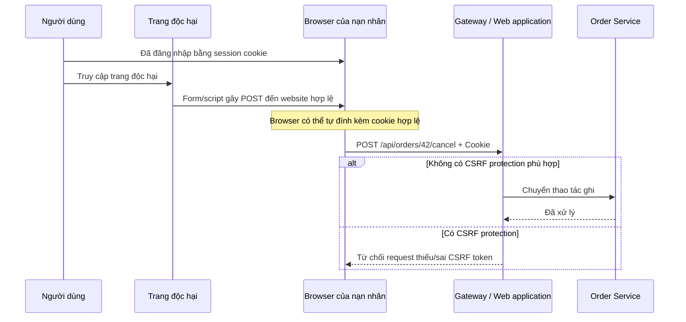
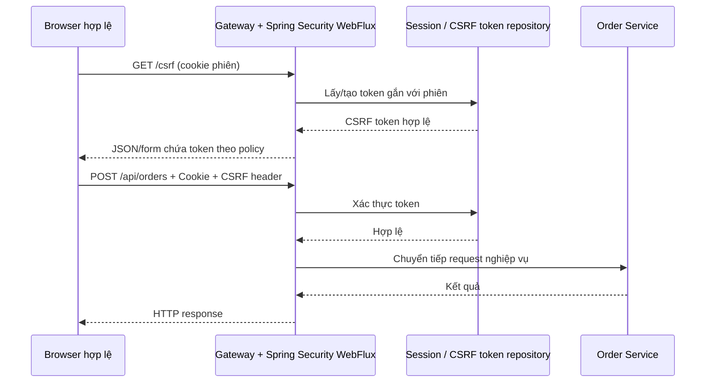

# CSRF theo mô hình client dùng cookie hoặc bearer token

## Mục tiêu bài học

Trong chương **Xác thực và phân quyền** của **Spring Cloud Gateway**, chúng ta xem xét **Cross-Site Request Forgery (CSRF)** theo hai mô hình giao tiếp phổ biến:

1. **Browser dùng cookie phiên (session cookie):** trình duyệt thường tự gửi cookie phù hợp với đích request. Một website độc hại có thể lợi dụng hành vi này để kích hoạt hành động dưới danh tính nạn nhân.
2. **Client gửi bearer token rõ ràng trong `Authorization` header:** nếu API **chỉ** xác thực header này và trình duyệt không tự động đính kèm credential thay thế, nguy cơ CSRF cổ điển khác đáng kể so với cookie session.

Spring Cloud Gateway còn có **route predicate**, **filter chain**, **rewrite path/header**, **service discovery**, **TLS**, **rate limiting**, **retry**, **circuit breaker** và **observability**. CSRF là một lớp kiểm soát bảo mật cụ thể, không thể thay thế xác thực hoặc phân quyền của gateway và microservices.

Sau bài này, bạn có thể:

- Giải thích điều kiện để một cuộc tấn công CSRF thành công và vì sao **trình duyệt tự mang credential** là trọng tâm.
- Phân biệt **cookie session**, **bearer token trong HTTP header** và **JWT được lưu trong cookie**.
- Biết khi nào phải **giữ CSRF protection** và khi nào có thể **vô hiệu hóa có phạm vi** cho API bearer-only.
- Cấu hình Spring Security WebFlux với `SecurityWebFilterChain`, `CookieServerCsrfTokenRepository` hoặc xác thực JWT resource server.
- Phối hợp CSRF với **CORS preflight**, cookie `SameSite`, `Secure`, `HttpOnly` và trust boundary ở Gateway.
- Kiểm thử request hợp lệ, thiếu/sai CSRF token, cookie phiên, cross-site form và bearer header bằng HTTP test.
- Tránh những lỗi thường gặp như tắt CSRF toàn hệ thống để chữa lỗi 403 hoặc tin rằng `SameSite`/CORS tự thay thế mọi biện pháp phòng CSRF.

> **Phạm vi:** các ví dụ dùng **Spring Cloud Gateway Server WebFlux** và **Spring Security reactive (`ServerHttpSecurity`)**, không phải cấu hình servlet `HttpSecurity` hay Spring Cloud Gateway Server MVC. Cần đối chiếu Spring Boot/Spring Security/Spring Cloud Gateway với phiên bản triển khai, nhất là cơ chế sinh/trả CSRF token cho SPA.

## 1. CSRF thực chất khai thác điều gì?

Giả sử người dùng đã đăng nhập website:

```text
https://shop.example.com
```

Backend của website hoặc API Gateway nhận diện người dùng bằng cookie:

```http
Cookie: SESSION=<session-id>
```

Người dùng vô tình mở trang:

```text
https://attacker.example
```

Trang độc hại tìm cách khiến browser của người dùng gửi request làm thay đổi trạng thái:

```html
<form action="https://shop.example.com/api/orders/42/cancel"
      method="POST">
  <input name="reason" value="cancelled" />
</form>
<script>
  document.forms[0].submit();
</script>
```

Nếu cookie phiên được trình duyệt tự đính kèm trong bối cảnh đó, server chỉ kiểm tra cookie mà **không** kiểm tra tính hợp lệ của nguồn request, hành động hủy đơn có thể được thực hiện dù người dùng không chủ ý.

Đây là **request forgery**: kẻ tấn công không cần biết giá trị cookie, chỉ cần làm cho trình duyệt của nạn nhân **tự gửi** credential. Kết quả còn phụ thuộc thuộc tính cookie, `SameSite`, browser policy, loại request và những biện pháp bảo vệ khác. Một cookie có `SameSite=Lax` hay `Strict` thường ngăn được nhiều tình huống cross-site, nhưng không nên dựa vào thuộc tính đó làm lớp bảo vệ duy nhất.



Sơ đồ thể hiện một **điều kiện có thể khai thác**, không khẳng định mọi browser luôn gửi cookie trong mọi cross-site POST. Việc kiểm soát cookie và browser hiện đại có thể chặn một phần kịch bản; hệ thống vẫn cần xác định đúng threat model.

### 1.1. Ba điều kiện thường khiến CSRF đáng lo

1. **Credential có thể được browser tự gửi** cho website đích, chẳng hạn session cookie, hoặc một cơ chế xác thực tự động khác.
2. **Request có tác dụng thay đổi trạng thái** như đổi mật khẩu, thanh toán, hủy đơn hoặc cập nhật hồ sơ.
3. **Server thiếu phép kiểm tra chống request giả mạo** tương ứng với mô hình xác thực.

Việc kẻ tấn công **không đọc được response** chưa chắc ngăn được hành động ghi. Browser có thể gửi một số loại request cross-site rồi mới áp dụng giới hạn đọc response. Đó là lý do không thể đồng nhất CSRF với CORS.

### 1.2. CSRF khác với XSS và hành vi chiếm token

| Kiểu tấn công | Mục tiêu | Điểm khác biệt |
| --- | --- | --- |
| **CSRF** | Lợi dụng credential browser tự đính kèm để gửi request ngoài ý muốn | Không nhất thiết đọc được cookie/token |
| **XSS** | Chạy JavaScript không đáng tin trong origin hợp lệ | Có thể đọc dữ liệu JavaScript truy cập được, gửi request hợp lệ hoặc đánh cắp token không được bảo vệ |
| **Token theft** | Lấy credential để tự gọi API | Kẻ tấn công nắm token, không cần browser nạn nhân phát request |
| **CORS misconfiguration** | Cho origin không đáng tin đọc response cross-origin | Có thể làm lộ dữ liệu, nhưng không phải điều kiện cần của CSRF |
| **IDOR/BOLA** | Truy cập tài nguyên không có quyền | Cần phân quyền theo đối tượng ở backend dù request không bị CSRF |

Chống CSRF **không thay thế** XSS prevention; ngược lại, chỉ khóa cookie bằng `HttpOnly` không ngăn browser tự đính kèm cookie trong một request CSRF.

## 2. Câu hỏi quan trọng: browser có tự gửi credential không?

Không nên quyết định bật/tắt CSRF theo tiêu chí đơn giản **“JWT hay session?”**. Điều quyết định là **credential được vận chuyển và tự động gửi như thế nào**.

| Mô hình client | Credential dùng để xác thực | Browser tự gắn credential khi request tới đích? | Mức quan tâm CSRF |
| --- | --- | --- | --- |
| Web app dùng session | Cookie `SESSION` | Có, nếu cookie policy cho phép | **Cần CSRF protection** cho thao tác thay đổi trạng thái |
| SPA dùng JWT trong `Authorization: Bearer ...` | Header do JavaScript chủ động đặt | Website bên ngoài không thể đơn giản tự đặt header có token của nạn nhân | CSRF cổ điển thường không phải mối đe dọa chính **nếu API thực sự chỉ chấp nhận bearer header** |
| SPA lưu JWT trong cookie rồi server đọc cookie | Cookie chứa JWT | Có, theo cookie policy | **Vẫn cần xét CSRF** giống mô hình cookie |
| Browser dùng HTTP Basic hoặc credential tự động | Browser-managed credentials | Có thể tự gửi theo cơ chế/browser | Phải đánh giá và bảo vệ CSRF |
| Native mobile app/server-to-server gửi bearer header | Header được client chủ động thêm | Không có hành vi browser tự mang session cookie | Thường không cần CSRF token; vẫn cần auth/TLS và các chính sách khác |
| Gateway chấp nhận **cả** cookie session và bearer header | Một trong hai | **Có** qua nhánh cookie | Không được vô hiệu hóa CSRF chỉ vì một số clients dùng bearer |

### 2.1. Bearer token nằm trong cookie không phải là “bearer-only header”

Hai request sau nhìn khác nhau:

```http
GET /api/profile HTTP/1.1
Host: api.example.com
Authorization: Bearer eyJ...
```

và:

```http
GET /api/profile HTTP/1.1
Host: api.example.com
Cookie: ACCESS_TOKEN=eyJ...
```

Cả hai có thể sử dụng **cùng định dạng JWT**, nhưng trình duyệt xử lý khác nhau. Trong trường hợp thứ hai, browser có thể tự gắn cookie vào request đến host phù hợp. **Dữ liệu là JWT không khiến cookie tự trở thành miễn nhiễm CSRF.**

Tương tự, đặt session ID vào một `Authorization` header do JavaScript chủ động gửi làm thay đổi threat model so với session cookie, dù giá trị credential có thể đại diện cùng một tài khoản.

### 2.2. Bearer header giảm một nguy cơ nhưng không tự an toàn

Khi SPA có bearer token trong JavaScript và chỉ gửi qua `Authorization`:

```javascript
const response = await fetch("/api/orders/42", {
  headers: {
    Authorization: `Bearer ${accessToken}`
  }
});
```

Một website ngoài origin của SPA không thể đọc biến `accessToken` nếu không có lỗ hổng khác, và cross-origin HTML form không tự tạo được header `Authorization: Bearer ...` tùy ý như vậy. Do đó CSRF token thường không cần thiết cho API thực sự stateless và **chỉ xác thực bearer header**.

Tuy nhiên:

- **XSS** trên origin hợp lệ có thể gửi API calls dưới danh tính user, dù token chỉ lưu trong bộ nhớ.
- Lưu access token trong `localStorage`/`sessionStorage` tăng mức phơi lộ trước JavaScript độc hại; việc lựa chọn nơi lưu token cần đánh giá riêng.
- Nếu backend/Gateway còn nhận session cookie, Basic authentication, refresh-token cookie hay một cơ chế credential tự động khác để thực hiện tác vụ nhạy cảm, phải **đánh giá lại CSRF** cho các endpoints đó.
- Bearer token vẫn cần xác minh signature, issuer, audience, expiry, scope và authorization theo tài nguyên.

**Kết luận:** đừng nói “JWT thì tắt CSRF”, mà phải nói **“API chỉ nhận bearer token trong header do client chủ động gửi, không dùng cookie/credential tự động để xác thực các thao tác cần bảo vệ”**.

## 3. Cookie, SameSite và ranh giới giữa origin với site

Cookie có những thuộc tính ảnh hưởng trực tiếp đến khả năng browser tự gắn credential:

```http
Set-Cookie: SESSION=<opaque-id>; Path=/; Secure; HttpOnly; SameSite=Lax
```

| Thuộc tính | Công dụng | Điều nó không tự làm |
| --- | --- | --- |
| `Secure` | Chỉ gửi cookie qua kết nối an toàn theo quy tắc browser | Không ngăn CSRF trên HTTPS |
| `HttpOnly` | Không cho JavaScript trực tiếp đọc giá trị cookie | **Không** ngăn browser tự gửi cookie |
| `SameSite=Strict` | Hạn chế mạnh cookie trong nhiều bối cảnh cross-site | Không thay authorization; có thể ảnh hưởng navigation hợp lệ |
| `SameSite=Lax` | Giảm khả năng gửi cookie trong nhiều cross-site subrequests/unsafe requests | Có các hành vi/ngoại lệ theo browser và context; không thay toàn bộ CSRF token |
| `SameSite=None; Secure` | Cho phép nhiều trường hợp cookie cross-site có chủ đích (nếu browser cho phép) | Làm CSRF threat model đáng chú ý hơn nếu cookie xác thực |
| `Domain`, `Path` | Quy định host/path được gửi cookie | **Không** phải ranh giới phân quyền ứng dụng |
| Prefix `__Host-` | Có ràng buộc về Secure, Path=/ và không có Domain trên browser hỗ trợ | Không tự đảm bảo CSRF/authorization |

### 3.1. Cross-origin khác cross-site

**Origin** là bộ ba scheme + host + port. **Site** theo mô hình cookie hiện đại thường dựa trên scheme và registrable domain; vì thế hai subdomain có thể **khác origin nhưng vẫn same-site**.

Ví dụ:

```text
https://portal.example.com
https://api.example.com
```

Hai địa chỉ khác **origin**, nhưng thường thuộc cùng **site**. Vì vậy:

- JavaScript từ portal sang API có thể cần **CORS**.
- Cookie `SameSite` có thể coi trao đổi này là **same-site** thay vì cross-site.
- Một subdomain cùng site bị chiếm quyền có thể tạo đường tấn công không bị `SameSite` chặn như kỳ vọng.

Không coi `SameSite=Strict` là bằng chứng đã loại bỏ toàn bộ khả năng CSRF khi một tổ chức sở hữu nhiều subdomain, có nội dung người dùng tự tạo hoặc chịu rủi ro subdomain takeover.

### 3.2. Cookie host-only và cookie dùng chung Domain

Một session cookie **host-only** dành cho `api.example.com` thường không xuất hiện trong `document.cookie` khi JavaScript chạy ở `portal.example.com`, dù browser vẫn có thể gửi cookie tới API theo các quy tắc thích hợp.

Nếu tự đổi cookie sang `Domain=.example.com` chỉ để cho JavaScript của một subdomain đọc được, phạm vi cookie sẽ mở rộng. Điều này có thể làm tăng nguy cơ subdomain có quyền ảnh hưởng cookie, session hoặc CSRF token.

Đừng nới `Domain` một cách vội vàng để xử lý lỗi frontend không đọc được `XSRF-TOKEN`; nên thiết kế **endpoint lấy CSRF token phù hợp**, same-origin reverse proxy hoặc kiến trúc trusted frontend/BFF rõ ràng.

## 4. Cơ chế CSRF token cho browser dùng cookie session

Biện pháp truyền thống là **synchronizer token pattern**:

1. Server tạo token khó đoán và gắn với session/ngữ cảnh được bảo vệ.
2. Frontend hợp lệ nhận token qua một kênh được phép, chẳng hạn HTML form hoặc endpoint `/csrf` chỉ lộ cho origin đã được kiểm soát.
3. Với request làm thay đổi trạng thái (`POST`, `PUT`, `PATCH`, `DELETE`...), client gửi token trong header hoặc form field riêng.
4. Server so sánh token nhận được với token hợp lệ của phiên và từ chối nếu thiếu hoặc sai.

Kẻ tấn công ở một origin khác có thể khiến browser gửi cookie trong một số điều kiện, nhưng **không tự biết token đúng** và không thể giả mạo thêm token đúng một cách hợp lệ chỉ bằng một HTML form đơn giản.



Sơ đồ biểu diễn trường hợp **CSRF được thực thi tại Gateway**. Nếu cookie phiên và CSRF protection thuộc riêng backend, token validation có thể diễn ra **tại backend**; Gateway không thể tự kiểm tra token session của backend nếu không chia sẻ một cơ chế trust/session được thiết kế rõ.

### 4.1. Các HTTP method cần chú ý

Theo mặc định, Spring Security thường áp dụng CSRF protection với các method **không được coi là safe**, chẳng hạn `POST`, `PUT`, `PATCH`, `DELETE`. `GET`, `HEAD`, `OPTIONS`, `TRACE` không được dùng để thực hiện tác vụ thay đổi trạng thái.

| Request | Có nên thay đổi dữ liệu? | CSRF protection |
| --- | --- | --- |
| `GET /api/orders/42` | Không | Thường không yêu cầu CSRF token |
| `HEAD /api/orders/42` | Không | Thường không yêu cầu CSRF token |
| `OPTIONS /api/orders` | Không | Thường không yêu cầu CSRF token |
| `POST /api/orders` | Có | Cần token nếu xác thực bằng cookie/credential tự động |
| `PATCH /api/profile` | Có | Cần token nếu xác thực bằng cookie/credential tự động |
| `DELETE /api/orders/42` | Có | Cần token nếu xác thực bằng cookie/credential tự động |

**Không giấu thao tác ghi sau GET**, ví dụ `GET /api/orders/42/cancel`. Những request safe không được kiểm tra CSRF token theo mặc định; đổi trạng thái bằng GET có thể khiến hệ thống bị khai thác qua liên kết, prefetch, crawler hoặc cross-site navigation.

## 5. Spring Security WebFlux: giữ CSRF cho cookie session

Trong Gateway Server WebFlux, lớp bảo mật reactive được cấu hình qua `SecurityWebFilterChain` và `ServerHttpSecurity`. CSRF protection của Spring Security WebFlux **được bật theo mặc định** trong nhiều cấu hình phổ biến. Khi dùng cookie session, nên **giữ** bảo vệ này, cấu hình repository/cách phát token phù hợp với loại client, và kiểm thử các method ghi.

### 5.1. Cấu hình mẫu cho client dùng cookie

```java
import org.springframework.context.annotation.Bean;
import org.springframework.http.HttpMethod;
import org.springframework.security.config.web.server.ServerHttpSecurity;
import org.springframework.security.web.server.SecurityWebFilterChain;
import org.springframework.security.web.server.csrf.CookieServerCsrfTokenRepository;

@Bean
SecurityWebFilterChain browserCookieSecurity(ServerHttpSecurity http) {
    return http
        .authorizeExchange(exchanges -> exchanges
            .pathMatchers(HttpMethod.GET, "/public/**").permitAll()
            .anyExchange().authenticated()
        )
        .csrf(csrf -> csrf
            .csrfTokenRepository(
                CookieServerCsrfTokenRepository.withHttpOnlyFalse()
            )
        )
        .build();
}
```

Đoạn code minh họa **cơ chế CSRF**, chưa phải cấu hình xác thực đầy đủ. Ứng dụng thực tế còn cần **cơ chế đăng nhập/khởi tạo phiên**, `ReactiveAuthenticationManager`/identity provider hoặc thành phần tương đương, cookie flags, xử lý logout, CORS và kiểm soát session.

`CookieServerCsrfTokenRepository.withHttpOnlyFalse()` phù hợp cho những SPA cần đọc **CSRF token cookie** bằng JavaScript để gửi lại qua header. Nó **không** có nghĩa session cookie được phép bỏ `HttpOnly`; hai cookie có trách nhiệm khác nhau:

- `SESSION` hoặc session cookie tương đương là **credential xác thực**: nên dùng `HttpOnly`, `Secure` và `SameSite` thích hợp.
- `XSRF-TOKEN` là **giá trị chống CSRF dành cho cơ chế được thiết kế**: một số SPA cần đọc giá trị này, nên có thể cần `HttpOnly=false` cho **riêng cookie token**.

Tùy phiên bản Spring Security, token có thể được **defer** (chỉ sinh khi cần) và có cơ chế **mask/XOR** bảo vệ chống BREACH. Việc chỉ đặt cookie repository **không bảo đảm** mọi SPA sẽ thấy token ngay sau GET đầu tiên hoặc có thể gửi nguyên cookie token mà luôn được chấp nhận. Cần thiết kế cách **khởi tạo/phát token** và request handler khớp cách frontend gửi token trong **đúng phiên bản Security WebFlux**.

### 5.2. Kho lưu CSRF token trong WebFlux

| Repository/cách cấp token | Đặc điểm | Điều cần quan tâm |
| --- | --- | --- |
| `WebSessionServerCsrfTokenRepository` | Token được quản lý theo WebSession ở server; là một lựa chọn mặc định trong WebFlux | Frontend cần một đường nhận token hợp lệ |
| `CookieServerCsrfTokenRepository` | Token liên quan cookie; thường dùng với SPA | Không nhầm cookie này với credential; kiểm tra request handler, flags và việc sinh token |
| Custom repository | Token có thể tích hợp hạ tầng riêng | Phải đảm bảo tính khó đoán, binding/trust, vòng đời, chống giả mạo và khả năng scale |

Mô hình **double-submit cookie** cũng dùng token trong cookie và một bản sao ở header/body. Nếu tự triển khai, cần thiết kế token **gắn mật mã với session/ngữ cảnh**, tránh kiểu token tự chọn tùy ý có thể bị cookie injection từ subdomain hoặc các đường ghi cookie ngoài ý muốn. Không tự viết bộ kiểm tra đơn giản “header bằng cookie là đủ” cho các ứng dụng nhạy cảm mà không đánh giá các rủi ro đó.

### 5.3. Một endpoint cung cấp token cho SPA

Với một SPA **cùng origin** với Gateway, một endpoint trả CSRF token thường giúp client chủ động lấy token trước khi gửi request ghi. Ví dụ **khung minh họa** cho Spring Security WebFlux:

```java
import java.util.Map;
import org.springframework.security.web.server.csrf.CsrfToken;
import org.springframework.web.bind.annotation.GetMapping;
import org.springframework.web.bind.annotation.RestController;
import org.springframework.web.server.ServerWebExchange;
import reactor.core.publisher.Mono;

@RestController
class CsrfTokenController {

    @GetMapping("/csrf")
    Mono<Map<String, String>> csrf(ServerWebExchange exchange) {
        Mono<CsrfToken> tokenMono =
            exchange.getAttribute(CsrfToken.class.getName());

        if (tokenMono == null) {
            return Mono.error(
                new IllegalStateException("CSRF is not configured")
            );
        }

        return tokenMono.map(token -> Map.of(
            "headerName", token.getHeaderName(),
            "token", token.getToken()
        ));
    }
}
```

Trong nhiều phiên bản Spring Security WebFlux, exchange attribute mang một `Mono<CsrfToken>`; **phải xác minh với phiên bản ứng dụng**. Quan trọng là subscribe vào publisher để token được phát sinh nếu cơ chế sử dụng deferred token. Endpoint phải:

- Được bảo vệ bởi chính sách CORS/same-origin thích hợp, không cho origin không đáng tin đọc token.
- Trả `Cache-Control: no-store` hoặc một chính sách cache an toàn tương đương; tránh CDN dùng chung cache token theo phiên.
- Không ghi token vào log, query string, trace attributes hay error messages.
- Hoạt động cùng session/cookie và vòng đời token, nhất là sau đăng nhập, đăng xuất hoặc đổi session.
- Trả token theo dạng mà **CSRF request handler** hiện tại chấp nhận (có thể gồm xử lý masked token).

Đây là endpoint cho ứng dụng **thực thi CSRF tại Gateway**. Nếu security filter từ chối request ngay trước controller, cần cấu hình matcher/permission cho endpoint token một cách có chủ đích; không đơn giản `permitAll` toàn bộ API.

### 5.4. Frontend cùng origin gửi token trên unsafe request

Giả sử frontend và API cùng origin `https://shop.example.com`, gateway nhận request `/api/**` dưới cùng host:

```javascript
async function cancelOrder(orderId) {
  const csrfResponse = await fetch("/csrf", {
    method: "GET",
    credentials: "same-origin",
    cache: "no-store"
  });

  if (!csrfResponse.ok) {
    throw new Error("Cannot obtain CSRF token");
  }

  const csrf = await csrfResponse.json();

  const response = await fetch(`/api/orders/${orderId}/cancel`, {
    method: "POST",
    credentials: "same-origin",
    headers: {
      [csrf.headerName]: csrf.token,
      "Content-Type": "application/json"
    },
    body: JSON.stringify({ reason: "customer-request" })
  });

  if (!response.ok) {
    throw new Error("Request rejected or failed");
  }

  return response;
}
```

Ví dụ này dùng **same-origin fetch**, không phải ví dụ cross-origin cookie. Nếu frontend ở `portal.example.com` còn API ở `api.example.com`, phải điều chỉnh `credentials: "include"`, CORS, cookie flags và cách lấy token tương ứng. Một cookie `XSRF-TOKEN` host-only ở `api.example.com` **không tự đọc được bằng `document.cookie` từ portal.example.com**.

Không lấy CSRF token từ URL query, không hard-code token vào HTML được cache công khai và không sử dụng cùng token tĩnh cho mọi người dùng.

## 6. Bearer-only API: khi nào có thể tắt CSRF?

Một API dùng **OAuth2 Resource Server JWT** có thể chỉ chấp nhận:

```http
Authorization: Bearer <valid-jwt>
```

Nếu **mọi request cần quyền** trên nhóm API đó chỉ dùng header bearer và **không dùng cookie/session/HTTP Basic tự động** để xác thực thao tác ghi, thì CSRF token thường không cần thiết cho nhóm route ấy. Đây là quyết định **dựa trên threat model**, không phải mặc định cho toàn ứng dụng.

### 6.1. Cấu hình WebFlux với phạm vi rõ

Ví dụ một nhóm route `/api/bearer/**` được thiết kế cho SPA/mobile/service clients chủ động đính kèm token:

```java
import org.springframework.context.annotation.Bean;
import org.springframework.core.annotation.Order;
import org.springframework.security.config.Customizer;
import org.springframework.security.config.web.server.ServerHttpSecurity;
import org.springframework.security.web.server.SecurityWebFilterChain;
import org.springframework.security.web.server.context.NoOpServerSecurityContextRepository;
import org.springframework.security.web.server.util.matcher.PathPatternParserServerWebExchangeMatcher;

@Bean
@Order(1)
SecurityWebFilterChain bearerOnlyApi(ServerHttpSecurity http) {
    return http
        .securityMatcher(
            new PathPatternParserServerWebExchangeMatcher("/api/bearer/**")
        )
        .securityContextRepository(
            NoOpServerSecurityContextRepository.getInstance()
        )
        .authorizeExchange(exchanges -> exchanges
            .anyExchange().authenticated()
        )
        .oauth2ResourceServer(oauth2 -> oauth2
            .jwt(Customizer.withDefaults())
        )
        .csrf(ServerHttpSecurity.CsrfSpec::disable)
        .build();
}
```

**Điều kiện tiên quyết:** issuer/JWKS, audience validation, JWT signature/expiry, scope policy và dependencies cần được cấu hình. Ví dụ chỉ mô tả CSRF decision cùng một JWT resource server, **không tự triển khai xác thực JWT hoàn chỉnh**. Nó cũng không tự ngăn các route khác bị mở; nếu ứng dụng có nhiều `SecurityWebFilterChain`, phải cấu hình chain cho **mọi path còn lại** sao cho không có endpoint không được bảo vệ.

`NoOpServerSecurityContextRepository` cho biết chain không lưu kết quả security context trong WebSession. Chỉ thêm repository này **không đủ** nếu một custom filter hoặc backend vẫn chấp nhận cookie để thực hiện request. Cần kiểm tra **cả đường đi và các cách xác thực thực tế**.

### 6.2. Đừng bỏ kiểm tra phân quyền

Vô hiệu hóa CSRF với bearer-only API **không đồng nghĩa**:

```text
permitAll()
```

Gateway vẫn phải từ chối token không hợp lệ, token hết hạn hoặc thiếu scope; backend vẫn phải kiểm tra người dùng có quyền với đơn hàng cụ thể.

Ví dụ một JWT có scope `orders.read` có thể đủ để xem danh sách đơn hàng nhưng **không tự cho phép** xem đơn hàng `42` của người dùng khác. Đó là vấn đề **authorization theo tài nguyên**, không phải CSRF.

### 6.3. Cảnh báo với refresh token

Một SPA có thể dùng:

- Access token trong `Authorization` header.
- **Refresh token lưu trong `HttpOnly` cookie** để gọi `/auth/refresh`.

Vậy `/api/bearer/**` có thể không cần CSRF nếu bearer-only, nhưng endpoint **`/auth/refresh`** nhận cookie tự động **phải được đánh giá riêng về CSRF**. Tùy thiết kế, kẻ tấn công có thể gây request refresh/logout/login hoặc thay đổi trạng thái mà không cần đọc token.

Phân tách chain hoặc chính sách theo **cơ chế credential của từng endpoint**, không theo việc toàn hệ thống có sử dụng JWT hay không.

## 7. Một Gateway phục vụ cả cookie session và bearer token

Đây là tình huống dễ cấu hình sai:

```text
/web/**          Browser đăng nhập bằng session cookie
/api/bearer/**   Mobile/SPA tự gửi Authorization: Bearer
/auth/refresh    Refresh token trong cookie
```

Chính sách đề xuất:

| Nhóm endpoint | Credential | CSRF | Authorization |
| --- | --- | --- | --- |
| `/web/**` | Session cookie | **Bật**, token cho unsafe methods | User/session/role và quyền nghiệp vụ |
| `/api/bearer/**` | Bearer header duy nhất | Có thể tắt cho nhóm này sau threat assessment | JWT issuer/audience/scope và quyền backend |
| `/auth/refresh` | Refresh-token cookie | Đánh giá và thường cần bảo vệ theo cookie threat model | Token rotation, reuse detection và session/CSRF policy |
| `/auth/logout` | Session/refresh cookie | Bảo vệ theo chính sách cookie, đặc biệt POST logout | Xóa session/token đúng cách |
| `/health` | Không dùng user credential | Có chính sách riêng; endpoint read-only | Hạn chế thông tin và network exposure |

Nếu dùng nhiều `SecurityWebFilterChain`, thứ tự `@Order` và `securityMatcher` quyết định request thuộc chain nào. **Các chain không tự kết hợp rule với nhau**; một request thường chỉ được bảo vệ bởi chain khớp theo thứ tự. Một rule rộng ở chain trước có thể khiến chain cookie/bearer cụ thể không bao giờ được áp dụng.

Ví dụ tham khảo về hai chain phân tách, không phải ứng dụng sẵn sàng production:

```java
@Bean
@Order(1)
SecurityWebFilterChain jwtEndpoints(ServerHttpSecurity http) {
    return http
        .securityMatcher(
            new PathPatternParserServerWebExchangeMatcher("/api/bearer/**")
        )
        .securityContextRepository(
            NoOpServerSecurityContextRepository.getInstance()
        )
        .authorizeExchange(ex -> ex.anyExchange().authenticated())
        .oauth2ResourceServer(oauth -> oauth.jwt(Customizer.withDefaults()))
        .csrf(ServerHttpSecurity.CsrfSpec::disable)
        .build();
}

@Bean
@Order(2)
SecurityWebFilterChain browserEndpoints(ServerHttpSecurity http) {
    return http
        .securityMatcher(
            new PathPatternParserServerWebExchangeMatcher("/web/**")
        )
        .authorizeExchange(ex -> ex.anyExchange().authenticated())
        .csrf(csrf -> csrf.csrfTokenRepository(
            CookieServerCsrfTokenRepository.withHttpOnlyFalse()
        ))
        .build();
}
```

Đoạn code sử dụng các imports của mục 5/6 và **chỉ biểu đạt phạm vi chính sách**, không bao gồm login/session provider và một chain fallback. Muốn dùng trong ứng dụng thật phải khai báo đầy đủ các bean, cấu hình auth, và bảo vệ các path ngoài hai nhóm (`/auth/**`, actuator, admin, health). Không sao chép cả ví dụ này bên cạnh các beans mẫu trước đó mà không rà soát trùng cấu hình.

### 7.1. Không gắn CSRF với route ID một cách mù quáng

Spring Security WebFlux thường chạy trong **WebFilter chain**, **trước** khi Spring Cloud Gateway chọn route và chạy `GatewayFilter` tương ứng. Khi security cần quyết định CSRF cho `/api/orders/**`, nó thường đánh giá **request URL/method đầu vào**, không phải URI sau `RewritePath`.

Ví dụ:

```text
Browser → POST /api/orders/42/cancel
  ↓
Spring Security WebFilter: auth + CSRF
  ↓
RoutePredicateHandlerMapping: chọn route orders
  ↓
RewritePath: /api/orders/... → /orders/...
  ↓
RouteToRequestUrlFilter + Load balancing + Routing
  ↓
Order Service
```

Đừng đặt một custom `GlobalFilter` ở cuối filter chain rồi tưởng nó bảo vệ **mọi request**: request không match route, actuator handler hoặc request đã bị security chặn có thể không tới Gateway filter chain. CSRF cho cookie-based web app nên được xử lý ở tầng security phù hợp hoặc tại backend sở hữu session, không dựa vào filter muộn một cách ngẫu nhiên.

### 7.2. Khi session thực sự nằm ở backend

Giả sử Gateway chỉ proxy cookie `SESSION` tới backend, còn **backend** mới là nơi lưu session và kiểm tra credential. Gateway có thể không có đủ thông tin để xác minh CSRF token gắn với session của backend.

Trong thiết kế này:

- Backend **phải tự bảo vệ** request cookie-authenticated, trừ khi có một kiến trúc xác thực/CSRF tập trung thực sự bao phủ nó.
- Gateway cần giữ các headers/cookies liên quan theo hợp đồng, không xóa/đổi một token cần cho backend mà không thiết kế lại flow.
- Nếu muốn Gateway tập trung kiểm tra CSRF, phải thiết kế rõ token repository, session binding, cách chuyển trạng thái và trust boundary; không chỉ bật một filter ở Gateway rồi tắt backend protection.
- Khi một người dùng có thể gọi thẳng backend ngoài Gateway, chính sách backend không được dựa hoàn toàn vào giả định “Gateway đã kiểm tra”.

## 8. CORS không thay thế CSRF

Với browser từ `https://portal.example.com` gọi `https://api.example.com`:

```javascript
await fetch("https://api.example.com/api/orders", {
  method: "POST",
  credentials: "include",
  headers: {
    "Content-Type": "application/json",
    "X-XSRF-TOKEN": csrfToken
  },
  body: JSON.stringify({ itemId: "BOOK-42" })
});
```

Do khác origin, trình duyệt có thể gửi **preflight OPTIONS**:

```http
OPTIONS /api/orders HTTP/1.1
Origin: https://portal.example.com
Access-Control-Request-Method: POST
Access-Control-Request-Headers: content-type,x-xsrf-token
```

Gateway cần phản hồi CORS hợp lệ cho origin/method/headers được phép. Nhưng:

1. **Preflight OPTIONS không phải request tạo đơn hàng.** Không nên yêu cầu CSRF token cho preflight theo policy mặc định dành cho unsafe methods.
2. Preflight thường **không mang session cookie hoặc bearer credential như actual request**. Nếu security chặn OPTIONS ở trước bộ xử lý CORS, browser có thể không gửi POST dù CSRF cho actual request đã đúng.
3. Actual POST vẫn cần **xác thực + CSRF token** nếu dùng cookie session.
4. `allowedHeaders: [X-XSRF-TOKEN]` chỉ cho browser gửi header đó, **không tự xác minh** giá trị CSRF token.
5. `Access-Control-Allow-Origin` không thể thay chính sách ủy quyền ở backend.

### 8.1. CORS cấu hình theo route

Trong những phiên bản Gateway Server WebFlux hỗ trợ `metadata.cors`, ví dụ:

```yaml
spring:
  cloud:
    gateway:
      routes:
        - id: orders-web
          uri: lb://order-service
          predicates:
            - Path=/api/orders/**
          metadata:
            cors:
              allowedOrigins:
                - https://portal.example.com
              allowedMethods:
                - GET
                - POST
              allowedHeaders:
                - Content-Type
                - X-XSRF-TOKEN
              allowCredentials: true
              maxAge: 300
```

Đây chỉ là **CORS policy**, không có nghĩa CSRF token repository đã được bật hoặc request đã được xác thực. Với `allowCredentials: true`, không dùng `allowedOrigins: '*'` để cho phép credentialed CORS. Nên định nghĩa origin cụ thể và kiểm soát cookies/CSRF tại Security WebFilterChain.

### 8.2. Khi route dùng `Method=POST`

Một route có predicate:

```yaml
predicates:
  - Path=/api/orders/**
  - Method=POST
```

có thể không match request **OPTIONS** preflight. Khi đó `metadata.cors` của route chưa chắc được áp dụng cho OPTIONS. Cần đường xử lý CORS ở global mapping, Security hoặc ingress **đủ hẹp và nhất quán**. Không tắt CSRF để giải quyết một preflight không match route, vì đó là hai vấn đề khác nhau.

### 8.3. Cookie cross-origin và chính sách bảo vệ

`credentials: "include"` không bảo đảm browser sẽ gửi mọi cookie; còn phụ thuộc domain/path, `SameSite`, `Secure`, chính sách third-party cookie và tình trạng session.

Một SPA ở subdomain khác có thể cần thiết kế **lấy CSRF token qua endpoint được cấp phép**, thay vì yêu cầu JavaScript đọc cookie host-only của API. Token endpoint cần CORS allowlist chặt chẽ, session binding và `Cache-Control: no-store`. Nếu frontend và Gateway có thể dùng **cùng origin qua reverse proxy**, kiến trúc thường đơn giản hơn để quản lý cookie và CSRF.

## 9. TLS, header forwarding và cookie policy ở Gateway

Khi Gateway nằm sau ingress:

```text
Browser --HTTPS--> Ingress --HTTP(S)--> Gateway --HTTP(S)--> Backend
```

CSRF không làm thay TLS:

- Cookie `Secure` chỉ được browser gửi qua kết nối an toàn theo quy tắc cookie.
- Nếu ingress terminate TLS, Gateway nhận HTTP nội bộ vẫn cần trust boundary, network policy, proxy header validation và quyết định bảo vệ chặng nội bộ.
- Các header `X-Forwarded-Proto`, `Forwarded` hay `X-Forwarded-Host` do client giả mạo **không được** tự biến thành chứng cứ request HTTPS hoặc origin được tin cậy.
- Nếu Gateway rewrite request/response headers/cookies, phải đảm bảo `Set-Cookie` và CSRF token không bị loại, thay Domain hoặc thay Path ngoài ý muốn.

Không nên log `Cookie`, `Set-Cookie`, `Authorization`, CSRF token hay body nhạy cảm để debug lỗi 403. Dùng route ID, HTTP method, status, error category, trace ID đã được kiểm soát và kết quả kiểm tra token dạng boolean (hợp lệ/không hợp lệ), không log giá trị token.

### 9.1. Cấu hình các thuộc tính cookie

Một session cookie an toàn điển hình:

```http
Set-Cookie: SESSION=<opaque-id>; Path=/; Secure; HttpOnly; SameSite=Lax
```

Đây là **ví dụ định dạng**, không phải một property Spring Boot tự động sinh đúng các thuộc tính này ở mọi setup. WebSession store, cookie name, session management và reverse proxy phải được cấu hình/kiểm thử theo runtime thực tế. Cookie `SameSite=None` chỉ dùng khi luồng cross-site thật sự cần và phải đi cùng `Secure` trên browser hiện đại.

Cookie CSRF token có thể cần JavaScript đọc **nếu** chọn SPA pattern dựa trên cookie token; điều này không áp dụng cho session cookie. Khi cấu hình `HttpOnly=false` trên CSRF cookie, giảm XSS vẫn là ưu tiên quan trọng: script độc hại chạy ngay trong origin hợp lệ có thể đọc token và gửi request.

## 10. Những bẫy khi bảo vệ CSRF trong microservices

### 10.1. Tắt CSRF toàn Gateway vì thấy 403

Ví dụ **nguy hiểm với ứng dụng dùng cookie**:

```java
http.csrf(ServerHttpSecurity.CsrfSpec::disable);
```

Nếu dòng này áp dụng cho mọi endpoint có session cookie, hành vi chặn các cross-site unsafe requests có thể bị gỡ bỏ. **403 chưa chắc do CSRF**: có thể là thiếu role/scope, backend từ chối, CORS error hoặc CSRF token sai. Cần phân biệt trước khi thay đổi chính sách.

### 10.2. Bật token repository nhưng frontend không bao giờ lấy token

Trong Spring Security hiện đại, CSRF token có thể được tạo **khi được truy cập** (deferred). Nếu SPA không có endpoint/token view kích hoạt việc sinh token, hoặc không gửi header mà repository mong đợi, request POST vẫn bị từ chối.

Giải pháp: tạo luồng **lấy token → gửi token → xử lý rotation**, test sau login/logout và kiểm tra đúng request handler nếu framework có BREACH/XOR token processing. Đừng kết luận CSRF “lỗi” rồi tắt nó.

### 10.3. Gửi `X-XSRF-TOKEN` nhưng bearer JWT không còn hợp lệ

Một CSRF token hợp lệ không giúp một request thiếu session/JWT có quyền truy cập. **CSRF token không phải access token** và không thay `Authorization`. Với bearer-only API, việc bắt buộc một CSRF header không giải quyết được XSS, token theft hay scope validation.

### 10.4. Chỉ đặt `SameSite` mà bỏ CSRF token

`SameSite` hữu ích nhưng có những tình huống same-site cross-origin, browser behaviors, cấu hình cookie mở rộng Domain, và những hệ thống cần cho phép cross-site cookies. Đối với ứng dụng cookie-authenticated có thao tác quan trọng, nên kết hợp CSRF token và các lớp phòng vệ bổ sung theo threat assessment, thay vì chỉ dựa vào một cookie attribute.

### 10.5. Dùng `GET` để đổi trạng thái

Nếu `GET /api/payments/42/approve` thực hiện cập nhật dữ liệu, các cơ chế dựa trên “safe methods” có thể không kiểm tra CSRF token. Đường dẫn có thể bị gọi qua liên kết, crawler hoặc prefetch. **Đặt thao tác ghi vào method không safe** và bảo vệ nó bằng authentication, CSRF (nếu cookie) và authorization thích hợp.

### 10.6. Đảo filter order gây bỏ qua bảo vệ

Spring Security WebFlux thường chạy trước `RoutePredicateHandlerMapping`, còn `RewritePath`, `StripPrefix`, Retry, load balancing và HTTP routing chạy trong Gateway filter chain. Các rule path-based của security có thể thấy **path gốc** khác path backend nhận.

Không dựa vào thứ tự filter tùy tiện để bảo vệ một endpoint chỉ sau rewrite. Với custom filters, phải kiểm tra HTTP request đầu vào, security matcher, route predicate và `order`; một route mới hoặc fallback có thể đi vòng một policy quá hẹp.

### 10.7. Kết hợp retry với unsafe requests

Nếu POST hợp lệ đã vượt CSRF và đi tới backend, **Retry** có thể lặp lại outbound request khi kết nối lỗi. CSRF token kiểm tra nguồn request, nhưng **không biến POST thành idempotent**. Các thao tác như thanh toán hoặc tạo đơn cần idempotency key, xử lý khử trùng lặp ở backend và chính sách retry có giới hạn.

### 10.8. Tin tưởng Origin hoặc Referer một cách đơn giản

Kiểm tra `Origin`/`Referer` có thể là **defense in depth**, nhưng cần xử lý null/missing values, scheme/host/port, proxy trust và privacy policies. Không tự xây logic “Origin chứa chuỗi `example.com` là hợp lệ”; `attacker-example.com` không phải cùng origin với `example.com`.

Một số hệ thống còn sử dụng `Sec-Fetch-Site`, `Sec-Fetch-Mode` và các Fetch Metadata headers để lọc cross-site requests. Chúng cũng chỉ là **lớp bổ sung**, phải có fallback rõ ràng cho clients không gửi headers và không thay thế token validation ở cookie-based flows.

## 11. Kiểm thử: CSRF theo hai mô hình

Muốn xác nhận Gateway an toàn, cần kiểm tra **response status** và **backend có thực sự nhận request/đổi trạng thái hay không**. Chỉ nhìn 403 mà không biết do CSRF hay authorization là chưa đủ.

### 11.1. Ca kiểm thử cho cookie session

Giả sử browser đã đăng nhập bằng session cookie, và Gateway/Backend thực thi CSRF:

| Ca | Cookie/session | CSRF token | Kỳ vọng |
| --- | --- | --- | --- |
| GET đọc dữ liệu | Hợp lệ | Không gửi | Có thể thành công nếu đủ quyền |
| POST tạo đơn | Hợp lệ | Đúng với session | Cho qua CSRF, tiếp tục authz và backend |
| POST tạo đơn | Hợp lệ | Thiếu | **Từ chối** theo CSRF policy |
| POST tạo đơn | Hợp lệ | Sai | **Từ chối** theo CSRF policy |
| DELETE đơn | Hợp lệ | Token của session khác | **Từ chối** |
| POST sau logout | Phiên không còn hợp lệ | Token cũ | Không được thực thi nghiệp vụ |
| POST không có session | Không hợp lệ/không có | Token bất kỳ | Không được coi là người dùng đã xác thực |
| POST qua Origin không được phép | Cookie có thể được gửi tùy policy | Không có token hợp lệ | Không có hành động nghiệp vụ |
| OPTIONS preflight | Thường không có token | Không gửi | Được tầng CORS đánh giá, không gây tác vụ ghi |

Trong trường hợp thông thường, Spring Security trả **403 Forbidden** khi thiếu/sai CSRF token. Nếu chưa xác thực hoặc chain xử lý khác, response có thể là 401/redirect/login response. Đừng cứng nhắc coi mọi 403 đều là CSRF hoặc mọi lỗi CSRF đều phải có chính xác cùng body.

### 11.2. Ca kiểm thử cho bearer-only API

| Ca | `Authorization` | Cookie xác thực | Kỳ vọng |
| --- | --- | --- | --- |
| GET hợp lệ | JWT hợp lệ và đủ scope | Không | Cho qua auth/authz |
| POST hợp lệ | JWT hợp lệ và đủ scope | Không | Có thể thành công **không cần CSRF token** nếu policy bearer-only |
| POST thiếu token | Không có | Không | Bị từ chối |
| POST token sai | JWT hết hạn/sai signature/audience | Không | Bị từ chối |
| POST thiếu scope | JWT hợp lệ nhưng thiếu quyền | Không | Bị từ chối |
| Browser gửi form cross-site | Không thể tự gắn bearer token nạn nhân | Không | Không thực thi dưới danh tính nạn nhân |
| POST chỉ có cookie | Không có | Có cookie bất kỳ | **Không được xác thực** nếu API thật sự bearer-only |
| POST vừa có cookie vừa có bearer | Có bearer hợp lệ | Có cookie khác | Phải xác minh API vẫn dùng **duy nhất bearer** theo chủ đích, không fallback cookie |

Sự khác biệt quan trọng: tắt CSRF chỉ hợp lý sau khi chứng minh **cookie không được chấp nhận như một phương thức authentication dự phòng** trên nhóm bearer-only.

### 11.3. Thử bằng `curl`

Với môi trường test cookie session, minh họa các request:

```bash
# Giả sử session cookie và CSRF token đã được cấp bởi test login flow.
# Token và cookie ở đây là placeholder, không phải thông tin thực.
curl -i -X POST "https://api.example.com/api/orders" \
  -H "Content-Type: application/json" \
  -H "Cookie: SESSION=<test-session>" \
  -d '{"itemId":"BOOK-42"}'

# Request hợp lệ về CSRF (authorization vẫn phải được kiểm tra):
curl -i -X POST "https://api.example.com/api/orders" \
  -H "Content-Type: application/json" \
  -H "Cookie: SESSION=<test-session>" \
  -H "X-XSRF-TOKEN: <valid-csrf-for-session>" \
  -d '{"itemId":"BOOK-42"}'
```

Trong test đầu tiên, nếu session được nhận và CSRF active, request thiếu token phải bị từ chối. Trong test thứ hai, chỉ khi token đúng và user có quyền thì backend mới được xử lý. **Không dùng token/cookie thật trong shell history, ticket hoặc log điều tra**.

Với bearer-only endpoint:

```bash
curl -i -X POST "https://api.example.com/api/bearer/orders" \
  -H "Authorization: Bearer <test-jwt>" \
  -H "Content-Type: application/json" \
  -d '{"itemId":"BOOK-42"}'
```

Nếu API chỉ xác thực JWT header và CSRF đã được tắt có phạm vi, việc không có `X-XSRF-TOKEN` không phải lý do mặc định để từ chối. Vẫn có thể nhận 401/403 do token hoặc scope.

**Lưu ý:** `curl` không thực thi chính sách CORS của browser. Muốn test tấn công cross-origin thực tế phải thử trong browser hoặc mô phỏng phù hợp các quy tắc browser/cookie; không kết luận CSRF an toàn chỉ vì một lệnh curl có thể gửi hay không gửi header.

### 11.4. Test reactive bằng `WebTestClient`

Một integration test có Gateway, Spring Security và backend stub có thể kiểm tra:

```java
// Kịch bản được khởi tạo với session đã xác thực bằng cơ chế test phù hợp.
webTestClient.post()
    .uri("/api/orders")
    .cookie("SESSION", "<test-session>")
    .contentType(MediaType.APPLICATION_JSON)
    .bodyValue(Map.of("itemId", "BOOK-42"))
    .exchange()
    .expectStatus().isForbidden();
```

Đoạn trên chỉ minh họa **request thiếu CSRF token**; nếu test chưa tạo session hợp lệ hoặc route/security matcher khác, status thực tế có thể là 401/redirect. Test hoàn chỉnh phải thiết lập session/authentication và server token repository đúng, sau đó xác nhận **backend stub không nhận request** trong trường hợp thiếu/sai token.

Nên có một test song song gửi token đúng theo session và xác minh backend nhận đúng **một** request. Với bearer-only API, khởi tạo JWT test đã ký/được decoder test chấp nhận, kiểm tra không cần CSRF token nhưng vẫn từ chối JWT sai hoặc thiếu scope.

### 11.5. Quan sát nguồn lỗi

Khi browser báo 403 hoặc “blocked by CORS policy”, kiểm tra:

1. Request nào bị lỗi: **preflight OPTIONS** hay actual POST?
2. Origin và `Access-Control-Request-Headers` có nằm trong CORS policy không?
3. Cookie có thực sự được gửi theo Domain/Path/SameSite/Secure và fetch credentials không?
4. Security chain nào match path?
5. CSRF token có được phát, gửi qua đúng header và khớp repository/session không?
6. JWT/session có hợp lệ và có đủ scope/quyền không?
7. Request đã tới Gateway filter chain/backend chưa, hay bị chặn trước route matching?
8. Có filter rewrite/header/retry nào làm thay đổi hành vi không?

Không ghi giá trị credential/CSRF token đầy đủ vào log để debug; chỉ cần trạng thái có/thiếu, kết quả validation, route/path pattern an toàn, trace ID và error category.

## 12. Checklist thiết kế trước khi triển khai

| Câu hỏi | Điều cần xác nhận |
| --- | --- |
| **Client là gì?** | Browser SPA, browser form, mobile app hay service-to-service? |
| **Credential đi ở đâu?** | Cookie tự gửi, `Authorization` header do app đặt hay hỗn hợp? |
| **API có auth fallback?** | Bearer-only thật sự không chấp nhận session cookie/Basic không? |
| **Unsafe methods?** | POST/PUT/PATCH/DELETE được bảo vệ; GET/HEAD không đổi trạng thái? |
| **Token repository?** | Token gắn với session/ngữ cảnh, khó đoán, được kiểm chứng đúng? |
| **Token delivery?** | SPA/form lấy token ở kênh an toàn; không cache chung và không log? |
| **Cookie flags?** | Session cookie `Secure`, `HttpOnly`, `SameSite`, Domain/Path thích hợp? |
| **CORS?** | Origin cụ thể, allowCredentials/allowedHeaders đúng; preflight không bị auth chặn nhầm? |
| **CSRF owner?** | Gateway hay backend có phiên và validate token? Không bỏ sót ở cả hai? |
| **Security chain?** | Matcher/order bao phủ đúng route và không để path ngoài chain? |
| **Authorization?** | Backend kiểm tra quyền từng tài nguyên, không chỉ tin Gateway? |
| **TLS/proxy?** | Inbound/outbound TLS, forwarded headers tin cậy, cookie secure đúng? |
| **Retry?** | Có bảo vệ idempotency cho thao tác ghi; không nhầm CSRF với duplicate requests? |
| **Observability?** | Metrics route/status/latency/CSRF validation mà không log secret? |
| **Tests?** | Cookie thiếu/sai token bị chặn; bearer-only hoạt động đúng; mixed flows được phủ? |

## 13. Bài luyện tập có đáp án

Một API Gateway phục vụ:

```text
https://shop.example.com/web/orders
  → Browser đăng nhập bằng cookie SESSION

https://api.example.com/api/bearer/orders
  → Mobile app gửi Authorization: Bearer <JWT>

https://api.example.com/auth/refresh
  → Browser dùng HttpOnly refresh-token cookie
```

**Hãy trả lời:**

1. Route `/web/orders` có cần CSRF token trên `POST` không, nếu dùng session cookie?
2. JWT được lưu trong `HttpOnly` cookie có làm hết nguy cơ CSRF không?
3. Vì sao API bearer-only có thể không cần CSRF token nhưng vẫn phải bảo vệ XSS/token theft?
4. Có thể tắt CSRF toàn Gateway chỉ vì route mobile dùng JWT không?
5. `/auth/refresh` dùng cookie có nên được đánh giá CSRF riêng không?
6. Nếu frontend từ `portal.example.com` gọi API ở `api.example.com`, `SameSite=Lax` có làm CORS không còn cần thiết không?
7. Vì sao không dùng `GET /web/orders/42/cancel` để tránh lỗi 403 CSRF?
8. Nếu POST có token hợp lệ nhưng JWT thiếu quyền `orders.write`, request có được cập nhật dữ liệu không?
9. Nếu backend lưu session riêng nhưng Gateway không biết session đó, nơi nào phải bảo vệ CSRF?
10. Đã xác thực CSRF rồi thì Retry có thể gọi lại thao tác thanh toán POST vô hạn không?

**Gợi ý đáp án:**

1. **Có**, theo mô hình cookie session, một unsafe request cần chống CSRF.
2. **Không.** `HttpOnly` ngăn JavaScript đọc cookie nhưng không ngăn browser tự gửi cookie.
3. Website ngoài origin không tự đọc/gắn bearer token nạn nhân theo cách của session cookie, nhưng XSS trên origin hợp lệ hoặc token theft vẫn có thể gọi API.
4. **Không.** Phải tách security chain/policy theo credential và bảo vệ các endpoint cookie.
5. **Có.** Nó phụ thuộc credential tự động và có các nguy cơ/session semantics riêng.
6. **Không.** CORS kiểm soát cross-origin; SameSite là chính sách cookie ở cấp site.
7. Vì GET phải safe; GET đổi trạng thái có thể bị kích hoạt qua link/prefetch/crawler và thường không được CSRF filter kiểm tra.
8. **Không.** CSRF và authorization là hai điều kiện độc lập; thiếu scope/quyền vẫn phải bị từ chối.
9. Backend sở hữu session cần tự bảo vệ trừ khi đã xây dựng và kiểm chứng cơ chế CSRF tập trung thực sự ở Gateway.
10. **Không.** CSRF không tạo idempotency. Retry phải được giới hạn và bảo vệ thao tác ghi bằng cơ chế idempotency riêng.

## Tổng kết

**CSRF phụ thuộc vào cách browser gửi credential, không phụ thuộc đơn thuần vào định dạng token.** Với **cookie session** hoặc JWT được đặt trong cookie tự động gửi, những request thay đổi trạng thái cần chính sách chống CSRF phù hợp. Với **API chỉ nhận bearer token trong `Authorization` header do client chủ động gắn**, CSRF cổ điển thường không cần token riêng; nhưng JWT validation, authorization, TLS, XSS defense và chính sách lưu token vẫn bắt buộc.

Trong **Spring Cloud Gateway Server WebFlux**, hãy thực thi các quyết định này ở **Spring Security WebFilterChain** hoặc lớp backend thực sự sở hữu session, với phạm vi rõ theo endpoint. Kết hợp CSRF token, cookie flags, CORS preflight, SameSite, route/filter order và integration tests thay vì tắt CSRF toàn cục để giải quyết 403. Một thiết kế đúng sẽ ngăn website ngoài ý muốn kích hoạt hành động bằng credential browser, đồng thời không tạo gánh nặng CSRF không cần thiết cho các clients bearer-only thực sự stateless.
