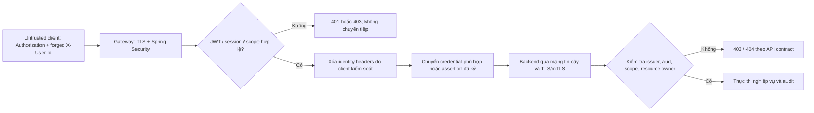
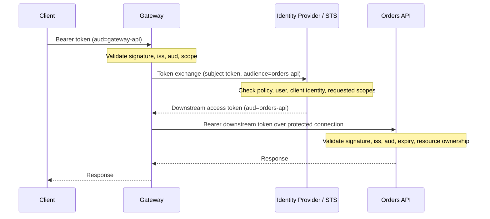

# Chuyển tiếp danh tính xuống dịch vụ trong ranh giới tin cậy với Spring Cloud Gateway

## 1. Vì sao “đã đăng nhập ở Gateway” chưa có nghĩa backend được tin mọi thông tin?

Trong hệ thống microservices, **Spring Cloud Gateway** là cổng vào HTTP: chọn tuyến bằng **route predicate**, thực thi **filter chain**, biến đổi đường dẫn/header, định tuyến qua service discovery và áp dụng những chính sách như xác thực, rate limiting, circuit breaker, retry, TLS và quan sát request. Gateway thường là nơi xác thực client đầu tiên, nhưng **backend mới là nơi xử lý dữ liệu và quyết định quyền trên tài nguyên cụ thể**.

Giả sử người dùng đã xác thực gọi:

```http
GET /api/orders/42 HTTP/1.1
Host: api.example.test
Authorization: Bearer <access-token>
X-User-Id: administrator
```

Header `X-User-Id: administrator` do **client tự gửi**; nó không trở nên đáng tin chỉ vì request đi qua Gateway. Gateway có thể xác minh access token và biết `sub=user-123`, nhưng nếu nó cứ chuyển tiếp header giả mạo, một backend chỉ đọc `X-User-Id` có thể nhầm thành quản trị viên.

**Mục tiêu bài học:** phân biệt *chuyển tiếp credential* với *chuyển tiếp danh tính đã xác minh*, giải thích **trust boundary**, dùng Spring Security Resource Server hoặc OAuth2 Client/`TokenRelay` đúng bối cảnh, hạn chế audience và scope, phòng chống header spoofing, cấu hình TLS/mTLS, kiểm thử quyền ở cả Gateway lẫn backend.

> **Phạm vi triển khai:** ví dụ chính dùng **Spring Cloud Gateway Server WebFlux 4.3+/5.x**, route dưới `spring.cloud.gateway.server.webflux.routes`. WebFlux 4.2 trở về trước thường dùng `spring.cloud.gateway.routes`. Gateway Server Web MVC sử dụng Servlet security/filter API khác; không sao chép `SecurityWebFilterChain` hoặc Java `RouteLocatorBuilder` của WebFlux sang MVC.

## 2. Danh tính, credential, principal và quyền truy cập là bốn thứ khác nhau

| Khái niệm | Ví dụ | Ý nghĩa | Rủi ro nếu nhầm lẫn |
|---|---|---|---|
**Credential** | OAuth2 access token, client certificate | Bằng chứng cần được bên nhận xác minh | Sao chép token thành “đã xác thực” dù không kiểm chứng |
**Identity / principal** | `sub=user-123`, client ID, service identity | Ai hoặc workload nào đang thực hiện hành động | Gán nhầm danh tính người dùng cho service |
**Authorization attributes** | `scope=orders.read`, tenant, vai trò | Quyền được xét trong một ngữ cảnh | Tin `role=admin` từ header client tự tạo |
**Resource authorization** | User `user-123` có được xem order `42`? | Kiểm tra quyền trên **tài nguyên cụ thể** | Chỉ kiểm tra token hợp lệ rồi cho đọc mọi đơn hàng |

Một JWT có thể chứa các claim như `iss` (issuer), `sub` (subject), `aud` (audience), `exp`, `nbf`, `scope`; việc **giải mã Base64** không chứng minh các claim đó đáng tin. Resource server phải kiểm tra chữ ký/nguồn khóa, issuer, thời hạn, audience dự kiến và scope/quyền theo API.

**Access token** dùng để truy cập resource server. **ID token** của OpenID Connect dùng để xác nhận sự kiện đăng nhập với OAuth2 client, **không phải token thay thế cho access token khi gọi API**. **Refresh token** dùng để lấy token mới, không nên chuyển xuống mọi microservice.

### 2.1. Sơ đồ trust boundary



**Có nhiều ranh giới, không phải một:** browser → Gateway; Gateway → backend; backend → service nội bộ tiếp theo; Gateway ↔ registry/IdP. Một header do client điều khiển nằm ở phía **không đáng tin** ngay cả khi tên của nó bắt đầu bằng `X-Internal-`.

### 2.2. Các đối tượng thực sự phải kiểm soát

- **User identity**: cá nhân hoặc tenant đang yêu cầu hành động.
- **Gateway identity**: workload/cổng vào đang gọi backend; có thể chứng minh bằng mTLS/service credential.
- **Actor identity**: service đang hành động thay mặt người dùng, quan trọng trong delegation/on-behalf-of.
- **Request context**: route ID, request/trace ID, source, IP, user agent; phần lớn phục vụ quan sát, **không phải quyền người dùng**.

Không đồng nhất `client_id` của OAuth2 client với `sub` của người dùng. Client-credentials token thường đại diện cho một ứng dụng/service, không mặc nhiên chứa danh tính người dùng cuối.

## 3. Chọn chiến lược chuyển tiếp trước khi viết filter

| Chiến lược | Credential/backend nhận | Khi nên dùng | Điều kiện bảo mật |
|---|---|---|---|
**Bearer pass-through** | Access token client đã gửi | API Gateway và backend cùng chấp nhận token theo thiết kế | Gateway và backend tự xác minh token; issuer, audience, scope và ownership nhất quán |
**OAuth2 TokenRelay** | Access token của `OAuth2AuthorizedClient` | Gateway làm OAuth2 client/SSO, có phiên đăng nhập hoặc registration phù hợp | Đăng ký client, authorized-client storage, token audience thích hợp; backend tự xác minh |
**Token exchange / on-behalf-of** | Token mới nhắm riêng downstream | Backend yêu cầu audience/scope hẹp, cần delegation rõ ràng | IdP/STS hỗ trợ trao đổi token, xác định actor/subject, không tự chế token |
**Service credentials** | Token client-credentials hoặc workload identity | Gateway thực hiện việc của **chính service** | Không tuyên bố đó là user token; kiểm soát service scopes/audience |
**Trusted identity assertion** | Assertion đã ký hoặc identity headers trong kênh được bảo vệ | Hệ thống legacy không tự hiểu OAuth2/JWT user token | Xóa header giả trước khi ghi, xác thực Gateway ở backend, chống replay và không cho gọi backend trực tiếp |

**Một nguyên tắc:** chỉ chọn cách chuyển tiếp token khi **token thực sự được phép dùng ở backend**. Cùng một access token hợp lệ tại Gateway nhưng có `aud=gateway-api` **không tự hợp lệ** cho backend `orders-api`.

## 4. Mô hình A — Bearer pass-through qua Gateway Resource Server

Kiến trúc này phù hợp với REST API nhận header `Authorization: Bearer ...` từ client. Spring Security ở Gateway kiểm tra JWT để chặn request không hợp lệ **trước Gateway route chain**. Access token được giữ trong request proxy, nếu không có filter/ingress loại bỏ hoặc thay thế; backend **độc lập xác minh lại**.

### 4.1. Dependencies của Gateway WebFlux

```xml
<!-- Các version được quản lý bởi Spring Boot và Spring Cloud BOM tương thích -->
<dependency>
    <groupId>org.springframework.cloud</groupId>
    <artifactId>spring-cloud-starter-gateway-server-webflux</artifactId>
</dependency>
<dependency>
    <groupId>org.springframework.boot</groupId>
    <artifactId>spring-boot-starter-oauth2-resource-server</artifactId>
</dependency>
```

Nếu route dùng `lb://orders-api`, cần thêm `spring-cloud-starter-loadbalancer` và nguồn service instances (DiscoveryClient/registry hoặc tương đương). `oauth2-resource-server` giúp xác minh bearer/JWT nhưng **không tự tạo TokenRelay filter**.

### 4.2. `application.yml`: issuer, audience, route và loại bỏ header giả

Đây là ví dụ **một Gateway chuyên công bố Orders API**, dùng access token mà IdP cố ý phát hành với audience `orders-api` để cả Gateway và backend cùng kiểm chứng:

```yaml
server:
  port: 8080

spring:
  security:
    oauth2:
      resourceserver:
        jwt:
          issuer-uri: https://idp.example.test/realms/shop
          audiences:
            - orders-api
  cloud:
    gateway:
      server:
        webflux:
          routes:
            - id: orders-api
              uri: lb://orders-api
              predicates:
                - Path=/api/orders/**
              filters:
                - StripPrefix=1
                - RemoveRequestHeader=X-User-Id
                - RemoveRequestHeader=X-User-Roles
                - RemoveRequestHeader=X-Authenticated-User
```

`audiences` là property của **Spring Boot OAuth2 Resource Server** để bổ sung kiểm tra `aud` theo khả năng/phiên bản đang dùng. `issuer-uri` cung cấp metadata để xác minh issuer và khóa ký của IdP (hoặc có thể cấu hình `jwk-set-uri` cùng issuer để kiểm soát nguồn khóa). URL `idp.example.test` chỉ là tên minh họa, phải thay bằng IdP thực sự.

Các `RemoveRequestHeader` loại bỏ **header identity tự khai báo** trước khi chuyển request xuống backend. Chúng không xóa `Authorization`: ý định của mô hình A là backend nhận token và tự kiểm chứng. Với hệ thống có nhiều route/loại proxy, hãy kiểm tra thực tế header outbound và những đường đi khác có thể bỏ qua route filter.

### 4.3. Gateway `SecurityWebFilterChain`: xác thực và scope trước route

```java
package com.example.gateway.security;

import org.springframework.context.annotation.Bean;
import org.springframework.context.annotation.Configuration;
import org.springframework.http.HttpMethod;
import org.springframework.security.config.Customizer;
import org.springframework.security.config.web.server.ServerHttpSecurity;
import org.springframework.security.web.server.SecurityWebFilterChain;

@Configuration(proxyBeanMethods = false)
public class GatewayApiSecurity {

    @Bean
    SecurityWebFilterChain apiSecurity(ServerHttpSecurity http) {
        return http
            // Chỉ phù hợp với API stateless xác thực bằng Bearer,
            // không dùng session cookie để cấp quyền cho browser.
            .csrf(csrf -> csrf.disable())
            .authorizeExchange(exchanges -> exchanges
                .pathMatchers(HttpMethod.GET, "/api/orders/**")
                    .hasAuthority("SCOPE_orders.read")
                .pathMatchers(HttpMethod.POST, "/api/orders/**")
                    .hasAuthority("SCOPE_orders.write")
                .anyExchange().denyAll())
            .oauth2ResourceServer(oauth2 ->
                oauth2.jwt(Customizer.withDefaults()))
            .build();
    }
}
```

Spring Security Resource Server mặc định ánh xạ scope của JWT thành authority tiền tố `SCOPE_`, nên scope `orders.read` thường thành `SCOPE_orders.read`. Nếu IdP dùng claim roles/scope đặc biệt, phải cấu hình converter đúng thay vì đoán quyền dựa trên tên claim.

**Chú ý CSRF:** ví dụ cố ý tắt CSRF cho **API bearer stateless**. Không sao chép cài đặt này vào Gateway dùng `oauth2Login`/session cookie cho browser hoặc form nếu vẫn có nguy cơ browser tự động gửi credential; cần thiết kế CSRF riêng.

### 4.4. Backend xác thực lại: không “tin” kết quả của Gateway bằng lời nói

Ở dịch vụ `orders-api`, cấu hình Spring Boot Resource Server **độc lập**:

```yaml
# application.yml của orders-api, KHÔNG phải file Gateway
spring:
  security:
    oauth2:
      resourceserver:
        jwt:
          issuer-uri: https://idp.example.test/realms/shop
          audiences:
            - orders-api
```

Backend cũng nên yêu cầu scope `orders.read`/`orders.write` trên path tương ứng **và kiểm tra ownership/tenant của từng order**:

```java
// Minh họa một controller của backend Spring WebFlux:
@GetMapping("/orders/{orderId}")
Mono<OrderDto> findOrder(
        @AuthenticationPrincipal Jwt jwt,
        @PathVariable String orderId) {
    return orderService.findVisibleToSubject(jwt.getSubject(), orderId);
}
```

`findVisibleToSubject(...)` là **hàm nghiệp vụ minh họa**, phải thực sự kiểm tra quyền trên order, tenant và dữ liệu liên quan; việc có scope `orders.read` chưa chứng minh user được xem **mọi** order. Controller cần import `@GetMapping`, `@PathVariable`, `@AuthenticationPrincipal`, `Jwt` và `Mono` phù hợp trong ứng dụng backend thực tế.

**Vì sao backend xác thực lại?** Nếu một client đi được trực tiếp đến backend, nếu một route nội bộ vô tình được công bố hoặc nếu header chuyển tiếp bị giả mạo, backend vẫn phải bảo vệ tài nguyên nhạy cảm. Backend không được tin rằng “chỉ Gateway mới gọi đến đây” nếu mạng và danh tính workload chưa được bảo vệ và giám sát.

### 4.5. Hạn chế của pass-through

Mô hình này chỉ hợp lệ khi token **được IdP phát hành cho resource đó**, không chỉ hợp lệ về chữ ký. Nếu IdP phát token `aud=gateway-api`, backend yêu cầu `aud=orders-api` phải **từ chối**. Không sửa `aud` bằng cách chỉnh JSON của JWT: chữ ký sẽ sai và hành động đó không cấp quyền mới.

Pass-through cũng khiến cùng một bearer token có mặt tại nhiều service: nếu token bị lộ ở một backend hoặc logging sai, phạm vi tác động có thể rộng. Khi cần kiểm soát đối tượng nhận, thời hạn và scope hẹp theo backend, cân nhắc **token exchange** thay vì cho mọi service dùng cùng token.

## 5. Mô hình B — OAuth2 `TokenRelay` với đăng nhập tại Gateway

`TokenRelay` là **GatewayFilter** có sẵn cho OAuth2 Client. Nó lấy access token từ `OAuth2AuthorizedClient` và đặt token vào header `Authorization` của request được proxy. Đây là trường hợp thường gặp khi Gateway làm **BFF/SSO**: browser giữ **session cookie của Gateway**, còn Gateway chuyển **OAuth2 access token** tới backend.

### 5.1. Điều kiện để filter tồn tại và hoạt động

Tài liệu Gateway Server WebFlux yêu cầu:

- Có dependency `spring-boot-starter-oauth2-client`.
- Có `spring.security.oauth2.client.*` tạo ra `ReactiveClientRegistrationRepository`.
- Có OAuth2 authorized client/token tương ứng (thường được tạo qua `oauth2Login()`).
- Backend thực sự chấp nhận token được chuyển đến, gồm issuer, audience, expiry và scope.

**Không suy rằng chỉ thêm `- TokenRelay=` là mọi Bearer token từ request đều được tự động đọc và phát lại.** Cụ thể, kiểu **Resource Server JWT stateless** của mục 4 không tự tạo `OAuth2AuthorizedClient` chỉ nhờ xác thực bearer. Nếu muốn pass-through, hiểu cơ chế proxy và xác minh header; nếu cần token riêng, dùng OAuth2 Client/token exchange phù hợp.

### 5.2. `application.yml` cho OAuth2 Login

```yaml
spring:
  security:
    oauth2:
      client:
        registration:
          company:
            provider: company-idp
            client-id: ${OAUTH_CLIENT_ID}
            client-secret: ${OAUTH_CLIENT_SECRET}
            authorization-grant-type: authorization_code
            redirect-uri: "{baseUrl}/login/oauth2/code/{registrationId}"
            scope: openid,profile,orders.read
        provider:
          company-idp:
            issuer-uri: https://idp.example.test/realms/shop
  cloud:
    gateway:
      server:
        webflux:
          routes:
            - id: orders-browser
              uri: lb://orders-api
              predicates:
                - Path=/api/orders/**
                - Method=GET
              filters:
                - StripPrefix=1
                - RemoveRequestHeader=X-User-Id
                - RemoveRequestHeader=X-User-Roles
                - RemoveRequestHeader=Cookie
                - TokenRelay=
```

`${OAUTH_CLIENT_ID}` và `${OAUTH_CLIENT_SECRET}` là **placeholders của Spring** lấy từ secret/env; không ghi credential thật vào repository. `TokenRelay=` (không có `clientRegistrationId`) sử dụng access token của người dùng đã đăng nhập qua `oauth2Login`. `RemoveRequestHeader=Cookie` được đặt trên tuyến này để tránh chuyển **session cookie của Gateway** tới Orders; chỉ làm vậy nếu backend không cần một cookie khác theo hợp đồng.

Lưu ý `orders.read` trong client registration là **scope đề nghị** IdP cấp, không bảo đảm token nhận được có audience `orders-api`. Phải cấu hình policy tại IdP và kiểm tra JWT thực tế trong môi trường test mà không lộ token.

### 5.3. Security chain cho browser session

```java
package com.example.gateway.security;

import org.springframework.context.annotation.Bean;
import org.springframework.context.annotation.Configuration;
import org.springframework.http.HttpMethod;
import org.springframework.security.config.Customizer;
import org.springframework.security.config.web.server.ServerHttpSecurity;
import org.springframework.security.web.server.SecurityWebFilterChain;

@Configuration(proxyBeanMethods = false)
public class BrowserSecurity {
    @Bean
    SecurityWebFilterChain browserSecurity(ServerHttpSecurity http) {
        return http
            .authorizeExchange(ex -> ex
                .pathMatchers("/login/**", "/oauth2/**").permitAll()
                .pathMatchers(HttpMethod.GET, "/api/orders/**")
                    .authenticated()
                .anyExchange().denyAll())
            .oauth2Login(Customizer.withDefaults())
            .oauth2Client(Customizer.withDefaults())
            .build();
    }
}
```

Đây là **mô hình thay thế** mô hình Resource Server bearer ở mục 4; không đặt hai security classes này cạnh nhau trong một demo rồi mong Spring tự chọn đúng chain. Nếu ứng dụng vừa hỗ trợ API bearer vừa hỗ trợ browser SSO, phải cấu hình **nhiều `SecurityWebFilterChain` có matcher và order rõ ràng**, tránh một chain bắt nhầm request.

Trong mô hình browser, mặc định CSRF cần được xem xét cho các thao tác thay đổi trạng thái dựa trên cookie/session; không bật blanket `csrf.disable()` như ví dụ bearer-only. OAuth2 login có thể redirect client khi chưa xác thực, thay vì trả JSON 401 như REST API; đây là khác biệt thiết kế cần kiểm thử.

### 5.4. Khi cung cấp `clientRegistrationId`

Hai cách sau khác nhau về nguồn token:

```yaml
filters:
  - TokenRelay=
```

Đường trên dùng access token hiện gắn với OAuth2 login của user (khi có). Cách còn lại:

```yaml
filters:
  - TokenRelay=backend-client
```

Khi chỉ định `backend-client`, filter dùng **client registration đó** để lấy/relay OAuth2 access token phù hợp. Nếu registration sử dụng `client_credentials`, token đại diện cho **client/workload**, **không tự động** chứa danh tính và quyền của người dùng cuối. Không xem tham số `clientRegistrationId` là cơ chế “on behalf of” mặc định.

Tài liệu Gateway lưu ý `ReactiveOAuth2AuthorizedClientService` mặc định dùng **in-memory storage**; với cluster nhiều Gateway replicas hoặc yêu cầu phiên đăng nhập bền vững, cần thiết kế lại authorized-client/session storage, bảo mật token at rest và chiến lược refresh/revocation phù hợp. `SaveSession`, Spring Session hoặc kho lưu trữ phù hợp có thể cần thiết tùy kiến trúc, nhưng không tự làm token có audience đúng.

## 6. Mô hình C — Token exchange để giới hạn audience và quyền

**Vấn đề:** client mang access token dành cho API edge, ví dụ:

```json
{
  "iss": "https://idp.example.test/realms/shop",
  "sub": "user-123",
  "aud": ["gateway-api"],
  "scope": "orders.read catalog.read",
  "exp": 1900000000
}
```

Đây là **payload minh họa** để giải thích claims, không phải token hợp lệ hoặc một JWT đã được ký. Backend `orders-api` kiểm tra `aud=orders-api` phải từ chối token ở trên dù Gateway đã xác thực thành công và `sub` có vẻ chính xác. Điều này **đúng về mặt bảo mật**: token không được phát hành cho backend.

Nếu IdP/STS hỗ trợ **OAuth 2.0 Token Exchange (RFC 8693)**, Gateway hoặc một service được phép có thể xin token mới **nhắm riêng `orders-api`** và chỉ mang quyền `orders.read`.



Một yêu cầu trao đổi token **theo cấu trúc protocol** có thể sử dụng các tham số:

```text
grant_type=urn:ietf:params:oauth:grant-type:token-exchange
subject_token=<incoming-access-token>
subject_token_type=urn:ietf:params:oauth:token-type:access_token
audience=orders-api
scope=orders.read
```

IdP còn phải **xác thực OAuth2 client** thực hiện exchange và áp dụng chính sách có cho phép cấp quyền thay mặt người dùng hay không. `actor_token`/`act` claim có thể dùng trong các hệ thống biểu diễn **delegation**; quy tắc cụ thể do IdP và phía tiêu thụ token thống nhất. Không phải mọi IdP hỗ trợ RFC 8693 hoặc mọi loại token đều được exchange.

**Không có chuyện `TokenRelay` tự động thực hiện RFC 8693.** `TokenRelay` thông thường lấy token từ authorized client rồi chuyển tiếp; **token exchange** cần IdP/STS hỗ trợ, client tích hợp, cache/rotation/error handling và chính sách mapping audience/scope riêng.

### 6.1. Relay, exchange và client credentials khác nhau

| Hành vi | `sub` và actor | Audience/scope | Lưu ý |
|---|---|---|---|
**Relay** token người dùng | Giữ token đã có | Không tự đổi audience/scope | Chỉ dùng khi backend đã là audience hợp lệ |
**Exchange** token | Có thể biểu diễn user và actor/delegation | Xin token mới giới hạn cho downstream | Phải được STS/IdP cấp phép |
**Client credentials** | Identity của workload/client | Token cho service riêng | Không tự chứng minh một user đang hành động |
**Chỉ thêm `X-User-Id`** | Chuỗi do proxy đặt | Không có chữ ký/token nếu thiếu thiết kế | Không tương đương bất kỳ mô hình OAuth2 nào |

Token exchange giúp giảm **lateral movement** nếu một token bị lộ: token cho `orders-api` không nên được `billing-api` chấp nhận. Điều này chỉ hiệu quả nếu từng backend **thực sự kiểm tra audience** và không có đường tắt bỏ qua kiểm chứng.

### 6.2. Những thứ không được tự làm

- Không tự sửa claim `aud`/`scope` của JWT rồi gửi lại; chữ ký số sẽ không còn đúng.
- Không tự ký JWT “giả IdP” bằng secret dùng chung không được quản lý và cho tất cả backend tin cậy vô điều kiện.
- Không dùng `id_token` thay `access_token` để cấp quyền resource server.
- Không chuyển refresh token xuống downstream; chỉ thành phần OAuth2 client được ủy quyền mới nên quản lý vòng đời refresh.
- Không dùng một `client_credentials` token rồi ghi `X-User-Id` để backend tưởng đó là quyền của người dùng.

## 7. Trường hợp legacy: chuyển identity bằng header trong miền tin cậy

Một số backend cũ chỉ hiểu `X-User-Id` hoặc `X-User-Roles`. Đây là mô hình **identity propagation dựa trên trust giữa gateway và backend**, khác với backend trực tiếp kiểm chứng OAuth2 access token.

### 7.1. Vì sao không an toàn nếu chỉ dùng `AddRequestHeader`?

Client có thể tự gửi:

```http
GET /api/orders/42 HTTP/1.1
X-User-Id: administrator
X-User-Roles: ROLE_ADMIN
```

Nếu Gateway chuyển nguyên các header này hoặc chỉ `AddRequestHeader=X-User-Id, user-123`, backend có thể nhìn thấy **nhiều giá trị** và chọn nhầm giá trị do client cung cấp. Nếu backend cũng truy cập được trực tiếp qua Internet hoặc service khác, kẻ tấn công có thể **bỏ qua Gateway** và gửi header giả.

Vì vậy, **không dùng header client tự khai làm bằng chứng danh tính**. Nếu buộc áp dụng legacy protocol:

1. Gateway xác thực credential thật trước khi tạo identity context.
2. Ở **trust boundary đầu vào**, xóa mọi `X-User-Id`, `X-User-Roles`, `X-Gateway-Identity` hoặc biến thể không đáng tin mà client có thể đặt.
3. Gateway xây identity assertion từ **`Authentication`/JWT đã xác minh**, không từ request header/query/body tự khai.
4. Chỉ gửi assertion tới **backend được chỉ định**, trên kết nối HTTPS/mTLS hoặc mạng/mesh được bảo vệ và xác thực nguồn.
5. Backend chỉ tin assertion khi đã xác minh **danh tính Gateway**, giới hạn path/API và chống gọi trực tiếp từ bên ngoài.
6. Nếu identity có tác động tới quyền nhạy cảm, ưu tiên **assertion có chữ ký** thay vì plain header; có `iss`, `aud`, `sub`, `iat`, `exp`, có thể có `jti` và actor.
7. Backend vẫn kiểm tra **quyền tài nguyên** chứ không coi mọi vai trò mà Gateway gửi là quyết định cuối cùng.

### 7.2. Cấu hình loại bỏ header giả trong Gateway

```yaml
spring:
  cloud:
    gateway:
      server:
        webflux:
          routes:
            - id: legacy-orders
              uri: https://legacy-orders.internal.example:8443
              predicates:
                - Path=/api/legacy-orders/**
              filters:
                - StripPrefix=1
                - RemoveRequestHeader=X-User-Id
                - RemoveRequestHeader=X-User-Roles
                - RemoveRequestHeader=X-Gateway-Identity
                - RemoveRequestHeader=X-Authenticated-User
```

Đoạn YAML này **chỉ loại bỏ** các header đáng ngờ; nó **chưa tạo assertion đáng tin cậy**. Phần tạo assertion phải do thành phần đã đọc được `SecurityContext` hợp lệ thực hiện. Một thuật toán an toàn về mặt thiết kế:

```text
PSEUDOCODE (không phải Java chạy trực tiếp):

authentication = requireAuthenticatedSecurityContext()
identity = validatePrincipalAndRequestedRoute(authentication)

cleanRequest = removeAllUntrustedIdentityHeaders(incomingRequest)
downstreamAssertion = trustedIssuer.sign({
  iss: "edge-gateway",
  sub: identity.subject,
  aud: "legacy-orders",
  scope: allowedScopesForThisRoute(identity),
  exp: shortExpiry,
  jti: uniqueIdentifier
})

sendOverMutuallyAuthenticatedTLS(
  cleanRequest.withHeader("X-Gateway-Identity", downstreamAssertion)
)
```

Backend phải **verify** chữ ký, issuer, audience, expiry và các điều kiện chống replay mà contract yêu cầu. Header có chữ ký vẫn là credential nhạy cảm, phải hạn chế log và forwarding. Nếu hệ thống không có công cụ ký/xác minh assertion đáng tin cậy, nên ưu tiên modernize backend thành OAuth2 Resource Server thay vì tự phát minh giao thức.

### 7.3. Vì sao `default-filters` không phải ranh giới tuyệt đối?

`spring.cloud.gateway.server.webflux.default-filters` có thể gắn `RemoveRequestHeader` cho các **route definitions** do `RouteDefinitionRouteLocator` xử lý; nhưng không mặc nhiên bao phủ mọi endpoint WebFlux, request bị Spring Security chặn trước Gateway hoặc các route tạo trực tiếp bằng `RouteLocatorBuilder`. Nếu chính sách “không bao giờ tin header identity do client gửi” là quy tắc hệ thống, cần kiểm soát thêm tại **ingress/reverse proxy**, Spring Security/WebFilter phù hợp và chính backend.

Một hệ thống nhiều Gateway replicas phải áp dụng chính sách nhất quán ở **mọi** điểm vào, gồm route internal, admin, debug, actuator và các kết nối từ workloads bên trong mạng.

## 8. Tin cậy mạng và metadata: `X-Forwarded-*` không phải danh tính

`Forwarded`, `X-Forwarded-For`, `X-Forwarded-Host`, `X-Forwarded-Proto` có thể phản ánh đường đi qua proxy. Chúng **không** xác thực người dùng và không nên quyết định quyền với đơn hàng hoặc tenant.

- Browser có thể tự gửi `X-Forwarded-For` nếu edge proxy không xóa/ghi đè.
- Gateway có thể phải tin `X-Forwarded-*` từ **ingress đã xác thực** để tạo redirect URL hoặc ghi IP thực. Danh sách `trusted-proxies` và cấu hình forwarding phải khớp phiên bản Gateway.
- `Host` header là dữ liệu từ request HTTP; một predicate `Host=internal.example.test` **không phải authentication**. Không dùng hostname do client chọn làm ranh giới duy nhất ngăn truy cập admin route.
- Khi cần phân quyền theo IP, chỉ dùng địa chỉ suy ra từ chuỗi proxy **được cấu hình tin cậy**, và không thay thế quyền ứng dụng bằng IP allowlist.

### 8.1. HTTPS/mTLS ở hai chiều

```text
Browser --HTTPS--> Ingress --HTTPS/mTLS--> Gateway
                                         |
                                         +--HTTPS/mTLS--> Orders API
                                         +--HTTPS/mTLS--> Billing API
                                         +--registry/IdP over protected network
```

TLS **client → Gateway** được cấu hình ở HTTPS listener/ingress. TLS **Gateway → backend** thuộc cấu hình outbound `HttpClient`/service mesh: certificate trust, hostname verification, và client certificate nếu backend yêu cầu. `lb://orders-api` chỉ chọn instance, **không tự biến kết nối thành mTLS**.

**mTLS xác thực workload của Gateway** nhưng không thay thế kiểm tra quyền của user. Ngược lại, JWT user hợp lệ nhưng backend cho phép kết nối trực tiếp từ mạng không đáng tin vẫn là một bề mặt tấn công cần giảm.

## 9. Kết hợp với rate limiting, retry, discovery và audit

Chuyển danh tính qua Gateway phải được xét cùng các thành phần vận hành:

| Cơ chế | Cách sử dụng an toàn khi có identity |
|---|---|
`RequestRateLimiter` | Chọn `KeyResolver` dựa trên **principal đã xác thực** hoặc tenant được kiểm chứng; tránh dùng `X-User-Id` client tự khai để tạo quota |
`Retry` | Chỉ retry operation phù hợp; tránh POST thanh toán không idempotent; không để retry làm lộ token ở nhiều host |
`CircuitBreaker` | Fallback không được vô tình trả dữ liệu của user khác hoặc bỏ qua security policy |
Discovery / `lb://` | Chỉ định đích backend từ service ID được phép; hạn chế tự sinh route cho services nội bộ |
`StripPrefix`/`RewritePath` | Policy phải xem xét path **Gateway nhận** và path **backend xử lý**; không cho path normalization bypass matcher |
OAuth2 session | Cookie nên được bảo vệ bằng Secure/HttpOnly/SameSite phù hợp; không tự chuyển session cookie đến backend |
TLS / mTLS | Bảo vệ credential trong transit và danh tính workload |
Tracing / metrics | Ghi route ID, status, request ID; **không ghi bearer token, cookie, refresh token hoặc full JWT** |

### 9.1. Rate limiter cần key từ danh tính thật

Nếu đã xác thực trước Gateway bằng Spring Security, một `KeyResolver` có thể lấy principal từ `ServerWebExchange`:

```java
import java.security.Principal;
import org.springframework.cloud.gateway.filter.ratelimit.KeyResolver;
import org.springframework.context.annotation.Bean;
import reactor.core.publisher.Mono;

@Bean
KeyResolver authenticatedUserKeyResolver() {
    return exchange -> exchange.getPrincipal()
        .map(Principal::getName);
}
```

Đây là đoạn **trong class cấu hình**, giả định các route có rate limiter được **Spring Security yêu cầu authenticated**. Khi không có principal, resolver phát `Mono.empty()`; cần xác định rõ chính sách deny/anonymous theo rate limiter đang dùng. Không tùy tiện `switchIfEmpty(Mono.just("admin"))` hoặc gom toàn bộ người dùng chưa xác thực vào một định danh tưởng là hợp lệ.

Nếu quota phụ thuộc tenant, việc dùng claim `tenant_id` chỉ được phép sau khi **JWT đã được xác minh** và chính sách ánh xạ tenant tại IdP đã được kiểm chứng.

## 10. Kiểm thử dương tính, âm tính và chống header spoofing

Đừng chỉ thử một request có token đúng rồi kết luận hệ thống an toàn. Cần kiểm tra **route**, **token**, **scope**, **audience**, **giả mạo header** và **đường gọi trực tiếp backend**.

### 10.1. Test mô hình bearer pass-through

Giả sử Gateway chạy ở `localhost:8080`, `orders-api` có route `/orders/{id}` và bạn có token **thực do IdP cấp cho môi trường test**:

```bash
# TOKEN_VALID: access token có issuer, audience và scope phù hợp.
# KHÔNG ghi token thật vào shell history chia sẻ hoặc kết quả log.
curl -i \
  -H "Authorization: Bearer $TOKEN_VALID" \
  http://localhost:8080/api/orders/42

# Request giả mạo identity header: backend KHÔNG được tin X-User-Id=admin.
curl -i \
  -H "Authorization: Bearer $TOKEN_VALID" \
  -H "X-User-Id: administrator" \
  -H "X-User-Roles: ROLE_ADMIN" \
  http://localhost:8080/api/orders/42

# Không có credential:
curl -i http://localhost:8080/api/orders/42
```

Token không có scope yêu cầu nên bị chặn ở Gateway/Backend tùy chính sách. Token đúng scope nhưng user không sở hữu order `42` vẫn phải bị từ chối ở backend. **Không đưa access token thật vào câu trả lời, screenshot hoặc log dùng chung**; test có thể cấp token ngắn hạn cho principal demo và lưu trong secret store của môi trường thử nghiệm.

### 10.2. Ma trận dự kiến

| Trường hợp | Gateway kỳ vọng | Backend kỳ vọng |
|---|---|---|
Không có Bearer token cho protected route | Thường `401 Unauthorized` | Không nên nhận request nếu Gateway chặn đúng |
Token hết hạn, chữ ký sai hoặc issuer sai | Thường `401` | Không nhận request, hoặc tự trả `401` nếu bị gọi trực tiếp |
Token không đúng `aud` của API | `401` nếu Gateway kiểm tra audience | `401` nếu không đúng audience backend |
Token hợp lệ nhưng thiếu `orders.read` cho GET | Thường `403 Forbidden` | Cũng phải bảo vệ cùng quyền |
Token có scope nhưng không có quyền với order `42` | Có thể cho qua kiểm tra scope | Phải chặn bằng resource-level authorization |
Token hợp lệ + `X-User-Id: admin` giả | Loại header giả trước khi proxy | Không tin giá trị tự khai |
Route không tồn tại | Không chọn route | Không nhận request qua route đó |
Browser OAuth2 login chưa có session | Có thể redirect tới IdP thay vì trả API JSON `401` | Không nhận request cho tới khi login thành công |
`TokenRelay=` nhưng không có authorized client/token | Không giả vờ user đã có access token | Không có credential hợp lệ; cần xử lý đúng policy |
Backend bị gọi trực tiếp không qua Gateway | Gateway không tham gia | Tự xác minh token/mTLS và quyền |

Status cụ thể có thể thay đổi theo `AuthenticationEntryPoint`, exception handling và API contract. **`403` không tự chứng minh một request đã được kiểm chứng audience**; phải có test riêng cho cả issuer/audience và scope.

### 10.3. Kiểm tra header thật tại backend

Trong môi trường test, backend có thể ghi nhận **sự tồn tại** của các header thay vì giá trị:

```text
Request observability (safe):
  routeId=orders-api
  authScheme=Bearer
  tokenPresent=true
  issuerValidation=passed
  audienceValidation=passed
  subjectHash=<non-reversible correlation if needed>
  spoofedIdentityHeaderPresent=false
  status=200
```

Đây chỉ là ví dụ **format log mong muốn**, không phải output mặc định của Spring Security. Không ghi toàn bộ `Authorization`, `Cookie`, `X-Gateway-Identity` hay JWT claims có PII. Đối với claims nhạy cảm, dùng log policy và pseudonymization được phê duyệt; ưu tiên trace ID/route ID cho quan sát.

### 10.4. Test token exchange và browser SSO

Với TokenRelay/browser:

1. Truy cập route GET khi chưa đăng nhập: Gateway chuyển qua login flow phù hợp.
2. Login với client `company` qua IdP, kiểm tra callback và session cookie.
3. Gọi `GET /api/orders/42`; backend phải nhận **access token hợp lệ**, **không nhận Gateway session cookie** nếu đã dùng `RemoveRequestHeader=Cookie`.
4. Logout, hết hạn session hoặc thu hồi/expire token: không được tiếp tục proxy với credential cũ ngoài chính sách.
5. Chạy nhiều Gateway replicas để kiểm tra authorized-client/session storage nếu sử dụng cluster.

Với token exchange, cần **hai bộ token có audience khác nhau**: token client `aud=gateway-api` và token downstream `aud=orders-api`. Test trường hợp IdP từ chối exchange, thiếu scope, user bị thu hồi quyền, backend từ chối token hết hạn, retry không phát lại hành động có side effect không an toàn.

## 11. Các lỗi cấu hình thường gặp

| Dấu hiệu | Nguyên nhân cần điều tra | Hướng xử lý |
|---|---|---|
Token hợp lệ ở Gateway nhưng backend trả `401` | Backend yêu cầu `aud` khác, issuer/key khác, token không được forward | Kiểm tra token audience, trust/key và header outbound; không tắt audience validation |
`TokenRelay` factory không có | Chưa có OAuth2 client starter hoặc `ReactiveClientRegistrationRepository` | Thêm `spring-boot-starter-oauth2-client` và cấu hình registration |
`TokenRelay=` không có token để chuyển | Chỉ cấu hình Resource Server JWT, chưa có OAuth2 authorized client | Phân biệt bearer pass-through với OAuth2 login/token acquisition |
Backend nhận token app thay vì token user | Dùng registration `client_credentials` | Không coi service token là user delegation; dùng on-behalf-of/token exchange nếu cần |
Giả `X-User-Roles: ADMIN` vẫn nâng quyền | Backend tin header client, Gateway không xóa | Strip header ở biên, dùng signed assertion/verified JWT và chặn direct access |
Gateway cho phép scope nhưng backend trả dữ liệu user khác | Backend chỉ kiểm tra `orders.read`, chưa kiểm tra ownership | Bổ sung resource/tenant-level authorization |
Login hoạt động trên một Gateway replica nhưng lỗi ở replica khác | Session/authorized-client chỉ lưu trong RAM | Dùng storage phù hợp và quản lý khóa/phiên |
Browser POST bị `403` dù vừa login | CSRF còn bật nhưng thiếu CSRF token | Thiết kế CSRF flow cho cookie-based web; không tắt bừa |
Bearer API GET trả redirect HTML thay vì `401` | Request bị security chain của `oauth2Login` bắt | Phân chia SecurityWebFilterChain/matcher và entrypoint rõ ràng |
`lb://` route không gọi được backend | Discovery/LoadBalancer lỗi, không có instance, TLS không đúng | Kiểm tra mạng/instance trước khi quy cho JWT |
Forwarded IP/host sai | Proxy headers do client giả hoặc trusted-proxies cấu hình sai | Chỉ tin ingress đã xác minh, cấu hình forwarding đúng |
Token lộ trong logs/traces | Wiretap, access log hoặc logging toàn header | Tắt/che dữ liệu nhạy cảm, xoay vòng credential đã lộ |
Gateway HTTP public nhưng backend yêu cầu mTLS | Thiếu client certificate ở kết nối outbound | Cấu hình Reactor Netty HttpClient TLS/SSL bundle thích hợp |
Đã xóa header ở YAML nhưng Java DSL route vẫn chuyển | `default-filters` không luôn áp cho route trực tiếp | Kiểm tra nguồn tạo route và bảo vệ tại các lớp khác |

## 12. Checklist thiết kế trước khi công bố API

1. **Định nghĩa đúng trust boundary:** client, ingress, Gateway, registry, IdP, backend và service nội bộ nào được quyền gọi nhau?
2. **Xác định principal:** user, service client hay actor thay mặt user? Không dùng chung trường `sub` hoặc custom header với ý nghĩa mơ hồ.
3. **Chọn mô hình token:** pass-through khi audience thực sự phù hợp; OAuth2 TokenRelay cho authorized client; token exchange nếu cần down-scoping; client credentials cho hành động của workload.
4. **Xác minh JWT tại backend:** issuer, chữ ký/JWK, `exp`/`nbf`, audience, scope/roles, và resource/tenant ownership.
5. **Ngăn header spoofing:** xóa hoặc ghi đè identity headers đầu vào; không tin `X-Forwarded-*` ngoài trusted proxy chain.
6. **Bảo vệ kết nối:** HTTPS/mTLS phù hợp, hostname validation, giới hạn trực tiếp đến backend bằng network policy/ingress.
7. **Chỉ công bố routes được phê duyệt:** tránh tự sinh public route cho toàn bộ discovery registry; kiểm tra Host/Path/Method và path rewriting.
8. **Thiết kế trạng thái phiên:** bảo vệ cookie, CSRF, refresh token, authorized-client storage, logout, revocation và multiple replicas.
9. **Kiểm tra side effects:** retry/circuit breaker/fallback không phá idempotency, không bỏ qua authorization và không phát tán bearer token.
10. **Thử cả đường tắt:** backend bị gọi trực tiếp, token sai aud/issuer, mất scope, forged headers, client không login, expired token, mTLS failure.
11. **Quan sát an toàn:** route ID, trace ID, status, key error categories; tuyệt đối không ghi token, session secret hay assertion toàn văn.
12. **Có kế hoạch thu hồi:** xoay vòng khóa, thu hồi OAuth2 client, disable route, chặn mạng, cập nhật allowlist khi có sự cố.

## 13. Bài tập và đáp án

**Bài 1 — Header giả mạo.** Gateway xác thực JWT của `user-123`, nhưng client tự gửi `X-User-Id: admin`. Backend đọc header này để kiểm tra quyền. Vấn đề là gì?

**Đáp án:** backend đã tin dữ liệu do client điều khiển thay cho danh tính đã xác thực. Gateway phải xóa header giả; backend xác thực token hoặc assertion ký bởi thực thể đáng tin, cùng kiểm tra quyền trên tài nguyên.

**Bài 2 — Token audience.** Access token có `aud=gateway-api` và `scope=orders.read`, backend chỉ chấp nhận `aud=orders-api`. Có nên tắt audience validation ở backend?

**Đáp án:** không. Audience giúp ngăn token dùng sai resource. Dùng token được IdP phát hành hợp lệ cho backend hoặc token exchange để có token audience `orders-api` với quyền phù hợp.

**Bài 3 — TokenRelay.** Bạn chỉ cài `spring-boot-starter-oauth2-resource-server` và cấu hình `oauth2ResourceServer().jwt()`, sau đó thêm `TokenRelay=`. TokenRelay có chắc sẵn sàng không?

**Đáp án:** không. TokenRelay dựa trên cơ sở hạ tầng OAuth2 Client/`ReactiveClientRegistrationRepository` và authorized client. Resource Server stateless không tự tạo trạng thái OAuth2AuthorizedClient của user.

**Bài 4 — Service token.** Gateway dùng client credentials lấy token có `sub=gateway-service` rồi truyền `X-User-Id=user-123`. Backend có được coi token đó là bằng chứng user-123 đã ủy quyền không?

**Đáp án:** không. Token client credentials đại diện cho service. Nếu cần hành động nhân danh user, phải dùng delegation/on-behalf-of được IdP cấp phép hoặc assertion có contract và kiểm chứng độc lập.

**Bài 5 — Hai nơi xác thực.** Gateway đã xác minh chữ ký và scope cho request `GET /orders/42`. Vì sao backend vẫn cần kiểm tra?

**Đáp án:** backend có thể được truy cập qua đường khác; Gateway chỉ kiểm soát một số tuyến. Backend phải xác minh token theo audience của mình và kiểm tra user/tenant có quyền với đúng order `42`.

**Bài 6 — Browser session.** Gateway dùng `oauth2Login` rồi `TokenRelay=`. Có nên forward nguyên `Cookie` của Gateway sang mọi backend?

**Đáp án:** không mặc định. Session cookie của Gateway là credential của Gateway, không phải credential của backend. Chỉ chuyển dữ liệu cookie nếu hợp đồng yêu cầu rõ; thường loại cookie của Gateway trên route và gửi access token đúng audience.

**Bài 7 — Proxy headers.** Client đặt `X-Forwarded-For: 127.0.0.1` rồi gọi endpoint quản trị chỉ kiểm tra IP. Đây có phải chứng minh client từ localhost?

**Đáp án:** không. Header đó có thể do client giả. Chỉ dùng chuỗi proxy đáng tin để suy IP và vẫn yêu cầu authentication/authorization cho admin APIs.

**Bài 8 — Rate limiting.** Team dùng `X-User-Id` làm Redis rate limit key nhưng client có thể đổi header. Rủi ro?

**Đáp án:** client có thể thay key để né quota hoặc gây áp lực lên người khác. Key cần lấy từ principal/tenant đã xác thực, và phải xác định hành vi với anonymous requests.

**Bài 9 — CSRF.** Gateway dùng session cookie cho browser và đã bật `oauth2Login`. Dev copy `csrf.disable()` từ ví dụ Bearer API stateless. Tại sao cần xem lại?

**Đáp án:** browser có thể tự gửi session cookie trên request cross-site; nếu API thay đổi trạng thái dựa trên cookie, thiếu CSRF protection có thể mở rủi ro. Chính sách CSRF cần theo kiến trúc web và loại credential.

**Bài 10 — Token exchange.** Một `TokenRelay=backend-client` dùng `client_credentials` có tự động xin token thay mặt user theo RFC 8693 không?

**Đáp án:** không. `TokenRelay` chuyển token của authorized client; client credentials đại diện workload. Token exchange cần grant/IdP hỗ trợ và quyền delegation được xác định riêng.

## 14. Tài liệu tham khảo

- [Spring Cloud Gateway Server WebFlux – TokenRelay GatewayFilter](https://docs.spring.io/spring-cloud-gateway/reference/spring-cloud-gateway-server-webflux/gatewayfilter-factories/tokenrelay-factory.html): tham số `clientRegistrationId`, OAuth2 login, dependency Client, `ReactiveOAuth2AuthorizedClientService`.
- [Spring Cloud Gateway Server WebFlux – RemoveRequestHeader GatewayFilter](https://docs.spring.io/spring-cloud-gateway/reference/spring-cloud-gateway-server-webflux/gatewayfilter-factories/removerequestheader-factory.html): xóa header client trước khi proxy.
- [Spring Cloud Gateway 5.1 – Configuration Properties](https://docs.spring.io/spring-cloud-gateway/reference/5.1/configprops.html): cấu hình WebFlux route, filters và trusted proxies.
- [Spring Security – Reactive OAuth2 Resource Server JWT](https://docs.spring.io/spring-security/reference/reactive/oauth2/resource-server/jwt.html): xác minh JWT, issuer, `exp`/`nbf`, ánh xạ scopes và `SecurityWebFilterChain`.
- [Spring Boot – OAuth2 Resource Server](https://docs.spring.io/spring-boot/reference/security/oauth2.html): `issuer-uri` và `spring.security.oauth2.resourceserver.jwt.audiences`.
- [Spring Security – Reactive OAuth2 Client](https://docs.spring.io/spring-security/reference/reactive/oauth2/client/index.html): authorized client, login, client credentials và token management.
- [Spring Security – Authorized Client Features](https://docs.spring.io/spring-security/reference/reactive/oauth2/client/authorized-clients.html): cách `OAuth2AuthorizedClient` được chọn cho outbound call.
- [RFC 8693 – OAuth 2.0 Token Exchange](https://www.rfc-editor.org/rfc/rfc8693): delegation, impersonation, audience/resource/scope khi cấp token downstream.
- [Spring Cloud Gateway – TLS and SSL](https://docs.spring.io/spring-cloud-gateway/reference/spring-cloud-gateway-server-webflux/tls-and-ssl.html): bảo vệ kết nối inbound/outbound.

**Ghi nhớ:** **Gateway xác thực client không đồng nghĩa backend được phép tin mọi header mà request mang theo.** Chuyển tiếp access token chỉ khi **audience và quyền hợp lệ cho backend**, phân biệt `TokenRelay` với token exchange, loại bỏ identity headers do client kiểm soát và yêu cầu backend xác minh lại danh tính/quyền trên tài nguyên. Ranh giới tin cậy phải được củng cố bằng **TLS/mTLS, kiểm soát mạng, security policy, scope/audience tối thiểu và kiểm thử âm tính**, không chỉ bằng một filter hoặc một header.
