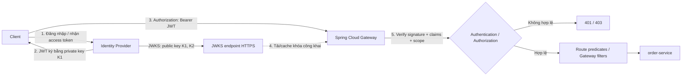
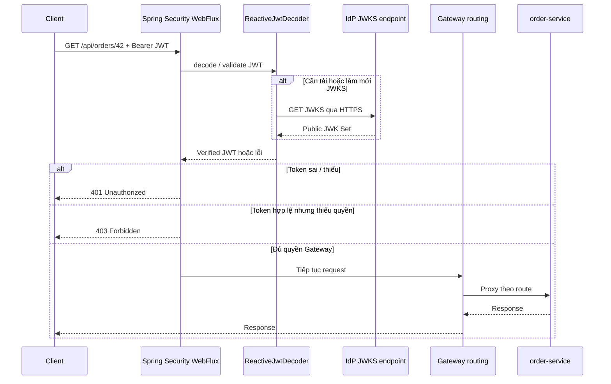
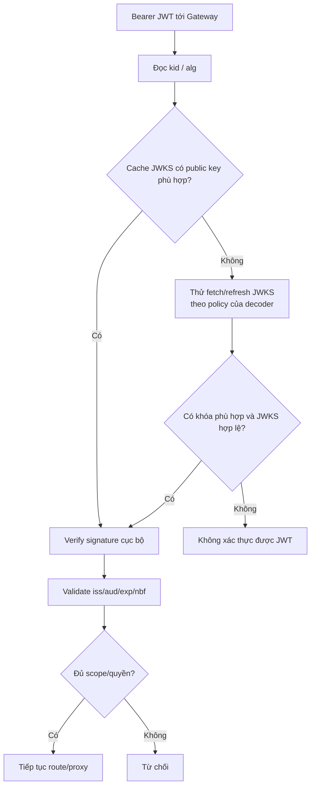
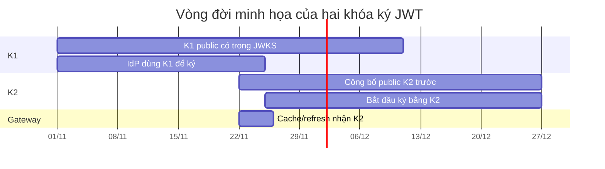
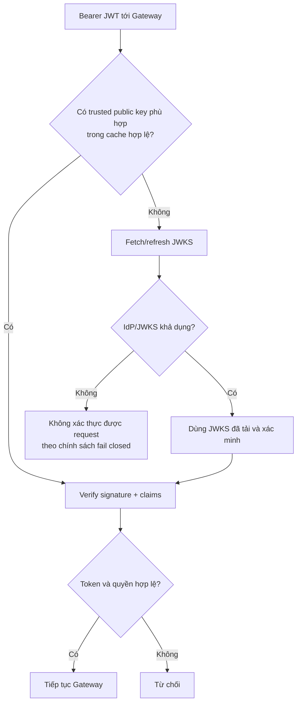

# Quản lý khóa xác minh, cache JWK và thay đổi khóa của nhà cung cấp danh tính

Trong một kiến trúc microservices, **Spring Cloud Gateway** thường là cổng tiếp nhận request có `Authorization: Bearer ...` trước khi định tuyến đến các service nội bộ. Khi token là **JWT được ký số**, gateway cần xác minh chữ ký bằng khóa công khai của **nhà cung cấp danh tính (Identity Provider — IdP)**; đồng thời phải kiểm tra issuer, audience, thời hạn và quyền truy cập. Nếu IdP thay khóa ký trong khi gateway vẫn giữ bộ khóa công khai cũ, request hợp lệ có thể đột ngột bị trả `401`. Ngược lại, nếu gateway tiếp tục tin một khóa đã bị lộ quá lâu, token giả mạo có thể được chấp nhận.

Bài thuộc chương **Xác thực và phân quyền** của module **SPRING_CLOUD_GATEWAY**, tập trung vào ba năng lực vận hành: **quản lý khóa xác minh**, **cache JSON Web Key (JWK)** và **xử lý thay đổi khóa (key rotation) của IdP**. Đây là phần nối giữa Spring Security WebFlux Resource Server và những mối quan tâm chung của API Gateway như route predicates, filter chain, biến đổi path/header, service discovery, rate limiting, circuit breaker, retry, TLS và observability.

Sau bài học, bạn sẽ có thể:

1. Phân biệt khóa ký riêng của IdP với khóa công khai trong `JWKS`, hiểu vai trò của `kid` và `alg` trên JWT.
2. Cấu hình Spring Security Reactive Resource Server với `issuer-uri` và/hoặc `jwk-set-uri`, có kiểm tra `iss`, `aud`, `exp`, `nbf` và tập thuật toán tin cậy.
3. Hiểu bộ nhớ đệm JWKS giúp giảm phụ thuộc vào IdP nhưng có thể tạo khoảng trễ khi công bố, thay thế hoặc thu hồi khóa.
4. Lập quy trình xoay khóa **không gián đoạn** bằng cách công bố khóa mới trước, chuyển sang ký bằng khóa mới, giữ khóa cũ đủ lâu rồi mới rút.
5. Thiết kế cách xử lý IdP outage, nghi ngờ lộ khóa, multi-issuer, key ID lạ và lỗi TLS theo nguyên tắc **fail closed**.
6. Kiểm thử xác thực trước/trong/sau key rotation và quan sát lỗi mà không tiết lộ token hoặc vật liệu khóa nhạy cảm.

> **Phạm vi:** Các ví dụ dùng **Spring Cloud Gateway Server WebFlux** và **Spring Security Reactive OAuth2 Resource Server JWT**. Đây không phải Server MVC/Servlet: WebFlux dùng `SecurityWebFilterChain`, `ServerHttpSecurity` và `ReactiveJwtDecoder`, không dùng `HttpSecurity` hoặc `JwtDecoder` đồng bộ thay thế trực tiếp. Một số chi tiết JWKS cache, lazy initialization và HTTP client có thể khác nhau giữa Spring Security 6.x/7.x, phiên bản Nimbus JOSE+JWT và starter của ứng dụng. Cần kiểm thử thực tế thay vì hard-code giả định về TTL, số lần fetch hay thời điểm refresh.

## 1. Bối cảnh và ranh giới tin cậy giữa IdP, Gateway và backend

Giả sử có một IdP phát hành access token để người dùng gọi `GET /api/orders/42`. Gateway xác minh token trước khi sử dụng route để gửi request tới `order-service`.



Ba chủ thể có trách nhiệm khác nhau:

| Thành phần | Giữ gì? | Trách nhiệm chính |
| --- | --- | --- |
| **IdP / Authorization Server** | **Private signing key**; hệ thống định danh và chính sách phát hành token | Ký JWT, quản lý vòng đời khóa, công bố JWKS và metadata issuer |
| **JWKS endpoint** | Danh sách **public verification keys** và metadata tương ứng | Cho các resource server lấy khóa xác minh hiện hành |
| **Gateway — Resource Server** | URI issuer/JWKS đáng tin và **cache khóa công khai** | Xác minh chữ ký/claims, áp dụng security policy, định tuyến request hợp lệ |
| **Backend service** | Contract và dữ liệu nghiệp vụ; có thể tự xác minh token hoặc dùng một trust boundary nội bộ được bảo vệ | Kiểm tra quyền trên `orderId`, tenant, resource và các rule nghiệp vụ |
| **Client** | Access token do IdP phát hành | Gửi token khi truy cập API; không được chọn khóa tin cậy cho Gateway |

**Quan trọng:** Gateway không cần private signing key của IdP để xác minh chữ ký bất đối xứng. Một public key bị lộ thường không cho phép kẻ tấn công tự ký token; **private key** bị lộ mới là sự cố khẩn cấp. Hãy sử dụng bất đối xứng như RSA/ECDSA theo thuật toán được IdP và resource server thống nhất.

Một cấu hình Resource Server **không tự biến Gateway thành IdP**. Nó không phát hành JWT, không tự xoay private key và không tự cấp quyền người dùng chỉ vì chữ ký hợp lệ.

## 2. JWS, JWK, JWKS và metadata của JWT

### 2.1. JWT được ký chứa những gì?

Một JWT dạng **JWS compact** thường có ba thành phần được mã hóa Base64URL:

```text
BASE64URL(header).BASE64URL(payload).BASE64URL(signature)
```

Ví dụ header đã giải mã (minh họa, không phải token thật):

```json
{
  "typ": "JWT",
  "alg": "RS256",
  "kid": "sig-2026-11"
}
```

Ví dụ payload:

```json
{
  "iss": "https://idp.example.com/realms/shop",
  "sub": "user-42",
  "aud": ["orders-api"],
  "scope": "orders.read",
  "iat": 1793500000,
  "nbf": 1793500000,
  "exp": 1793503600
}
```

Các timestamp ở đây chỉ để minh họa cấu trúc `NumericDate`, **không phải một access token đang có hiệu lực**.

| Trường | Nằm ở đâu? | Vai trò |
| --- | --- | --- |
| `alg` | JWS protected header | Thuật toán ký được token khai báo; verifier chỉ chấp nhận tập thuật toán **đã cấu hình tin cậy** |
| `kid` | JWS header | Gợi ý chọn khóa xác minh tương ứng từ tập public keys |
| `iss` | Claims | Issuer đã phát hành JWT; phải khớp issuer tin cậy |
| `aud` | Claims | Đối tượng API/resource server mà JWT được phát hành cho |
| `exp` | Claims | Thời điểm hết hiệu lực; cần xét clock skew hợp lý |
| `nbf` | Claims | Không chấp nhận token trước thời điểm này |
| `iat` | Claims | Thời điểm phát hành, có thể dùng trong policy bổ sung |
| `scope` / `scp` | Claims | Quyền/phạm vi được cấp; cách ánh xạ authorities tùy IdP và cấu hình Spring Security |

**Chỉ giải mã Base64URL không phải là xác minh chữ ký.** Vì client có thể sửa header và claims trong token rồi gửi lại, không được tin `sub`, `scope`, `iss` hoặc `kid` trước khi verification và validation thành công.

### 2.2. JWK và JWKS

**JWK (JSON Web Key)** là biểu diễn một khóa mật mã trong JSON. **JWKS (JSON Web Key Set)** là đối tượng JSON có một mảng `keys` chứa nhiều JWK.

Ví dụ minh họa JWKS công khai cho khóa RSA:

```json
{
  "keys": [
    {
      "kty": "RSA",
      "use": "sig",
      "alg": "RS256",
      "kid": "sig-2026-11",
      "n": "<base64url-public-modulus-K1>",
      "e": "AQAB"
    },
    {
      "kty": "RSA",
      "use": "sig",
      "alg": "RS256",
      "kid": "sig-2026-12",
      "n": "<base64url-public-modulus-K2>",
      "e": "AQAB"
    }
  ]
}
```

**Lưu ý:** Các giá trị `n` chỉ là placeholder, không phải khóa RSA hợp lệ để chạy thử. JWKS public RSA phải công bố thành phần khóa công khai như `n` và `e`; **không công bố các tham số private RSA** như `d`, `p`, `q` trên endpoint public. Một JWK còn có thể chứa các thuộc tính khác như `key_ops`, `x5c` theo mục đích.

### 2.3. Vai trò thực tế của kid

Theo **RFC 7517**, `kid` là **key identifier** giúp chọn khóa trong một JWK Set, đặc biệt hữu ích khi rollover. `kid` là chuỗi phân biệt chữ hoa/chữ thường; **không phải khóa và không phải bằng chứng danh tính**.

Ví dụ:

```text
JWT header kid = sig-2026-12
            ↓
JWKS có nhiều keys
            ↓
Chọn JWK có kid phù hợp, kty/alg/use phù hợp
            ↓
Kiểm tra chữ ký bằng public key tương ứng
            ↓
Kiểm tra iss, aud, exp, nbf và policy
```

Kẻ tấn công có thể **chủ động thay `kid`** vì header đi cùng token do client gửi. Thư viện xác minh phải tra cứu trong **tập khóa từ issuer đã tin**, không lấy một URL bất kỳ từ `kid` hoặc tự xem `kid` là credential.

## 3. Spring Security Reactive Resource Server xác minh token ở bước nào?

Trong Gateway WebFlux, Spring Security thường xử lý authentication ở **`WebFilter` chain**, trước khi request được chuyển qua Gateway route filters tới backend. Nếu bearer token không hợp lệ, Gateway có thể trả `401` và **không proxy request**.



**Phân biệt lỗi xác thực và phân quyền:**

- **`401 Unauthorized`:** thiếu token, signature sai, issuer không tin cậy, token hết hạn, token malformed hoặc cơ chế xác thực không chấp nhận.
- **`403 Forbidden`:** token đã được xác thực nhưng không có quyền theo security rule; cũng có thể phát sinh từ policy khác.
- **`5xx`:** hạ tầng hoặc thành phần xác thực có lỗi không khôi phục; một số lỗi tải JWKS có thể bị ánh xạ khác nhau tùy decoder/exception handling. **Không khẳng định mọi lỗi JWKS đều luôn thành 401**.

Với Spring Security, một token hợp lệ có `scope: orders.read` thường được ánh xạ thành authority `SCOPE_orders.read`. Backend phải kiểm tra quyền xem **đơn hàng số 42** của user/tenant thực tế; scope chỉ là một điều kiện tổng quát.

## 4. Dependencies và cấu hình issuer/JWKS cho Gateway WebFlux

### 4.1. Các dependency liên quan

Với Maven và Spring Cloud BOM/Spring Boot version tương thích, Resource Server JWT thường cần:

```xml
<!-- Spring Security OAuth2 Resource Server -->
<dependency>
  <groupId>org.springframework.boot</groupId>
  <artifactId>spring-boot-starter-oauth2-resource-server</artifactId>
</dependency>

<!-- Gateway Server WebFlux theo phiên bản dự án -->
<dependency>
  <groupId>org.springframework.cloud</groupId>
  <artifactId>spring-cloud-starter-gateway-server-webflux</artifactId>
</dependency>
```

`spring-security-oauth2-resource-server` xử lý Resource Server, còn `spring-security-oauth2-jose` cung cấp cơ chế JWT/JWS và Nimbus. Starter Spring Boot phù hợp thường mang các dependency cần thiết; nếu cấu hình dependency thủ công, hãy kiểm tra cả hai module Security. Không tự ghép version Spring Cloud/Spring Boot/Spring Security không cùng release train.

### 4.2. Chỉ dùng issuer-uri để discovery

```yaml
spring:
  security:
    oauth2:
      resourceserver:
        jwt:
          issuer-uri: https://idp.example.com/realms/shop
```

Khi sử dụng `issuer-uri`:

1. Resource Server biết **issuer được tin cậy**.
2. Spring Security có thể đọc **OIDC Provider Configuration** hoặc **Authorization Server Metadata** để tìm URL chứa public JWKS.
3. Decoder lấy các public keys và kiểm tra chữ ký.
4. Claims như `iss`, `exp`, `nbf` được kiểm tra theo validators mặc định tương ứng.

Thời điểm gọi metadata/JWKS (startup hay first bearer request) **phụ thuộc version và cách decoder được khởi tạo**. Các bản Spring Security reactive mới có cơ chế lazy initialization để không buộc startup phải kết nối IdP ngay; nếu bạn tự khai báo decoder bean, có thể làm thay đổi hành vi này. Không giả định ứng dụng luôn hoạt động hoàn toàn độc lập với IdP ngay cả khi chỉ đặt `issuer-uri`.

### 4.3. Cấu hình issuer-uri cùng jwk-set-uri

Với môi trường muốn biết chính xác JWKS URL và không cần discovery metadata để khởi tạo:

```yaml
spring:
  security:
    oauth2:
      resourceserver:
        jwt:
          issuer-uri: https://idp.example.com/realms/shop
          jwk-set-uri: https://idp.example.com/realms/shop/protocol/openid-connect/certs
```

Hai URL ở đây là **ví dụ giả định**, phải thay bằng địa chỉ được IdP công bố. JWKS path **không có một định dạng bắt buộc chung** cho mọi nhà cung cấp.

- `jwk-set-uri`: nơi lấy public verification keys.
- `issuer-uri`: dùng để xác minh `iss` của token.
- Khi khai báo trực tiếp `jwk-set-uri`, decoder không cần tra cứu metadata chỉ để tìm URL JWKS lúc startup; việc tải JWKS để xác minh token vẫn cần xử lý ở runtime, tùy cache.

**Sai lầm nghiêm trọng:** Đặt chỉ `jwk-set-uri` rồi cho rằng claim `iss` tự động được xác minh theo issuer mong muốn. Hãy giữ `issuer-uri` hoặc cấu hình validator `iss` tường minh.

### 4.4. Xác minh audience và thuật toán

Một public key của IdP có thể được dùng ký token phát hành cho **nhiều API**. Gateway không được chấp nhận mọi token chỉ vì chữ ký cùng issuer hợp lệ. Cần giới hạn **audience** và scope.

Ví dụ Spring Boot Resource Server với cấu hình audience (kiểm tra property hỗ trợ trên đúng Boot version):

```yaml
spring:
  security:
    oauth2:
      resourceserver:
        jwt:
          issuer-uri: https://idp.example.com/realms/shop
          jwk-set-uri: https://idp.example.com/realms/shop/protocol/openid-connect/certs
          audiences:
            - orders-api
          jws-algorithms:
            - RS256
```

`audiences` chỉ cho phép access token hướng tới `orders-api` theo claim `aud`. `jws-algorithms` giới hạn thuật toán chữ ký; không mở rộng danh sách chỉ vì token header tự ghi một thuật toán khác.

**Không dùng ID token của OIDC thay access token** để gọi API nếu ID token được phát hành cho client application, không phải resource server. `aud` của ID token thường là OAuth2 client ID, không nhất thiết là audience của API. Việc kiểm tra audience và token purpose giúp giảm rủi ro token substitution.

### 4.5. SecurityWebFilterChain: bảo vệ route

Ví dụ Java dành cho Gateway **Server WebFlux**:

```java
import org.springframework.context.annotation.Bean;
import org.springframework.context.annotation.Configuration;
import org.springframework.http.HttpMethod;
import org.springframework.security.config.Customizer;
import org.springframework.security.config.annotation.web.reactive.EnableWebFluxSecurity;
import org.springframework.security.config.web.server.ServerHttpSecurity;
import org.springframework.security.web.server.SecurityWebFilterChain;

@Configuration(proxyBeanMethods = false)
@EnableWebFluxSecurity
public class GatewayResourceServerSecurity {

    @Bean
    SecurityWebFilterChain securityWebFilterChain(ServerHttpSecurity http) {
        return http
            .authorizeExchange(exchanges -> exchanges
                .pathMatchers("/health").permitAll()
                .pathMatchers(HttpMethod.GET, "/api/orders/**")
                    .hasAuthority("SCOPE_orders.read")
                .pathMatchers(HttpMethod.POST, "/api/orders/**")
                    .hasAuthority("SCOPE_orders.write")
                .anyExchange().authenticated()
            )
            .oauth2ResourceServer(oauth2 -> oauth2
                .jwt(Customizer.withDefaults()))
            .build();
    }
}
```

Cấu hình này giả định Gateway nhận Bearer JWT và các request API được bảo vệ theo scope. Với hệ thống browser sử dụng **cookie/session**, phải thiết kế CSRF và CORS phù hợp; không mặc định tắt CSRF trên mọi app. Nếu backend có route sau `StripPrefix` hoặc `RewritePath`, security rules ở gateway nên được xác định theo **path công khai mà WebFlux WebFilter nhìn thấy**, không giả định path đã rewrite trong GatewayFilter.

**Nhớ:** Cấu hình xác thực ở Gateway không tự đảm bảo `order-service` có thể tin request nội bộ. Nếu backend dùng identity từ header do client tự gửi, có thể bị giả mạo. Backend nên tự xác minh JWT hoặc chỉ tin danh tính truyền qua một kênh nội bộ được xác thực, có chính sách xóa/thay header giả mạo và bảo vệ service-to-service.

## 5. Key selection: kid là gợi ý tìm khóa, không phải nguồn tin cậy

Khi JWT có:

```json
{"alg":"RS256","kid":"sig-2026-12","typ":"JWT"}
```

Decoder dùng `kid` cùng thông tin về loại khóa/thuật toán để chọn public key thích hợp từ **JWKS của issuer đã cấu hình**. Nếu tìm được, nó kiểm tra chữ ký và sau đó thực hiện validation khác.

### Một số tình huống

| JWT header / tình trạng JWKS | Điều đúng cần xảy ra |
| --- | --- |
| `kid=K1`, JWKS có public K1, signature đúng | Có thể qua kiểm tra chữ ký; tiếp tục kiểm tra claims |
| `kid=K2` mới, cache chưa có K2 | Cần cơ chế refresh JWKS phù hợp; nếu không tìm được khóa, từ chối token |
| `kid=K1` nhưng signature sai | Từ chối, dù `kid` trùng |
| `alg=none` | Không chấp nhận một unsigned token khi policy yêu cầu JWS có chữ ký |
| Header yêu cầu `HS256` nhưng gateway chỉ tin RS256 | Từ chối; không dùng public RSA key như secret HMAC |
| `kid` là URL hoặc chuỗi dài lạ | Không biến thành một HTTP request tới địa chỉ do client chỉ định |
| JWT có `jku`/`x5u` do client cung cấp | Không tự tải khóa từ URL trong token header không đáng tin |
| Token do issuer B ký nhưng cấu hình chỉ tin issuer A | Từ chối, kể cả có `kid` trùng giữa các issuer |

**Rủi ro algorithm confusion:** Không dựa trên `alg` do client khai báo để tự chuyển sang thuật toán bất kỳ. Resource Server phải có **allowlist thuật toán xác minh** và kiểu khóa tương ứng. Nếu đang dùng RSA, không bổ sung HMAC hoặc thuật toán yếu chỉ để làm một token lỗi “chạy được”.

**Rủi ro SSRF qua key lookup:** Tuyệt đối không tự viết logic ghép URL từ `kid`, `jku`, `iss` hoặc claim do client kiểm soát rồi fetch khóa từ mạng không giới hạn. JWKS URL và issuer phải đến từ **cấu hình tin cậy** hoặc danh sách issuer đã phê duyệt.

## 6. Cache JWK để làm gì và vận hành ra sao?

Nếu mỗi request API phải tải JWKS từ IdP trước khi xác minh chữ ký, Gateway sẽ tạo một dependency mạng nóng trên luồng request: latency tăng, IdP chịu tải lớn và chỉ cần IdP chậm cũng có thể làm cả gateway chậm. Vì vậy, decoder/Nimbus thường sử dụng một **bộ nhớ đệm public JWKS** để tái sử dụng khóa xác minh.



Đây là sơ đồ **logic**. Thời điểm refresh thực sự, cache TTL, refresh khi gặp `kid` lạ, HTTP cache headers, retry/backoff, đồng bộ nhiều request và hành vi khi IdP không sẵn sàng **phụ thuộc implementation/version/configuration**.

### Phân biệt ba loại cache

| Loại cache | Lưu dữ liệu gì? | Ai quản lý? |
| --- | --- | --- |
| **JWKS cache của decoder** | Public keys/JWK Set đã tải từ IdP | Spring Security/Nimbus hoặc thành phần cache được tùy biến |
| **HTTP cache trên đường tới JWKS endpoint** | Có thể lưu response HTTP theo `Cache-Control`/`ETag` | HTTP client, proxy, CDN nếu được cấu hình |
| **Token/session/revocation cache** | Metadata hiệu lực, token ID hoặc trạng thái thu hồi | IdP, backend hoặc cơ chế introspection/revocation riêng |

**Cache JWKS không phải cache các access token đã được xác thực**. Việc có public K1 trong cache chỉ cho phép gateway tiếp tục **xác minh token được ký bằng K1**; token vẫn phải vượt qua `exp`, `nbf`, `iss`, `aud` và authorization tại thời điểm kiểm tra.

### Thời gian sống của cache

Tài liệu Spring Security **Servlet `NimbusJwtDecoder`** mô tả một cache JWKS trong bộ nhớ mặc định theo triển khai tương ứng (tài liệu nêu ví dụ 5 phút) và API tùy chỉnh `Cache` cho nhánh Servlet. **Không bê nguyên con số hoặc `NimbusJwtDecoder.cache(...)` sang `NimbusReactiveJwtDecoder`** nếu chưa kiểm tra reactive implementation đang sử dụng.

Với **Gateway WebFlux** cần xác định:

1. Phiên bản Spring Security/Nimbus và loại `ReactiveJwtDecoder` thực tế.
2. Cache có hiệu lực trong từng gateway instance hay có chia sẻ qua lớp khác.
3. Nó refresh dựa trên TTL, `kid` không tìm thấy hay tín hiệu khác như thế nào.
4. Fetch JWKS có timeout, hạn chế retry, TLS trust và bảo vệ chống nhiều request đồng thời hay không.
5. Có cơ chế vận hành được **purge/refresh** khi sự cố khóa không và cơ chế đó có được thử trước production không.

Đừng gán tùy tiện một property `spring.security.oauth2.resourceserver.jwt.cache-ttl` nếu phiên bản ứng dụng không công bố property đó. Nếu cần TTL/eviction tùy biến, sử dụng API và thành phần cache/JWK source **được hỗ trợ chính thức trong đúng version** hoặc xây dựng integration test để kiểm chứng cấu hình.

## 7. Key rotation có kế hoạch: công bố trước, ký sau, thu hồi cuối

Khi IdP muốn chuyển từ private key **K1** sang **K2**, một kế hoạch an toàn thường có **khoảng overlap**: JWKS công bố đồng thời public K1 và public K2 trong một thời gian.



Biểu đồ là **minh họa quy trình**, không phải lịch thực tế cho IdP hay một khuyến nghị số ngày cụ thể.

### Bước A — Công bố public K2 trước khi sử dụng private K2

JWKS ban đầu:

```json
{"keys":[{"kid":"K1","kty":"RSA","n":"<public-K1>","e":"AQAB"}]}
```

JWKS trong giai đoạn chuẩn bị:

```json
{
  "keys": [
    {"kid":"K1","kty":"RSA","n":"<public-K1>","e":"AQAB"},
    {"kid":"K2","kty":"RSA","n":"<public-K2>","e":"AQAB"}
  ]
}
```

Đây là dữ liệu minh họa, các JWK RSA chưa có đủ giá trị thực để kiểm tra chữ ký. Quan trọng là **IdP vẫn ký bằng K1**, còn K2 đã có mặt để cache của các resource server có cơ hội cập nhật.

Lợi ích: các gateway pods còn dùng cache cũ có thời gian nhận K2 trước khi token mới `kid=K2` xuất hiện. Khoảng chuẩn bị phải tính tới TTL/refresh, CDN/cache trung gian, mạng bị lỗi tạm thời và việc triển khai nhiều cụm.

### Bước B — Chuyển sang phát hành token ký bằng private K2

Sau khi K2 được công bố đủ lâu, IdP bắt đầu ký token mới bằng K2. **Giữ public K1** trong JWKS vì những token ký bằng K1 trước thời điểm chuyển đổi **có thể vẫn còn hạn**.

| Thời điểm | Token | JWKS chứa | Gateway cần làm |
| --- | --- | --- | --- |
| Trước chuyển | `kid=K1` | K1 | Verify bằng public K1 |
| Khi chuẩn bị | `kid=K1` | K1 + K2 | Tiếp tục verify K1; cache có thể cập nhật K2 |
| Vừa chuyển | `kid=K2` | K1 + K2 | Verify K2 nếu đã có; nếu thiếu thì refresh theo cơ chế decoder |
| Trong overlap | `kid=K1` hoặc `K2` | K1 + K2 | Chấp nhận cả hai nếu token/claims hợp lệ |
| Sau khi token K1 hết hạn | Chủ yếu K2 | Có thể rút K1 theo kế hoạch | Không được chấp nhận token cũ đã hết hạn |

**Không nên** xoá public K1 ngay khi IdP đổi sang ký bằng K2, vì như vậy token K1 còn hạn sẽ thất bại dù người dùng không làm sai điều gì.

### Bước C — Rút public K1 sau khoảng an toàn

Điều kiện để rút K1 thường gồm:

- Tất cả issuer nodes đã ngừng phát hành token bằng K1.
- Token K1 được phát hành cuối cùng đã **hết thời hạn `exp`**, tính cả clock skew hợp lý và hệ thống còn giữ token.
- Đã kiểm tra gateway/service caches được cập nhật với K2 trên tất cả cụm.
- Không còn client/backend đặc biệt dùng quy trình xác minh cũ nằm ngoài kế hoạch.

**Đừng dùng thời điểm xuất hiện K2 trong JWKS làm thời điểm K1 tự động hết an toàn.** K1 phải được giữ đủ để những token đã phát hành hợp lệ còn được xác minh trong overlap, trừ khi có sự cố bảo mật đòi thu hồi khẩn cấp.

### Cách chọn thời lượng overlap

Một nguyên tắc thực tế:

```text
Khoảng công bố K2 trước khi ký:
    lớn hơn độ trễ refresh/cache dự kiến
    + dự phòng mạng / rollout IdP / CDN

Khoảng giữ K1 sau khi ngừng ký:
    đủ bao phủ access token K1 còn hạn cuối cùng
    + clock skew / dự phòng vận hành
```

Đây là **quy tắc thiết kế**, không phải giá trị TTL bắt buộc từ RFC. Nếu access token có thời hạn tối đa 15 phút, K1 thường cần tồn tại sau lần ký cuối ít nhất trong khoảng bao phủ token đó và sai lệch đồng hồ hợp lý; các đối tượng khác như ID token/session có vòng đời riêng cần xét theo contract.

## 8. Khi cache chứa khóa cũ nhưng IdP vừa đổi khóa

Tình huống hay gặp:

1. Gateway pod A đã cache JWKS chỉ có K1.
2. IdP công bố K2 và bắt đầu ký token mới.
3. Client gửi JWT có `kid=K2` tới pod A.
4. Decoder không tìm thấy public K2 trong cache hiện tại.

**Hành vi đúng theo chính sách an toàn:** Gateway **không bỏ qua chữ ký** và không cho token qua chỉ vì IdP có thể đang rotate. Nó cần làm mới JWKS theo cơ chế được thư viện hỗ trợ, rồi chỉ xác thực nếu tìm được key phù hợp và signature/claims hợp lệ. Nếu refresh không thành công, token không được coi là đã xác thực.

### Vì sao token có thể thất bại không đồng đều giữa pods?

| Pod | Tình trạng JWKS cache | Token K2 |
| --- | --- | --- |
| Pod A | Cache K1 cũ | Có thể fail hoặc phải refresh |
| Pod B | Cache K1 + K2 | Có thể verify ngay |
| Pod C | Cold cache, IdP đang chậm | Có thể chờ tải JWKS và gặp timeout |
| Pod D | Mới restart, dùng cấu hình sai JWKS URI | Có thể fail mọi token |

Đây là lý do cần kiểm thử **key rotation qua nhiều Gateway instances**, không chỉ thử trên một tiến trình local với cache trống. Khi tăng số instance, mỗi pod có thể có trạng thái cache và thời điểm refresh khác nhau; không tự giả định các pods có một cache đồng nhất.

### Nếu gặp kid không biết thì decoder có fetch ngay không?

Không nên khẳng định mọi `NimbusReactiveJwtDecoder` đều **ngay lập tức** gọi JWKS endpoint trên mọi token có `kid` lạ. Chính sách refresh/TTL/rate limit thay đổi theo phiên bản và cache/JWK source. Fetch quá nhiều do attacker gửi token random kid có thể tạo **JWKS fetch amplification** và gây DoS.

Vì thế, quy trình nghiệm thu phải có test:

- Token mới K2 đến trong khi cache chỉ có K1.
- Nhiều request đồng thời cùng dùng K2.
- Kẻ tấn công gửi hàng loạt `kid` ngẫu nhiên.
- IdP endpoint trả lỗi/timeout đúng lúc refresh.
- Gateway có nhiều replica với cache warm/cold khác nhau.

Nếu cần điều chỉnh cache hoặc warm-up, hãy làm theo cơ chế được thư viện hỗ trợ, không tự cho JWT đi qua trong khoảng chuyển đổi.

## 9. IdP/JWKS endpoint mất kết nối: fail closed nhưng có kế hoạch vận hành

Mất kết nối tới IdP không nhất thiết khiến **mọi** request JWT thất bại ngay lập tức. Gateway có thể đang giữ public JWK phù hợp trong cache và tiếp tục verify **chữ ký cục bộ**. Nhưng một request cần key mới hoặc một lần refresh bắt buộc có thể thất bại.



Đây là sơ đồ logic. Cache hết hạn hay còn được dùng khi endpoint lỗi tùy implementation. **Không tự phát minh quy tắc “offline thì cho qua 15 phút”** nếu chưa có bảo đảm về chữ ký/claims hoặc chính sách an toàn đã được phê duyệt.

### Các nguyên tắc khi outage

- **Không tắt signature verification** để khôi phục traffic nhanh.
- **Không chấp nhận `alg=none`** hoặc một key hard-coded không thuộc issuer đã tin.
- **Không trả thành công giả** cho endpoint nhạy cảm nếu không xác thực được.
- Thiết lập timeout kết nối/response cho việc tải JWKS **riêng với timeout proxy request tới backend**. Cấu hình `spring.cloud.gateway...httpclient.response-timeout` cho Netty routing không mặc nhiên quản lý mọi HTTP call của decoder.
- Dùng TLS truststore, DNS, egress policy và certificate validation phù hợp để JWKS fetch đáng tin cậy.
- Quan sát HTTP errors, latency JWKS refresh, tỷ lệ thiếu `kid` và failure rate khi decoder thiếu khóa.
- Phân biệt lỗi mạng/decoder với token thực sự hết hạn hoặc sai audience.

Một hệ thống có yêu cầu sẵn sàng cao có thể triển khai JWKS endpoint/CDN đáng tin, cache hợp lý và monitoring từ trước. **Không nên** biến “IdP tạm mất kết nối” thành lý do chấp nhận token không kiểm tra.

## 10. Thu hồi khẩn cấp khi nghi ngờ private signing key bị lộ

**Xoay khóa có kế hoạch** và **thu hồi khóa bị lộ** là hai tình huống khác nhau.

Với planned rotation, có thể giữ K1 để các token cũ tiếp tục hoạt động đến `exp`. Nhưng nếu **private K1 bị lộ**, attacker có thể tạo JWT mới với chữ ký K1, và gateway giữ public K1 trong cache có thể tiếp tục xác minh chữ ký đó là hợp lệ.

### Playbook khẩn cấp

1. **Khoanh vùng sự cố:** xác định issuer, `kid` bị ảnh hưởng, những API và môi trường có dùng K1.
2. **Ngừng ký K1**, chuyển sang private K2 đã được tạo và lưu trữ an toàn; ngăn private K1 tiếp tục được dùng.
3. **Thu hồi K1 khỏi tập khóa tin cậy** của IdP và phối hợp **invalidate/refresh cache JWKS trên tất cả Gateway và các resource server khác**. Xóa K1 khỏi JWKS public **không đủ ngay** nếu các instance còn giữ cache cũ.
4. **Xử lý token đã phát hành:** áp dụng session revocation, token blocklist/introspection hoặc biện pháp policy thích hợp. Token JWT tự chứa có thể tiếp tục hợp lệ cho tới khi `exp` nếu resource server vẫn tin khóa cũ và không có cơ chế kiểm tra thu hồi bổ sung.
5. **Giám sát và xác minh:** token K1 mới/giả phải bị từ chối ở tất cả pods; token K2 hợp lệ phải được chấp nhận, không bỏ qua kiểm tra issuer/audience.
6. **Điều tra nguyên nhân và khôi phục:** bảo vệ kho khóa riêng (KMS/HSM/secret store), rà soát log và các dịch vụ được cấp quyền ký.

**Hậu quả chủ đích:** Thu hồi khẩn cấp có thể khiến **token K1 còn hạn của người dùng hợp lệ** bị từ chối; đây là đánh đổi để loại bỏ một khóa đã mất tin cậy. Cần có quy trình buộc đăng nhập lại hoặc phát hành token mới, nhưng không chấp nhận tiếp K1 chỉ để tránh ảnh hưởng UX.

### Private key nên được quản lý ở đâu?

- IdP/KMS/HSM hoặc hệ thống quản lý bí mật có giới hạn quyền đọc và audit.
- Không lưu private key trong Git, image container, cấu hình `application.yml` công khai hay log.
- Không cho Gateway truy cập private signing key nếu nhiệm vụ chỉ là **verify** token bất đối xứng.
- Rotation, backup và khôi phục private key phải có ownership và kiểm soát truy cập chặt.

Nếu thuật toán/IdP dùng khóa **đối xứng** (ví dụ HMAC), bên xác minh phải biết shared secret và rủi ro phân phối secret khác hẳn mô hình public JWKS; không trộn lẫn hai mô hình trong một cấu hình thiếu kiểm soát.

## 11. Multi-issuer và multi-tenant: phải chọn đúng tập khóa cho đúng issuer

Một Gateway có thể phục vụ nhiều tenant hoặc tích hợp nhiều IdP. **Không được dùng chung một JWKS của issuer A để xác thực token issuer B** chỉ vì hai token có cùng `kid` hoặc cùng `alg`.

Ví dụ:

| Issuer | JWKS URI tin cậy | Audience được phép |
| --- | --- | --- |
| `https://idp-a.example.com/realms/shop` | `https://idp-a.example.com/keys` | `orders-api` |
| `https://idp-b.example.com/realms/partner` | `https://idp-b.example.com/keys` | `partner-api` |

Trong kiến trúc nhiều issuer:

1. Có một **allowlist issuer** đã phê duyệt.
2. Mỗi issuer có mapping tới JWKS URI tin cậy, tập thuật toán, audience và validator tương ứng.
3. Chỉ định resolver/decoder cho từng issuer theo cơ chế Spring Security reactive multi-tenancy được hỗ trợ.
4. Dùng `iss` của token như **gợi ý chọn cấu hình đã tin cậy**, sau đó xác minh JWT và issuer claim. Không tự fetch metadata từ **bất kỳ URL `iss` nào client ghi trong token**.
5. Cache JWKS phải phân vùng hợp lý theo **issuer/JWKS URI**, không chỉ theo `kid` (vì `kid` có thể trùng giữa các nhà cung cấp).
6. Backend kiểm tra quyền tenant/resource riêng, không suy ra user thuộc tenant chỉ từ tên subdomain hoặc issuer.

**Không nên** tự chế multi-issuer bằng cách đọc `iss` chưa xác minh, ghép nó vào một URL rồi gọi `WebClient.get()` không có allowlist. Đây là nguồn rủi ro **SSRF**, trust confusion và chấp nhận issuer giả.

Với hệ thống chỉ có **một IdP duy nhất**, ưu tiên cấu hình `issuer-uri`/`jwk-set-uri` đơn giản. Chỉ tăng độ phức tạp khi thực sự cần nhiều issuer và có test cho issuer mix-up.

## 12. Mối liên hệ giữa JWT verification và API Gateway filters

Spring Security Resource Server bảo vệ request ở lớp **WebFlux security chain**. Spring Cloud Gateway còn có **GlobalFilter/GatewayFilter** để định tuyến, sửa header, rate limiting, circuit breaker, retry và biến đổi path.

| Nhu cầu | Thành phần nên chịu trách nhiệm | Ghi chú |
| --- | --- | --- |
| Xác minh JWT/JWKS/claims | **Spring Security Reactive Resource Server** | Không tự parse JWT bằng Base64 trong `GlobalFilter` |
| Quyết định public/protected path | `SecurityWebFilterChain` / authorization managers | Định nghĩa theo path công khai và method |
| Kiểm tra quyền tài nguyên cụ thể | Backend + security policy | `SCOPE_orders.read` chưa đủ chứng minh quyền xem order 42 |
| Bỏ header danh tính do client tự đặt | Gateway header filter/edge policy | Không tin `X-User-Id` hoặc `X-Tenant-Id` từ Internet |
| Chuyển access token tới backend | Chính sách forward token / TokenRelay khi phù hợp | Resource Server verify JWT **không tự đồng nghĩa** OAuth2 client TokenRelay đã được cấu hình |
| Chọn service instance `lb://...` | Spring Cloud LoadBalancer | Không dùng `kid`/`iss` để tự chọn host |
| Retry/circuit breaker | Gateway resilience filters | Không retry xác thực sai; không cho token giả qua fallback |
| TLS & proxy HTTPS outbound | Reactor Netty / TLS client config | Khác HTTP client dùng để tải JWKS của JWT decoder |
| Quan sát request | Micrometer/tracing/log đã che dữ liệu | Không ghi raw JWT, cookies hay key materials |

### Bảo vệ backend khỏi header spoofing

Nếu backend nhận `X-User-Id` và tin tuyệt đối mà không kiểm tra nguồn, client có thể tự gửi header này qua Gateway hoặc đi thẳng tới backend nếu mạng cho phép. Một thiết kế có thể:

- Gateway **xóa** các identity headers không tin cậy trước khi áp dụng chính sách downstream.
- Nếu cần truyền identity, dùng **token đã ký** hoặc kênh nội bộ được xác thực (mTLS/service mesh) với cơ chế gắn metadata đáng tin.
- Backend kiểm tra authorization trên từng tài nguyên hoặc xác minh JWT độc lập.
- Không cấu hình fallback/anonymous mode chỉ vì JWKS endpoint chậm.

**CORS** chỉ điều khiển browser có được đọc response cross-origin; nó không biến bearer token sai chữ ký thành hợp lệ. Với preflight `OPTIONS`, xử lý CORS phù hợp trước authentication mà không mở actual API thành public.

## 13. Quan sát hệ thống mà không lộ bí mật

Để phát hiện key rotation lỗi, cần theo dõi cả **dấu hiệu bảo mật** và **sự cố mạng**.

| Tín hiệu | Có ích để nhận biết | Cần tránh |
| --- | --- | --- |
| Tỷ lệ `401` theo route / issuer đã chuẩn hóa | Key mới chưa được cache, token hết hạn, issuer sai | Ghi nguyên token vào log |
| Tỷ lệ `403` | Scope/authorization thiếu dù token hợp lệ | Trộn lỗi quyền với lỗi chữ ký |
| JWKS fetch success/error/latency | IdP outage, TLS, DNS, HTTP 5xx hoặc rate limiting | Public hóa full URL nhạy cảm nếu chứa thông tin nội bộ |
| Cache hit/miss/refresh (nếu có metrics) | Tình trạng warm/cold cache khi rotate | Tự giả định metric nào cũng được framework export |
| Unknown `kid` rate | Rotation sớm hoặc tấn công random-kid | Dùng raw `kid` làm metric label không giới hạn cardinality |
| Issuer/audience validation failures | Token gửi sai resource server hoặc sai môi trường | Log claims riêng tư không cần thiết |
| Deployment/version của decoder | Pods có hành vi cache khác nhau | Thay đổi TTL trong production mà không test |
| Trace ID giữa Gateway/backend | Phân biệt auth fail ở Gateway hay backend | Log `Authorization`, cookie và nội dung cá nhân |

### Dùng HTTP status đúng cách

- Một request `401` có thể xảy ra **trước khi route match hoặc backend được gọi**.
- Một request `403` có thể do Gateway hoặc backend trả.
- Một request `503` có thể do LoadBalancer không có instance, upstream lỗi hoặc circuit breaker; không tự suy ra IdP hỏng.
- Nếu JWKS HTTP client timeout, exception có thể bị chuyển thành các response khác nhau theo cấu hình. Xem **root cause** từ log an toàn, traces và metrics, không chỉ từ status cuối.

Với Spring Security reactive, nên cấu hình log ở mức phù hợp trong **staging**, tránh bật DEBUG toàn bộ nội dung token trên production. Khi cần điều tra `kid`, hãy dùng thống kê/allowlist có giới hạn hoặc log đã được giảm rủi ro, không chấp nhận chuỗi `kid` tùy ý thành một nhãn metric vô hạn.

## 14. Thực hành: kiểm thử rotation qua K1 và K2

**Mục tiêu:** chứng minh Gateway chấp nhận token ký bằng K1 và K2 trong giai đoạn overlap, từ chối token không hợp lệ và không ngừng bảo vệ route khi JWKS bị lỗi.

### 14.1. Chuẩn bị môi trường cô lập

Sử dụng:

- Gateway WebFlux với cấu hình issuer/JWKS tin cậy của **IdP thử nghiệm**.
- Một JWKS HTTP endpoint mock có khả năng thay tập public keys theo từng bước.
- **Hai cặp khóa RSA thử nghiệm** độc lập: private K1/K2 để tạo JWS trong test, public K1/K2 để công bố JWKS.
- Backend echo an toàn phía sau Gateway, chẳng hạn `GET /orders/42`.
- Route cần scope `orders.read`; JWT test có `iss`, `aud`, `exp`, `nbf` hợp lệ.

**Không sử dụng private keys production trong test**, không lưu token/bí mật production vào file fixture công khai và không tạo JWKS endpoint có khả năng phát tán private material.

### 14.2. Ma trận kiểm thử

| Bước | JWKS mock | Token gửi | Kỳ vọng |
| --- | --- | --- | --- |
| A | Chỉ public K1 | K1, signature + claims hợp lệ | `200` hoặc response backend thành công |
| B | K1 + K2 | K1 hợp lệ | Vẫn thành công |
| C | K1 + K2 | K2 hợp lệ | Thành công khi decoder đã có/có thể refresh K2 |
| D | Chỉ K2, sau cache refresh thích hợp | K2 hợp lệ | Thành công |
| E | Chỉ K2, sau khi cache K1 bị loại | K1 dù còn `exp` | Bị từ chối khi K1 không còn là trusted key |
| F | K1 + K2 | JWT K1 bị đổi payload sau khi ký | `401` do chữ ký không hợp lệ |
| G | K1 + K2 | JWT sai `iss` hoặc `aud` | Bị từ chối |
| H | K1 + K2 | JWT hết hạn | Bị từ chối |
| I | JWKS endpoint trả 503 | Token có key đang được cache hợp lệ | Quan sát hành vi cache/decoder thực tế |
| J | JWKS endpoint trả 503 | Token `kid` mới chưa có trong cache | Không cho request đi qua nếu không xác minh được |
| K | K1 + K2 | Token thiếu scope `orders.read` | `403` nếu authentication thành công nhưng thiếu authority |

Ma trận sử dụng các response kỳ vọng **về chính sách**. Chi tiết HTTP status trong trường hợp IdP outage hoặc cấu hình exception handling có thể khác; cần xác minh **không có request chưa xác thực nào tới backend**.

### 14.3. Gọi thử từ client

Giả sử test đã tạo access token hợp lệ và lưu vào biến môi trường `ACCESS_TOKEN_K1` hoặc `ACCESS_TOKEN_K2`. Không in giá trị token vào log:

```bash
curl -i \
  -H "Authorization: Bearer <test-access-token>" \
  http://localhost:8080/api/orders/42
```

Có thể gọi endpoint JWKS của IdP mock để kiểm tra **chỉ public keys** được công bố:

```bash
curl -fsS https://idp-test.example.local/jwks
```

Lệnh trên giả định DNS/TLS cho hostname test đã được cấu hình hợp lệ; đây không phải endpoint thực phải truy cập từ Internet. Không cần `curl -k` để bỏ xác minh chứng chỉ, kể cả khi kiểm thử kết nối JWKS.

**Kiểm chứng quan trọng:** Backend chỉ được ghi nhận request khi JWT đã được verify và người gọi đủ quyền. Nếu gateway trả `401` nhưng backend vẫn nhận request, cần kiểm tra thứ tự security chain, cấu hình matcher và route filter.

### 14.4. Test cache warm và cold

Để không nhầm hành vi cache:

1. **Warm K1:** cho một request K1 hợp lệ đi qua để decoder có khóa K1.
2. Thay JWKS mock thành `[K1, K2]` nhưng **không restart** Gateway.
3. Gửi token K2 và ghi lại số lần fetch JWKS, thời gian chờ và response.
4. Restart **chỉ trong môi trường test**, lặp lại bước K2 với cold cache để so sánh.
5. Nếu có nhiều replicas, gửi traffic tới từng pod để kiểm tra điểm khác nhau.
6. Thử JWKS 500/timeout đúng lúc token K2 đến; xác minh fail closed.
7. Thử 100 token có random `kid` với tốc độ thấp được kiểm soát và quan sát có cơ chế chống fetch storm không.

Đừng suy ra số lần fetch hoặc TTL mặc định chỉ từ một lần thử. Đặt tiêu chí nghiệm thu theo **đúng decoder version và cache configuration**.

## 15. Các lỗi thường gặp khi xoay khóa và hướng chẩn đoán

| Dấu hiệu | Nguyên nhân có thể | Cách kiểm tra |
| --- | --- | --- |
| Cả hệ thống trả 401 sau IdP đổi khóa | Public K2 chưa có trong cache/JWKS, JWKS URI sai, alg không được tin | So sánh `kid`, JWKS public, thuật toán và refresh |
| Chỉ một số Gateway pods trả 401 | Cache của các pod khác trạng thái hoặc version/config khác | Quan sát từng replica, TTL/refresh và deployment |
| Token K1 còn hạn bị từ chối ngay sau cutover | IdP rút public K1 quá sớm | Khôi phục quy trình overlap nếu K1 chưa lộ; tránh khôi phục khóa đã bị compromise |
| Token sai issuer vẫn đi qua | Chỉ cấu hình JWKS URI mà thiếu issuer validator | Thêm `issuer-uri` hoặc validation `iss` chính xác |
| Token ID token dùng được cho API | Chưa kiểm tra `aud`/token purpose | Ràng buộc audience và access-token policy |
| JWT với `alg` bất ngờ được chấp nhận | Allowlist thuật toán quá rộng hoặc decoder custom không an toàn | Giới hạn JWS algorithms và kiểm tra key type |
| Tăng 5xx/401 khi JWKS endpoint chậm | DNS/TLS/timeout/egress hoặc issuer outage | Theo dõi JWKS fetch metrics và root cause |
| IdP đã xóa K1 nhưng Gateway vẫn accept K1 | Cache cũ chưa bị invalidated | Kích hoạt quy trình thu hồi đồng bộ; kiểm chứng tất cả replicas |
| Random `kid` làm IdP chịu tải | Refresh/fetch amplification | Giới hạn request, cache/refresh policy, bảo vệ JWKS endpoint |
| Backend tin `X-User-Id` từ client | Header spoofing / trust boundary sai | Xóa header untrusted, verify token tại service hoặc mTLS trusted channel |
| Scope hợp lệ nhưng order của tenant khác vẫn được đọc | Backend chỉ kiểm tra scope mà thiếu ownership | Kiểm tra tenant/resource authorization theo user |
| JWKS HTTP request bị SSL handshake failure | Truststore, certificate chain, SNI hoặc ngày giờ máy sai | Sửa TLS đúng cách; không disable verification |
| Gateway có JWK cache nhưng startup vẫn phụ thuộc IdP | Decoder/discovery khởi tạo eager theo version/custom bean | Kiểm tra lazy init, issuer metadata lookup, dependency configuration |
| Restart Gateway sửa lỗi tạm thời nhưng lỗi quay lại | Cache/refresh policy sai hoặc thiếu warm-up | Test rotation dưới tải và xử lý gốc, không dùng restart như kế hoạch chính thức |

## 16. Câu hỏi củng cố

**1. Gateway xác minh JWT bất đối xứng cần private key của IdP không?**

> Không. Gateway dùng public verification key từ JWKS. Private key chỉ nên nằm ở hệ thống phát hành token/KMS/HSM.

**2. `kid` có chứng minh issuer hoặc identity của user không?**

> Không. `kid` chỉ hỗ trợ chọn khóa; chữ ký, issuer, audience, thời hạn và policy vẫn phải được kiểm tra.

**3. Nếu dùng `issuer-uri` và `jwk-set-uri` cùng lúc, có cần kiểm tra `iss` không?**

> Có. `jwk-set-uri` chỉ cho biết nguồn public keys. `issuer-uri` giúp ràng buộc token với issuer đã tin cậy và phải được giữ trong policy.

**4. Tại sao IdP nên công bố K2 trước khi dùng private K2 ký token?**

> Để các gateway caches có thời gian lấy public K2, tránh hàng loạt token hợp lệ bị từ chối khi `kid=K2` xuất hiện lần đầu.

**5. Tại sao giữ K1 sau khi bắt đầu ký bằng K2?**

> Token K1 cũ có thể còn hạn. Nếu rút public K1 ngay, các token đó không còn xác minh được dù chưa đến `exp`.

**6. Nếu private K1 bị lộ, có nên giữ K1 đến khi mọi token hết hạn không?**

> Không theo quy trình rotation thông thường. Đây là incident: ngừng ký, thu hồi trust và cache đồng bộ, chấp nhận việc token K1 hợp lệ bị từ chối nếu cần để ngăn giả mạo.

**7. Cache JWKS có thay được việc kiểm tra `exp` hoặc blocklist thu hồi token không?**

> Không. Cache chỉ giữ public verification keys; nó không tự xác định một token đã hết hạn hoặc bị thu hồi theo yêu cầu ứng dụng.

**8. Nếu IdP mất mạng và JWT có `kid` mới chưa có trong cache, Gateway nên xử lý thế nào?**

> Không chấp nhận token khi chưa có cách xác minh chữ ký bằng khóa tin cậy. Cần fail closed, theo dõi lỗi và khôi phục JWKS availability.

**9. Vì sao token có chữ ký hợp lệ và đúng issuer vẫn phải kiểm tra `aud`?**

> IdP có thể phát hành token cho nhiều API. Audience bảo đảm token này thực sự được cấp để gọi resource server/API phù hợp.

**10. Tại sao không được dùng `NimbusJwtDecoder.cache(...)` từ ví dụ Servlet mà không kiểm tra trong Gateway WebFlux?**

> Gateway WebFlux cần `ReactiveJwtDecoder`; khả năng tùy chỉnh cache và cách dùng API reactive có thể khác. Phải xem docs và implementation của đúng Spring Security version.

## 17. Checklist vận hành khóa JWT/JWKS trên Gateway

- [ ] Resource Server dùng **Spring Security WebFlux reactive**, không thay bằng `JwtDecoder` Servlet hoặc tự verify JWT trong custom GlobalFilter.
- [ ] Cấu hình `issuer-uri` đúng giá trị `iss` và `jwk-set-uri` từ metadata/IdP đã tin cậy khi cần.
- [ ] Kiểm tra `aud` phù hợp API, `exp`, `nbf`, `scope`/authorities và token purpose.
- [ ] Giới hạn `jws-algorithms`, kiểm tra key type, không chấp nhận unsigned/algorithm confusion.
- [ ] Không tải JWKS từ URL tùy ý do token `kid`, `jku`, `x5u` hoặc `iss` chưa xác minh cung cấp.
- [ ] Private signing keys chỉ nằm ở IdP/KMS/HSM; JWKS public không chứa private fields.
- [ ] Đã biết thời hạn/cơ chế cache JWKS thực tế của **từng Gateway instance**, không dựa vào TTL giả định của một stack khác.
- [ ] Có timeout/TLS/egress policy cho HTTP client lấy JWKS, độc lập với HTTP client proxy upstream.
- [ ] Rotation thường có **publish K2 → ký K2 → giữ K1 → retire K1** với overlap đủ cho TTL/token lifetime/skew.
- [ ] Đã test token K1/K2 trong trạng thái cache warm/cold, sau khi refresh, dưới tải và trên nhiều pods.
- [ ] Có playbook **emergency key compromise** gồm ngừng ký, thu hồi trust, invalidate caches và xử lý token cũ.
- [ ] Mọi lỗi không xác minh được chữ ký đều **fail closed**; không fallback sang anonymous success hay skip JWT.
- [ ] Không coi chữ ký hợp lệ là quyền nghiệp vụ: backend vẫn kiểm tra tenant, ownership và resource permissions.
- [ ] Chống header spoofing, kiểm soát TokenRelay và network trust/mTLS khi chuyển identity tới backend.
- [ ] Không log raw JWT, bearer token, cookie, private keys hay nội dung nhạy cảm của claims.
- [ ] Có metrics/tracing phân biệt 401/403, invalid issuer/audience, unknown kid, JWKS fetch errors và downstream 5xx.
- [ ] Nếu có nhiều issuer, dùng allowlist issuer và cache phân vùng theo issuer/JWKS URI, không chỉ theo kid.
- [ ] Kiểm tra CORS preflight, rate limit, retry/circuit breaker và TLS không làm bypass security chain.

## Kết luận

Trong **Spring Cloud Gateway Server WebFlux**, xác minh JWT không chỉ là lấy `Authorization` và gọi một hàm giải mã. Gateway phải sử dụng **public keys từ JWKS của issuer tin cậy**, chọn khóa đúng qua `kid`/thuật toán, xác minh chữ ký và kiểm tra `iss`, `aud`, `exp`, `nbf` cùng quyền truy cập. **JWKS cache** giúp giảm tải và cho phép xác minh cục bộ, nhưng tạo độ trễ trong quá trình công bố/thu hồi khóa, nhất là khi nhiều gateway instances có cache khác nhau.

Một quy trình **xoay khóa có kế hoạch** cần công bố public K2 trước, dùng private K2 ký token mới sau, giữ public K1 đủ lâu cho token cũ, rồi mới rút K1. Khi **private key bị lộ**, phải chuyển sang quy trình thu hồi khẩn cấp và làm mới trust của toàn bộ resource servers thay vì giữ overlap bình thường. Kết hợp cache/rotation đúng cách với TLS, validation audience/issuer, Spring Security WebFlux, phân quyền ở backend, rate limiting và observability giúp bảo vệ cổng vào microservices mà vẫn giảm gián đoạn khi IdP thay đổi khóa.

## Tài liệu tham khảo

- [Spring Security — Reactive OAuth 2.0 Resource Server JWT](https://docs.spring.io/spring-security/reference/reactive/oauth2/resource-server/jwt.html)
- [Spring Security 6.5 — Reactive JWT Resource Server](https://docs.spring.io/spring-security/reference/6.5/reactive/oauth2/resource-server/jwt.html)
- [Spring Security — Servlet JWT và ví dụ JWK Set Cache (để đối chiếu, không dùng nguyên xi cho Reactive)](https://docs.spring.io/spring-security/reference/servlet/oauth2/resource-server/jwt.html)
- [Spring Cloud Gateway — Server WebFlux Reference](https://docs.spring.io/spring-cloud-gateway/reference/spring-cloud-gateway-server-webflux/index.html)
- [RFC 7517 — JSON Web Key (JWK)](https://www.rfc-editor.org/rfc/rfc7517)
- [RFC 7519 — JSON Web Token (JWT)](https://www.rfc-editor.org/rfc/rfc7519)
- [RFC 8725 — JSON Web Token Best Current Practices](https://www.rfc-editor.org/rfc/rfc8725)
- [OpenID Connect Discovery 1.0 — Provider Metadata / jwks_uri](https://openid.net/specs/openid-connect-discovery-1_0.html)
