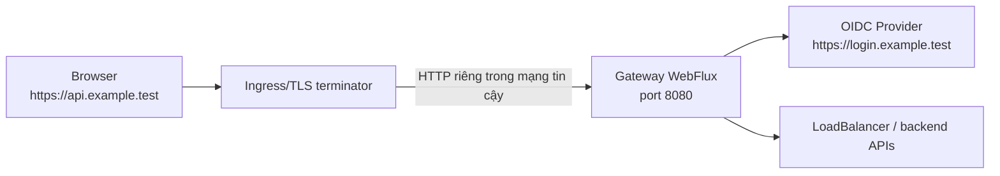

# Gateway làm OAuth 2.0 Client và đăng nhập bằng OpenID Connect

**Chương:** Phiên đăng nhập và token  
**Module:** `SPRING_CLOUD_GATEWAY` — Spring Cloud Gateway

Khi xây dựng API Gateway cho microservices, không phải lúc nào trình duyệt cũng mang sẵn một access token để gửi đến từng backend. Với một ứng dụng web dùng đăng nhập tập trung, **Spring Cloud Gateway Server WebFlux có thể đóng vai trò OAuth 2.0 Client**, đưa người dùng đến Identity Provider (IdP), xử lý callback, tạo phiên đăng nhập tại Gateway và sử dụng thông tin/token thích hợp để truy cập các API phía sau. Khi bổ sung **OpenID Connect (OIDC)**, Gateway có thể xác minh danh tính người dùng dựa trên **ID Token** và các thông tin OIDC chuẩn hóa.

Chủ đề này nằm ở ranh giới giữa **đăng nhập (authentication)**, **quản lý session** và **truyền quyền truy cập đến microservices**. Việc Gateway nhận diện người dùng không tự đồng nghĩa backend đã được cấp quyền cho mọi API; việc có ID Token cũng không có nghĩa có thể gửi ID Token thay access token xuống backend. Để vận hành an toàn, cần hiểu các luồng browser redirect, WebSession, OAuth 2.0 Authorized Client, TokenRelay, Resource Server, bảo mật cookie/CSRF, TLS, service discovery, retry, rate limiting và observability.

> **Phạm vi và giả định:** Bài học dùng **Spring Cloud Gateway Server WebFlux**, **Spring Security Reactive OAuth 2.0 Client** và **OIDC Authorization Code Flow**. Ví dụ Java sử dụng Spring Boot 3.x/Java 17+ và một Spring Cloud BOM tương thích; với Spring Boot 4.x hay release train khác, đối chiếu starter/config chính thức. Các URI và client ID của IdP bên dưới là **giá trị minh họa**, không phải một Identity Provider có thật đã được triển khai.

## 1. Mục tiêu học tập

Sau bài này, bạn có thể:

1. Phân biệt vai trò **OAuth 2.0 Client**, **Authorization Server/OIDC Provider**, **Resource Server** và **Resource Owner** trong hệ thống Gateway.
2. Giải thích **Authorization Code Flow**, state, redirect URI, PKCE và thời điểm OIDC ID Token được xác minh.
3. Phân biệt **ID Token**, **Access Token**, **Refresh Token** và **session cookie**; biết thông tin nào được dùng ở chặng nào.
4. Tạo một ứng dụng **Gateway WebFlux** với cấu hình `spring.security.oauth2.client.registration`, `issuer-uri` và `oauth2Login`.
5. Cấu hình `TokenRelay` cho route Gateway khi backend cần một access token phù hợp và hiểu các giới hạn về scope/audience.
6. Thiết kế bảo vệ phiên đăng nhập, CSRF, logout, CORS, TLS và secrets khi triển khai nhiều instance.
7. Chẩn đoán các lỗi phổ biến như redirect loop, `invalid_redirect_uri`, callback lỗi, `401`/`403`, token audience sai hoặc authorized client không được tìm thấy.

## 2. Phân biệt các vai trò OAuth 2.0 và OIDC

Một hệ thống điển hình có:

| Vai trò | Ví dụ | Trách nhiệm |
|---|---|---|
| **Resource Owner / End User** | Người dùng trên trình duyệt | Đăng nhập và cho phép các quyền truy cập phù hợp |
| **User Agent** | Trình duyệt | Đi theo redirect, giữ cookie session, gọi URL Gateway |
| **OAuth 2.0 Client** | **Gateway Server WebFlux** | Khởi tạo authorization request, nhận code, đổi code lấy token, quản lý authorized client |
| **Authorization Server / OIDC Provider** | Keycloak, một IdP OIDC doanh nghiệp | Xác thực user, công bố metadata/JWKs, cấp authorization code và token |
| **Resource Server** | `orders-service`, `profile-service` | Kiểm tra access token/scope/audience và phân quyền khi nhận API request |
| **API Gateway / Reverse Proxy** | Spring Cloud Gateway | Chọn route/predicate, áp filter, forward HTTP, giới hạn lưu lượng và quan sát |

Gateway có thể mang **hai vai trò đồng thời**: OAuth 2.0 Client ở bước đăng nhập và API Gateway ở bước định tuyến request. Backend Resource Server vẫn có vai trò bảo vệ tài nguyên; nó không cần biết mật khẩu của người dùng và không nên mặc định tin một header `X-User` do client tự gửi.

### 2.1. OAuth 2.0 không đồng nhất với OIDC

**OAuth 2.0** là framework ủy quyền truy cập tài nguyên: access token cho phép client thay mặt chủ thể truy cập một API trong phạm vi phù hợp. **OpenID Connect** là lớp nhận dạng xây trên OAuth 2.0, dùng `scope=openid` và **ID Token** để Client xác minh thông tin về sự kiện xác thực và danh tính người dùng theo giao thức OIDC.

Ví dụ:

- Gateway cần biết ai đang đăng nhập: OIDC login và ID Token giúp tạo `Authentication`.
- Gateway muốn gọi `orders-service`: có thể cần **Access Token dành cho orders API**, không phải ID Token.
- Gateway muốn duy trì đăng nhập giữa các lần nhấp trang: dùng **WebSession** và cookie tham chiếu phiên.
- Backend cần chắc user có quyền sửa đơn hàng: backend kiểm tra chính sách authorization của mình, không chỉ kiểm tra Gateway đã cho qua request.

### 2.2. Bốn vật mang thông tin rất khác nhau

| Loại | Ai cấp/tạo | Dùng cho | Không nên dùng để |
|---|---|---|---|
| **Authorization code** | Authorization Server | Client đổi tại token endpoint, tồn tại ngắn và dùng một lần | Gửi thẳng đến Resource Server như credential API |
| **ID Token** | OIDC Provider | Client xác minh danh tính user/audience client, issuer, chữ ký, thời gian | Thay thế access token để gọi API backend |
| **Access Token** | Authorization Server | Resource Server kiểm tra quyền truy cập API; token có thể opaque hoặc JWT | Đương nhiên chứng minh mọi quyền/đúng audience |
| **Refresh Token** (nếu được cấp) | Authorization Server | Client yêu cầu token mới theo policy | Chuyển thẳng cho browser/backend không có nhu cầu |
| **Gateway session cookie** | Gateway/WebSession | Browser gửi lại để Gateway tìm phiên đã xác thực | Gửi như bearer token đến API hoặc coi là bằng chứng quyền backend |

**Điểm thường gây nhầm:** ID Token có claim `sub`, `name`, `email`... nhưng thường có `aud` hướng đến **OIDC Client**; API backend cần access token theo audience/scope riêng. Gửi ID Token đến backend vì “nó cũng là JWT” là sai mô hình tin cậy.

## 3. Authorization Code + OIDC Login diễn ra như thế nào?

```mermaid
sequenceDiagram
    autonumber
    actor U as Browser/User
    participant G as Gateway OAuth2 Client
    participant I as OIDC Provider
    participant A as Backend API
    U->>G: GET /api/profile (chưa có session)
    G-->>U: 302 tới authorization endpoint
    U->>I: GET /authorize?client_id...&state...&scope=openid...
    I->>U: Hiển thị login/MFA/consent nếu cần
    U->>I: Hoàn tất xác thực
    I-->>U: Redirect về Gateway?code=...&state=...
    U->>G: GET /login/oauth2/code/gateway-oidc?code...&state...
    G->>I: POST /token (code, client authentication, PKCE nếu dùng)
    I-->>G: Access token + ID token (+ refresh token nếu cấp)
    G->>G: Kiểm tra state/ID token, tạo Authentication + WebSession
    G-->>U: Set-Cookie phiên và redirect đến tài nguyên ban đầu
    U->>G: GET /api/profile với session cookie
    G->>G: Security kiểm tra session; route + TokenRelay
    G->>A: GET /profile + Authorization: Bearer access-token
    A-->>G: JSON (nếu token/authorization hợp lệ)
    G-->>U: JSON response
```

Sơ đồ mô tả **hành vi khái niệm**; redirect ban đầu có thể qua `/oauth2/authorization/{registrationId}`, login page mặc định hoặc entry point do Security chọn. Các thông số OIDC trong authorization request và token validation được thư viện quản lý theo phiên bản, không được tự gán hằng số một cách tùy tiện.

### 3.1. State, nonce và PKCE bảo vệ phần nào?

- **`state`** gắn authorization request với callback để giảm nguy cơ OAuth login CSRF/code injection. Spring Security quản lý correlation của authorization request; không tự viết “state cố định”.
- **`nonce`** là cơ chế OIDC liên kết ID Token với authorization request, đặc biệt khi profile/flow yêu cầu. Để OIDC Client library chịu trách nhiệm tạo/kiểm tra theo giao thức thay vì chỉ parse JWT.
- **PKCE** dùng `code_challenge` và `code_verifier` để ràng buộc authorization code với client đã khởi tạo giao dịch, hữu ích để giảm rủi ro code interception/injection. Nên bật theo khuyến nghị hiện đại và yêu cầu IdP; cách Spring Security áp dụng PKCE có thể phụ thuộc loại client/cấu hình/release.
- **Redirect URI** cần khớp chính sách đăng ký tại IdP. Không dùng wildcard redirect tùy ý hoặc lấy redirect từ header/query chưa được xác minh.
- **Client secret** chỉ phù hợp với confidential client phía server; không gửi cho frontend JavaScript hoặc nhúng vào repository.

### 3.2. Browser không cần cầm access token trong mô hình session ở Gateway

Với mô hình thường gọi là **Backend for Frontend (BFF)**:

```text
Browser -- session cookie --> Gateway OAuth2 Client
                             | quản lý token tại server
                             |
                             +-- access token --> orders-service
                             +-- access token --> profile-service
```

Browser dùng cookie phiên để Gateway tìm `SecurityContext` và authorized client; không cần tự lưu access token trong `localStorage` để đưa vào mọi HTTP request. Mô hình này có thể giảm rủi ro token bị JavaScript truy cập, nhưng **không loại bỏ XSS, CSRF, session theft hay việc backend bị gọi trực tiếp**. Cookie và session vẫn phải được bảo vệ.

### 3.3. Gateway đăng nhập thành công không có nghĩa mọi route đều truy cập được

Sau callback thành công, một request có thể gặp:

- `401` nếu phiên không có/không hợp lệ hoặc backend không chấp nhận token;
- `403` nếu backend/authorization policy từ chối scope, role hoặc tài nguyên;
- `404` nếu route predicate/`StripPrefix` sai hoặc backend không có mapping;
- `502/503/504` hoặc lỗi tương ứng nếu network/discovery/backend không sẵn sàng.

Không coi một redirect OIDC hoàn tất là kiểm thử end-to-end của downstream authorization.

## 4. Các thành phần Spring Security liên quan

Trong **WebFlux reactive**, các loại object thường gặp:

| Thành phần | Vai trò |
|---|---|
| `SecurityWebFilterChain` / `ServerHttpSecurity` | Khai báo rules cho HTTP Security, login, OAuth2 client, CSRF/logout |
| `ReactiveClientRegistrationRepository` | Chứa metadata các OAuth 2.0/OIDC client registrations |
| `ClientRegistration` | Client ID, grant type, redirect URI, scopes, endpoints/provider |
| `ReactiveOAuth2AuthorizedClientService` hoặc `ServerOAuth2AuthorizedClientRepository` | Quản lý `OAuth2AuthorizedClient` và token gắn với principal/session theo cấu hình |
| `OAuth2AuthorizedClient` | Client registration cùng access/refresh token đã được cấp |
| `Authentication` / `OidcUser` | Principal sau đăng nhập và dữ liệu nhận dạng đã được xác minh |
| `WebSession` | Phiên reactive phía server, thông thường browser tham chiếu bằng cookie |
| Gateway `TokenRelay` | Chuyển access token phù hợp sang request backend khi route được chọn |

**Không nhầm WebFlux và Servlet API:** ở Gateway Server WebFlux không sử dụng `HttpSecurity`, `SecurityFilterChain` hoặc `HttpSession` như cấu hình chính của một Gateway MVC/Servlet. Với WebFlux, dùng `ServerHttpSecurity` và `SecurityWebFilterChain`.

## 5. Chuẩn bị một OIDC Provider và đăng ký Client

Bạn cần một **OIDC Provider thực sự** hỗ trợ Authorization Code Flow, ví dụ IdP quản lý nội bộ hoặc một môi trường Keycloak được cấp cho lab. Không thể chạy riêng Gateway rồi gọi URL ví dụ `https://login.example.test` và mong đăng nhập thành công.

Đăng ký một confidential web client với các giá trị minh họa:

| Thuộc tính ở IdP | Giá trị ví dụ |
|---|---|
| Issuer | `https://login.example.test/realms/demo` |
| Client ID | `gateway-bff` |
| Client secret | Cấp trong IdP, lưu bằng secret manager/environment variable |
| Grant type | Authorization Code |
| OIDC scopes | `openid profile email` |
| Redirect URI cho lab | `http://localhost:8080/login/oauth2/code/gateway-oidc` |
| Redirect URI production | `https://api.example.test/login/oauth2/code/gateway-oidc` |
| Allowed origins / web origins | Cấu hình theo các frontend thực sự cần, không dùng wildcard không kiểm soát |
| PKCE | Bật/yêu cầu theo chính sách IdP và khả năng client |

**Issuer URI** là định danh có tính bảo mật, không chỉ là một hostname ngẫu nhiên. OIDC discovery thường xuất metadata tại địa chỉ tương ứng với `/.well-known/openid-configuration` theo chuẩn, bao gồm authorization endpoint, token endpoint, JWKS URI và các cấu hình được hỗ trợ. Spring Security có thể sử dụng metadata đó qua `issuer-uri`.

Trước khi cấu hình Gateway, xác nhận:

1. Trình duyệt và Gateway có thể truy cập đúng IdP (DNS/TLS/cổng).
2. Issuer chính xác trùng với giá trị `iss` trong ID Token.
3. Client ID, secret, redirect URIs đã được IdP chấp thuận.
4. IdP có người dùng thử hoặc cơ chế login/MFA hoạt động.
5. IdP cấp access token phù hợp **API backend** nếu dự định dùng `TokenRelay`; có thể cần đăng ký audience/scope riêng cho API.

Không đưa client secret, refresh token hoặc access token thật vào Markdown, commit, build logs hoặc screenshot công khai.

## 6. Dựng Gateway Server WebFlux với OAuth2 Client/OIDC Login

Tạo **ứng dụng Gateway riêng** tại `http://localhost:8080`, package ví dụ `com.example.gateway`. Chọn Spring Boot và Spring Cloud release train tương thích, quản lý các version qua Spring Cloud BOM. Với Spring Cloud 2025.0+ và các dòng Gateway tương ứng, dependency Maven có thể khai báo:

```xml
<dependencies>
    <dependency>
        <groupId>org.springframework.cloud</groupId>
        <artifactId>spring-cloud-starter-gateway-server-webflux</artifactId>
    </dependency>
    <dependency>
        <groupId>org.springframework.boot</groupId>
        <artifactId>spring-boot-starter-security</artifactId>
    </dependency>
    <dependency>
        <groupId>org.springframework.boot</groupId>
        <artifactId>spring-boot-starter-oauth2-client</artifactId>
    </dependency>
</dependencies>
```

Không thêm `spring-boot-starter-web` vào Gateway WebFlux chỉ để hỗ trợ login; nó kéo theo Servlet/MVC stack và có thể làm lệch web application type, cấu hình bảo mật hoặc bản Gateway mà bạn dự kiến sử dụng.

### 6.1. Đăng ký OAuth 2.0 Client trong `application.yml`

Ví dụ dành cho Gateway tại cổng `8080`:

```yaml
server:
  port: 8080

spring:
  application:
    name: oidc-gateway-lab

  security:
    oauth2:
      client:
        registration:
          gateway-oidc:
            provider: demo-idp
            client-id: gateway-bff
            client-secret: ${OIDC_CLIENT_SECRET}
            authorization-grant-type: authorization_code
            redirect-uri: "{baseUrl}/login/oauth2/code/{registrationId}"
            scope:
              - openid
              - profile
              - email
        provider:
          demo-idp:
            issuer-uri: https://login.example.test/realms/demo

  cloud:
    gateway:
      server:
        webflux:
          routes:
            - id: profile-api
              uri: http://localhost:8081
              predicates:
                - Path=/api/profile/**
              filters:
                - StripPrefix=2
                - TokenRelay
                - RemoveRequestHeader=Cookie

            - id: public-ping
              uri: http://localhost:8081
              predicates:
                - Path=/api/public/**
              filters:
                - StripPrefix=2
```

**Đừng chạy nguyên file này mà chưa có IdP và secret phù hợp.** `login.example.test` là hostname ví dụ; phải thay bằng issuer thật được IdP công bố. Đặt biến môi trường `OIDC_CLIENT_SECRET` từ secret manager hoặc cấu hình bảo mật của môi trường chạy, không commit secret dưới dạng literal.

Đọc từng nhóm:

| Trường | Ý nghĩa |
|---|---|
| `registration.gateway-oidc` | ID nội bộ của client registration; xuất hiện trong URL khởi tạo/callback login |
| `provider: demo-idp` | Nối registration tới cấu hình provider |
| `client-id` và `client-secret` | Danh tính/credential của confidential client ở IdP |
| `authorization-grant-type: authorization_code` | Dùng Authorization Code Flow |
| `redirect-uri` | Callback mà IdP redirect code về, phải khớp allowlist tại IdP |
| `scope: openid` | Yêu cầu OIDC login và ID Token, các scope khác theo policy |
| `issuer-uri` | Lấy metadata OIDC và làm căn cứ kiểm tra issuer/token |
| `Path=/api/profile/**` | Đường public dành cho API cần đăng nhập |
| `StripPrefix=2` | `/api/profile/me` → `/me` tại backend |
| `TokenRelay` | Lấy access token của authorized client phù hợp và đặt vào request downstream |
| `RemoveRequestHeader=Cookie` | Không gửi cookie session browser xuống backend trong mô hình backend bearer-only |
| `public-ping` | Route kiểm tra kết nối công khai, không chuyển token |

Khi dùng các bản Spring Cloud Gateway cũ, prefix route có thể là `spring.cloud.gateway.routes` và tên starter có thể khác. Đừng trộn prefix mới với bản cũ; chọn tài liệu ứng với chính xác Gateway Server WebFlux trong dự án.

### 6.2. Cấu hình SecurityWebFilterChain

Tạo `GatewaySecurityConfiguration.java`:

```java
package com.example.gateway;

import org.springframework.context.annotation.Bean;
import org.springframework.context.annotation.Configuration;
import org.springframework.security.config.Customizer;
import org.springframework.security.config.annotation.web.reactive.EnableWebFluxSecurity;
import org.springframework.security.config.web.server.ServerHttpSecurity;
import org.springframework.security.web.server.SecurityWebFilterChain;

@Configuration
@EnableWebFluxSecurity
public class GatewaySecurityConfiguration {

    @Bean
    SecurityWebFilterChain securityWebFilterChain(ServerHttpSecurity http) {
        return http
            .authorizeExchange(exchanges -> exchanges
                .pathMatchers("/", "/public/**", "/api/public/**")
                    .permitAll()
                .pathMatchers("/api/profile/**", "/me")
                    .authenticated()
                .anyExchange()
                    .authenticated())
            .oauth2Login(Customizer.withDefaults())
            .oauth2Client(Customizer.withDefaults())
            .build();
    }
}
```

Giải thích:

- `@EnableWebFluxSecurity` và `ServerHttpSecurity` dành cho reactive security.
- `authorizeExchange` quy định đường công khai và đường phải xác thực; đây là **bảo vệ tại Gateway**, không thay thế authorization ở backend.
- `oauth2Login` bật cơ chế đăng nhập qua OAuth 2.0/OIDC redirect, callback và tạo `Authentication`.
- `oauth2Client` hỗ trợ sử dụng OAuth 2.0 Authorized Client từ ứng dụng reactive.
- Chúng ta **không tắt CSRF** trong ví dụ. Spring Security có CSRF protection cho các request thay đổi trạng thái khi dùng cookie/session. Lab tập trung vào `GET` để tránh đưa một form submit thiếu CSRF token vào đường thực hành.

Nếu ứng dụng chứa nhiều `ClientRegistration`, lựa chọn provider/login entry point hoặc default login page có thể cần cấu hình thêm. Trong bài lab chỉ đăng ký một provider để quan sát rõ đường redirect.

### 6.3. Thêm controller nhỏ để quan sát principal tại Gateway

Trong package `com.example.gateway`, tạo:

```java
package com.example.gateway;

import java.util.Map;
import org.springframework.security.core.annotation.AuthenticationPrincipal;
import org.springframework.security.oauth2.core.oidc.user.OidcUser;
import org.springframework.web.bind.annotation.GetMapping;
import org.springframework.web.bind.annotation.RestController;

@RestController
public class GatewaySessionController {

    @GetMapping("/")
    public Map<String, String> index() {
        return Map.of(
            "service", "oidc-gateway-lab",
            "login", "/oauth2/authorization/gateway-oidc",
            "protected", "/me");
    }

    @GetMapping("/me")
    public Map<String, String> me(@AuthenticationPrincipal OidcUser user) {
        return Map.of(
            "service", "gateway",
            "subject", user.getIdToken().getSubject(),
            "issuer", user.getIdToken().getIssuer().toString());
    }
}
```

Với `/me`, Security yêu cầu xác thực nên sau khi login OIDC thành công, controller được gọi với `OidcUser`. Chỉ trả **subject và issuer minh họa** để quan sát; trong hệ thống thật, `sub` là định danh người dùng nên cần xem chính sách dữ liệu cá nhân và hạn chế lộ thông tin.

Đừng trả `user.getIdToken().getTokenValue()`, access token, refresh token, full claims hay session ID cho browser chỉ để “dễ debug”. Đăng nhập và token validation đã do thư viện thực hiện ở phía server; JSON đầu ra không cần chứa credential.

### 6.4. URL login và redirect URI chuẩn

Với registration ID `gateway-oidc`, Spring Security có các đường đi thường dùng:

```text
Khởi tạo authorization:
  GET http://localhost:8080/oauth2/authorization/gateway-oidc

OIDC Provider redirect về:
  GET http://localhost:8080/login/oauth2/code/gateway-oidc?code=...&state=...

URL được bảo vệ:
  GET http://localhost:8080/me

Gateway route sau khi đăng nhập:
  GET http://localhost:8080/api/profile/me
```

Các URL login/callback này thuộc **Spring Security OAuth 2.0 Login**, không cần khai báo thành route Gateway tới backend. Chỉ cấp URI callback hợp lệ cho IdP đã tin cậy, không đưa authorization code/state lên log hoặc gửi cho hệ thống khác.

## 7. Backend Resource Server: nhận Access Token, không nhận session cookie

Trong mô hình demo, backend `profile-service` tại `http://localhost:8081` tự xác minh bearer access token. Đây là một ứng dụng Spring Boot **Spring MVC** riêng (có thể dùng WebFlux, nhưng ví dụ chọn MVC để dễ phân biệt), không dùng chung SecurityWebFilterChain của Gateway.

### 7.1. Dependencies và cấu hình backend

Tạo dự án backend với `Spring Web`, `Spring Security` và `OAuth2 Resource Server`:

```xml
<dependencies>
    <dependency>
        <groupId>org.springframework.boot</groupId>
        <artifactId>spring-boot-starter-web</artifactId>
    </dependency>
    <dependency>
        <groupId>org.springframework.boot</groupId>
        <artifactId>spring-boot-starter-security</artifactId>
    </dependency>
    <dependency>
        <groupId>org.springframework.boot</groupId>
        <artifactId>spring-boot-starter-oauth2-resource-server</artifactId>
    </dependency>
</dependencies>
```

`application.yml` **của backend**:

```yaml
server:
  port: 8081

spring:
  application:
    name: profile-service
  security:
    oauth2:
      resourceserver:
        jwt:
          issuer-uri: https://login.example.test/realms/demo
```

Backend ở ví dụ này kỳ vọng **JWT access token** do IdP phát hành và có issuer phù hợp. Một IdP có thể phát hành **opaque access token**, khi đó backend phải dùng introspection hoặc cách xác thực tương ứng, không thể giả định mọi access token là JWT. Với JWT, Spring Security dùng issuer/JWKS để kiểm tra chữ ký, thời hạn và các điều kiện chuẩn; **kiểm tra audience API cần được bổ sung theo policy** nếu chưa được cấu hình.

### 7.2. Cấu hình SecurityFilterChain cho backend MVC

`ProfileBackendApplication.java`:

```java
package com.example.profile;

import org.springframework.boot.SpringApplication;
import org.springframework.boot.autoconfigure.SpringBootApplication;

@SpringBootApplication
public class ProfileBackendApplication {
    public static void main(String[] args) {
        SpringApplication.run(ProfileBackendApplication.class, args);
    }
}
```

`ResourceServerSecurityConfiguration.java`:

```java
package com.example.profile;

import org.springframework.context.annotation.Bean;
import org.springframework.context.annotation.Configuration;
import org.springframework.security.config.Customizer;
import org.springframework.security.config.annotation.web.builders.HttpSecurity;
import org.springframework.security.web.SecurityFilterChain;

@Configuration
public class ResourceServerSecurityConfiguration {

    @Bean
    SecurityFilterChain securityFilterChain(HttpSecurity http)
            throws Exception {
        return http
            .authorizeHttpRequests(auth -> auth
                .requestMatchers("/ping").permitAll()
                .anyRequest().authenticated())
            .oauth2ResourceServer(oauth2 ->
                oauth2.jwt(Customizer.withDefaults()))
            .build();
    }
}
```

Trong backend MVC, dùng `HttpSecurity` và `SecurityFilterChain` — **khác với** reactive `ServerHttpSecurity` và `SecurityWebFilterChain` của Gateway.

### 7.3. Controller phân biệt public và protected

`ProfileController.java`:

```java
package com.example.profile;

import java.util.Map;
import org.springframework.security.core.annotation.AuthenticationPrincipal;
import org.springframework.security.oauth2.jwt.Jwt;
import org.springframework.web.bind.annotation.GetMapping;
import org.springframework.web.bind.annotation.RestController;

@RestController
public class ProfileController {

    @GetMapping("/ping")
    public Map<String, String> ping() {
        return Map.of("service", "profile-backend", "status", "OK");
    }

    @GetMapping("/me")
    public Map<String, String> me(@AuthenticationPrincipal Jwt jwt) {
        return Map.of(
            "service", "profile-backend",
            "subject", jwt.getSubject(),
            "issuer", jwt.getIssuer().toString());
    }
}
```

Đường `/ping` là public theo config backend; `/me` chỉ xử lý khi access token đã được backend xác minh và request đủ quyền theo cấu hình. Đây là **mô hình tối thiểu** để quan sát đường đi. Với production, cần thêm authorization theo scope/role/tenant, **đặc biệt là kiểm tra audience dành cho backend** và policy token lifetime/issuer.

### 7.4. Token audience là một ranh giới bảo mật

Đăng nhập OIDC thành công có thể cung cấp access token vốn được cấp cho một resource khác, ví dụ userinfo endpoint hoặc một API của IdP. Nếu backend nhận token đó mà không kiểm tra **`aud`** hoặc scope phù hợp, một token dành cho dịch vụ A có nguy cơ bị dùng ngoài ý định ở dịch vụ B.

Vì vậy, hãy cấu hình IdP phát hành access token **dành cho profile API**, yêu cầu scope hợp lệ và áp các kiểm tra ở Resource Server. Cấu hình `issuer-uri` là quan trọng nhưng **không đủ để khẳng định mọi token cùng issuer được phép gọi mọi API**.

Nếu IdP của lab không cấp token có audience phù hợp, **đừng tắt audience validation của production chỉ để bài demo chạy**. Thay vào đó, đăng ký resource/audience/scope phù hợp trong IdP hoặc dùng token exchange được thiết kế rõ ràng.

## 8. Thực hành end-to-end: đăng nhập ở Gateway rồi gọi backend

Để chạy lab hoàn chỉnh, cần có **ba tiến trình/dịch vụ**:

| Thành phần | Địa chỉ ví dụ | Yêu cầu |
|---|---|---|
| OIDC Provider | `https://login.example.test/realms/demo` (thay bằng IdP thật) | Đã đăng ký client, redirect URI, token scopes/audience |
| Gateway WebFlux | `http://localhost:8080` | Có OAuth2 Client registration, SecurityWebFilterChain, route TokenRelay |
| Backend Resource Server | `http://localhost:8081` | Có `/ping` và `/me`, xác minh access token |

Khởi động IdP hoặc bảo đảm môi trường IdP có thể truy cập từ Gateway; rồi khởi động backend và Gateway. Ở một số phiên bản, việc cấu hình `issuer-uri` có thể yêu cầu tải OIDC discovery metadata khi khởi tạo, nên IdP không truy cập được có thể làm ứng dụng **không khởi động**, chứ không chỉ gây lỗi khi người dùng nhấp login.

### 8.1. Bước 1 — Kiểm tra backend public

```bash
curl -i http://localhost:8081/ping
```

Kỳ vọng backend trả JSON:

```json
{"service":"profile-backend","status":"OK"}
```

Sau đó thử API bảo vệ **không có token**:

```bash
curl -i http://localhost:8081/me
```

Backend Resource Server thường trả `401 Unauthorized` vì thiếu bearer token. Nếu `/me` trả thông tin người dùng khi request không có credential, hãy kiểm tra `SecurityFilterChain`: đó là một lỗ hổng cấu hình chứ không phải trạng thái chuẩn để lab tiếp tục.

### 8.2. Bước 2 — Kiểm tra route public qua Gateway

```bash
curl -i http://localhost:8080/
curl -i http://localhost:8080/api/public/ping
```

Lệnh thứ nhất do controller nội bộ Gateway trả thông tin lab. Lệnh thứ hai được route `public-ping` đưa đến backend `/ping` vì `StripPrefix=2`. Không cần đăng nhập cho hai URL này theo cấu hình `authorizeExchange`.

Nếu public ping đã lỗi, chưa nên debug OIDC: kiểm tra port `8080/8081`, route predicates, YAML prefix và mạng trước. Gateway nằm trong container Docker không thể dùng `localhost:8081` để liên hệ một container backend khác; cần dùng tên dịch vụ trong mạng Docker/Kubernetes.

### 8.3. Bước 3 — Quan sát redirect trước khi có session

```bash
curl -i http://localhost:8080/me
curl -i http://localhost:8080/api/profile/me
```

Trong mô hình browser login ở lab, request chưa đăng nhập thường được redirect đến bước OAuth2 login qua mã `3xx`. Địa chỉ `Location` thực tế phụ thuộc entry point/login page và client registration; không cố định nó phải đúng một URL trong mọi phiên bản.

**Không dùng `curl -L` rồi kỳ vọng tự hoàn tất OIDC login.** Authorization Code Flow cần trình duyệt/IdP login, state và cookie tương quan; chỉ theo redirect HTTP không tự điền form, làm MFA hoặc xử lý consent.

### 8.4. Bước 4 — Đăng nhập bằng browser

1. Mở `http://localhost:8080/me` trong trình duyệt.
2. Gateway chuyển đến IdP (có thể thông qua trang chọn login/authorization endpoint).
3. Đăng nhập bằng **tài khoản thử của IdP**; thực hiện MFA/consent nếu môi trường yêu cầu.
4. IdP trả code/state về `http://localhost:8080/login/oauth2/code/gateway-oidc` theo redirect URI đã đăng ký.
5. Gateway trao đổi code lấy token, xác minh OIDC login rồi tạo phiên.
6. Trình duyệt trở về `/me`; JSON có `subject` và `issuer` (không chứa token).

Trong DevTools Network có thể thấy nhiều request redirect và response có `Set-Cookie` cho phiên. **Không chụp ảnh hoặc chia sẻ nguyên code/state, cookie/session ID, token endpoint response hoặc token values**.

Nếu callback trả lỗi, kiểm tra URL callback thực nhận, phiên lưu authorization request, time skew, issuer/JWKS và HTTPS/host/port thay vì chỉ sửa route backend.

### 8.5. Bước 5 — Gọi backend qua TokenRelay

Trong **cùng browser đang có phiên**, mở:

```text
http://localhost:8080/api/profile/me
```

Luồng dự kiến:

```text
Browser GET /api/profile/me + session cookie
   -> Gateway: khôi phục Authentication từ WebSession
   -> Route profile-api: Path=/api/profile/**
   -> StripPrefix=2: /api/profile/me -> /me
   -> TokenRelay: lấy OAuth2 authorized client's access token
   -> RemoveRequestHeader=Cookie: loại cookie browser khỏi request backend
   -> Backend GET /me + Authorization: Bearer <access token>
   -> Backend validate issuer, signature, lifetime, audience/scope theo policy
   -> Backend trả JSON; Gateway trả lại browser
```

Nếu backend được IdP cấp đúng access token dành cho API và cấu hình Resource Server khớp, response có thể là:

```json
{
  "service": "profile-backend",
  "subject": "test-user-subject",
  "issuer": "https://login.example.test/realms/demo"
}
```

**Giá trị subject và issuer trong JSON chỉ là ví dụ**, không phải kỳ vọng mọi IdP phát chính xác như vậy. Đặc biệt, `TokenRelay` chuyển **access token**, không phải ID Token và không phải cookie session của browser.

Nếu `/me` tại Gateway thành công nhưng `/api/profile/me` thất bại, hãy tách:

- **Session/OIDC login:** đã chứng minh Gateway biết user.
- **Authorized client/access token:** Gateway có token để chuyển hay không?
- **API token contract:** backend có chấp nhận issuer, chữ ký, audience và scope không?
- **Route/network:** `StripPrefix` và kết nối `8081` có đúng không?

### 8.6. Bước 6 — Thử không có cookie hoặc đăng xuất

Mở cửa sổ private/incognito không có phiên hoặc dùng `curl -i` không có cookie để gọi `/api/profile/me`. Gateway nên yêu cầu đăng nhập theo cấu hình. Cửa sổ browser cũ có cookie hợp lệ vẫn có thể truy cập cho đến khi session hết hạn/được vô hiệu hóa.

Để thử logout, dùng cơ chế logout **được Security hỗ trợ** và đúng CSRF policy; không coi thao tác chỉ xóa một cookie trong DevTools là full OIDC single logout hoặc revocation của access/refresh token.

## 9. TokenRelay: chuyển token nào và khi nào?

`TokenRelay` là một GatewayFilter factory trong Spring Cloud Gateway Server WebFlux; nó kết hợp với các thành phần OAuth2 Client của Spring Security để lấy access token đã được cấp cho authorized client và đặt vào request downstream.

### 9.1. Route có và không có TokenRelay

```yaml
spring:
  cloud:
    gateway:
      server:
        webflux:
          routes:
            - id: profile-protected
              uri: http://localhost:8081
              predicates:
                - Path=/api/profile/**
              filters:
                - StripPrefix=2
                - TokenRelay

            - id: static-public
              uri: http://localhost:8081
              predicates:
                - Path=/api/public/**
              filters:
                - StripPrefix=2
```

Đừng bật `TokenRelay` mặc định cho mọi tuyến mà chưa có chủ đích. Một route đến service bên thứ ba hoặc backend không thuộc phạm vi audience của token **không nên nhận access token của người dùng** chỉ vì Gateway đã có token.

### 9.2. Có hoặc không có clientRegistrationId

| Dạng | Ý nghĩa khái niệm |
|---|---|
| `TokenRelay` không có tham số | Tìm authorized client/access token gắn với người dùng đã xác thực theo cơ chế Spring Security/Gateway |
| `TokenRelay=some-client-registration` | Chỉ định một client registration để lấy token bằng authorized client manager phù hợp, nếu phiên bản và grant đã cấu hình hỗ trợ |

Dạng thứ hai có thể phù hợp với use case machine-to-machine/client credentials, nhưng **không đồng nghĩa** tự “biến token đăng nhập user thành token của service”. Grant, scopes, principal, repository/service và cách authorization phải được cấu hình phù hợp. Token client credentials biểu diễn **client/service**, không phải tự mang danh tính người dùng như Authorization Code Flow.

### 9.3. Nếu không có authorized client thì sao?

Không mặc định mọi `Authentication` đều đi kèm một `OAuth2AuthorizedClient` sẵn sàng. Ví dụ:

- Request đã được xác thực bằng một cơ chế không phải OAuth2 login;
- Authorized client đã mất khỏi session/store;
- Token đã hết hạn, refresh thất bại hoặc IdP không cho refresh;
- Có nhiều registrations và filter tra cứu nhầm registration;
- OAuth2 client manager/repository không được cấu hình hoặc không truy cập được.

Hậu quả có thể là request downstream không có bearer token hoặc filter/security báo lỗi tùy phiên bản và tình huống. Backend trả `401` không nhất thiết có nghĩa callback OIDC thất bại.

### 9.4. TokenRelay không phải token exchange

**Token relay** thường chuyển một access token đã có đến backend. **Token exchange/on-behalf-of** là thao tác yêu cầu Authorization Server cấp token mới cho resource/audience khác, có policy riêng. Khi một access token của client `gateway-bff` không dành cho `orders-service`, đừng cố sửa bằng cách chuyển ID Token hoặc bỏ qua audience; cần thiết kế scopes/audience đúng hoặc tích hợp token exchange theo IdP.

### 9.5. Không dùng Authorization header do browser tự gửi để mạo danh

Trong mô hình browser + WebSession, Gateway xác định user bằng session đã đăng nhập. Nếu client tự gửi `Authorization: Bearer xyz` song song với cookie, phải xác định rõ Security chain và downstream policy sẽ xử lý trường nào. Không tạo tình trạng backend dùng header client tự khai khi Gateway tưởng rằng TokenRelay luôn ghi đè thành giá trị đáng tin.

Khi cần tách session-browser endpoints và machine-to-machine bearer endpoints, thiết kế các security chains/routes rõ ràng, test header forwarding và không dùng cùng một cơ chế auth cho tất cả request theo giả định.

## 10. WebSession và Authorized Client: lưu ở đâu?

OIDC login tạo `Authentication` được dùng trên các request sau; trong mô hình stateful, WebFlux có `WebSession` và trình duyệt thường giữ **session ID cookie** để tìm lại trạng thái phiên phía server.

```text
Browser
  Cookie: SESSION=<opaque-session-id>
             |
             v
Gateway WebSession store
  |- SecurityContext / authenticated principal
  |- OAuth2 authorization request state (trong giai đoạn login)
  |- Authorized client / token storage theo cấu hình
  +- Thông tin phiên, thời gian hết hạn, CSRF state (theo cơ chế)
             |
             v
TokenRelay dùng access token phù hợp để gọi backend
```

Nội dung chính xác nằm ở WebSession, repository hay service nào phụ thuộc Spring Security/Spring Session và cấu hình phiên bản. **Không mặc định token luôn nằm trực tiếp trong cookie hoặc luôn nằm cùng một object trong WebSession.** Cookie browser thông thường chứa ID phiên, không phải toàn bộ token dưới dạng plaintext.

### 10.1. Vì sao một replica Gateway có thể login được nhưng request sau lỗi?

Ở lab một instance, WebSession lưu local memory có thể đủ để quan sát flow. Khi Gateway scale ngang:

1. Browser login qua instance A, state/authorized client lưu ở bộ nhớ của A.
2. Callback hoặc request tiếp theo đến instance B.
3. Nếu không có lưu trữ phiên chia sẻ hoặc routing/sticky session phù hợp, B có thể không tìm được state/session, gây redirect loop hoặc callback lỗi.

Trong production, hãy xem xét **Spring Session với store dùng chung** (ví dụ Redis) và repository/service lưu authorized clients phù hợp, thiết kế TTL, serialization, encryption/secret management, HA và xóa session. Sticky sessions có thể che một số triệu chứng nhưng không thay thế thiết kế nhất quán hoặc failover.

### 10.2. Bảo vệ cookie phiên

| Thuộc tính/chính sách | Mục đích |
|---|---|
| `Secure` | Chỉ gửi cookie trên HTTPS theo chính sách browser |
| `HttpOnly` | Giảm khả năng JavaScript trực tiếp đọc cookie |
| `SameSite` | Kiểm soát cách cookie đi cùng cross-site requests; cân bằng với login redirects |
| `Path` / `Domain` | Giới hạn phạm vi cookie gửi đến các URL/host |
| TTL và idle timeout | Hạn chế thời gian tồn tại session |
| Session ID rotation | Giảm rủi ro session fixation khi đổi trạng thái xác thực |
| CSRF protection | Bảo vệ các thao tác thay đổi trạng thái dùng cookie auth |

Không mặc định mọi thuộc tính đều có giá trị bảo mật tối ưu chỉ vì ứng dụng chạy Spring Security. Kiểm tra `Set-Cookie` thực tế trên HTTPS/behind proxy và chính sách cookie của framework/ingress.

### 10.3. CSRF vẫn quan trọng trong BFF/session model

Một trình duyệt tự gửi cookie phiên cho Gateway theo scope browser cho phép; vì thế các thao tác `POST/PUT/PATCH/DELETE` có thể bị khai thác CSRF nếu không có cơ chế bảo vệ phù hợp. **CORS không thay thế CSRF protection.** Ngay cả khi browser chặn JavaScript đọc response, một số cross-site requests vẫn có thể gây side effect.

Trong cấu hình Gateway mẫu, ta để CSRF ở giá trị mặc định phù hợp của Spring Security. Khi xây SPA gửi POST JSON, cần tích hợp CSRF token/cookie/header theo cơ chế **Reactive Spring Security** hoặc thiết kế stateless authentication khác với threat model tương ứng; không tắt `csrf()` một cách máy móc để “sửa lỗi 403”.

### 10.4. Kết thúc WebSession khác kết thúc phiên IdP

Logout tại Gateway thường bao gồm xóa `SecurityContext` và hủy WebSession. Nhưng người dùng có thể vẫn còn **SSO session tại IdP**: sau khi nhấp login lại, IdP có thể xác thực gần như ngay lập tức mà không cần nhập mật khẩu. Tương tự, access token đã cấp có thể tiếp tục hợp lệ đến khi hết hạn hoặc bị thu hồi theo cơ chế IdP.

Nếu sản phẩm yêu cầu logout đồng bộ, nghiên cứu **OIDC RP-Initiated Logout** và `OidcClientInitiatedServerLogoutSuccessHandler` của Spring Security Reactive (khi provider hỗ trợ), kèm post-logout redirect URI hợp lệ. Không coi xóa cookie của Gateway là mặc định revocation token hoặc logout toàn bộ ứng dụng SSO.

## 11. Gateway sau reverse proxy: redirect URI, HTTPS và forwarded headers

Trong production, kiến trúc có thể là:



Vấn đề: browser truy cập `https://api.example.test` nhưng Gateway chỉ nhìn thấy local request với scheme `http`, host nội bộ hoặc port `8080`. Nếu Gateway tự tạo callback:

```text
http://gateway-internal:8080/login/oauth2/code/gateway-oidc
```

thay vì URI đã đăng ký tại IdP:

```text
https://api.example.test/login/oauth2/code/gateway-oidc
```

IdP có thể từ chối với lỗi `invalid_redirect_uri` hoặc browser không thể truy cập callback.

### 11.1. Cấu hình base URL đáng tin

Spring Security hỗ trợ redirect URI template `{baseUrl}/login/oauth2/code/{registrationId}`. `{baseUrl}` phải phản ánh URL **mà browser nhìn thấy**. Một số triển khai Spring Boot/WebFlux sau proxy dùng forwarded headers cùng cấu hình phù hợp, ví dụ:

```yaml
server:
  forward-headers-strategy: framework
```

**Cảnh báo:** Chỉ dùng forwarded headers khi reverse proxy phía trước **đáng tin** và có chính sách **xóa/ghi đè các header `Forwarded` / `X-Forwarded-*` do client bên ngoài tự khai**. Nếu mọi client được quyền tùy ý gửi `X-Forwarded-Host` hay `X-Forwarded-Proto`, việc tin các header này để tạo redirect URI có thể dẫn tới open redirect, sai hostname hoặc các lỗ hổng phụ thuộc cấu hình.

Trong một số môi trường, thay vì suy ra URL từ forwarded headers, có thể cấu hình external redirect URI cố định đúng hostname/TLS theo contract. Nếu cần path prefix ở proxy, phải đối chiếu thêm `X-Forwarded-Prefix`, base path và đường callback thực đến Gateway.

### 11.2. Bảo vệ từng chặng TLS

- **Browser → Gateway/Ingress:** bắt buộc HTTPS cho production login/session; cookie `Secure`, HSTS và domain/path đúng policy.
- **Gateway → IdP:** xác minh TLS certificate/hostname, truststore, issuer/JWKS. Đừng tắt certificate validation để xử lý lỗi bắt tay.
- **Gateway → Backend:** có thể dùng `https://...` hoặc `lb://...` với instance secure/mTLS tùy mô hình zero-trust. Bảo vệ HTTP downstream riêng với bảo vệ callback.
- **IdP → Browser:** redirect phải là URL hợp lệ, được IdP allowlist; code/state là dữ liệu nhạy cảm dù chỉ tồn tại ngắn.

Chọn `uri: lb://profile-service` thay vì `http://localhost:8081` chỉ thay cách tìm instance; nó không tự thiết lập TLS, OAuth2 Client, phiên đăng nhập hay audience token.

### 11.3. CORS khi frontend khác origin

Nếu frontend JavaScript chạy ở `https://app.example.test` còn Gateway tại `https://api.example.test`, browser thực hiện **cross-origin** request dù hai host cùng tổ chức. Với session cookie:

1. Frontend dùng fetch `credentials: "include"` nếu cần gửi cookie phù hợp.
2. Gateway cần CORS allowlist **origin cụ thể**, không dùng `allowedOrigins: "*"` với `allowCredentials: true`.
3. Browser còn áp chính sách cookie `SameSite`, `Secure`, domain/path và quyền riêng tư.
4. CORS preflight `OPTIONS` phải được xử lý đúng trước auth bắt buộc nếu policy cần; một `GatewayFilter` gắn route có thể không chạy khi preflight không khớp `Method` predicate.
5. Không cho phép origin chỉ vì client tự gửi header `Origin`: các HTTP clients ngoài browser có thể giả lập header này.

Để giảm độ phức tạp, kiến trúc BFF có thể phục vụ frontend và Gateway API **cùng origin** hoặc qua cùng reverse proxy path. Dù vậy, vẫn cần CSRF/XSS protection và kiểm soát cookie.

## 12. Thiết kế các ranh giới bảo mật

OIDC login chỉ là một phần của hệ thống an toàn:

| Ranh giới | Dữ liệu/tác vụ | Biện pháp chính |
|---|---|---|
| **Browser → Gateway** | Session cookie, request API | HTTPS, Secure/HttpOnly/SameSite, CSRF, session timeout, XSS mitigation |
| **Gateway → IdP** | Authorization code, client secret, token exchange | PKCE/state/nonce theo giao thức, redirect URI allowlist, TLS, bảo vệ secrets |
| **Gateway → Backend** | Access token và request đã định tuyến | Audience/scope/token policy, TLS/mTLS, Route/TokenRelay chính xác |
| **Backend → Resource** | Nghiệp vụ đơn hàng, hồ sơ | Authorization tại backend, tenant isolation, audit và validation |
| **Logs/traces/metrics** | Route ID, status, principal/correlation metadata | Redaction, quyền truy cập, retention, cardinality limit |
| **Nhiều Gateway replica** | Session/auth request/token store | Distributed session phù hợp, availability, TTL, failover |

### 12.1. Gateway xác thực không cho phép backend bỏ mọi kiểm tra

Một backend có thể chỉ được mạng nội bộ cho Gateway truy cập; dù vậy, quyền **đọc hồ sơ người dùng A** hay **sửa đơn hàng của người dùng B** phải được backend thực thi theo dữ liệu đáng tin. Nếu backend nhận bearer token, nên xác minh issuer, signature, audience, thời gian, scope/role và tenant/access policy. Nếu backend dùng mTLS cùng internal claims, vẫn cần kiểm soát quyền và chống giả mạo header/đường đi bypass.

### 12.2. Rate limiting và đăng nhập

`RequestRateLimiter` trên các route business không nhất thiết áp dụng cho các endpoint OAuth2 login/callback do Spring Security xử lý. Nếu cần chống spam login, callback abuse hoặc DoS, kết hợp IdP protections, ingress-level rate limits và quan sát endpoint authentication riêng. Key resolver dựa trên user ID chỉ hoạt động sau khi đã có principal; với request trước login, cần chính sách rate limit khác tránh tin `X-Forwarded-For` do client tự khai.

### 12.3. Circuit breaker và retry không được lạm dụng trong auth flow

Login/authorization-code exchange có tính trạng thái, code một lần và nhiều redirect. Không áp retry GatewayFilter một cách máy móc cho `/login/oauth2/code/**` hay các trao đổi với IdP. Retry POST nghiệp vụ có thể làm lặp side effect, đặc biệt nếu có request body; cần idempotency và điều kiện retry rõ ràng.

Circuit breaker phù hợp khi bảo vệ kết nối đến backend không khỏe, nhưng **không sửa lỗi OIDC issuer, redirect URI hoặc token audience**. Với backend `401/403` do token không hợp lệ, retry không tự biến token thành hợp lệ.

### 12.4. Dữ liệu nào không được log?

Không ghi nguyên:

- `Authorization` header, access token, ID Token, refresh token, client secret;
- `Cookie` / `Set-Cookie` có session ID;
- Query callback chứa `code` và `state`;
- Token response body, userinfo/claims nhạy cảm;
- Password/MFA data hoặc full HTTP wiretap của login flows.

Ưu tiên ghi **route ID, request outcome, normalized path, correlation ID, latency, lỗi issuer/endpoint dưới dạng reason code**, không lấy token hay session ID làm metric labels. Nếu cần audit user identity, chỉ lưu định danh được phép theo policy riêng tư, hạn chế quyền truy cập và retention phù hợp.

## 13. Phân biệt 3 kiểu bảo vệ API sau Gateway

Trong cùng một hệ thống có thể tồn tại nhiều nhóm caller:

### 13.1. Browser session + Gateway OAuth2 Client

```text
Browser --cookie--> Gateway oauth2Login
  -> TokenRelay access token nếu API cần
  -> Backend Resource Server
```

Phù hợp ứng dụng web server-side/BFF. Gateway quản lý token; browser làm việc với session. Cần CSRF/session security, không được quên logout/expiration và đa replica.

### 13.2. Mobile/SPA gửi bearer access token

```text
Mobile/SPA --Bearer access token--> Gateway Resource Server
  -> Gateway kiểm tra token và authorization
  -> Backend nhận token/identity theo hợp đồng
```

Trong mô hình này Gateway có thể được cấu hình thêm `spring-boot-starter-oauth2-resource-server` và `oauth2ResourceServer`. **Chỉ bật `oauth2Login` không tự làm Gateway trở thành JWT Resource Server** cho mọi bearer token đến từ mobile/SPA. Cần thiết kế rõ security chain và token validation theo loại client.

### 13.3. Service-to-service client credentials

```text
Scheduled job/service client --Client Credentials--> Authorization Server
  -> access token của client/service
  -> Gateway API và backend theo chính sách
```

Token này có thể không đại diện cho một người dùng tương tác. Không mặc định thêm user name/role từ OIDC session vào một request máy-máy. Với `TokenRelay=client-registration-id` cho use case phù hợp, cần quản lý client registration/authorized client manager và grant tương ứng, không tái sử dụng secret/browser session cho các service không có nhu cầu.

### 13.4. Bảng chọn nhanh

| Tình huống | Vai trò Security thường dùng tại Gateway | Thông tin downstream cần |
|---|---|---|
| Web app đăng nhập và dùng phiên | OAuth2 Client + OIDC Login | Access token phù hợp (nếu backend Resource Server) hoặc contract identity an toàn |
| Mobile/SPA đã có access token | Resource Server | Token đã validate và/hoặc identity context theo contract |
| Job tự động không có user | OAuth2 Client (client credentials) hoặc Resource Server nhận token | Service identity, scopes/audience |
| Endpoint public như health/info | Có thể permitAll theo chính sách | Không forward credential không cần |

Một ứng dụng Gateway có thể hỗ trợ nhiều kiểu nhưng phải làm rõ auth entry point, token được ưu tiên, session creation, CSRF và routes; nếu không, rất dễ xuất hiện redirect HTML thay vì `401` cho API client hoặc backend nhận sai loại token.

## 14. Xử lý lỗi OAuth 2.0/OIDC theo từng bước

| Hiện tượng | Tầng có khả năng lỗi | Kiểm tra đầu tiên |
|---|---|---|
| Gateway không khởi động khi bật `issuer-uri` | OIDC discovery/TLS/metadata | Issuer thật, network, CA, metadata URL, Spring Security version |
| Nhấn login trả `invalid_redirect_uri` | IdP client registration | Redirect URI đăng ký có đúng scheme/host/port/path không |
| Redirect trở về `http://gateway-internal:8080` thay vì HTTPS public | Reverse proxy/forwarded headers | External baseUrl, trusted proxy headers, ingress config |
| Callback báo `invalid_state` hoặc correlation fail | Authorization request/session | Cookie, WebSession TTL, multiple replicas, browser thay đổi |
| Browser login xong quay lại login liên tục | Session không được duy trì | Cookie Secure/SameSite/Path, session store, proxy, Security chain |
| Login thành công nhưng `/me` trả 403 | Gateway Security/CSRF/authorization | Method, authenticated principal, security rules |
| `/me` thành công nhưng `/api/profile/me` trả 401 | TokenRelay hoặc backend Resource Server | Access token có được gửi không, backend issuer/JWT/audience |
| Backend trả 403 sau TokenRelay | Scope/role/tenant authorization | Token scope/claims và policy backend |
| Backend trả 404 | Route path transformation/backend mapping | `StripPrefix=2`, endpoint `/me`, route ID |
| Lúc đăng nhập được lúc callback lỗi khi scale Gateway | Distributed session/state không nhất quán | Replica ID, session store, proxy routing |
| Token hết hạn thì request API lỗi | Access token refresh/expiry policy | Authorized client manager, refresh token policy, IdP availability |
| `TokenRelay` không hoạt động trên route public | Không có authorized client/user | Xem route có thực sự yêu cầu login, clientRegistrationId |
| Frontend báo CORS hoặc redirect login bị chặn | Origin/cookie/CORS/Security | Browser DevTools, preflight, credentials, SameSite, CSRF |
| Login OK nhưng gọi backend bị TLS failure | HTTPS outbound/mTLS | Backend certificate, hostname/SNI, truststore |
| Logout Gateway nhưng IdP tự đăng nhập lại | Chưa thực hiện OIDC logout phía IdP | RP-Initiated Logout, SSO session, postLogoutRedirectUri |
| GET đi được, POST 403 | CSRF hoặc backend authorization | CSRF token, HTTP method, session/security policy |
| Một access token gọi được API A nhưng bị từ chối ở API B | Audience/resource scope khác | Token issued-for, scope, backend validators |

### 14.1. Đọc status theo đúng chặng

Một browser có thể gặp:

```text
302 (đi login) -> 302 (IdP redirect) -> 302 (Gateway callback hoàn tất)
 -> 200 (Gateway /me) -> 401 (backend /me vì token sai audience)
```

**200 tại `/me` của Gateway không bảo đảm 200 tại backend**. Tương tự, một 401 từ backend qua Gateway không nhất thiết được gây bởi session cookie; có thể do token issuer, signature, audience hoặc scope.

### 14.2. Trình tự debug khuyến nghị

1. **Xác minh IdP:** issuer metadata/JWKS, client registration và redirect URI hợp lệ.
2. **Xác minh Gateway start:** starter WebFlux + Security + OAuth2 Client, property prefix, secrets có mặt.
3. **Xác minh public route:** `GET /api/public/ping` đến backend.
4. **Xác minh redirect:** `GET /me` trong cửa sổ mới tới đúng IdP/login URL.
5. **Xác minh callback:** state được đối chiếu, ID Token hợp lệ, session cookie được browser lưu.
6. **Xác minh Gateway Authentication:** `GET /me` trả subject/issuer như dự kiến, không trả credential.
7. **Xác minh TokenRelay:** downstream có bearer access token đúng loại, không chuyển cookie/id token.
8. **Xác minh Resource Server:** backend issuer/JWKS/audience/scopes/permissions đúng; nếu lỗi, xem reason code/log an toàn.
9. **Xác minh network và TLS:** từ đúng môi trường Gateway đến IdP/backend, không chỉ từ máy laptop.
10. **Xác minh scale/timeout/logout:** nhiều replica, TTL, refresh và sự kiện revoke/session invalidation.

Không giải quyết lỗi bằng cách tắt TLS verification, bỏ audience validation, cho phép mọi path hoặc log raw token trên production. Những workaround này có thể che lỗi tạm thời nhưng làm hỏng ranh giới bảo mật.

## 15. Bài tập tự thực hành

Các bài sau thực hiện ở môi trường **lab với IdP test**, không dùng tài khoản thật hoặc token production. Mỗi bài cần ghi nhận **request/response metadata, route được chọn và lý do thành công/thất bại**, nhưng tuyệt đối không ghi raw token, authorization code, secret hay cookie ID vào báo cáo.

### Bài 1 — Phân biệt đăng nhập và API authorization

1. Gọi `GET /api/public/ping` khi chưa đăng nhập, xác minh Gateway forward đến `/ping`.
2. Gọi `GET /me` khi chưa đăng nhập, quan sát redirect đến OIDC Provider.
3. Đăng nhập bằng tài khoản lab, gọi lại `GET /me`.
4. Gọi `GET /api/profile/me` từ browser có session và đối chiếu response backend.
5. Tại sao bước 3 thành công nhưng bước 4 vẫn có thể trả `401/403`?

**Kết quả cần giải thích:** `/me` chứng minh Gateway đã có OIDC Authentication; `/api/profile/me` còn cần authorized client/access token và policy Resource Server riêng.

### Bài 2 — Đối chiếu ID Token và Access Token

Trong tài liệu/console quản trị IdP test, không cần đưa token raw ra log, hãy xác nhận những claim được IdP định nghĩa:

- ID Token có `iss` và `aud` trỏ tới OIDC Client theo contract.
- Access Token có audience/scope dành cho resource API (nếu đã cấu hình).
- Refresh Token (nếu được cấp) chỉ dùng ở phía client để xin access token mới.
- Browser session cookie là một tham chiếu phiên, không phải JWT dùng trực tiếp cho backend.

Thảo luận: vì sao không được dùng ID Token để thay access token trong `Authorization: Bearer` khi backend yêu cầu OAuth 2.0 API authorization?

### Bài 3 — Thử route có và không có TokenRelay

Trong lab, giữ route `profile-api` có `TokenRelay`. Thử bỏ filter này, reload Gateway theo cơ chế được hỗ trợ, rồi gọi `/api/profile/me` từ browser vẫn có session. Resource Server có thể từ chối do thiếu bearer token. Khôi phục filter.

So sánh ba điều kiện:

| Điều kiện | Gateway biết user? | Backend nhận đúng access token? |
|---|---|---|
| Chưa login | Không | Không |
| Đã login, không TokenRelay | Có | Không tự có |
| Đã login, có TokenRelay và đúng policy | Có | Có thể có nếu authorized client/token hợp lệ |

Nếu backend vẫn được xác thực trong trường hợp không TokenRelay, kiểm tra xem route/global filter khác có chuyển `Authorization` hoặc backend có cấu hình cho phép ngoài dự kiến hay không.

### Bài 4 — Sai redirect URI có kiểm soát

Trong một IdP lab, thử đăng ký callback tại cổng `8081` nhưng Gateway thực nhận tại `8080`; thực hiện login và quan sát lỗi ở IdP hoặc callback. Khôi phục URI đúng. Giải thích vì sao scheme/hostname/port/path của redirect URI phải nhất quán với URL mà browser nhìn thấy.

Không thực hiện sửa callback trên một IdP client production đang được người dùng sử dụng.

### Bài 5 — Refresh token và session expiry

Với tài khoản và IdP lab, thiết lập token/session TTL ngắn **bằng cấu hình được IdP cho phép**, rồi quan sát:

1. Access token hết hạn trong khi Gateway session còn tồn tại.
2. Authorized client có thể tự refresh theo cơ chế Spring Security và policy IdP không?
3. Nếu refresh thất bại, Gateway/backend trả lỗi gì?
4. Nếu session đã hết hạn nhưng token chưa hết hạn, browser được yêu cầu đăng nhập lại thế nào?

Đừng mặc định “session còn nghĩa token luôn hợp lệ” hoặc “token còn nghĩa session browser còn tồn tại”. Đây là hai vòng đời khác nhau.

### Bài 6 — CSRF với session cookie

Tạo một POST test có bảo vệ và gửi từ frontend đang đăng nhập mà **không có CSRF token phù hợp**, so sánh với request có token hợp lệ theo cơ chế reactive Spring Security. Không tắt CSRF chỉ để bài test xanh. Giải thích CORS origin allowlist khác CSRF protection và authentication ở đâu.

### Bài 7 — Thử nhiều Gateway replica

Nếu có môi trường container lab, chạy hai replica Gateway phía sau một load balancer, kiểm tra login/callback và request sau login. Khi dùng local session memory, thử phân phối khác replica để quan sát vấn đề; sau đó so sánh với thiết kế Spring Session shared store có TTL và failover thích hợp.

Không dùng session ID/cookie thật làm nhãn log/metric; dùng một trace/correlation ID không nhạy cảm.

### Bài 8 — Chọn mô hình Security cho ba kiểu client

Thiết kế sơ đồ cho:

1. Browser dùng Gateway OIDC login + session cookie;
2. Mobile API client gửi JWT bearer;
3. Background service dùng client credentials.

Ghi rõ trong từng sơ đồ ai là OAuth2 Client, ai là Resource Server, token nào đến backend, nơi nào áp audience/scope/authorization, và có cần CSRF/session hay không.

## 16. Checklist trước khi đưa Gateway OIDC login lên môi trường thực

- [ ] Chọn đúng **Gateway Server WebFlux** và bộ Spring Boot/Spring Cloud/Spring Security versions tương thích.
- [ ] OIDC issuer/JWKS/metadata có thể truy cập qua TLS với certificate validation.
- [ ] IdP client registration sử dụng **Authorization Code**, redirect URIs được allowlist và PKCE theo policy.
- [ ] Client secret được lấy từ secret manager/environment, không commit và có quy trình rotate.
- [ ] `oauth2Login`/`oauth2Client` được bật ở `SecurityWebFilterChain` cần thiết, không nhầm với `oauth2ResourceServer`.
- [ ] Public routes và authenticated routes được liệt kê rõ; route business không vô tình bị `permitAll`.
- [ ] Session cookie được bảo vệ bằng HTTPS, Secure/HttpOnly/SameSite phù hợp, TTL và CSRF protection.
- [ ] Gateway multi-replica có chiến lược session + authorized client storage nhất quán.
- [ ] Browser không nhận access/refresh token chỉ để phục vụ routing; các endpoint debug không lộ credential.
- [ ] `TokenRelay` chỉ áp trên routes thực sự cần access token và đúng audience/scope.
- [ ] Backend Resource Server xác minh JWT/opaque token phù hợp, issuer, lifetime, audience, scopes và quyền nghiệp vụ.
- [ ] Backends không tin header identity do client tự đặt; có network isolation hoặc mTLS/trust mechanism.
- [ ] Nếu có reverse proxy, external base URL và forwarded headers được cấu hình từ **proxy đáng tin**.
- [ ] Preflight/CORS/cookie chính sách đúng khi frontend khác origin; không dùng CORS thay authentication hoặc CSRF.
- [ ] Logout policy phân biệt Gateway WebSession, IdP SSO session và token revocation/expiry.
- [ ] Retry/rate limits/circuit breaker được áp vào các tầng phù hợp, không retry authorization code exchange tùy tiện.
- [ ] Logs/metrics/traces đã redaction token, code, state, cookie; không gắn ID nhạy cảm vào metric labels.
- [ ] Đã thử các tình huống negative: sai redirect, sai issuer, sai audience, token hết hạn, session timeout, backend 401/403 và mất một Gateway replica.

## 17. Câu hỏi ôn tập

**1. Gateway làm OAuth2 Client có tự làm mọi backend trở thành Resource Server không?**  
Không. Gateway xử lý đăng nhập và có thể relay access token; backend cần xác minh token/authorization bằng cấu hình và hợp đồng riêng.

**2. Vì sao Gateway OIDC login cần `scope=openid`?**  
Vì scope này kích hoạt ngữ nghĩa OIDC, trong đó ID Token dùng để Client xác minh thông tin đăng nhập/danh tính theo protocol.

**3. Browser có bắt buộc lưu Access Token vào localStorage không?**  
Không. Trong mô hình Gateway/BFF stateful, browser có thể dùng session cookie; token được quản lý ở phía server.

**4. ID Token và Access Token khác nhau ở điểm nào?**  
ID Token phục vụ OIDC authentication tại Client; Access Token phục vụ authorization khi gọi Resource Server với audience/scope phù hợp. Không tráo đổi chức năng chỉ vì cả hai đôi khi ở dạng JWT.

**5. `TokenRelay` làm gì?**  
Giúp Gateway lấy OAuth2 Authorized Client access token phù hợp và đặt vào request downstream. Nó không tự yêu cầu token mới cho mọi audience hoặc xác minh quyền nghiệp vụ của backend.

**6. Nếu login thành công nhưng backend trả 401, phải kiểm tra gì?**  
Kiểm tra access token có được forward, token type/issuer/JWKS/audience/expiry, route/path và cấu hình Resource Server; đừng mặc định Gateway session đã hỏng.

**7. Tại sao redirect URI lỗi khi triển khai Gateway sau ingress HTTPS?**  
Gateway có thể suy ra scheme/host nội bộ thay vì external URL. Cần cấu hình baseUrl/forwarded headers đáng tin và IdP registered callback đúng.

**8. Session cookie khác Refresh Token thế nào?**  
Cookie giúp browser tìm phiên Gateway; Refresh Token dùng bởi OAuth2 Client để xin access token mới theo policy IdP. Không sử dụng cookie làm API bearer credential.

**9. Vì sao multi-replica Gateway cần chú ý session store?**  
Callback và request sau login có thể đến replica khác nơi giữ authorization state/authorized client; local memory không tự chia sẻ trạng thái.

**10. Logout ở Gateway có chắc đăng xuất khỏi IdP không?**  
Không. Cần nghiên cứu RP-Initiated Logout hoặc SSO logout hỗ trợ ở IdP, và phân biệt access token còn hiệu lực với session bị hủy.

**11. Gateway bật `oauth2Login` rồi thì có nhận và validate mọi Bearer JWT của mobile không?**  
Không. Nhận/kiểm tra bearer JWT như Resource Server là một cấu hình và policy khác.

**12. Có nên tắt CSRF khi SPA nhận 403 cho POST sau OIDC login?**  
Không được làm máy móc. Nếu dùng session cookie, phải xem CSRF token integration, cookie SameSite và Security policy; CORS success cũng không thay CSRF.

**13. `lb://orders-service` có tự xác thực service đích bằng TLS không?**  
Không. `lb` phân giải instance; giao thức/TLS của kết nối downstream, truststore, service identity và mTLS cần được cấu hình/kiểm chứng riêng.

**14. Tại sao không được log query callback OAuth2?**  
Callback có thể chứa authorization code và `state`. Đưa chúng vào log có thể làm lộ dữ liệu nhạy cảm của login flow và tăng nguy cơ bị lạm dụng.

## 18. Tổng kết

**Spring Cloud Gateway Server WebFlux có thể làm OAuth 2.0 Client với đăng nhập OpenID Connect** bằng Spring Security Reactive. Với Authorization Code Flow, Gateway đưa người dùng đến IdP, nhận code tại callback, trao đổi token, xác minh OIDC login và tạo `Authentication`/`WebSession`. Trình duyệt thường dùng session cookie để gọi lại Gateway, trong khi **`TokenRelay` chuyển access token phù hợp** tới backend Resource Server khi route yêu cầu.

Điểm cốt lõi là **không đồng nhất ID Token, Access Token, Refresh Token và session cookie**. OIDC login chứng minh Gateway đã nhận diện người dùng; quyền gọi từng API vẫn cần Resource Server/authorization logic theo issuer, signature, audience, scopes và nghiệp vụ. Khi triển khai thật, cần xử lý redirect URIs sau proxy, TLS ở từng chặng, shared session store cho nhiều replica, CSRF/CORS, logout/refresh lifecycle và redaction logs. Chỉ khi các ranh giới đó nhất quán, Gateway mới vận hành đăng nhập và định tuyến microservices an toàn.

## Tài liệu tham khảo chính thức

1. [Spring Security — Reactive OAuth2 Login](https://docs.spring.io/spring-security/reference/reactive/oauth2/login/index.html) — cấu hình `oauth2Login`, login redirect/callback và OIDC.
2. [Spring Security — Reactive OAuth2 Client](https://docs.spring.io/spring-security/reference/reactive/oauth2/client/index.html) — `ClientRegistration` và `OAuth2AuthorizedClient`.
3. [Spring Security — Reactive OAuth2 Resource Server/JWT](https://docs.spring.io/spring-security/reference/reactive/oauth2/resource-server/jwt.html) — khi Gateway trực tiếp xác minh bearer JWT.
4. [Spring Security — Servlet OAuth2 Resource Server/JWT](https://docs.spring.io/spring-security/reference/servlet/oauth2/resource-server/jwt.html) — backend MVC kiểm tra access token.
5. [Spring Cloud Gateway Server WebFlux — TokenRelay GatewayFilter](https://docs.spring.io/spring-cloud-gateway/reference/spring-cloud-gateway-server-webflux/gatewayfilter-factories/tokenrelay-factory.html).
6. [Spring Cloud Gateway Server WebFlux — Route Predicate Factories](https://docs.spring.io/spring-cloud-gateway/reference/spring-cloud-gateway-server-webflux/request-predicates-factories.html).
7. [Spring Security — Reactive CSRF](https://docs.spring.io/spring-security/reference/reactive/exploits/csrf.html).
8. [Spring Security — Reactive OIDC Logout](https://docs.spring.io/spring-security/reference/reactive/oauth2/login/logout.html).
9. [OpenID Connect Core 1.0](https://openid.net/specs/openid-connect-core-1_0.html) — ID Token, authorization flow, validation.
10. [RFC 6749 — OAuth 2.0 Authorization Framework](https://www.rfc-editor.org/rfc/rfc6749) và [RFC 7636 — PKCE](https://www.rfc-editor.org/rfc/rfc7636).
11. [OAuth 2.0 Security Best Current Practice (RFC 9700)](https://www.rfc-editor.org/rfc/rfc9700) — các khuyến nghị bảo mật hiện đại.

> **Lưu ý về phiên bản và lab:** Prefix cấu hình route `spring.cloud.gateway.server.webflux.routes`, tên starter và một số integration APIs có thể khác theo Spring Cloud release train. `https://login.example.test/realms/demo`, client ID và JSON response trong bài là ví dụ, không thay thế OIDC Provider được cấu hình thật. Hoàn thành bài viết không đồng nghĩa ứng dụng đã được kiểm thử OAuth2/OIDC với IdP cụ thể, chưa phải kết quả QA học thuật STEP 6 hoặc review bảo mật production.
