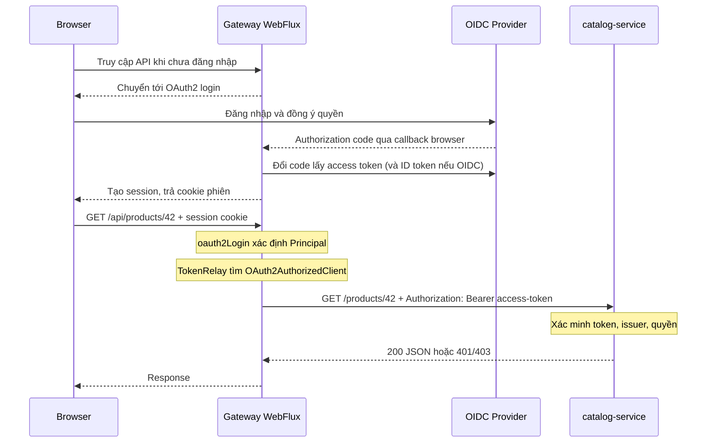
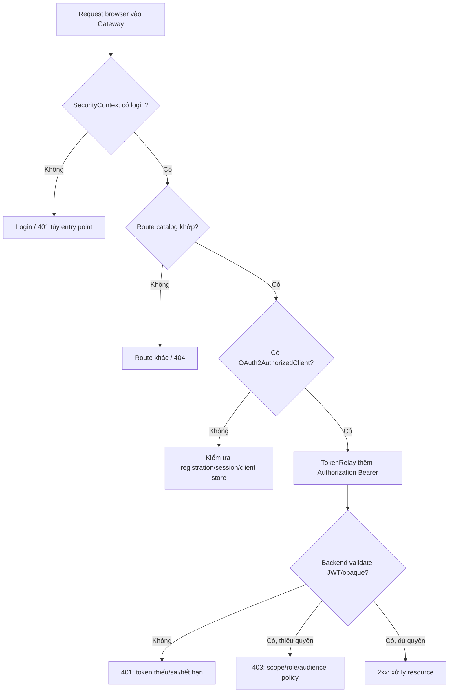

# TokenRelay và chuyển access token đến dịch vụ phía sau

## 1. Bối cảnh: đăng nhập ở Gateway, gọi API ở microservice

Trong kiến trúc microservices, **Spring Cloud Gateway** là điểm vào chung: route predicate chọn đường đi, filter chain chỉnh request/response, service discovery chọn instance, còn Spring Security, rate limiting, circuit breaker, retry, TLS và observability bảo vệ luồng gọi. Một câu hỏi phổ biến là: **Người dùng đã đăng nhập vào Gateway, làm thế nào để dịch vụ phía sau biết request này đại diện cho ai và có quyền gì?**

Ví dụ:

- Trình duyệt truy cập `https://app.example.test` và đăng nhập qua một **OpenID Connect (OIDC) Identity Provider**.
- Gateway dùng **OAuth2 Login** để hoàn tất authorization-code flow và quản lý phiên đăng nhập trình duyệt.
- Frontend gọi `GET /api/products/42` bằng cookie phiên của Gateway.
- `catalog-service` là **OAuth2 Resource Server** yêu cầu access token hợp lệ có scope `catalog.read`.
- Gateway cần gửi **`Authorization: Bearer <access-token>`** sang `catalog-service`, thay vì bắt backend tin cookie phiên của Gateway.

**`TokenRelay` GatewayFilter** hỗ trợ kịch bản này: tìm access token từ ngữ cảnh **OAuth2 authorized client** và gắn access token đó vào request gửi tới upstream.

Mục tiêu của bài thuộc chương **Phiên đăng nhập và token**:

1. Phân biệt **session cookie**, **access token**, **ID token**, **refresh token** và **client registration**.
2. Hiểu TokenRelay hoạt động với `oauth2Login()` và khi chỉ định `clientRegistrationId`.
3. Cấu hình **Spring Cloud Gateway Server WebFlux** bằng YAML hoặc Java `RouteLocatorBuilder`.
4. Xây dựng backend **Resource Server** tự xác minh JWT và scope, không tin mù quáng Gateway.
5. Kiểm thử luồng đăng nhập, chuyển bearer token, `401/403`, token hết hạn và xử lý lỗi.
6. Thiết kế production an toàn: TLS, token audience, scope tối thiểu, không rò token, quản lý session/authorized-client ở nhiều instance.

> **Phạm vi phiên bản:** Ví dụ tập trung **Spring Cloud Gateway Server WebFlux 5.0.x**, namespace `spring.cloud.gateway.server.webflux`, cùng Spring Boot và Spring Security tương thích theo BOM. Gateway Server Web MVC cũng có TokenRelay nhưng dùng Servlet API/Java DSL khác (mục 10). Các endpoint IdP, client ID, domain và quyền trong ví dụ là **giá trị minh họa cần cấu hình bằng IdP thật**, không thể chạy nguyên mẫu khi chưa có IdP.

## 2. Những danh tính và thông tin đăng nhập không được nhầm lẫn

| Thành phần | Ai thường nắm giữ? | Dùng để làm gì? | Có phải thứ TokenRelay cần chuyển không? |
|---|---|---|---|
| **Session cookie** của Gateway | Browser, do Gateway cấp khi đăng nhập | Gắn request browser với phiên xác thực ở Gateway | **Không**; cookie không phải OAuth2 access token |
| **Access token** | OAuth2 client/Gateway sau khi ủy quyền | Gọi **resource server** theo scope/audience | **Có**, nếu được tìm thấy từ authorized client |
| **ID token** (OIDC) | OAuth2/OIDC client | Thông báo thông tin/xác thực danh tính tới **client** | **Không**; không dùng thay access token cho API |
| **Refresh token** | OAuth2 client lưu an toàn, nếu IdP cấp | Xin access token mới theo quy tắc OAuth2 | **Không** gửi xuống API như bearer token |
| **Client ID/secret** | Gateway và Identity Provider | Nhận diện và xác thực OAuth2 client ở flow phù hợp | **Không** chuyển client secret đến backend |
| **Scope** | Thuộc quyền được cấp trong access token | Giới hạn hành động như `catalog.read` | Backend phải kiểm tra scope, Gateway không tự cấp quyền |
| **Audience (`aud`)** | Claim/khái niệm người nhận của access token | Xác định service/API mà token dành cho | Phải phù hợp với backend, không tự thay khi relay |

**JWT** và **opaque token** là hai dạng access token có thể được cấp bởi authorization server. Với JWT, resource server thường kiểm chứng chữ ký qua JWKS cùng `iss`, expiry và policy riêng; với opaque token, resource server có thể introspect qua IdP. `TokenRelay` **không biến opaque thành JWT** và không thay vai trò xác minh của backend.

### 2.1. Hai chặng có hai cơ chế xác thực



Đăng nhập ở Gateway không tự khiến backend tin người dùng. Backend **phải xác minh bearer token** theo issuer và policy của nó. Cũng không được khẳng định cookie phiên của browser tự động không đi qua Gateway: việc **loại Cookie header trước khi proxy** có thể cần filter cụ thể (mục 5), tùy hợp đồng với backend.

### 2.2. TokenRelay không đồng nghĩa proxy toàn bộ Authorization header

Tên TokenRelay gợi ý “chuyển token của request đầu vào”, nhưng **cơ chế thực tế phụ thuộc loại Authentication**:

- Với **`oauth2Login()`**, Gateway có **OAuth2 authorized client** gắn với người dùng và có access token đã xin từ IdP. Dùng `TokenRelay=` để chuyển token đó xuống backend.
- Với **`TokenRelay=<clientRegistrationId>`**, Gateway yêu cầu token cho **registration cụ thể** theo khả năng OAuth2 client manager và grant đã cấu hình.
- Với **một request chỉ chứa `Authorization: Bearer ...`**, Gateway được cấu hình đơn thuần làm **resource server**, Principal có thể là `JwtAuthenticationToken`, **không nhất thiết có OAuth2AuthorizedClient**. Không giả định `TokenRelay=` sẽ tự động lấy bearer token trong mọi trường hợp. Cần xác minh hành vi proxy Authorization hoặc thiết kế cơ chế propagation riêng theo yêu cầu (mục 9).

**Đặc biệt:** TokenRelay không thực hiện **OAuth 2.0 Token Exchange** (RFC 8693), không tự đổi audience/scope, không ký lại token, không quyết định xem backend có quyền sử dụng token đó hay không.

## 3. TokenRelay GatewayFilter làm gì?

Trên Gateway Server WebFlux, `TokenRelayGatewayFilterFactory` hỗ trợ một tham số **không bắt buộc**: `clientRegistrationId`.

| Cấu hình | Nguồn token | Khi nào dùng |
|---|---|---|
| `TokenRelay=` (không ID) | Access token từ authorized client của người dùng đã đăng nhập bằng `oauth2Login()` | Gateway đóng vai **BFF/SSO gateway** dùng cookie session ở browser |
| `TokenRelay=gateway-oidc` | Access token gắn với client registration `gateway-oidc` và principal hiện hành | Chọn rõ registration khi có nhiều OAuth2 clients |
| `TokenRelay=catalog-machine` | Access token theo registration `catalog-machine` và grant đã cấu hình | Luồng service-to-service, khi chính Gateway được cấp quyền phù hợp |

Ở cả hai cách, TokenRelay đặt bearer token vào header **`Authorization`** của request **downstream**. Đây là **route-specific GatewayFilter**, được khai báo trong `filters` của route. Nó không tự mở toàn bộ route cho người dùng chưa xác thực: Spring Security vẫn quyết định request có được phép đến filter chain hay không.

### 3.1. Điều kiện để TokenRelay factory tồn tại

Theo tài liệu Spring Cloud Gateway WebFlux 5.0.x:

1. Có dependency **`org.springframework.boot:spring-boot-starter-oauth2-client`**.
2. Cấu hình `spring.security.oauth2.client.*` tạo được **`ReactiveClientRegistrationRepository`**.
3. Có cơ chế xác thực/ủy quyền phù hợp (ví dụ `oauth2Login()`) và cấu hình truy cập authorized client đúng.
4. Với backend có bảo vệ, token phải hợp lệ và được backend chấp nhận.

Nếu thiếu registration/dependency, bean `TokenRelayGatewayFilterFactory` có thể **không được tạo**; không thể sửa tình huống ấy bằng cách chỉ thêm `- TokenRelay=` vào YAML.

### 3.2. Quy trình xử lý tổng quát

```text
Browser request + session cookie
        |
        v
Spring Security oauth2Login -> Authentication
        |
        v
Route predicate chọn route catalog
        |
        v
TokenRelay GatewayFilter
        |
        +--> ReactiveOAuth2AuthorizedClientManager / authorized client
        |       └── access token do OAuth2 flow cấp
        |
        v
Set Authorization: Bearer <access-token>
        |
        v
Gateway HTTP client -> catalog-service Resource Server
        |
        v
Resource Server kiểm chứng JWT/opaque token, scope, audience
```

**Lưu ý về bảo mật:** “Có access token” không chứng minh người dùng được phép truy cập **mọi** resource của backend. Backend phải kết hợp token claims, scope, đối tượng tài nguyên và quy tắc nghiệp vụ.

## 4. Chuẩn bị môi trường thực hành

### 4.1. Kiến trúc thử nghiệm

Ba thành phần:

| Thành phần | Địa chỉ minh họa | Vai trò |
|---|---|---|
| OIDC Provider | `https://idp.example.test/realms/demo` | Authorization server cấp code/token |
| Gateway Server WebFlux | `http://localhost:8080` (lab) | OAuth2 client, login session, TokenRelay |
| Catalog Resource Server | `http://localhost:8081` (lab) | Nhận bearer token và kiểm tra quyền `catalog.read` |

**Bắt buộc trước khi chạy:** bạn phải có OIDC provider thật hoặc IdP local được cấu hình hợp lệ; đăng ký OAuth2 client có redirect URI đến Gateway; IdP cấp access token có scope `catalog.read` và audience phù hợp với catalog API. **`idp.example.test` là tên ví dụ, không phải IdP sẵn có.**

Trên môi trường thật dùng **HTTPS** cho browser → Gateway và Gateway → backend (hoặc mTLS được quản lý). HTTP local ở ví dụ chỉ phù hợp **lab khép kín**.

### 4.2. Dependency cho Gateway WebFlux

Tạo dự án Spring Boot tương thích với Spring Cloud Gateway 5.0.x, nhập Spring Cloud BOM theo release train đang dùng và bổ sung các dependency sau vào `pom.xml` của **Gateway**:

```xml
<dependencies>
    <dependency>
        <groupId>org.springframework.cloud</groupId>
        <artifactId>spring-cloud-starter-gateway-server-webflux</artifactId>
    </dependency>
    <dependency>
        <groupId>org.springframework.boot</groupId>
        <artifactId>spring-boot-starter-security</artifactId>
    </dependency>
    <dependency>
        <groupId>org.springframework.boot</groupId>
        <artifactId>spring-boot-starter-oauth2-client</artifactId>
    </dependency>
</dependencies>
```

Không cần cấu hình Gateway như **OAuth2 Resource Server** chỉ để chạy demo **OAuth2 Login + TokenRelay** này. OAuth2 client và resource server là **hai vai trò khác nhau**; Gateway có thể thực hiện cả hai ở hệ thống phức tạp, nhưng không nên trộn khi mới học.

**Tên starter trên Spring Boot 4:** Boot 4 giới thiệu tên khuyến nghị `spring-boot-starter-security-oauth2-client` thay cho `spring-boot-starter-oauth2-client` (tên cũ vẫn còn ở một số bản để tương thích). Ví dụ ở trên giữ tên mà tài liệu Gateway TokenRelay sử dụng; khi tạo dự án Boot 4 mới, nên ưu tiên tên starter mới và khóa BOM đúng phiên bản.

### 4.3. Đăng ký OAuth2 client ở IdP

Giả sử bạn đã tạo client có:

- **Registration ID** trong Spring: `gateway-oidc`.
- **Client ID** tại IdP: `gateway-web`.
- **Client secret** chỉ lưu trong secret manager/biến môi trường.
- **Authorization grant:** `authorization_code`.
- **Redirect URI** trong lab: `http://localhost:8080/login/oauth2/code/gateway-oidc`.
- **Requested scopes:** `openid`, `profile`, `catalog.read` nếu IdP cho phép.

Redirect URI phải được IdP đăng ký chính xác theo scheme/host/port/path được sử dụng. Với Gateway sau ingress TLS termination, public redirect URI phải phản ánh hostname HTTPS thật, không được lấy máy localhost của nội bộ làm redirect URI production.

## 5. Khai báo Gateway OAuth2 Login + TokenRelay bằng YAML

Đây là **`application.yml` của ứng dụng Gateway**, với hai phần độc lập: OAuth2 client cho Spring Security và route có TokenRelay cho Spring Cloud Gateway.

```yaml
server:
  port: 8080

spring:
  application:
    name: catalog-gateway
  security:
    oauth2:
      client:
        registration:
          gateway-oidc:
            provider: demo-idp
            client-id: gateway-web
            client-secret: ${OAUTH2_CLIENT_SECRET}
            authorization-grant-type: authorization_code
            redirect-uri: "{baseUrl}/login/oauth2/code/{registrationId}"
            scope:
              - openid
              - profile
              - catalog.read
        provider:
          demo-idp:
            issuer-uri: https://idp.example.test/realms/demo
  cloud:
    gateway:
      server:
        webflux:
          routes:
            - id: catalog-with-user-token
              uri: http://localhost:8081
              predicates:
                - Path=/api/products/**
                - Method=GET
              filters:
                - StripPrefix=1
                # Không cho backend nhận cookie phiên của Gateway.
                - RemoveRequestHeader=Cookie
                # Không có clientRegistrationId: dùng token của user đã login.
                - TokenRelay=
```

**Lưu ý về bí mật:** `OAUTH2_CLIENT_SECRET` phải được cung cấp từ nguồn cấu hình an toàn, không commit secret thực vào Git. Không copy file cấu hình này vào production khi chưa thay IdP, redirect URI, đường dẫn backend và TLS theo môi trường thật.

### 5.1. Giải thích từng bước

| Thành phần | Ý nghĩa |
|---|---|
| `registration.gateway-oidc` | Đăng ký OAuth2 client mà Gateway dùng để login và xin token |
| `provider.demo-idp.issuer-uri` | Cho phép Spring Security khám phá metadata OIDC/OAuth2 của IdP |
| `authorization-grant-type: authorization_code` | Browser login thông qua authorization code; backend token exchange do OAuth2 client của Gateway thực hiện |
| `scope` | Quyền **yêu cầu** IdP cấp, không bảo đảm IdP thực sự cấp tất cả |
| `redirect-uri` | Callback của Spring Security khi IdP trả authorization code |
| `Path=/api/products/**` | Route chỉ khớp API sản phẩm |
| `Method=GET` | Chỉ định tuyến GET; POST không được vào route demo |
| `StripPrefix=1` | `/api/products/42` → `/products/42` của backend |
| `RemoveRequestHeader=Cookie` | Bỏ cookie browser trước khi gửi downstream trong bài lab |
| `TokenRelay=` | Lấy access token người dùng đang đăng nhập và gắn `Authorization: Bearer ...` khi proxy |

Thứ tự đặt `RemoveRequestHeader=Cookie` trong chuỗi được chọn để dễ hiểu: Spring Security xác thực phiên **trước khi route Gateway chạy**, nên việc loại Cookie ở giai đoạn proxy không khiến Gateway quên user vừa được xác thực. Tuy nhiên, nếu backend của bạn **thực sự cần cookie khác**, đừng loại tất cả Cookie mà chưa thiết kế rõ hợp đồng.

**Không thêm `TokenRelay` vào `default-filters` cho tất cả route nếu chưa kiểm tra:** token có thể bị chuyển đến upstream không nên nhận quyền người dùng, như dịch vụ quản trị hoặc endpoint của bên thứ ba. Ưu tiên allowlist các route có backend đã được tin cậy.

### 5.2. SecurityWebFilterChain cho Gateway

Để nhận session OAuth2 Login và quản lý OAuth2 client trên **WebFlux**, tạo file `GatewaySecurityConfig.java`:

```java
package com.example.gateway;

import org.springframework.context.annotation.Bean;
import org.springframework.context.annotation.Configuration;
import org.springframework.security.config.Customizer;
import org.springframework.security.config.annotation.web.reactive.EnableWebFluxSecurity;
import org.springframework.security.config.web.server.ServerHttpSecurity;
import org.springframework.security.web.server.SecurityWebFilterChain;

@Configuration
@EnableWebFluxSecurity
public class GatewaySecurityConfig {

    @Bean
    SecurityWebFilterChain securityWebFilterChain(ServerHttpSecurity http) {
        return http
            .authorizeExchange(authorize -> authorize
                // Đường sản phẩm và các request khác đều phải đăng nhập.
                .anyExchange().authenticated())
            .oauth2Login(Customizer.withDefaults())
            .oauth2Client(Customizer.withDefaults())
            .build();
    }
}
```

`oauth2Login()` thiết lập cơ chế đăng nhập dựa trên OAuth2/OIDC; `oauth2Client()` bật các thành phần OAuth2 Client khi sử dụng authorized clients. Ví dụ giữ chính sách **yêu cầu xác thực cho mọi request**, ngoại trừ các endpoint bắt tay OAuth2/callback được cơ chế Security xử lý. Với Actuator hoặc health check cần public, thiết kế matcher riêng có kiểm soát.

**Không vô hiệu hóa CSRF vô điều kiện**: khi browser dùng cookie phiên để thực hiện POST/PUT/DELETE, hãy xét CSRF token và chính sách SameSite cookie. Bài lab chỉ proxy **GET** để tách vấn đề relay token khỏi CSRF. Khi triển khai SPA, phải thiết kế CORS, session cookie, CSRF, callback URL và reverse proxy cùng nhau.

### 5.3. Java DSL thay thế cho route YAML

Nếu ứng dụng khai báo route Java, có thể thay **route YAML** bằng bean `RouteLocator`; đây là một cách khai báo độc lập, **không chạy đồng thời cả hai với cùng route ID**:

```java
package com.example.gateway;

import org.springframework.cloud.gateway.route.RouteLocator;
import org.springframework.cloud.gateway.route.builder.RouteLocatorBuilder;
import org.springframework.context.annotation.Bean;
import org.springframework.context.annotation.Configuration;
import org.springframework.http.HttpMethod;

@Configuration
public class CatalogGatewayRoutes {

    @Bean
    RouteLocator catalogRoute(RouteLocatorBuilder builder) {
        return builder.routes()
            .route("catalog-with-user-token", r -> r
                .path("/api/products/**")
                .and()
                .method(HttpMethod.GET)
                .filters(f -> f
                    .stripPrefix(1)
                    .removeRequestHeader("Cookie")
                    .tokenRelay())
                .uri("http://localhost:8081"))
            .build();
    }
}
```

`tokenRelay()` không đối số tương ứng với `TokenRelay=`. Các route khác có thể dùng `tokenRelay("registration-id")` khi chủ động chọn OAuth2 client registration tương ứng.

## 6. Catalog backend: Resource Server phải tự kiểm tra bearer token

### 6.1. Dependency của backend

Backend trong bài dùng một **Spring Boot Servlet/Web MVC** app chạy cổng `8081`. Thêm:

```xml
<dependencies>
    <dependency>
        <groupId>org.springframework.boot</groupId>
        <artifactId>spring-boot-starter-webmvc</artifactId>
    </dependency>
    <dependency>
        <groupId>org.springframework.boot</groupId>
        <artifactId>spring-boot-starter-security</artifactId>
    </dependency>
    <dependency>
        <groupId>org.springframework.boot</groupId>
        <artifactId>spring-boot-starter-oauth2-resource-server</artifactId>
    </dependency>
</dependencies>
```

Starter `spring-boot-starter-webmvc` dành cho Spring Boot 4.x. Với Spring Boot 3.x, starter phổ biến tương ứng là `spring-boot-starter-web`. Chọn dependency đúng với phiên bản ứng dụng; không áp dụng đồng thời cả hai.

### 6.2. Cấu hình issuer để xác minh JWT

```yaml
# catalog-service/src/main/resources/application.yml
server:
  port: 8081

spring:
  application:
    name: catalog-service
  security:
    oauth2:
      resourceserver:
        jwt:
          issuer-uri: https://idp.example.test/realms/demo
          audiences:
            - catalog-api
```

Đây là **Resource Server JWT**: Spring Security dùng metadata/JWKS của IdP để xác minh chữ ký cùng các claim hợp lệ. Nếu IdP cấp **opaque access token**, phải dùng **introspection** thay vì cấu hình JWT này. Thuộc tính Boot 4 `audiences` yêu cầu claim `aud` chứa `catalog-api`; IdP demo **phải được cấu hình cấp audience này**. Chỉ có `issuer-uri` không đủ để enforce audience. Nếu version hoặc cơ chế token khác, cấu hình validator tương đương.

Starter `spring-boot-starter-oauth2-resource-server` trong ví dụ cũng có tên khuyến nghị mới trên Boot 4 là `spring-boot-starter-security-oauth2-resource-server`. Dùng một trong hai tên tương thích với phiên bản Boot/BOM.

### 6.3. Security policy buộc phải có scope catalog.read

```java
package com.example.catalog;

import org.springframework.context.annotation.Bean;
import org.springframework.context.annotation.Configuration;
import org.springframework.http.HttpMethod;
import org.springframework.security.config.Customizer;
import org.springframework.security.config.annotation.web.configuration.EnableWebSecurity;
import org.springframework.security.config.annotation.web.builders.HttpSecurity;
import org.springframework.security.web.SecurityFilterChain;

@Configuration
@EnableWebSecurity
public class CatalogSecurityConfig {

    @Bean
    SecurityFilterChain filterChain(HttpSecurity http) throws Exception {
        return http
            .authorizeHttpRequests(authorize -> authorize
                .requestMatchers(HttpMethod.GET, "/products/**")
                    .hasAuthority("SCOPE_catalog.read")
                .anyRequest().denyAll())
            .oauth2ResourceServer(oauth2 ->
                oauth2.jwt(Customizer.withDefaults()))
            .build();
    }
}
```

Mặc định, Spring Security Resource Server thường chuyển scope JWT `catalog.read` thành authority `SCOPE_catalog.read`. Hãy xác minh format scope thực của IdP (`scope`, `scp` hoặc custom claims) và điều chỉnh converter nếu cần. **Không chấp nhận mọi token chỉ vì chữ ký hợp lệ**: kiểm tra `iss`, `aud`, expiration và quyền được cấp, sau đó kiểm tra quyền ở cấp tài nguyên/người dùng.

### 6.4. Controller không phản hồi giá trị token

```java
package com.example.catalog;

import java.util.Map;
import org.springframework.boot.SpringApplication;
import org.springframework.boot.autoconfigure.SpringBootApplication;
import org.springframework.security.oauth2.server.resource.authentication.JwtAuthenticationToken;
import org.springframework.web.bind.annotation.GetMapping;
import org.springframework.web.bind.annotation.PathVariable;
import org.springframework.web.bind.annotation.RestController;

@SpringBootApplication
@RestController
public class CatalogApplication {

    public static void main(String[] args) {
        SpringApplication.run(CatalogApplication.class, args);
    }

    @GetMapping("/products/{id}")
    public Map<String, String> product(
            @PathVariable String id,
            JwtAuthenticationToken authentication) {
        return Map.of(
            "id", id,
            "requestedBy", authentication.getName(),
            "message", "authorized access"
        );
    }
}
```

Controller chỉ hiển thị một định danh thử nghiệm và thông điệp xác nhận; **không trả raw access token, refresh token hay client secret**. Trong production, thông tin như username/subject cũng là dữ liệu cá nhân; chỉ đưa vào response nếu hợp đồng API yêu cầu và có kiểm soát.

### 6.5. Kết quả kỳ vọng

Với JWT có chữ ký/issuer/audience hợp lệ và authority `SCOPE_catalog.read`, request đến `GET /products/42` được cho phép. Nếu thiếu token hoặc token không hợp lệ, Resource Server thường trả **401**; nếu token hợp lệ nhưng thiếu quyền `catalog.read`, thường trả **403**. Các response và status thực tế còn phụ thuộc custom security exception handlers của ứng dụng.

**Lưu ý:** Gateway có thể đã đăng nhập thành công, nhưng backend vẫn từ chối nếu IdP không cấp đúng scope hoặc backend yêu cầu audience khác. Đây là cơ chế bảo vệ đúng, không phải bằng chứng `TokenRelay` đã “không chạy”.

## 7. Kiểm thử luồng đăng nhập và token relay

### 7.1. Chuẩn bị các điều kiện

Để thử toàn bộ luồng:

1. **IdP đang chạy**, cho phép client `gateway-web` đăng nhập theo authorization-code flow, redirect URI hợp lệ.
2. **IdP cấp access token có quyền `catalog.read`** và audience của catalog API; bearer token có thể được backend xác minh theo metadata/JWKS.
3. **Backend `catalog-service` chạy cổng 8081** với cấu hình resource server mục 6.
4. **Gateway chạy cổng 8080** với Spring Security OAuth2 Login và route mục 5.
5. Trình duyệt cho phép lưu **cookie phiên** trên Gateway; mạng từ Gateway tới IdP và backend hoạt động.

Nếu chưa có IdP thật, **không thể chỉ chạy YAML là có sẵn token**. Các kết quả bên dưới là **kịch bản kỳ vọng**, không phải kết quả đã chạy tại đây.

### 7.2. Trước đăng nhập: Gateway yêu cầu xác thực

Mở một cửa sổ browser riêng tư và vào:

```text
http://localhost:8080/api/products/42
```

Với `oauth2Login()`, Gateway sẽ yêu cầu đăng nhập, có thể hiển thị trang chọn provider hoặc redirect đến:

```text
http://localhost:8080/oauth2/authorization/gateway-oidc
```

Sau khi xác thực thành công, IdP redirect về `/login/oauth2/code/gateway-oidc` để Gateway đổi authorization code lấy token và lưu trạng thái authorized client. Browser có **cookie phiên của Gateway** cho các request kế tiếp.

Không kỳ vọng một request `curl` không có cookie tự hoàn thành toàn bộ login flow. Nó có thể nhận redirect `302` hoặc response security khác tùy cách cấu hình entry point; cần browser thật để kiểm chứng flow authorization code.

### 7.3. Sau đăng nhập: Gateway gọi catalog-service

Truy cập lại:

```text
http://localhost:8080/api/products/42
```

Nếu token và quyền hợp lệ, response minh họa:

```http
HTTP/1.1 200 OK
Content-Type: application/json

{"id":"42","requestedBy":"user-123","message":"authorized access"}
```

`user-123` chỉ là một **ví dụ về principal name**, không bảo đảm IdP của bạn tạo cùng giá trị. Điều cần quan sát:

- **Frontend → Gateway:** browser trình **session cookie**, không phải tự lấy OAuth2 access token để gắn bearer header.
- **Gateway → backend:** request có `Authorization: Bearer ...` do TokenRelay chuyển từ authorized client.
- **Backend:** kiểm tra token thành công, cấp authority từ scope và chạy controller.
- **Response:** backend chỉ trả thông tin cần thiết, không echo token.

### 7.4. Đối chứng trực tiếp backend

Khi **không** gửi bearer token:

```bash
curl -i 'http://localhost:8081/products/42'
```

Backend resource server phải **không cho phép** truy cập dữ liệu bảo vệ. Với cấu hình ví dụ, thường trả `401 Unauthorized`.

Khi dùng một access token thử nghiệm **hợp lệ do IdP thật cấp**, có thể kiểm tra từ terminal an toàn:

```bash
# TOKEN là biến môi trường đã được cấp một cách an toàn,
# không đặt raw access token trực tiếp vào command/history/tài liệu.
curl -i \
  -H "Authorization: Bearer $TOKEN" \
  'http://localhost:8081/products/42'
```

Token **hết hạn/sai chữ ký/sai issuer/sai audience** phải bị từ chối, còn token hợp lệ nhưng không có `catalog.read` không được phép đọc API. Đừng hardcode token có thật trong một bài lab hoặc hệ thống CI; mask các giá trị nhạy cảm trong log và report.

### 7.5. Kiểm thử đủ các tình huống

| Ca | Đầu vào | Kỳ vọng chính |
|---|---|---|
| T1 | Browser chưa đăng nhập, GET qua Gateway | Gateway yêu cầu đăng nhập, không gửi một user token hợp lệ xuống backend |
| T2 | Browser đã đăng nhập, token có `catalog.read` | Backend nhận bearer và trả 200 |
| T3 | Browser đã đăng nhập nhưng token thiếu scope | Backend trả 403 (hoặc policy từ chối tương đương) |
| T4 | Backend nhận token sai issuer, hết hạn hoặc chữ ký | Backend trả 401 |
| T5 | Token đúng chữ ký nhưng sai audience | Backend từ chối nếu đã cấu hình audience validator |
| T6 | Browser hết hạn session/logout | Request mới phải trải qua xác thực lại, không còn được relay token theo session cũ |
| T7 | Gateway gọi sai hostname/port backend | Lỗi kết nối/TLS/timeout; không đồng nghĩa lỗi TokenRelay |
| T8 | Request `POST /api/products/42` | Route `Method=GET` không match; không tự chuyển bearer xuống POST |
| T9 | Dùng hai browser sessions với hai user khác nhau | Authorized clients không bị lẫn, backend thấy principal tương ứng |
| T10 | Proxy downstream ghi log header | Phải **mask Authorization**, không lộ token trong log/tracing |

**Điểm phân biệt lỗi:** login thất bại (chưa có authenticated principal), TokenRelay không lấy được authorized client, backend từ chối token và backend không kết nối được là **bốn lớp lỗi khác nhau**, cần quan sát độc lập.

## 8. Chọn clientRegistrationId rõ ràng khi có nhiều OAuth2 clients

### 8.1. Trường hợp muốn dùng token của registration cụ thể

Nếu Gateway có nhiều `ClientRegistration`, có thể chọn registration bằng ID:

```yaml
# Chỉ là một route, đặt dưới
# spring.cloud.gateway.server.webflux.routes:
- id: catalog-registration-specific
  uri: http://localhost:8081
  predicates:
    - Path=/service/catalog/**
  filters:
    - StripPrefix=2
    - TokenRelay=catalog-machine
```

Java DSL tương ứng:

```java
@Bean
RouteLocator serviceRoutes(RouteLocatorBuilder builder) {
    return builder.routes()
        .route("catalog-registration-specific", r -> r
            .path("/service/catalog/**")
            .filters(f -> f
                .stripPrefix(2)
                .tokenRelay("catalog-machine"))
            .uri("http://localhost:8081"))
        .build();
}
```

Đoạn Java trên là **method `@Bean` đặt bên trong một class `@Configuration`** có imports của `RouteLocator` và `RouteLocatorBuilder` như mục 5.3; nó không phải một file Java độc lập.

### 8.2. Ví dụ OAuth2 client_credentials

Trên Gateway, bổ sung một registration riêng trong `spring.security.oauth2.client.registration`:

```yaml
# Trích đoạn của application.yml Gateway.
spring:
  security:
    oauth2:
      client:
        registration:
          catalog-machine:
            provider: demo-idp
            client-id: gateway-machine
            client-secret: ${CATALOG_MACHINE_SECRET}
            authorization-grant-type: client_credentials
            scope:
              - catalog.read
        provider:
          demo-idp:
            issuer-uri: https://idp.example.test/realms/demo
```

`client_credentials` là **grant của OAuth2 client**, được dùng khi Gateway đóng vai một client service-to-service. Token đại diện cho **Gateway/client**, không mặc nhiên đại diện cho user đang dùng trình duyệt. Để hoạt động thực, IdP phải cho phép grant đó, cấp scope/audience đúng; Spring Security OAuth2 Client Manager phải được cấu hình hỗ trợ grant; security chain vẫn phải quyết định request nào có quyền kích hoạt route.

**Không nhầm hai kịch bản**:

| `TokenRelay=` với oauth2Login | `TokenRelay=catalog-machine` với client_credentials |
|---|---|
| Principal của **người dùng** đã login | Principal **ứng dụng/Gateway** |
| Quyền thường gắn với consent/user/client | Quyền được cấp cho service client |
| Có browser session ở Gateway | Không cần browser session để xin machine token, nhưng Gateway vẫn phải có policy bảo vệ route |
| Dùng khi backend cần **user context** | Dùng khi backend chấp nhận **service identity** |

Nếu backend cần biết **ai là người dùng cuối** và kiểm tra quyền truy cập riêng theo từng user, **đừng thay access token của user bằng client_credentials token** rồi giả định hai loại quyền tương đương. Có thể cần OAuth2 Token Exchange hoặc kiến trúc truyền danh tính được bảo vệ riêng, nhưng đó là một giải pháp khác TokenRelay cơ bản.

### 8.3. Cẩn trọng khi có nhiều registration

Khi route `TokenRelay=` không chỉ định registration, nó phù hợp với access token của **người dùng đã đăng nhập**. Khi route chỉ định ID, filter tìm/ủy quyền client theo **ID đó**; đây không phải câu lệnh “gửi bất kỳ token nào client đang có”.

Nếu registration không tồn tại, không được ủy quyền, grant bị IdP từ chối hoặc token không được backend chấp nhận, request có thể thất bại ở Gateway hoặc backend tùy bước xử lý. Khi điều tra, kiểm tra **registration ID thực**, loại grant, token endpoint, phạm vi cấp quyền và identity mong đợi của service.

## 9. Khi Gateway nhận sẵn Bearer token: phân biệt với OAuth2 Login

### 9.1. Kịch bản Gateway đồng thời là Resource Server

Một SPA hoặc mobile client có thể trực tiếp gửi:

```http
GET /api/products/42 HTTP/1.1
Host: gateway.example.test
Authorization: Bearer eyJ...redacted
```

Đây **không phải kịch bản browser session + oauth2Login**. Gateway lúc này có thể xác thực **bearer access token đầu vào** bằng Spring Security Resource Server (JWT hoặc opaque token). Để minh họa, một cấu hình Security WebFlux **thay thế** cho mục 5.2 là:

```java
@Bean
SecurityWebFilterChain apiSecurity(ServerHttpSecurity http) {
    return http
        .authorizeExchange(exchanges -> exchanges
            .anyExchange().authenticated())
        .oauth2ResourceServer(oauth2 ->
            oauth2.jwt(org.springframework.security.config.Customizer.withDefaults()))
        .build();
}
```

Đoạn trên cần đặt trong class `@Configuration` có imports `ServerHttpSecurity` và `SecurityWebFilterChain`; cần dependency `spring-boot-starter-oauth2-resource-server` và cấu hình issuer/audience tương ứng cho Gateway. Đây là **security chain riêng**, không dán thêm một bean cùng matcher vào cấu hình oauth2Login ví dụ để tránh hai chain chồng lấn.

### 9.2. Có cần TokenRelay= không?

**Không được mặc định “có bearer thì TokenRelay= tự biết chuyển”.** Sau `oauth2ResourceServer()`, Security principal thường là `JwtAuthenticationToken`; không phải `OAuth2AuthenticationToken` có authorized client từ `oauth2Login()`. `TokenRelay` bản OAuth2 Client được thiết kế để làm việc với `OAuth2AuthorizedClient` theo registration/principal.

Với một reverse proxy đơn giản, **header `Authorization` đầu vào có thể đã được chuyển tiếp** tới backend theo quy tắc header forwarding của Gateway nếu không bị filter khác xóa/ghi đè. Nhưng hành vi này **phải được kiểm chứng với chính version/filter chain** và không phải cơ chế `TokenRelay=` của phiên đăng nhập.

Các lựa chọn kiến trúc:

1. **Giữ bearer token người gọi** qua reverse proxy, đồng thời Gateway và backend **đều xác minh** token/scope/audience phù hợp. Kiểm thử truyền header và giới hạn route đích.
2. **Sử dụng OAuth2 Client/TokenRelay với registration rõ** nếu Gateway được cấp một token khác để gọi dịch vụ (mục 8), chấp nhận ngữ nghĩa danh tính client tương ứng.
3. **Dùng cơ chế Token Exchange** khi backend phải nhận token mới với audience/quyền riêng, không truyền token gốc sang service khác phạm vi.
4. Với code **`WebClient` gọi API** chứ không phải route proxy, Spring Security cung cấp `ServerBearerExchangeFilterFunction` để lấy credentials kiểu bearer từ Security context và gắn vào WebClient request; đây là **cơ chế khác** với `TokenRelayGatewayFilterFactory` và không tự refresh token.

Không tự viết `AddRequestHeader=Authorization,...` với raw token từ query/cookie chưa xác thực. Nếu cần custom relay, phải kiểm soát rõ **nguồn token, validation, route đích, header overwrite, TLS và lỗi**.

### 9.3. ID token không phải access token

Với OpenID Connect, ID token xác nhận sự kiện xác thực danh tính **tại client**. Một ID token có `aud` là OAuth2 client `gateway-web` **không phải** một access token dành cho `catalog-service`. Vì thế:

- Không dùng ID token thay `Authorization: Bearer` khi gọi backend.
- Không giải mã JWT rồi tự sửa `aud`/`scope` hoặc ký bằng secret Gateway để “chữa” lỗi token.
- Không coi bất cứ JWT nào có chữ ký hợp lệ là đủ; token type, issuer, audience và quyền vẫn phải phù hợp.
- Khi backend chỉ chấp nhận audience khác, IdP cần cấp token đúng audience hoặc hỗ trợ token exchange theo chính sách.

## 10. Gateway Server Web MVC có TokenRelay riêng

Trong **Spring Cloud Gateway Server Web MVC 5.0.x**, `TokenRelay` cũng tồn tại nhưng sử dụng **Servlet stack/WebMvc.fn**. YAML đặt tại `spring.cloud.gateway.server.webmvc.routes` chứ không phải `server.webflux.routes`:

```yaml
# Chỉ dành cho ứng dụng Gateway Server Web MVC.
spring:
  cloud:
    gateway:
      server:
        webmvc:
          routes:
            - id: catalog-mvc
              uri: http://localhost:8081
              predicates:
                - Path=/api/products/**
              filters:
                - StripPrefix=1
                - TokenRelay=
```

Spring Cloud Gateway Server Web MVC dùng `OAuth2AuthorizedClientManager` và kho `OAuth2AuthorizedClientService` của **Servlet Security**; WebFlux dùng các loại `ReactiveOAuth2AuthorizedClientManager` / `ReactiveOAuth2AuthorizedClientService`. Không trộn `SecurityFilterChain` MVC với `SecurityWebFilterChain` WebFlux, hoặc copy Java `RouteLocatorBuilder` WebFlux sang MVC.

Tài liệu MVC cũng hỗ trợ `tokenRelay()` và `tokenRelay("registration-id")` trong Java `RouterFunction` DSL. Khi chọn MVC, hãy dùng starter MVC và cấu hình OAuth2 Client/Security tương ứng; tiến hành cùng ma trận kiểm thử bearer, scope và session như với WebFlux.

## 11. Session, refresh token và scale-out Gateway

### 11.1. Một browser session khác một OAuth2AuthorizedClient

Có ít nhất hai trạng thái cần quản lý:

| Trạng thái | Mục đích | Rủi ro nếu chỉ lưu trong RAM |
|---|---|---|
| **Web session / SecurityContext** | Nhớ rằng browser đã đăng nhập và là user nào | User mất phiên/đăng nhập lại khi restart hoặc request sang instance khác |
| **OAuth2AuthorizedClient** | Gắn OAuth2 client registration, principal, access token và refresh token (nếu có) | Filter không tìm được authorized client ở instance khác, refresh không đồng bộ |

Theo tài liệu Spring Cloud Gateway, `TokenRelayGatewayFilterFactory` trong WebFlux dùng một implementation mặc định của `ReactiveOAuth2AuthorizedClientService` với **kho in-memory**. Điều này phù hợp với lab nhưng **chưa đủ** cho môi trường nhiều instance hoặc yêu cầu phục hồi sau restart.

Trên production, cần quyết định **lưu session tập trung** (ví dụ Spring Session + Redis nếu phù hợp), **lưu authorized client an toàn/persistent** bằng implementation phù hợp và cách định tuyến traffic giữa instances. **Chỉ bật Spring Session không có nghĩa `ReactiveOAuth2AuthorizedClientService` chắc chắn đã chuyển sang persistent store** — xác minh riêng từng bean và flow.

### 11.2. Token hết hạn không đồng nghĩa session hết hạn

Một browser session có thể còn hoạt động khi access token hết hạn. OAuth2 authorized client manager có thể **refresh hoặc reauthorize** token nếu grant, refresh token, provider, client và policy hỗ trợ. Không giả định rằng mọi IdP đều phát refresh token hoặc token luôn refresh thành công.

Khi token hết hạn/revoked:

1. Kiểm tra TokenRelay/authorized client manager có tìm được token hợp lệ và có thể refresh hay không.
2. Kiểm tra IdP token endpoint, grant, consent và chính sách refresh token rotation.
3. Nếu authorization không thể phục hồi, yêu cầu đăng nhập/ủy quyền lại hoặc xử lý lỗi rõ ràng, **không tiếp tục gửi token quá hạn**.
4. Khi logout, quyết định cách hủy **local session**, xóa authorized client và nếu được hỗ trợ, thực hiện revocation/logout tại IdP. **Xóa cookie Gateway không tự động thu hồi mọi access token đã cấp**.

Không bao giờ log refresh token hoặc gửi refresh token như bearer trong request tới service.

### 11.3. Hạn chế dùng user token cho toàn bộ hệ thống

Access token thường là **bearer credential**: ai có token có thể thử sử dụng nó trong phạm vi quyền và thời hạn của token. Khi Gateway relay token tới nhiều services, mặt phẳng rủi ro **token leakage/lateral movement** tăng lên.

Các nguyên tắc:

- Relay token chỉ tới **upstream thuộc trust boundary đã duyệt** và dùng HTTPS/mTLS outbound phù hợp.
- Cấp scope tối thiểu; phân biệt `catalog.read` với `admin.write`.
- Backend tự kiểm tra issuer, audience và quyền cấp tài nguyên; không chấp nhận token của dịch vụ không liên quan.
- Không chuyển token user đến endpoint bên thứ ba chỉ vì route predicate có thể match.
- Không để URI downstream phụ thuộc trực tiếp URL do client cung cấp (SSRF có thể làm rò Authorization header).
- Nếu cần service identity thay cho user identity, chọn grant phù hợp; nếu cần delegation qua nhiều API, thiết kế token exchange/danh tính theo OAuth2.

## 12. Bảo mật phiên, cookie và kênh truyền

### 12.1. Client → Gateway và Gateway → backend là hai chặng độc lập

`TokenRelay` đặt bearer token vào **HTTP request outbound**, nhưng **không thiết lập TLS**. Dù frontend dùng `https://app.example.test`, route `uri: http://localhost:8081` trong bài lab vẫn gọi backend bằng HTTP.

Trên production:

- Browser → Gateway/Ingress nên dùng HTTPS; cookie phiên cần `Secure`, `HttpOnly`, SameSite theo flow.
- Gateway → backend nên dùng HTTPS hoặc mTLS theo yêu cầu bảo mật, xác minh certificate chain/hostname.
- Nếu TLS kết thúc ở ingress, kiểm soát `Forwarded` / `X-Forwarded-*` từ trusted proxy để redirect URL/cookie Secure không bị tính sai.
- Đừng bật insecure trust manager hoặc tắt hostname validation để “làm OAuth2 hoạt động”.

### 12.2. CSRF, CORS, logout và session fixation

Nếu browser xác thực với Gateway bằng cookie phiên, request thay đổi trạng thái cần **CSRF protection** phù hợp; CORS chỉ kiểm soát việc browser đọc response, **không thay CSRF/authorization**. Spring Security cung cấp session/authentication protections, nhưng khi tùy biến filter chain phải kiểm thử các thay đổi như login/logout, redirect, session rotation, cookie attributes và origin.

Nếu SPA ở origin khác Gateway, cấu hình **CORS credentials** cho những origin được phép; dùng `Access-Control-Allow-Origin` chính xác và `Access-Control-Allow-Credentials: true` khi thật sự cần. Không kết hợp wildcard `*` với credentials.

**Không chuyển cookie phiên nội bộ xuống backend** trừ khi có hợp đồng sử dụng cụ thể. Ví dụ mục 5 có `RemoveRequestHeader=Cookie` để tách việc nhận dạng Gateway (session cookie) khỏi nhận dạng backend (bearer token).

### 12.3. Không ghi bearer token vào log

Một giá trị `Authorization: Bearer ...` **không phải thông tin quan sát an toàn**. Không hiển thị nguyên chuỗi trong:

- Gateway access logs, Netty wiretap/TRACE, log filter tùy biến.
- Backend access logs, application exception messages, APM/tracing attributes.
- Message queue, URL query string, browser localStorage, analytics events.
- `curl -v` được copy lên ticket hỗ trợ hoặc ảnh chụp màn hình.

Khi cần điều tra, chỉ log **route ID**, request/trace ID, status, loại lỗi, latency và một mã định danh không nhạy cảm đã được kiểm soát. Nếu cần biết token có được gắn, ghi **boolean tokenPresent** ở môi trường lab, không ghi token value.

## 13. Đối chiếu cấu hình với request thực tế

### 13.1. Đo tín hiệu tại từng lớp, không in token



Sơ đồ là **mô hình suy luận**, không phải lời hứa về status chính xác trong mọi tình huống; exception handler, OAuth2 entry point, retry và circuit breaker có thể thay đổi response.

Trong ứng dụng thật, nên ghi các tín hiệu sau:

| Vị trí | Tín hiệu không nhạy cảm | Câu hỏi được trả lời |
|---|---|---|
| Ingress/Gateway | Request ID, method/path, status, route ID | Request có tới Gateway và match route đúng không? |
| Spring Security | Authentication type, login success/failure category | Đang xử lý session OAuth2 Login hay JWT bearer? |
| OAuth2 Client Manager | Registration ID, token availability, refresh outcome (**không có token value**) | TokenRelay có client/token nào để dùng không? |
| Gateway HTTP client | Backend host/port, TLS result, latency, response status | Có kết nối và proxy sang service hay không? |
| Resource Server | Token validation result, issuer/audience/scope policy | Vì sao backend trả 401/403? |
| Observability | Trace ID, thời gian từng chặng, error class đã lọc | Lỗi thuộc security, routing hay downstream? |

### 13.2. Actuator cho route, không phải nơi đọc token

Nếu đã thêm `spring-boot-starter-actuator` và được cấp quyền đọc Gateway endpoint:

```yaml
management:
  endpoint:
    gateway:
      access: read-only
  endpoints:
    web:
      exposure:
        include: health,gateway
```

```bash
curl -sS 'http://localhost:8080/actuator/gateway/routes'
curl -sS 'http://localhost:8080/actuator/gateway/routes/catalog-with-user-token'
```

Chúng giúp xác nhận route và `TokenRelay` filter đã được lắp ráp, **không chứng minh token người dùng đã được tìm thấy hay backend đã chấp nhận**. Bảo vệ Actuator ở network/Spring Security và không dùng endpoint cấu hình để xuất token/secret.

### 13.3. Bảng triệu chứng và nguyên nhân

| Hiện tượng | Nguyên nhân khả dĩ | Cách xác minh |
|---|---|---|
| Gateway báo không tìm thấy `TokenRelay` factory | Thiếu OAuth2 client dependency hoặc `ReactiveClientRegistrationRepository` | Kiểm tra BOM, `spring.security.oauth2.client.*`, bean startup và filter factory |
| Request liên tục chuyển trang login | Cookie/session không được giữ, redirect URI/forwarded host sai, callback không match | Kiểm tra browser cookie, OAuth2 state, redirect URI và ingress |
| IdP trả `invalid_client` | Client ID/secret, token endpoint hoặc grant sai | Kiểm tra registration tại IdP, secret manager và log lỗi đã mask |
| IdP trả `invalid_scope` hoặc consent bị từ chối | Scope `catalog.read` chưa được phép | Kiểm tra cấu hình scope/client/grant trên IdP |
| Gateway login thành công nhưng backend 401 | Token sai issuer/audience, hết hạn, thiếu bearer header hoặc cert/JWKS lỗi | Kiểm tra presence của header, token metadata an toàn và backend Resource Server logs |
| Backend trả 403 khi token hợp lệ | Thiếu `SCOPE_catalog.read` hoặc policy tài nguyên từ chối | Kiểm tra claims/authority mapping và authorization |
| Gateway trả lỗi khi refresh token | Refresh grant bị từ chối, refresh token hết hạn/rotation lỗi, client store mất state | Kiểm tra refresh outcome, IdP policy và authorized-client persistence |
| Token đến sai backend | Route quá rộng, URI động hoặc service discovery cấu hình sai | So sánh route ID/predicate/URI instance và trust boundary |
| Token relay có lúc được lúc không khi scale-out | Gateway instances dùng session/authorized-client store không nhất quán | Kiểm tra sticky session và hai loại store tách biệt |
| Request bearer inbound không được TokenRelay= xử lý như mong muốn | Gateway đang làm Resource Server, không có OAuth2AuthorizedClient từ login | Phân biệt `JwtAuthenticationToken` và `OAuth2AuthenticationToken`; xem mục 9 |
| Browser login có session nhưng API gọi từ SPA bị CORS/CSRF | Sai origin/cookie SameSite/credentials/CSRF | Quan sát preflight và actual request trong DevTools |
| Backend nhìn thấy cookie Gateway | Filter loại Cookie bị thiếu hoặc không áp lên route | Xác minh request header downstream không log giá trị cookie |
| Client nhận 5xx khi backend mất kết nối | DNS, port, TLS trust, timeout, circuit breaker | Gọi backend từ môi trường Gateway, kiểm tra Netty/connection metrics |
| Logout xong token cũ vẫn dùng được | Access token chưa hết hạn và chưa bị revocation; backend chỉ kiểm tra JWT | Thiết kế revocation, TTL, token exchange/ủy quyền theo yêu cầu |
| Metrics/log lộ token | DEBUG/wiretap/custom filter ghi Authorization | Tắt/mask, rotate credential bị lộ và rà soát hệ thống log |

**Trình tự chẩn đoán:** xác nhận instance/config → Security login → route matching → authorized client và token availability → outbound header presence → TLS/kết nối backend → xác minh JWT/scope/audience ở backend → response/metrics. Không sửa CORS hoặc `StripPrefix` khi bằng chứng cho thấy lỗi nằm ở issuer/audience.

## 14. Checklist đưa TokenRelay vào production

1. **Đúng flow:** browser session + `oauth2Login` hay client bearer + resource server, hoặc service-to-service `client_credentials`?
2. **Đúng registration:** `clientRegistrationId` trùng cấu hình OAuth2 client thực; IdP cấp đúng grant/scopes.
3. **Đúng token type:** chỉ access token được gửi tới backend; không gửi ID token, refresh token hoặc client secret.
4. **Đúng audience:** backend chỉ nhận token được phát hành cho chính API của nó; cấu hình audience validator.
5. **Đúng quyền:** backend kiểm tra scope/role **và** quyền ở mức resource; Gateway không cấp quyền chỉ bằng cách relay.
6. **Đúng route:** chỉ gắn TokenRelay cho upstream được phê duyệt; giới hạn SSRF và redirect tới host không tin cậy.
7. **Đúng kết nối:** TLS/mTLS chặng Gateway → backend và xác minh certificate/hostname, không bật insecure trust.
8. **Đúng session:** bảo vệ cookie `HttpOnly`/`Secure`/SameSite; kiểm tra CSRF, CORS và public redirect URI.
9. **Đúng lưu trữ:** session và OAuth2AuthorizedClient an toàn qua restart/scale-out; mã hóa bí mật at rest.
10. **Đúng vòng đời:** refresh token rotation, logout, revocation, TTL và lỗi IdP được xử lý rõ.
11. **Đúng quan sát:** route ID, request ID, principal metadata tối thiểu, scope validation errors; không log bearer token.
12. **Đúng hồi quy:** test happy path, anonymous, invalid/expired token, wrong audience, missing scope, wrong route, multi-user/multi-instance.

## 15. Bài tập và câu hỏi tự kiểm tra

**Bài 1 — Phân biệt token.** Browser đăng nhập với Gateway và chỉ gửi cookie phiên khi gọi `GET /api/products/42`. TokenRelay cần lấy access token từ đâu? Vì sao không chuyển session cookie hoặc ID token thay access token?

**Bài 2 — Scope và audience.** IdP cấp JWT có `iss` hợp lệ và `scope=catalog.read` nhưng `aud` không chứa audience catalog-service. Backend nên trả quyền truy cập hay từ chối? Gateway có thể tự sửa `aud` không?

**Bài 3 — Không có clientRegistrationId.** Viết cấu hình route WebFlux dùng `TokenRelay=` và `StripPrefix=1` để chuyển `/api/products/7` thành `/products/7`.

**Bài 4 — Chọn registration.** Khi nào `TokenRelay=catalog-machine` phù hợp hơn `TokenRelay=`? User identity có còn được giữ tự động nếu `catalog-machine` là client_credentials không?

**Bài 5 — Gateway như Resource Server.** Một SPA gửi `Authorization: Bearer ...` trực tiếp tới Gateway, nơi chỉ bật `oauth2ResourceServer().jwt()`. Có thể mặc định thêm `TokenRelay=` và bảo đảm nó forward token nguyên gốc không? Đề xuất cách kiểm thử.

**Bài 6 — Backend.** Vì sao `spring.security.oauth2.resourceserver.jwt.issuer-uri` chưa đủ để ngăn JWT dành cho một ứng dụng khác được chấp nhận? Viết cấu hình policy bổ sung.

**Bài 7 — Multi-instance.** Gateway có hai pod; pod A login thành công nhưng pod B không tìm được authorized client. Cần kiểm tra **hai** loại dữ liệu nào và vì sao Spring Session không tự giải quyết hết?

**Bài 8 — Bảo mật.** Một route chung `Path=/**` với `TokenRelay=` proxy nhiều upstream, trong đó có URL bên thứ ba. Nêu ba rủi ro và thiết kế lại.

**Bài 9 — Logout.** Người dùng logout khỏi Gateway. Liệu access token đã cấp chắc chắn hết hiệu lực ngay ở catalog-service không? Cần cơ chế nào nếu muốn thu hồi sớm?

**Bài 10 — Chẩn đoán.** Browser login thành công, Gateway route đúng nhưng backend trả 403. Hãy nêu ít nhất ba nguyên nhân có thể và các nguồn bằng chứng an toàn.

### Gợi ý đáp án

1. Từ `OAuth2AuthorizedClient` gắn với principal/login hiện hành. Session cookie chỉ xác thực với Gateway; ID token có mục đích OIDC client, còn backend cần access token.
2. **Từ chối** nếu backend enforce audience đúng; TokenRelay không tự biến đổi audience. Cần IdP cấp token audience phù hợp hoặc giải pháp token exchange được bảo vệ.
3. Route có `uri` backend, `Path=/api/products/**`, `filters: [StripPrefix=1, TokenRelay=]`. Phải bật OAuth2 client registration/login thật.
4. Khi backend chấp nhận **service identity** được cấp cho registration `catalog-machine`. `client_credentials` không tự mang user identity.
5. Không bảo đảm. Phải xác định Spring Security Authentication type và cơ chế forward header thực tế; test request bearer hợp lệ, invalid token, route filters và backend HTTP logs đã redact.
6. Backend cần kiểm tra **`aud`** (ví dụ Boot JWT `audiences` hoặc validator tương đương), đồng thời `scope`/resource permission.
7. **Web session/SecurityContext** và **OAuth2AuthorizedClient storage**. Spring Session giải quyết session nhưng chưa bảo đảm OAuth2 authorized-client service là persistent/shared.
8. Dễ **lộ token** sang host không tin cậy, cấp quyền quá rộng, SSRF/redirect; gắn TokenRelay vào route cụ thể có upstream allowlist, TLS và audience/scopes tối thiểu.
9. Không chắc. JWT có thể tiếp tục hợp lệ đến hết `exp`; cần token revocation/introspection, TTL ngắn, session logout phối hợp IdP và cơ chế theo yêu cầu.
10. Thiếu scope `catalog.read`, sai authority mapping, policy resource từ chối, hoặc token audience không đúng (nếu backend dùng custom policy); xem backend authorization logs, claims metadata đã redact, route ID/status.

## Tài liệu tham khảo chính thức

- [Spring Cloud Gateway Server WebFlux 5.0 — TokenRelay GatewayFilter Factory](https://docs.spring.io/spring-cloud-gateway/reference/5.0/spring-cloud-gateway-server-webflux/gatewayfilter-factories/tokenrelay-factory.html) — hai cách dùng `TokenRelay=` và `TokenRelay=registration-id`, dependency và kho authorized-client.
- [Spring Cloud Gateway Server WebFlux 5.0 — Spring Security Integration](https://docs.spring.io/spring-cloud-gateway/reference/5.0/spring-cloud-gateway-server-webflux/spring-security.html) — phân biệt OAuth2 client và resource server.
- [Spring Cloud Gateway Server Web MVC 5.0 — TokenRelay Filter](https://docs.spring.io/spring-cloud-gateway/reference/5.0/spring-cloud-gateway-server-webmvc/filters/tokenrelay.html) — API/token relay trên Servlet stack.
- [Spring Security — OAuth2 for Reactive Applications](https://docs.spring.io/spring-security/reference/reactive/oauth2/) — login, resource server, OAuth2 client và authorization.
- [Spring Security — Reactive OAuth2 Login Core](https://docs.spring.io/spring-security/reference/reactive/oauth2/login/core.html) — `oauth2Login` và cấu hình `SecurityWebFilterChain`.
- [Spring Security — Authorized Client Features](https://docs.spring.io/spring-security/reference/reactive/oauth2/client/authorized-clients.html) — OAuth2AuthorizedClientManager và quyền sử dụng token.
- [Spring Security — OAuth2 Resource Server Bearer Tokens](https://docs.spring.io/spring-security/reference/reactive/oauth2/resource-server/bearer-tokens.html) — phân biệt bearer token propagation qua WebClient và OAuth2 client relay.
- [Spring Security — OAuth2 Resource Server JWT (Servlet)](https://docs.spring.io/spring-security/reference/servlet/oauth2/resource-server/jwt.html) — xác thực JWT, `issuer-uri`, scope/authority và audience.
- [Spring Boot 4.0 — Spring Security](https://docs.spring.io/spring-boot/4.0/reference/web/spring-security.html) — JWT resource server và thuộc tính `audiences`.
- [RFC 6750 — OAuth 2.0 Bearer Token Usage](https://www.rfc-editor.org/rfc/rfc6750) — ý nghĩa bearer token và header Authorization.
- [RFC 8693 — OAuth 2.0 Token Exchange](https://www.rfc-editor.org/rfc/rfc8693) — cơ chế đổi token/audience khác với TokenRelay đơn thuần.
