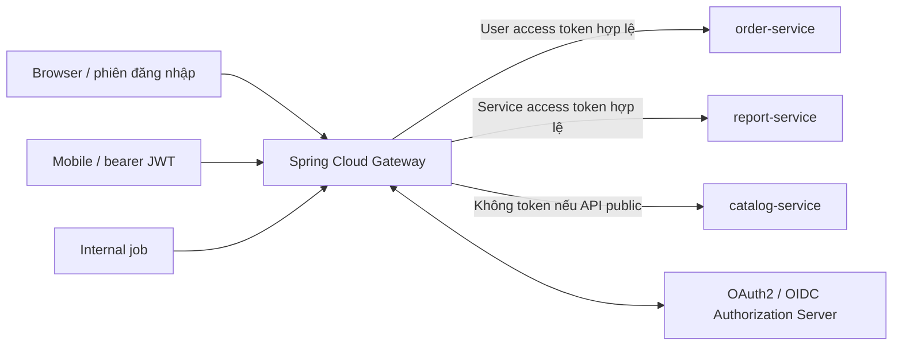
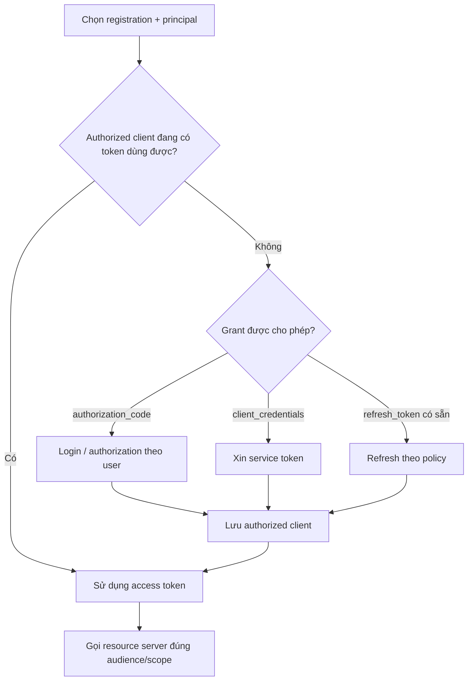
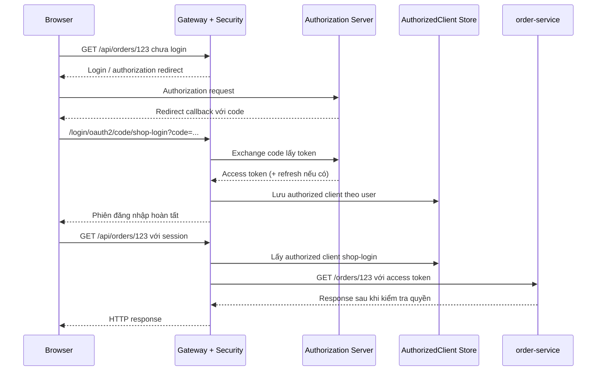
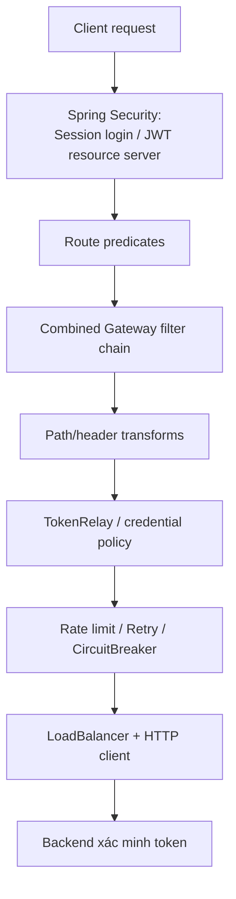
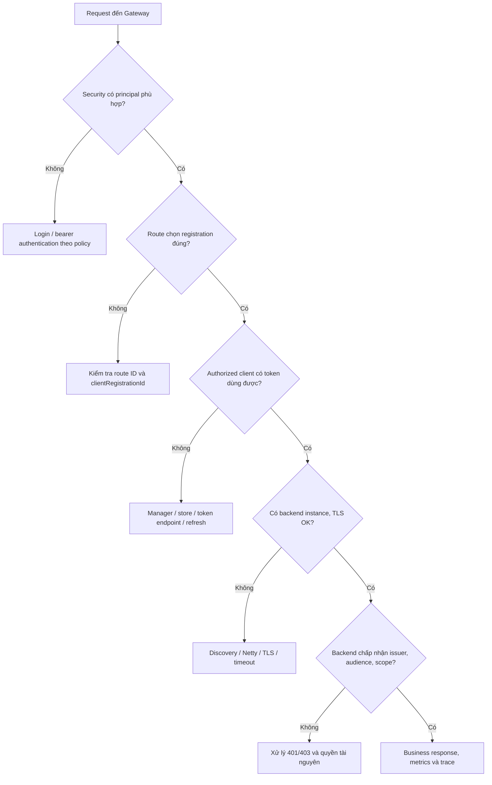

# OAuth2AuthorizedClient và lựa chọn client registration

Một API Gateway thường làm nhiều việc cùng lúc: nhận request của browser, chọn route theo path/method, kiểm tra xác thực, giới hạn lưu lượng và chuyển tiếp đến một microservice qua `lb://service-id`. Khi những backend cần **OAuth 2.0 access token**, Gateway còn phải trả lời: **đang gọi dưới danh tính người dùng hay danh tính chính ứng dụng**, **client registration nào được phép dùng**, **access token nào đã được cấp**, và **token đó có dành cho backend này không**?

Giả sử khách hàng đã đăng nhập muốn xem `GET /api/orders/123`. Gateway có thể giữ token OAuth2 của user phía server và chuyển tiếp token hợp lệ đến `order-service`. Đồng thời, một tác vụ nội bộ muốn gọi `report-service` bằng grant `client_credentials` của chính gateway. Hai tình huống đều sử dụng OAuth 2.0, nhưng **không thể mặc nhiên dùng chung `ClientRegistration`, `OAuth2AuthorizedClient` hoặc principal**: làm vậy có nguy cơ mất ngữ cảnh user, gửi sai audience, gây lỗi `401/403` hoặc vô tình nâng quyền.

Bài thuộc chương **Phiên đăng nhập và token** của module **SPRING_CLOUD_GATEWAY**. Mục tiêu là hiểu mô hình `ClientRegistration` và `OAuth2AuthorizedClient` trong Spring Security, cách lựa chọn registration theo route, quản lý authorized client, cách dùng `TokenRelay` và phân biệt login, resource server, machine-to-machine. Nội dung được đặt trong bối cảnh filter chain, biến đổi path/header, discovery/load balancing, xác thực, rate limiting, retry, circuit breaker, TLS và quan sát request của microservices.

> **Phạm vi:** Ví dụ dùng **Spring Cloud Gateway Server WebFlux** và **Spring Security Reactive OAuth2 Client**. Gateway Server Web MVC có pipeline servlet, route/filter API và `SecurityFilterChain` riêng; không sao chép nguyên code `ServerHttpSecurity` hoặc DSL WebFlux sang MVC. Tên starter và nhánh property thay đổi theo phiên bản, nên phải đối chiếu bộ Spring Boot/Spring Cloud/Gateway/Spring Security được dùng thực tế.

## 1. Ba luồng gọi API cần phân biệt

| Tình huống | Gateway nhận gì? | Danh tính outbound mong muốn | Ví dụ |
| --- | --- | --- | --- |
| **BFF/browser đã đăng nhập** | Session cookie Gateway | Access token gắn với user và login registration | `/api/orders/**` → `order-service` |
| **API nhận bearer từ SPA/mobile** | `Authorization: Bearer ...` | Token inbound đã được xác minh hoặc token exchanged theo policy | `/api/account/**` → `account-service` |
| **Machine-to-machine** | Công việc nội bộ, có thể không có browser | Token `client_credentials` của service principal | Tác vụ tổng hợp → `report-service` |



**Không để tất cả route dùng chung một token mạnh nhất.** Token service không tự đại diện người dùng, token đăng nhập không được gửi đến mọi backend, và một route public không cần tự đính kèm credential của user chỉ vì request có session.

## 2. Các đối tượng cốt lõi

| Đối tượng | Nội dung | Chức năng |
| --- | --- | --- |
| **`ClientRegistration`** | Registration ID, client ID, grant type, provider, redirect URI, scope và các endpoint OAuth2. | Cấu hình **một ứng dụng OAuth2 client**. |
| **`OAuth2AuthorizedClient`** | Tham chiếu ClientRegistration, principal name, access token và refresh token nếu được cấp. | Biểu thị **client đã được ủy quyền** trong một ngữ cảnh principal. |
| **`Authentication` / principal** | Danh tính hiện tại do Security xác thực. | Phân biệt user A, user B, service principal. |
| **`ReactiveClientRegistrationRepository`** | Kho/nguồn tra cứu ClientRegistration. | Tìm cấu hình client bằng registration ID. |
| **`ServerOAuth2AuthorizedClientRepository`** | Cơ chế lưu/tìm authorized client trong môi trường web reactive. | Liên kết authorized client với request web/session/principal theo implementation. |
| **`ReactiveOAuth2AuthorizedClientService`** | Lưu/tìm authorized client không nhất thiết cần web exchange. | Phù hợp các manager/service và kho token chuyên biệt. |
| **`ReactiveOAuth2AuthorizedClientManager`** | Điều phối authorize/re-authorize theo grant và provider. | Lấy lại token hiện có, xin/refresh token khi được hỗ trợ. |

### Registration ID không phải OAuth2 client ID

Ví dụ:

```text
registrationId = shop-login
clientId       = gateway-web
provider       = company-idp
grant          = authorization_code

registrationId = reporting-client
clientId       = gateway-reporting
provider       = company-idp
grant          = client_credentials
```

`shop-login` là tên nội bộ để code/filter chọn cấu hình; `gateway-web` là client ID mà authorization server biết. Hai registrations có thể cùng issuer nhưng dùng **client ID, grant, scope và secret khác nhau**.

### Một registration có thể có nhiều authorized clients

```text
ClientRegistration("shop-login")
    |
    +-- OAuth2AuthorizedClient(user-a) -> access token A
    |
    +-- OAuth2AuthorizedClient(user-b) -> access token B

ClientRegistration("reporting-client")
    |
    +-- OAuth2AuthorizedClient("gateway-service")
        -> service access token
```

**Không lưu access token user gần nhất trong một field mutable của singleton `GlobalFilter`.** Nhiều request đồng thời có thể mang user khác nhau; chia sẻ token kiểu đó tạo rủi ro lộ thông tin giữa tài khoản.

## 3. OAuth2AuthorizedClient quản lý trạng thái gì?

Các API quan trọng của `OAuth2AuthorizedClient`:

```java
import org.springframework.security.oauth2.client.OAuth2AuthorizedClient;
import org.springframework.security.oauth2.core.OAuth2AccessToken;
import org.springframework.security.oauth2.core.OAuth2RefreshToken;

public class AuthorizedClientInspector {
    void inspect(OAuth2AuthorizedClient authorizedClient) {
        String registrationId = authorizedClient
            .getClientRegistration().getRegistrationId();
        String principalName = authorizedClient.getPrincipalName();
        OAuth2AccessToken accessToken = authorizedClient.getAccessToken();
        OAuth2RefreshToken refreshToken = authorizedClient.getRefreshToken();

        // Chỉ dùng thông tin trong phạm vi cần thiết; không log tokenValue.
    }
}
```

Đoạn trên minh họa **đối tượng đã được manager/repository cấp cho method**, chưa cho biết cách lấy và không nên đưa `accessToken.getTokenValue()` vào log. `refreshToken` có thể là `null` vì provider hoặc grant không cấp refresh token.

| Dữ liệu | Điều nên hiểu |
| --- | --- |
| `ClientRegistration` | Cấu hình client; không chứa access token của user. |
| `principalName` | Authorized client gắn với ngữ cảnh danh tính nào. |
| `accessToken` | Credential gọi resource server, gồm thời điểm cấp/hết hạn. |
| `refreshToken` | Dùng để xin access token mới khi được cấp và manager/provider hỗ trợ. |



Sơ đồ thể hiện **quy trình khái niệm**. Việc tự động refresh, reuse token, xử lý token endpoint error và lưu trạng thái phụ thuộc `ReactiveOAuth2AuthorizedClientManager`, provider/grant và store thực tế. Chỉ việc tạo registration **không tự lấy token**.

## 4. Phân biệt OAuth2 Login, OAuth2 Client và Resource Server

| Vai trò Gateway | Thao tác | Thành phần Spring Security thường dùng |
| --- | --- | --- |
| **OAuth2 Login / OIDC client** | Điều hướng browser đến IdP, nhận callback, xác thực user/session. | `oauth2Login()` cùng registration `authorization_code`. |
| **OAuth2 Client** | Lấy và quản lý authorized client/access token để gọi API. | `oauth2Client()`, manager, authorized-client repository/service, TokenRelay. |
| **OAuth2 Resource Server** | Xác minh bearer **đi vào** Gateway từ caller. | `oauth2ResourceServer().jwt()` hoặc opaque token introspection. |

### Ba nhận định dễ nhầm

1. **Có JWT trong `Authorization` không đồng nghĩa có `OAuth2AuthorizedClient`.** Resource Server xác minh token inbound; OAuth2 Client quản lý token đã được cấp cho một registration.
2. **OIDC ID token không phải token gọi API.** ID token phục vụ định danh phiên login cho client; backend cần access token có audience/resource phù hợp.
3. **`client_credentials` không phải đăng nhập thay user.** Token này chứng minh quyền của ứng dụng/client, không tự có thông tin phân quyền đến một đơn hàng của user A.

Topology **BFF** thường dùng OAuth2 Login và session cookie để giữ token ở phía server. Topology **SPA/mobile gửi bearer** có thể chỉ cần Gateway Resource Server; việc relay hoặc đổi token phải là quyết định rõ ràng. Workload **machine-to-machine** cần manager và grant `client_credentials`.

## 5. Cấu hình nhiều ClientRegistration trong YAML

Ví dụ với một IdP thử nghiệm và hai registrations:

```yaml
spring:
  security:
    oauth2:
      client:
        registration:
          shop-login:
            provider: company-idp
            client-id: gateway-web
            client-secret: ${SHOP_OAUTH_CLIENT_SECRET}
            authorization-grant-type: authorization_code
            redirect-uri: "{baseUrl}/login/oauth2/code/{registrationId}"
            scope:
              - openid
              - profile
              - orders.read

          reporting-client:
            provider: company-idp
            client-id: gateway-reporting
            client-secret: ${REPORTING_CLIENT_SECRET}
            authorization-grant-type: client_credentials
            scope:
              - reports.read

        provider:
          company-idp:
            issuer-uri: https://idp.example.org/realms/commerce
```

**Đây là cấu hình minh họa**, không phải một IdP có thật đã được kiểm tra. Cần đăng ký client thật với issuer, redirect URIs, scopes và grant được IdP hỗ trợ. Biến môi trường phải được cấp qua secret manager/cơ chế triển khai; **không commit client secret vào Git**.

| Trường | Ý nghĩa | Sai lầm cần tránh |
| --- | --- | --- |
| `registration.shop-login` | ID nội bộ cho login client. | Nhầm với `client-id`. |
| `provider: company-idp` | Dùng các endpoint của provider được chỉ định. | Dùng sai issuer hoặc token/JWK endpoint. |
| `client-id`/`client-secret` | Định danh và bí mật của confidential client. | Dùng chung secret quyền cao cho mọi route. |
| `authorization-grant-type` | Cách client lấy quyền/token. | Dùng service grant nhưng giả định có user principal. |
| `redirect-uri` | Callback của authorization code. | Sai public URL sau ingress hoặc chưa đăng ký tại IdP. |
| `scope` | Quyền được yêu cầu, không bảo đảm được cấp. | Yêu cầu quyền rộng không cần thiết. |
| `issuer-uri` | Discovery metadata của provider khi hỗ trợ. | Host/CA không được tin, issuer không khớp. |

### Khi nào cần tách registration dù cùng IdP?

Tách `shop-login` và `reporting-client` giúp cô lập **grant, scope, credential, audit và revocation**. Một lỗi của reporting workload không nên khiến client secret cho browser login bị lộ hoặc khiến Gateway dùng service token để thay user token.

## 6. ReactiveClientRegistrationRepository không chứa user token

Trong WebFlux, repository này cho phép tra `ClientRegistration` bằng ID:

```java
import org.springframework.security.oauth2.client.registration.ClientRegistration;
import org.springframework.security.oauth2.client.registration.ReactiveClientRegistrationRepository;
import reactor.core.publisher.Mono;

public class RegistrationLookup {
    private final ReactiveClientRegistrationRepository registrations;

    public RegistrationLookup(
            ReactiveClientRegistrationRepository registrations) {
        this.registrations = registrations;
    }

    public Mono<ClientRegistration> reporting() {
        return registrations.findByRegistrationId("reporting-client");
    }
}
```

Nếu tìm được registration, ứng dụng mới biết **cách xin token**, chưa chắc đã có token. Muốn lấy authorized client cần repository/service/manager cùng principal và grant thích hợp.

### Chọn registration dựa trên policy

| Route/caller | Registration | Principal | Đích |
| --- | --- | --- | --- |
| `orders-user` | `shop-login` | User đã đăng nhập | `order-service` |
| Internal reporting job | `reporting-client` | `gateway-service` | `report-service` |
| `catalog-public` | Không cần | Anonymous | `catalog-service` |
| API nhận bearer từ mobile | Tùy kiến trúc; thường không tự có authorized client | Bearer principal đã xác minh | Backend được quyền |

**Không nhận `X-Client-Registration: reporting-client` từ client rồi chọn thẳng credential đó**. Registration selection là quyết định bảo mật của server; chỉ dùng route/config đã được review hoặc tenant claim đã xác minh cùng allowlist.

## 7. Authorized client được lưu ở đâu?

Hai abstraction thường gặp trong Spring Security reactive:

- **`ServerOAuth2AuthorizedClientRepository`:** lưu/tìm OAuth2AuthorizedClient theo web exchange và authentication/session trong môi trường WebFlux.
- **`ReactiveOAuth2AuthorizedClientService`:** lưu/tìm OAuth2AuthorizedClient theo registration/principal không nhất thiết gắn với một HTTP request.

`ReactiveOAuth2AuthorizedClientManager` sử dụng các thành phần phù hợp để **authorize lại, lưu token và xử lý grant**. Repository có thể dùng session hoặc ủy quyền cho service; implementation cụ thể do auto-configuration và bean cấu hình quyết định.

### Session cookie, authorized client và backend access token

```text
Browser:
  Cookie SESSION -> nhận diện phiên với Gateway

Gateway:
  SecurityContext -> Authentication của user
  Authorized client store -> access token/refresh token nếu có

Backend:
  Authorization: Bearer <access token hợp lệ cho backend>
```

Không đưa `OAuth2AuthorizedClient`, refresh token hoặc client secret vào cookie, query string hay response debug. Với BFF, token được giữ phía server theo chính sách và chỉ chuyển **access token cần thiết** cho resource server phù hợp.

### Hệ thống nhiều replica

Giả sử user đăng nhập ở gateway replica A rồi request tiếp theo đến B. B cần khôi phục **session/authentication và authorized client** theo đúng topology. Spring Session/kho session dùng chung có thể giải quyết một phần, nhưng không tự làm cho mọi `ReactiveOAuth2AuthorizedClientService` trở thành distributed store.

Một số tài liệu `TokenRelay` của Gateway WebFlux nêu service mặc định có **in-memory storage**. Nếu cần HA, cân nhắc implementation dùng kho bảo vệ, cơ chế session/token nhất quán, expiry, refresh concurrency, encryption và quyền đọc/ghi tách biệt. Không dựa vào sticky session đơn lẻ như sự bảo đảm bền vững qua restart.

## 8. OAuth2 Login tạo authorized client cho user

Với `shop-login` sử dụng authorization code:



Những kiểm soát bắt buộc gồm `state`, redirect URI đã đăng ký, PKCE khi cần/hỗ trợ, xác thực issuer/claims, TLS và chính sách cookie/session. Nếu browser frontend khác origin Gateway, không mặc định một `fetch` theo redirect đến IdP sẽ hoạt động giống điều hướng login ở top-level browser.

**User login thành công không chứng minh token được backend chấp nhận.** Backend còn phải kiểm tra issuer, audience, scope và quyền user đối với đơn hàng thực.

## 9. TokenRelay GatewayFilter Factory

`TokenRelay` là filter có thể dùng access token của OAuth2 authorized client để gửi tới backend. Với WebFlux route:

```yaml
spring:
  cloud:
    gateway:
      server:
        webflux:
          routes:
            - id: orders-user
              uri: lb://order-service
              predicates:
                - Path=/api/orders/**
              filters:
                - StripPrefix=2
                - TokenRelay=shop-login
```

Khi user đã login và authorized client phù hợp hiện diện:

1. Predicate `Path` chọn `orders-user`.
2. `StripPrefix=2` đổi `/api/orders/123` thành `/orders/123`.
3. `TokenRelay=shop-login` hướng filter đến registration `shop-login` để sử dụng authorized client/token phù hợp với principal và manager.
4. LoadBalancer giải quyết `lb://order-service` nếu có starter và nguồn `ServiceInstance`.
5. Backend nhận access token và **tự xác minh** danh tính, audience/scope và quyền theo tài nguyên.

Chỉ viết `TokenRelay=shop-login` **không tự tạo** OAuth2 Login, client registration tại IdP hoặc authorized-client store. Cần starter OAuth2 Client/Spring Security và flow đúng phiên bản.

### Không chỉ định clientRegistrationId

```yaml
filters:
  - TokenRelay
```

Trong ngữ cảnh user được xác thực bằng OAuth2 Login, dạng không tham số có thể dùng access token gắn với authentication hiện tại theo hành vi tài liệu Gateway mô tả. Tuy nhiên, với nhiều registrations, **chọn rõ registration theo route** thường dễ audit hơn.

**Không mặc định** TokenRelay không tham số sẽ relay mọi bearer inbound của một Gateway chỉ cấu hình Resource Server. Một request được xác thực bằng JWT inbound không nhất thiết có `OAuth2AuthorizedClient` tương ứng.

### Token relay khác token exchange

Relay chuyển access token hiện có; nó **không đổi audience, issuer hoặc scope**. Nếu backend cần token dành cho resource khác, phải dùng quy trình cấp token/token exchange được authorization server hỗ trợ và policy đã duyệt. Không tự sửa claims của JWT rồi dùng như token hợp lệ.

## 10. Cấu hình Spring Security reactive cho Gateway BFF

Một Gateway đứng trước browser và lưu user session có thể bật OAuth2 Login và OAuth2 Client bằng `SecurityWebFilterChain`:

```java
import org.springframework.context.annotation.Bean;
import org.springframework.context.annotation.Configuration;
import org.springframework.http.HttpMethod;
import org.springframework.security.config.Customizer;
import org.springframework.security.config.annotation.web.reactive.EnableWebFluxSecurity;
import org.springframework.security.config.web.server.ServerHttpSecurity;
import org.springframework.security.web.server.SecurityWebFilterChain;

@Configuration
@EnableWebFluxSecurity
public class GatewaySecurityConfiguration {

    @Bean
    SecurityWebFilterChain securityWebFilterChain(ServerHttpSecurity http) {
        return http
            .authorizeExchange(exchanges -> exchanges
                .pathMatchers("/login/**", "/oauth2/**").permitAll()
                .pathMatchers(HttpMethod.GET, "/api/catalog/**").permitAll()
                .pathMatchers("/api/orders/**").authenticated()
                .anyExchange().denyAll())
            .oauth2Login(Customizer.withDefaults())
            .oauth2Client(Customizer.withDefaults())
            .build();
    }
}
```

**Ý nghĩa:**

- `oauth2Login()` cung cấp luồng đăng nhập browser thông qua một client registration `authorization_code`.
- `oauth2Client()` bật tích hợp OAuth2 Client ở Security layer, phục vụ quản lý authorized client.
- `authorizeExchange` yêu cầu user đã xác thực cho các route đơn hàng; backend vẫn phải kiểm tra quyền đối với từng đơn hàng.
- Route riêng trong Gateway vẫn cần `TokenRelay` nếu muốn dùng access token cho lời gọi upstream.

**Đây chỉ là khung học tập, chưa phải cấu hình production hoàn chỉnh.** Cần thêm issuer/JWK thực tế, CORS và cookie policy, logout/revocation, session persistence, xử lý 401/403, chính sách quyền chi tiết và khả năng quan sát.

### Không tắt CSRF vô điều kiện

Ví dụ **không tắt CSRF mặc định**. Với OAuth2 Login + session cookie, request thay đổi trạng thái như POST/PUT/PATCH/DELETE cần cơ chế CSRF phù hợp. Nếu browser và Gateway khác origin, còn cần CORS, cookie `SameSite`/`Secure` và preflight handling.

Một Gateway **bearer-only stateless Resource Server** có mô hình CSRF khác, nhưng không nên copy một lệnh `csrf.disable()` từ ví dụ bearer-only sang BFF dùng cookie chỉ để tiện gọi API.

### OAuth2 Client chưa phải Resource Server

Chỉ bật:

```java
.oauth2Login(Customizer.withDefaults())
.oauth2Client(Customizer.withDefaults())
```

không khiến Gateway mặc định **xác minh mọi bearer JWT inbound** như một Resource Server. Ngược lại, chỉ bật:

```java
.oauth2ResourceServer(oauth2 -> oauth2.jwt(Customizer.withDefaults()))
```

không tự có user login session hoặc authorized client. Nếu một ứng dụng cần hỗ trợ cả hai, hãy thiết kế nhiều security matchers/chains hoặc entry point rõ ràng để API bearer-only không bị chuyển hướng login ngoài ý muốn.

## 11. Machine-to-machine: dùng client_credentials đúng ngữ cảnh

`reporting-client` sử dụng grant `client_credentials` để xin access token **nhân danh ứng dụng**. Nó không có browser authorization code, không phải refresh user session và thường không có refresh token theo mô hình client credentials.

### ReactiveOAuth2AuthorizedClientManager cho công việc không phụ thuộc web exchange

Một scheduled job hoặc HTTP client nội bộ có thể cấu hình:

```java
import org.springframework.context.annotation.Bean;
import org.springframework.context.annotation.Configuration;
import org.springframework.security.oauth2.client.AuthorizedClientServiceReactiveOAuth2AuthorizedClientManager;
import org.springframework.security.oauth2.client.ReactiveOAuth2AuthorizedClientManager;
import org.springframework.security.oauth2.client.ReactiveOAuth2AuthorizedClientProvider;
import org.springframework.security.oauth2.client.ReactiveOAuth2AuthorizedClientProviderBuilder;
import org.springframework.security.oauth2.client.ReactiveOAuth2AuthorizedClientService;
import org.springframework.security.oauth2.client.registration.ReactiveClientRegistrationRepository;

@Configuration
public class ServiceClientConfiguration {

    @Bean
    ReactiveOAuth2AuthorizedClientManager serviceClientManager(
            ReactiveClientRegistrationRepository registrations,
            ReactiveOAuth2AuthorizedClientService clients) {

        ReactiveOAuth2AuthorizedClientProvider provider =
            ReactiveOAuth2AuthorizedClientProviderBuilder.builder()
                .clientCredentials()
                .build();

        AuthorizedClientServiceReactiveOAuth2AuthorizedClientManager manager =
            new AuthorizedClientServiceReactiveOAuth2AuthorizedClientManager(
                registrations, clients);

        manager.setAuthorizedClientProvider(provider);
        return manager;
    }
}
```

Factory/manager ở ví dụ này chỉ biết cách **authorize client** theo grant đã bật; nó không tự thay thế `NettyRoutingFilter` hoặc route WebFlux. Hãy dùng trong một caller được phép truy cập report-service, với lựa chọn registration cố định.

### Lựa chọn registration và principal cho một lời gọi nội bộ

```java
import org.springframework.security.oauth2.client.OAuth2AuthorizeRequest;
import org.springframework.security.oauth2.client.OAuth2AuthorizedClient;
import org.springframework.security.oauth2.client.ReactiveOAuth2AuthorizedClientManager;
import reactor.core.publisher.Mono;

public class ReportingAuthorization {

    private final ReactiveOAuth2AuthorizedClientManager manager;

    public ReportingAuthorization(
            ReactiveOAuth2AuthorizedClientManager manager) {
        this.manager = manager;
    }

    public Mono<OAuth2AuthorizedClient> authorizedClient() {
        OAuth2AuthorizeRequest request = OAuth2AuthorizeRequest
            .withClientRegistrationId("reporting-client")
            .principal("gateway-service")
            .build();

        return manager.authorize(request)
            .switchIfEmpty(Mono.error(
                new IllegalStateException("Reporting client not authorized")));
    }
}
```

`reporting-client` là registration do **server lựa chọn**, không được lấy từ request header của client bên ngoài; `gateway-service` là service principal ổn định để quản lý authorized client. Nếu cần gọi report-service, một reactive HTTP client phù hợp sẽ sử dụng **access token** của authorized client này trên kết nối HTTPS đã xác minh TLS.

**Không gọi `block()` trên event-loop của Gateway WebFlux** để đợi token; kết hợp `Mono` bất đồng bộ vào pipeline.

### TokenRelay với client credentials có tự chạy không?

`TokenRelay` cho phép nêu `clientRegistrationId`; tùy phiên bản/cấu hình, nó có thể phối hợp authorized client manager cho grant phù hợp. Tuy nhiên, **không giả định** cứ đặt `TokenRelay=reporting-client` là mọi request không có user session đều sẽ lấy service token thành công. Kiểm tra manager, principal, authorized client service và grant configuration trong đúng dòng Gateway/Security.

Với tác vụ machine-to-machine **không có ServerWebExchange/browser**, cấu hình manager và caller như trên thường giúp làm rõ trách nhiệm hơn. Không fallback sang token của user khác hoặc một registration quyền cao khi authorization thất bại.

## 12. Lập ma trận lựa chọn registration trước khi thêm filter

| Route/caller | Loại token | Registration được phép | Phạm vi quyền | Cơ chế kiểm tra |
| --- | --- | --- | --- | --- |
| `orders-user` | Access token user | `shop-login` | `orders.read` / `orders.write` theo nghiệp vụ | IdP, Gateway Security và `order-service` |
| `report-job` | Access token ứng dụng | `reporting-client` | `reports.read` | Client credentials + `report-service` |
| `catalog-public` | Không token | Không | Chỉ API public | Route/method và backend |
| `account-mobile` | Bearer inbound của mobile | Không mặc định có OAuth2AuthorizedClient | `account.read` | Gateway/Backend Resource Server |

**Quy tắc lựa chọn nên dựa trên:**

1. **Route ID hoặc caller nội bộ đã định danh**, không dựa trên tên registration trong header client gửi.
2. **Grant type phù hợp** với ngữ cảnh principal: authorization code theo user hoặc client credentials theo service.
3. **Audience/resource** mà backend chấp nhận; scope tối thiểu cho thao tác.
4. **Issuer/provider** được phê duyệt; không cho client tự đặt issuer/token endpoint tùy ý.
5. **Fail closed:** không có authorized client phù hợp phải trả lỗi hoặc khởi động luồng login/authorization được thiết kế rõ, không tự nâng quyền.

### Đừng chọn client registration theo input không tin cậy

Không dùng:

```http
X-Client-Registration: reporting-client
```

như mệnh lệnh để Gateway lấy secret và token reporting. CORS `Origin`, `Host`, query param, route path hay header tự đặt đều có thể bị client điều khiển. Nếu hệ thống hỗ trợ nhiều tenant, phải dựa vào identity/tenant **đã được xác thực**, mapping allowlist và ràng buộc issuer/client/route phù hợp.

### Multi-tenant OAuth2

Nếu một Gateway có `tenant-a-login` và `tenant-b-login`:

- Không trộn authorized client của user/tenant A với B.
- Ràng buộc issuer, redirect URI, client ID và backend đích theo tenant.
- Kiểm tra `state`/callback, không để login session fixation hoặc callback confusion.
- Không sinh `ClientRegistration` trực tiếp từ issuer URL do user cung cấp, tránh SSRF sang token/JWK endpoint không tin cậy.
- Kiểm tra request đồng thời, logout và refresh trên nhiều replica.

## 13. Backend phải xác minh access token thế nào?

**Gateway có token không đồng nghĩa backend phải chấp nhận token.** Một resource server cần xác minh:

| Kiểm tra | Câu hỏi |
| --- | --- |
| **Signature / introspection** | Token JWT có chữ ký hợp lệ hoặc opaque token được IdP xác nhận không? |
| **Issuer (`iss`)** | Token có do nhà phát hành được backend tin cậy cấp không? |
| **Audience/resource (`aud`)** | Token có dành cho `order-api` hay `report-api` không? |
| **Validity** | Token có hết hạn/chưa có hiệu lực không, đồng hồ có sai lệch? |
| **Scopes/roles** | Được phép gọi endpoint và method cụ thể không? |
| **Resource authorization** | User có được xem đúng đơn hàng `123` không? |

### Token đúng chữ ký vẫn có thể sai audience

Access token với `aud=catalog-api` không được coi là hợp lệ cho `order-api` chỉ vì cùng issuer. Và một ID token có `aud=gateway-web` là thông tin cho OAuth2 client, **không nên dùng làm bearer token cho backend**.

### Client credentials không tương đương user delegation

Token `client_credentials` của `gateway-service` thể hiện quyền của service. Nó không tự cung cấp danh tính khách hàng A. Nếu một API yêu cầu **on behalf of user A**, cần token/luồng delegation phù hợp, có thể liên quan **OAuth 2.0 Token Exchange** (RFC 8693) khi provider hỗ trợ, chứ không gửi service token rồi tự thêm `X-User-Id` không được bảo vệ.

### Scope không thay phân quyền nghiệp vụ

`orders.read` thường chỉ cho biết user có thể gọi chức năng đọc đơn hàng. Backend vẫn phải đối chiếu user với **đơn hàng cụ thể**, tránh IDOR/BOLA. Gateway có thể làm kiểm soát chung nhưng không thể tự đảm bảo quyền nghiệp vụ nếu thiếu dữ liệu sở hữu tài nguyên.

## 14. Hết hạn access token và refresh/re-authorization

| Trường hợp | Hành vi cần thiết kế |
| --- | --- |
| Access token còn hiệu lực | Authorized client manager có thể tái sử dụng theo policy. |
| Access token hết hạn, có refresh token hợp lệ | Provider `refresh_token` có thể xin token mới nếu được cấu hình. |
| Refresh token không tồn tại | Có thể cần user login/authorization mới. |
| Refresh token hết hạn/bị thu hồi | Xóa/không tái sử dụng authorized client lỗi; xử lý re-login. |
| Client credentials token hết hạn | Xin service token mới từ token endpoint, giới hạn retry. |
| Token endpoint lỗi hoặc quá tải | Fail closed, áp timeout/rate limit/circuit breaker hợp lý, quan sát nguyên nhân. |
| Backend trả `401 invalid_token` | Kiểm tra token expiry/issuer/audience và hành vi refresh, không retry vô hạn. |
| Backend trả `403 insufficient_scope` | Kiểm tra quyền/registration; không tự đổi sang client quyền rộng. |

### Refresh rotation và nhiều replica

Một số IdP **xoay refresh token** sau mỗi lần refresh. Hai request hoặc hai Gateway replica đồng thời dùng cùng refresh token cũ có thể gây race condition, `invalid_grant` hoặc ghi đè token mới trong store.

Với hệ thống nhiều replica, cần lưu authorized client an toàn, điều phối concurrent refresh và quản lý token failure theo framework/IdP thực tế. Tăng cache TTL không phải cách sửa mọi lỗi refresh.

### Logout không tự thu hồi mọi token

Khi user logout, Gateway có thể xóa session/authorized client theo cấu hình. Nhưng **access token đã cấp không tự động bị revoke ở mọi resource server**. Tùy mô hình, cần OIDC logout, OAuth2 token revocation, dọn refresh token và giới hạn lifetime. Tránh cam kết “logout lập tức vô hiệu tất cả token” nếu chưa có cơ chế revoke/introspection phù hợp.

## 15. Token storage, secret và session security

| Dữ liệu | Nơi quản lý phù hợp | Tránh |
| --- | --- | --- |
| Client secret, private key | Secret manager/kho bí mật có ACL, rotation. | Hardcode repo, log startup, YAML route metadata. |
| Authorized client của user | Kho server-side được phân quyền theo principal và session. | Token của mọi user trong field singleton. |
| Refresh token | Store được bảo vệ, mã hóa và có chính sách rotation. | Gửi xuống backend không cần thiết hoặc browser trong mô hình BFF. |
| Session cookie | `Secure`, `HttpOnly`, `SameSite`, timeout phù hợp. | Gắn session ID vào URL, log hoặc token debug. |
| Service credential | Identity/secret riêng cho workload, scopes tối thiểu. | Dùng credential admin chung cho nhiều dịch vụ. |

### CORS, cookie và CSRF

Nếu frontend `https://shop.example.com` gọi Gateway `https://api.example.com` bằng cookie session:

- Browser có thể thực hiện **preflight OPTIONS**; request preflight không giống actual request có token/cookie.
- Security CORS processor phải xử lý preflight đúng trước các bước authentication có thể chặn.
- `Access-Control-Allow-Origin`/`Allow-Credentials` phải phù hợp; không kết hợp wildcard origin với credentialed CORS.
- Cookie phải có `Secure`, `SameSite` và domain/path phù hợp.
- Các request thay đổi trạng thái vẫn cần **CSRF protection** theo topology BFF.

Không xem CORS như một cơ chế xác thực danh tính hoặc thay thế CSRF.

### TLS cho từng chặng

```text
Browser --> HTTPS --> Ingress/Gateway
Gateway --> HTTPS --> Authorization Server / JWKS / Token endpoint
Gateway --> HTTPS hoặc mTLS --> Backend resource server
```

`lb://order-service` là URI logic; bản thân prefix `lb://` **không bảo đảm outbound HTTPS**. Cần kiểm tra metadata `ServiceInstance`, HTTP client TLS trust, hostname/SNI, certificate và egress policy. Không tắt xác minh chứng chỉ để khắc phục lỗi kết nối đến IdP/backend.

### Redirect URI và proxy headers

Gateway thường đứng sau ingress terminate TLS. Nếu `redirect-uri: "{baseUrl}/login/oauth2/code/{registrationId}"` được dựng từ base URL không đúng, IdP có thể báo redirect URI mismatch hoặc callback về hostname nội bộ.

Hãy cấu hình forwarded-header processing an toàn theo phiên bản; **chỉ tin `Forwarded`/`X-Forwarded-*` do proxy thuộc mạng đáng tin tạo**. Client không được điều khiển tùy ý public callback URL hoặc ép Gateway redirect sang hostname khác.

## 16. TokenRelay trong filter chain và khi backend thay đổi

Trong Gateway Server WebFlux:

1. Security WebFilter chain nhận diện session hoặc xác minh bearer inbound.
2. `RoutePredicateHandlerMapping` chọn route theo path/method/host.
3. `FilteringWebHandler` kết hợp `GlobalFilter` và `GatewayFilter` có thứ tự hiệu lực.
4. `StripPrefix`/`RewritePath` điều chỉnh path, `TokenRelay` xử lý token theo authorized client.
5. LoadBalancer chọn instance của `lb://service-id` và HTTP routing filter chuyển request.



Sơ đồ là **chuỗi trách nhiệm logic**; thứ tự của từng filter thực tế phụ thuộc `Ordered`, các filter tích hợp và bản Gateway. Một `GlobalFilter` chạy sớm không nhất thiết thấy token outbound cuối cùng. Nếu `Retry` chạy lại downstream chain, phải kiểm tra token có được sử dụng nhất quán và backend có nhận nhiều request hay không.

### Không trộn các header danh tính

| Header | Ý nghĩa | Rủi ro |
| --- | --- | --- |
| `Authorization: Bearer ...` | Access token của user hoặc service cho backend. | Gửi sang sai audience hoặc host. |
| `Cookie: SESSION=...` | Nhận diện session browser với Gateway. | Không nên chuyển thẳng sang mọi backend. |
| `X-User-Id` | Header tùy biến có thể mang danh tính nội bộ. | Dễ bị giả mạo nếu không kiểm soát nguồn/giá trị. |

Nếu Gateway vừa nhận bearer inbound vừa phải chèn một authorized-client token khác, cần **quyết định rõ nguồn token nào thắng**, xóa/ghi đè header đúng điểm trong chain và kiểm tra bằng mock backend mà không log token.

## 17. Rate limiting, retry và circuit breaker quanh token lifecycle

| Cơ chế | Quan hệ với authorized client | Cẩn trọng |
| --- | --- | --- |
| **RequestRateLimiter** | Giới hạn theo principal/API key/route. | KeyResolver phải dùng identity đáng tin, quota nhất quán giữa replica. |
| **Retry** | Có thể gửi lại request khi backend lỗi. | Không retry vô hạn với 401/403; POST cần idempotency key. |
| **CircuitBreaker** | Bảo vệ backend quá chậm/lỗi. | Không fallback sang token quyền cao để bypass lỗi. |
| **Timeout** | Giới hạn chờ backend/token endpoint. | Authorization server cũng cần ngân sách và phân loại lỗi riêng. |
| **Discovery/LoadBalancer** | Chọn một instance backend theo `lb://`. | Các instance phải xác minh issuer/audience/scope nhất quán. |
| **Observability** | Theo dõi login, refresh, token failure, route latency. | Không ghi token/raw cookie/secret vào logs hoặc metric tags. |

### Token endpoint bị quá tải do refresh đồng thời

Nếu hàng trăm request cùng phát hiện token hết hạn, manager/store không phù hợp có thể tạo nhiều request token endpoint cùng lúc. Đừng xử lý bằng retry không giới hạn. Cần caching/locking/concurrency policy, timeout, backoff cho lỗi có thể phục hồi và phân biệt `invalid_client`, `invalid_grant` với lỗi mạng.

### Không retry mọi lỗi ghi

Backend có thể hoàn tất `POST /api/orders` rồi Gateway mất response. Retry vì access token hoặc kết nối lỗi mà thiếu **idempotency key** có thể tạo đơn hàng trùng. Authorization client lifecycle không thay đổi nguyên tắc nghiệp vụ này.

## 18. Logging và tracing không làm lộ token

Một bản ghi minh họa **do đội phát triển định nghĩa**:

```text
traceId:              [trace ID]
routeId:              orders-user
clientRegistrationId: shop-login
grantCategory:        authorization_code
principalCategory:    authenticated-user
authorizedClient:     available
tokenAction:          reused / renewed / failed
serviceId:            order-service
downstreamStatus:     [status thực]
elapsedMs:            [số đo thực]
```

Đây **không phải output mặc định** của TokenRelay. Ưu tiên route ID, registration ID, grant category, status/error class và latency, với số lượng nhãn hữu hạn. **Tuyệt đối tránh** log raw access token, refresh token, authorization code, client secret, `Authorization`, `Cookie`, PII hoặc toàn bộ query/body nhạy cảm.

Nếu cần điều tra token failure, phân loại lỗi theo:

- `oauth2_authorization_failed`, token endpoint timeout/5xx, `invalid_client`/`invalid_grant`.
- Authorized client không tồn tại hoặc không gắn đúng principal.
- Backend `401 invalid_token`, `403 insufficient_scope` hoặc audience mismatch.
- Gateway routing/discovery/TLS timeout độc lập với token.

Đừng quy mọi lỗi `401` cho “Gateway không relay” khi backend có thể đã nhận token nhưng từ chối audience hoặc quyền.

## 19. Bài thực hành A: Login và TokenRelay theo route

### 19.1. Chuẩn bị môi trường thử nghiệm

Sử dụng:

- Gateway **Server WebFlux** ở `http://localhost:8080` hoặc hostname HTTPS test tương ứng.
- Một OIDC Authorization Server dành riêng cho thử nghiệm, với client `gateway-web`, grant `authorization_code` và redirect URI đã đăng ký.
- Một backend `order-service` giả lập/Resource Server có thể xác minh token.
- Spring Security OAuth2 Client, cấu hình `shop-login`, security chain ở mục 10.
- Route `orders-user` dùng `TokenRelay=shop-login`.
- Nếu route có `lb://order-service`, chuẩn bị Spring Cloud LoadBalancer và nguồn `ServiceInstance`; nếu chưa học discovery, dùng URI HTTP của backend mock được kiểm soát để phân lập lỗi.

Không sử dụng tài khoản, token, secret hoặc endpoint sản xuất trong bài thực hành.

### 19.2. Luồng thành công

1. Mở browser đến endpoint yêu cầu user login hoặc đường dẫn khởi tạo authorization theo cấu hình Spring Security.
2. Kiểm tra browser được chuyển đến **đúng issuer và đúng OAuth2 client**.
3. Đăng nhập tại IdP test, hoàn tất callback `/login/oauth2/code/shop-login`.
4. Xác nhận Gateway có authenticated user và authorized client tương ứng trong kho đang dùng.
5. Gửi `GET /api/orders/123` bằng browser cùng session.
6. Quan sát Gateway chọn `orders-user`, rewrite path thành `/orders/123` và chuyển tiếp request.
7. Backend chỉ ghi **có/không bearer token** và kết quả kiểm tra issuer/audience/scope; **không echo raw token** về browser hoặc log.
8. Backend kiểm tra user có quyền xem đơn hàng 123, trả HTTP response phù hợp.

### 19.3. Kiểm tra session và callback

Với cookie session, kiểm tra:

- Cookie có `HttpOnly`/`Secure` và `SameSite` phù hợp với topology frontend/Gateway.
- Callback URI được IdP chấp nhận; `{baseUrl}` không bị dựng theo host HTTP nội bộ do ingress.
- `state`/PKCE/session liên quan luồng authorization được framework bảo vệ theo cấu hình.
- Sau logout, không tái sử dụng session/authorized client trái với policy.
- Khi chuyển request qua gateway replica khác, store vẫn giữ trạng thái như thiết kế.

### 19.4. Ma trận kiểm thử user flow

| Case | Tình huống | Điều cần chứng minh |
| --- | --- | --- |
| U01 | Chưa có session login | Chỉ kích hoạt login hoặc trả lỗi theo policy, không relay token của user khác. |
| U02 | Login bằng `shop-login` thành công | Authorized client gắn đúng principal và registration. |
| U03 | Gọi route đơn hàng | Backend nhận access token phù hợp và path đã rewrite. |
| U04 | User A rồi user B đăng nhập riêng | Token A không bị dùng cho request user B. |
| U05 | Token đúng chữ ký nhưng sai audience | Backend từ chối; Gateway không tự đổi audience. |
| U06 | Token không có `orders.read` | Backend trả lỗi quyền phù hợp. |
| U07 | Token hết hạn | Refresh/re-authorization hoặc login lại theo provider/policy. |
| U08 | Refresh token bị thu hồi | Không fallback sang service/admin token. |
| U09 | Logout | Session/authorized client lifecycle và revocation phản ánh thiết kế. |
| U10 | Hai gateway replicas | Session và authorized client nhất quán sau load balancing/rollout. |
| U11 | Frontend khác origin | CORS preflight/cookie/CSRF xử lý đúng, không che 401/403. |
| U12 | Backend hoặc registry tạm mất | Phân biệt token problem với `lb://`/TLS/connect timeout. |

### 19.5. Xác minh route không đồng nghĩa xác minh token

Nếu Spring Cloud Gateway Actuator đã được bật **và bảo vệ quyền truy cập**, endpoint:

```http
GET /actuator/gateway/routes
```

có thể giúp thấy route runtime và danh sách filters. Nó **không chứng minh** OAuth2AuthorizedClient đã tồn tại cho user đang login hoặc backend sẽ chấp nhận token. Để chứng minh, kết hợp Security/authorized-client diagnostics an toàn với phản hồi/trace của mock backend.

## 20. Bài thực hành B: client_credentials cho workload nội bộ

### Chuẩn bị

Tạo client `gateway-reporting` tại IdP test với `client_credentials` và quyền tối thiểu `reports.read`. Dùng registration `reporting-client` và `serviceClientManager` ở mục 11.

### Quy trình

1. Gọi `ReportingAuthorization.authorizedClient()` từ một tác vụ nội bộ với principal `gateway-service`.
2. Đặt token vào outbound HTTP request **tới đúng report-service mock** bằng HTTP client reactive dùng TLS phù hợp.
3. Backend xác minh token issuer/audience/scope của service, không giả định token đại diện user.
4. Lặp lại trước lúc hết hạn để xem manager/store tái sử dụng authorized client theo policy nào.
5. Mô phỏng token hết hạn để xem hành vi cấp lại token.
6. Mô phỏng secret sai, scope thiếu và token endpoint không sẵn sàng.
7. Xác nhận workload **không** gửi service token đến `orders-user` hoặc route public catalog.

| Case | Điều kiện | Bằng chứng cần lưu |
| --- | --- | --- |
| M01 | Client ID/secret/grant hợp lệ | Có service token và backend chấp nhận đúng scope. |
| M02 | Secret sai | Token endpoint từ chối, không gọi backend bằng token thay thế. |
| M03 | Thiếu `reports.read` | Backend từ chối hoặc báo thiếu quyền. |
| M04 | Token hết hạn | Manager xử lý cấp lại theo provider/grant. |
| M05 | Nhiều lời gọi đồng thời | Không tạo token storm ngoài ngân sách. |
| M06 | Route user cố chọn reporting token | Policy phát hiện và chặn sai phạm vi. |
| M07 | Gateway/worker restart | Authorized client store hoạt động theo kỳ vọng triển khai. |
| M08 | TLS IdP/backend không hợp lệ | Không bypass xác minh chứng chỉ. |

### Khi nào cần WebClient thay vì TokenRelay?

Một **scheduled job không gắn với incoming Gateway request** thường phù hợp hơn với `ReactiveOAuth2AuthorizedClientManager` và một `WebClient` outbound được kiểm soát. `TokenRelay` là một **GatewayFilter** trong filter chain của route; việc dùng filter đó để “lấy token cho cron job” không đúng phạm vi. Nếu muốn Gateway route tự lấy token service, phải kiểm tra khả năng hỗ trợ của phiên bản và thiết kế route/security/manager rõ ràng.

## 21. Xử lý sự cố OAuth2AuthorizedClient và registration

| Triệu chứng | Nguyên nhân khả dĩ | Hướng kiểm tra |
| --- | --- | --- |
| `TokenRelay` filter không tồn tại | Thiếu OAuth2 Client starter, sai biến thể Gateway hoặc dependency không tương thích. | Starter, auto-configuration, log startup và reference đúng phiên bản. |
| Không tìm thấy `shop-login` | Sai registration ID, YAML không bind hoặc provider config thiếu. | `ReactiveClientRegistrationRepository`, config properties và IdP. |
| Browser login quay về URI sai | Sai forwarded headers, public hostname, redirect URI tại IdP. | Ingress, HTTPS, `{baseUrl}` và redirect URI đã đăng ký. |
| Login thành công nhưng backend không có token | TokenRelay chưa được gắn, authorized client chưa được lưu/tìm đúng principal hoặc filter bị short-circuit. | Route filters, Security authentication, manager/store và request mock. |
| Backend nhận token nhưng trả `401` | Sai issuer/audience, token hết hạn, token không được xác minh. | Claims/introspection, resource server config và grant. |
| Backend trả `403` | Không đủ scope hoặc quyền đối với tài nguyên. | Policy backend, user-role mapping và scopes. |
| Chỉ lỗi sau vài phút | Token hết hạn, refresh token invalid hoặc store không nhất quán. | Token lifecycle, refresh provider, clock skew, token endpoint logs đã lọc. |
| Chỉ lỗi ở replica B | Session/authorized client không chia sẻ hoặc cookie/key khác nhau. | Shared session store, authorized-client persistence và rollout. |
| `client_credentials` không lấy được token | Client secret/grant/scope/token endpoint không đúng. | IdP client registration, TLS/DNS, timeout và lỗi `invalid_client`. |
| Mobile bearer API bị redirect login | Trộn OAuth2 Login entry point với bearer-only Resource Server. | Security matcher/chain và entry point theo API. |
| Browser báo CORS dù server trả 401 | Preflight hoặc actual response thiếu CORS headers do Security/Gateway owner. | CORS processor và tầng tạo response. |
| Token của user A xuất hiện ở request B | Token cache không ràng buộc principal hoặc mutable singleton state. | Cô lập sự cố ngay, kiểm tra store/key và audit. |
| API `lb://order-service` trả `503` | Discovery/LoadBalancer không có instance. | Registry/ServiceInstance và mạng, không chỉ kiểm tra token. |
| Backend HTTPS báo handshake failure | CA/SNI/certificate, không nhất thiết lỗi OAuth2. | TLS trust/hostname và HTTP client. |
| Raw token xuất hiện trong log/trace | Log request headers/claims không kiểm soát. | Ngừng logging, kiểm tra quyền truy cập log và rotate/revoke nếu cần. |



## 22. Tương thích phiên bản và lựa chọn dependency

| Hạng mục | Điều cần kiểm chứng |
| --- | --- |
| JDK, Spring Boot, Spring Cloud | Dùng release train được hỗ trợ, quản lý dependency qua BOM phù hợp. |
| Gateway **Server WebFlux/MVC** | Đúng starter, API route/filter và HTTP/security stack. |
| Property route | WebFlux mới có thể dùng `spring.cloud.gateway.server.webflux.routes`; dòng cũ dùng `spring.cloud.gateway.routes`. |
| `TokenRelayGatewayFilterFactory` | Có OAuth2 Client dependency, tùy chọn registration ID, behavior theo auth/manager. |
| `ReactiveOAuth2AuthorizedClientManager` | API và provider hỗ trợ `authorization_code`, `refresh_token`, `client_credentials`. |
| Authorized-client storage | Default in-memory/session/service behavior, persistence và replication. |
| OAuth2 Login endpoints | Authorization redirect, callback, cookie/CSRF, PKCE nếu áp dụng. |
| OAuth2 Resource Server | JWT/opaque introspection, audience/issuer, auth entry point. |
| Authorization server | Discovery endpoint, grant/scopes, refresh rotation, token exchange nếu có. |
| TLS và ingress | Trusted forwarded headers, callback hostname, secure cookies. |

**Không tự ghim lẻ** bản Gateway, Reactor Netty hay Spring Security không tương thích với BOM chỉ để dùng một ví dụ mới. Khi nâng cấp, kiểm tra cả login, refresh, logout, TokenRelay, quyền backend và nhiều replica; việc ứng dụng compile/khởi động không chứng minh flow OAuth2 vận hành chính xác.

## 23. Checklist production

- [ ] Xác định rõ Gateway phục vụ **BFF OAuth2 Login**, **bearer Resource Server**, **client_credentials** hay phối hợp theo từng route.
- [ ] Khóa JDK, Spring Boot, Spring Cloud release train, Gateway WebFlux/MVC, Spring Security và OAuth2 Client starter tương thích.
- [ ] Lập ma trận **route/caller → registration → principal → grant → audience/scope → backend**.
- [ ] Client registration có client ID, provider, redirect URI, grant và scopes phù hợp; không dùng một client quyền cao cho mọi nhiệm vụ.
- [ ] Client secrets và private keys được lưu trong secrets manager, có rotation và giới hạn quyền.
- [ ] Không để input client tùy ý chọn registration hoặc token endpoint.
- [ ] Đã kiểm thử `OAuth2AuthorizedClient` được gắn và tìm theo đúng principal; không lưu token user trong singleton state.
- [ ] `TokenRelay` có/không có registration ID được kiểm chứng theo đúng loại login và phiên bản, không giả định inbound JWT tự tạo authorized client.
- [ ] Backend kiểm tra issuer, audience, expiry, scope và quyền từng tài nguyên, không dùng ID token như access token.
- [ ] Token storage, refresh/rotation, logout/revocation, clock skew và authorization failure có quy trình rõ.
- [ ] Session cookie `Secure`/`HttpOnly`/`SameSite`, CORS và CSRF được thiết kế đúng cho browser flow.
- [ ] Ingress forwarded headers/redirect URI được kiểm soát để không xảy ra open redirect hoặc callback sai host.
- [ ] Nhiều Gateway replicas có session/authorized-client store phù hợp và xử lý refresh race.
- [ ] TLS/trust CA/hostname/SNI và egress policy đúng cho IdP lẫn backend; `lb://` có discovery/LoadBalancer.
- [ ] Rate limiter và resilience không làm token leak hoặc nâng quyền; retry request ghi có idempotency.
- [ ] Log/metrics/tracing không có access token, refresh token, secret, cookie, PII hoặc raw Authorization.
- [ ] Có test login, token expiry, refresh fail, client credentials, 401/403, wrong audience, IdP outage, restart/rollout và rollback.

## 24. Câu hỏi tự kiểm tra

1. `ClientRegistration` khác `OAuth2AuthorizedClient` như thế nào? Vì sao một registration có thể có nhiều authorized clients?
2. `registrationId` và `client-id` khác nhau ở đâu?
3. Khi `TokenRelay=shop-login` chạy, Gateway phải có những điều kiện về Security principal, authorized client và route nào?
4. Vì sao chỉ cấu hình `oauth2ResourceServer().jwt()` không bảo đảm `OAuth2AuthorizedClient` tồn tại?
5. Vì sao ID token OIDC không nên dùng để gọi `order-service`?
6. `client_credentials` biểu thị danh tính user hay ứng dụng? Vì sao phải dùng service principal ổn định?
7. Vì sao `TokenRelay` không tự đổi token có audience `catalog-api` sang `order-api`?
8. Khi nào dùng `AuthorizedClientServiceReactiveOAuth2AuthorizedClientManager` cho scheduled job?
9. Vì sao `refresh_token` có thể null và không nên giả định tất cả client credentials đều có refresh token?
10. Những lỗi nào có thể xảy ra khi hai replica cùng refresh token đã được xoay?
11. Vì sao `403 insufficient_scope` không được sửa bằng cách tự chọn registration quyền cao?
12. Có nên cho client gửi `X-Client-Registration` để chọn credential? Cần chính sách gì nếu có nhiều tenant?
13. Gateway đã có HTTPS ở browser nhưng backend qua `lb://` thì còn cần kiểm tra TLS gì?
14. Với API dùng session cookie, vì sao CORS không thay CSRF?
15. Phân biệt `401` do audience sai với `503` vì không có ServiceInstance.
16. Bạn cần ghi những trường metrics/log nào để chẩn đoán token failure mà không để lộ credential?

## 25. Tài liệu đối chiếu theo phiên bản

Tra cứu tài liệu chính thức theo **đúng release train** và variant đang triển khai:

- [Spring Security Reactive — OAuth2 Client](https://docs.spring.io/spring-security/reference/reactive/oauth2/client/index.html)
- [Spring Security Reactive — OAuth2 Login](https://docs.spring.io/spring-security/reference/reactive/oauth2/login/index.html)
- [Spring Security Reactive — OAuth2 Resource Server](https://docs.spring.io/spring-security/reference/reactive/oauth2/resource-server/index.html)
- [Spring Security Reactive — OAuth2 Client Core APIs](https://docs.spring.io/spring-security/reference/reactive/oauth2/client/core.html)
- [Spring Cloud Gateway Server WebFlux — TokenRelay GatewayFilter Factory](https://docs.spring.io/spring-cloud-gateway/reference/spring-cloud-gateway-server-webflux/gatewayfilter-factories/tokenrelay-factory.html)
- [Spring Cloud Gateway — Configuration Properties](https://docs.spring.io/spring-cloud-gateway/reference/configprops.html)
- [Spring Cloud Gateway Server Web MVC — Reference](https://docs.spring.io/spring-cloud-gateway/reference/spring-cloud-gateway-server-webmvc/index.html)
- [OAuth 2.0 Authorization Framework — RFC 6749](https://www.rfc-editor.org/rfc/rfc6749)
- [OAuth 2.0 Token Exchange — RFC 8693](https://www.rfc-editor.org/rfc/rfc8693)

**Ghi nhớ:** **`ClientRegistration` mô tả cách một OAuth2 client được cấu hình, `OAuth2AuthorizedClient` chứa trạng thái/token đã được cấp gắn với principal, còn `TokenRelay` cho phép Gateway chuyển access token phù hợp xuống resource server.** Lựa chọn registration phải dựa trên **route, principal và chính sách đáng tin**, không dựa trên header tùy ý. Muốn cổng vào microservices an toàn, cần tách token người dùng với token dịch vụ, kiểm tra audience/scope ở backend, bảo vệ session/secret, quản lý refresh và phối hợp TLS, discovery, rate limit, retry cùng quan sát trên nhiều Gateway replicas.


