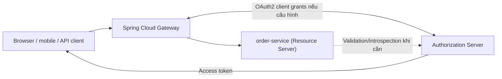
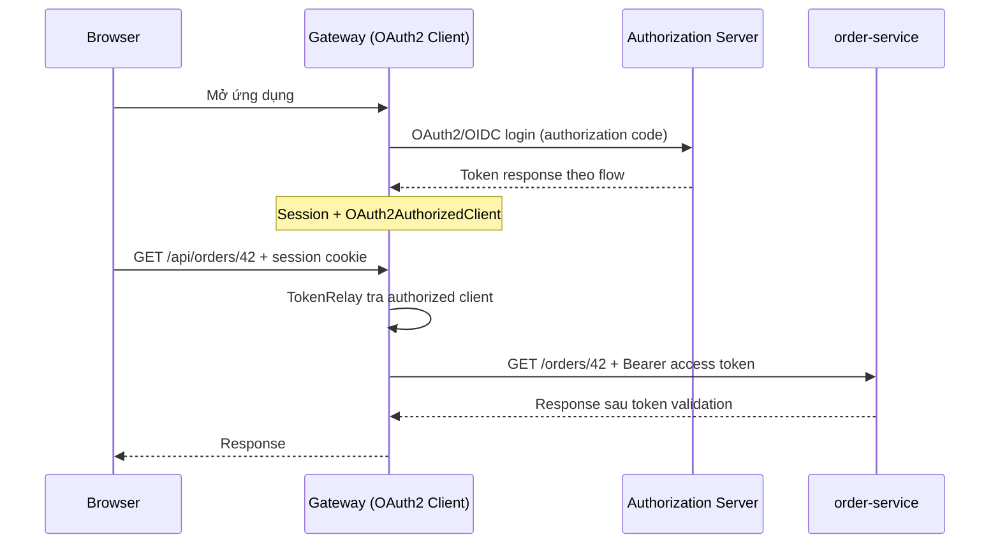
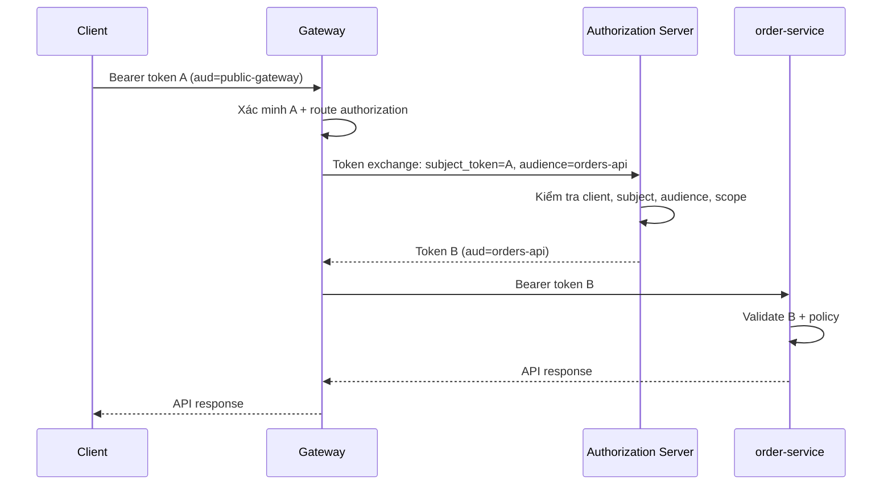
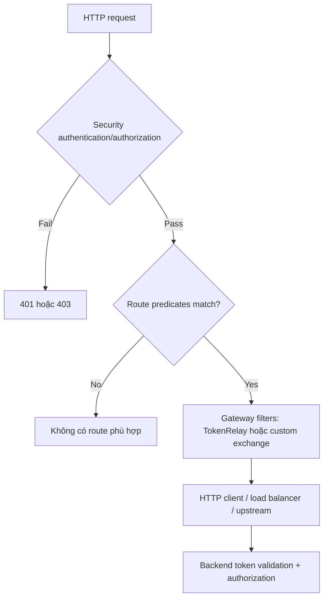

# Phân biệt relay token hiện có với cấp token hoặc trao đổi token

Khi xây dựng **Spring Cloud Gateway**, một API request đi từ client qua Gateway đến microservice thường phải mang thông tin xác thực. Cách truyền thông tin này quyết định ai có quyền gọi API, token được dịch vụ nào chấp nhận và Gateway có trách nhiệm gì với thông tin đăng nhập. Ba thao tác dễ bị nhầm là **relay token hiện có**, **yêu cầu cấp/làm mới token** và **trao đổi token để lấy token khác**.

Bài thuộc chương **Phiên đăng nhập và token**. Trọng tâm là phân biệt vai trò `TokenRelay` của Spring Cloud Gateway với OAuth 2.0/OIDC token issuance, refresh token và **OAuth 2.0 Token Exchange (RFC 8693)**. Nội dung kết nối với Spring Security WebFlux, route predicates/filter chain, service discovery, TLS, retry, rate limiting và khả năng quan sát request để vận hành cổng vào microservices an toàn.

> **Phạm vi:** Các ví dụ chủ yếu dành cho **Spring Cloud Gateway Server WebFlux** và Spring Security OAuth2 Client/Resource Server. Gateway Server MVC có cơ chế và API cấu hình khác; tên thuộc tính/phương thức có thể thay đổi theo phiên bản. Identity Provider/Authorization Server phải thực sự hỗ trợ grant và policy mà ứng dụng sử dụng.

## 1. Phân biệt bốn vai trò trong OAuth 2.0

| Thành phần | Chức năng | Ví dụ |
| --- | --- | --- |
| **Client** | Đề nghị truy cập tài nguyên, có thể là OAuth2 client | Browser/BFF, mobile app, machine-to-machine |
| **Authorization Server (AS)** | Xác thực/ủy quyền theo chính sách và phát hành access token | OIDC Identity Provider |
| **Resource Server** | Xác minh access token và quyết định có cho truy cập API không | `order-service`, `billing-service` |
| **Gateway** | Chọn route, lọc request, có thể xác thực và chuyển token | `api.example.test` |

Một ứng dụng có thể đồng thời đóng **nhiều vai trò**. Gateway có thể là Resource Server khi nhận Bearer token từ client; cũng có thể là OAuth2 Client khi dùng OAuth2 login, client credentials hoặc một grant được AS hỗ trợ.

**Gateway không tự trở thành Authorization Server** chỉ nhờ có `TokenRelay` hoặc Spring Security OAuth2 Client. Việc phát hành token hợp lệ thuộc AS. Gateway có thể **yêu cầu** AS cấp token và sau đó sử dụng hoặc chuyển tiếp token đó.



## 2. Access token, ID token, refresh token và session không tương đương

| Đối tượng | Mục đích hợp lệ | Không nên nhầm với |
| --- | --- | --- |
| **Access token** | Ủy quyền gọi một API/resource nhất định | Cookie phiên hoặc ID token |
| **ID token** (OIDC) | Thông tin kết quả xác thực user cho OIDC client | Access token gọi microservice |
| **Refresh token** | Yêu cầu AS cấp access token mới theo grant/policy | Token gửi tới mọi backend |
| **Session cookie** | Browser gửi để xác định phiên với ứng dụng quản lý session | Bearer token của backend |
| **Client credentials** | Xác thực ứng dụng với AS | Danh tính/ủy quyền của user cuối |
| **JWT** | Một định dạng token được ký và mang claims | Mọi access token; có thể có token opaque |

JWT thường có các claims như `iss` (issuer), `sub` (subject), `aud` (audience), `exp` (hết hạn), `nbf` và scope. Tính hợp lệ của chữ ký **không tự chứng minh** token phù hợp với mọi backend. Backend cần kiểm tra issuer, audience, hạn dùng và quyền theo hợp đồng.

Một access token cũng có thể là **opaque token**, xác minh bằng cơ chế introspection hoặc tích hợp phù hợp; không tự giải mã mọi chuỗi Bearer như JWT.

### Ví dụ audience khác nhau

```json
{
  "iss": "https://idp.example.test",
  "sub": "user-42",
  "aud": "gateway-api",
  "scope": "orders.read",
  "exp": 1893456000
}
```

Đây là dữ liệu payload **minh họa**, không phải JWT hợp lệ. Nếu `order-service` chỉ chấp nhận `aud=orders-api`, một token có `aud=gateway-api` có thể bị từ chối dù Gateway đã xác minh chữ ký. Không thể sửa chữ `aud` trong payload để “chuyển” token: thay đổi payload làm chữ ký cũ không còn hợp lệ.

## 3. Bảng so sánh: forwarding, relay, issuance và exchange

| Trường hợp | Nguồn token | Gateway thực hiện | Upstream nhận |
| --- | --- | --- | --- |
| **Forward incoming Bearer** | Client đã có access token | Giữ và chuyển header `Authorization` theo chính sách | Chính token từ client |
| **`TokenRelay` qua OAuth2 login** | Access token gắn `OAuth2AuthorizedClient` của người dùng/session | Lấy token từ OAuth2 Client infrastructure và gắn header downstream | Access token của authorized client |
| **Client credentials** | AS cấp token cho OAuth2 client qua grant | Yêu cầu token bằng danh tính ứng dụng | Token đại diện **quyền ứng dụng**, không mặc định đại diện user |
| **Refresh token** | AS cấp token mới dựa trên refresh token hợp lệ | OAuth2 client manager có thể thực hiện refresh | Access token đã được làm mới |
| **RFC 8693 token exchange** | AS nhận subject token từ một client có quyền | Yêu cầu AS phát hành **token khác** cho audience/scope được phép | Token mới theo policy AS |

**Sắc thái quan trọng:** Mục đích của `TokenRelay` là **đưa access token phù hợp vào request downstream**. Trong quá trình tìm authorized client, một OAuth2 client manager được cấu hình có thể cần **lấy hoặc làm mới token**. Vì vậy không nên nói `TokenRelay` “tuyệt đối không bao giờ gọi Authorization Server”. Nhưng `TokenRelay` **không mặc định thực hiện chuẩn RFC 8693**, không tự cấp quyền mới và không tự đổi audience theo URI route.

## 4. Trường hợp A: forward access token có sẵn từ client

Giả sử ứng dụng mobile nhận token từ AS rồi gọi:

```http
GET /api/orders/42 HTTP/1.1
Host: api.example.test
Authorization: Bearer <access-token-A>
```

Gateway có thể xác minh token như OAuth2 Resource Server và chuyển request tới `order-service`:

```yaml
spring:
  cloud:
    gateway:
      routes:
        - id: orders
          uri: lb://order-service
          predicates:
            - Path=/api/orders/**
          filters:
            - StripPrefix=1
```

Nếu không có filter/header policy loại bỏ hoặc thay thế `Authorization`, HTTP proxy của Gateway có thể forward header đó đến upstream. Đây là **chuyển tiếp header Bearer**, chưa nhất thiết dùng `TokenRelay`. Phải kiểm tra request backend nhận để xác nhận, vì security filter, HTTP headers filters hoặc proxy khác có thể thay đổi dữ liệu.

### Gateway Resource Server không tự tạo OAuth2AuthorizedClient

Ví dụ cấu hình WebFlux với JWT:

```yaml
spring:
  security:
    oauth2:
      resourceserver:
        jwt:
          issuer-uri: https://idp.example.test/realms/demo
```

```java
@Bean
SecurityWebFilterChain apiSecurity(ServerHttpSecurity http) {
    return http
        .authorizeExchange(exchanges -> exchanges
            .pathMatchers(HttpMethod.GET, "/api/orders/**")
                .hasAuthority("SCOPE_orders.read")
            .pathMatchers(HttpMethod.POST, "/api/orders/**")
                .hasAuthority("SCOPE_orders.write")
            .anyExchange().authenticated())
        .oauth2ResourceServer(oauth2 ->
            oauth2.jwt(Customizer.withDefaults()))
        .build();
}
```

Ví dụ giả định scope được ánh xạ sang authorities dạng `SCOPE_...`. Với production, cần thêm **audience validation**, phân tách quyền theo route/method, CORS/CSRF policy thích hợp và kiểm tra issuer/clock skew. Resource Server xác minh incoming Bearer token, nhưng **không mặc định tạo `OAuth2AuthorizedClient`** cho token đó.

### Điều kiện để forward là hợp lệ

- Token có issuer/audience mà **backend thực sự tin**.
- Scope/role phù hợp thao tác; Gateway và backend thực hiện authorization theo hợp đồng.
- Token chưa hết hạn/thu hồi theo cơ chế kiểm tra tương ứng.
- Kết nối Gateway → backend được bảo vệ và không làm lộ token.
- Không có yêu cầu downscope, actor identity hoặc sender-constrained token mà forwarding đơn giản không đáp ứng.

Nếu backend yêu cầu audience khác, không bỏ qua validation để “cứu request”; sử dụng luồng cấp token đúng đích hoặc exchange khi được AS hỗ trợ.

## 5. Trường hợp B: OAuth2 login + `TokenRelay`

Mô hình Browser → Gateway (BFF) có thể hoạt động như sau:

1. User đăng nhập thông qua OAuth2 Authorization Code / OIDC.
2. AS cấp access token cho OAuth2 client, cùng những token khác khi grant/policy cho phép.
3. Gateway có **server-side session** và `OAuth2AuthorizedClient` liên quan principal/client registration.
4. Browser gọi API với **session cookie**, không nhất thiết gửi Bearer token.
5. `TokenRelay` lấy access token liên quan authorized client và gắn `Authorization: Bearer ...` tới microservice.
6. Microservice xác minh access token và authorization của chính nó.



### Cấu hình minh họa

```yaml
spring:
  security:
    oauth2:
      client:
        registration:
          gateway-login:
            provider: corp-idp
            client-id: <client-id-from-secret-store>
            client-secret: <client-secret-from-secret-store>
            authorization-grant-type: authorization_code
            redirect-uri: "{baseUrl}/login/oauth2/code/{registrationId}"
            scope:
              - openid
              - profile
              - orders.read
        provider:
          corp-idp:
            issuer-uri: https://idp.example.test/realms/demo

  cloud:
    gateway:
      routes:
        - id: orders-with-relay
          uri: lb://order-service
          predicates:
            - Path=/api/orders/**
          filters:
            - StripPrefix=1
            - TokenRelay=
```

**Không dùng literal secret như trên trong production.** Các giá trị góc nhọn chỉ là placeholder để nhắc phải lấy từ secret manager/environment có bảo vệ; thay bằng hệ thống cấu hình bí mật thực tế. Cần dependency OAuth2 Client, Gateway WebFlux và LoadBalancer/discovery nếu sử dụng `lb://`.

Cấu hình `TokenRelay=` không ghi client registration thường dùng authorized client gắn với user/principal đã đăng nhập. Nếu không có authorized client phù hợp, filter **không tự biến incoming user Bearer token** thành một authorized client. Hành vi lỗi/bỏ qua cụ thể cần được kiểm tra theo phiên bản và cấu hình OAuth2 client manager.

Với các thế hệ Gateway khác nhau, prefix route có thể là `spring.cloud.gateway.routes` hoặc `spring.cloud.gateway.server.webflux.routes`. Xác minh prefix của starter/phiên bản trước khi kết luận filter không hoạt động.

### Spring Security OAuth2 Login

```java
@Bean
SecurityWebFilterChain loginSecurity(ServerHttpSecurity http) {
    return http
        .authorizeExchange(exchanges -> exchanges
            .pathMatchers("/api/orders/**").authenticated()
            .anyExchange().permitAll())
        .oauth2Login(Customizer.withDefaults())
        .oauth2Client(Customizer.withDefaults())
        .build();
}
```

Đoạn mã minh họa pipeline login, **không phải production policy đầy đủ**. Browser BFF cần CSRF protection cho các thao tác thay đổi trạng thái khi dựa vào cookie/session; cấu hình cookie `Secure`, `HttpOnly`, `SameSite` phù hợp; xác minh redirect URI public khi Gateway đứng sau ingress; giữ session và authorized clients an toàn giữa nhiều replica.

### `TokenRelay=registrationId`

```yaml
filters:
  - TokenRelay=gateway-login
```

Khi khai báo client registration ID, filter có thể nhờ `ReactiveOAuth2AuthorizedClientManager` tìm hoặc lấy authorized client của registration đó. Nếu registration dùng grant được cấu hình như client credentials, việc này có thể liên quan đến **AS cấp token bằng grant**, không tự động mang quyền user.

**Không suy luận “có registrationId là có user delegation”.** Loại grant và token claims thực tế quyết định token đại diện cho ai. Backend cần kiểm tra chính token được nhận.

## 6. Trường hợp C: AS cấp token mới qua grant flow

### Authorization Code

Authorization Code flow thường phục vụ ứng dụng có người dùng tương tác. Client chuyển hướng user tới AS, nhận authorization code rồi gọi token endpoint để đổi code lấy token theo quy trình bảo mật. **AS phát hành token; Gateway là client yêu cầu token.**

```text
Browser -> Gateway / OAuth2 client -> Authorization Server
        -> authorization code -> token endpoint
        -> access token (và ID token/refresh token khi policy cho phép)
```

Sau đó, `TokenRelay` có thể lấy access token từ authorized client để gọi downstream nếu audience/scope phù hợp.

### Client Credentials

Grant này phù hợp khi Gateway cần gọi một API bằng **danh tính ứng dụng**, không mặc định đại diện cho user cuối:

```http
POST /oauth2/token HTTP/1.1
Host: idp.example.test
Authorization: Basic <client-authentication>
Content-Type: application/x-www-form-urlencoded

grant_type=client_credentials&scope=inventory.read
```

AS xác minh client và quyết định scope được cấp. Nếu Gateway dùng client credentials để gọi `inventory-service`, backend phải hiểu token này đại diện client/app, **không phải user đang mua hàng**. Không dùng app token để bỏ qua phân quyền user cho API nhạy cảm.

### Refresh Token

OAuth2 client có refresh token hợp lệ có thể dùng nó để xin một access token mới khi token cũ hết hạn hoặc sắp hết hạn. Việc refresh phụ thuộc grant/policy, client manager và AS:

```text
access token cũ -> hết hạn/sắp hết hạn
  -> nếu refresh token hợp lệ và client được phép
  -> AS token endpoint dùng refresh_token grant
  -> access token mới theo policy
```

**Refresh không đồng nghĩa token exchange.** Refresh token cần được lưu trữ như bí mật; không relay nó xuống mọi microservice, không cho vào log hoặc response. Refresh token rotation còn có nguy cơ race giữa nhiều request/replica nếu state không được đồng bộ.

## 7. Trường hợp D: Token Exchange theo RFC 8693

**OAuth 2.0 Token Exchange** cho phép OAuth2 client trình một `subject_token` tới token endpoint để yêu cầu AS cấp **token khác** phù hợp tài nguyên đích, scope hoặc ngữ cảnh ủy quyền mà AS chấp nhận.

Ví dụ:

```text
Client token A:
  sub=user-42
  aud=public-gateway
  scope=orders.read

order-service chỉ chấp nhận:
  aud=orders-api
  scope=orders.read

Gateway có quyền exchange:
  token A -> Authorization Server -> token B (aud=orders-api)

Gateway gửi:
  Authorization: Bearer token-B
```



### Request trao đổi token minh họa

```http
POST /oauth2/token HTTP/1.1
Host: idp.example.test
Authorization: Basic <client-authentication>
Content-Type: application/x-www-form-urlencoded

grant_type=urn:ietf:params:oauth:grant-type:token-exchange
&subject_token=<incoming-access-token>
&subject_token_type=urn:ietf:params:oauth:token-type:access_token
&requested_token_type=urn:ietf:params:oauth:token-type:access_token
&audience=orders-api
&scope=orders.read
```

Body form trên được tách dòng cho dễ đọc; khi gửi thật phải **URL-encode form data đúng chuẩn**, không gửi raw line breaks tùy ý.

AS có thể trả:

```json
{
  "access_token": "<new-token-for-orders-api>",
  "issued_token_type": "urn:ietf:params:oauth:token-type:access_token",
  "token_type": "Bearer",
  "expires_in": 300,
  "scope": "orders.read"
}
```

Các giá trị thực tế khác nhau theo AS/profile. RFC 8693 có thể dùng `resource` hoặc `audience`, có `actor_token`/`actor_token_type` cho một số ngữ cảnh delegation và có token type khác khi được hỗ trợ. **Không phải mọi IdP đều hỗ trợ grant này** hoặc chấp nhận tất cả tham số. Phải kiểm tra khả năng hỗ trợ và policy cấp quyền exchange.

### Exchange không phải quyền tự mở rộng scope

Nếu user chỉ có `orders.read`, việc Gateway yêu cầu `orders.write` không có nghĩa AS phải cấp. Client exchange phải được ủy quyền cho audience/resource mới, và AS phải giới hạn quyền/actor/subject theo chính sách. Backend vẫn xác minh token B và authorization của chính nó.

**Đừng tự sửa claim của JWT.** Token B phải do AS tin cậy phát hành/ký hoặc theo protocol có thẩm quyền. Không dùng một `SetRequestHeader` chứa JWT tự tạo không có trust chain rồi gọi đó là token exchange.

### `TokenRelay` không mặc định là RFC 8693

`TokenRelay` tìm/lấy access token theo OAuth2 client infrastructure và gắn vào downstream header. Nó **không tự thực hiện** grant `urn:ietf:params:oauth:grant-type:token-exchange`, không tự lấy từng `audience` từ service ID và không tự bảo đảm downscope. Token exchange thật cần một thành phần OAuth2 Client/AS integration có hỗ trợ giao thức, hoặc filter/service riêng được thiết kế và kiểm thử.

## 8. Quyết định cơ chế từ yêu cầu upstream

| Yêu cầu | Cách tiếp cận | Điều kiện an toàn |
| --- | --- | --- |
| Mobile có token đã cấp cho `orders-api` | Forward Bearer sau kiểm tra | Backend chấp nhận issuer/aud/scope |
| Browser dùng session tại Gateway | OAuth2 login + `TokenRelay` | Có authorized client/token phù hợp, session/CSRF an toàn |
| Backend chỉ yêu cầu app identity | Client credentials | Scope theo client, không giả danh user |
| Incoming token `aud=gateway-api`, backend cần `aud=orders-api` | Token exchange nếu AS hỗ trợ | Client exchange được phép và AS kiểm tra quyền |
| Access token hết hạn, có refresh token | Refresh grant qua client manager | Token rotation/store, expiry, revoke |
| Endpoint public không cần danh tính | Không relay token | Public route được định nghĩa, kiểm soát dữ liệu công khai |
| Không có token/grant hợp lệ | Từ chối hoặc yêu cầu login | Không bypass authentication hoặc tạo token giả |

Đừng chọn cơ chế vì “một filter ngắn hơn”. Bắt đầu từ câu hỏi **ai là subject, ai là actor, backend cần audience/scope nào, có session hay không, và token được AS cấp bằng grant gì**.

## 9. Route matching trước khi token filter chạy

Trong WebFlux, Security WebFilter thường xử lý request trước `RoutePredicateHandlerMapping`. Sau khi route khớp, các `GatewayFilter` mới được thực thi. `TokenRelay` thuộc Gateway route filter chain.



Các hệ quả:

- `TokenRelay` **không xử lý** request bị Security chặn trước khi chọn route.
- Nếu `Path`/`Method`/`Host` không khớp, filter token của route đó không chạy.
- Một route có `TokenRelay` không tự đảm bảo nó có principal hoặc authorized client đúng.
- Backend vẫn phải kiểm tra token; Gateway xác thực không thay thế authorization của từng resource.
- Filter khác có thể thay đổi `Authorization` trước/sau relay, dẫn tới sai token.

### Authorization header cần một source of truth

Nếu client gửi token A, `TokenRelay` gắn token B, một filter khác lại dùng `AddRequestHeader=Authorization,...`, backend có thể nhận nhiều giá trị/credential sai. Không ghép nhiều Bearer token vào một header theo kiểu append.

Hãy xác định **chỉ một cơ chế quyết định Authorization dành cho upstream** trên từng route. Nếu policy yêu cầu token B, cần **thay** header, không bổ sung danh sách credential. Nên loại giá trị client giả mạo tại trust boundary đúng chỗ; không dùng raw client header làm identity đã xác thực.

## 10. Khung thiết kế một filter token exchange

Một integration token exchange an toàn phải:

1. Lấy incoming token từ authentication đã **xác minh**; không đơn giản tin bất kỳ raw header nào.
2. Quyết định audience/scope từ **cấu hình route và quyền**; không để client tùy ý đặt `X-Target-Audience` để lấy token cho resource khác.
3. Gọi token endpoint của AS với client authentication phù hợp, dùng HTTPS và validation chứng chỉ.
4. Xử lý token response, expiry, denied exchange, timeout, cancellation và giới hạn concurrency.
5. Thay header `Authorization` của request downstream bằng token B.
6. Không tự fallback sang token A khi AS từ chối token B do audience/scope.
7. Không log hoặc phơi bày access/refresh token.

Pseudocode minh họa filter WebFlux:

```java
// Chỉ minh họa cấu trúc, KHÔNG phải mã production hoàn chỉnh.
// Các service bên dưới phải tự thực thi validation, AS call và errors.
GatewayFilter exchangeFilter = (exchange, chain) ->
    trustedTokenResolver.resolve(exchange)
        .flatMap(sourceToken ->
            tokenExchangeService.exchange(
                sourceToken, "orders-api", "orders.read"))
        .flatMap(newToken -> {
            ServerHttpRequest downstream = exchange.getRequest()
                .mutate()
                .headers(headers ->
                    headers.setBearerAuth(newToken.value()))
                .build();

            return chain.filter(
                exchange.mutate().request(downstream).build());
        });
```

`trustedTokenResolver` ở đây là abstraction **chỉ nhận token đã xác thực và được cấp quyền**, không phải helper đọc raw header bất kỳ. Pseudocode cần thêm handling khi không có principal, AS từ chối grant, token hết hạn, response đã commit và cancel; thực tế nên ưu tiên API Spring Security phù hợp nếu **phiên bản thư viện đã hỗ trợ** token exchange.

### Caching token trao đổi

Để tránh gọi AS cho mọi request, token B có thể được cache có giới hạn, nhưng cache key phải gắn với **principal/tenant, source token hoặc các thuộc tính ủy quyền liên quan, audience, scope, client registration và expiration**. Không cache token B chỉ theo `orders-api`: nếu không, token user A có thể rò sang request của user B.

Không coi token cache là quyền bỏ qua revocation/policy. Đặt TTL theo hạn token và yêu cầu bảo mật; không ghi raw token vào cache key hiển thị trong metric/log.

## 11. Session BFF và Gateway nhiều replica

Khi browser giữ cookie phiên và Gateway giữ authorized client, các replica Gateway phải chia sẻ hoặc đồng bộ state theo kiến trúc:

| Chủ đề | Rủi ro | Khuyến nghị |
| --- | --- | --- |
| Session chỉ lưu local | User có session trên replica A, request tới B không tìm thấy | Dùng session store chia sẻ hoặc cơ chế nhất quán phù hợp |
| `OAuth2AuthorizedClient` không đồng bộ | TokenRelay hoạt động ở một replica nhưng không ở replica khác | Cấu hình authorized client service/repository đúng |
| Refresh token rotation | Hai request refresh đồng thời gây `invalid_grant` | Thiết kế đồng bộ/rotation và xử lý phiên hết hạn |
| Cookie thiếu `Secure`/`HttpOnly` | Rò rỉ hoặc lộ session | Dùng HTTPS, cookie policies phù hợp |
| CSRF cho thao tác POST | Browser tự gửi session cookie có thể bị khai thác | Dùng CSRF protection đúng mô hình |
| Redirect URI sai sau ingress | OAuth2 login callback bị mismatch | Dùng hostname/scheme public đã tin cậy |
| Logout/revocation | Session hết nhưng authorized client/token vẫn lưu | Thiết kế cleanup, revoke và expiry |

Không mặc định mọi Gateway replica tự chia sẻ phiên chỉ vì dùng `lb://` cho backend. `lb://` giải quyết chọn service instance, không quản lý OAuth2AuthorizedClient store.

### Stateless Resource Server khác BFF

Với API stateless, Gateway chỉ xác minh incoming Bearer token, không nhất thiết có `oauth2Login` hay cookie session. Với BFF, Gateway là OAuth2 client, browser có thể không thấy access token. Nếu ứng dụng phục vụ cả hai, hãy phân tách route và SecurityWebFilterChain để tránh API client nhận `302` login khi cần `401` hoặc dùng sai principal khi relay token.

## 12. Những giới hạn bảo mật khác

### ID token và refresh token không dành cho upstream API

Không lấy ID token (thường có audience là OAuth2 client) thay cho access token chỉ vì nó là JWT. Không gửi refresh token đến backend không có trách nhiệm/quyền sử dụng refresh grant. Token có thể chứa thông tin nhạy cảm, cần bảo vệ trên đường truyền, khi lưu trữ và khi quan sát.

### Sender-constrained tokens

Một số access token bị ràng buộc với **mTLS certificate** hoặc **DPoP key**. Chỉ copy chuỗi Bearer có thể **không đủ**: downstream còn cần bằng chứng sở hữu khóa/certificate. Kiến trúc relay/exchange phải xem xét sender binding, SNI/TLS client configuration và khả năng AS cấp token đúng dạng.

### Identity headers do client khai

Không tin `X-User-Id`, `X-Role` hay `X-Tenant` từ internet như một claim đã được xác minh. Nếu Gateway truyền identity nội bộ, backend phải xác minh được tính toàn vẹn và quyền, ví dụ thông qua access token được AS tin cậy cấp.

### Không tự leo thang quyền

Gateway không được tự sửa claims, thêm scope hoặc đổi audience bằng phép biến đổi header để cho phép API vượt quyền. Token exchange phải được AS kiểm tra; Resource Server phía sau vẫn phải kiểm tra authorization theo resource/action.

## 13. Phân loại lỗi theo đúng lớp xử lý

| Kết quả | Nguyên nhân có thể | Bước kiểm tra |
| --- | --- | --- |
| `302` sang login | Browser chưa có OAuth2 login session | Đúng flow BFF hay API stateless? |
| `401` tại Gateway | Thiếu/sai incoming credential | JWT/opaque validation, issuer, aud, expiry |
| `403` tại Gateway | Có principal nhưng thiếu quyền route | Scope, role, method policy |
| `401` tại backend | Đã proxy nhưng token sai audience/issuer/expiry hoặc không có token | Token nào backend thật sự nhận? |
| `403` tại backend | Token hợp lệ nhưng thiếu backend scope/resource permission | Backend authorization |
| `invalid_client` tại AS | Client authentication/registration sai | Credential/certificate/config AS |
| `invalid_grant` khi refresh | Refresh token rotation/revocation/hết hạn, race | Authorized client state |
| Token exchange bị AS từ chối | Không hỗ trợ grant/không cho audience/scope | AS exchange policy |
| `503` route `lb://` | Không có service instance hoặc backend tạm lỗi | Discovery/load balancing |
| Timeout | AS token endpoint hoặc backend chậm/không kết nối | Hai HTTP calls, timeout budgets |
| User A nhận dữ liệu user B | Sai token/session/cache isolation | Sự cố bảo mật, kiểm tra cache key và principal |

**Phân biệt hai lần gọi HTTP** có thể xảy ra: Gateway → AS để refresh/exchange token, rồi Gateway → backend để gọi nghiệp vụ. Nếu lỗi ở lần gọi AS, backend có thể chưa nhận request. Nếu backend trả `401`, có request đã được chuyển tiếp nhưng token/policy đích không hợp lệ.

### Quan sát an toàn

Nên ghi route ID, method, HTTP status, issuer/audience **dự kiến**, grant type, client registration ID, token expiry metadata được phép, attempt count, trace ID và loại exception. **Không ghi access token, refresh token, ID token, raw Authorization, cookie phiên hoặc client secret**. Token exchange logs cần bảo vệ như authentication logs.

## 14. Tương tác với TLS, CORS, retry và rate limiting

- **TLS:** Bảo vệ client → Gateway, Gateway → AS và Gateway → backend. TLS terminated ở ingress không đảm bảo kết nối backend được mã hóa. Kiểm tra hostname/SAN, truststore và mTLS nếu bắt buộc; đừng tắt certificate verification để relay token dễ hơn.
- **CORS:** Browser preflight `OPTIONS` có thể không gửi token của actual request. Cấu hình CORS đủ sớm trước Security phù hợp; actual request vẫn phải xác thực. CORS không thay CSRF khi dùng cookie session.
- **Retry:** Timeout sau một lần POST không chứng minh backend chưa xử lý. Với refresh rotation, retry token endpoint mù quáng còn có thể gây `invalid_grant`. Phân tách retry policy của AS và API nghiệp vụ.
- **Circuit breaker:** Có thể giúp giới hạn lỗi từ AS hoặc backend, nhưng fallback không được “bỏ xác thực cho qua”. Cần deadline, timeout và số attempt giới hạn.
- **Rate limiting:** Tránh hàng nghìn request đồng thời cùng refresh/exchange token (thundering herd); giới hạn concurrency và cache theo principal an toàn. Rate key nên dựa vào danh tính đã xác minh.
- **Service discovery:** Nếu `lb://order-service` không có instance, token relay có thể hoàn toàn đúng nhưng request không tới backend. Kiểm tra route ID, service ID và kết quả chọn instance.

## 15. Kiểm thử relay, cấp và trao đổi token

Không chỉ kiểm tra `HTTP 200`. Mỗi cơ chế phải được xác nhận qua **token mà upstream test server nhận được**, đồng thời không để token thật xuất hiện trong test logs.

### Test A — Forward incoming Bearer

```bash
curl -i 'http://localhost:8080/api/orders/42' \
  -H 'Authorization: Bearer <test-access-token-for-orders-api>'
```

Trong test fixture, Gateway phải xác minh incoming token theo security policy, route đúng và upstream nhận Authorization phù hợp. Nếu token không hợp lệ, upstream mock phải nhận **0 request**. Lệnh trên chỉ là minh họa, không tạo token hợp lệ từ placeholder.

### Test B — OAuth2 login + `TokenRelay`

```text
1. Tạo OAuth2 login session / principal hợp lệ trong test.
2. Cung cấp OAuth2AuthorizedClient chứa access token A.
3. Request /api/orders/42 chỉ với session cookie.
4. Upstream mock xác minh nhận Bearer A.
5. Test session không tồn tại và authorized client không tìm thấy.
6. Test token gần hết hạn, refresh và logout/revocation theo manager.
```

Chỉ mock `Authentication` không tự chứng minh `OAuth2AuthorizedClient` tồn tại. Khi dùng Spring Security test helpers, phải cung cấp authorized client/repository/manager đúng như cách `TokenRelay` tra cứu trong phiên bản đang chạy.

### Test C — RFC 8693 exchange

```text
1. Client gửi token A có aud=public-gateway.
2. Gateway xác thực A, kiểm tra method/scope và chọn route orders.
3. AS stub xác nhận exchange request với subject_token=A,
   audience=orders-api, scope=orders.read.
4. AS stub trả token B có aud=orders-api.
5. Upstream mock nhận Authorization: Bearer B, KHÔNG nhận A.
6. AS từ chối exchange => upstream nhận 0 request.
7. Hai user cùng gọi => token/cache không bị dùng chéo.
```

### Ma trận test tối thiểu

| Tình huống | Kết quả mong đợi |
| --- | --- |
| Token A hợp lệ cho `orders-api` | Forward A được chấp thuận |
| Token thiếu/invalid signature | Gateway `401`, không gọi upstream |
| Token hợp chữ ký nhưng sai audience | Từ chối đúng chính sách |
| Token có `orders.read`, request POST cần `orders.write` | `403` phù hợp, không mở quyền |
| Browser session + authorized client | TokenRelay sử dụng access token của authorized client |
| Có session nhưng không có authorized client | Không tự tạo token user |
| Token hết hạn, refresh hợp lệ | Manager refresh khi được cấu hình, giữ rotation an toàn |
| Refresh token bị thu hồi | Không fallback sang token hết hạn |
| Client credentials | Token biểu diễn quyền client/app, không tự mang user |
| Exchange đúng audience/scope | Upstream nhận token B |
| Exchange audience không được phép | AS từ chối; upstream không nhận token A sai đích |
| AS timeout/unavailable | Lỗi theo contract, không bypass authentication |
| Hai user và hai Gateway replica | Không rò token giữa users/tenants |
| POST có retry sau timeout | Idempotency được đảm bảo theo nghiệp vụ |
| CORS preflight OPTIONS | Không yêu cầu Bearer của actual request như một OPTIONS credential |

## 16. Runbook khi “token không đến backend”

1. Xác định client gửi **Bearer hay cookie**, Gateway đang dùng Resource Server, OAuth2 login, client credentials hay token exchange.
2. Kiểm tra Spring Security đã xác thực principal và authorization cho route chưa; `401`/`403` tại Gateway khác `401`/`403` upstream.
3. Kiểm tra route ID, predicates và `TokenRelay`/custom exchange filter **đã được nạp** theo prefix cấu hình đúng.
4. Nếu `TokenRelay`, kiểm tra OAuth2 client registration, `OAuth2AuthorizedClient`, principal/session và token expiry/refresh.
5. Nếu exchange, kiểm tra AS có hỗ trợ RFC 8693, client có được phép đổi token, subject token và audience/scope hợp lệ không.
6. Nếu upstream trả `401`, so sánh **loại token/A-B**, issuer/audience/scope và sender binding theo telemetry/test an toàn.
7. Nếu không có request upstream, kiểm tra AS call failure, route mismatch, load balancer, DNS/TLS và timeout.
8. Với nhiều Gateway replica, so sánh session/authorized client store, token cache key, refresh rotation race và clock skew.
9. Kiểm thử lại happy path, token không hợp lệ, wrong audience, revoked refresh, denied exchange, concurrent users và retry.
10. Kiểm tra không có secrets/token trong access logs, tracing spans, error messages hoặc response headers.

### Các nhầm lẫn thường gặp

| Nhận định sai | Điều đúng |
| --- | --- |
| “Bật `TokenRelay` là Gateway phát hành token” | AS phát hành; TokenRelay dùng OAuth2 client infrastructure |
| “Resource Server đã xác thực thì có authorized client” | Xác thực Bearer không mặc định tạo OAuth2AuthorizedClient |
| “TokenRelay luôn copy incoming Authorization” | Với OAuth2 login, token có thể đến từ authorized client |
| “TokenRelay tự đổi `aud` theo service ID” | Không mặc định làm RFC 8693 exchange |
| “Client credentials là token của user” | Là quyền OAuth2 client/app theo grant, không tự là user delegation |
| “Refresh là trao đổi token sang audience khác” | Refresh và token exchange có mục đích khác |
| “ID token là JWT nên gọi API nào cũng được” | ID token không phải access token của API |
| “Sửa payload JWT là đổi audience” | Chữ ký không còn hợp lệ |
| “AS từ chối exchange thì cứ forward token A” | Sai audience/chính sách, phải fail theo contract |
| “`401` downstream chứng minh Gateway chưa xác thực” | Gateway có thể đã authn nhưng backend từ chối token khác |
| “Cache theo audience là đủ” | Phải cách ly subject/tenant/source authorization/scope |
| “Retry token endpoint luôn an toàn” | Refresh rotation, state và timeout có thể bị ảnh hưởng |

## 17. Bài tập tình huống

Một Gateway phục vụ SPA tại `https://app.example.test`, có hai route:

- `/api/orders/**` → `lb://order-service`; backend yêu cầu token có `aud=orders-api`, scope `orders.read` hoặc `orders.write`.
- `/api/billing/**` → `lb://billing-service`; backend yêu cầu `aud=billing-api` và scope `billing.read`.
- User đăng nhập OIDC; Gateway có browser session và authorized client.
- AS hỗ trợ token exchange cho một số client đã được cấp quyền; Gateway chạy nhiều replica.

**Hãy thiết kế:**

1. Route nào có thể dùng `TokenRelay` trực tiếp nếu authorized client đã chứa access token đúng audience/scope?
2. Khi chỉ có token `aud=public-gateway`, làm sao lấy token cho `billing-api` mà không sửa JWT?
3. Với `POST /api/orders`, vì sao cần authority `orders.write` và idempotency key nếu retry?
4. Session và `OAuth2AuthorizedClient` phải được lưu/đồng bộ thế nào giữa các replica?
5. Nếu AS từ chối exchange hoặc refresh token bị thu hồi, client nhận lỗi theo hợp đồng nào và backend có được gọi không?
6. Vì sao một OAuth2 client credentials token không thể thay user authorization của nghiệp vụ billing?
7. Cách kiểm thử nào xác nhận token upstream nhận đúng audience mà không ghi raw token vào production log?

### Câu hỏi tự kiểm tra

1. Access token, ID token, refresh token và session cookie khác nhau ở mục đích nào?
2. Forward incoming Bearer có bắt buộc bật `TokenRelay` không?
3. `OAuth2AuthorizedClient` khác principal đã xác thực trong `SecurityContext` như thế nào?
4. Thành phần nào thực sự phát hành token trong authorization code, client credentials và refresh flow?
5. Khi `TokenRelay=registrationId`, vì sao không chắc token đại diện user?
6. Token exchange RFC 8693 dùng `subject_token`, `subject_token_type` và `audience` để làm gì?
7. Vì sao token ký đúng nhưng sai `aud` vẫn bị downstream từ chối?
8. Token exchange có tự cho phép scope rộng hơn quyền nguồn không?
9. Vì sao không thể dùng `SetRequestHeader` với token giả để thay RFC 8693?
10. Cần những ràng buộc nào trên token cache để không rò credential giữa users?
11. Token sender-constrained mTLS/DPoP khiến relay phức tạp hơn ở điểm nào?
12. Cách phân biệt `401` từ Gateway, `401` từ upstream và lỗi grant từ AS?
13. Vì sao browser session cần xem xét CSRF còn API stateless Bearer có mô hình khác?
14. Vì sao retry POST cần xem cả token validity và nghiệp vụ idempotency?
15. Những gì cần kiểm tra trước khi chuyển token qua `lb://service-id`?

**Ghi nhớ:** **Relay** chuyển một access token hiện có và phù hợp; **cấp/làm mới** là OAuth2 client yêu cầu Authorization Server phát hành token theo grant; **token exchange RFC 8693** là yêu cầu AS cấp **token khác** dựa trên subject token và mục tiêu được cho phép. `TokenRelay` hỗ trợ gắn access token của authorized client vào request upstream, nhưng không mặc định đổi audience hoặc thay thế token exchange. Mỗi route phải có nguồn token rõ ràng, issuer/audience/scope đúng, session và cache được cách ly, TLS an toàn và kiểm thử token mà backend thật sự nhận.

