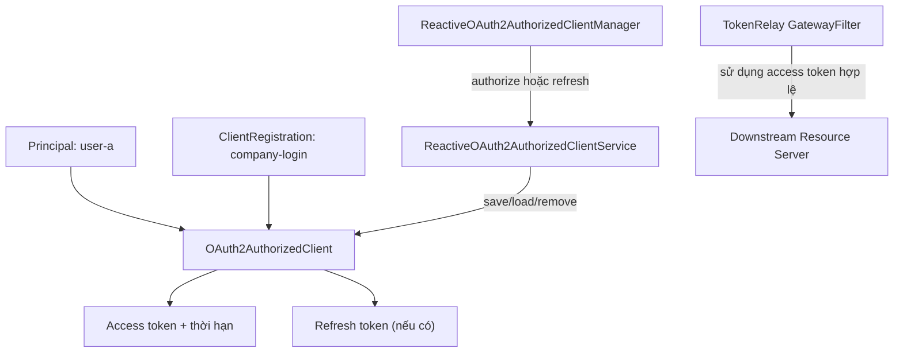
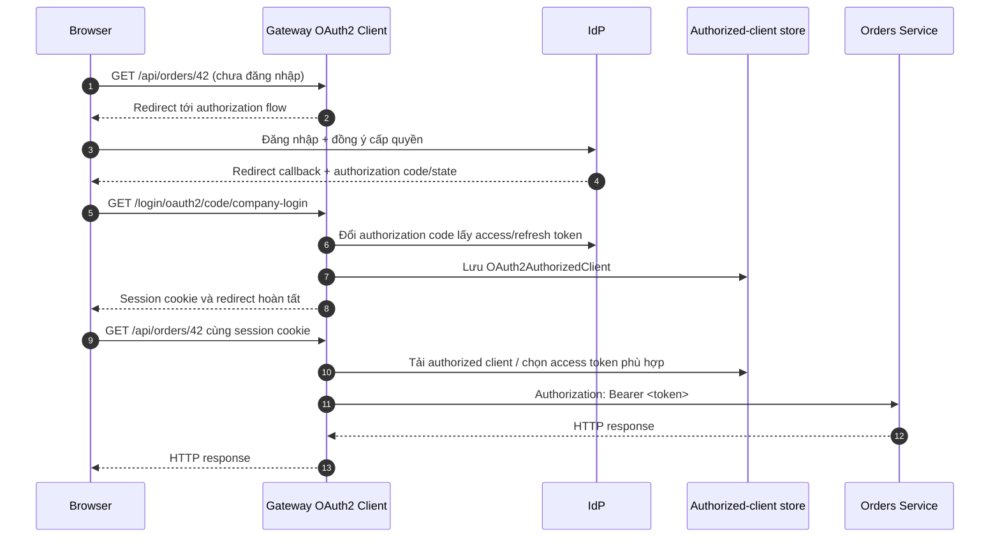

# Lưu trạng thái authorized client và giới hạn lưu trữ trong bộ nhớ

## 1. Vì sao API Gateway cần lưu trạng thái OAuth2 Authorized Client?

Khi **SPRING_CLOUD_GATEWAY** hoạt động như một cổng vào microservices, nó có thể chỉ kiểm tra JWT được client gửi tới, nhưng cũng có thể đóng vai trò **OAuth2 Client**: đưa người dùng tới Identity Provider (IdP) đăng nhập, nhận access token, rồi gọi dịch vụ phía sau thay mặt người dùng bằng filter `TokenRelay`.

Ở mô hình thứ hai, Gateway cần biết **OAuth2 client registration nào** đã được người dùng cấp quyền, **access token nào** đang sử dụng và đôi khi **refresh token nào** giúp xin token mới. Spring Security gom thông tin này vào `OAuth2AuthorizedClient`.

Vấn đề xuất hiện khi sử dụng cấu hình mặc định: theo tài liệu Spring Security reactive, `InMemoryReactiveOAuth2AuthorizedClientService` là implementation lưu authorized client **trong bộ nhớ của một tiến trình**. Tài liệu Spring Cloud Gateway cũng lưu ý `TokenRelay` dựa trên mô hình authorized-client service in-memory mặc định và cần một implementation đủ bền vững hơn nếu muốn vận hành nghiêm túc.

Hãy xét hệ thống có hai Gateway replica:

```text
Client --(SESSION cookie)--> Load Balancer
                                |
                         +------+------+
                         |             |
                      Gateway A     Gateway B
                      authorized     authorized
                      clients A      clients B
                         |             |
                         +---- Orders Service
```

Người dùng đăng nhập qua **Gateway A**. Nếu authorized client chỉ nằm trong heap của A, **Gateway B không tự nhìn thấy token đã lưu ở A**. Khi A bị restart, trạng thái in-memory cũng mất. Việc thêm một Redis store cho **WebSession** không mặc nhiên đồng nghĩa kho `ReactiveOAuth2AuthorizedClientService` cũng được chia sẻ.

Bài học thuộc chương **Phiên đăng nhập và token**. Bạn sẽ biết cách phân biệt session, client registration và authorized client; quan sát hạn chế của in-memory store; cấu hình một Gateway `oauth2Login` + `TokenRelay`; và lựa chọn persistence phù hợp cho hệ thống nhiều instance, có refresh token, TLS, rate limiting, circuit breaker, retry và tracing.

### Mục tiêu học tập

Sau bài này, bạn có thể:

1. Giải thích cấu trúc `OAuth2AuthorizedClient` và lý do nó không đồng nghĩa với `WebSession` hay JWT access token.
2. Phân biệt `ReactiveClientRegistrationRepository`, `ServerOAuth2AuthorizedClientRepository`, `ReactiveOAuth2AuthorizedClientService` và `ReactiveOAuth2AuthorizedClientManager`.
3. Cấu hình Gateway Server WebFlux làm **OAuth2 Client** để đăng nhập và `TokenRelay` token xuống upstream.
4. Hiểu rõ dữ liệu được lưu trong bộ nhớ, giới hạn khi restart, scale ngang và refresh.
5. Thay implementation in-memory bằng `R2dbcReactiveOAuth2AuthorizedClientService` có database nếu yêu cầu vận hành cần persistence.
6. Biết khi nào Spring Session Redis phù hợp với **WebSession**, và vì sao cần kiểm tra thêm authorized-client storage.
7. Thiết kế cleanup, logout, bảo vệ refresh token và kiểm thử multi-instance.

> **Phiên bản minh họa:** Spring Boot 3.5.x + Spring Cloud 2025.0.x (Gateway Server WebFlux 4.3.x, Spring Security 6.5.x). Starter `spring-cloud-starter-gateway-server-webflux`; cấu hình route dưới prefix `spring.cloud.gateway.server.webflux`. Khi áp dụng cho bản mới hơn, phải kiểm tra đúng release train và API; các phiên bản `*.0` trong ví dụ chỉ nhằm chỉ ra một cặp tương thích, không phải khuyến nghị dùng bản vá cũ cho production.

## 2. Authorized client là gì — và không phải là gì?

Theo Spring Security, `OAuth2AuthorizedClient` liên kết:

- Một **`ClientRegistration`**: cấu hình của OAuth2 client đã đăng ký ở IdP, như `registrationId`, `clientId`, `authorizationGrantType`, token endpoint và scopes.
- Một **principal**: danh tính người dùng cuối (*resource owner*) đã cấp quyền; với `client_credentials`, principal có thể là danh tính kỹ thuật được đặt có chủ đích.
- Một **`OAuth2AccessToken`**: credential cho một hoặc nhiều request tới resource server.
- Tùy grant, một **`OAuth2RefreshToken`**: credential nhạy cảm để xin access token mới khi cơ chế refresh được cho phép.



Ví dụ về quan hệ logic (các chuỗi token dưới đây chỉ là **giá trị giả mô tả**, tuyệt đối không phải access token thật):

```text
registrationId: company-login
principalName:  user-a
accessToken:    <sensitive-credential>
accessExpires:  sau một khoảng thời gian do IdP quy định
refreshToken:   <sensitive-credential, nếu grant cấp>
```

**Không được lưu access token/refresh token dưới dạng metric label, in ra console hoặc trả về HTTP body trong ứng dụng thật.** Giá trị `principalName` cũng là một thành phần xác định khóa lưu trữ; nó phải được sinh từ danh tính đã xác thực thay vì từ query/header do client tự nhập.

### Bốn đối tượng có tên gần nhau

| Thành phần | Chứa/đảm nhiệm | Có phải kho authorized client? |
| --- | --- | --- |
| `ReactiveClientRegistrationRepository` | Tra cứu **cấu hình OAuth2 client** theo `registrationId`; ví dụ issuer/client ID/authorization grant. | **Không**. Nó không phải nơi giữ access token của từng người dùng. |
| `OAuth2AuthorizedClient` | Một bản ghi ủy quyền gồm client registration, principal, access/refresh token. | Là **đối tượng cần được lưu**. |
| `ServerOAuth2AuthorizedClientRepository` | Load/save/remove authorized client **trong ngữ cảnh web request**, có `ServerWebExchange`. | **Có**, nhưng cách lưu phụ thuộc implementation. |
| `ReactiveOAuth2AuthorizedClientService` | Load/save/remove authorized client ở **mức ứng dụng**, theo registration ID và principal. | **Có**. Mặc định phổ biến là in-memory. |
| `ReactiveOAuth2AuthorizedClientManager` | Điều phối authorize/re-authorize/refresh thông qua provider, repository/service và các success/failure handlers. | **Không trực tiếp là kho**, nhưng quyết định khi nào đọc/ghi/xóa. |

Điểm quan trọng: `ReactiveClientRegistrationRepository` có chữ "Repository" nhưng lưu **client registration metadata**, không phải "phiên đăng nhập của mọi người dùng". Để xử lý token theo người dùng, phải xem **authorized-client repository/service**.

## 3. WebSession, OAuth2 login và authorized client là ba lớp khác nhau

Các lớp này thường cùng xuất hiện trong ứng dụng **OAuth2 Login / Backend for Frontend (BFF)**, nhưng giải quyết ba vấn đề khác nhau.

| Loại trạng thái | Nội dung tiêu biểu | Mục đích |
| --- | --- | --- |
| **WebSession** | ID phiên, `SecurityContext` hoặc dữ liệu web cần duy trì giữa request, tùy cấu hình. | Giúp trình duyệt duy trì phiên với Gateway. |
| **OAuth2 authorization request** | `state`, thông tin redirect/PKCE và dữ liệu tạm cho handshake authorization code, tùy cấu hình. | Liên kết request bắt đầu đăng nhập với callback, chống CSRF/login mix-up. |
| **OAuth2AuthorizedClient** | Client registration + principal + access token + refresh token (nếu có). | Cho Gateway thay mặt principal gọi resource server và có thể refresh token. |

Ví dụ vòng đời:



Sơ đồ là mô hình tổng quan. Tùy cấu hình, Spring Security có thể quản lý authorized client qua `ServerOAuth2AuthorizedClientRepository` hoặc `ReactiveOAuth2AuthorizedClientService`; một repository có thể ủy thác sang service đối với principal đã xác thực hoặc lưu vào WebSession đối với ngữ cảnh khác.

**Lỗi tư duy phổ biến:** "Đã đưa session vào Redis thì mọi access token tự động vào Redis". Điều này **không đúng trong mọi cấu hình**. Redis-backed WebSession làm session sống qua restart/replica, nhưng `InMemoryReactiveOAuth2AuthorizedClientService` vẫn có thể nằm trong heap của từng JVM. Bạn phải xác nhận **implementation đang dùng cho authorized clients** chứ không chỉ kiểm tra có dependency Spring Session.

### Stateless Resource Server khác OAuth2 Client

Nếu Gateway **chỉ** nhận `Authorization: Bearer <JWT>` từ client và sử dụng `spring-boot-starter-oauth2-resource-server` để xác minh chữ ký/issuer/audience/scope, nó có thể hoạt động **stateless** mà không cần duy trì OAuth2AuthorizedClient của người dùng như một ứng dụng `oauth2Login`.

Nếu Gateway **đăng nhập người dùng qua OAuth2 authorization code**, quản lý authorized client để relay token và refresh, thì đây là **OAuth2 Client** và có yêu cầu lưu trạng thái riêng.

Đừng cài OAuth2 Client và lưu refresh token chỉ để giải quyết một yêu cầu đơn giản là kiểm tra JWT. Cũng đừng nhầm **`TokenRelay`** với cơ chế tự xác minh token: downstream vẫn phải kiểm tra audience, signature, expiry và quyền trên tài nguyên.

## 4. Ai quản lý persistence trong Spring Security reactive?

### 4.1. `ServerOAuth2AuthorizedClientRepository`

Interface này cho phép load, save, remove `OAuth2AuthorizedClient` với ngữ cảnh web:

```java
Mono<T> loadAuthorizedClient(
    String clientRegistrationId,
    Authentication principal,
    ServerWebExchange exchange);

Mono<Void> saveAuthorizedClient(
    OAuth2AuthorizedClient authorizedClient,
    Authentication principal,
    ServerWebExchange exchange);

Mono<Void> removeAuthorizedClient(
    String clientRegistrationId,
    Authentication principal,
    ServerWebExchange exchange);
```

Đây là **chữ ký khái quát** để học; hãy tham chiếu Javadoc chính thức khi implement, vì generic bounds và kiểu trả về chi tiết có thể khác cách viết rút gọn trên.

Các implementation quan trọng:

- `AuthenticatedPrincipalServerOAuth2AuthorizedClientRepository`: đối với principal đã xác thực, có thể ủy thác lưu authorized clients cho một `ReactiveOAuth2AuthorizedClientService`; với anonymous principal, implementation mặc định có thể dùng một repository dựa trên WebSession.
- `WebSessionServerOAuth2AuthorizedClientRepository`: lưu authorized clients trong `WebSession`. **Độ bền phụ thuộc WebSession store**; in-memory WebSession mất khi process restart, Redis-backed WebSession có thể chia sẻ giữa replica.

Điểm tinh tế: nếu người dùng đã xác thực và repository thực tế đang dùng `AuthenticatedPrincipalServerOAuth2AuthorizedClientRepository`, thêm Redis-backed WebSession **không làm service in-memory mà repository ủy thác biến thành database**.

### 4.2. `ReactiveOAuth2AuthorizedClientService`

Interface ứng dụng có ba thao tác cơ bản:

```java
Mono<T> loadAuthorizedClient(
    String clientRegistrationId, String principalName);

Mono<Void> saveAuthorizedClient(
    OAuth2AuthorizedClient authorizedClient, Authentication principal);

Mono<Void> removeAuthorizedClient(
    String clientRegistrationId, String principalName);
```

Ý nghĩa khóa tra cứu: tổ hợp **`clientRegistrationId` + `principalName`**. Nếu người dùng có nhiều OAuth2 client registration hoặc đăng nhập nhiều tài khoản, khóa và quy tắc lưu cần được thiết kế rõ. Trong hệ thống multi-tenant, một tên principal lặp giữa các tenant có thể gây nhập nhằng nếu không ánh xạ thành danh tính ổn định, duy nhất theo phạm vi tin cậy.

Spring Security cung cấp:

- `InMemoryReactiveOAuth2AuthorizedClientService`: giữ authorized clients trong tiến trình; đơn giản cho học tập và thử nghiệm.
- `R2dbcReactiveOAuth2AuthorizedClientService`: dùng `DatabaseClient` của Spring R2DBC để lưu vào database theo schema OAuth2 Client do Spring Security mô tả.
- Bạn cũng có thể triển khai `ReactiveOAuth2AuthorizedClientService` riêng khi cần encryption/partition/TTL/policy đặc thù, nhưng phải bảo đảm đầy đủ ngữ nghĩa load/save/remove, concurrency và lỗi.

### 4.3. `ReactiveOAuth2AuthorizedClientManager`

Manager phụ trách phối hợp authorization/re-authorization qua `ReactiveOAuth2AuthorizedClientProvider`. Chẳng hạn, khi access token hết hạn:

1. Manager tìm authorized client tương ứng.
2. Nếu provider hỗ trợ `refresh_token` và client có refresh token phù hợp, manager có thể xin access token mới.
3. Khi authorize thành công, trạng thái cập nhật được lưu bằng success handler và storage tương ứng.
4. Nếu refresh thất bại (ví dụ `invalid_grant`), failure handler có thể loại authorized client đã lỗi theo chính sách của manager.

Hai manager thường được nhắc đến:

| Manager | Khi phù hợp |
| --- | --- |
| `DefaultReactiveOAuth2AuthorizedClientManager` | Authorize/re-authorize **trong ngữ cảnh request WebFlux** và `ServerWebExchange`, thường phối hợp với `ServerOAuth2AuthorizedClientRepository`. |
| `AuthorizedClientServiceReactiveOAuth2AuthorizedClientManager` | Authorize/re-authorize **bên ngoài web request** như service-tier/job có principal logic được cung cấp rõ, dùng `ReactiveOAuth2AuthorizedClientService`. |

Không tự viết filter kiểm tra `exp` và gọi token endpoint bằng HTTP blocking để refresh. Hãy dùng OAuth2 Client manager/provider đúng grant, xử lý lỗi/retry có kiểm soát và để Spring Security quản lý lifecycle của authorized client.

## 5. Giới hạn của `InMemoryReactiveOAuth2AuthorizedClientService`

Đây là implementation đơn giản; điểm mạnh là **không cần hạ tầng ngoài**. Nhưng để vận hành Gateway an toàn, cần hiểu giới hạn thực.

| Tình huống | Điều có thể xảy ra với in-memory authorized clients |
| --- | --- |
| Gateway process restart/crash | Bản ghi trong heap **mất**; principal có thể phải authorize lại. |
| Thay instance khi rolling deployment | Authorized clients của instance cũ **không được truyền** sang instance mới. |
| Hai/ba Gateway replicas | Mỗi JVM có kho riêng; replica khác không tự tải được bản ghi vừa lưu. |
| Session Redis đã triển khai | **Không bảo đảm** authorized-client service in-memory cũng được chia sẻ. |
| Số user và client registrations tăng | Số bản ghi/token trong heap có thể tăng; cần kiểm soát lifecycle và bộ nhớ. |
| Access token hết hạn | Manager có thể refresh khi có provider/refresh token; nhưng storage không tự đảm bảo refresh thành công. |
| Logout hoặc thu hồi quyền | Không được giả định mọi authorized client đã bị xóa ở mọi nơi nếu chưa có luồng cleanup rõ. |
| Nhiều request đồng thời refresh cùng token | Có thể phát sinh race; repository in-memory **không** thay thế chính sách concurrency của IdP/store. |

**Không nhầm in-memory với cache có giới hạn tự động.** Không nên giả định implementation mặc định cung cấp property kiểu `max-size`, eviction LRU hay TTL cleanup tự động cho mọi authorized client. Phải xem source/Javadoc của phiên bản cụ thể và có cơ chế lifecycle hoặc thay storage nếu yêu cầu có giới hạn lưu trữ.

### Minh họa sự cố hai Gateway replicas

```text
T0: Browser login qua Pod A
    -> OAuth2AuthorizedClient(user-a, company-login) lưu trong heap A

T1: Browser gọi /api/orders/42, load balancer chọn Pod B
    -> Pod B không thấy authorized client trong heap của A
    -> TokenRelay có thể không lấy được token / cần authorize lại
       (hành vi HTTP cụ thể tùy security/manager)

T2: Pod A restart
    -> authorized client của A mất
    -> nếu WebSession được giữ ở Redis, browser có thể vẫn có session,
       nhưng kho authorized client vẫn thiếu dữ liệu cần relay
```

**Sticky session** giúp giảm tình trạng request nhảy pod, nhưng không cứu được token khi pod mất và không phải giải pháp persistence bền vững. Nếu session và authorized client được lưu ở những nơi khác nhau, hãy kiểm thử cả hai vòng đời.

### Rủi ro bảo mật của "lưu trong RAM"

In-memory **không tự động an toàn** chỉ vì không ghi ra đĩa. Token vẫn có thể xuất hiện trong heap dump, crash dump, debug tooling hoặc log nếu ứng dụng ghi sai. Tuy nhiên, đưa token vào database cũng không tự động an toàn: phải có TLS, quyền truy cập tối thiểu, encryption, backup policy, retention và audit. **Chọn storage dựa trên cả độ bền lẫn bảo mật.**

## 6. Ví dụ Gateway OAuth2 Login và TokenRelay

Ví dụ này minh họa cơ chế **OAuth2 Client + authorized client** rõ ràng. Nó **chưa chạy được ngay nếu không có Identity Provider thật**, vì `idp.example.test` chỉ là hostname minh họa. Đối với thực hành có đăng nhập, bạn cần client registration đã được tạo ở một IdP bạn quản lý, redirect URI đúng và access token có audience/scope được backend chấp nhận.

Kiến trúc:

```text
Browser
  |
  | WebSession cookie
  v
Gateway :8080
  |-- Spring Security oauth2Login()
  |-- AuthorizedClient store (demo: memory)
  |-- TokenRelay GatewayFilter
  |
  | Authorization: Bearer <access-token>
  v
Orders Service :9001
  |-- Resource Server tự verify token và quyền trên resource
  +-- HTTP response
```

### 6.1. `pom.xml` tối thiểu

Dùng **JDK 17+**, Maven, Spring Boot 3.5.x + Spring Cloud 2025.0.x. Các giá trị `3.5.0` và `2025.0.0` chỉ làm ví dụ về release train tương thích; với production phải dùng bản vá còn hỗ trợ.

```xml
<?xml version="1.0" encoding="UTF-8"?>
<project xmlns="http://maven.apache.org/POM/4.0.0"
         xmlns:xsi="http://www.w3.org/2001/XMLSchema-instance"
         xsi:schemaLocation="http://maven.apache.org/POM/4.0.0
                             https://maven.apache.org/xsd/maven-4.0.0.xsd">
    <modelVersion>4.0.0</modelVersion>

    <parent>
        <groupId>org.springframework.boot</groupId>
        <artifactId>spring-boot-starter-parent</artifactId>
        <version>3.5.0</version>
        <relativePath/>
    </parent>

    <groupId>com.example</groupId>
    <artifactId>oauth2-session-gateway</artifactId>
    <version>0.0.1-SNAPSHOT</version>

    <properties>
        <java.version>17</java.version>
    </properties>

    <dependencyManagement>
        <dependencies>
            <dependency>
                <groupId>org.springframework.cloud</groupId>
                <artifactId>spring-cloud-dependencies</artifactId>
                <version>2025.0.0</version>
                <type>pom</type>
                <scope>import</scope>
            </dependency>
        </dependencies>
    </dependencyManagement>

    <dependencies>
        <dependency>
            <groupId>org.springframework.cloud</groupId>
            <artifactId>spring-cloud-starter-gateway-server-webflux</artifactId>
        </dependency>
        <dependency>
            <groupId>org.springframework.boot</groupId>
            <artifactId>spring-boot-starter-oauth2-client</artifactId>
        </dependency>
    </dependencies>

    <build>
        <plugins>
            <plugin>
                <groupId>org.springframework.boot</groupId>
                <artifactId>spring-boot-maven-plugin</artifactId>
            </plugin>
        </plugins>
    </build>
</project>
```

`spring-boot-starter-oauth2-client` là điều kiện quan trọng để cấu hình OAuth2 Client và dùng `TokenRelay`. Không cần thêm servlet stack `spring-boot-starter-web` vào Gateway WebFlux này. Các version của starter được Boot/Cloud BOM quản lý, không gắn riêng thủ công.

### 6.2. `application.yml`: đăng ký OAuth2 Client và route

```yaml
server:
  port: 8080

spring:
  application:
    name: oauth2-session-gateway

  security:
    oauth2:
      client:
        provider:
          company-idp:
            issuer-uri: https://idp.example.test/realms/lab
        registration:
          company-login:
            provider: company-idp
            client-id: gateway-bff
            client-secret: "${OAUTH2_CLIENT_SECRET}"
            authorization-grant-type: authorization_code
            redirect-uri: "{baseUrl}/login/oauth2/code/{registrationId}"
            scope:
              - openid
              - profile
              - orders.read

  cloud:
    gateway:
      server:
        webflux:
          routes:
            - id: orders-route
              uri: http://127.0.0.1:9001
              predicates:
                - Path=/api/orders/**
              filters:
                - StripPrefix=1
                - TokenRelay=
```

Chi tiết:

- `provider.company-idp.issuer-uri` phải thay bằng issuer thực tế **có metadata/JWKS** và được Gateway tin cậy qua TLS.
- `client-id` và `client-secret` là credential của OAuth2 client, **không** phải access token người dùng. Secret lấy từ môi trường/secret manager, không commit vào repository.
- `redirect-uri` phải được IdP cho phép chính xác; nếu Gateway nằm sau reverse proxy, phải cấu hình trusted forwarded headers/proxy và external base URL đúng.
- `TokenRelay=` không chỉ ra registration ID nên phù hợp với việc relay **access token gắn với principal đã đăng nhập qua `oauth2Login()`** trong kịch bản này.
- Muốn chọn một registration cụ thể, có thể cấu hình `TokenRelay=company-login`; khi đó cần bảo đảm registration/authorized client phù hợp với principal/ngữ cảnh request.
- Access token được chuyển xuống upstream bằng `Authorization: Bearer ...`. Backend **phải tự validate** token, issuer, audience, expiry và phân quyền; không xem đã đi qua Gateway là đủ.
- Không dùng `spring.security.oauth2.resourceserver.jwt.*` để thay thế `spring.security.oauth2.client.*`: chúng thuộc hai mô hình khác nhau.

### 6.3. Entry point và security

`src/main/java/com/example/gateway/GatewayApplication.java`:

```java
package com.example.gateway;

import org.springframework.boot.SpringApplication;
import org.springframework.boot.autoconfigure.SpringBootApplication;

@SpringBootApplication
public class GatewayApplication {
    public static void main(String[] args) {
        SpringApplication.run(GatewayApplication.class, args);
    }
}
```

`src/main/java/com/example/gateway/GatewaySecurity.java`:

```java
package com.example.gateway;

import org.springframework.context.annotation.Bean;
import org.springframework.context.annotation.Configuration;
import org.springframework.security.config.Customizer;
import org.springframework.security.config.annotation.web.reactive.EnableWebFluxSecurity;
import org.springframework.security.config.web.server.ServerHttpSecurity;
import org.springframework.security.web.server.SecurityWebFilterChain;

@Configuration
@EnableWebFluxSecurity
public class GatewaySecurity {

    @Bean
    SecurityWebFilterChain security(ServerHttpSecurity http) {
        return http
                .authorizeExchange(exchanges -> exchanges
                        .pathMatchers("/login", "/oauth2/**", "/login/oauth2/**")
                            .permitAll()
                        .pathMatchers("/api/orders/**")
                            .authenticated()
                        .anyExchange().denyAll()
                )
                .oauth2Login(Customizer.withDefaults())
                .oauth2Client(Customizer.withDefaults())
                .build();
    }
}
```

**Không tắt CSRF trong ví dụ này.** Đây là ứng dụng OAuth2 Login có phiên trình duyệt và session cookie, không phải API bearer-stateless thuần túy. Nếu bổ sung các endpoint ghi dữ liệu, cần kiểm tra yêu cầu CSRF của kiến trúc BFF theo từng trường hợp.

Spring Security xử lý OAuth2 authorization redirect, callback, login session và authorized client lifecycle. Không tự viết mã cất access token trong cookie hoặc response body để frontend đọc. Cookie session cần có `HttpOnly`, `Secure` khi dùng HTTPS, `SameSite` phù hợp và thời hạn truy cập được quản lý.

### 6.4. Điều kiện để ví dụ hoạt động

Bạn phải có một IdP thật được cấu hình:

1. Đăng ký OAuth2 client `gateway-bff` với grant `authorization_code`; thêm redirect URI hợp lệ, ví dụ `http://localhost:8080/login/oauth2/code/company-login` cho môi trường dev.
2. Cấp scopes `openid`, `profile`, `orders.read` theo chính sách. Nếu IdP không hỗ trợ một scope ví dụ, thay bằng scope được cấp đúng.
3. Cấu hình `OAUTH2_CLIENT_SECRET` qua môi trường/secret manager, không ghi vào source hoặc log.
4. Đảm bảo Orders Service có resource-server validation và **audience** tương ứng. Không phải access token nào cấp cho OIDC login cũng được phép gọi Orders API.
5. Cho Gateway kết nối TLS an toàn tới issuer/token endpoint và backend; trong demo `http://127.0.0.1:9001` chỉ dùng loopback.

**Không thể giả lập đăng nhập thành công chỉ bằng `curl` nếu thiếu IdP, user account và authorization code hợp lệ.** Bài này không cung cấp token giả để đánh lừa các security checks.

### 6.5. Quan sát bằng trình duyệt và HTTP

Chạy Gateway từ project có `pom.xml`:

```bash
mvn spring-boot:run
```

Trong trình duyệt, mở `http://localhost:8080/api/orders/O-100`. Khi chưa xác thực, tùy security entry point, client nhận chuyển hướng tới đăng nhập. Sau đăng nhập qua IdP thực và quay lại callback, Gateway có authorized client gắn với principal.

Bạn có thể kiểm tra khi chưa login bằng:

```bash
curl -i -H "Accept: text/html" \
  http://127.0.0.1:8080/api/orders/O-100
```

Thường nhận `302` tới login/authorization flow cho request chấp nhận HTML, nhưng status chính xác phụ thuộc security entry point và cấu hình. Không coi một status cố định là tiêu chí duy nhất của bài.

Sau khi đăng nhập bằng browser, quan sát **backend access log không chứa token** và xác nhận request đã được nhận với security principal đúng. Đừng sao chép session cookie hoặc access token vào ticket/chat/log khi kiểm thử.

## 7. Ví dụ kiểm chứng service in-memory mà không cần IdP

Để chứng minh một authorized client được lưu **với khóa principal + registration ID**, có thể tạo **unit test riêng** cho `InMemoryReactiveOAuth2AuthorizedClientService`. Test không thực hiện authorization_code flow, không gửi HTTP và **không tạo credential có giá trị thật**.

Thêm dependency test trong dự án:

```xml
<dependency>
    <groupId>org.springframework.boot</groupId>
    <artifactId>spring-boot-starter-test</artifactId>
    <scope>test</scope>
</dependency>
<dependency>
    <groupId>io.projectreactor</groupId>
    <artifactId>reactor-test</artifactId>
    <scope>test</scope>
</dependency>
```

Tạo `src/test/java/com/example/gateway/AuthorizedClientMemoryTest.java`:

```java
package com.example.gateway;

import java.time.Instant;
import java.util.Set;

import org.junit.jupiter.api.Test;
import org.springframework.security.authentication.TestingAuthenticationToken;
import org.springframework.security.oauth2.client.InMemoryReactiveOAuth2AuthorizedClientService;
import org.springframework.security.oauth2.client.OAuth2AuthorizedClient;
import org.springframework.security.oauth2.client.registration.ClientRegistration;
import org.springframework.security.oauth2.client.registration.InMemoryReactiveClientRegistrationRepository;
import org.springframework.security.oauth2.core.AuthorizationGrantType;
import org.springframework.security.oauth2.core.OAuth2AccessToken;

import reactor.core.publisher.Mono;
import reactor.test.StepVerifier;

import static org.assertj.core.api.Assertions.assertThat;

class AuthorizedClientMemoryTest {

    @Test
    void saveLoadAndRemoveAreScopedToPrincipal() {

        ClientRegistration registration =
                ClientRegistration.withRegistrationId("company-login")
                        .clientId("test-client")
                        .clientSecret("test-only-not-a-real-secret")
                        .clientName("Lab client")
                        .authorizationGrantType(
                                AuthorizationGrantType.AUTHORIZATION_CODE)
                        .authorizationUri("https://idp.example.test/authorize")
                        .tokenUri("https://idp.example.test/token")
                        .redirectUri(
                                "{baseUrl}/login/oauth2/code/{registrationId}")
                        .build();

        var registrations =
                new InMemoryReactiveClientRegistrationRepository(registration);

        var storage =
                new InMemoryReactiveOAuth2AuthorizedClientService(registrations);

        Instant now = Instant.now();
        OAuth2AccessToken fakeToken = new OAuth2AccessToken(
                OAuth2AccessToken.TokenType.BEARER,
                "inert-unit-test-token",
                now,
                now.plusSeconds(120),
                Set.of("orders.read")
        );

        OAuth2AuthorizedClient authorizedClient =
                new OAuth2AuthorizedClient(
                        registration, "user-a", fakeToken);

        var principal = new TestingAuthenticationToken("user-a", "unused");

        Mono<Void> scenario = storage
                .saveAuthorizedClient(authorizedClient, principal)
                .then(storage.loadAuthorizedClient("company-login", "user-a")
                        .doOnNext(loaded ->
                                assertThat(loaded.getPrincipalName())
                                        .isEqualTo("user-a"))
                        .then())
                .then(storage.loadAuthorizedClient("company-login", "user-b")
                        .doOnNext(unexpected -> {
                            throw new AssertionError("Cross-principal leakage");
                        })
                        .then())
                .then(storage.removeAuthorizedClient(
                        "company-login", "user-a"))
                .then(storage.loadAuthorizedClient("company-login", "user-a")
                        .doOnNext(unexpected -> {
                            throw new AssertionError("Expected removal");
                        })
                        .then());

        StepVerifier.create(scenario).verifyComplete();
    }
}
```

Test minh họa lưu/tải/xóa dựa trên **API service**, không chứng minh OAuth2 login/refresh đã diễn ra hay token giả hợp lệ. `fakeToken` là dữ liệu trơ chỉ dùng trong unit test và **không được relay tới một resource server thật**.

Chạy từ project của người học:

```bash
mvn -Dtest=AuthorizedClientMemoryTest test
```

Bạn có thể mở rộng test bằng cách tạo một **service instance khác** trong cùng JVM và xác nhận nó không thấy bản ghi của instance đầu tiên; điều đó phản ánh tính **cục bộ theo instance**. Không cần/không được đọc private field trong implementation để kiểm tra nội dung token.

## 8. Khi nào nên thay in-memory bằng persistent storage?

Câu trả lời dựa trên tính sẵn sàng, số replica và chính sách dữ liệu:

| Mô hình | Authorized-client storage | Ưu điểm | Giới hạn |
| --- | --- | --- | --- |
| Một Gateway dev/test, đăng nhập thủ công | In-memory | Cấu hình ít, không cần database. | Mất khi restart, không chia sẻ. |
| OAuth2 BFF nhiều replicas | Shared store (R2DBC hoặc implementation phù hợp) | Các instance cùng truy cập authorized clients, có thể sống qua restart. | Cần bảo vệ token trong database, xử lý cleanup/refresh concurrency. |
| App lưu authorized clients *trong WebSession* | `WebSessionServerOAuth2AuthorizedClientRepository` + Redis-backed WebSession (nếu thiết kế vậy) | Có thể chia sẻ **session-bound authorized clients** giữa replicas. | Không đồng nghĩa service-level store đã chuyển sang Redis; phải kiểm tra routing/repository thực dùng. |
| Machine-to-machine `client_credentials` | Authorized-client service theo service principal, có thể dùng shared store/cache an toàn | Quản lý lifecycle token hệ thống. | Không phải phiên đăng nhập của user; phải tránh dùng chung token quá rộng quyền. |
| JWT Resource Server stateless | Thường **không cần** authorized-client store của người dùng | Scale ngang đơn giản, chỉ verify token. | Nếu cần login/refresh/TokenRelay với OAuth2 Client thì kiến trúc đổi khác. |

**Không có một cấu hình persistence duy nhất đúng cho mọi luồng.** Với Gateway BFF, bạn phải quyết định lưu **session ở đâu**, lưu **authorized clients ở đâu**, hệ thống **logout/revoke** ra sao, và khả năng liên kết giữa hai kho khi rolling restart.

### 8.1. `R2dbcReactiveOAuth2AuthorizedClientService` của Spring Security

Spring Security có implementation R2DBC dùng `DatabaseClient`; nó là lựa chọn cụ thể để tách authorized-client store khỏi memory của một pod.

Trong dự án đã có cấu hình R2DBC và bean `DatabaseClient`, bạn có thể đăng ký `ReactiveOAuth2AuthorizedClientService`:

```java
package com.example.gateway;

import org.springframework.context.annotation.Bean;
import org.springframework.context.annotation.Configuration;
import org.springframework.r2dbc.core.DatabaseClient;
import org.springframework.security.oauth2.client.R2dbcReactiveOAuth2AuthorizedClientService;
import org.springframework.security.oauth2.client.ReactiveOAuth2AuthorizedClientService;
import org.springframework.security.oauth2.client.registration.ReactiveClientRegistrationRepository;

@Configuration
public class AuthorizedClientPersistenceConfig {

    @Bean
    ReactiveOAuth2AuthorizedClientService authorizedClientService(
            DatabaseClient databaseClient,
            ReactiveClientRegistrationRepository registrations) {

        return new R2dbcReactiveOAuth2AuthorizedClientService(
                databaseClient, registrations);
    }
}
```

Đây là **code khả dụng khi đã cung cấp đầy đủ R2DBC dependencies, driver, database connection và schema**. Nó không tự tạo database/table.

Thêm dependencies phù hợp database của bạn, ví dụ PostgreSQL:

```xml
<dependency>
    <groupId>org.springframework.boot</groupId>
    <artifactId>spring-boot-starter-data-r2dbc</artifactId>
</dependency>
<dependency>
    <groupId>org.postgresql</groupId>
    <artifactId>r2dbc-postgresql</artifactId>
    <scope>runtime</scope>
</dependency>
```

Ví dụ cấu hình kết nối R2DBC sử dụng biến môi trường/secret:

```yaml
spring:
  r2dbc:
    url: r2dbc:postgresql://db.internal.example:5432/gateway_auth
    username: "${GATEWAY_DB_USER}"
    password: "${GATEWAY_DB_PASSWORD}"
```

**Điều kiện rất quan trọng:** `R2dbcReactiveOAuth2AuthorizedClientService` yêu cầu bảng từ schema OAuth2 Client của Spring Security (tham chiếu `org/springframework/security/oauth2/client/oauth2-client-schema.sql`). Phải tạo/migrate bảng tương thích với database của bạn và kiểm thử các kiểu cột/blob theo dialect. **Không** mặc định một file SQL mẫu chạy nguyên vẹn trên mọi PostgreSQL/MySQL/H2 hoặc Boot sẽ tự sinh bảng này.

Khi đăng ký bean custom, Spring Boot auto-configuration có thể back off đối với implementation mặc định; hãy kiểm tra bean thực tế được các manager/repository/`TokenRelay` sử dụng bằng integration test. Đừng giả định chỉ cần thêm một bean là toàn bộ những nơi từng lưu token in-memory đều đã chuyển store nếu ứng dụng còn tự cấu hình repository/manager khác.

### 8.2. Tại sao R2DBC phù hợp với WebFlux?

Spring Cloud Gateway Server WebFlux dùng Reactor/Netty event loop. `R2dbcReactiveOAuth2AuthorizedClientService` dùng API reactive để truy vấn database. Tránh gọi JDBC blocking trực tiếp trên Netty event loop hoặc dùng `block()` trong `GlobalFilter`, `GatewayFilter`, `SecurityWebFilterChain`.

Tuy nhiên, **reactive không đồng nghĩa với bền vững**. Bền vững phụ thuộc database HA, backup, replication, migrations, failover và chính sách nhất quán. Khi database không truy cập được, phải xử lý theo hướng **fail closed** đối với token chưa thể xác minh hoặc tải; đừng phát lại token khác hay chuyển qua backend không xác thực.

### 8.3. Spring Session Redis quản lý WebSession, không tự thay mọi authorized-client service

Với Gateway OAuth2 Login sử dụng session cookie, Spring Boot 3.5 hỗ trợ Spring Session Redis cho **reactive WebSession**. Dependency:

```xml
<dependency>
    <groupId>org.springframework.boot</groupId>
    <artifactId>spring-boot-starter-session-data-redis</artifactId>
</dependency>
```

Ví dụ cấu hình khi đã có Redis nội bộ:

```yaml
spring:
  data:
    redis:
      host: redis.internal.example
      port: 6379
  session:
    timeout: 30m
```

Đây là ví dụ **chưa đủ bảo mật production**: cần thêm TLS Redis, xác thực, quyền truy cập, network policy, secret management, HA và chính sách key TTL theo môi trường. Spring Session có thể thay WebSession in-memory bằng Redis-backed WebSession; **không tự động chứng minh `ReactiveOAuth2AuthorizedClientService` dùng R2DBC/Redis**.

Một cách thiết kế là dùng `WebSessionServerOAuth2AuthorizedClientRepository` thực sự lưu authorized clients vào WebSession, **và** WebSession được Spring Session quản lý ở Redis. Cách khác là dùng `AuthenticatedPrincipalServerOAuth2AuthorizedClientRepository` phối hợp với một **shared authorized-client service** như R2DBC. Phải chọn rõ và test path load/save/remove của cấu hình đang chạy.

**Tránh đưa cùng một token vào nhiều kho mà không có chiến lược xóa đồng bộ**. Ví dụ session hết hạn nhưng database vẫn giữ refresh token sẽ cần quy trình dọn dẹp/revocation riêng.

## 9. Giới hạn lưu trữ: capacity, TTL, retention và dọn dẹp

Khi chuyển sang database, vấn đề không chỉ là giữ token lâu hơn mà còn **giữ token bao lâu là hợp lý và giới hạn thế nào**.

### 9.1. Chính sách vòng đời

| Trạng thái | Xử lý mong muốn |
| --- | --- |
| Người dùng đăng nhập/cấp quyền | Authorized client được lưu sau authorization thành công. |
| Access token còn hiệu lực | Manager có thể dùng lại theo policy và scope. |
| Access token hết hạn, có refresh token hợp lệ | Manager/provider có thể refresh, lưu token mới. |
| Refresh bị IdP từ chối `invalid_grant` | Loại authorized client không còn hợp lệ và yêu cầu authorization lại theo chính sách. |
| Người dùng logout | Xóa WebSession; nếu yêu cầu, **remove authorized clients**, revoke token/refresh token ở IdP. |
| Account bị khóa/tenant bị thu hồi | Áp dụng chính sách thu hồi token và xóa authorized clients liên quan. |
| Bản ghi lưu đã hết retention | Cleanup/batch/job có giới hạn và audit; không dùng mã xóa ngẫu nhiên theo username. |

**Không nhầm access token expiry với hạn lưu của refresh token.** Nếu access token hết hạn trong 5 phút, authorized client vẫn có thể cần giữ refresh token để xin token mới; nhưng không có nghĩa giữ bản ghi **vô thời hạn**. Retention phải phù hợp consent, TTL refresh token và yêu cầu tuân thủ của tổ chức.

### 9.2. Giới hạn dung lượng

Với memory store, số entry có thể tăng theo principal và registrations. Không nên phụ thuộc một thuộc tính cấu hình không có trong tài liệu để mong tự giới hạn memory. Nếu bạn tự triển khai cache:

- Đặt **maximum size** và TTL theo chính sách.
- Lựa chọn eviction có thể buộc người dùng login lại; phải tính tác động UX.
- Không log token trong cache metrics hoặc eviction logs.
- Đồng bộ cleanup khi logout/revocation; cân nhắc stale entries và concurrency.
- Xác minh không có leak theo các principal giả/lặp hoặc client registration rác.

Với database, đặt **retention policy** và job cleanup; bảo vệ truy vấn bằng indexes phù hợp cho `clientRegistrationId` và `principalName`; giám sát số bản ghi theo thời gian mà không ghi thông tin token trong dashboard.

### 9.3. Encryption và access control

Authorized client có thể chứa **refresh token** có giá trị sử dụng lâu hơn access token. Do đó:

1. Bật **TLS** từ Gateway đến database hoặc kho lưu trữ.
2. Bật **encryption at rest** và, nếu threat model yêu cầu, mã hóa ở mức ứng dụng/token field, với keys được quản lý bởi KMS/secret manager.
3. Chỉ cấp quyền DB tối thiểu cho Gateway, tách schema/store khi cần.
4. Hạn chế debug dump, DB backup, snapshots; kiểm soát quyền và retention của backup.
5. Không sao chép token sang Redis/session/log không cần thiết.
6. Không để một client registration dùng token có scope quá rộng cho tất cả downstream.
7. Quy hoạch key rotation và xử lý dữ liệu token đã được mã hóa khi đổi khóa.

**Lưu token trong database không tự động mã hóa token.** Phải xác minh cách dữ liệu được lưu trong bảng, không ngộ nhận R2DBC là một giải pháp encryption.

### 9.4. Concurrency khi refresh token

Với một số IdP, refresh token có thể được **rotation** và token cũ bị vô hiệu hóa sau lần dùng đầu. Nếu hai Gateway replicas cùng refresh một authorized client:

```text
Pod A đọc refresh-token-R1 ----> xin token mới, nhận R2
Pod B đọc refresh-token-R1 ----> dùng R1 đã bị rotate -> invalid_grant
Pod A ghi token mới R2
Pod B có thể xử lý failure và xóa state nếu thiếu concurrency guard
```

Cần chính sách **single-flight/locking, optimistic versioning hoặc compare-and-set** khi storage/IdP có semantics đòi hỏi. Một shared database giúp cùng truy cập dữ liệu **không tự giải quyết mọi race**. Hãy test refresh token rotation, lỗi `invalid_grant` và xử lý trạng thái mới không bị một attempt cũ ghi đè/xóa nhầm.

## 10. Thiết kế kiểm thử: single instance, restart, multi-replica

Nên tách **unit test storage** với **integration test có IdP thật hoặc test IdP được kiểm soát**. Không gửi access/refresh token thật tới mock public hoặc log.

| Kiểm thử | Thiết lập | Tiêu chí đạt |
| --- | --- | --- |
| In-memory basic | Unit test `save/load/remove` | User A tải được client A, User B không thấy; remove thành công. |
| Restart process với in-memory | Login rồi restart Gateway; giữ nguyên IdP | Không giả định authorized client còn tồn tại; xác minh UX login lại theo cấu hình. |
| Hai replicas in-memory | Login qua A, request qua B | Nhận diện trường hợp B không thấy token từ A. |
| Redis WebSession + memory authorized clients | Session có thể sống qua replica | Không ngộ nhận session chia sẻ nghĩa là authorized client cũng đã chia sẻ. |
| Shared R2DBC service | A lưu client, B load với cùng registration/principal | B tải được đúng bản ghi, không rò token giữa principal. |
| Logout/revoke | Logout và quay lại route được bảo vệ | Session bị hủy; authorized client được remove/revoke theo chính sách. |
| Refresh rotation | Hai request đồng thời khi token sắp hết hạn | Không làm mất token mới do race; behavior xác định. |
| IdP unavailable | Login/refresh khi token endpoint hoặc JWKS mất kết nối | Fail closed, có timeout, không bỏ kiểm tra bảo mật. |
| DB/Redis unavailable | Authorized-client load/save lỗi | Không tiếp tục bằng credential giả; phản hồi/giám sát phù hợp. |
| Token expiry | Access token hết hạn | Refresh hoặc re-authorization theo policy, không relay token đã hết hạn bừa bãi. |
| Cross-tenant | Hai tenant có cùng tên user | Không dùng key mơ hồ làm lẫn token giữa tenant. |
| Performance/load | Nhiều người dùng/authorized clients | Memory và database records có giới hạn, metrics phù hợp. |

### Chẩn đoán sự cố bằng quan sát ít nhạy cảm

Theo dõi các loại tín hiệu:

- `registrationId` và **loại grant**, nếu không lộ cấu hình nội bộ quá mức.
- Loại storage thực tế (in-memory/R2DBC/WebSession) và replica/pod ID.
- Kết quả load/save/remove **thành công, không tìm thấy, lỗi** (không đưa token/secret vào log).
- Số lần refresh, lỗi `invalid_grant`, timeout kết nối IdP và latency thao tác database.
- Số active sessions, sessions bị expire, số authorized-client entries theo thống kê aggregate.
- HTTP status ở Gateway và downstream, route ID, trace ID an toàn.

Đừng gắn `principalName` hay refresh token thành **metrics label** vì rủi ro thông tin cá nhân và cardinality rất cao. Khi cần audit theo user, lưu tại hệ thống có kiểm soát truy cập, retention và masking.

## 11. Lỗi thường gặp và cách khắc phục

| Hiện tượng | Gốc vấn đề có thể | Cách xử lý |
| --- | --- | --- |
| TokenRelay không tồn tại / filter factory chưa được tạo | Thiếu `spring-boot-starter-oauth2-client` hoặc client registration chưa hợp lệ. | Kiểm tra dependency, `spring.security.oauth2.client.*`, `ReactiveClientRegistrationRepository`. |
| Browser đã login nhưng TokenRelay không có access token | Authorized client không tìm thấy ở replica hiện tại; manager/repository không đúng; scope/audience không hợp lệ. | Xác nhận actual storage, principal key, grant và network path. |
| Restart Gateway khiến người dùng phải login lại | WebSession và/hoặc authorized-client state in-memory mất. | Chọn session store và authorized-client store theo SLA, test restart. |
| Redis Session đã có nhưng TokenRelay vẫn lỗi qua pod khác | `ReactiveOAuth2AuthorizedClientService` vẫn in-memory hoặc repository không lưu vào Redis-backed WebSession. | Xem wiring service/repository; không chỉ kiểm tra Redis session. |
| Access token hết hạn và refresh không chạy | Provider/manager chưa hỗ trợ grant tương ứng; không có refresh token; IdP không cho refresh. | Xem `ReactiveOAuth2AuthorizedClientProvider`, grant, thời hạn, response IdP. |
| Mất refresh token sau khi đổi pod | Shared storage chưa dùng hoặc lỗi lưu state. | Dùng store bền vững và test read/write giữa replicas. |
| DB báo thiếu bảng authorized client | Schema OAuth2 Client chưa migrate hoặc dialect không khớp. | Tạo/migrate schema theo Spring Security, kiểm tra types/privileges. |
| DB lưu token nhưng logout rồi vẫn có record | Session cleanup và authorized-client cleanup không đồng nhất. | Thiết kế remove/revoke rõ ràng và xác minh mọi registration. |
| Một số refresh trả `invalid_grant` khi nhiều request đồng thời | Refresh token rotation race. | Xem optimistic locking/distributed coordination và failure semantics. |
| `401`/ `403` từ backend dù relay thành công | Token không dành cho downstream, thiếu scope/role hoặc bị từ chối theo resource. | Kiểm tra audience và policy backend; TokenRelay không cấp quyền. |
| Heap tăng theo số người dùng | In-memory store giữ nhiều bản ghi, cleanup/expiry không đủ. | Đặt lifecycle/capacity policy hoặc thay persistent store có retention. |
| Access token xuất hiện trong access log/trace | Ghi Authorization header/body/token sai cách. | Redact, hạn chế logging, rotate/revoke credential đã lộ. |

## 12. Các câu hỏi tự kiểm tra

**1. `ReactiveClientRegistrationRepository` và `ReactiveOAuth2AuthorizedClientService` lưu cùng một loại dữ liệu không?**

Không. Cái đầu lưu/tra cứu **cấu hình OAuth2 client**; cái sau lưu **authorized client của một principal**, gồm access token và có thể refresh token.

**2. Khi thêm Spring Session Redis, authorized clients trong `InMemoryReactiveOAuth2AuthorizedClientService` có tự chuyển sang Redis không?**

Không. Phải xem implementation `ServerOAuth2AuthorizedClientRepository`/`ReactiveOAuth2AuthorizedClientService` thực dùng và cấu hình persistence cụ thể.

**3. Vì sao memory store không đủ cho rolling deployment nhiều Gateway replicas?**

Mỗi JVM lưu state riêng, mất khi restart và không tự chia sẻ với instance khác. Sticky sessions không cứu dữ liệu khi pod bị mất.

**4. `TokenRelay` có tự làm backend tin access token và cho phép mọi tài nguyên không?**

Không. Nó chuyển access token phù hợp xuống downstream; backend vẫn phải verify signature, issuer, audience, expiry và phân quyền trên tài nguyên.

**5. Khác nhau giữa `WebSession` và `OAuth2AuthorizedClient` là gì?**

WebSession duy trì trạng thái web/cookie session; Authorized Client là bản ghi OAuth2 của một principal và client registration, chứa access/refresh token để gọi API.

**6. Vì sao chỉ có shared database chưa đủ để giải quyết refresh token rotation?**

Vì hai replicas vẫn có thể đọc cùng refresh token cũ đồng thời, phát sinh race. Cần chiến lược locking/versioning và xử lý lỗi concurrency.

**7. R2DBC persistence đã tự mã hóa refresh token chưa?**

Không nên giả định. Cần kiểm tra dữ liệu thực tế và áp dụng TLS, encryption at rest, key management, DB permissions và retention theo threat model.

**8. Khi logout, xóa WebSession có chắc đã revoke access token và refresh token ở IdP không?**

Không. Hủy session, remove authorized client và revoke token tại IdP là các thao tác liên quan nhưng khác nhau, cần quy trình rõ.

**9. Gateway chỉ xác minh JWT bearer từ client có nhất thiết cần Authorized Client store không?**

Không nhất thiết. Mô hình **Resource Server stateless** có thể verify JWT mà không cần OAuth2 Client login/refresh token storage.

**10. Key lưu authorized client nên lấy từ `?username=user-a` do client gửi không?**

Không. Dùng identity/principal đã xác thực, cùng registration ID và ranh giới tenant cần thiết; không tin dữ liệu client để chọn token của người khác.

## Kết luận

Trong **Spring Cloud Gateway Server WebFlux**, `OAuth2AuthorizedClient` đại diện cho quyền OAuth2 đã cấp cho một client registration và một principal, cùng access token/refresh token liên quan. `TokenRelay` có thể sử dụng trạng thái này để chuyển access token xuống microservice, nhưng **nó không tự giải quyết vấn đề độ bền lưu trữ**. `InMemoryReactiveOAuth2AuthorizedClientService` phù hợp demo hoặc trường hợp chấp nhận mất state; với BFF nhiều replicas, restart, refresh token rotation và yêu cầu bảo mật, cần thiết kế riêng **authorized-client persistence**, **WebSession storage**, **retention/cleanup**, **token revocation** và **concurrency control**.

Hiểu đúng nơi lưu authorized client giúp tránh cả sự cố vận hành (người dùng bị logout/ngắt TokenRelay khi đổi pod) lẫn sai lầm bảo mật (lộ refresh token, chấp nhận token sai audience hoặc rò state giữa principal/tenant). Gateway an toàn vẫn cần phối hợp với xác thực/phân quyền ở downstream, TLS, rate limiting, circuit breaker, retry và observability có giới hạn.

### Tài liệu tham khảo chính thức

- [Spring Cloud Gateway Server WebFlux 4.3 — TokenRelay GatewayFilter Factory](https://docs.spring.io/spring-cloud-gateway/reference/4.3/spring-cloud-gateway-server-webflux/gatewayfilter-factories/tokenrelay-factory.html)
- [Spring Security 6.5 — Reactive OAuth2 Client Core Interfaces](https://docs.spring.io/spring-security/reference/6.5/reactive/oauth2/client/core.html)
- [Spring Security 6.5 — Reactive OAuth2 Login Core Configuration](https://docs.spring.io/spring-security/reference/6.5/reactive/oauth2/login/core.html)
- [Spring Security 6.5 — Reactive OAuth2 Authorized Client Features](https://docs.spring.io/spring-security/reference/6.5/reactive/oauth2/client/authorized-clients.html)
- [Spring Security 6.5 API — R2dbcReactiveOAuth2AuthorizedClientService](https://docs.spring.io/spring-security/reference/6.5/api/java/org/springframework/security/oauth2/client/R2dbcReactiveOAuth2AuthorizedClientService.html)
- [Spring Security 6.5 API — ServerOAuth2AuthorizedClientRepository](https://docs.spring.io/spring-security/reference/6.5/api/java/org/springframework/security/oauth2/client/web/server/ServerOAuth2AuthorizedClientRepository.html)
- [Spring Session — Reactive WebSession Integration](https://docs.spring.io/spring-session/reference/web-session.html)
- [Spring Boot — Spring Session auto-configuration](https://docs.spring.io/spring-boot/reference/web/spring-session.html)
- [Spring Cloud — chọn release train tương thích với Spring Boot](https://spring.io/projects/spring-cloud/)
