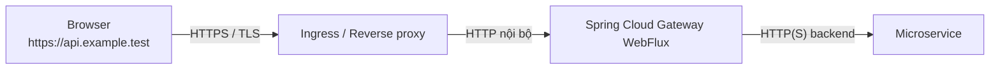

# Cookie phiên, SameSite, Secure và đường dẫn phía sau proxy

## 1. Bối cảnh: đăng nhập thành công nhưng request tiếp theo lại mất phiên

Trong kiến trúc microservices, **Spring Cloud Gateway** là điểm vào chung cho web, mobile hoặc đối tác. Gateway dùng **route predicate** chọn route, chạy **filter chain**, biến đổi path/header, khám phá service và chuyển tiếp đến backend. Một nhóm ứng dụng còn dùng Gateway làm **Backend for Frontend (BFF)**: người dùng đăng nhập qua Spring Security, Gateway giữ trạng thái đăng nhập ở server và phát **session cookie** cho trình duyệt.

Sự cố phổ biến khi triển khai sau ingress/reverse proxy:

- Trình duyệt đăng nhập tại `https://api.example.test/portal/api/auth/login` và thấy response `200` hoặc `302`.
- Backend thực tế nhận `/auth/login` sau khi Gateway loại prefix `/portal/api`.
- Response mang `Set-Cookie: SESSION=...; Path=/auth`.
- Trình duyệt gọi tiếp `https://api.example.test/portal/api/orders` nhưng **không gửi cookie** vì đường dẫn ngoài không khớp `Path=/auth`.
- Gateway hoặc backend coi request là chưa đăng nhập, dẫn đến `401`, `302` về login hoặc lặp redirect.

Một lỗi khác xảy ra khi TLS được kết thúc ở ingress: người dùng truy cập Gateway bằng **HTTPS**, nhưng ứng dụng phía trong thấy kết nối **HTTP** và phát cookie thiếu `Secure`, hoặc tạo redirect về URL `http://...`.

Để xử lý đúng, phải phân biệt **ba lớp**: (1) URL mà **browser** nhìn thấy, (2) URL mà **Gateway** nhận và biến đổi, và (3) URL mà **microservice** thực sự xử lý. Các thuộc tính cookie được trình duyệt đánh giá theo **URL công khai**, không theo đường dẫn nội bộ của container.

Bài thuộc chương **Phiên đăng nhập và token** trong module **SPRING_CLOUD_GATEWAY**. Mục tiêu là hiểu `Set-Cookie`, `Cookie`, `SameSite`, `Secure`, `HttpOnly`, `Domain`, `Path`, cách cấu hình session cookie trên **Spring WebFlux**, xử lý TLS termination/forwarded headers, và kiểm thử browser với route rewrite, OAuth2 login, CORS, CSRF cùng service discovery.

> **Phạm vi:** tập trung vào **Spring Cloud Gateway Server WebFlux**, Spring Boot và Spring Security reactive. Không sao chép nguyên cấu hình `server.servlet.session.cookie.*` của Servlet/MVC sang WebFlux. Ví dụ có thể cần điều chỉnh theo phiên bản Spring Boot/Spring Cloud, cơ chế session của dự án và vị trí chính xác nơi cookie được tạo.

## 2. Session cookie hoạt động như thế nào?

Một mô hình **server-side session** thường có luồng:

1. User đăng nhập tại ứng dụng hoặc BFF.
2. Server xác thực và tạo một phiên có ID khó đoán, ví dụ `s_abc123...`.
3. Server lưu trạng thái phiên (in-memory, Redis hoặc store phù hợp) và trả header `Set-Cookie`.
4. Trình duyệt lưu cookie theo **host/domain, path, expiry, SameSite, Secure**.
5. Ở request phù hợp tiếp theo, trình duyệt tự gửi header `Cookie`.
6. Server tra ID phiên, xác minh còn hiệu lực rồi cho phép xử lý theo quyền.

```mermaid
sequenceDiagram
    autonumber
    participant B as Browser
    participant G as Gateway / WebFlux
    participant S as Session store
    participant U as Upstream service
    B->>G: Login request qua HTTPS
    G->>S: Tạo session mới
    S-->>G: Session ID và trạng thái
    G-->>B: Set-Cookie: SESSION=...; Secure; HttpOnly; SameSite=Lax; Path=/
    B->>G: Request tiếp theo + Cookie: SESSION=...
    G->>S: Tra session ID
    S-->>G: Principal / attributes còn hiệu lực
    G->>U: Route được phép tới service
    U-->>G: Response
    G-->>B: HTTP response
```

Sơ đồ chỉ là một **phương án** khi **Gateway chính là nơi quản lý session**. Nếu session do **backend** tạo, backend/store của nó là nơi tra phiên; Gateway có thể chỉ proxy `Cookie` và `Set-Cookie` theo chính sách. Phải xác định rõ tầng nào sở hữu cookie trước khi sửa cấu hình.

### 2.1. Phân biệt session cookie với token

| Đối tượng | Nội dung thường gặp | Được quản lý ở đâu? |
| --- | --- | --- |
| **Session cookie** | ID tham chiếu trạng thái đăng nhập tại server | Browser giữ ID; server giữ session |
| **Opaque access token** | Giá trị access token khó diễn giải | Resource server xác minh qua introspection khi cần |
| **JWT access token** | Chuỗi chứa claims có chữ ký | Resource server kiểm tra JWT và claims |
| **CSRF token** | Giá trị để chứng minh yêu cầu đổi trạng thái hợp lệ | Framework/client phối hợp theo cơ chế CSRF |
| **Refresh token** | Credential xin access token mới | Cần bảo vệ/rotation, không tự biến thành session ID |

Một ứng dụng có thể dùng OAuth2/OIDC phía ngoài và **session cookie** cho browser ở BFF; Gateway lưu access token của authorized client ở server. Tuy vậy, `TokenRelay` không đồng nghĩa có session cookie, và `Cookie` không đồng nghĩa chứa JWT. Hãy quyết định rõ **token nào được lưu ở đâu** và backend nào được quyền nhận token đó.

**Không nên để session cookie chứa mật khẩu, access token thô hoặc dữ liệu người dùng nhạy cảm.** Cookie có thể bị sao chép hoặc lộ; đối với server-side session, giá trị ID phải đủ ngẫu nhiên, được tạo và quản lý bởi framework phù hợp.

## 3. Cách trình duyệt xử lý Set-Cookie và Cookie

Response:

```http
HTTP/1.1 200 OK
Set-Cookie: SESSION=demo-id; Path=/; Secure; HttpOnly; SameSite=Lax
Content-Type: application/json

{"authenticated":true}
```

Request sau:

```http
GET /portal/api/orders/42 HTTP/1.1
Host: api.example.test
Cookie: SESSION=demo-id
```

Những chuỗi `demo-id` ở đây chỉ là giả định để minh họa. Khi chạy thật, session ID là bí mật và **không** nên ghi nguyên vào tài liệu, log, trace, analytics hay URL.

| Thuộc tính `Set-Cookie` | Điều browser hiểu | Lưu ý |
| --- | --- | --- |
| `Secure` | Chỉ gửi cookie qua kết nối HTTPS tương ứng, ngoại lệ localhost tùy browser | Đặt cho session production |
| `HttpOnly` | JavaScript không thể đọc cookie qua `document.cookie` | **Không** ngăn browser tự đính cookie vào request |
| `SameSite=Strict` | Chỉ gửi cookie trong ngữ cảnh same-site | Dễ cản trở login/navigation bắt đầu từ site khác |
| `SameSite=Lax` | Cho phép same-site và một số điều hướng top-level cross-site bằng method an toàn | Thường hợp lý cho login flow dựa trên redirect GET |
| `SameSite=None` | Cho phép gửi trong ngữ cảnh cross-site theo quy tắc browser | **Bắt buộc có `Secure`**; chính sách third-party cookie vẫn có thể chặn |
| `Path=/portal/api` | Chỉ gửi với các path công khai phù hợp | Không bảo vệ cookie khỏi JavaScript trên cùng origin nếu không có `HttpOnly` |
| `Domain=example.test` | Có thể gửi đến host thuộc domain đó và các subdomain | Mở rộng phạm vi, cần cân nhắc |
| Không có `Domain` | Host-only cookie, chỉ host đã đặt cookie | Thường an toàn hơn cho session Gateway |
| `Max-Age`/`Expires` | Thời điểm browser hết hạn cookie | Không thay thế TTL phiên phía server |

Cookie không được gửi chỉ vì URL có cùng host; browser còn xét `Path`, `Secure`, `SameSite`, hạn dùng, domain và chính sách browser. Ngược lại, một HTTP client như **curl** không thực thi toàn bộ quy tắc SameSite/CORS của trình duyệt, nên việc curl thành công chưa chứng minh web app sẽ thành công.

### 3.1. Tại sao HttpOnly vẫn chưa đủ?

`HttpOnly` làm JavaScript không đọc trực tiếp được giá trị cookie, nhưng nếu có XSS, script độc hại vẫn có thể **gửi request cùng origin để thực hiện hành động dưới session đó**. Bảo vệ cần kết hợp escape/sanitize nội dung, CSP, giới hạn quyền, CSRF và kiểm tra quyền nghiệp vụ.

`Secure` chỉ ràng buộc đường truyền HTTPS của browser; nó không mã hóa session ID trong database, không tự tạo TLS ở chặng Gateway → backend, và không ngăn người có quyền truy cập hệ thống lấy cookie từ nơi lưu trữ sai cách.

## 4. SameSite: site khác origin và có cả scheme

### 4.1. Phân biệt origin và site

**Origin** gồm scheme, host, port. **Site** trong ngữ nghĩa SameSite hiện đại thường dựa trên **scheme** và **registrable domain** (eTLD+1), không chỉ hostname.

| URL A | URL B | Same-origin? | Same-site? |
| --- | --- | --- | --- |
| `https://app.example.test` | `https://api.example.test` | Không | Thường **có** |
| `https://api.example.test` | `https://api.example.test:8443` | Không, khác port | Thường **có** |
| `http://api.example.test` | `https://api.example.test` | Không | **Không** theo schemeful same-site |
| `https://app.example.test` | `https://api.other.test` | Không | Không |

Ở bảng trên, `example.test` là domain ví dụ; cách xét registrable domain chính xác phụ thuộc danh sách public suffix. Điều quan trọng là **CORS hoạt động theo origin**, còn **SameSite hoạt động theo site**: hai subdomain có thể same-site nhưng vẫn cần cấu hình CORS khi dùng `fetch` cross-origin.

### 4.2. Khi nào dùng Strict, Lax, None?

| Tình huống | Lựa chọn thường cân nhắc | Cảnh báo |
| --- | --- | --- |
| Ứng dụng nội bộ chỉ same-site, không login redirect bên ngoài | `Strict` | Cross-site navigation có thể thiếu session |
| BFF có OAuth2/OIDC redirect GET về callback | `Lax` | Kiểm tra cookie có được gửi tại callback và các flow khác |
| SPA ở một site khác gọi API bằng credentials | `None; Secure` khi thật sự cần | CORS + CSRF + third-party cookie policy |
| Form POST callback từ một site đăng nhập bên ngoài | `Lax` có thể chặn cookie | Cân nhắc kiến trúc callback và SameSite phù hợp |
| Cookie chỉ dùng trên host API, không cần subdomains | Không đặt `Domain` | Giảm phạm vi bị chia sẻ |

Ví dụ `SameSite=Lax`: một trình duyệt được điều hướng top-level bằng **GET** từ IdP về callback của Gateway thường gửi cookie đủ điều kiện; nhưng một request **POST cross-site** hoặc `fetch` cross-site **không** có quyền gửi Lax cookie chỉ vì endpoint ở Gateway tồn tại.

`SameSite=None` **không bảo đảm third-party cookie luôn được gửi**: browser có thể chặn hoặc phân vùng cookie theo chính sách quyền riêng tư. Nếu tích hợp iframe/widget/SPA khác site, cần kiểm thử đúng browser và mô hình triển khai thay vì chỉ bật `None`.

### 4.3. SameSite không thay thế CSRF protection

Cookie session là **credential tự động đính kèm** khi browser quyết định request phù hợp. Vì vậy, một trang độc hại có thể lợi dụng browser gửi request đổi trạng thái đến ứng dụng nếu không có cơ chế bảo vệ CSRF.

`SameSite=Lax`/`Strict` giúp giảm một số tấn công nhưng **không đủ** trong mọi tình huống, đặc biệt với các subdomain cùng site hoặc những luồng điều hướng đặc biệt. Với Gateway có **Spring Security session/cookie login**, nên giữ cơ chế CSRF phù hợp và xác minh Origin/Referer cho endpoint nhạy cảm nếu kiến trúc yêu cầu.

Chỉ vô hiệu hóa CSRF trong ứng dụng **thật sự stateless**, được xác thực bằng Bearer token do code client chủ động thêm, không phụ thuộc cookie/session browser làm credential. Không sao chép cấu hình `.csrf(...disable)` của một ví dụ Resource Server token vào một BFF dùng session cookie mà không đánh giá threat model.

## 5. Secure và TLS termination ở ingress/reverse proxy

Nhiều deployment có topology:



Browser chỉ biết URL public là **HTTPS**. Nếu session cookie được đặt với `Secure`, browser gửi cookie ở request HTTPS sau. Dù Gateway nhận HTTP từ ingress nội bộ, cookie vẫn nên có **`Secure`** để bảo vệ chặng client → ingress.

Rủi ro khi ứng dụng suy luận sai scheme:

- Gateway/backend nghĩ request public là HTTP vì thấy kết nối nội bộ HTTP.
- Response redirect `Location: http://api.example.test/login` khiến browser đổi sang HTTP hoặc tạo vòng lặp HTTP ↔ HTTPS.
- Một session resolver mặc định có thể không đánh dấu Secure nếu nó phụ thuộc scheme của request được nhận; kết quả phải được đo bằng header `Set-Cookie` thực tế.
- OAuth2 redirect URI được xây dựng sai scheme/host, gây `invalid_redirect_uri` hoặc mất state/session.

**Khuyến nghị:** trong production HTTPS, cấu hình `Secure=true` **tường minh** cho cookie do Gateway tự phát; đồng thời cấu hình xử lý forwarded headers để URL/redirect phản ánh host và scheme ngoài.

### 5.1. Forwarded và X-Forwarded-* nói gì?

Ingress đáng tin có thể gửi tới Gateway:

```http
GET /portal/api/auth/login HTTP/1.1
Host: api-gateway.internal:8080
Forwarded: proto=https;host=api.example.test
X-Forwarded-Proto: https
X-Forwarded-Host: api.example.test
X-Forwarded-Port: 443
```

Đây là dữ liệu **do proxy tin cậy cấp**, không phải một chỉ dẫn tự biến kết nối HTTP nội bộ thành HTTPS. Nó giúp framework nhận biết request gốc khi xây dựng redirect URL, absolute links hoặc áp dụng chính sách phụ thuộc scheme.

Spring Boot 3.x với WebFlux có thể sử dụng:

```yaml
server:
  forward-headers-strategy: framework
```

Cấu hình này sử dụng cơ chế **`ForwardedHeaderTransformer`** ở stack reactive để xử lý request theo forwarded headers. Với Spring Boot 4.x hoặc cơ chế native khác, **tên/chi tiết cấu hình có thể thay đổi**: đối chiếu tài liệu của đúng phiên bản và hạ tầng ingress.

**Ranh giới tin cậy là bắt buộc.** Không để client Internet tự gửi `Forwarded`, `X-Forwarded-Proto`, `X-Forwarded-Host` hoặc `X-Forwarded-Prefix` rồi được Gateway coi là dữ liệu sự thật. Ingress phải **xóa/ghi đè header client giả mạo**, Gateway chỉ nhận từ mạng/hop đáng tin; dùng chính sách trusted proxies được Gateway phiên bản đó hỗ trợ khi tạo forwarded headers cho downstream. Tin header chưa xác minh có thể dẫn đến open redirect, host-header poisoning hoặc URL/cookie policy sai.

### 5.2. Gateway dùng HTTPS inbound có tự làm HTTPS outbound không?

Không. TLS client → ingress, ingress → Gateway và Gateway → backend là **những chặng độc lập**. Nếu ứng dụng yêu cầu TLS đến microservice, cần cấu hình `https://...`, `lb://` với `ServiceInstance.isSecure` phù hợp hoặc service mesh/mTLS. `Secure` của browser cookie **không** tạo TLS trên chặng đến backend.

## 6. Path của cookie: trình duyệt dùng đường dẫn công khai

**`Path` là nguyên nhân thường bị bỏ sót nhất khi Gateway thay đổi URL.** Browser xét request URL nó đang gửi, không biết `StripPrefix` hoặc `RewritePath` ở phía server.

Ví dụ:

```text
Browser gọi:       https://api.example.test/portal/api/auth/login
Gateway predicate: Path=/portal/api/**
Gateway filter:    StripPrefix=2
Backend nhận:      /auth/login

Backend trả:
Set-Cookie: SESSION=demo-id; Path=/auth; Secure; HttpOnly; SameSite=Lax

Browser gọi tiếp:  https://api.example.test/portal/api/orders
Browser kiểm tra:  /portal/api/orders KHÔNG khớp Path=/auth
Kết quả:           Cookie SESSION không được đính kèm
```

Cách sửa phụ thuộc chủ thể sở hữu phiên:

- Nếu **backend** sở hữu session và các endpoint cần cookie nằm dưới **public path `/portal/api/**`**, backend nên phát `Path=/portal/api` (hoặc một path khác đã tính đến mọi luồng cần session).
- Nếu **Gateway** sở hữu session cho cả OAuth2 login/callback ở những path như `/oauth2/authorization/**` và `/login/oauth2/code/**`, session cookie có thể cần `Path=/` để được gửi trên các endpoint đăng nhập **lẫn** API.
- Không giả định thêm `StripPrefix=2` sẽ tự động sửa `Set-Cookie: Path=` trong response. GatewayFilter thay request path **không đồng nghĩa** rewrite response cookie attributes.

### 6.1. Path matching ở browser

Giả sử:

```http
Set-Cookie: SESSION=demo-id; Path=/portal/api; Secure; HttpOnly; SameSite=Lax
```

| Browser gọi | Cookie có thỏa điều kiện Path? |
| --- | --- |
| `/portal/api` | Có |
| `/portal/api/` | Có |
| `/portal/api/orders/42` | Có |
| `/portal/api/auth/logout` | Có |
| `/portal/apis` | Không, không có ranh giới slash phù hợp |
| `/login/oauth2/code/customer` | **Không** |
| `/` | Không |

Bảng chỉ đánh giá **Path**; cookie còn phải vượt qua điều kiện domain, Secure, SameSite, expiry và browser policy.

**Cạm bẫy OAuth2 login:** `Path=/portal/api` có thể phù hợp với tất cả API nghiệp vụ nhưng **không** phù hợp với callback mặc định `/login/oauth2/code/{registrationId}`. Nếu Spring Security lưu OAuth2 authorization request/state trong session, browser không gửi cookie về callback và login thất bại. Cần xem toàn bộ danh sách endpoint tham gia **login → callback → API → logout** trước khi thu hẹp Path.

### 6.2. Domain cũng phải là domain công khai

Giả sử backend chạy ở host nội bộ `orders.default.svc.cluster.local`, nhưng client luôn truy cập `api.example.test`. Nếu backend trả:

```http
Set-Cookie: SESSION=demo-id; Domain=orders.default.svc.cluster.local; Path=/portal/api
```

Browser nhận response **từ api.example.test** và có thể **từ chối cookie** do `Domain` không phải domain hợp lệ của host công khai. Host nội bộ của backend không thể được đưa vào `Domain` chỉ vì backend đã đặt cookie.

Đa số ứng dụng nên **bỏ hẳn `Domain`** để tạo host-only cookie. Chỉ chia sẻ cookie qua các subdomain khi có nhu cầu thực sự và đã đánh giá rủi ro session fixation/cookie tossing.

### 6.3. Khi ingress cũng strip prefix

Một topology phức tạp hơn:

```text
Public:  https://api.example.test/portal/api/orders/42
Ingress: bỏ /portal -> Gateway nhận /api/orders/42
Gateway: StripPrefix=1 -> Backend nhận /orders/42
```

**Cookie Path vẫn được browser xét theo `/portal/api/orders/42`.** `X-Forwarded-Prefix: /portal` (nếu ingress cấp và framework tin cậy) có thể giúp tái tạo public URL trong một số logic tạo link/redirect, nhưng **không được mặc định xem là bộ rewrite `Set-Cookie Path` của mọi backend**.

Với topology có nhiều lớp rewrite, hãy vẽ bảng:

| Lớp | Scheme/host/path nhìn thấy |
| --- | --- |
| Browser | `https://api.example.test/portal/api/orders/42` |
| Ingress | URL public, có thể bỏ `/portal` |
| Gateway | `http://gateway:8080/api/orders/42` |
| Backend | `http://orders:8081/orders/42` |

Sau đó chọn cookie Path dựa trên **browser-facing URL**, không dựa trên path ở một hop bất kỳ.

## 7. Cấu hình session cookie cho Spring WebFlux bằng Spring Boot

### 7.1. Trường hợp Gateway sở hữu session

Nếu **Gateway** dùng WebFlux session cho OAuth2 Login hoặc BFF, có thể cấu hình Spring Boot:

```yaml
server:
  reactive:
    session:
      timeout: 30m
      cookie:
        name: SESSION
        path: /
        http-only: true
        secure: true
        same-site: lax
```

Các khóa `server.reactive.session.cookie.name`, `path`, `http-only`, `secure`, `same-site` tồn tại trong các phiên bản Spring Boot hỗ trợ reactive session cookie tương ứng. Ví dụ chọn `Path=/` vì giả định ứng dụng còn phục vụ **OAuth2 login/callback ngoài `/portal/api`**. Trong một ứng dụng chỉ dùng session ở một prefix và không có callback ngoài prefix đó, có thể xét path hẹp hơn.

Một `Set-Cookie` kết quả mong đợi theo cấu hình, khi ứng dụng thật sự **tạo hoặc thay đổi session**, là:

```http
Set-Cookie: SESSION=<opaque-session-id>; Path=/; Secure; HttpOnly; SameSite=Lax
```

`timeout: 30m` mô tả **TTL/idle timeout của WebSession phía server**, không có nghĩa cookie được browser tự loại sau đúng 30 phút. Cookie hết hạn, Max-Age và server-side session timeout là những khái niệm khác nhau. Cần thiết kế logout, invalidation và thời gian sống session rõ ràng.

**Cảnh báo về phạm vi property:** đoạn YAML này cấu hình **cookie cho WebFlux session do ứng dụng phát**. Nó **không tự thay đổi** cookie `Set-Cookie` do một upstream HTTP khác trả về khi Gateway proxy. Muốn sửa cookie ở backend, ưu tiên cấu hình ứng dụng backend; nếu không làm được, phải triển khai response cookie rewrite chuyên biệt và kiểm thử.

### 7.2. Tùy biến bằng CookieWebSessionIdResolver

Với Spring Session/WebFlux hoặc khi cần điều khiển session cookie rõ ràng hơn, có thể đăng ký `WebSessionIdResolver`:

```java
import org.springframework.context.annotation.Bean;
import org.springframework.context.annotation.Configuration;
import org.springframework.web.server.session.CookieWebSessionIdResolver;
import org.springframework.web.server.session.WebSessionIdResolver;

@Configuration
class SessionCookieConfig {

    @Bean
    WebSessionIdResolver webSessionIdResolver() {
        CookieWebSessionIdResolver resolver =
                new CookieWebSessionIdResolver();

        resolver.setCookieName("__Host-SESSION");

        resolver.addCookieInitializer(builder ->
                builder.path("/")
                       .secure(true)
                       .httpOnly(true)
                       .sameSite("Lax"));

        return resolver;
    }
}
```

Ở đây:

- `CookieWebSessionIdResolver` là cơ chế WebFlux/Spring Session quản lý cookie chứa **ID phiên**.
- `addCookieInitializer` áp dụng thuộc tính cookie cho mỗi lần cần phát cookie.
- `__Host-SESSION` là một tên cookie được minh họa theo quy tắc tiền tố `__Host-`: phải có `Secure`, **`Path=/`**, **không có `Domain`**, và được đặt từ secure origin theo điều kiện browser.
- Nếu yêu cầu Path hẹp hơn `/`, **không** dùng prefix `__Host-`; chọn tên phù hợp như `SESSION` hoặc `__Secure-SESSION` kèm Secure.
- Resolver điều khiển việc ghi/đọc **session ID**, **không phải session store**. Nếu Gateway có nhiều replica, có thể cần Spring Session với Redis hoặc store chung tùy kiến trúc.
- Khi tự khai báo bean `WebSessionIdResolver`, đừng giả định mọi giá trị `server.reactive.session.cookie.*` từ auto-configuration vẫn tự gộp vào resolver của bạn. Chọn một cơ chế cấu hình rõ ràng và kiểm thử.

**Không dùng song song hai tên cookie khác nhau** ở các gateway replicas trừ khi bạn chủ động triển khai một quá trình chuyển đổi session: browser có thể nhận hai cookie và không biết cookie nào có tác dụng.

### 7.3. Cookie Session và Servlet JSESSIONID

Trong **Gateway Server WebFlux**, thông thường cơ chế cookie được xây dựng trên `WebSession` và `WebSessionIdResolver`. Không nên lấy mặc định của `JSESSIONID` hoặc property `server.servlet.session.cookie.*` của ứng dụng Spring MVC rồi coi là cấu hình WebFlux.

Nếu service phía sau là **Servlet/MVC**, nó có thể dùng **`JSESSIONID`** riêng. Gateway không tự biến cookie đó thành session của Gateway. Khi nhiều backend cùng đặt cookie trùng tên trên một public host/path, có thể xảy ra va chạm. Cần thống nhất chiến lược cookie name, path, host-only và nơi lưu session.

## 8. Gateway xử lý cookie do upstream tạo như thế nào?

Hai mô hình cần phân biệt:

| Mô hình | Cookie do ai phát? | Sửa ở đâu là chính? |
| --- | --- | --- |
| BFF/Gateway đăng nhập và giữ session | Gateway/Spring WebFlux session resolver | `server.reactive.session.cookie.*` hoặc `CookieWebSessionIdResolver` |
| Backend login tạo session riêng | Upstream service, Gateway proxy response | Cấu hình cookie tại backend; Gateway chỉ can thiệp khi cần |

Khi backend phát:

```http
Set-Cookie: BACKEND_SESSION=demo-id; Path=/internal/auth; HttpOnly; Secure; SameSite=Lax
```

Gateway có thể chuyển `Set-Cookie` cho browser. Nhưng browser sẽ áp dụng thuộc tính theo **host/path công khai** của request qua Gateway, không theo host nội bộ. Nếu backend Path sai, cần chỉnh nơi phát cookie hoặc có một cơ chế rewrite response chuyên dụng.

### 8.1. Không dùng filter tùy tiện với Set-Cookie

`Set-Cookie` **có thể xuất hiện nhiều lần** vì mỗi cookie có tên, Path, Domain hoặc Max-Age khác nhau. Các cookie hợp lệ cần được giữ nguyên các trường hợp đa giá trị. Vì vậy:

- Không dùng `DedupeResponseHeader` với `Set-Cookie` chỉ để “giữ một giá trị”: có thể làm mất session, CSRF hoặc preference cookie.
- Không dùng `SetResponseHeader` để ghi đè một danh sách nhiều `Set-Cookie` nếu không chủ đích thay toàn bộ cookie.
- Không gộp nhiều `Set-Cookie` thành một chuỗi phân tách bằng dấu phẩy; nó không có cùng ngữ nghĩa với phần lớn header dạng danh sách.
- Không dùng regex rewrite quá rộng có thể làm mất `Secure`, `HttpOnly`, `SameSite`, `Expires` hoặc thay sai `Domain`.
- Nếu buộc phải rewrite cookie tại Gateway, nên dùng cách **phân tích từng cookie/ResponseCookie** đúng ngữ nghĩa và bảo toàn nhiều dòng `Set-Cookie`, kiểm thử trước response commit.

Spring Cloud Gateway có các filter chỉnh response header, nhưng `StripPrefix`/`RewritePath` là **biến đổi request path**, không bảo đảm chỉnh cookie. `RewriteLocationResponseHeader` nếu dùng cũng xử lý header **`Location`** cho redirect, không tương đương sửa `Set-Cookie`.

### 8.2. Cookie và service discovery/load balancing

Nếu session nằm ở memory của một backend instance, route `lb://orders-service` có thể chọn instance khác ở request sau. Cookie vẫn được browser gửi đúng, nhưng instance được chọn **không tìm thấy session ID**.

Phương án triển khai:

1. Dùng session store chung như Redis qua Spring Session hoặc cơ chế phù hợp.
2. Thiết kế dịch vụ stateless và dùng access token được backend xác minh, nếu thích hợp.
3. Cân nhắc session affinity khi thật sự cần, nhưng phải biết giới hạn khi autoscaling/restart.

**Cookie Path đúng không giải quyết được state bị phân tán sai giữa các instance.** Tương tự, stickiness không thay thế session rotation, invalidation hay khả năng tự phục hồi khi một instance mất.

## 9. Cookie Path, Domain và các tiền tố bảo mật

### 9.1. Host-only so với Domain rộng

Một response từ `https://api.example.test`:

```http
Set-Cookie: SESSION=demo-id; Path=/; Secure; HttpOnly; SameSite=Lax
```

Nếu không có `Domain`, cookie thường là **host-only**: được gửi đến `api.example.test` khi các điều kiện khác thỏa, nhưng **không** được gửi đến `app.example.test` chỉ vì thuộc cùng `example.test`. Đây là hành vi phù hợp cho nhiều BFF dùng cookie riêng trên API host.

Ngược lại:

```http
Set-Cookie: SESSION=demo-id; Domain=example.test; Path=/; Secure; HttpOnly; SameSite=Lax
```

Cookie có thể được gửi đến cả subdomain nằm dưới `example.test`, mở rộng phạm vi credential. Chỉ bật `Domain` khi có nhu cầu kiến trúc thực sự, vì những subdomain kém tin cậy có thể tăng rủi ro cookie tossing/session fixation.

### 9.2. Đặt tên bằng tiền tố __Host- và __Secure-

| Tên | Quy tắc browser hỗ trợ | Khi dùng |
| --- | --- | --- |
| `SESSION` | Không có yêu cầu đặc biệt do tên | Phù hợp khi tự kiểm soát thuộc tính |
| `__Secure-SESSION` | Được đặt từ secure origin và phải có `Secure` | Có thể dùng Path hẹp, hoặc Domain nếu chủ động |
| `__Host-SESSION` | `Secure`, `Path=/`, **không có Domain** | Khi muốn ràng buộc session vào một host |

Không dùng `__Host-SESSION` với `Path=/portal/api`: browser tuân quy tắc prefix sẽ **từ chối cookie**. Tên cookie prefix là biện pháp phòng thủ bổ sung, không thay thế HTTPS, HttpOnly, CSRF hay bảo vệ session store.

### 9.3. Logout và xóa cookie phải khớp phạm vi

Khi logout, server nên **invalidate session phía server** và phát cookie xóa ở đúng **tên, Path và Domain** mà browser đang lưu. Ví dụ nếu cookie ban đầu có Path `/portal/api`, việc phát một cookie hết hạn với Path `/` có thể **không xóa** cookie cũ vì đó là phạm vi khác.

Cookie có thể được yêu cầu xóa bằng `Max-Age=0` hoặc `Expires` thích hợp, nhưng phải kiểm tra qua browser DevTools và xử lý server-side invalidation. Chỉ xóa cookie ở trình duyệt **không** đủ để vô hiệu hóa một session ID đã bị sao chép.

## 10. CORS, fetch credentials và session cross-origin

Ví dụ frontend phục vụ tại `https://app.example.test`, API Gateway tại `https://api.example.test`. Hai địa chỉ khác **origin**, dù thường cùng **site**. Một ứng dụng JavaScript gọi API có cookie cần chú ý:

```javascript
const response = await fetch(
  "https://api.example.test/portal/api/orders/42",
  {
    method: "GET",
    credentials: "include"
  }
);
```

Phía Gateway (hoặc tầng CORS được quản lý) cần cho phép **origin cụ thể**, và khi cần credentials:

```http
Access-Control-Allow-Origin: https://app.example.test
Access-Control-Allow-Credentials: true
Vary: Origin
```

**Không** dùng `Access-Control-Allow-Origin: *` cùng chế độ credentials. Nếu request cần preflight, phải xử lý `OPTIONS` và `Access-Control-Allow-Methods`/`Access-Control-Allow-Headers` phù hợp.

Các vấn đề độc lập cần kiểm tra:

- **SameSite:** browser có được phép gửi cookie trong ngữ cảnh site hiện tại?
- **Secure:** URL phía browser có dùng HTTPS không?
- **Cookie Domain/Path:** URL API đích có nằm trong phạm vi cookie không?
- **fetch credentials:** frontend có yêu cầu browser gửi credential cross-origin không?
- **CORS:** response có cho phép JavaScript đọc kết quả không?
- **CSRF:** request đổi trạng thái có token/chính sách chống giả mạo hợp lệ không?
- **Third-party cookie policies:** browser có chặn cookie theo chính sách riêng không?

`Set-Cookie` là header đặc biệt không được JavaScript đọc trực tiếp qua `response.headers.get("Set-Cookie")`, kể cả khi server gửi nó. Hãy quan sát bằng **Network/Storage/Application DevTools**. Đối với CORS request, browser có thể bỏ qua `Set-Cookie` nếu cấu hình credentials không đúng.

**Không nên** suy ra "browser báo CORS error" đồng nghĩa server không nhận request. Service có thể đã thực hiện thao tác ghi nhưng browser chặn JavaScript đọc response. Với request không idempotent, không tự retry tùy tiện khi gặp lỗi CORS.

## 11. OAuth2 login: các đường dẫn đặc biệt không được quên

Một Gateway BFF dùng Spring Security `oauth2Login()` có thể tham gia các endpoint:

| Vai trò | Path ví dụ thường gặp | Có cần cookie session không? |
| --- | --- | --- |
| Bắt đầu OAuth2 login | `/oauth2/authorization/customer` | Có thể dùng session để giữ authorization request/state |
| IdP chuyển về callback | `/login/oauth2/code/customer` | Có thể cần tìm lại session/state |
| API sau đăng nhập | `/portal/api/orders/42` | Cần session nếu dùng BFF cookie |
| Logout | `/logout` hoặc path ứng dụng tự định nghĩa | Cần session hoặc cơ chế invalidation phù hợp |
| Trang login/public | `/login` hoặc URL tùy chỉnh | Phụ thuộc UI và flow |

Nếu session cookie đặt `Path=/portal/api`, browser không gửi cookie tới callback `/login/oauth2/code/customer`. Kết quả thường là **mất state**, login không hoàn tất hoặc lặp lại yêu cầu xác thực.

Với login dùng callback GET mặc định từ IdP, `SameSite=Lax` thường là điểm khởi đầu phù hợp. Nếu IdP dùng `form_post` callback hoặc flow chạy trong iframe/cross-site, cần xác minh riêng: cookie có thể bị chặn vì `SameSite=Lax` và chính sách browser. Không bật `SameSite=None` cho toàn hệ thống chỉ để “sửa” một ca login mà chưa đánh giá CSRF, cookie tracking và hỗ trợ browser.

**Session fixation:** khi đăng nhập thành công, ứng dụng nên thay/rotate session ID theo chiến lược của Spring Security hoặc cơ chế đã thiết kế. Khi logout, invalidate server-side session và loại bỏ cookie theo đúng Path/Domain. Không giữ nguyên session ID trước và sau authentication nếu điều đó làm tăng nguy cơ session fixation.

## 12. Các tình huống lỗi và cách chẩn đoán theo từng tầng

| Triệu chứng | Khả năng xảy ra | Cần kiểm tra |
| --- | --- | --- |
| Login thành công, API tiếp theo trả 401 | Cookie không được gửi do Path/Domain/SameSite/Secure | DevTools Request Cookies, Set-Cookie, URL public |
| Browser báo cookie bị từ chối | `SameSite=None` thiếu `Secure`, `Domain` sai, prefix __Host- sai | DevTools blocked reason và thuộc tính |
| Local HTTP chạy, production sau ingress bị vòng redirect | Proxy TLS termination nhưng app sinh URL HTTP | Forwarded/X-Forwarded headers, trust proxy, Location |
| OAuth2 callback báo state mismatch | Cookie Path không bao callback hoặc SameSite chặn | Path callback, SameSite, domain, browser request |
| Backend vẫn nhận request nhưng không có session | Cookie không được gửi hoặc backend store không chia sẻ | Cookie header ở hop backend (redact), session store |
| Route lb:// khi được khi mất phiên | Phiên lưu in-memory theo instance | Shared store/affinity, instance health |
| Chỉ một số browser/iframe không giữ cookie | Third-party cookie policy hoặc SameSite | Thử browser cụ thể, ngữ cảnh site, partitioning |
| `fetch` không nhận response nhưng cURL có 200 | CORS/credentials cấu hình chưa đúng | Origin, Allow-Credentials, preflight, DevTools |
| Cookie thiếu Secure trên HTTPS public | Resolver/cấu hình nghĩ request là HTTP hoặc chưa đặt Secure tường minh | Header Set-Cookie, Boot WebFlux properties |
| Cookie có Domain nội bộ Kubernetes | Backend phát Domain theo hostname sai | Bỏ Domain hoặc đặt phạm vi public hợp lệ |
| Cookie bị mất sau header rewrite | Filter gộp/ghi đè Set-Cookie hoặc xóa nhầm | Response filters, nhiều dòng Set-Cookie |
| Logout vẫn còn phiên | Chỉ xóa cookie ở sai Path/Domain, chưa invalid server store | Cookie jar, session invalidation, logout handler |
| Session tự hết sớm | TTL server, eviction, Redis timeout khác browser cookie | Session store/timeout/max-age |
| Session cookie gửi đúng nhưng API 403 | User đã xác thực nhưng thiếu quyền nghiệp vụ | Security authorization, route policy và backend |

### 12.1. Đừng chỉ kiểm tra HTTP status

Một `302` về login có thể là **kết quả** của mất session, không phải nguyên nhân. Một `200` từ OAuth callback chưa bảo đảm browser đã lưu cookie; browser có thể **từ chối `Set-Cookie`** vì attribute không hợp lệ.

Khi debug, hãy ghi nhận theo cùng request ID:

```text
Client-facing URL / scheme / host / path
→ Cookie attributes do server phát
→ Browser có lưu cookie không? Vì sao?
→ Browser có gửi Cookie ở request kế tiếp?
→ Gateway có chuyển Cookie tới upstream không?
→ Session store có tìm thấy session ID?
→ Principal có quyền trên route và resource không?
```

Chỉ quan sát tên cookie, thuộc tính và một **hash/redacted identifier** được thiết kế an toàn. Không ghi nguyên session ID, JWT, `Authorization`, `Cookie` hoặc `Set-Cookie` của user vào log công khai.

## 13. Kiểm thử với curl và browser DevTools

### 13.1. Xác nhận Set-Cookie qua Gateway

Giả sử bạn có endpoint thử nghiệm `GET /portal/api/session-demo` thực sự tạo session, chạy trên host HTTPS có chứng chỉ hợp lệ:

```bash
# Chỉ dùng endpoint test do bạn kiểm soát.
curl -i \
  --cookie-jar cookies.txt \
  https://api.example.test/portal/api/session-demo
```

Quan sát `Set-Cookie`:

```http
Set-Cookie: SESSION=<demo-id>; Path=/; Secure; HttpOnly; SameSite=Lax
```

Chỉ là **kết quả kỳ vọng giả định**, không phải mặc định cho mọi ứng dụng. Nếu endpoint không tạo/sửa session, có thể không có `Set-Cookie`. Hãy dùng test fixture hoặc endpoint chuyên dụng cho việc kiểm tra cookie, không đưa mã debug tạo session không cần thiết vào production.

Cookie jar `cookies.txt` là dữ liệu **nhạy cảm** nếu chứa session thật. Không commit, chia sẻ hoặc đưa vào log CI công khai; xóa an toàn sau khi thử.

### 13.2. Gửi request tiếp theo cùng cookie

```bash
curl -i \
  --cookie cookies.txt \
  https://api.example.test/portal/api/orders/42
```

Nếu backend cần session và cookie đúng phạm vi, request có thể được xác thực. Tuy nhiên, curl cookie jar **không thay thế kiểm thử SameSite/CORS trên browser**. Nếu response là 401, hãy kiểm tra route, session store, authorization và việc cookie có thực sự được gửi đến URL đó hay không.

### 13.3. Kiểm thử bằng browser

Trong DevTools → **Network** và **Application/Storage → Cookies**:

1. Mở request login, kiểm tra `Set-Cookie` và **Blocked Reason** nếu có.
2. Ghi nhận `Domain`, `Path`, `Secure`, `HttpOnly`, `SameSite`, thời gian hết hạn.
3. Mở request tiếp theo, kiểm tra `Cookie` được browser gửi đi (nếu cần dùng môi trường test và redact giá trị khi chia sẻ).
4. Kiểm tra URL ngoài, `Location` của 302 và chuỗi chuyển hướng.
5. Với frontend khác origin, quan sát preflight OPTIONS, `Origin` và CORS response headers.
6. Lặp lại qua đúng ingress/TLS termination của staging/production thay vì chỉ gọi Gateway trực tiếp qua HTTP.
7. Thử một browser/thiết bị khác khi nghi ngờ third-party cookie restrictions.
8. Kiểm tra OAuth login callback và logout, không chỉ request sau login.

**Lưu ý:** frontend JavaScript không thể đọc `Set-Cookie` qua Fetch Headers API; đây không phải bằng chứng response thiếu cookie.

### 13.4. Ma trận kiểm thử kỳ vọng

| Ca | Bối cảnh | Kỳ vọng |
| --- | --- | --- |
| C1 | HTTPS public, cookie `Secure; HttpOnly; SameSite=Lax; Path=/` | Browser lưu và gửi trên URL cùng host/path hợp lệ |
| C2 | Public path `/portal/api/**`, cookie `Path=/auth` | Browser không gửi tới `/portal/api/orders` |
| C3 | Cookie `Path=/portal/api`, callback `/login/oauth2/code/customer` | Cookie không được gửi ở callback |
| C4 | Cookie `SameSite=None` nhưng thiếu `Secure` | Browser hiện đại từ chối cookie |
| C5 | Response qua `api.example.test` với `Domain=orders.svc.cluster.local` | Browser từ chối domain không hợp lệ |
| C6 | HTTPS tại ingress, HTTP nội bộ | Cookie vẫn cần Secure trên public HTTPS; app redirect URL đúng |
| C7 | SPA cross-origin có `credentials: include`, CORS cho origin cụ thể | Browser có thể gửi/nhận cookie nếu SameSite và policy cho phép |
| C8 | SPA cross-site `SameSite=Lax` gửi POST bằng fetch | Cookie thường bị chặn theo SameSite |
| C9 | Nhiều `Set-Cookie` cho session và CSRF | Phải giữ từng cookie, không gộp hoặc xóa nhầm |
| C10 | Logout rồi gửi lại session cookie cũ | Phiên phía server đã invalid, request không được coi là authenticated |
| C11 | Đổi backend instance khi dùng `lb://` | Phiên vẫn hoạt động nếu store/phương án session được thiết kế đúng |
| C12 | Client gửi forged `X-Forwarded-Proto` trực tiếp | Gateway không tin header ngoài ranh giới proxy đáng tin |

Ma trận là **đặc tả hành vi để thử**, không khẳng định đã chạy các hệ thống minh họa. Với ca 401/403 cần phân biệt lỗi thiếu session, thiếu scope và quyền nghiệp vụ ở service.

## 14. Tương tác với các chức năng khác của Spring Cloud Gateway

Cookie/session không hoạt động độc lập với toàn bộ gateway architecture:

| Thành phần | Điều liên quan đến session cookie |
| --- | --- |
| **Route predicates** | Browser URL có thể được Gateway chọn qua Path/Host, không quyết định cookie scope |
| **StripPrefix/RewritePath** | Thay đường dẫn chuyển upstream; không tự thay browser-facing cookie Path |
| **Set/Rewrite response headers** | Có thể ảnh hưởng `Set-Cookie`; cần tránh làm mất cookie |
| **Service discovery `lb://`** | Lựa chọn instance có thể đổi, session store cần chiến lược chia sẻ |
| **Spring Security/WebFilter** | Xác thực, OAuth2 login, CSRF, logout, authorization |
| **RequestRateLimiter** | Nếu giới hạn theo user, dùng principal thật, không tin cookie/header giả |
| **Circuit breaker và retry** | Retry request có cookie vẫn có thể lặp side effect, nhất là POST |
| **TLS và forwarded headers** | Quyết định public scheme/host trong login redirect và Secure cookie |
| **Observability** | Đo 401/403, login loops, session timeout, redirect mà không lộ ID |
| **CORS** | Quyết định JavaScript của origin khác có thể gửi/đọc response chứa credentials |

**Cookie Path không phải authorization boundary.** Một cookie không được gửi tại `/public` không có nghĩa endpoint `/public` đã được bảo vệ trước kẻ tấn công; URL khác, domain khác hoặc client không phải browser có thể gửi request riêng. Luôn dùng Spring Security/authorization đúng tầng và kiểm tra quyền tài nguyên tại microservice.

**Không để CORS thay thế authentication.** CORS là chính sách của browser cho JavaScript; curl hoặc server-to-server clients không bị giới hạn bằng cùng cách. Tương tự, SameSite không kiểm soát mọi HTTP client.

## 15. Tình huống thực hành: BFF đăng nhập qua Gateway phía sau ingress

**Kiến trúc mẫu:**

- Browser: `https://api.example.test`.
- Ingress kết thúc TLS, chuyển HTTP nội bộ đến Gateway WebFlux.
- Gateway có Spring Security OAuth2 login, callback `/login/oauth2/code/customer`.
- Gateway proxy `/portal/api/orders/**` đến `lb://ORDER-SERVICE` với `StripPrefix=2`.
- Gateway quản lý session và có thể dùng một store chung khi chạy nhiều replica.

Mục tiêu:

1. `Secure=true` và `HttpOnly=true` cho session cookie.
2. `SameSite=Lax` khi login callback là top-level GET và phù hợp ngữ cảnh.
3. `Path=/` để browser gửi session cho OAuth2 callback, logout và API.
4. Không set `Domain` nếu chỉ cần cookie tại `api.example.test`.
5. Ingress cấp forwarded headers đáng tin để Gateway dựng URL HTTPS public.
6. Kiểm soát session fixation, invalidation, CSRF, logout và quyền API.
7. Các request sang backend không làm mất `Cookie` hay tự lộ token; backend chỉ nhận credential thực sự cần thiết.

Cấu hình minh họa **Spring Boot 3.x WebFlux**:

```yaml
server:
  forward-headers-strategy: framework
  reactive:
    session:
      timeout: 30m
      cookie:
        name: SESSION
        path: /
        secure: true
        http-only: true
        same-site: lax

spring:
  cloud:
    gateway:
      routes:
        - id: orders-api
          uri: lb://ORDER-SERVICE
          predicates:
            - Path=/portal/api/orders/**
          filters:
            - StripPrefix=2
```

Cấu hình trên **chưa** khai báo đầy đủ OAuth2 client, Spring Security, service discovery hoặc session store; đó là những phần cấu hình độc lập cần có trong dự án thật. Dùng namespace Gateway tương ứng với phiên bản WebFlux đang chạy; route trên theo kiểu quen thuộc của các dự án Gateway 4.x.

Kết quả chuyển đường dẫn:

```text
Browser: GET https://api.example.test/portal/api/orders/42
Gateway: path /portal/api/orders/42
Filter:  StripPrefix=2
Backend: GET /orders/42
Cookie:  SESSION được browser gửi vì Path=/
```

**Kiểm tra bắt buộc:**

- Login trước: response có `Set-Cookie` đúng thuộc tính và không chứa Domain nội bộ.
- Redirect IdP về `/login/oauth2/code/customer`: cookie vẫn gửi và OAuth state khớp.
- Gọi `/portal/api/orders/42`: cookie tồn tại, Gateway tìm được session, backend có quyền tương ứng.
- Logout: session bị invalid và browser không còn dùng được session ID cũ.
- Đổi Gateway replica/service instance: cookie vẫn hoạt động theo session store được thiết kế.
- Truy cập ingress qua HTTPS: không có Location HTTP làm vòng redirect.
- Gửi forged forwarded headers từ Internet: chúng bị ingress xóa/ghi đè.
- API state-changing: CSRF và authorization hoạt động đúng, không chỉ dựa vào SameSite.

## 16. Lỗi cấu hình dễ lặp lại và checklist production

| Sai lầm | Hậu quả | Cách phòng tránh |
| --- | --- | --- |
| Đặt cookie Path theo path của backend sau StripPrefix | Browser không đính cookie ở URL public | Dựa trên path browser nhìn thấy |
| Thu hẹp Path của OAuth2 session mà quên callback/login/logout | OAuth state mất, login loop | Liệt kê toàn bộ endpoint cần session |
| Đặt `Domain` là hostname nội bộ | Browser từ chối cookie | Host-only hoặc public domain hợp lệ |
| `SameSite=None` thiếu `Secure` | Browser từ chối cookie | Bật Secure và HTTPS |
| Bật `SameSite=Strict` cho mọi flow | Callback từ IdP/site khác mất cookie | Kiểm thử OAuth2 GET/POST và chính sách phù hợp |
| Tin `X-Forwarded-Proto` từ client bất kỳ | Redirect/cookie URL sai, header spoofing | Trust boundary + ingress sanitize |
| Gắn `server.servlet.session.cookie.*` cho WebFlux | Thuộc tính không có hiệu quả mong muốn | Dùng `server.reactive.session.cookie.*` hoặc resolver WebFlux |
| Dùng `DedupeResponseHeader` cho `Set-Cookie` | Xóa các cookie hợp lệ | Bảo toàn nhiều `Set-Cookie` |
| Chỉ xóa cookie khi logout, không invalidate server session | Session cũ có thể bị replay | Invalidate server-side và xóa đúng scope |
| Cookie đến đúng nhưng phiên mất khi LB chọn instance khác | Session lưu cục bộ từng instance | Shared session store hoặc thiết kế session khác |
| Tắt CSRF vì “đã có SameSite” | Có thể còn lỗ hổng CSRF | Defense in depth theo loại auth |
| Chỉ thử curl rồi kết luận CORS/SameSite đúng | Browser có chính sách khác | Thử DevTools/browsers và preflight |
| Log toàn bộ `Cookie`/`Set-Cookie` | Lộ session ID/bí mật | Redact và giảm log chi tiết |
| Dùng `Secure` cookie qua HTTP local rồi bỏ Secure ở prod | Khác biệt môi trường, risk cấu hình | Dùng HTTPS test hoặc profile rõ ràng, không giảm bảo mật prod |

### Checklist triển khai

- [ ] Đã xác định **Gateway** hay **backend** là bên sở hữu session cookie.
- [ ] Cookie có `Secure`, `HttpOnly`, `SameSite` phù hợp yêu cầu thực tế.
- [ ] Đã review `Path` theo **public URL**, bao gồm login, OAuth callback, API và logout.
- [ ] Đã review `Domain`; ưu tiên host-only khi không cần chia sẻ subdomain.
- [ ] Cookie `__Host-` (nếu dùng) có `Path=/`, `Secure`, **không Domain**.
- [ ] Đã kiểm tra scheme/host/redirect sau ingress TLS termination.
- [ ] Ingress sanitize forwarded headers và Gateway chỉ tin trusted proxies.
- [ ] Cookie do upstream phát không bị lọc trùng/ghi đè gây mất nhiều `Set-Cookie`.
- [ ] Spring Boot WebFlux cookie configuration hoặc `CookieWebSessionIdResolver` được áp dụng đúng.
- [ ] Đã phân biệt cookie lifetime với session store TTL.
- [ ] Session được rotate khi đăng nhập, invalidate khi logout; kiểm tra cookie deletion scope.
- [ ] Multi-replica Gateway/backend có session store hoặc phương án chia sẻ trạng thái đúng.
- [ ] Có CSRF defense, CORS đúng origin/credentials nếu dùng browser và cross-origin.
- [ ] Đã thử SameSite ở browser, không chỉ trong curl.
- [ ] Không log session ID, bearer token hoặc thông tin nhạy cảm.
- [ ] Đã kiểm tra tương tác với route predicate/filter chain, retry và service discovery.

## 17. Tổng kết và tài liệu tham khảo

Trong **Spring Cloud Gateway Server WebFlux**, browser quản lý session cookie theo **URL công khai**. `SameSite` quyết định bối cảnh cross-site, `Secure` giới hạn gửi qua HTTPS, `HttpOnly` ngăn JavaScript đọc trực tiếp, còn `Path`/`Domain` quyết định phạm vi URL nhận cookie. Những yếu tố này giải thích vì sao đăng nhập có thể thành công nhưng request sau lại thiếu session.

**Điểm then chốt khi có reverse proxy:** `StripPrefix` hoặc `RewritePath` chỉ biến đổi request đi đến backend, **không tự sửa `Set-Cookie Path`**. Cookie phải có Path phù hợp với request mà browser gửi. Với BFF có OAuth2 login, callback và logout bên ngoài prefix API, `Path=/` có thể là lựa chọn cần thiết; với backend session riêng, ưu tiên cấu hình cookie đúng ngay ở backend.

Khi ingress kết thúc TLS, cần đảm bảo `Secure` cho cookie trên HTTPS public và xử lý forwarded headers **trong ranh giới tin cậy** để redirect/URL đúng. Cuối cùng, cookie không thay thế Spring Security, CSRF, quyền nghiệp vụ, session store, rate limiting, retry, circuit breaker, TLS cho backend hay quan sát request.

Tài liệu chính thức và đặc tả để đối chiếu:

- [Spring Boot — Common Application Properties: server.reactive.session.cookie.*](https://docs.spring.io/spring-boot/appendix/application-properties/).
- [Spring Boot 3.5 — Running Behind a Front-end Proxy Server](https://docs.spring.io/spring-boot/3.5/how-to/webserver.html).
- [Spring Session — WebFlux Custom Cookie](https://docs.spring.io/spring-session/reference/configuration/common.html).
- [Spring Framework — CookieWebSessionIdResolver](https://docs.spring.io/spring-framework/docs/current/javadoc-api/org/springframework/web/server/session/CookieWebSessionIdResolver.html).
- [Spring Cloud Gateway Server WebFlux — HttpHeadersFilters](https://docs.spring.io/spring-cloud-gateway/reference/spring-cloud-gateway-server-webflux/httpheadersfilters.html).
- [MDN — Set-Cookie Header](https://developer.mozilla.org/en-US/docs/Web/HTTP/Reference/Headers/Set-Cookie).
- [MDN — Using HTTP Cookies](https://developer.mozilla.org/en-US/docs/Web/HTTP/Guides/Cookies).
