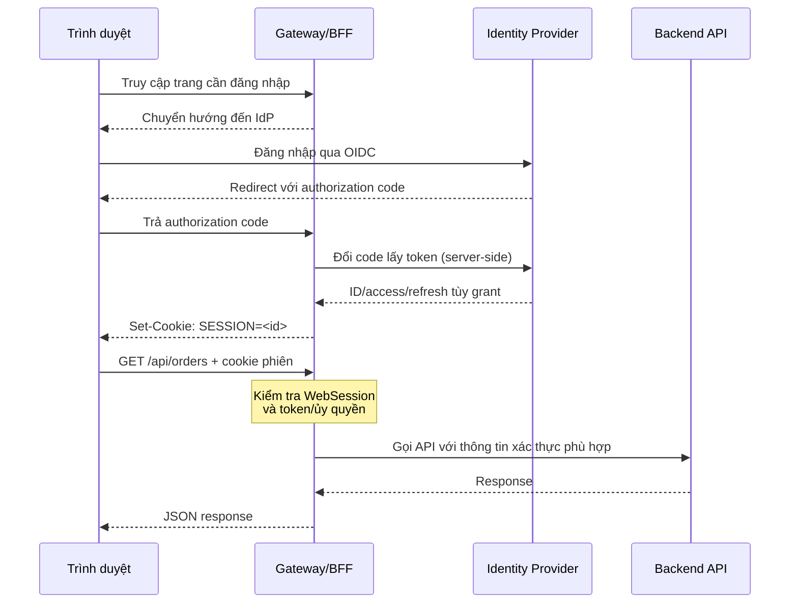
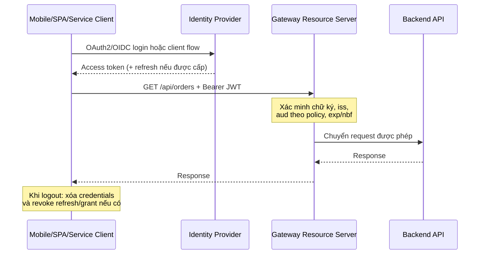
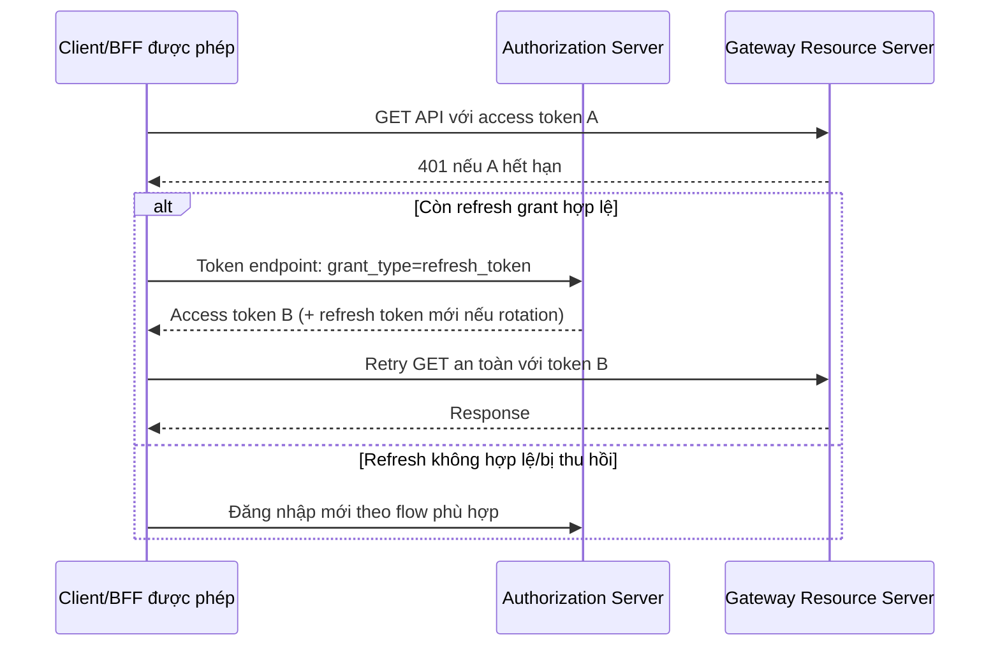

# Đăng xuất, token hết hạn và vòng đời phiên của người dùng

Một người dùng đăng nhập vào ứng dụng, gọi API qua Spring Cloud Gateway, để trình duyệt không hoạt động trong một thời gian rồi quay lại. Khi nào họ cần đăng nhập lại? Nếu người dùng nhấn **Đăng xuất**, liệu một access token đã được cấp trước đó còn gọi API được không? Nếu phiên hết hạn trên một Gateway replica nhưng replica khác vẫn giữ dữ liệu cũ thì hệ thống có hành vi gì?

Các câu hỏi này không thể trả lời bằng một thuộc tính `timeout` duy nhất. Trong kiến trúc microservices, **phiên đăng nhập (session)**, **access token**, **refresh token** và **phiên đăng nhập tại nhà cung cấp danh tính (Identity Provider / OIDC Provider)** là các thực thể khác nhau. Chúng có thời hạn, trạng thái thu hồi và ranh giới trách nhiệm riêng.

Chương **Phiên đăng nhập và token** của module **SPRING_CLOUD_GATEWAY** tập trung vào cách quản lý **đăng xuất, token hết hạn và vòng đời phiên của người dùng** khi Gateway là cổng vào các microservice. Bài liên hệ với route predicate, filter chain, sửa path/header, service discovery, xác thực/phân quyền, rate limiting, circuit breaker, retry, TLS và observability để tránh lỗi đăng xuất “trên giao diện đã thoát nhưng API vẫn nhận token cũ”.

> **Phạm vi:** Các ví dụ dùng **Spring Cloud Gateway Server WebFlux** và **Spring Security Reactive**. Cần phân biệt ứng dụng Gateway đóng vai trò **OAuth2 Resource Server** (xác minh access token gửi tới) và **OAuth2/OIDC Client** (điều phối đăng nhập, giữ authorized client/phiên cho web). Một số tính năng logout OIDC phụ thuộc phiên bản Spring Security và khả năng của nhà cung cấp danh tính. Không sao chép mã Servlet `HttpSession`/`HttpSecurity` vào WebFlux rồi mặc định hoạt động tương đương.

## 1. Bốn thứ có thể cùng được gọi là “phiên”

| Thực thể | Tạo và lưu ở đâu? | Chứa gì hoặc tham chiếu đến gì? | Kết thúc khi nào? |
| --- | --- | --- | --- |
| **WebSession của Gateway/BFF** | WebFlux `WebSession`; có thể lưu trạng thái ở bộ nhớ hoặc Redis qua Spring Session | Security context, thông tin phiên hoặc trạng thái OAuth2 client được cấu hình | Hết hạn idle, bị vô hiệu hóa, hoặc bị xóa theo chính sách |
| **Access token** | Authorization Server/Identity Provider cấp; client hoặc BFF gửi trong `Authorization: Bearer` | Quyền truy cập API, thời hạn, issuer/audience/scope; có thể là JWT hoặc token opaque | Tới hạn `exp`, bị từ chối theo chính sách hoặc bị thu hồi nếu hệ thống hỗ trợ |
| **Refresh token** | Authorization Server cấp cho client phù hợp; thường được lưu ở vị trí được bảo vệ | Cho phép xin access token mới, không dùng trực tiếp như access token gọi resource API | Hết hạn, bị thu hồi, bị xoay vòng hoặc grant bị hủy |
| **Phiên SSO/OIDC tại IdP** | Identity Provider quản lý | Trạng thái đăng nhập tại hệ thống danh tính | Người dùng logout ở IdP, IdP hết phiên hoặc bị quản trị thu hồi |

**Một người có thể đồng thời có nhiều phiên ở nhiều thiết bị.** Đăng xuất một tab, một trình duyệt hoặc một ứng dụng không mặc nhiên đăng xuất mọi nơi. Hành vi “đăng xuất thiết bị này” và “đăng xuất mọi thiết bị” phải được thiết kế riêng.

### 1.1. Cookie phiên không phải access token

Trong mô hình đăng nhập có session, trình duyệt có thể nhận cookie tương tự:

```http
Set-Cookie: SESSION=<random-session-id>; Path=/; Secure; HttpOnly; SameSite=Lax
```

Giá trị cookie **chỉ là định danh phiên** trong mô hình server-side session thông dụng. Dữ liệu có giá trị xác thực được quản lý phía server trong session store. Nếu session bị vô hiệu hóa, giữ lại cookie chứa session ID cũ không tự khôi phục được phiên.

Ngược lại, trong API dùng Bearer JWT:

```http
GET /api/orders/42 HTTP/1.1
Host: api.example.test
Authorization: Bearer <access-token>
```

JWT đã phát hành thường được Gateway xác minh chữ ký và claims mà **không cần tìm một session server-side cho mỗi request**. Nếu chỉ xóa token trong trình duyệt, bản sao token ở thiết bị khác vẫn có thể được dùng cho đến khi hết hạn hoặc bị cơ chế thu hồi từ chối.

### 1.2. Resource Server và OAuth2 Client là hai vai trò

- **Gateway Resource Server:** dùng Spring Security OAuth2 Resource Server để xác minh Bearer token, kiểm tra issuer, chữ ký, `exp`/`nbf`, audience theo cấu hình và authorities/scopes. Nó **không tự đăng xuất người dùng ở IdP** và **không tự làm mới token** chỉ vì token gửi đến hết hạn.
- **Gateway OAuth2/OIDC Client hoặc BFF:** phối hợp Authorization Code flow/PKCE khi phù hợp, lưu authorized client/token theo thiết kế và có thể hỗ trợ đăng xuất cục bộ hay khởi tạo OIDC logout tại IdP. Cách lưu phiên và token phải được bảo vệ.
- **Backend Resource Server:** có thể xác minh access token hoặc dùng một cơ chế danh tính được thiết lập tin cậy; backend vẫn cần kiểm tra quyền với tài nguyên.

**Đừng đồng nhất `TokenRelay` với một cơ chế làm mới/thu hồi JWT.** `TokenRelay` ở Spring Cloud Gateway liên quan đến authorized OAuth2 client khi Gateway được cấu hình với vai trò OAuth2 Client phù hợp; resource server xác minh Bearer token đầu vào không tự tạo một authorized client và refresh token để relay.

## 2. Vòng đời một lần đăng nhập

Một vòng đời phổ biến:

```mermaid
stateDiagram-v2
    [*] --> ChuaDangNhap
    ChuaDangNhap --> DangNhap: Xác thực thành công
    DangNhap --> DangHoatDong: Tạo phiên/cấp access token
    DangHoatDong --> DangHoatDong: Gọi API; gia hạn idle khi áp dụng
    DangHoatDong --> AccessHetHan: Access token hết hạn
    AccessHetHan --> DangHoatDong: Refresh thành công và còn phiên hợp lệ
    AccessHetHan --> CanDangNhapLai: Không refresh được
    DangHoatDong --> CanDangNhapLai: WebSession timeout hoặc phiên bị thu hồi
    DangHoatDong --> DaDangXuat: Đăng xuất hợp lệ
    AccessHetHan --> DaDangXuat: Đăng xuất/thu hồi phiên
    DaDangXuat --> ChuaDangNhap
    CanDangNhapLai --> ChuaDangNhap
```



Sơ đồ mang tính khái niệm: **trạng thái WebSession** và **trạng thái access token** có thể diễn ra song song. Ví dụ WebSession còn hợp lệ nhưng access token backend đã hết hạn; BFF có thể refresh nếu còn refresh token hợp lệ. Ngược lại, access JWT có thể vẫn còn hiệu lực sau khi WebSession hoặc phiên IdP đã kết thúc, nếu Resource Server chỉ kiểm tra JWT offline.

### 2.1. Ba loại thời hạn phải cấu hình độc lập

| Thời hạn | Ý nghĩa | Ví dụ minh họa |
| --- | --- | --- |
| **Session idle timeout** | Hết phiên khi không có hoạt động được tính là duy trì phiên trong một khoảng. | 20 phút không hoạt động |
| **Session absolute lifetime** | Tuổi tối đa của phiên kể từ một sự kiện xác định, dù vẫn đang hoạt động. | Buộc đăng nhập lại sau 12 giờ |
| **Access token TTL** | Khoảng access token được chấp nhận theo claims/chính sách. | 5–15 phút, tùy threat model |
| **Refresh token TTL / rotation policy** | Giới hạn khoảng có thể lấy token mới và cách phát hiện dùng lại token cũ. | Hết hạn sau vài ngày hoặc theo inactivity/rotation |
| **IdP SSO session lifetime** | Bao lâu người dùng vẫn còn đăng nhập tại nhà cung cấp danh tính. | Do IdP quyết định |

Các số trong bảng **chỉ để hình dung**, không phải giá trị mặc định hay chuẩn bắt buộc. Mức phù hợp phụ thuộc nguy cơ, UX, MFA, dữ liệu nhạy cảm, thiết bị và chính sách IdP.

**Idle timeout khác absolute timeout.** Một hệ thống chỉ thiết lập `maxIdleTime` cho WebSession có thể giữ phiên lâu nếu hoạt động tiếp diễn đều đặn. Nếu yêu cầu “phải đăng nhập lại sau N giờ bất kể hoạt động”, cần bổ sung **absolute expiry** ở nơi quản lý phiên/authorized grant đáng tin cậy.

## 3. Token hết hạn được đánh giá như thế nào?

JWT access token thường có những claim thời gian:

```json
{
  "iss": "https://identity.example.test/issuer",
  "sub": "user-123",
  "aud": ["orders-api"],
  "iat": 1999995000,
  "nbf": 1999995000,
  "exp": 1999995900,
  "scope": "orders.read"
}
```

Đây là **payload minh họa**, không phải JWT đã ký hoặc credential thật.

- **`iat` — issued at:** thời điểm token được phát hành; không thay thế kiểm tra chữ ký hoặc `exp`.
- **`nbf` — not before:** token chưa được phép dùng trước thời điểm xác định, xét theo chính sách clock skew.
- **`exp` — expiration:** token không còn hợp lệ sau thời điểm hết hạn, xét theo chính sách validator/clock skew.
- **`iss` — issuer:** nhà phát hành được chấp nhận.
- **`aud` — audience:** API/Resource Server mà token được cấp cho; cần kiểm tra theo chính sách của Gateway/backend.
- **`scope`/`scp`:** phạm vi quyền, chỉ dùng sau khi token được xác minh và đã ánh xạ thành authorities.

Spring Security Resource Server cho **Reactive JWT** có khả năng xác minh chữ ký, `iss` và các mốc `exp`/`nbf` khi cấu hình chuẩn. **Kiểm tra audience phải được xác nhận hoặc thêm validator phù hợp**, không tự suy luận rằng khai báo `issuer-uri` luôn đủ để ràng buộc token với API này.

### 3.1. Clock skew: token vừa hết hạn nhưng vẫn được chấp nhận?

Máy ở các vùng hạ tầng có thể lệch đồng hồ nhỏ. Validator JWT thường có một mức **clock skew (leeway)** để chịu được sự sai khác, do đó kết quả gần mốc `exp`/`nbf` có thể không trùng chính xác với phút/giây mà người dùng nhìn thấy trên thiết bị.

Trong các phiên bản Spring Security, `JwtTimestampValidator` cho phép cấu hình khoảng lệch; tài liệu hiện hành mô tả **mặc định 60 giây** đối với Resource Server. Đây là **dung sai**, không phải lời hứa token sẽ có “thêm một phút quyền”. Hãy kiểm tra mặc định của phiên bản và cấu hình effective, đồng bộ NTP cho Gateway/IdP/backend và tránh tự tăng skew lớn để chữa lỗi thời gian.

### 3.2. Người dùng phải thấy điều gì khi access token hết hạn?

Với API Bearer:

1. Client gọi API bằng access token.
2. Gateway Resource Server xác minh token và phát hiện token hết hạn.
3. Request bị từ chối ở tầng xác thực, thường là **`401 Unauthorized`**; không tới route backend tương ứng.
4. Nếu client/BFF **được phép refresh**, nó xin access token mới từ IdP rồi thử lại **một cách có kiểm soát**.
5. Nếu refresh thất bại, phiên/grant hết hạn hoặc bị thu hồi, client chuyển sang **đăng nhập lại**.

**Không lặp refresh vô hạn khi nhận 401.** Một 401 cũng có thể do sai issuer, audience, token bị thu hồi, chữ ký sai hoặc policy khác. Refresh chỉ có ý nghĩa khi hệ thống hiểu rõ nguyên nhân và còn một phiên/refresh token hợp lệ.

## 4. Đăng xuất thực chất cần vô hiệu hóa những gì?

“Logout” là một **hành động nghiệp vụ bảo mật**, không phải chỉ thay chữ nút trong UI. Tùy kiến trúc, một lần logout có thể gồm:

1. Xóa trạng thái phiên cục bộ của ứng dụng/Gateway nếu có.
2. Vô hiệu hóa WebSession ở server-side store, không chỉ xóa cookie trên client.
3. Xóa cookie phiên đúng thuộc tính và xóa state/token trong client theo chính sách.
4. Thu hồi refresh token/authorized grant tại Authorization Server nếu ứng dụng có quyền và hỗ trợ.
5. Khởi tạo **OIDC logout tại IdP** nếu yêu cầu kết thúc cả SSO session và provider hỗ trợ.
6. Nếu cần ngắt access token **ngay lập tức**, dùng cơ chế kiểm tra thu hồi phù hợp: opaque token introspection, revocation/denylist/phiên bản quyền và những điểm kiểm tra nhất quán ở mọi resource server.
7. Ghi audit sự kiện đăng xuất nhưng không ghi token/cookie nhạy cảm.

**Không có một hàm logout duy nhất mặc định hoàn thành tất cả các bước trên.**

### 4.1. Ma trận tác động của từng thao tác

| Hành động | WebSession Gateway/BFF | Refresh token | JWT access token đã phát hành | SSO session tại IdP |
| --- | --- | --- | --- | --- |
| Ẩn giao diện/đổi state UI thành “đã thoát” | Không đảm bảo mất hiệu lực | Không | Không | Không |
| Xóa session cookie ở trình duyệt | Browser không còn gửi ID; session server có thể vẫn tồn tại | Không | Không | Không |
| Vô hiệu hóa WebSession server-side | Phiên đó mất hiệu lực | Không tự động | Không tự động | Không tự động |
| Gọi OAuth2 revocation endpoint cho refresh token | Không tự động | Có thể bị thu hồi, tùy IdP | Không chắc token đang sống bị từ chối offline | Không tự động |
| OIDC RP-initiated logout | Tùy xử lý local của ứng dụng | Tùy nhà cung cấp và triển khai | Không mặc nhiên | Có thể kết thúc phiên IdP |
| Xóa danh tính khỏi denylist hay kiểm tra token status | Không trực tiếp | Tùy thiết kế | Phụ thuộc quy tắc validator và điểm kiểm tra | Không trực tiếp |

**Thu hồi refresh token không đồng nghĩa access JWT đã được ký sẽ lập tức vô hiệu.** Nếu Resource Server chỉ xác minh chữ ký/`exp` mà không kiểm tra trạng thái thu hồi, JWT có thể được chấp nhận đến khi hết hạn dù browser đã logout.

## 5. Hai mô hình kiến trúc phổ biến

### 5.1. Mô hình A — BFF/Gateway giữ phiên server-side

Trong **Backend For Frontend (BFF)**, trình duyệt giữ một **session cookie bảo mật**, còn Gateway/BFF giữ các thông tin OAuth2 cần thiết ở server-side theo chính sách.



**Ưu điểm:** browser không cần giữ access/refresh token trong JavaScript; session có thể bị vô hiệu hóa phía server; thích hợp khi web app và BFF cùng ranh giới tin cậy.

**Đổi lại:** phải quản lý WebSession, CSRF/cookie, đồng bộ giữa Gateway replicas, vòng đời refresh token và tính nhất quán giữa logout local với logout IdP.

### 5.2. Mô hình B — API Gateway Resource Server nhận Bearer token



**Ưu điểm:** resource server có thể xác minh JWT độc lập, giảm phụ thuộc vào một session store cho mỗi request.

**Đổi lại:** không có “session server-side” để vô hiệu hóa JWT đã phát hành một cách mặc định. Nếu yêu cầu cắt quyền **ngay**, cần chiến lược thu hồi và kiểm tra thêm, có thể đánh đổi bằng latency, trạng thái phân tán hoặc tính sẵn sàng của hệ thống danh tính.

### 5.3. Không trộn hai mô hình mà không quyết định ranh giới

Một Gateway vừa cấu hình `oauth2Login()` vừa cấu hình `oauth2ResourceServer().jwt()` có thể phục vụ những nhóm URL/clients khác nhau, nhưng cần quy tắc rõ ràng về:

- Request nào dùng cookie/session, request nào dùng Bearer token?
- Có cho phép request mang cả cookie và Authorization header không; ưu tiên identity nào?
- CSRF áp dụng cho những route được xác thực bằng cookie nào?
- Logout có xóa cả local WebSession và authorized client không?
- Backend nhận identity qua token hay qua một cơ chế tin cậy khác?

Không viết hai security chains chồng lấn rồi kỳ vọng chúng tự hợp nhất. **Thứ tự `SecurityWebFilterChain` và `securityMatcher` quyết định chuỗi nào xử lý request**; cần test cả giao điểm giữa các vùng path.

## 6. Đăng xuất WebSession trong Spring Security WebFlux

Theo tài liệu Spring Security Reactive, sau khi đăng nhập, endpoint logout mặc định có thể cho người dùng xem trang xác nhận khi `GET /logout` và thực hiện logout bằng `POST /logout`. Hành vi/logout matcher thực tế phụ thuộc cấu hình và CSRF đang bật.

Tài liệu Spring Security nêu rằng logout mặc định sẽ xóa các thông tin liên quan tới CSRF/security context, nhưng khi yêu cầu **vô hiệu hóa WebSession**, nên cấu hình thêm **`WebSessionServerLogoutHandler`** cùng handler xóa security context.

### 6.1. Ví dụ logout local có vô hiệu hóa WebSession

Ví dụ **Spring Security Reactive** cho Gateway/BFF sử dụng OIDC login theo cấu hình OAuth2 Client đã có:

```java
package com.example.gateway.security;

import org.springframework.context.annotation.Bean;
import org.springframework.context.annotation.Configuration;
import org.springframework.security.config.annotation.web.reactive.EnableWebFluxSecurity;
import org.springframework.security.config.web.server.ServerHttpSecurity;
import org.springframework.security.web.server.SecurityWebFilterChain;
import org.springframework.security.web.server.authentication.logout.DelegatingServerLogoutHandler;
import org.springframework.security.web.server.authentication.logout.SecurityContextServerLogoutHandler;
import org.springframework.security.web.server.authentication.logout.WebSessionServerLogoutHandler;

import static org.springframework.security.config.Customizer.withDefaults;

@Configuration
@EnableWebFluxSecurity
public class BrowserSessionSecurityConfig {

    @Bean
    SecurityWebFilterChain browserSecurity(ServerHttpSecurity http) {
        var logoutHandler = new DelegatingServerLogoutHandler(
            new SecurityContextServerLogoutHandler(),
            new WebSessionServerLogoutHandler()
        );

        return http
            // Không tắt CSRF cho ứng dụng xác thực bằng browser cookie.
            .authorizeExchange(exchanges -> exchanges
                .pathMatchers("/login", "/assets/**").permitAll()
                .anyExchange().authenticated()
            )
            .oauth2Login(withDefaults())
            .logout(logout -> logout.logoutHandler(logoutHandler))
            .build();
    }
}
```

**Điều kiện của ví dụ:**

1. Ứng dụng đã khai báo **OAuth2 Client registration** và IdP có thể truy cập được. Chỉ thêm class này không tự tạo một hệ thống đăng nhập OIDC.
2. Handler được cấu hình để **xóa SecurityContext** và **vô hiệu hóa WebSession**. Điều này không tự gọi revocation endpoint hay OIDC Provider logout.
3. Spring Security có thể dùng CSRF token từ repository theo cấu hình. Khi tùy biến logout handler/CSRF repository, phải xác nhận cả state CSRF liên quan cũng được xóa hoặc vô hiệu hóa theo chính sách.
4. `GET /logout` thường là trang xác nhận; thao tác thay đổi trạng thái cần được thực hiện theo method/logout matcher được bảo vệ bằng CSRF trong trường hợp dùng cookie.
5. Đặt route `/logout` tại **đúng Gateway/BFF đang sở hữu WebSession**. Chuyển tiếp nhầm request logout đến một backend khác không làm session của Gateway tự biến mất.

### 6.2. Vì sao không chỉ gọi WebSession.invalidate() một cách tùy tiện?

WebFlux có API `WebSession.invalidate()` nhưng **logout là thao tác security lifecycle**, không chỉ xóa một map thuộc tính:

- Cần xóa security context/repository phù hợp.
- Cần đảm bảo logout chỉ được thực hiện qua endpoint/method/CSRF policy được bảo vệ.
- Có thể cần xóa authorized client, session cookies và thông tin liên kết IdP.
- Cần xử lý logout nhiều lần hoặc trình duyệt đóng mạng giữa chừng một cách có kiểm soát.

Sử dụng handler của Spring Security giúp giữ luồng logout nhất quán hơn việc tự viết một `GatewayFilter` chỉ gọi invalidate rồi trả `200`. Nếu custom logout sâu hơn, cần hiểu những side effects đang được thay thế.

### 6.3. Xóa cookie và vô hiệu hóa session là hai việc khác nhau

Sau logout thành công, client nên không còn gửi cookie phiên. Việc xóa cookie cần dùng đúng **name/path/domain**; thuộc tính `Secure`, `HttpOnly` và `SameSite` cần được cấu hình phù hợp với môi trường HTTPS và ranh giới origin.

Ví dụ header xóa cookie mang tính minh họa:

```http
Set-Cookie: SESSION=; Max-Age=0; Path=/; Secure; HttpOnly; SameSite=Lax
```

**Nhưng việc xóa cookie ở browser không tự xóa session phía server.** Ngược lại, việc vô hiệu hóa session phía server nên khiến session ID cũ không còn dùng được dù browser chưa kịp xóa cookie vì lỗi mạng.

## 7. Session timeout và Spring Session khi Gateway có nhiều replica

Khi có nhiều Gateway instances sau load balancer, một ứng dụng dùng WebSession **in-memory cục bộ** có thể bị mất phiên hoặc thay đổi hành vi nếu request tiếp theo đến replica khác. Các lựa chọn thường gặp:

- **Shared session store**, ví dụ Spring Session Redis cho WebFlux.
- **Session affinity/stickiness** ở load balancer phía trước, nhưng vẫn cần tính tới restart/failover và không thay cho quản lý phiên nhất quán.
- **Stateless Bearer JWT** nếu kiến trúc phù hợp và chấp nhận mô hình thu hồi riêng.

Spring Session cung cấp tích hợp **Reactive `WebSession`** được hỗ trợ bởi Redis, cho phép các Gateway instances truy cập session qua một kho chung thay vì mỗi node tự giữ trạng thái riêng.

### 7.1. Spring Boot và Spring Session Redis với WebFlux

Trong các phiên bản Spring Boot hỗ trợ, thêm dependency quản lý Spring Session Redis:

```xml
<dependency>
    <groupId>org.springframework.boot</groupId>
    <artifactId>spring-boot-starter-session-data-redis</artifactId>
</dependency>
```

Ví dụ cấu hình **minh họa**:

```yaml
spring:
  session:
    timeout: 20m
  data:
    redis:
      host: redis.internal.example.test
      port: 6379
```

Trong môi trường triển khai thật, dùng DNS/credentials/TLS của Redis theo chính sách bảo mật. Không đưa mật khẩu Redis vào Git hoặc log; quản lý secret theo cơ chế của hạ tầng.

Spring Boot có cơ chế auto-configuration cho **Spring Session reactive Redis** khi starter/stack phù hợp. Tài liệu Spring Session cũng cho phép cấu hình chuyên sâu với `@EnableRedisWebSession`; **không thêm annotation trùng lặp nếu auto-configuration đã đáp ứng**.

### 7.2. Idle timeout không đồng nghĩa token timeout

Giả sử:

- WebSession idle timeout: 20 phút.
- Access token hết hạn sau 10 phút.
- Refresh token còn hiệu lực trong một khoảng dài hơn.

Nếu người dùng gọi API đều đặn, WebSession có thể vẫn tồn tại khi access token hết hạn. BFF phù hợp có thể xin token mới nếu refresh còn hợp lệ; Resource Server chỉ nhận Bearer token hết hạn thì trả 401 và không tự refresh.

Ngược lại, nếu người dùng không hoạt động quá 20 phút, session có thể bị xóa dù access token vẫn chưa hết hạn. **Đây không phải lỗi mâu thuẫn:** hai đối tượng có vòng đời độc lập.

### 7.3. Absolute timeout và revoke all sessions

Yêu cầu an toàn đôi khi gồm:

- Buộc đăng nhập lại sau N giờ kể cả vẫn hoạt động.
- Kết thúc mọi phiên của người dùng khi đổi mật khẩu hoặc phát hiện tài khoản bị chiếm.
- Chỉ đăng xuất một thiết bị cụ thể.

Để làm vậy, phải có **session registry hoặc dữ liệu mapping user ↔ sessions** được quản lý đáng tin cậy, cơ chế xác thực lại và policy áp dụng ở mọi Gateway replicas. **Không có một cấu hình idle timeout đơn giản thay thế toàn bộ “logout all devices”.**

Khi xóa session ở Redis, cần tính tới propagation, in-flight requests và nơi lưu session ở những dịch vụ khác. Việc vô hiệu hóa session Gateway không tự xóa toàn bộ phiên mà backend hoặc IdP đang giữ.

## 8. Đăng xuất khi Gateway chỉ là JWT Resource Server

Với Gateway chỉ nhận Bearer JWT, không nhất thiết tồn tại WebSession cần hủy. Một cấu hình cơ bản:

```yaml
spring:
  security:
    oauth2:
      resourceserver:
        jwt:
          issuer-uri: https://identity.example.test/issuer
```

```java
package com.example.gateway.security;

import org.springframework.context.annotation.Bean;
import org.springframework.context.annotation.Configuration;
import org.springframework.security.config.annotation.web.reactive.EnableWebFluxSecurity;
import org.springframework.security.config.web.server.ServerHttpSecurity;
import org.springframework.security.web.server.SecurityWebFilterChain;
import org.springframework.security.web.server.context.NoOpServerSecurityContextRepository;

import static org.springframework.security.config.Customizer.withDefaults;

@Configuration
@EnableWebFluxSecurity
public class BearerApiSecurityConfig {

    @Bean
    SecurityWebFilterChain apiSecurity(ServerHttpSecurity http) {
        return http
            // Chỉ phù hợp khi API được xác thực bằng Authorization: Bearer,
            // không dựa vào browser cookie tự động gửi để xác thực.
            .csrf(ServerHttpSecurity.CsrfSpec::disable)
            .securityContextRepository(
                NoOpServerSecurityContextRepository.getInstance())
            .authorizeExchange(exchanges -> exchanges
                .pathMatchers("/public/health").permitAll()
                .pathMatchers("/api/**").authenticated()
                .anyExchange().denyAll()
            )
            .oauth2ResourceServer(resourceServer ->
                resourceServer.jwt(withDefaults()))
            .build();
    }
}
```

Đây là ví dụ **mô hình JWT stateless**; không bật đồng thời với cấu hình browser-session khác ở mục 6 trong cùng ứng dụng mà chưa thiết kế các security chains/matchers phù hợp. Phải cấu hình JWT validators cho audience và những yêu cầu issuer/tenant, phân quyền theo method/role/scope trong hệ thống thực tế, không chỉ `authenticated()`.

### 8.1. “Logout” ở mô hình JWT là gì?

Trong mô hình này, logout thường do **client** khởi tạo và hệ thống danh tính hỗ trợ:

1. Client ngừng sử dụng và **xóa access token** ở nơi lưu trữ của mình.
2. Nếu có refresh token, client có thể gửi yêu cầu **revoke** qua điểm kết thúc của Authorization Server theo hợp đồng OAuth2, sau khi đã xác minh danh tính client thích hợp.
3. Authorization Server hủy refresh token/grant liên quan theo chính sách.
4. Nếu cần chặn access token còn hạn, các Resource Server/Gateway phải có cơ chế **kiểm tra thu hồi bổ sung** hoặc chính sách token thời hạn ngắn theo rủi ro cho phép.
5. Nếu đăng nhập bằng OIDC và cần kết thúc SSO, thực hiện OIDC logout riêng khi provider hỗ trợ.

**Không tạo API `GET /logout` rồi mong nó xóa mọi JWT đã từng phát hành.** Với JWT ký bất biến và verifier offline, một token bị đánh cắp vẫn có thể được sử dụng nếu chưa hết hạn và không có kiểm tra thu hồi.

### 8.2. Vì sao không để client gửi refresh token tới mọi backend?

Refresh token là credential có giá trị cao vì có thể xin thêm access token mới. Nó thuộc về **Authorization Server và client được cấp quyền**, không phải một thông tin nghiệp vụ mà tất cả downstream services cần nhận.

- Không truyền refresh token qua `X-Refresh-Token` do client tự đặt.
- Không lưu refresh token trong logs/URL/query.
- Không chuyển refresh token đến các resource servers không có chức năng token exchange/refresh đã được thiết kế.
- Với BFF, giữ refresh token ở server-side protected store; browser chỉ nhận cookie phiên được cấu hình an toàn.

## 9. OAuth2 Token Revocation và giới hạn của JWT tự xác minh

**RFC 7009 — OAuth 2.0 Token Revocation** quy định cách OAuth2 client yêu cầu Authorization Server thu hồi token. Endpoint của từng IdP và cách xác thực client phải lấy từ tài liệu/discovery đáng tin cậy; không mặc định IdP nào cũng dùng `/oauth2/revoke`.

Ví dụ **khung HTTP** cho một confidential client:

```http
POST /oauth2/revoke HTTP/1.1
Host: identity.example.test
Content-Type: application/x-www-form-urlencoded
Authorization: Basic <client-credentials-encoded>

token=<refresh-token>&token_type_hint=refresh_token
```

Các giá trị token/client credentials đều là **placeholder**, không dùng token thật trong ví dụ hay gửi qua kênh không mã hóa. Endpoint thực tế phải dùng **HTTPS**, credential phải được quản lý bí mật và chỉ client được phép mới gọi theo chính sách IdP.

**Điểm quan trọng từ RFC 7009:**

- Authorization Server phải hỗ trợ thu hồi **refresh token** và được khuyến nghị hỗ trợ thu hồi **access token**.
- Thu hồi refresh token có thể kéo theo thu hồi access token hoặc grant liên quan **tùy khả năng và chính sách của IdP**.
- Một phản hồi thành công cho yêu cầu thu hồi **không chứng minh mọi Resource Server đang xác minh JWT offline đã ngay lập tức nhận biết việc thu hồi**.
- Có thể tồn tại **độ trễ đồng bộ** giữa các thành phần khi áp dụng revocation.

### 9.1. Ba cách xử lý yêu cầu “logout phải cắt quyền ngay”

| Chiến lược | Cách hoạt động | Đổi lại |
| --- | --- | --- |
| **Access JWT ngắn hạn** | Giới hạn cửa sổ JWT còn được chấp nhận sau logout. | Không đảm bảo cắt quyền ngay trước `exp`; cần xử lý refresh an toàn. |
| **Opaque access token + introspection** | Resource Server hỏi Authorization Server về token status theo chính sách cache. | Thêm network dependency/latency; cache có thể làm chậm thấy trạng thái mới. |
| **JWT + revocation/denylist/session version check** | Mỗi request hoặc một số điểm kiểm tra đối chiếu `jti`/session ID/version với trạng thái phía server. | Cần lưu trữ, đồng bộ, TTL, xử lý lỗi mạng và định nghĩa fail-closed phù hợp. |

Chọn một hoặc kết hợp theo mức rủi ro, latency budget và yêu cầu vận hành. **Đừng mô tả JWT là “stateless hoàn toàn” nếu mọi request lại phải đọc denylist**: khi đó hệ thống đã đưa một phần trạng thái trở lại vào đường xác thực, đổi lấy khả năng thu hồi sớm.

### 9.2. Dùng denylist như thế nào để không tự gây lỗi mới?

Nếu hệ thống quyết định chặn JWT theo `jti` hoặc session identifier:

1. Chỉ chấp nhận token đã được **xác minh chữ ký/issuer/audience/thời hạn** trước khi tin các claims.
2. Ghi một khóa định danh an toàn, kèm TTL phù hợp với phần thời hạn còn lại của token.
3. Nếu cần “logout all devices”, phải có mapping/phiên bản quyền ở phạm vi user/grant đáng tin cậy.
4. Đảm bảo mọi Gateway/Resource Server đều kiểm tra trạng thái đồng nhất; không có node âm thầm bỏ qua kiểm tra.
5. Quy định khi store thu hồi **không khả dụng**: fail-closed đối với API nhạy cảm hay thiết kế cơ chế graceful degradation có kiểm soát.
6. Tránh để thông báo lỗi làm lộ trạng thái tài khoản hoặc cho phép kẻ xấu dò token.

Không xây denylist bằng cách lưu nguyên Bearer token ở log hoặc những bộ nhớ cache không bảo vệ; ưu tiên identifier/giá trị băm theo thiết kế và giới hạn quyền truy cập store.

## 10. Refresh token: làm mới, xoay vòng và tái sử dụng

**Refresh token** cho phép client được cấp quyền xin access token mới mà không bắt người dùng nhập lại mật khẩu cho mỗi lần access token hết hạn. Nó không được mặc nhiên cấp trong mọi OAuth2 grant.



Mô hình BFF có thể chủ động refresh **trước khi** access token hết hạn theo ngưỡng phù hợp, thay vì để request API nhận 401 mới xử lý. Tuy nhiên, không được dựa vào thời gian client đơn thuần để bỏ qua xác thực access token tại resource server.

### 10.1. Refresh token rotation

Trong rotation, mỗi lần sử dụng refresh token cũ, Authorization Server có thể cấp **refresh token mới** và vô hiệu hóa token cũ theo chính sách. Cơ chế phát hiện **reuse** token cũ có thể được IdP dùng để nhận biết nguy cơ token bị đánh cắp và thu hồi cả token family.

Điểm triển khai cần chú ý:

- **Lưu giá trị refresh mới an toàn và nguyên tử** theo session/authorized client.
- **Chống concurrent refresh:** hai HTTP requests gần nhau cùng thấy access token sắp hết hạn có thể cố dùng một refresh token cũ hai lần, tạo false positive reuse hoặc xung đột lưu trữ.
- Khi refresh thất bại, **không lặp vô hạn**; đưa phiên về trạng thái cần đăng nhập lại.
- Nếu IdP báo grant/token đã bị thu hồi, không đổi sang một refresh token cũ trong cache để “thử lại”.
- Xác định cách xử lý client crash sau khi IdP cấp token mới nhưng trước khi BFF lưu xong.

### 10.2. Refresh token còn hạn nhưng session đã hết

Nếu WebSession đã hết hạn và BFF không còn authorized client của người dùng, **đừng tự phục hồi phiên chỉ vì trong một hệ thống cache nào đó vẫn còn refresh token**. Việc tạo lại phiên cần tuân thủ ranh giới xác thực, session binding và chính sách đăng nhập lại.

Ngược lại, nếu client app hợp lệ giữ refresh token theo grant của nó, nó có thể xin token mới mà không cần WebSession Gateway. Đó là kiến trúc khác: quyền truy cập API vẫn do access token mới quyết định.

## 11. Đăng xuất OIDC: local logout không phải provider logout

Đối với ứng dụng sử dụng **OpenID Connect**, một người dùng có thể có cả **phiên của BFF/Gateway** và **SSO session ở IdP**.

Nếu chỉ logout local, người dùng có thể mở lại ứng dụng và được đưa qua luồng OIDC; IdP còn phiên có thể đăng nhập lại mà không cần nhập mật khẩu. Điều này thường gây cảm giác “logout không hoạt động”, trong khi thực tế chỉ có **một trong hai phiên** được kết thúc.

### 11.1. RP-Initiated Logout

Khi OIDC Provider có hỗ trợ endpoint đăng xuất phù hợp, ứng dụng có thể bắt đầu **RP-initiated logout**, đưa user-agent qua IdP để kết thúc phiên SSO.

Spring Security WebFlux cung cấp **`OidcClientInitiatedServerLogoutSuccessHandler`** cho trường hợp này, sử dụng **`ReactiveClientRegistrationRepository`**. Ví dụ cấu hình phần handler:

```java
import org.springframework.security.oauth2.client.registration.ReactiveClientRegistrationRepository;
import org.springframework.security.oauth2.client.oidc.web.server.logout.OidcClientInitiatedServerLogoutSuccessHandler;
import org.springframework.security.web.server.authentication.logout.ServerLogoutSuccessHandler;

@Bean
ServerLogoutSuccessHandler oidcLogoutSuccessHandler(
        ReactiveClientRegistrationRepository registrations) {
    var handler = new OidcClientInitiatedServerLogoutSuccessHandler(
        registrations);
    handler.setPostLogoutRedirectUri("{baseUrl}/signed-out");
    return handler;
}
```

Khi tích hợp vào một `SecurityWebFilterChain` đang dùng `oauth2Login()`, cấu hình logout success handler này theo tài liệu Spring Security cho phiên bản tương ứng. **Đừng chỉ khai báo bean rồi cho rằng framework tự sử dụng nó**.

**Những điểm cần xác minh:**

- IdP công bố/suport OIDC end-session endpoint qua discovery hoặc cách cấu hình tin cậy.
- Client ID và post-logout redirect URI được IdP cho phép.
- Local logout vẫn vô hiệu hóa WebSession và security context theo chính sách.
- Địa chỉ `{baseUrl}` được suy ra từ hostname/scheme đã qua trusted reverse proxy; tránh open redirect và host-header injection.
- Provider logout không mặc nhiên thu hồi mọi JWT access token đang còn hạn trong các resource servers.

### 11.2. Back-channel logout

Một số nhà cung cấp và phiên bản Spring Security có hỗ trợ **OIDC Back-Channel Logout**, trong đó IdP gửi logout token tới ứng dụng để yêu cầu kết thúc phiên liên quan. Tính năng này không phải một HTTP request thường từ browser, nên cần cơ chế xác minh logout token và mapping provider session ↔ local sessions.

Với WebFlux, tài liệu Spring Security có thể sử dụng `OidcBackChannelServerLogoutHandler` và endpoint tương ứng; cấu hình cụ thể phụ thuộc phiên bản và cookie/session naming. **Đừng áp dụng mẫu code của một phiên bản khác mà chưa kiểm tra**, vì thay đổi endpoint/cookie naming có thể làm back-channel không tìm thấy WebSession cần hủy.

Khi chạy nhiều Gateway replicas, mapping phiên IdP với phiên ứng dụng cũng có thể cần một store chia sẻ; chỉ giữ trạng thái mapping trong bộ nhớ một node không tự tạo được logout nhất quán toàn cụm.

## 12. CSRF, cookie và yêu cầu an toàn đối với logout

Với xác thực **dựa trên browser cookie**, trình duyệt có thể tự động đính kèm cookie vào request. Một website độc hại có thể cố gửi request thay mặt người dùng tới một ứng dụng cùng session nếu không có cơ chế kiểm soát CSRF thích hợp.

**Không tắt CSRF chỉ để endpoint logout dễ gọi hơn.** Với OIDC login/BFF cookie, cấu hình Spring Security CSRF phù hợp (token repository, same-origin policy và client gửi token cho state-changing requests). Một logout handler trên `POST /logout` phải được truy cập bằng request hợp lệ theo policy.

### 12.1. Cookie flags

| Thuộc tính | Lợi ích hoặc ý nghĩa | Điều cần lưu ý |
| --- | --- | --- |
| **`Secure`** | Cookie chỉ được gửi qua HTTPS theo chính sách browser. | Bắt buộc cho cookie phiên trong triển khai public HTTPS. |
| **`HttpOnly`** | JavaScript không trực tiếp đọc cookie. | Giảm nguy cơ lộ session ID qua JS; không chống toàn bộ tác động của XSS. |
| **`SameSite=Lax/Strict/None`** | Điều chỉnh cookie trong ngữ cảnh cross-site. | `None` cần `Secure`; lựa chọn phụ thuộc OIDC redirects, cross-site embedding và UX. |
| **`Path`, `Domain`** | Giới hạn phạm vi gửi cookie. | Cần đúng khi xóa cookie; đừng đặt Domain rộng không cần thiết. |
| **Cookie rotation/session ID renewal** | Giảm nguy cơ session fixation/reuse trong các tình huống. | Phải áp dụng theo cơ chế framework và policy xác thực, không tự tạo ID dễ đoán. |

Tuy nhiên, **CSRF khác CORS**. CORS quy định khi nào browser cho JavaScript đọc response cross-origin; nó không thay thế CSRF protection cho endpoint được xác thực bằng cookie. Một token hợp lệ cũng không khiến mọi Origin trở thành tin cậy.

### 12.2. Không nên dùng GET để thay đổi trạng thái logout

Các đường dẫn `GET` có thể bị trình duyệt preload, crawler, proxy hoặc những cơ chế an toàn khác gọi ngoài chủ đích. Do đó, với logout ảnh hưởng phiên, thường nên có một action **POST** có CSRF protection phù hợp với cookie auth. `GET /logout` nếu tồn tại trong UI nên chỉ hiển thị xác nhận, không tự xóa phiên như một tác dụng phụ.

## 13. Gateway, backend và IdP cần chia trách nhiệm thế nào?

| Lớp | Trách nhiệm chính trong vòng đời phiên |
| --- | --- |
| **Browser/mobile client** | Bảo quản credential phù hợp, ngừng gửi token sau logout, hiển thị trạng thái cần login lại. |
| **Gateway/BFF** | Quản lý WebSession nếu có, kiểm tra auth/authz tại biên, logout local và thực thi flow IdP/token theo vai trò được giao. |
| **Authorization Server/IdP** | Cấp/refresh/revoke token, quản lý SSO session, chính sách MFA và token rotation. |
| **Backend Resource Server** | Xác minh token/identity hoặc ranh giới tin cậy tương ứng; phân quyền theo dữ liệu và tài nguyên. |
| **Spring Session/Redis** | Lưu session server-side dùng chung khi kiến trúc yêu cầu. |
| **Reverse proxy/Ingress** | TLS, hostname, forwarded headers đáng tin cậy, giới hạn truy cập điểm vào. |

### 13.1. Logout không tự cắt request đang chạy

Nếu người dùng logout khi một request trước đó đã vượt qua authentication/authorization và đang xử lý ở backend, việc vô hiệu hóa session **không nhất thiết hủy ngay request in-flight**. Cần định nghĩa rõ hành vi cho những thao tác có tác dụng phụ:

- Có kiểm tra lại quyền ngay tại thời điểm commit nghiệp vụ không?
- Đã sử dụng idempotency key cho thanh toán/đặt hàng chưa?
- Có cần revoke session/grant ở các ranh giới mạng khác không?
- Khi nhận một logout event, các thành phần có độ trễ truyền sự kiện bao lâu?

Không hứa với người dùng “tất cả yêu cầu đang chạy sẽ dừng ngay” nếu hệ thống chưa có cơ chế hỗ trợ và kiểm thử điều đó.

### 13.2. Retry, circuit breaker và refresh

Một số logic refresh nằm ở HTTP client/BFF và có thể bị kích hoạt bởi `401`. Trong khi đó, Gateway có thể có **`Retry` GatewayFilter** hoặc circuit breaker dành cho downstream. Trộn không rõ hai loại retry có thể tạo vòng lặp:

1. Access token hết hạn → API trả 401.
2. Client tự refresh và retry.
3. Gateway/HTTP client lại retry downstream.
4. Cùng một POST có thể bị gửi nhiều lần nếu không có idempotency.

Hãy tách **retry do authentication/refresh** khỏi **retry do lỗi mạng/downstream**. Không bật retry chung cho các thao tác ghi có tác dụng phụ khi chưa thiết kế idempotency và timeout budget.

### 13.3. TLS và token forwarding

Bearer token bị lộ có thể dùng được bởi người khác trong phạm vi thời hạn/quyền, trừ khi có ràng buộc bổ sung như token binding được thiết kế phù hợp. Vì vậy:

- Dùng HTTPS cho client → Gateway.
- Bảo vệ Gateway → backend theo TLS/mTLS/network policy và ranh giới tin cậy phù hợp.
- Không gửi token qua query string, URL redirect, Referer hoặc log.
- Xác định rõ backend nào được nhận access token; kiểm tra audience và scope ở nơi xử lý tài nguyên.
- Không tin `X-User-Id`/`X-Role` do client tự gửi, ngay cả khi request đã đi qua route predicate.

## 14. Lỗi và phản hồi client khi phiên/token hết hạn

| Tình huống | Phản hồi thường gặp | Client/BFF nên làm gì? |
| --- | --- | --- |
| Bearer token thiếu hoặc hết hạn | `401 Unauthorized`, có thể kèm `WWW-Authenticate: Bearer` | Nếu có refresh hợp lệ, thử refresh có kiểm soát; nếu không, login lại. |
| Bearer token hợp lệ nhưng thiếu scope | `403 Forbidden` | Không refresh vô hạn để hy vọng quyền mới xuất hiện; hiển thị thiếu quyền và kiểm tra grant. |
| Browser WebSession hết hạn | Có thể redirect đến login hoặc `401` tùy chain/handler | Phân biệt UI navigation với API JSON; giữ trạng thái ứng dụng nhất quán. |
| Refresh token bị revoke/hết hạn | Lỗi từ token endpoint, thường OAuth2 `invalid_grant` tùy nguyên nhân | Xóa trạng thái token cũ, yêu cầu đăng nhập lại. |
| OIDC logout local hoàn tất nhưng IdP còn SSO | Có thể đăng nhập lại không cần mật khẩu | Kiểm tra nhu cầu RP-initiated logout và IdP session. |
| Redis session store lỗi | Có thể lỗi 5xx hoặc không xác thực được, theo thiết kế | Không fail open cho API nhạy cảm; giám sát store và SLA. |
| Backend không tìm thấy instance | Gateway có thể báo lỗi upstream, không phải token lỗi | Kiểm tra discovery/load balancing; không refresh token. |
| Rate limiter từ chối | `429 Too Many Requests` | Thực hiện backoff theo policy, không đăng xuất người dùng vô cớ. |

**Đừng trả 401 cho tất cả lỗi**. Nó khiến client liên tục refresh hoặc đăng nhập lại khi vấn đề thật là Redis, downstream, route mismatch hoặc rate limiting.

### 14.1. Phân biệt API response với browser redirect

Một UI điều hướng trực tiếp có thể nhận `302` về trang đăng nhập. Nhưng một SPA gọi `fetch('/api/orders')` thường mong nhận JSON/status, không mong HTTP client tự theo redirect để nhận HTML login page với mã `200` rồi parse như JSON.

Thiết kế rõ:

- Endpoint UI: redirect đến login page theo UX.
- Endpoint API: thường trả `401` có machine-readable error code và không redirect vòng lặp.
- Endpoint logout: trả `204` hoặc redirect sau logout theo client type, kèm chính sách xóa session/cookie.

Đây là quyết định API/UX, không phải một mặc định duy nhất của Spring Security cho mọi ứng dụng.

## 15. Kiểm thử vòng đời phiên và token

Đăng nhập thành công chưa đủ. Một bộ kiểm thử cần bảo đảm **đăng xuất thật sự làm mất quyền truy cập theo mô hình đã chọn**.

### 15.1. Ma trận kiểm thử

| Test case | Kịch bản | Điều phải xác minh |
| --- | --- | --- |
| A | Chưa login, gọi API protected | 401 hoặc redirect đúng policy; backend không bị gọi trái phép |
| B | Login, gọi protected API | Có phiên/token đúng và quyền phù hợp; backend vẫn kiểm tra ownership |
| C | Logout local WebSession | Session ID cũ không còn truy cập được; cookie/CSRF state xử lý đúng |
| D | Xóa cookie nhưng session server còn | Không coi thao tác client là bằng chứng session đã bị revoke; kiểm tra server-side |
| E | Access JWT hết hạn | Resource Server trả 401; không chuyển request đến backend |
| F | JWT còn hạn sau logout client | Kiểm tra hành vi đúng theo chiến lược revocation đã chọn; không giả định JWT tự hết hiệu lực |
| G | Refresh token còn hợp lệ | Cấp access token mới qua flow đúng; không lộ refresh token |
| H | Refresh bị thu hồi | Refresh thất bại; client không lặp vô hạn và chuyển sang login |
| I | Hai refresh gần đồng thời | Không mất refresh token mới/không tạo false positive reuse |
| J | WebSession idle timeout | Hết phiên đúng policy; client nhận được tín hiệu login lại |
| K | Absolute lifetime đạt ngưỡng | Buộc đăng nhập lại dù vừa hoạt động |
| L | Hai Gateway replicas dùng session store chung | Logout ở replica A khiến request ở replica B không dùng session cũ được |
| M | Logout một thiết bị, thiết bị khác còn phiên | Hành vi đúng với yêu cầu logout-local, không vô tình thu hồi mọi thiết bị |
| N | Logout all devices | Tất cả sessions/grants cần thu hồi đều bị xử lý theo thiết kế |
| O | OIDC logout tại IdP | Provider session kết thúc nếu hỗ trợ; đánh giá login lại qua SSO |
| P | CSRF attack tới endpoint logout | Bị ngăn khi sử dụng cookie auth và CSRF policy |
| Q | Store Redis/IdP/Network lỗi | Không vô tình mở quyền; lỗi được phân loại, giám sát rõ |

### 15.2. Kiểm thử WebSession bằng WebTestClient

Với ứng dụng WebFlux, có thể dùng `WebTestClient` và một endpoint test được bảo vệ để xác nhận WebSession sau logout. Tuy nhiên, test phải thực sự khởi chạy **SecurityWebFilterChain**, session store và CSRF policy:

```java
// Mã khung minh họa, không phải một test class hoàn chỉnh.
// 1) Đăng nhập test client theo cơ chế thực tế (form/OIDC mock).
// 2) Lưu cookie SESSION và CSRF token đúng cách.
// 3) Gửi POST /logout với cookie + CSRF token hợp lệ.
// 4) Dùng LẠI session cookie cũ:
webTestClient.get()
    .uri("/api/orders/42")
    .cookie("SESSION", oldSessionId)
    .exchange()
    .expectStatus()
    .isUnauthorized(); // Chỉ đúng nếu API chain trả 401 thay vì redirect.
```

Không hard-code `isUnauthorized()` khi ứng dụng dùng form login và mặc định redirect sang trang login; khi đó cần kiểm tra status/location theo policy. Điều quyết định là **phiên cũ không còn được xác thực**, không phải mọi kiến trúc phải trả cùng mã HTTP.

**Đừng kiểm thử logout bằng cách chỉ nhìn cookie hết hạn ở browser**. Phải gửi lại session ID cũ và xác nhận server-side state đã bị vô hiệu hóa trên đúng kho phiên.

### 15.3. Kiểm thử JWT expiry thật

`mockJwt()` của Spring Security Test rất hữu ích để kiểm tra authorization rule, nhưng nó **bỏ qua quá trình xác minh token thật**. Để kiểm thử `exp`, `nbf`, `iss` và `aud`, cần tạo JWT được ký bằng khóa **test**, cấu hình decoder test và gửi qua HTTP:

```text
Token A: chữ ký hợp lệ, exp trong quá khứ       -> 401
Token B: chữ ký hợp lệ, nbf trong tương lai      -> 401
Token C: chữ ký không hợp lệ                    -> 401
Token D: iss không đúng                          -> 401
Token E: aud không đúng theo policy             -> 401
Token F: token còn hạn và đúng issuer/audience   -> qua authentication
```

Tách riêng **test authorization** (thiếu scope/role → 403) và **test authentication** (token không hợp lệ → 401). Đồng bộ test clock hoặc kiểm soát `clockSkew` khi kiểm tra các ranh giới thời gian để tránh test chập chờn.

### 15.4. Kiểm thử logout JWT đúng yêu cầu kinh doanh

Giả sử policy là “JWT access token bị logout phải bị từ chối ngay”:

1. Đăng nhập và nhận access token còn hạn.
2. Gọi API → thành công.
3. Đăng xuất/thu hồi grant hoặc ghi denylist theo thiết kế.
4. Gọi lại bằng **cùng access token cũ**, trên **mọi Gateway replicas/backend resource servers**.
5. Xác nhận request bị từ chối theo **cam kết thực tế** và không đi tới backend ngoài ý muốn.

Nếu JWT vẫn được chấp nhận sau bước 3 mà hệ thống chỉ định nghĩa “logout ngừng refresh, access JWT hết hạn tự nhiên”, đây là hành vi **phù hợp với policy đó** nhưng không đáp ứng yêu cầu thu hồi tức thì. Cần phân biệt **thiếu chức năng** với **lỗi triển khai**.

## 16. Observability và xử lý sự cố

Để chẩn đoán “người dùng bị logout ngẫu nhiên” hoặc “logout rồi vẫn gọi API được”, cần nối dữ liệu từ client, Gateway, session store và IdP mà không để lộ credentials.

| Dấu hiệu | Nguyên nhân cần kiểm tra | Dữ liệu quan sát an toàn |
| --- | --- | --- |
| 401 tăng ngay sau deploy | Issuer/audience/clock skew/key rotation/config mismatch | Config version, nhóm mã lỗi, route ID, timestamp |
| 401 sau một khoảng không hoạt động | WebSession idle timeout hoặc access expiry | Loại session/token, thời gian idle đã chuẩn hóa |
| User logout nhưng đăng nhập lại ngay | IdP SSO vẫn còn | Event local logout, provider logout flow |
| Token refresh liên tục | Clock skew, expiry detection lỗi hoặc thiếu concurrency guard | Số lần refresh, kết quả refresh, client ID đã ẩn danh |
| Cùng cookie hoạt động ở replica A nhưng không ở B | Session store không chia sẻ hoặc key/cookie mismatch | Gateway instance, session store health, cookie name |
| Old JWT vẫn dùng được sau logout | Offline validation không có revocation check | Policy token TTL, revocation propagation, JWT validator status |
| Nhiều 5xx sau login | Redis/IdP/JWKS/network/downstream không sẵn sàng | Dependency health, latency, status origin |
| Logout endpoint bị gọi từ trang khác | CSRF/cookie/same-site policy chưa đúng | Origin đã làm sạch, CSRF denial count |

### 16.1. Không log token, cookie hoặc refresh secret

Không ghi nguyên:

- Header `Authorization` và `Cookie`.
- Access token, refresh token, ID token hay client secret.
- Authorization code, session ID hoặc URL callback chứa mã/giá trị nhạy cảm.
- Full request/response body của token endpoint.

Thay vào đó, có thể ghi **correlation ID**, route ID, loại sự kiện như `session_expired`, `jwt_expired`, `refresh_failed`, `logout_completed` và mã lỗi không chứa thông tin bí mật. Nếu cần liên kết sự kiện theo một token mà không lộ token, dùng một fingerprint/băm có quản lý khóa theo thiết kế bảo mật.

### 16.2. Hành vi khi IdP hoặc session store lỗi

Một thiết kế an toàn cần trả lời:

- Redis mất kết nối thì session đã được xác thực có được tiếp tục không?
- JWT verifier offline có thể hoạt động khi IdP tạm thời không truy cập được không? Khi cần rotate JWKS, cache phản ứng ra sao?
- Nếu revocation store không sẵn sàng, API nhạy cảm có được phép hoạt động trong khi không kiểm tra được token đã bị thu hồi?
- Client retry refresh ở mức nào và có bị rate limiter/circuit breaker chặn không?
- Có cảnh báo khi số lượng phiên/token đã logout nhưng vẫn thấy request không?

**Không mặc định fail-open** ở những chỗ xác thực/phân quyền quan trọng. Một số ứng dụng có thể dùng cache, timeouts và backoff để duy trì sẵn sàng, nhưng phải xác định rõ rủi ro khi trạng thái thu hồi không kiểm tra được.

## 17. Những sai lầm phổ biến

### 17.1. “JWT stateless nên logout chỉ cần xóa token khỏi localStorage”

Không đủ nếu yêu cầu ngăn token đã bị đánh cắp tiếp tục sử dụng. Xóa local state chỉ có tác động ở client đó; JWT khác hoặc bản sao token còn hạn có thể hoạt động. Cần token TTL và revocation strategy tương ứng với threat model.

### 17.2. “Spring Security logout tự thu hồi mọi refresh token”

Không đúng theo mặc định. Local logout WebFlux xử lý security context và WebSession theo cấu hình. Thu hồi OAuth2 grant/token cần gọi Authorization Server qua khả năng được hỗ trợ và có quyền của client. OIDC logout tại IdP là một bước khác.

### 17.3. “JWT hết hạn thì Gateway tự dùng refresh token để tạo token mới”

Một **OAuth2 Resource Server** xác minh access token, không tự có quyền/refresh token của client. Nếu hệ thống có BFF hoặc OAuth2 Client, thành phần đó có thể thực hiện refresh theo flow được cấp quyền.

### 17.4. “WebSession hết hạn thì JWT access token chắc chắn hết hạn”

Không. Hai thời hạn độc lập. Access token đang còn hạn có thể tiếp tục qua Resource Server offline nếu không có binding hoặc revocation check phù hợp.

### 17.5. “Logout OIDC ở IdP đồng nghĩa mọi backend bỏ JWT ngay”

Không có bảo đảm chung như vậy. Cần kiểm tra chính sách token revocation và cách downstream xác minh token. Một JWT ký sẵn không tự biến đổi chỉ vì SSO session đóng.

### 17.6. “Dùng mã 403 để yêu cầu client refresh token”

Không phù hợp trong phần lớn chính sách. `403` thường nghĩa là chứng thực có nhưng quyền thiếu; client cần hiển thị thiếu quyền, không retry refresh vô hạn. `401` mới thường gắn với credential chưa hợp lệ/cần chứng thực, nhưng vẫn phải phân tích nguyên nhân.

### 17.7. “Xóa cookie = xóa session”

Không. Trình duyệt có thể ngừng gửi cookie nhưng state trong session store vẫn tồn tại. Logout cần xử lý server-side invalidation khi dùng phiên server-side.

### 17.8. “Thêm Redis sẽ tự logout mọi thiết bị”

Redis là nơi lưu session, không tự định nghĩa policy “logout all devices”. Cần mapping và cơ chế xóa các sessions của người dùng được phép, đồng bộ IdP/authorized grants nếu policy yêu cầu.

### 17.9. “Tắt CSRF giúp logout hoạt động tốt hơn”

Với cookie-based authentication, tắt CSRF có thể tạo lỗ hổng. Thiết kế endpoint/method và token CSRF đúng; phân biệt CORS và CSRF. Chỉ disable CSRF cho Bearer-only API khi phù hợp.

### 17.10. “Retry POST sau 401 hoặc 504 là luôn an toàn”

Không. Nếu request đã tới backend và tạo tác dụng phụ trước khi client nhận response, retry có thể lặp hành động. Cần idempotency key, replay policy và phân biệt auth refresh với network retry.

## 18. Checklist vận hành

1. **Chọn mô hình xác thực:** Browser session/BFF, OAuth2 Client, Bearer JWT Resource Server hay kết hợp có security chain tách bạch.
2. **Xác định chủ sở hữu token:** Ai được giữ access/refresh token, ai được gọi token endpoint, backend nào được phép nhận access token?
3. **Định nghĩa ba loại thời hạn:** WebSession idle, session absolute lifetime và access/refresh token TTL.
4. **Xác định hành vi logout:** Local only, logout một thiết bị, tất cả thiết bị, IdP logout, thu hồi refresh và yêu cầu chặn access JWT còn hạn.
5. **Dùng đúng logout handlers:** Trong WebFlux bảo vệ endpoint và invalidate WebSession; xác nhận security context/CSRF state đã được xử lý.
6. **Bảo vệ cookie và CSRF:** Secure, HttpOnly, SameSite phù hợp; không dùng GET có tác dụng phụ để logout.
7. **Đồng bộ Gateway replicas:** Shared session store nếu có trạng thái; kiểm tra propagation và route/security configuration.
8. **Xác minh JWT an toàn:** Chữ ký, iss, aud, exp, nbf, clock skew và key rotation.
9. **Refresh có kiểm soát:** Rotation, concurrency guard, xử lý invalid_grant, không lưu token vào log/browser storage tùy tiện.
10. **Phân quyền ở backend:** Scope API không tự thay thế quyền sở hữu tài nguyên; request in-flight cần chính sách phù hợp.
11. **Kiểm thử âm tính:** Expired/revoked token, logout xong dùng lại cookie/JWT, mất Redis/IdP, nhiều devices/replicas.
12. **Giám sát sau deploy:** 401/403, logout/refresh events, session store latency, IdP/JWKS errors, không lộ credential.

## 19. Câu hỏi và tình huống tự ôn tập

### Tình huống A — Logout xong JWT vẫn dùng được

Người dùng nhấn logout, ứng dụng xóa token trong trình duyệt, nhưng bản sao JWT access token còn hạn vẫn gọi được Gateway.

**Giải thích:** Đó là hành vi có thể xảy ra với resource server xác minh JWT offline. Muốn cắt quyền ngay, phải thiết kế revocation/denylist/introspection phù hợp; xóa token trên client không vô hiệu hóa bản sao.

### Tình huống B — WebSession và access token hết hạn khác nhau

Session idle timeout là 20 phút, JWT hết hạn sau 10 phút. Người dùng vẫn hoạt động liên tục trong 15 phút.

**Hỏi:** Có bắt buộc người dùng đăng nhập lại không?

**Giải thích:** Không thể kết luận chỉ từ hai số này. Nếu Gateway là BFF/OAuth2 Client có refresh token hợp lệ, nó có thể lấy access token mới. Nếu client chỉ gửi JWT đã hết hạn và không refresh, Gateway Resource Server thường trả 401.

### Tình huống C — Logout local nhưng SSO vẫn còn

Sau logout, người dùng mở lại app và được xác thực tại IdP không cần nhập mật khẩu.

**Giải thích:** Local WebSession có thể đã hủy nhưng SSO session tại IdP còn tồn tại. Nếu yêu cầu logout cả IdP, thiết kế OIDC RP-initiated logout theo khả năng của nhà cung cấp.

### Tình huống D — Hai Gateway replicas

Logout ở Gateway A nhưng request tới Gateway B vẫn được xác thực bằng cookie cũ.

**Giải thích:** Kiểm tra session store chung, ID/cookie config, cache và cơ chế invalidation. Nếu mỗi replica dùng session store riêng, trạng thái không đồng bộ.

### Tình huống E — Refresh rotation bị reuse

Hai requests đồng thời nhận thấy access token sắp hết hạn và cùng dùng một refresh token cũ.

**Giải thích:** Thiếu concurrency guard hoặc cách lưu token mới không nguyên tử có thể gây xung đột với rotation/reuse detection. Cần một refresh operation điều phối theo session/authorized client.

### Tình huống F — Token đã ký nhưng thiếu audience

JWT còn hạn, chữ ký đúng của IdP, nhưng `aud` dành cho API khác.

**Giải thích:** Cần từ chối theo audience validator đã định nghĩa; chữ ký đúng không có nghĩa token phù hợp với mọi resource server.

### Tình huống G — CSRF với POST /logout

Một website khác cố gửi form POST vào Gateway dùng cookie session của user.

**Giải thích:** Với cookie auth, logout endpoint cần CSRF protection và cookie SameSite policy phù hợp. Không tắt CSRF chỉ để request POST từ website ngoài được chấp nhận.

### Tình huống H — 401 sau khi backend mất instance

Client báo “lỗi đăng nhập” khi gọi API, nhưng thực tế Gateway trả 503 vì `lb://order-service` không có instance.

**Giải thích:** Đây là vấn đề discovery/load balancing, không phải access token hết hạn. Client không nên refresh hoặc logout vì mọi lỗi HTTP.

## 20. Ghi nhớ

1. **WebSession, access token, refresh token và SSO session tại IdP là bốn đối tượng khác nhau**; thời hạn và cách vô hiệu hóa không tự đồng bộ.
2. **Logout cục bộ ≠ revocation token ≠ logout IdP.** Chọn và kết hợp các bước theo yêu cầu “thoát thiết bị này”, “thoát mọi thiết bị” và “chặn ngay JWT”.
3. **Spring Security WebFlux** có logout flow cho phiên; khi cần invalidate WebSession, dùng `WebSessionServerLogoutHandler` cùng xử lý security context phù hợp.
4. **Resource Server JWT** xác minh chữ ký/issuer/exp/nbf và audience theo policy, nhưng không mặc nhiên refresh hoặc thu hồi JWT đã phát hành.
5. **Refresh token** cần bảo vệ, rotation/concurrency guard và revocation qua Authorization Server; không chuyển token này bừa bãi qua Gateway/backend.
6. **CSRF/cookie và TLS** là thiết yếu cho browser session; không dùng GET gây tác dụng phụ để logout.
7. **Session store nhiều replica** cần nhất quán; Spring Session Reactive/Redis là một lựa chọn, nhưng không tự giải quyết logout all devices.
8. **Kiểm thử vòng đời thực tế:** đăng nhập, hết hạn, refresh, logout, dùng lại cookie/token cũ, OIDC logout và trạng thái khi IdP/Redis lỗi.

**Kết luận thực hành:** Thiết kế đăng xuất và vòng đời phiên bắt đầu từ việc xác định **ai giữ trạng thái, ai cấp token và ai có quyền thu hồi nó**. Spring Cloud Gateway có thể kiểm soát truy cập ở biên, quản lý WebSession hoặc xác minh JWT, nhưng không tự làm đồng bộ toàn bộ phiên giữa client, IdP và backend. Khi kết hợp session invalidation đúng cách với token TTL, refresh/revocation, CSRF, TLS, phân quyền, rate limiting và observability, hệ thống có thể đưa ra cam kết đăng xuất chính xác, kiểm thử được và phù hợp rủi ro.

### Tài liệu tham khảo

- [Spring Security Reactive — Logout](https://docs.spring.io/spring-security/reference/reactive/authentication/logout.html): logout local, `SecurityContextServerLogoutHandler` và `WebSessionServerLogoutHandler`.
- [Spring Security Reactive — OAuth2 Resource Server JWT](https://docs.spring.io/spring-security/reference/reactive/oauth2/resource-server/jwt.html): xác minh JWT, `iss`, `exp`, `nbf`, authority và clock skew.
- [Spring Security Reactive — OIDC Logout](https://docs.spring.io/spring-security/reference/reactive/oauth2/login/logout.html): local logout, RP-initiated logout và hỗ trợ back-channel tùy phiên bản.
- [Spring Session — WebSession Integration](https://docs.spring.io/spring-session/reference/web-session.html): tích hợp WebFlux `WebSession` với reactive session repository.
- [Spring Boot — Spring Session](https://docs.spring.io/spring-boot/reference/web/spring-session.html): auto-configuration Spring Session Redis reactive và thuộc tính session timeout.
- [RFC 7009 — OAuth 2.0 Token Revocation](https://www.rfc-editor.org/rfc/rfc7009.html): endpoint và semantics thu hồi access/refresh token.
- [RFC 7662 — OAuth 2.0 Token Introspection](https://www.rfc-editor.org/rfc/rfc7662.html): kiểm tra trạng thái token qua authorization server.
