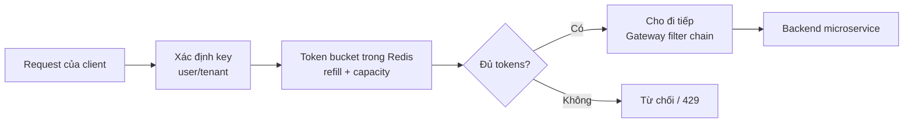
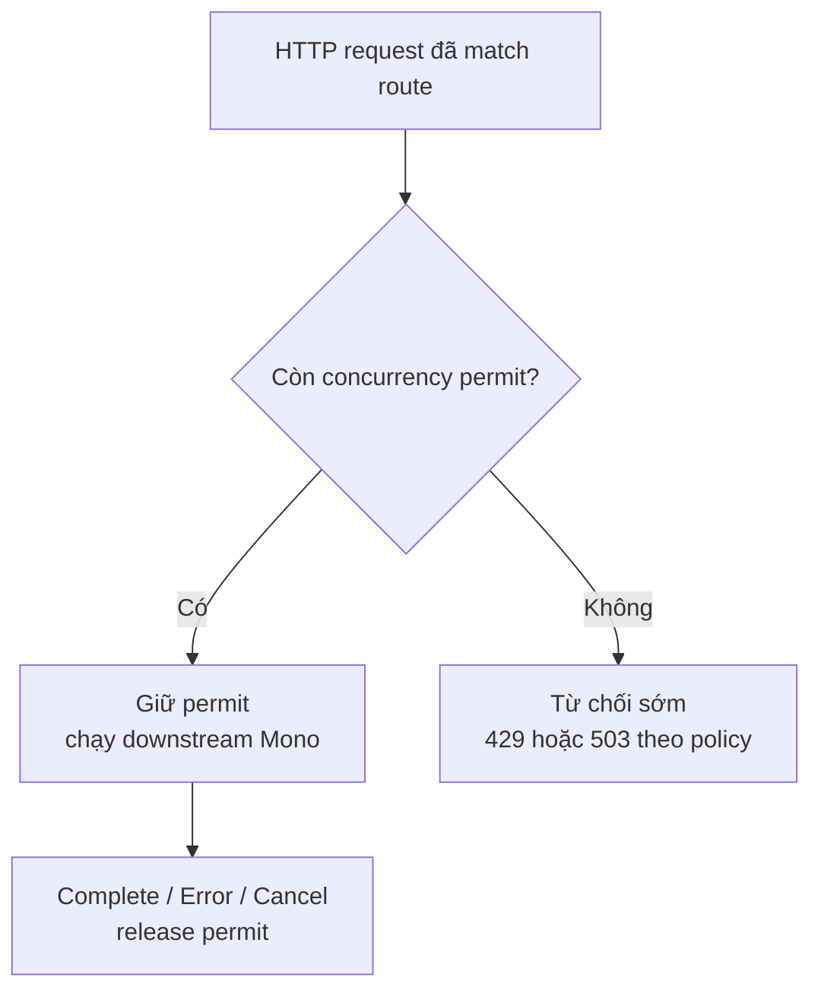
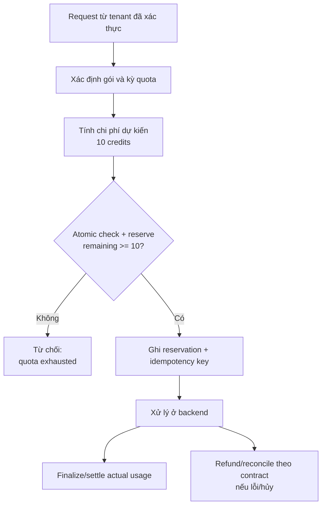

# Giới hạn tần suất, giới hạn đồng thời và hạn mức sử dụng

## Mục tiêu bài học

Trong chương **Giới hạn lưu lượng** của **Spring Cloud Gateway**, chúng ta phân biệt ba cơ chế thường bị gọi chung là “rate limit” nhưng kiểm soát **ba đại lượng khác nhau**:

1. **Giới hạn tần suất (rate limiting):** một chủ thể được gửi bao nhiêu request trong một đơn vị thời gian; có thể cho phép một mức burst ngắn.
2. **Giới hạn đồng thời (concurrency limiting):** tại một thời điểm có tối đa bao nhiêu request hoặc tác vụ đang được xử lý.
3. **Hạn mức sử dụng (usage quota):** một người dùng, tenant hay gói dịch vụ được sử dụng bao nhiêu request hoặc đơn vị tài nguyên trong một kỳ tính toán.

Ba lớp này bổ sung cho nhau để bảo vệ cổng vào microservices khi lượng truy cập tăng đột biến, backend chậm, client gửi quá nhiều requests hoặc một khách hàng dùng hết gói dịch vụ. Tuy nhiên, chúng không tự thay thế **xác thực, phân quyền, TLS, circuit breaker, retry, timeout, service discovery** hoặc các biện pháp bảo vệ bên trong mỗi microservice.

Sau bài học, bạn có thể:

- Lựa chọn rate, concurrency và quota đúng với vấn đề vận hành.
- Hiểu token bucket, fixed/sliding window, burst capacity, cost per request và sự khác biệt giữa yêu cầu đến với tác vụ đang chạy.
- Cấu hình `RequestRateLimiter` và `RedisRateLimiter` trong **Spring Cloud Gateway Server WebFlux**.
- Tạo `KeyResolver` dựa trên định danh đã xác thực, tránh tin trực tiếp các header do client gửi.
- Hiểu vì sao `RequestRateLimiter` **không mặc nhiên** là bộ giới hạn đồng thời hay hạn mức sử dụng tháng.
- Xây dựng một concurrency limiter **không blocking** ở một Gateway instance và biết giới hạn của giải pháp này khi scale.
- Phác thảo một bộ quota phân tán dùng các phép đếm nguyên tử, thời gian reset, xử lý retry và idempotency.
- Kiểm thử đáp ứng HTTP 429/503, tính công bằng, tải cao, lỗi Redis và hệ thống có nhiều Gateway replicas.

> Các ví dụ dùng Spring Cloud Gateway **Server WebFlux**, Project Reactor, Spring Cloud LoadBalancer và, ở ví dụ rate limiting phân tán, Spring Data Redis Reactive. Những phiên bản Gateway mới có thể dùng namespace `spring.cloud.gateway.server.webflux.*` thay cho `spring.cloud.gateway.*`; hãy đối chiếu đúng phiên bản dự án. Không sao chép một ví dụ cấu hình giữa các thế hệ sản phẩm mà chưa xác minh route/filter đã được nạp.

## 1. Ba giới hạn trả lời ba câu hỏi khác nhau

Giả sử một hệ thống có API:

```http
GET /api/reports/42 HTTP/1.1
Host: api.example.com
Authorization: Bearer <access-token>
```

Khách hàng A có chính sách:

```text
Tần suất: tối đa trung bình 20 request/giây, burst tối đa 40 requests.
Đồng thời: tối đa 10 tác vụ tạo báo cáo đang chạy.
Hạn mức: tối đa 100.000 báo cáo trong một kỳ thanh toán.
```

| Cơ chế | Đơn vị kiểm soát | Câu hỏi | Khi vượt ngưỡng |
| --- | --- | --- | --- |
| **Rate limit** | Request/tokens trên giây hoặc phút | “Client có gửi quá nhanh không?” | Hoãn hoặc từ chối request mới, thường `429 Too Many Requests` |
| **Concurrency limit** | Số request/tác vụ đang xử lý | “Có quá nhiều việc đang chiếm tài nguyên cùng lúc không?” | Từ chối hoặc xếp hàng có giới hạn; status tùy chính sách |
| **Usage quota** | Request, credits, bytes, token hoặc đơn vị nghiệp vụ trong kỳ | “Khách hàng đã sử dụng hết quyền lợi gói chưa?” | Từ chối hoặc yêu cầu nâng gói/gia hạn; có thể dùng `429` hoặc mã lỗi nghiệp vụ |

Ví dụ thực tế:

- Một client bắn **1.000 request chỉ trong một giây** là vấn đề tần suất, ngay cả khi từng request trả lời rất nhanh.
- Một client chỉ gửi **20 request/giây** nhưng mỗi request mất **10 giây** có thể gây ra khoảng **200 request đang xử lý** ở trạng thái ổn định. Đó là áp lực đồng thời, dù rate có vẻ thấp.
- Một client gửi đều **1 request/giây** suốt nhiều ngày có thể không vượt giới hạn rate tức thời nhưng vẫn dùng hết quota tháng.

**Không có một thông số “requests per second” nào đồng thời giải quyết cả ba tình huống.**

### 1.1. Mối liên hệ với độ trễ

Theo trực giác của định luật Little trong hệ thống ổn định:

\[
L \approx \lambda W
\]

Trong đó:

- \(L\) là số request/tác vụ đang xử lý trung bình.
- \(\lambda\) là tốc độ hoàn thành/đến trung bình (request/giây), khi hệ ổn định.
- \(W\) là thời gian xử lý hoặc thời gian request ở trong hệ thống (giây).

Ví dụ nếu thông lượng đạt khoảng **20 request/giây** và thời gian mỗi request trong hệ thống trung bình **0,5 giây**, số request đang xử lý trung bình có thể khoảng **10**. Khi backend chậm thành **5 giây**, cùng tốc độ đến đó có thể kéo concurrency lên khoảng **100**.

Đây là quan hệ xấp xỉ để lập kế hoạch, **không phải công thức đảm bảo** một Gateway luôn có đúng từng ấy connection. Queueing, retries, streaming, backpressure, timeouts và biến động traffic ảnh hưởng kết quả thực.

## 2. Giới hạn tần suất: khi nào dùng token bucket?

**Rate limiting** cố gắng kiểm soát tốc độ yêu cầu trên một key, chẳng hạn user ID, tenant ID, API key đã xác minh hoặc một nhóm endpoint.

Các thuật toán phổ biến:

| Thuật toán | Ý tưởng | Ưu điểm | Điều cần lưu ý |
| --- | --- | --- | --- |
| **Fixed window counter** | Đếm request trong một cửa sổ cố định, ví dụ mỗi phút | Dễ hiểu, dễ lưu trữ | Có thể xuất hiện hai đợt lớn sát ranh giới hai cửa sổ |
| **Sliding window log** | Lưu thời điểm mỗi request trong cửa sổ trượt | Kiểm soát chính xác theo cửa sổ | Tốn dữ liệu/bộ nhớ khi lưu lượng lớn |
| **Sliding window counter** | Ước lượng bằng các bộ đếm của nhiều cửa sổ | Ít bộ nhớ hơn log | Kết quả là xấp xỉ tùy thuật toán |
| **Token bucket** | Token bổ sung đều đặn, request lấy token | Hỗ trợ burst có kiểm soát và tốc độ duy trì | Cần chọn burst và token cost hợp lý |
| **Leaky bucket/queue** | Làm phẳng tốc độ xử lý/đẩy yêu cầu đi | Giảm dao động traffic outbound | Nếu có queue, cần giới hạn chiều dài và thời gian chờ |

**Spring Cloud Gateway `RedisRateLimiter` sử dụng ý tưởng token bucket**: có tốc độ bổ sung token, dung lượng tối đa và số token request cần tiêu thụ. Cơ chế lưu trạng thái trên Redis giúp nhiều Gateway replicas cùng nhìn thấy ngân sách của một key, thay vì mỗi replica tự duy trì một bộ đếm.

### 2.1. Token bucket bằng ví dụ cụ thể

Giả sử:

```text
replenishRate  = 20 tokens/giây
burstCapacity  = 40 tokens
requestedTokens = 1 token/request
```

Nếu bucket đang đầy:

1. Trong khoảng thời gian rất ngắn, có thể chấp nhận tối đa khoảng **40 request**, mỗi request dùng một token, nếu không có token mới bổ sung đáng kể.
2. Về dài hạn, token được bổ sung ở tốc độ **20 tokens/giây**, nên mức duy trì xấp xỉ **20 request/giây**.
3. Khi bucket hết token, request tới sẽ bị từ chối theo policy của filter.
4. Nếu không có request, bucket tích lũy lại token nhưng **không vượt burstCapacity**.



Không nên diễn giải `burstCapacity: 40` thành “mỗi giây cho phép 40 request”. Nó là **mức token tối đa tích lũy**. Request rate trong khoảng thời gian bất kỳ còn phụ thuộc token được bổ sung, trạng thái bucket trước đó và số token mỗi request dùng.

### 2.2. Một request có thể tiêu thụ nhiều token

Nếu:

```text
replenishRate  = 20
burstCapacity  = 40
requestedTokens = 5
```

Mỗi request cần 5 token, mức duy trì gần **4 request/giây** với trạng thái phù hợp; bucket đầy chấp nhận khoảng **8 request liên tiếp** trước khi cạn token, bỏ qua phần bổ sung trong lúc đó.

`requestedTokens` là công cụ kiểm soát **chi phí định lượng cho mỗi request** trong một policy nhất định. Nếu endpoint `/api/reports/export` nặng hơn `/api/reports/summary`, có thể dùng chính sách rate khác nhau theo route hoặc thiết kế KeyResolver/RateLimiter có thông tin cost, thay vì coi mọi request tiêu tốn như nhau.

**Nhưng token cost không tự đo CPU, băng thông hoặc hóa đơn thực.** Nó là giá trị theo chính sách định trước.

### 2.3. Một request mỗi phút bằng RedisRateLimiter

Muốn một key trung bình không quá khoảng **một request/phút** với token bucket, một cách cấu hình thường được tài liệu Gateway sử dụng:

```yaml
redis-rate-limiter.replenishRate: 1
redis-rate-limiter.burstCapacity: 60
redis-rate-limiter.requestedTokens: 60
```

Bucket bổ sung **1 token/giây**, và một request cần **60 token**. Đây là một chính sách tốc độ trung bình và burst cụ thể, **không tương đương** một lịch cố định “đúng mỗi phút bắt đầu lại”. Nếu yêu cầu là một request trong từng cửa sổ lịch 60 giây, hãy thiết kế fixed/sliding window theo semantics mong muốn.

## 3. Cấu hình RequestRateLimiter trong Spring Cloud Gateway

Trong **Spring Cloud Gateway Server WebFlux**, `RequestRateLimiter` là một **GatewayFilter Factory**, tức là được gắn với route hoặc `default-filters` và tham chiếu tới một `RateLimiter`. Một cách dùng phổ biến là **`RedisRateLimiter`**.

### 3.1. Dependency và hạ tầng cần có

Để ví dụ Redis hoạt động, dự án cần:

- Spring Cloud Gateway **Server WebFlux** và dependency tương thích với Spring Boot đang chạy.
- **Spring Data Redis Reactive** và kết nối tới Redis, ví dụ starter reactive Redis tương ứng.
- Một Redis endpoint mà các Gateway replicas được phép kết nối, với network/TLS/credentials được cấu hình an toàn.
- Một bean **`KeyResolver`** trả về key dùng để phân tách ngân sách.
- Danh sách instances của `order-service` nếu route dùng URI `lb://order-service`, hoặc đổi sang URI HTTP tĩnh để học filter riêng.

Đừng ghi Redis password vào repository. Redis dùng cho rate limiting cũng là một thành phần hạ tầng có latency, availability, security và cost riêng; nó không miễn phí chỉ vì filter sử dụng một cấu hình YAML ngắn.

### 3.2. `KeyResolver` dựa trên Principal đã xác thực

Ví dụ:

```java
import org.springframework.cloud.gateway.filter.ratelimit.KeyResolver;
import org.springframework.context.annotation.Bean;
import org.springframework.context.annotation.Configuration;

@Configuration
public class RateLimitKeyConfiguration {

    @Bean
    KeyResolver authenticatedUserKeyResolver() {
        return exchange -> exchange.getPrincipal()
            .map(principal -> principal.getName());
    }
}
```

Giải thích:

- `KeyResolver` trả `Mono<String>`, phù hợp với Spring WebFlux/Project Reactor.
- `exchange.getPrincipal()` phản ánh **Principal đã được xác thực** nếu security chain thiết lập đúng.
- Khi không có Principal, publisher có thể rỗng. Chính sách xử lý **empty key** phải được quy định rõ.
- Với resource server JWT, tên principal có thể tương ứng subject của token, tùy cấu hình. Nếu cần key **theo tenant** hoặc theo gói dịch vụ, phải lấy từ claim đã được **xác minh** và kiểm soát; không tự tin `X-Tenant-ID` từ client.

Không dùng trực tiếp password, access token, session ID hoặc dữ liệu cá nhân nhạy cảm như email làm Redis key nếu không cần thiết. Nên cân nhắc một định danh nội bộ ổn định, có phạm vi rõ và khả năng bảo vệ qua logging/metrics.

### 3.3. Cấu hình route với RedisRateLimiter

```yaml
spring:
  cloud:
    gateway:
      routes:
        - id: orders-api
          uri: lb://order-service
          predicates:
            - Path=/api/orders/**
          filters:
            - name: RequestRateLimiter
              args:
                key-resolver: "#{@authenticatedUserKeyResolver}"
                redis-rate-limiter.replenishRate: 20
                redis-rate-limiter.burstCapacity: 40
                redis-rate-limiter.requestedTokens: 1
```

Nếu có nhiều Gateway instances và tất cả cùng dùng **một Redis policy store**, rate limiting cho **cùng key và cùng route scope** có thể được phối hợp qua Redis. Việc Redis thực thi phép kiểm tra/tiêu thụ token nguyên tử giúp tránh tình trạng hai replicas đồng thời nhìn thấy “còn một token” rồi cùng nhận request.

**Cần hiểu chính xác phạm vi:** trong cách cấu hình phổ biến, chính sách bucket còn gắn với **route ID**. Cùng một người dùng gọi hai route độc lập có thể dùng hai ngân sách khác nhau. Nếu mục tiêu là **một hạn mức chung toàn sản phẩm**, phải thiết kế cách gộp key/scope và dùng cơ chế phù hợp; không giả định mọi route tự chia sẻ một bucket chỉ vì có chung Principal.

### 3.4. Trạng thái rỗng và HTTP 429

Thông thường, request không được `RateLimiter` cho phép sẽ nhận **`429 Too Many Requests`**, trừ khi ứng dụng đã thay đổi hành vi. Một số phiên bản/config cho phép điều chỉnh chính sách empty key với các property liên quan đến:

```text
deny-empty-key
empty-key-status-code
```

Hãy kiểm tra tên property/namespace chính xác của phiên bản Gateway. Trong nhiều cấu hình WebFlux, **empty key được từ chối mặc định**. Đây có thể là hành vi an toàn cho route yêu cầu xác thực; nhưng với route public, nếu `KeyResolver` chỉ đọc Principal thì tất cả requests ẩn danh có thể bị từ chối.

Giải pháp đúng không phải tùy tiện đặt `deny-empty-key: false` cho API cần bảo vệ. Hãy thiết kế **key policy cho anonymous traffic**, chẳng hạn hạn mức theo edge identity hoặc địa chỉ IP được xác định từ trusted proxy, kết hợp WAF/ingress và kiểm soát phân tán phù hợp.

### 3.5. Header phản ánh hạn mức

Tùy phiên bản/config, RedisRateLimiter có thể cung cấp những header cho biết ngân sách, chẳng hạn:

```text
X-RateLimit-Remaining
X-RateLimit-Replenish-Rate
X-RateLimit-Burst-Capacity
X-RateLimit-Requested-Tokens
```

Không coi tên, số lượng hoặc việc luôn có các header trên là **API contract bất biến**. Nếu client cần cơ chế backoff, nên thiết kế hợp đồng lỗi và `Retry-After` rõ ràng ở tầng được phép; với `429`, `Retry-After` có thể mô tả thời gian chờ nhưng **không phải mọi Gateway filter tự sinh header này**.

Đừng để thông tin header về ngân sách hoặc tên key làm lộ định danh khách hàng, tenant, Redis keys hay sơ đồ hạ tầng.

### 3.6. Namespace cấu hình theo phiên bản

Các ví dụ sử dụng:

```text
spring.cloud.gateway.routes
```

Đây là namespace quen thuộc ở nhiều dòng Spring Cloud Gateway Server WebFlux. Một số dòng mới sử dụng:

```text
spring.cloud.gateway.server.webflux.routes
```

Các field trong route và khả năng factory có thể được di chuyển/đổi theo phiên bản. Để tránh lỗi cấu hình **im lặng không có hiệu lực**, hãy đối chiếu tài liệu tương ứng dependency, kiểm tra route runtime được nạp và chạy HTTP integration test có cả trường hợp bị từ chối do vượt hạn mức.

## 4. Xác định key đúng là một quyết định bảo mật

Một rate limiter không có key đáng tin dễ bị lách hoặc vô tình gây lỗi cho người dùng hợp lệ.

| Kiểu key | Có thể phù hợp | Rủi ro phải giải quyết |
| --- | --- | --- |
| **User ID đã xác thực** | Limit theo tài khoản | User chia sẻ token, nhiều tài khoản, quyền bị đổi |
| **Tenant ID đã xác minh** | Limit theo khách hàng doanh nghiệp | Phải lấy từ security context/claim đã kiểm chứng |
| **API key đã xác thực** | B2B service clients | Không ghi nguyên API key vào logs/metrics/Redis key |
| **Client IP từ trusted edge** | Hạn chế traffic anonymous, một lớp bổ sung | NAT, shared proxies, IPv6 rotation, spoofing forwarded headers |
| **Route ID + authenticated subject** | Chính sách riêng từng API | Không tự chia sẻ budget trên nhiều routes |
| **Plan/organization scope** | Usage quota tổng và hợp đồng thương mại | Cần mapping identity → plan, cập nhật khi nâng gói |

### 4.1. Vì sao không nên tin `X-Forwarded-For` trực tiếp?

Client có thể tự gửi:

```http
X-Forwarded-For: 198.51.100.42
```

Nếu Gateway lấy nguyên header này làm key, kẻ tấn công có thể thay IP giả để tạo nhiều bucket. Khi nằm sau ingress hoặc L7 load balancer, phải có **trusted proxy policy**, chặn truy cập bỏ qua proxy và cấu hình ingress **loại bỏ/ghi đè giá trị không tin cậy** trước khi Gateway diễn giải địa chỉ client.

Ngay cả địa chỉ IP thật cũng không đồng nghĩa một người dùng: nhiều người dùng có thể dùng cùng NAT; một khách hàng có thể có nhiều IP. Vì vậy IP-based limit là biện pháp hữu ích cho **anonymous abuse**, nhưng không thay cho quota theo tài khoản/tenant.

### 4.2. Xác thực trước hay sau rate limiting?

Hai lớp có thể tồn tại đồng thời:

```text
Ingress/WAF: cheap anonymous protection
    ↓
TLS + HTTP request
    ↓
Spring Security WebFilterChain: xác thực Principal
    ↓
Gateway route matching
    ↓
RequestRateLimiter: key theo user/tenant đã xác minh
    ↓
Gateway filters → routing → backend
```

Một **edge limit trước authentication** giúp ngăn traffic thô trước khi nó tiêu tốn tài nguyên xác minh token. Một **per-user limit sau authentication** dùng identity đáng tin để công bằng giữa khách hàng.

Trong Spring Cloud Gateway Server WebFlux, Spring Security `WebFilter` thường chạy trước chuỗi `GlobalFilter`/`GatewayFilter` của route; các yêu cầu bị từ chối ở Security/ingress có thể không được đếm trong `RequestRateLimiter` của route. Đừng cho rằng một Gateway rate filter duy nhất có thể giới hạn tuyệt đối **mọi traffic trước route matching**.

## 5. Giới hạn đồng thời: bảo vệ tài nguyên đang bị chiếm dụng

Một backend có thể chỉ xử lý ổn định **50 tác vụ** cùng lúc. Khi thời gian xử lý tăng từ 100 ms lên 5 giây, throughput vẫn bị tấn công bởi các requests tích lũy. Rate limiting đầu vào **không kiểm soát trực tiếp số công việc đang mở**.

**Concurrency limiting** kiểm soát số “vé” (permits) được giữ trong lúc một request/tác vụ đang được xử lý.



### 5.1. Vì sao 20 RPS không đồng nghĩa tối đa 20 concurrent?

Giả sử một route được phép **20 request/giây**, mỗi backend call mất trung bình 4 giây do truy vấn chậm. Trong điều kiện ổn định, hệ thống có thể có khoảng:

\[
20\ \text{request/giây} \times 4\ \text{giây}
= 80\ \text{request đồng thời}
\]

Nếu pool kết nối, CPU hoặc bộ nhớ backend chỉ chịu được 30 tác vụ, **rate 20 RPS có thể vẫn là quá tải**. Cần giới hạn đồng thời, giảm độ trễ backend, đặt timeout, dùng bulkhead hoặc chính sách queue/backpressure được thiết kế rõ.

### 5.2. Bộ giới hạn đồng thời tại một Gateway instance

Spring Cloud Gateway không nên bị hiểu rằng **`RequestRateLimiter` tự cho phép cấu hình một giới hạn `maxConcurrentRequests` toàn cụm**. Để minh họa, ta có thể viết một `GlobalFilter` không blocking với bộ đếm nguyên tử:

```java
import java.util.concurrent.atomic.AtomicInteger;

import org.springframework.cloud.gateway.filter.GatewayFilterChain;
import org.springframework.cloud.gateway.filter.GlobalFilter;
import org.springframework.core.Ordered;
import org.springframework.http.HttpStatus;
import org.springframework.stereotype.Component;
import org.springframework.web.server.ServerWebExchange;
import reactor.core.publisher.Mono;

@Component
public final class LocalInFlightLimitFilter
        implements GlobalFilter, Ordered {

    private static final int MAX_IN_FLIGHT = 50;
    private final AtomicInteger inFlight = new AtomicInteger();

    @Override
    public int getOrder() {
        return -50;
    }

    @Override
    public Mono<Void> filter(
            ServerWebExchange exchange,
            GatewayFilterChain chain) {

        return Mono.defer(() -> {
            // Atomic CAS: tránh hai subscriptions cùng lấy permit cuối.
            while (true) {
                int current = inFlight.get();
                if (current >= MAX_IN_FLIGHT) {
                    exchange.getResponse()
                        .setStatusCode(HttpStatus.SERVICE_UNAVAILABLE);
                    return exchange.getResponse().setComplete();
                }
                if (inFlight.compareAndSet(current, current + 1)) {
                    break;
                }
            }

            // Release trên complete, error hoặc cancellation.
            return Mono.defer(() -> chain.filter(exchange))
                .doFinally(signal -> inFlight.decrementAndGet());
        });
    }
}
```

Phân tích:

- `AtomicInteger.compareAndSet` cấp permit theo cách thread-safe mà **không block event-loop**.
- `Mono.defer` khiến việc cấp permit xảy ra **khi subscription thực sự chạy**, không chỉ khi filter dựng publisher.
- `doFinally` giải phóng permit khi publisher downstream **complete, error hoặc cancel**; không để request thất bại giữ permit mãi.
- `503 Service Unavailable` ở ví dụ phản ánh một **giới hạn năng lực server**. Một sản phẩm có chính sách quota/concurrency theo khách hàng cũng có thể dùng `429`, nhưng phải có một contract HTTP nhất quán.
- Code minh họa không tạo queue; khi đầy permit, request bị từ chối ngay. Nếu muốn queue cần giới hạn kích thước, thời gian chờ, fairness và hủy an toàn.

**Giới hạn lớn của ví dụ:** đây là **một bean trong một JVM** và đếm tất cả request **đã match route** đi qua Gateway chain trên replica đó. Nếu có ba Gateway pods, mỗi pod có `MAX_IN_FLIGHT = 50`, tổng công việc tiềm năng có thể tới khoảng **150** chứ không phải 50.

Muốn giới hạn **theo route** hoặc **theo tenant**, cần thêm khóa và quản lý một bộ đếm/bulkhead theo khóa, cùng chính sách giải phóng và lifecycle. Muốn giới hạn **toàn cluster**, phải dùng một cơ chế phối hợp phân tán (ví dụ lease/permit có TTL và cách xử lý process chết) hoặc phân bổ ngân sách theo replica; không thể cộng phép đếm cục bộ rồi gọi đó là một giới hạn cứng toàn hệ thống.

### 5.3. Những bẫy của concurrency limiter

| Bẫy | Hệ quả | Cách thiết kế |
| --- | --- | --- |
| Dùng `Semaphore.acquire()` blocking trên event-loop | Chặn I/O và làm suy giảm throughput | Dùng cấu trúc non-blocking hoặc bulkhead reactive |
| Quên release khi error/cancel | Rò permit, hệ thống dần từ chối mọi request | Đặt cleanup trong lifecycle đúng như `doFinally` |
| Không có timeout | Request treo giữ permit lâu | Timeout phù hợp; quan sát cancellation và trạng thái backend |
| Hàng chờ không giới hạn | Latency/memory tăng đột biến | Queue bounded, deadline và backpressure rõ ràng |
| Áp limit chung lên SSE/WebSocket lâu dài | Kết nối giữ permit rất lâu | Dùng chính sách riêng cho streaming/connection |
| Mỗi pod giữ bộ đếm riêng nhưng cần quota chung | Scale-out làm nới giới hạn toàn hệ thống | Dùng coordinator/lease hoặc budgeting theo replicas |
| Retry bên trong một permit | Một inbound request có thể tạo nhiều outbound attempts | Phân biệt hạn mức request và hạn mức outbound concurrency |

**Bulkhead** của Resilience4j hoặc một mô hình queue/service worker có thể phù hợp hơn filter tùy chỉnh, tùy mục tiêu kiểm soát. Tuy nhiên, không tự kết luận `CircuitBreaker` của Gateway đồng nghĩa đã có semaphore bulkhead: circuit breaker kiểm soát **trạng thái lỗi và đóng/mở mạch**, không mặc nhiên giới hạn số tác vụ đồng thời.

## 6. Hạn mức sử dụng theo ngày, tháng hoặc gói dịch vụ

Hạn mức sử dụng thường gắn với **hợp đồng sản phẩm**, không chỉ tình trạng backend:

```text
Gói Basic:
  10.000 API calls / tháng
  100 báo cáo xuất / tháng

Gói Pro:
  500.000 API calls / tháng
  5.000 báo cáo xuất / tháng
```

Ở mô hình này, client có thể gửi dưới rate limit từng giây, và concurrency thấp, nhưng vẫn **hết quyền lợi tháng**.

### 6.1. Usage quota cần định nghĩa chính xác đơn vị

| Câu hỏi | Ví dụ quyết định cần ghi thành contract |
| --- | --- |
| **Đếm cái gì?** | HTTP request, báo cáo thành công, số bytes, số token xử lý, credit hay một transaction? |
| **Đếm lúc nào?** | Khi chấp nhận request, khi bắt đầu tác vụ, hay khi hoàn tất thành công? |
| **Kỳ tính?** | Ngày theo UTC, tháng lịch, 30 ngày trượt, kỳ thanh toán của tenant? |
| **Phạm vi?** | Per user, API key, tenant, tổ chức hay toàn gói? |
| **Chi phí khác nhau?** | `/summary` tốn 1 credit, `/export` tốn 10 credits |
| **Thất bại và hủy?** | Có tính các request 4xx/5xx, timeout, partial completion? |
| **Retry?** | Tính một request logic hay nhiều attempts tới backend? |
| **Reset?** | Mốc thời gian nào, xử lý đổi timezone/nâng gói ra sao? |

Không trả lời những câu hỏi này mà chỉ tăng một bộ đếm Redis sẽ tạo tranh chấp khách hàng và sai số tính phí.

### 6.2. Vì sao token bucket không tự thay quota tháng?

Token bucket có **replenishRate** và **burstCapacity**. Nó phù hợp để quản lý **tốc độ và burst**; quota tháng có thể cần:

- Bộ đếm theo kỳ chính xác hoặc theo sổ cái.
- Giới hạn trên tổng đơn vị sử dụng.
- Quy tắc reset/carry-over, plan upgrade, số dư trả trước.
- Cơ chế idempotency để một giao dịch logic không bị tính nhiều lần.
- Audit dữ liệu phục vụ đối soát, không đơn thuần Redis TTL tạm thời.

Có thể dùng Redis để làm **fast-path admission** cho quota, nhưng nên cân nhắc nguồn dữ liệu bền vững/ledger cho nghiệp vụ thanh toán hoặc đối soát. Redis cache bị mất dữ liệu hay TTL cấu hình sai có thể làm sai số sử dụng.

### 6.3. Mô hình quota theo kỳ với kiểm tra nguyên tử

Giả sử tenant `org-42` có quota **1.000 credits** trong kỳ `2026-11` và request export tiêu tốn 10 credits.

Luồng logic:



Điều kiện **atomic check-and-reserve** là then chốt. Mẫu đọc `used=990`, kiểm tra còn 10, rồi `used += 10` ở hai requests song song có thể khiến cả hai được cho qua nếu không có phép cập nhật nguyên tử.

Pseudo-code để minh họa (không phải cú pháp Redis trực tiếp):

```text
reserveQuota(tenantId, period, requestId, cost):
    if requestId already reserved/finalized:
        return previous decision  // idempotency

    atomically:
        remaining = limit(tenantId, period) - usedOrReserved(...)
        if remaining < cost:
            return DENIED

        reserve cost
        store requestId and reservation state
        return ALLOWED

after operation:
    finalize actual usage, or refund according to explicit policy
```

Đối với quota quan trọng, **atomicity** phải bao trùm đủ các trạng thái cần thiết; một vài Redis commands riêng lẻ không tự tạo thành transaction an toàn. Có thể dùng Redis script/transaction phù hợp hoặc database với transaction/concurrency control, tùy mức bền vững cần thiết.

### 6.4. Kỳ lịch và thời điểm reset

Ví dụ:

```text
quotaPeriod = 2026-11 (UTC)
resetAt = 2026-12-01T00:00:00Z
```

Đừng giả định “một tháng = 30 × 24 giờ” nếu hợp đồng là **tháng lịch**. Nếu tenant có timezone riêng, cần quy định timezone và xử lý DST. Đồng hồ giữa các services, cách xác định period, TTL và thời điểm thay gói phải thống nhất.

Nếu trả `Retry-After` cho quota đã hết, hãy dùng thời điểm mở lại hợp lệ **theo hợp đồng**; không hứa request sẽ được chấp nhận sau N giây nếu tenant vẫn chưa nâng gói hoặc còn điều kiện khác.

## 7. Kết hợp ba chính sách trong một request

Một kiến trúc có thể dùng:

```text
Client
  │
  ▼
Ingress: anonymous rate / bot protection / TLS
  │
  ▼
Spring Security: authenticate + authorize route-level
  │
  ▼
Gateway rate limit theo user/tenant (Redis)
  │
  ▼
Quota check / reserve credits theo kỳ
  │
  ▼
Concurrency bulkhead (bounded in-flight)
  │
  ▼
RewritePath / Service discovery / Load balancing
  │
  ▼
Retry / Circuit breaker / Routing
  │
  ▼
Backend: authorization nghiệp vụ, idempotency
```

Đây là **trật tự chính sách minh họa**, không phải chuỗi filter mặc định có sẵn trong một sản phẩm Spring Cloud Gateway duy nhất. `Quota check` và concurrency bulkhead trong ví dụ yêu cầu component riêng; thứ tự thực của các `GlobalFilter` và `GatewayFilter` được quyết định bởi `Ordered`, cấu hình route và cách publisher Reactor bao bọc nhau.

### 7.1. Vì sao thứ tự với Retry quan trọng?

Một `Retry` GatewayFilter có thể **resubscribe downstream** khi HTTP status/exception phù hợp với policy. Tùy vị trí:

```text
RateLimiter → Quota → Concurrency → Retry → Routing
```

có thể kiểm soát **một inbound request** trước khi nó tạo nhiều attempts, trong khi:

```text
Retry → RateLimiter → Quota → Concurrency → Routing
```

có thể khiến các giới hạn bên trong vùng retry **được thực thi lại** theo attempts. Mục tiêu có thể khác nhau:

- **Per-client rate/quota:** thường muốn tính **một request logic** ở biên, tránh retry nội bộ trừ quota nhiều lần.
- **Per-upstream attempt budget:** có thể muốn kiểm soát từng attempt để backend không bị request amplification khi sự cố.
- **Concurrency:** cần xác định permit bao bọc toàn bộ request hay từng outbound attempt, và xem thời gian backoff có nên giữ permit hay không.

Không tự suy luận chính xác số lần chạy từng filter chỉ từ thứ tự dòng YAML. Hãy kiểm chứng **filter effective order**, số attempts tại backend, log rate/quota, signal lifecycle và cách Retry tạo publisher trên phiên bản ứng dụng.

### 7.2. Rate limiting, circuit breaker và timeout

| Cơ chế | Chủ yếu bảo vệ điều gì? | Không thể thay thế |
| --- | --- | --- |
| Rate limiting | Lưu lượng request đến trong một khoảng thời gian | Concurrency và quota kỳ |
| Concurrency limit/bulkhead | Số tác vụ chiếm tài nguyên cùng lúc | Giới hạn tốc độ dài hạn hoặc quyền sử dụng tháng |
| Usage quota | Ngân sách sản phẩm của user/tenant | Khả năng chịu tải realtime của backend |
| Circuit breaker | Tránh tiếp tục gọi upstream đang lỗi vượt ngưỡng | Rate/quota/concurrency limits |
| Timeout | Chặn tác vụ chờ vô hạn và giải phóng tài nguyên | Kiểm soát tổng traffic |
| Retry + backoff | Phục hồi một số lỗi tạm thời khi an toàn | Idempotency hoặc chống tăng tải khi backend lỗi |

Ví dụ backend có lỗi 503 hàng loạt: **retry quá nhiều** có thể làm hạ tầng càng quá tải. Cần giới hạn attempts, backoff có jitter khi phù hợp, circuit breaker, timeout, bulkhead, và không retry thao tác thanh toán POST nếu chưa có idempotency protection.

### 7.3. Gateway không thay phân quyền của backend

Một KeyResolver dùng tenant ID đã xác thực không có nghĩa tenant đó có quyền xem mọi resource:

```http
GET /api/orders/42
Authorization: Bearer <valid-token>
```

RateLimiter có thể cho request đi qua nhưng **Order Service vẫn phải kiểm tra** đơn hàng 42 có thuộc về principal/tenant tương ứng. Không dùng việc còn rate/quota hoặc có `X-Tenant-ID` làm chứng cứ authorization.

## 8. HTTP status, phản hồi lỗi và hướng dẫn client

Khi từ chối một request, status nên thể hiện đúng loại giới hạn:

| Tình huống | Status thường hợp lý | Ghi chú |
| --- | --- | --- |
| Client vượt tốc độ đã công bố | **429 Too Many Requests** | Có thể kèm `Retry-After` khi biết cách tính |
| Tenant hết quota kỳ | 429 hoặc mã lỗi nghiệp vụ nhất quán | Response body nói rõ quota exhausted và kỳ reset; không tiết lộ dữ liệu khách hàng khác |
| Server hết permit concurrency do quá tải | **503 Service Unavailable** hoặc 429 theo API contract | Phân biệt overload hạ tầng với khách hàng gửi quá nhanh |
| Thiếu/xác thực sai token | **401 Unauthorized** | Rate limiter không thay authentication |
| Đã xác thực nhưng thiếu quyền | **403 Forbidden** | Có quota không có nghĩa đủ quyền |
| Redis/quota store unavailable | Chính sách fail-closed/fail-open được định nghĩa trước | Không tự coi mọi lỗi hạ tầng là vượt quota |
| Backend timeout | 504 hoặc lỗi được mapping theo Gateway | Không phải lỗi rate limit nếu rate filter không từ chối |

**`Retry-After`** có thể chứa số giây hoặc HTTP-date:

```http
HTTP/1.1 429 Too Many Requests
Retry-After: 10
Content-Type: application/json

{"code":"RATE_LIMITED","message":"Try again later"}
```

Đây là **response mẫu**, không phải bảo đảm `RequestRateLimiter` tự phát JSON hay `Retry-After`. Nếu client cần một contract ổn định, thiết kế error handler/filter thích hợp, tránh vô tình để response từ rate limiter khác với response từ quota hoặc concurrency layer.

### 8.1. Retry từ client có thể gây bão lưu lượng

Nếu mọi client nhận 429 rồi retry ngay sau đúng một thời điểm, hệ thống có thể gặp **thundering herd**. Khuyến nghị cho client:

- Tôn trọng `Retry-After` khi có và hợp lệ.
- Dùng exponential backoff với jitter trong giới hạn phù hợp.
- Không retry vô hạn; áp deadline, giới hạn attempts và circuit breaker client khi cần.
- Không retry POST không idempotent một cách máy móc.
- Với quota tháng, không gửi lại liên tục khi chưa đến kỳ reset hoặc chưa nâng gói.

### 8.2. Trả CORS headers trên response bị từ chối

Browser gọi API cross-origin có thể không đọc được body 429/503 nếu response thiếu CORS headers tương ứng. Thiết kế Gateway nên kiểm tra **preflight OPTIONS**, actual requests và **early rejection** bởi rate/concurrency/quota/Security. CORS được xử lý ở tầng phù hợp trước khi filter trả sớm, không dùng nới `Access-Control-Allow-Origin: *` làm “sửa nhanh” cho một lỗi rate limit.

## 9. Khi Redis/quota store gặp sự cố

Một rate limiter phân tán làm phát sinh **điểm phụ thuộc mới**. Nếu Redis chậm hoặc mất kết nối, các Gateway instances cần có chính sách rõ ràng:

| Chiến lược | Ưu điểm | Rủi ro |
| --- | --- | --- |
| **Fail closed** | Không vô tình bỏ hạn mức nghiêm ngặt khi store lỗi | Có thể làm API không khả dụng dù backend khỏe |
| **Fail open có kiểm soát** | Giữ availability cho một số API ít nhạy cảm | Client có thể gửi lưu lượng vượt budget; cần lớp bảo vệ thay thế |
| **Local emergency limit** | Một lớp bảo vệ khi Redis lỗi | Không đảm bảo ngân sách toàn cluster, scale-out làm lệch |
| **Queue/degrade service** | Có thể tránh làm backend quá tải | Cần bounded queue, timeout, dự đoán khi phục hồi |

**Không khẳng định RedisRateLimiter mặc định fail-open hay fail-closed trong mọi phiên bản.** Hành vi khi lỗi cache/script/connection còn phụ thuộc code filter, exception handling, policy ứng dụng và deployment; phải kiểm thử bằng cách chủ động làm Redis unavailable trong môi trường test.

Giới hạn sử dụng có liên quan tài chính thường cần cơ chế đảm bảo bền vững hơn “nếu Redis lỗi thì cho qua hết”. Ngược lại, với một read-only public endpoint, fail-open có kèm WAF/ingress emergency limit có thể là trade-off chấp nhận được. Quyết định phải được ghi thành SLO/security policy.

## 10. Quan sát và đo hiệu quả

Khi rate limiting hoạt động, nhiều request không tới backend. Vì vậy **metrics chỉ ở backend** không còn đại diện đầy đủ cho lượng truy cập Gateway nhìn thấy.

Nên tách ít nhất ba lớp:

1. **Inbound requests:** tất cả HTTP requests tại ingress/Gateway, gồm request được phép và bị từ chối.
2. **Admitted requests:** requests qua security/rate/quota/concurrency và đi vào routing.
3. **Outbound attempts:** số HTTP calls thật tới backend, kể cả retries.

| Metric | Câu hỏi trả lời |
| --- | --- |
| Inbound requests per route | Người dùng gửi bao nhiêu traffic? |
| Rate rejected count (429) | Bao nhiêu request vượt token bucket/window? |
| Quota remaining/consumed (aggregate) | Usage theo gói/kỳ có vượt dự kiến không? |
| In-flight requests / permits | Concurrency có sát ngưỡng không? |
| Limiter decision latency | Kiểm tra Redis/quota có làm chậm gateway không? |
| Redis errors/timeout | Rate limit store có là nguồn lỗi không? |
| Upstream attempts/retry count | Một inbound request có tạo nhiều calls không? |
| Backend latency p95/p99 | Backend chậm khiến in-flight tăng không? |
| HTTP 429/503/5xx theo route | Lỗi do policy hay hạ tầng/backend? |

Không đưa nguyên **user ID, tenant ID, token, IP hoặc arbitrary request headers** vào metric labels có cardinality cao. Dùng route ID, tên policy, outcome và tier đã chuẩn hóa; dữ liệu usage theo tenant để billing nên nằm trong kho có kiểm soát truy cập riêng.

### 10.1. Log phù hợp

Ví dụ một dòng log cấu trúc an toàn:

```text
route=orders-api policy=per-user-bucket outcome=denied
reason=rate-exceeded status=429 traceId=<trace-id>
```

Không log token, cookie, request body, Redis key chứa định danh nhạy cảm hoặc toàn bộ query string. Nếu cần trace qua các microservices, dùng context propagation qua HTTP theo chuẩn và chính sách observability đã cấu hình.

### 10.2. Thiết lập SLO riêng cho lớp limiter

Rate limiter có thể thành nút nghẽn khi Redis nhiều lần timeout. Nên đo:

- Thời gian ra quyết định allow/deny của rate/quota filters.
- Error budget của Redis/quota store.
- Tỷ lệ từ chối **đúng policy** so với từ chối do lỗi hạ tầng.
- Tác động tới p95/p99 latency của request thành công.
- Tỷ lệ retries, cancellations, response commit lỗi và sự khác biệt giữa ingress count với backend count.

Đừng đặt mục tiêu “429 phải luôn bằng 0” nếu hệ thống cố tình có rate limiting để chống lạm dụng. Quan trọng là xác minh policy đúng, công bằng và không từ chối nhầm người dùng hợp lệ.

## 11. Kiểm thử rate limit

Giả sử đang dùng một route:

```yaml
filters:
  - name: RequestRateLimiter
    args:
      key-resolver: "#{@authenticatedUserKeyResolver}"
      redis-rate-limiter.replenishRate: 2
      redis-rate-limiter.burstCapacity: 2
      redis-rate-limiter.requestedTokens: 1
```

Với một key riêng và bucket được khởi tạo như dự kiến:

1. Hai request đến rất sát nhau có thể được chấp nhận.
2. Request thứ ba đến ngay sau đó có thể nhận 429 nếu token chưa kịp bổ sung.
3. Sau khoảng thời gian đủ lâu, token được bổ sung và request có thể được chấp nhận lại.

Đây là **kỳ vọng về token bucket**, không phải một integration test deterministic chỉ bằng cách nhấn Enter ba lần: đồng hồ, Redis state, khoảng cách giữa requests và request được gửi bởi công cụ test có thể tạo kết quả khác.

### 11.1. Thử thủ công bằng curl

```bash
for i in 1 2 3 4 5; do
  curl -s -o /dev/null -w "%{http_code}\n" \
    -H "Authorization: Bearer <test-token>" \
    "http://localhost:8080/api/orders/42"
done
```

Thử nghiệm trên cần:

- Gateway chạy với route và RedisRateLimiter hợp lệ.
- JWT/session hoặc authentication phù hợp để `KeyResolver` lấy được Principal.
- Bucket test được cách ly, không dùng chung với user production.
- Backend stub có thể trả status dễ nhận diện.

Nếu token không hợp lệ, response có thể là **401**, không liên quan rate limiting. Nếu request không match route, có thể là 404. Không nhìn những status này rồi kết luận RedisRateLimiter hoạt động.

### 11.2. Kiểm tra phân tách key

Tạo hai principal thử nghiệm:

```text
user-A
user-B
```

Gửi nhiều request bằng user-A để vượt bucket, sau đó gửi user-B. Với chính sách per-principal:

- user-A có thể nhận 429.
- user-B dùng **bucket khác** và có thể vẫn được chấp nhận.

Với chính sách per-tenant, hai user cùng tenant có thể phải chia sẻ budget; đó phải là mục tiêu **được thiết kế**, không phải lỗi ngẫu nhiên.

### 11.3. Kiểm tra nhiều Gateway replicas

Khởi động hai Gateway instances cùng kết nối một Redis:

```text
Client → Gateway A ↘
                    Redis rate limiter
Client → Gateway B ↗
```

Gửi cùng key xen kẽ qua hai replicas. Tổng requests được cho phép phải tuân theo chính sách bucket **chia sẻ**, không tăng gấp đôi chỉ vì có hai instances. Đồng thời, test khi Redis lỗi và khi key/state được tạo lại.

## 12. Kiểm thử concurrency và quota

### 12.1. Concurrency

Với filter ví dụ `MAX_IN_FLIGHT = 50`, tạo backend stub giữ response khoảng một vài giây và gửi hơn 50 requests gần như đồng thời vào **cùng một Gateway replica**. Xác minh:

| Điều cần kiểm tra | Kết quả dự kiến |
| --- | --- |
| Số request đã được admit đang chạy | Không vượt 50 tại replica được kiểm thử |
| Request khi đã đầy permit | Bị từ chối sớm theo policy (ví dụ 503) |
| Request sau khi một tác vụ hoàn tất | Có thể lấy permit mới |
| Backend trả lỗi | Permit được release |
| Client cancel/timeout | Permit được release khi pipeline nhận cancellation |
| Nhiều Gateway replicas | Tổng giới hạn chỉ là per-replica nếu không có coordinator |
| Streaming rất dài | Đánh giá permit có bị giữ suốt stream không |

Nếu chỉ gửi từng request **tuần tự**, concurrency test không có ý nghĩa. Dùng công cụ load test hoặc integration test có khả năng giữ response và phát request song song, đồng thời quan sát `inFlight`.

### 12.2. Usage quota

Với quota `100 credits` và mỗi export tốn `10 credits`:

| Kịch bản | Kết quả đúng theo contract minh họa |
| --- | --- |
| 10 exports hợp lệ, mỗi export tiêu 10 | Tổng sử dụng đạt 100 |
| Export thứ 11 cùng kỳ | Bị từ chối do quota |
| Hai exports đồng thời khi còn 10 credits | Chỉ một request được reserve nếu cost 10 và không overdraft |
| Client gửi lại cùng idempotency key | Không bị trừ quota hai lần cho cùng transaction |
| Backend lỗi trước khi tạo báo cáo | Refund hoặc giữ debit **theo chính sách đã công bố** |
| Tới mốc reset của kỳ tiếp theo | Dùng đúng quota mới, không xóa sai lịch sử billing |
| User nâng gói giữa kỳ | Áp chính sách cập nhật limit nhất quán |
| Quota store không khả dụng | Hành vi fail-open/closed như đã định nghĩa |

### 12.3. Ma trận tổng hợp

| Test | Rate | Concurrency | Quota | Đánh giá |
| --- | --- | --- | --- | --- |
| Burst 50 calls trong giây đầu | Có thể từ chối khi bucket cạn | Có thể còn thấp nếu backend rất nhanh | Có thể còn nhiều | Không lấy riêng 429 làm phép đo concurrency |
| 10 requests lâu 20 giây | Có thể không vượt RPS | Có thể đầy permits | Ít đơn vị sử dụng | Cần bulkhead/timeout |
| Gửi đều 1 RPS suốt tháng | Có thể luôn hợp lệ | Có thể thấp | Có thể hết | Quota phải kiểm soát kỳ |
| Retry nội bộ khi backend 503 | Cần biết vùng retry | Có thể tăng outbound attempts | Không nên double charge request logic | Kiểm tra lifecycle/ordering |
| Hai pods cùng một user | Redis bucket nên chia sẻ | Bộ đếm cục bộ cộng dồn | Quota phải phân tán nguyên tử | Scale-out không được nới ngân sách tài chính |

## 13. Xử lý sự cố thường gặp

### Tình huống A — Mọi request ẩn danh nhận 429

**Nguyên nhân khả dĩ:** `KeyResolver` trả `Mono.empty()` vì chưa có Principal, và chính sách empty-key từ chối.

**Cách xử lý:** kiểm tra security chain, route match, key policy và cấu hình deny-empty-key. Với endpoint public, thiết kế anonymous budget dựa trên trusted edge/identity; không tắt kiểm tra key bừa bãi trên endpoint có phân quyền.

### Tình huống B — Rate limit bị nhân theo số replicas

**Nguyên nhân khả dĩ:** mỗi Gateway instance giữ bucket trong memory riêng, hoặc key/route scope khác nhau giữa instances.

**Cách xử lý:** xác định store chung, Redis connection và định dạng key; gửi cùng subject qua các replicas. Rate limiter phân tán không giống bộ đếm concurrency cục bộ.

### Tình huống C — Redis lỗi, API bỗng trả 5xx

**Nguyên nhân khả dĩ:** kết nối/script/authentication Redis không hoạt động và code exception path không có chính sách degrade phù hợp.

**Cách xử lý:** kiểm tra latency/error của Redis, network/TLS, resource limits, trạng thái limiter; thử fail-open/fail-closed có kiểm soát theo môi trường và đánh giá nguy cơ quá tải backend.

### Tình huống D — Backend vẫn quá tải dù rate thấp

**Nguyên nhân:** backend chậm làm tăng requests-in-flight, hoặc retry tạo nhiều outbound attempts cho một inbound request.

**Cách xử lý:** đo W/p95/p99, in-flight, queue và retry; thêm concurrency bulkhead/timeout, giảm retry và điều chỉnh capacity.

### Tình huống E — Quota tháng bị trừ nhiều lần cho một request

**Nguyên nhân:** quota check nằm trong vùng retry, một request được xử lý bởi nhiều replicas không có atomic/idempotent reservation, hoặc client gửi lại do timeout.

**Cách xử lý:** thiết kế request ID/idempotency, atomic reserve/finalize, kiểm tra filter order và đối soát usage ledger.

### Tình huống F — Một tenant dùng hết budget của tenant khác

**Nguyên nhân:** KeyResolver dùng key chung như `"anonymous"`, client IP sau NAT hoặc claim thiếu namespace tenant.

**Cách xử lý:** định nghĩa rõ identity key, xác minh claim, bảo đảm tenant segregation và thử hai tài khoản độc lập. Không log nguyên token/secret chỉ để tìm lỗi key.

### Tình huống G — Client không đọc được lỗi 429 trên browser

**Nguyên nhân:** phản hồi rate/quota sớm thiếu CORS headers, browser chỉ hiển thị thông báo CORS.

**Cách xử lý:** kiểm tra preflight, CORS owner, Security WebFilter, route matching và response headers khi bị từ chối. Không mở wildcard origin chỉ để làm lộ response.

## 14. Thiết kế chính sách cho một API Gateway thực tế

Giả sử tổ chức vận hành:

```text
GET  /api/catalog/**       API đọc nhẹ, nhiều client ẩn danh
GET  /api/reports/**       API đọc nặng theo tenant
POST /api/reports/export   Tạo báo cáo, tính credits
POST /api/payments/**      Nghiệp vụ nhạy cảm, cần idempotency
```

Một hướng thiết kế:

| API | Rate limiting | Concurrency | Usage quota | Lưu ý thêm |
| --- | --- | --- | --- | --- |
| Catalog | Edge/IP budget và bucket route | Hạn mức mềm theo backend khi cần | Thường không cần quota trả phí | Cache, WAF, tránh XFF spoof |
| Reports read | Per-user/tenant Redis bucket | Bulkhead cho truy vấn nặng | Có thể giới hạn calls/credits | Phân quyền report theo tenant |
| Reports export | Rate thấp hơn, cost cao | Limit tác vụ export đang chạy | Reserve/settle credits | Queue bounded, idempotency |
| Payments write | Rate theo credential đã xác thực | Bảo vệ backend | Quota có thể là policy khác | Không retry POST bừa bãi, kiểm soát fraud |

Trước production nên thống nhất với nhóm backend, sản phẩm và vận hành về:

- **Ai sở hữu key và định danh tenant:** Security WebFilter, API key verifier hoặc BFF.
- **Ai sở hữu response 429/503:** Gateway, quota service hay ingress.
- **Cách phân bổ budget theo route:** riêng từng route, theo nhóm endpoint hay toàn tenant.
- **Độ chính xác cần thiết:** best-effort rate vs exact quota tính phí.
- **Khả năng degrade khi mất Redis:** fail-open/closed có kiểm soát và emergency local limit.
- **Quan sát:** metric labels an toàn, lưu thông tin billing riêng, tránh dữ liệu cá nhân trong logs.
- **Kiểm thử:** burst, đồng thời, multi-pod, Redis outage, retry, CSRF/CORS/Authorization/TLS và tải lâu dài.

## 15. Bài luyện tập có đáp án

Một doanh nghiệp dùng Spring Cloud Gateway có hai replicas và các chính sách:

```text
Mỗi user: RedisRateLimiter
  replenishRate = 10 tokens/giây
  burstCapacity = 30 tokens
  requestedTokens = 1 token/request

Mỗi Gateway replica:
  maxInFlight = 25

Mỗi tenant:
  1.000 API credits/tháng
```

**Câu hỏi:**

1. Một user có thể bắn tối đa 30 request ngay khi bucket đầy mà không chờ refill không?
2. `burstCapacity: 30` có đồng nghĩa tốc độ duy trì 30 RPS không?
3. Hai Gateway replicas có làm ngân sách Redis bucket của cùng key tăng gấp đôi không nếu dùng đúng một store chung và route scope?
4. Hai replicas có bảo đảm concurrency toàn cụm tối đa 25 không?
5. Một user chỉ gửi 1 RPS suốt thời gian dài có thể hết quota tháng không?
6. Vì sao không dùng raw `X-Tenant-ID` client gửi làm quota key?
7. Nếu retry backend 503, quota có nên tự trừ thêm một lượt cho từng attempt không?
8. Khi Redis không khả dụng, cách fail-open hay fail-closed luôn đúng?
9. Nếu request bị 429, có nghĩa backend đã xử lý request đó không?
10. Với `MAX_IN_FLIGHT` local, vì sao phải release permit cả khi client cancellation?
11. Nếu một báo cáo tính 10 credits, hai requests song song khi còn 10 credits cần cơ chế gì?
12. CSRF token hoặc JWT hợp lệ có làm client bỏ qua rate/quota không?

**Đáp án giải thích:**

1. **Về nguyên lý có thể**, nếu bucket thực sự đầy, request cost một token và không có giới hạn khác; đây không phải bảo đảm mọi 30 request đồng thời sẽ thành công trong toàn pipeline.
2. **Không.** Tốc độ dài hạn xấp xỉ 10 token/giây, tương ứng 10 RPS khi `requestedTokens=1`.
3. **Không** theo mục tiêu của limiter phân tán: Redis phối hợp token state cho cùng key/route, nhưng vẫn phải test thực tế.
4. **Không.** Mỗi replica có 25 permits thì tổng có thể khoảng 50 khi cả hai nhận traffic.
5. **Có.** Rate theo giây và quota tháng là hai chính sách khác nhau.
6. Header do client tự gửi có thể bị giả mạo; quota key phải lấy từ identity/tenant đã xác minh.
7. **Không mặc định.** Cần hợp đồng: một request logic thường tính một lần; outbound attempts đo riêng.
8. **Không có đáp án duy nhất.** Tùy mức độ rủi ro và availability, định nghĩa policy rồi kiểm thử outage.
9. **Không nhất thiết.** Gateway rate filter có thể từ chối trước routing; cần quan sát backend hoặc outbound attempts.
10. Vì cancellation vẫn kết thúc việc giữ tài nguyên; không release sẽ rò permits và giảm capacity mãi.
11. **Atomic check-and-reserve**, kèm idempotency và settlement/refund theo contract.
12. **Không.** Authentication/CSRF là điều kiện khác; một caller hợp lệ vẫn phải tuân thủ hạn mức, quota và quyền nghiệp vụ.

## Tổng kết

**Giới hạn tần suất** kiểm soát số requests đến theo thời gian; **giới hạn đồng thời** kiểm soát công việc đang chiếm tài nguyên; **hạn mức sử dụng** kiểm soát số đơn vị dịch vụ của người dùng hoặc tenant trong một kỳ. Chúng giải quyết các vấn đề khác nhau, dù cùng có thể dẫn đến phản hồi từ chối khi vượt ngưỡng.

Trong **Spring Cloud Gateway Server WebFlux**, `RequestRateLimiter` kết hợp `RedisRateLimiter` và một `KeyResolver` đáng tin là điểm khởi đầu tốt cho **rate limiting phân tán theo route**. Concurrency cần bulkhead/permit được giải phóng đúng reactive lifecycle; quota theo kỳ cần các quyết định **đơn vị tính, tính nguyên tử, idempotency, reset và bền vững dữ liệu**. Khi ghép với route predicates, filter order, service discovery, security, TLS, retry/circuit breaker và quan sát request, hãy đo riêng inbound requests, admitted requests và outbound attempts để bảo vệ microservices một cách có thể giải thích, kiểm thử và vận hành an toàn.
