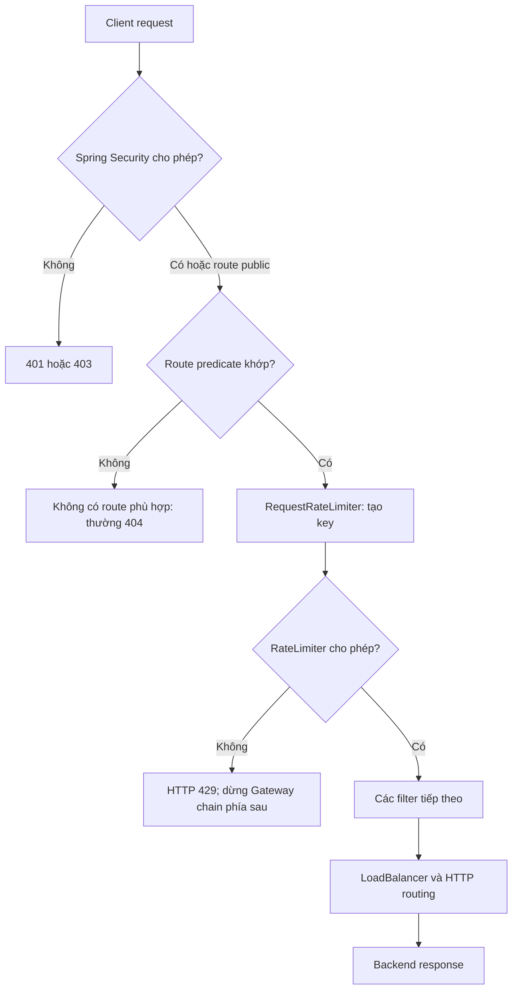
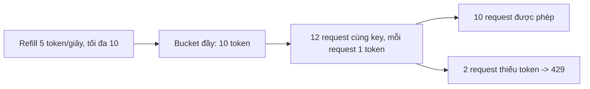
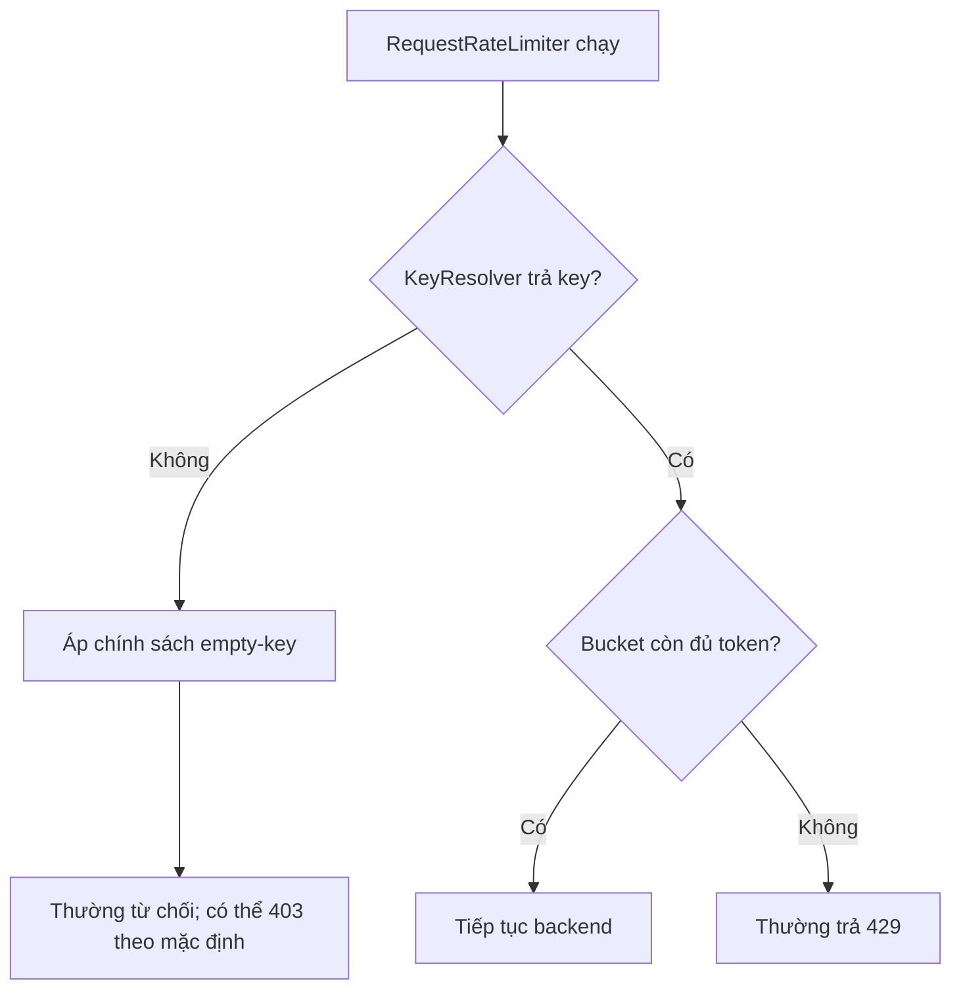
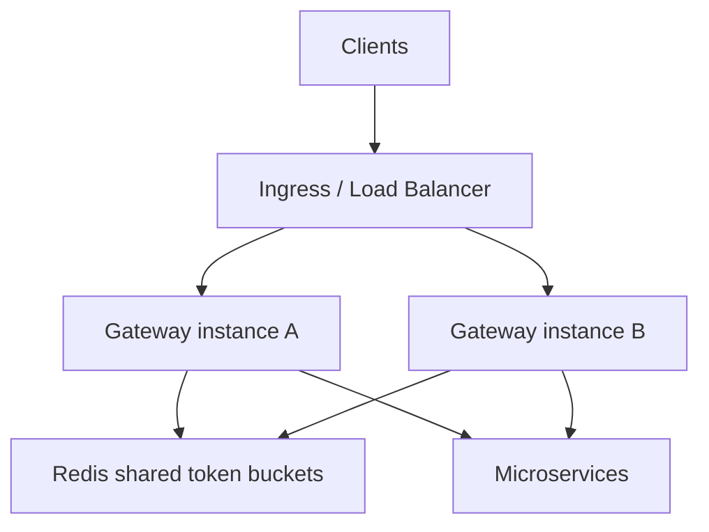
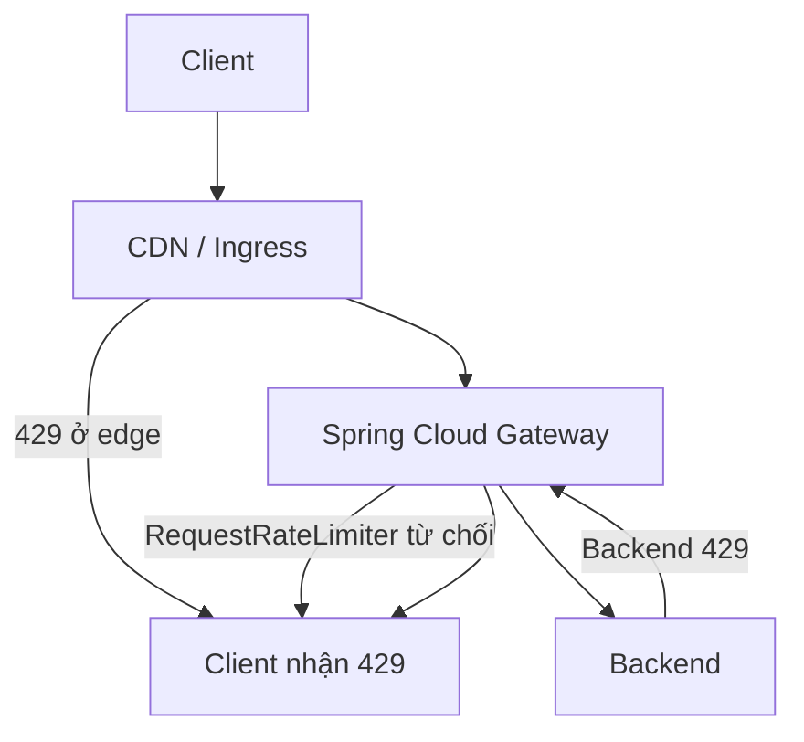

# RequestRateLimiter và phản hồi HTTP 429 trong Spring Cloud Gateway

Một API Gateway có thể định tuyến chính xác request đến Product Service, Order Service hoặc Payment Service, nhưng vẫn bị quá tải nếu một client gửi hàng nghìn yêu cầu trong thời gian ngắn. Khi đó, chỉ xác thực người dùng và tìm đúng `lb://service-id` chưa đủ: hệ thống cần **giới hạn lưu lượng** (*rate limiting*) để phân phối tài nguyên công bằng, giảm lạm dụng và bảo vệ microservices phía sau.

Trong **Spring Cloud Gateway Server WebFlux**, `RequestRateLimiter` là một **GatewayFilter Factory** có thể đánh giá request theo một **khóa định danh** (*key*) và một **chính sách tốc độ**. Khi yêu cầu vượt hạn mức, Gateway thường trả **HTTP 429 Too Many Requests** mà không chuyển tiếp request bị từ chối đến backend. Một cách triển khai phổ biến là kết hợp `KeyResolver` với `RedisRateLimiter` sử dụng thuật toán **token bucket**.

Bài thuộc chương **Giới hạn lưu lượng** của module `SPRING_CLOUD_GATEWAY`. Kiến thức kết nối với route predicate, filter chain, biến đổi đường dẫn/header, khám phá dịch vụ, xác thực/phân quyền, circuit breaker, retry, TLS và observability để vận hành cổng vào microservices an toàn.

**Sau bài này, bạn cần trả lời được:** Gateway giới hạn *ai*, trên *route nào*, với *hạn mức nào*; điều gì xảy ra khi hết token; tại sao 429 khác 401/403/503; và làm sao kiểm thử, giám sát, vận hành chính sách khi có nhiều Gateway instance.

> **Phạm vi:** Ví dụ dùng **Spring Cloud Gateway Server WebFlux**, không phải Gateway Server MVC. Tên starter và namespace thuộc tính thay đổi giữa các thế hệ Spring Boot/Spring Cloud. Hãy đối chiếu phiên bản cụ thể đang dùng trước khi sao chép cấu hình. Các giá trị hạn mức chỉ nhằm mục đích thực hành, không phải số liệu khuyến nghị cho mọi hệ thống.

## 1. Rate limiting giải quyết vấn đề gì?

Giả sử một ứng dụng bán hàng có ba API:

- `GET /api/catalog/**`: đọc danh mục, lượng truy cập lớn, chi phí xử lý tương đối thấp.
- `POST /api/orders`: tạo đơn, dùng database và có tác dụng phụ.
- `POST /api/payments`: yêu cầu nhạy cảm, cần xác thực nghiêm ngặt và idempotency.

Một client gửi 10.000 request trong vài giây có thể làm tăng CPU, số kết nối, truy vấn database và latency ngay cả khi toàn bộ request đều có token hợp lệ. **Rate limiting** đặt giới hạn sử dụng theo một chiều nhận dạng, ví dụ người dùng đã đăng nhập, API key được xác thực, tenant hoặc địa chỉ IP ở ranh giới mạng được kiểm soát.

Các mục tiêu chính:

1. **Bảo vệ năng lực phục vụ:** không để một nguồn request dùng hết kết nối/CPU/database của mọi người.
2. **Công bằng:** mỗi người dùng/tenant có phần hạn mức theo gói dịch vụ hoặc hợp đồng.
3. **Ổn định khi traffic tăng đột ngột:** cho phép burst có kiểm soát, hạn chế tốc độ trung bình.
4. **Giảm lạm dụng:** làm chậm các kiểu tự động hóa quá mức, nhưng không thay thế WAF hay chống DDoS hạ tầng.
5. **Quan sát và quản lý trải nghiệm client:** trả 429 rõ ràng để client biết cần giảm tần suất.

Rate limiting không phải một cơ chế duy nhất: có thể đặt giới hạn ở CDN/edge, reverse proxy, Gateway, backend hoặc hạ tầng network. Bài này tập trung vào **RequestRateLimiter ở tầng route của Spring Cloud Gateway**.

### 1.1. Rate limiting khác concurrency limiting

| Cơ chế | Giới hạn điều gì? | Ví dụ |
| --- | --- | --- |
| **Rate limiting** | Tốc độ/lượng request được chấp nhận trong một khoảng thời gian. | Mỗi user trung bình 5 request/giây, burst tối đa 10 token. |
| **Concurrency limiting** | Số request đang xử lý đồng thời. | Mỗi service cho tối đa 100 tác vụ đang chạy. |
| **Connection limiting** | Số kết nối TCP/HTTP hoặc connection pool. | Giới hạn kết nối tới backend. |
| **Request size limiting** | Dung lượng body một request. | Upload tối đa 10 MiB. |
| **Timeout** | Thời gian chờ xử lý hoặc kết nối. | Timeout kết nối upstream 2 giây. |
| **Circuit breaker** | Tạm ngừng gọi upstream khi lỗi đạt điều kiện. | Mở circuit khi tỷ lệ lỗi quá cao. |

Một endpoint mất 30 giây mới trả lời vẫn có thể gây cạn tài nguyên ngay cả khi chỉ có vài request/giây; khi đó phải kết hợp concurrency limit, timeout, backpressure và capacity planning. Ngược lại, có nhiều request rất nhanh không có nghĩa tất cả đều đáng từ chối nếu hạn mức của API cho phép.

## 2. `RequestRateLimiter` nằm ở đâu trong chuỗi xử lý?

Gateway Server WebFlux thường đi qua các giai đoạn:

1. **WebFlux/Spring Security:** có thể xác thực và phân quyền trước tầng Gateway routing.
2. **Route predicate:** chọn route nhờ `Path`, `Method`, `Host` và các điều kiện khác.
3. **Gateway filter chain:** hợp nhất `GlobalFilter` và `GatewayFilter` của route, sắp theo order.
4. **RequestRateLimiter:** phân giải key và hỏi `RateLimiter` xem request có được phép không.
5. **Nếu được phép:** gọi phần còn lại của chain để biến đổi URL, chọn instance và gửi upstream.
6. **Nếu không được phép:** trả status cấu hình (thường là `429`), kết thúc request ở Gateway, không gọi các filter phía sau.



**Giới hạn phạm vi:** `RequestRateLimiter` là **GatewayFilter**, nên được gắn với route hoặc `default-filters`; nó không tự xử lý mọi HTTP request tới server. Nếu request bị Spring Security từ chối sớm hoặc không có route khớp, rate limiter của route có thể không chạy.

Một filter đặt *trước* `RequestRateLimiter` có thể thực thi phần pre-phase và nhận tín hiệu hoàn tất; những filter nằm *sau* nó không được gọi khi limiter từ chối. Điều này quan trọng khi bạn mong 429 cũng có correlation ID, security headers hoặc log.

### 2.1. RateLimiter khác KeyResolver

Hai thành phần đóng vai trò khác nhau:

| Thành phần | Câu hỏi trả lời | Ví dụ |
| --- | --- | --- |
| **`KeyResolver`** | “Request này thuộc bucket của **ai/nhóm nào**?” | `user-123`, `tenant-77` hoặc key public API. |
| **`RateLimiter`** | “Bucket ấy còn đủ hạn mức để cho request này đi tiếp không?” | `RedisRateLimiter` dùng Redis token bucket. |
| **`RequestRateLimiter`** | “Ghép key + quyết định của limiter vào pipeline route thế nào?” | Cho đi tiếp, hoặc trả 429 và dừng. |
| **Route predicate** | “Request nào chịu chính sách này?” | `Path=/api/orders/**`, `Method=POST`. |

Không nên dùng `KeyResolver` để tự gửi 429 hoặc gọi API chặn; resolver chỉ nên xác định key đáng tin cậy theo mô hình reactive.

## 3. HTTP 429 Too Many Requests có nghĩa gì?

**HTTP 429 Too Many Requests** báo client đã gửi quá nhiều request so với chính sách mà server áp dụng trong một khoảng thời gian. Response có thể có `Retry-After` để gợi ý thời điểm gửi lại.

Ví dụ minh họa:

```http
HTTP/1.1 429 Too Many Requests
Content-Type: application/problem+json
Retry-After: 3
Cache-Control: no-store

{
  "type": "https://api.example.com/problems/rate-limit",
  "title": "Too Many Requests",
  "status": 429,
  "detail": "Vui lòng giảm tần suất gửi yêu cầu."
}
```

**Đây là một response do ứng dụng tự thiết kế**, không phải cam kết rằng bộ lọc `RequestRateLimiter` mặc định sẽ trả JSON hoặc tự thêm `Retry-After` như ví dụ. Với cấu hình tích hợp thông thường, Gateway có thể chỉ trả status và một số headers hạn mức; body cụ thể phụ thuộc cơ chế xử lý đã cấu hình.

### 3.1. 429 khác những mã lỗi nào?

| Status | Tình huống điển hình | Cách phản ứng |
| --- | --- | --- |
| **401 Unauthorized** | Chưa có credential hợp lệ hoặc JWT không hợp lệ. | Xử lý xác thực, không tự retry vô hạn. |
| **403 Forbidden** | Người dùng thiếu quyền hoặc request không có key được chấp nhận theo một policy riêng. | Kiểm tra phân quyền/nhận dạng; không mặc định là hết quota. |
| **404 Not Found** | Không có route/tài nguyên hoặc một chính sách riêng dùng 404. | Kiểm tra route/tài nguyên. |
| **413 Content Too Large** | Body request vượt giới hạn dung lượng. | Giảm kích thước payload. |
| **429 Too Many Requests** | Vượt hạn mức tần suất. | Giảm tốc độ; nếu có `Retry-After` hợp lệ, cân nhắc chờ. |
| **503 Service Unavailable** | Service tạm không khả dụng, có thể do không instance hoặc quá tải. | Điều tra upstream; backoff phù hợp. |

Cần phân biệt **429 do Gateway sinh** với **429 do backend chủ động trả**. Chỉ nhìn status cuối chưa xác định được nơi áp chính sách. Dùng route ID, tracing và log upstream được kiểm soát để phân loại.

### 3.2. `Retry-After` là gợi ý, không phải lệnh phải retry

Header `Retry-After` có thể mang **số giây** hoặc **HTTP-date** theo chuẩn HTTP. Với một hệ thống có nhiều tầng quota, thời gian chờ an toàn có thể khó tính chính xác; đừng bịa một giá trị cố định không có căn cứ.

Client nên:

- Tôn trọng `Retry-After` nếu hợp lệ và có thể thực hiện.
- Nếu không có, sử dụng backoff có giới hạn và jitter theo hợp đồng.
- Không retry đồng loạt, vô hạn hoặc ngay lập tức khi nhận 429.
- **Không tự gửi lại POST thanh toán/tạo đơn** nếu không có quy tắc idempotency và biết request trước đó đã được xử lý ra sao.

## 4. Cơ chế Redis token bucket

`RedisRateLimiter` là implementation thông dụng cho `RequestRateLimiter`. Nó dùng Redis để lưu trạng thái bucket và thực thi phép quyết định cấp token bằng thao tác atomic (thường qua Lua script), phù hợp với nhiều Gateway instance cùng chia sẻ hạn mức.

Hình dung **token bucket** như một bình có số token tối đa:

- Mỗi request được phép cần tiêu thụ một lượng token.
- Token được bổ sung theo tốc độ quy định, nhưng không vượt quá sức chứa.
- Khi không đủ token, request bị từ chối.
- Một khoảng thời gian không có traffic cho phép bucket tích lũy trở lại cho một đợt burst sau đó.

Ba tham số cốt lõi:

| Tham số `RedisRateLimiter` | Ý nghĩa | Ví dụ |
| --- | --- | --- |
| `replenishRate` | Lượng **token bổ sung mỗi giây**. | `5` token/giây. |
| `burstCapacity` | Số token tối đa bucket có thể giữ. | `10` token. |
| `requestedTokens` | Số token mà **mỗi request** cần. | `1` token/request. |

### 4.1. Ví dụ 5 request/giây, burst 10 request

Giả sử:

```yaml
redis-rate-limiter.replenishRate: 5
redis-rate-limiter.burstCapacity: 10
redis-rate-limiter.requestedTokens: 1
```

Nếu bucket đang đầy và 12 request của **cùng một key** đến gần như cùng lúc, khoảng 10 request đầu có thể được chấp nhận, 2 request còn lại bị từ chối **nếu chưa kịp bổ sung token**. Trong quá trình phục hồi, bucket nhận trung bình 5 token mới mỗi giây và không vượt quá 10 token.



Đây là **mô hình minh họa**, không phải cam kết thứ tự chính xác khi có concurrency, latency mạng và cách thuật toán tính thời điểm. Cơ chế atomic ở Redis giúp tránh việc hai Gateway instance cùng đọc một số token rồi tiêu thụ vượt bucket.

### 4.2. Công thức tư duy

Với một key, có thể tư duy đơn giản:

```text
tokens_now ≈ min(
    burstCapacity,
    tokens_before + replenishRate * elapsed_seconds
)

allowed = tokens_now >= requestedTokens

if allowed:
    tokens_after = tokens_now - requestedTokens
else:
    tokens_after = tokens_now
```

Implementation Redis có thể dùng thời gian rời rạc/giới hạn nội bộ để tính token; công thức trên nhằm hiểu semantics, không thay cho mã thuật toán của phiên bản hiện tại.

### 4.3. Vì sao `burstCapacity` không phải “số request mỗi giây”?

`burstCapacity` là **sức chứa token**, không phải một cửa sổ cố định 1 giây. Nếu `replenishRate=5` và `burstCapacity=10`, một người dùng có thể tiêu thụ 10 request ngay sau quãng nghỉ, nhưng không thể duy trì 10 request/giây vô hạn với mỗi request tốn 1 token.

Để giới hạn chính xác “không bao giờ quá N request trong bất kỳ cửa sổ 1 giây” cần cân nhắc thuật toán cửa sổ khác. Token bucket tối ưu cho **tốc độ trung bình và burst có kiểm soát**.

## 5. Cấu hình `RequestRateLimiter` với Redis

### 5.1. Dependency và hạ tầng

Với Spring Cloud Gateway Server WebFlux, thường cần:

1. Gateway Server WebFlux starter khớp phiên bản.
2. **Spring Boot Reactive Redis** starter, thường là `spring-boot-starter-data-redis-reactive`.
3. Một Redis instance/cluster được Gateway truy cập an toàn để lưu trạng thái bucket.
4. Một `KeyResolver` và cấu hình hạn mức cho các route cần bảo vệ.
5. Spring Cloud LoadBalancer/discovery nếu URI route dùng `lb://...`; đây là phần độc lập với Redis rate limiting.

Không nghĩ `uri: lb://order-service` sẽ dùng Redis để tìm instance. Redis của `RedisRateLimiter` phục vụ **trạng thái token bucket**, trong khi discovery/load balancer phục vụ **chọn backend**.

Ví dụ fragment dependency Maven (version do Spring Boot BOM quản lý):

```xml
<dependency>
    <groupId>org.springframework.boot</groupId>
    <artifactId>spring-boot-starter-data-redis-reactive</artifactId>
</dependency>
```

Một cấu hình kết nối Redis cho Spring Boot mới thường có dạng:

```yaml
spring:
  data:
    redis:
      host: localhost
      port: 6379
```

Trên các nhánh Boot cũ, namespace Redis có thể khác. Khi chạy Docker/Kubernetes, `localhost` là môi trường của Gateway, **không phải** Redis pod/container khác. Dùng DNS, TLS, authentication và network policy phù hợp với môi trường. Không ghi mật khẩu Redis trong Git/YAML công khai.

### 5.2. Bean `KeyResolver` theo principal đã xác thực

Dùng định danh người dùng đã được Spring Security xác thực:

```java
import java.security.Principal;

import org.springframework.cloud.gateway.filter.ratelimit.KeyResolver;
import org.springframework.context.annotation.Bean;
import org.springframework.context.annotation.Configuration;

@Configuration
public class GatewayRateLimitKeys {

    @Bean
    KeyResolver authenticatedUserKeyResolver() {
        return exchange ->
            exchange.getPrincipal()
                .map(Principal::getName);
    }
}
```

Đối với JWT Resource Server, `Principal.getName()` thường gắn với `sub` trong cách cấu hình phổ biến, nhưng có thể thay đổi theo converter/`Authentication` thực tế. Nếu hạn mức cần theo **tenant** thay vì cá nhân, key resolver phải lấy tenant ID từ **claim đã được xác minh** hoặc hệ thống danh tính tin cậy, không từ query parameter/client tự khai.

Điểm quan trọng: với request chưa xác thực, `getPrincipal()` có thể trả publisher **rỗng**. Không tự gán key giả kiểu `admin` hoặc mặc định trao thêm quyền. Cách xử lý key rỗng phải được lựa chọn theo chính sách và thuộc tính của `RequestRateLimiter`.

### 5.3. Route YAML hoàn chỉnh

Ví dụ giới hạn route Order Service cho user đã xác thực:

```yaml
spring:
  cloud:
    gateway:
      server:
        webflux:
          routes:
            - id: orders-api
              uri: lb://order-service
              predicates:
                - Path=/api/orders/**
              filters:
                - StripPrefix=1
                - name: RequestRateLimiter
                  args:
                    key-resolver: "#{@authenticatedUserKeyResolver}"
                    redis-rate-limiter.replenishRate: 5
                    redis-rate-limiter.burstCapacity: 10
                    redis-rate-limiter.requestedTokens: 1
```

Giải thích:

- `Path=/api/orders/**` chọn nhóm endpoint Order Service.
- `StripPrefix=1` đổi path công khai như `/api/orders/42` thành `/orders/42` trước routing.
- `name: RequestRateLimiter` khai báo GatewayFilter Factory.
- `key-resolver: "#{@authenticatedUserKeyResolver}"` tham chiếu bean bằng biểu thức SpEL; **không** phải chuỗi tên bean tùy ý gửi qua HTTP.
- `replenishRate=5`, `burstCapacity=10`, `requestedTokens=1` tạo hạn mức như mục 4.
- `lb://order-service` yêu cầu nguồn ServiceInstance hợp lệ; request bị 429 **không đến** load balancer/routing phía sau điểm giới hạn.

**Chú ý:** `RequestRateLimiter` thường cần dạng khai báo **đầy đủ có `name` và `args`**; không tùy tiện dùng `RequestRateLimiter=5,10` rồi mong các tham số được nhận. Hãy kiểm tra cú pháp factory trong phiên bản Gateway thực tế.

Ở các phiên bản WebFlux cũ, routes thường khai dưới `spring.cloud.gateway.routes`; những phiên bản mới có namespace `spring.cloud.gateway.server.webflux.routes`. Không khai cả hai kiểu một cách ngẫu nhiên.

### 5.4. Chọn chính sách theo từng route

Không nên mặc định mọi API cần cùng hạn mức:

```yaml
routes:
  - id: catalog-read
    uri: lb://catalog-service
    predicates:
      - Path=/api/catalog/**
      - Method=GET
    filters:
      - StripPrefix=1
      - name: RequestRateLimiter
        args:
          key-resolver: "#{@authenticatedUserKeyResolver}"
          redis-rate-limiter.replenishRate: 20
          redis-rate-limiter.burstCapacity: 40
          redis-rate-limiter.requestedTokens: 1

  - id: order-create
    uri: lb://order-service
    predicates:
      - Path=/api/orders
      - Method=POST
    filters:
      - StripPrefix=1
      - name: RequestRateLimiter
        args:
          key-resolver: "#{@authenticatedUserKeyResolver}"
          redis-rate-limiter.replenishRate: 2
          redis-rate-limiter.burstCapacity: 4
          redis-rate-limiter.requestedTokens: 1
```

Đây là **đoạn YAML con** đặt bên dưới namespace `routes` tương ứng, không phải toàn bộ `application.yml`. Hai route có hạn mức khác vì GET catalog và POST tạo đơn có chi phí/rủi ro khác nhau.

Khi dùng RedisRateLimiter tích hợp, route ID thường tham gia cách định danh bucket để tách hạn mức giữa các route; nếu thay bằng `RateLimiter` tùy biến, hãy xác minh cách tạo khóa lưu trữ. Không suy từ tên user rằng mọi route chắc chắn dùng chung một quota toàn hệ thống.

## 6. Tùy biến `requestedTokens` để biểu diễn chi phí request

Không phải mọi request phải tốn một token. Ví dụ trong một route chứa API gọi báo cáo nặng, có thể đặt:

```yaml
filters:
  - name: RequestRateLimiter
    args:
      key-resolver: "#{@authenticatedUserKeyResolver}"
      redis-rate-limiter.replenishRate: 6
      redis-rate-limiter.burstCapacity: 12
      redis-rate-limiter.requestedTokens: 3
```

Trong mô hình này:

- Bucket đầy 12 token cho phép tối đa **4 request liên tiếp** tiêu thụ 3 token, nếu không có refill đáng kể.
- Bổ sung 6 token/giây và mỗi request tốn 3 token tương ứng tốc độ trung bình **2 request/giây**.
- Đây là **chi phí đồng nhất** cho mọi request thuộc route trên theo cấu hình, không phải chi phí được tính động theo CPU của từng request.

### 6.1. Hạn mức thấp hơn một request mỗi giây

Một mẫu phổ biến cho “xấp xỉ một request/phút” trong RedisRateLimiter là:

```yaml
redis-rate-limiter.replenishRate: 1
redis-rate-limiter.burstCapacity: 60
redis-rate-limiter.requestedTokens: 60
```

Token được bổ sung 1/giây; mỗi request cần 60 token. Sau khi một request tiêu thụ đủ 60, bucket cần khoảng 60 giây để đầy lại nếu không có yếu tố khác. Đây **không phải lịch cố định reset vào đầu mỗi phút**, mà là hành vi token bucket.

Không nên nhầm ví dụ này với `replenishRate: 1`, `burstCapacity: 1`, `requestedTokens: 1`: cấu hình thứ hai thường cho khoảng một request/giây, không phải một request/phút.

### 6.2. Đơn vị và hạn mức cần được công bố chính xác

Một gói dịch vụ có hợp đồng “60 request/phút” không hoàn toàn đồng nghĩa với token bucket trung bình 1 request/giây và burst 60: profile traffic được cho phép khác nhau. Cần viết rõ:

- Tốc độ refill và độ lớn burst.
- Key dùng để tính hạn mức.
- Các route chịu chính sách.
- Hạn mức có chia sẻ giữa nhiều API/tenant không.
- Thời gian chờ hoặc cơ chế phản hồi khi vượt quota.

Nếu hợp đồng đòi quota **theo ngày/tháng** hoặc billing credits, cần hệ thống quota bền vững riêng; token bucket Redis phục vụ tốc độ ngắn hạn, không tự thay thế hệ thống hạch toán.

## 7. `KeyResolver` quyết định tính công bằng và tính an toàn

Giới hạn theo key sai có thể tạo **bypass** hoặc **từ chối người dùng vô tội**. Những lựa chọn thường gặp:

| Cách định danh | Ưu điểm | Rủi ro/cân nhắc |
| --- | --- | --- |
| User principal đã xác thực | Gần với hạn mức công bằng theo người dùng. | Cần JWT/session hợp lệ; tài khoản dùng chung vẫn chia quota. |
| Tenant ID từ claim đáng tin | Phù hợp hợp đồng gói dịch vụ. | Tất cả user trong tenant chia cùng bucket; tenant claim cần kiểm chứng. |
| API key đã xác thực | Phù hợp client machine-to-machine. | Không dùng raw API key làm Redis key/log; key phải được validate và biến đổi an toàn. |
| Client IP tại trusted edge | Có thể giới hạn anonymous endpoints. | NAT, mobile networks và proxy khiến nhiều người chia IP; có thể bị spoof nếu tin forwarded header sai. |
| Key cố định cho cả route | Bảo vệ tổng lưu lượng của route. | Một client có thể dùng hết ngân sách của mọi người. |
| Key lấy từ header/query không xác thực | Dễ code. | **Không an toàn**: client tự đổi key để né quota hoặc làm phình cardinality. |

### 7.1. Resolver theo IP: chỉ đúng khi hiểu proxy

Ví dụ kỹ thuật đọc địa chỉ của kết nối mà ứng dụng nhìn thấy:

```java
import java.net.InetAddress;
import java.net.InetSocketAddress;

import org.springframework.cloud.gateway.filter.ratelimit.KeyResolver;
import org.springframework.context.annotation.Bean;
import reactor.core.publisher.Mono;

@Bean
KeyResolver remoteAddressKeyResolver() {
    return exchange -> {
        InetSocketAddress remote =
            exchange.getRequest().getRemoteAddress();

        InetAddress address =
            remote == null ? null : remote.getAddress();

        return Mono.justOrEmpty(address)
            .map(InetAddress::getHostAddress);
    };
}
```

Đoạn code **không có nghĩa tự tìm được IP client gốc** nếu Gateway chạy sau ingress/reverse proxy. `getRemoteAddress()` có thể là IP của proxy.

Để giới hạn theo client IP thật, hãy thiết kế trust boundary cho `Forwarded`/`X-Forwarded-For` với **danh sách trusted proxies**, canonicalization IPv4/IPv6 và chính sách NAT phù hợp. Không lấy giá trị đầu tiên từ header `X-Forwarded-For` do client tùy ý gửi và coi đó là danh tính thật.

### 7.2. Resolver theo user có phù hợp anonymous endpoint không?

Với `authenticatedUserKeyResolver` ở mục 5, anonymous request có thể không có principal và trả `Mono.empty()`. Trong nhiều phiên bản Gateway, thuộc tính `deny-empty-key` mặc định **từ chối request không phân giải được key**; mã trả về cho trường hợp này mặc định có thể là **403 Forbidden**, **không phải 429**.

Vì thế nếu test anonymous request và thấy 403, không nên mặc định đã “hết token”. Có thể request **không có key để kiểm tra**.

Nếu muốn hỗ trợ API public, hãy **chọn một chính sách rõ ràng**: bucket theo IP của trusted proxy, bucket tổng theo route, hoặc giới hạn ở CDN/WAF. Không bật `deny-empty-key: false` tùy tiện rồi bỏ qua giới hạn anonymous mà không hiểu tác động.

### 7.3. Key cố định cho route public

Để giới hạn **tổng** lưu lượng của một API public, có thể dùng key cố định:

```java
@Bean
KeyResolver publicRouteKeyResolver() {
    return exchange -> Mono.just("public-route");
}
```

Với RedisRateLimiter tích hợp, route ID và key thường được dùng trong việc định danh bucket. Nhưng key cố định có nhược điểm: một nguồn traffic xấu có thể làm tất cả người dùng trên route cùng nhận 429. Nó thích hợp cho **global cap/load shedding** hơn là hạn mức công bằng theo cá nhân.

Nếu cần đồng thời **hạn mức tổng** và **hạn mức từng user**, có thể phải kết hợp nhiều tầng hoặc nhiều limiter được thiết kế độc lập; một bucket duy nhất thường không đáp ứng cả hai mục tiêu.

## 8. Khóa rỗng, từ chối 403 và tùy biến status

Thông số quan trọng nhưng dễ bị bỏ qua là **không tìm được key**.

Quy trình quyết định có hai nhánh tách biệt:



Các phiên bản Gateway WebFlux thông dụng có các thuộc tính thuộc `RequestRateLimiterGatewayFilterFactory` tương ứng với ý tưởng:

- `deny-empty-key`: có từ chối khi resolver không phát key hay không.
- `empty-key-status-code`: status trả khi key rỗng.
- `status-code`: status trả khi rate limiter không cho phép.

**Tên đầy đủ của property phụ thuộc phiên bản/namespace** (các nhánh cũ thường nằm dưới `spring.cloud.gateway.filter.request-rate-limiter`, các nhánh mới có thể đặt dưới `spring.cloud.gateway.server.webflux.filter.request-rate-limiter`). Hãy kiểm tra metadata/config properties của phiên bản đang dùng trước khi khai báo. Không giả định mọi 403 là do scope hoặc mọi 429 là do token bucket.

### 8.1. Có nên đổi mọi trường hợp từ chối sang 429?

Không nhất thiết. Với user chưa được xác thực và key policy đòi principal, **401/403** ở lớp security có thể hợp lý hơn. Với client có danh tính hợp lệ nhưng vượt quota, **429** là lựa chọn minh bạch hơn.

Nếu key resolver bị lỗi vì claim không đúng hoặc hệ thống danh tính bất thường, việc trả 429 có thể che giấu lỗi xác thực/cấu hình. Phải phân biệt đúng nguyên nhân trước khi quyết định status.

## 9. Response 429 và các header hạn mức

`RedisRateLimiter` ở những nhánh Gateway phổ biến có thể trả các header riêng để phản ánh tốc độ/bucket, ví dụ:

```http
HTTP/1.1 429 Too Many Requests
X-RateLimit-Remaining: 0
X-RateLimit-Replenish-Rate: 5
X-RateLimit-Burst-Capacity: 10
X-RateLimit-Requested-Tokens: 1
```

**Đây là ví dụ minh họa**: sự hiện diện, tên và giá trị header phụ thuộc implementation/phiên bản/cấu hình. Header `X-RateLimit-*` mang tính implementation-specific, **không đồng nghĩa** với một hợp đồng HTTP RateLimit chuẩn hóa mà client có thể giả định ở mọi Gateway.

`Retry-After` không được bảo đảm xuất hiện chỉ vì `RequestRateLimiter` từ chối request. Nếu API có yêu cầu client retry có kiểm soát, hãy thiết kế cách tính và trả header đó ở một lớp có đủ thông tin, đúng thời điểm trước khi response commit.

### 9.1. 429 có tự chứa JSON body không?

Không được mặc định. GatewayFilter có thể đặt status rồi hoàn tất response. Nếu frontend yêu cầu response theo `application/problem+json` hoặc một schema lỗi thống nhất:

- Phải xác định **lớp tạo response** (custom filter, error handling, hoặc cơ chế được Gateway phiên bản hỗ trợ).
- Không đặt body quá muộn sau `response.setComplete()` hoặc khi response đã commit.
- Bảo đảm header `Content-Type`, status, body và correlation ID phù hợp.
- Kiểm thử các nhánh CORS/authorization/ratelimit/upstream thay vì chỉ kiểm tra 200.

Đừng chỉnh toàn bộ `429` của hệ thống thành cùng một body rồi vô tình che giấu các loại quota khác nhau. Có thể đưa một **mã lỗi ổn định** không tiết lộ chi tiết nhạy cảm, ví dụ `RATE_LIMIT_EXCEEDED`, và tài liệu mô tả cách xử lý cho client.

### 9.2. Cẩn thận với cache

HTTP 429 biểu thị từ chối theo hạn mức, thường phụ thuộc key người dùng/tenant. Cache trung gian không nên phát nhầm response 429 của người dùng A cho B. Cần có chính sách cache phù hợp, ví dụ không lưu response rate limit cá nhân khi thích hợp, và kiểm tra CDN/proxy sau Gateway.

Không dùng các header quota chứa danh tính, raw API key hoặc chi tiết nội bộ làm công cụ debug public.

## 10. Nhiều Gateway instance dùng chung Redis

Trong production, cổng vào thường có nhiều instance:



Nếu mỗi Gateway instance giữ một bộ đếm rate limit **chỉ trong bộ nhớ riêng**, cùng một client có thể nhận hạn mức tăng lên theo số instance. Với `RedisRateLimiter`, các Gateway instance có thể cùng kiểm tra **trạng thái bucket chung** tại Redis.

Ví dụ hai Gateway instance cùng phục vụ `GET /api/catalog` cho user `u1` với bucket đầy 10 token. Tổng số request được chấp nhận trong một burst gần đồng thời được điều phối bởi bucket chung, **không phải mỗi instance tự cho 10 request**.

### 10.1. Redis không miễn phí về latency và độ sẵn sàng

Mỗi quyết định có thể phát sinh chi phí I/O đến Redis, và Redis trở thành phụ thuộc của đường đi request. Hãy thiết kế:

- Redis có khả năng phục vụ throughput/connection cần thiết.
- Timeout và cấu hình pool phù hợp; không block event loop.
- TLS, authentication, network policy, hạn chế quyền truy cập.
- Giám sát latency, lỗi Redis, memory, eviction/capacity.
- Phương án khi Redis không khả dụng theo risk appetite.

### 10.2. Fail-open hay fail-closed?

Đây là quyết định kiến trúc, không có đáp án chung:

| Chính sách khi limiter store lỗi | Hệ quả | Khi nào cân nhắc |
| --- | --- | --- |
| **Fail-closed**: không chấp nhận request khi không kiểm tra được quota. | Bảo vệ tài nguyên nhưng tạo outage cho user hợp lệ. | API có rủi ro lạm dụng cao hoặc giới hạn là yêu cầu an toàn bắt buộc. |
| **Fail-open**: cho request qua khi limiter store lỗi. | Giữ availability nhưng có thể gây quá tải và bỏ qua quota. | Một số API đọc có bảo vệ ở tầng khác và chính sách rủi ro chấp nhận được. |
| **Fallback có giới hạn**: dùng tạm cơ chế giới hạn dự phòng có hạn mức riêng. | Phức tạp, cần tránh việc mỗi Gateway tự cấp quota quá rộng. | Hệ thống có SLO cao, đã thiết kế/kiểm thử rõ. |

**Không giả định RedisRateLimiter mặc định luôn fail-open hoặc luôn fail-closed theo ý muốn.** Khi Redis lỗi, hành vi còn phụ thuộc implementation, exception handling và filter chain phiên bản thực tế; cần kiểm thử có chủ đích bằng cách ngắt Redis trong môi trường test.

### 10.3. Mất Redis khác hết token

Nếu Redis không kết nối được hoặc script thất bại, Gateway có thể trả lỗi 5xx hoặc kết quả khác theo cấu hình. Không nên lập tức xem mọi 429/503 là Redis outage. Quan sát riêng:

- “Key hợp lệ, quota hết”;
- “Key không phân giải được”;
- “Redis/RateLimiter error”;
- “Backend không có instance hoặc timeout”.

Phân loại đúng giúp tránh việc thay đổi quota khi vấn đề thực chất là mạng hoặc Redis không sẵn sàng.

## 11. Kết hợp RequestRateLimiter với Spring Security

Để hạn mức theo **user đã xác thực**, Spring Security WebFlux thường xử lý `Authorization: Bearer ...` trước Gateway filter chain. `KeyResolver` có thể sử dụng principal đáng tin thay vì tin `X-User-Id` từ client.

Ví dụ tình huống:

```text
Client gửi JWT hợp lệ, sub = user-123
Spring Security xác minh issuer/signature/audience/exp
GET /api/orders/42 được phép theo SCOPE_orders.read
RequestRateLimiter lấy principal key = user-123
RedisRateLimiter kiểm tra bucket route + user-123
Nếu hết token: 429, không gọi Order Service
```

**Thứ tự quyết định quan trọng:**

- JWT không hợp lệ → thường 401 trước khi vào RequestRateLimiter.
- JWT hợp lệ nhưng thiếu scope → thường 403 trước khi vào route.
- JWT hợp lệ và đủ scope, bucket hết → thường 429.
- JWT hợp lệ, quota còn, nhưng Order Service không có instance → có thể 503.
- JWT hợp lệ, quota còn, backend báo không có tài nguyên → có thể 404.

Trên một số ứng dụng, security matcher/filter order có thể khác; hãy xác nhận bằng test thực tế thay vì suy từ sơ đồ lý tưởng.

### 11.1. API key và quyền truy cập

Nếu API dùng API key, cần **xác minh key trước** (ví dụ từ một authentication component đáng tin) rồi sử dụng định danh ổn định của client làm rate-limit key. Không dùng nguyên chuỗi API key thô làm Redis key hoặc metric label vì có thể lộ credential.

Một `KeyResolver` không có trách nhiệm tự xác thực API key bằng cách tin bất kỳ header `X-Api-Key` nào client gửi. Nếu người dùng tự đổi header là đổi được bucket, rate limit có thể bị bypass.

### 11.2. TokenRelay không phải rate limiting

`TokenRelay` chuyển access token trong các luồng OAuth2 Client thích hợp; `RequestRateLimiter` quyết định quota. Hai filter không thay thế nhau. Khi backend cũng có rate limiting, cần tránh quota trùng không kiểm soát gây trải nghiệm khó dự đoán; nếu cả hai cần thiết, ghi rõ hạn mức ở tầng nào và nguyên nhân 429.

## 12. CORS preflight và 429: không đổ lỗi sai tầng

Frontend tại `https://app.example.com` gọi API qua Gateway ở `https://api.example.com` với Bearer token, thường có preflight `OPTIONS`.

```http
OPTIONS /api/orders HTTP/1.1
Origin: https://app.example.com
Access-Control-Request-Method: POST
Access-Control-Request-Headers: authorization, content-type
```

Preflight có thể được xử lý bởi **CORS handling ở tầng WebFlux/Gateway mapping** trước khi route GatewayFilter được gọi. Vì vậy không nên mặc định preflight cũng tiêu thụ một token Redis ở route POST.

Khi request POST thực tế vượt quota, Gateway trả `429`. Nếu response 429 thiếu `Access-Control-Allow-Origin` phù hợp, browser có thể chỉ báo **CORS error**, che mất status 429. Do đó cần kiểm thử **response bị rate limit** chứ không chỉ response thành công.

Đặc biệt:

- CORS không phải xác thực hoặc rate limiting.
- Preflight không tự chứa bearer token của request POST thật.
- `RequestRateLimiter` của route không thay thế chính sách bảo vệ trước route matching hoặc chống abuse ở edge.
- Không dùng `Access-Control-Allow-Origin: *` cùng credentialed cross-origin requests.
- Nếu Spring Security chặn OPTIONS trước CORS, phải chỉnh đúng CORS/Security integration, không chỉ thêm một filter rate limit.

## 13. Kết hợp rate limit, retry và circuit breaker

Một thiết kế đáng tin phải cân nhắc cách các cơ chế tương tác.

### 13.1. Retry có thể khiến một request client tạo nhiều lần gọi upstream

Giả sử client gửi một request đến Gateway, quota cho phép đi tiếp, nhưng `Retry` filter thực hiện hai lần gọi backend vì timeout. Phụ thuộc thứ tự filter và cách retry tái thực thi phần downstream chain, **một request client** có thể dẫn đến nhiều upstream attempts.

Điều này ảnh hưởng đến:

- Tài nguyên backend tiêu thụ thực tế.
- Quota theo số request client so với quota theo số lần gọi upstream.
- Metrics throughput và success rate.
- Tính idempotent của POST/PUT và khả năng replay request body.

Đừng mặc định mỗi lần retry đều trừ thêm token hay hoàn toàn không trừ thêm token **mà chưa xác minh thứ tự filter**. Muốn quota tính theo request client hay upstream attempt, phải đặt limiter đúng vị trí và kiểm thử.

### 13.2. Không retry 429 vô hạn

Nếu client nhận 429 và retry ngay, nó có thể tạo một vòng lặp gây quá tải thêm:

```text
Client -> Gateway: quota hết -> 429
Client retry ngay -> Gateway: quota vẫn hết -> 429
Client retry ngay -> ...
```

Cách tốt hơn là trả thông tin rõ ràng, client dùng backoff/jitter và chỉ thử lại khi có lý do. Nếu request có tác dụng phụ, áp dụng idempotency key theo hợp đồng.

Không cấu hình `Retry` mặc định áp mọi 429 hoặc mọi POST. Nếu có lý do đặc biệt để retry 429 từ upstream, cần một retry budget được kiểm soát và phân biệt với 429 do Gateway.

### 13.3. Circuit breaker không tạo lại quota

Circuit breaker bảo vệ backend khỏi lỗi/timeout; request rate limiter bảo vệ khỏi lưu lượng vượt ngưỡng. Khi circuit breaker mở, request có thể trả fallback hoặc lỗi sớm, nhưng điều đó không có nghĩa token bucket phải được reset.

Ngược lại, tăng `burstCapacity` để “chữa” 503 do không có instance thường chỉ khiến thêm request đi tới nhánh lỗi. Cần xử lý service discovery/readiness/backend health riêng.

## 14. Response 429 trước và sau Gateway: xác định nguồn

Một HTTP 429 đến từ nhiều vị trí:



Với cùng route, ba nguồn từ chối có thể có quota/key khác nhau. Một frontend không thể tự xác định chính xác nguyên nhân chỉ từ status 429. Nếu cần cung cấp thông tin, hãy dùng **mã lỗi ổn định, header được kiểm soát hoặc telemetry nội bộ** để phân loại mà không lộ dữ liệu nhạy cảm.

Gợi ý quan sát:

| Nguồn | Dấu hiệu có thể thu thập |
| --- | --- |
| Edge/CDN | Request không đến Gateway; edge metric/status hoặc header do edge sở hữu. |
| Gateway limiter | Route đã khớp; limiter decision bị deny; upstream không nhận request. |
| Backend quota | Gateway cho request qua; có upstream span/request, backend trả 429. |

Cần tránh dựa duy nhất vào một header `X-RateLimit-Remaining` vì backend/edge có thể cũng phát header cùng tên, dẫn đến trùng/mâu thuẫn.

## 15. Observability: đo cả số lượng từ chối lẫn tác động

Một dashboard tốt cho `RequestRateLimiter` nên giúp trả lời:

1. Route nào đang nhận nhiều 429?
2. Tỷ lệ bị từ chối tăng theo giờ, region hoặc phiên bản deploy nào?
3. Redis latency/errors có tăng đồng thời không?
4. Backend có giảm lỗi 5xx/timeout sau khi bật limiter hay không?
5. Các client hợp lệ có bị từ chối quá mức do key grouping sai không?

Những metric nên cân nhắc:

- Số request vào Gateway theo **route ID** và outcome.
- Tỷ lệ **429 trên tổng request** của mỗi route, phân loại nguồn nếu có instrumentation.
- Latency của Redis rate-limit decision.
- Số lỗi KeyResolver/empty-key.
- Hạn mức/burst configuration change events.
- Backend 5xx, queue length, latency và health dưới chính sách rate limit.
- Nếu có quota theo tier, đo theo nhóm tier/tenant đã chuẩn hóa với cardinality được kiểm soát.

Không tạo metric label theo raw user ID, token hoặc API key cho mọi request khi số lượng giá trị không giới hạn; điều này có thể khiến hệ thống metrics quá tải. Log per-user khi cần điều tra phải có quyền truy cập, retention và quy tắc bảo vệ dữ liệu phù hợp.

### 15.1. Tại sao không chỉ log trong GlobalFilter?

`GlobalFilter` chỉ tham gia khi Gateway đã chọn route và thiết lập chain. Request bị Spring Security từ chối trước đó hoặc không match route có thể không vào filter này. Nếu cần quan sát **mọi** request và mọi loại lỗi, dùng instrumentation ở đúng tầng như WebFlux/Spring Security/ingress ngoài metrics của Gateway.

Với request bị 429, filter đăng ký quan sát **trước** RequestRateLimiter có thể ghi latency và status. Filter ở phía **sau** limiter thường không chạy nếu request đã bị từ chối; không kỳ vọng mọi header/metric custom filter đều xuất hiện trên response 429.

### 15.2. Không thu thập body để phân tích rate limit khi không cần

Việc đọc JSON/multipart để xác định key có thể làm tăng memory, phá streaming hoặc lộ dữ liệu. Ưu tiên principal/tenant/API key đã xác thực; nếu quota cần tính theo “chi phí nghiệp vụ”, backend hoặc một dịch vụ quota chuyên biệt thường hiểu chi phí thật rõ hơn một GatewayFilter đọc body tùy tiện.

## 16. Quy trình kiểm thử thực tế bằng curl

Giả định:

- Gateway chạy ở `http://localhost:8080` trong môi trường thử nghiệm.
- Có route `GET /api/catalog/**` dùng `RequestRateLimiter` và Redis.
- Backend Catalog Service đang hoạt động, để tránh nhầm 429 với 503.
- Bạn có một key resolver tạo **cùng một key ổn định** cho các request trong thử nghiệm.
- Hạn mức thử là `replenishRate=1`, `burstCapacity=2`, `requestedTokens=1` để dễ quan sát.

### 16.1. Kiểm tra một request hợp lệ

```bash
curl -i "http://localhost:8080/api/catalog/products/42"
```

Nếu không có authentication phù hợp, bạn có thể nhận 401/403 **trước khi** test được 429. Hãy dùng profile test an toàn với key resolver phù hợp, không mở auth production chỉ để thử limiter.

### 16.2. Gửi một burst nhỏ

```bash
for i in 1 2 3 4 5; do
  curl -sS -o /dev/null \
    -w "request=$i status=%{http_code}\n" \
    "http://localhost:8080/api/catalog/products/42"
done
```

Nếu request liên tiếp trong khoảng rất ngắn và bucket ban đầu đầy, có thể thấy khoảng hai request đầu được phép, các request sau nhận 429. Nhưng kết quả thực tế phụ thuộc thời gian giữa request, trạng thái Redis đã tồn tại, auth, backend và cách test chạy. Hãy xem **số lần backend thực nhận request**; response 200/404 từ backend vẫn chứng minh quota cho request đó đi qua.

Để kiểm tra burst chính xác hơn, sử dụng HTTP load generator trong môi trường cô lập với mức tải được cho phép; không thử tải cao vào production.

### 16.3. Đợi token được nạp lại

Với rate 1 token/giây, sau một khoảng nghỉ đủ dài, một request mới có thể được cho phép. Đây là tính chất token bucket. Không nhầm việc token hồi phục với reset quota cứng theo đầu phút.

### 16.4. Thử hai key khác nhau

Dùng hai principal/test identities khác nhau, ví dụ `user-A` và `user-B`, mỗi người có bucket riêng theo resolver. Khi `user-A` hết token, `user-B` vẫn có thể gọi API nếu bucket của họ còn token.

Nếu cả hai cùng nhận 429, kiểm tra có phải resolver đã trả cùng một key, dùng fixed key, hoặc Redis key partition không như mong muốn.

### 16.5. Thử không có key

Nếu cấu hình route dùng `authenticatedUserKeyResolver` nhưng request không có principal:

```bash
curl -i "http://localhost:8080/api/catalog/products/42"
```

Kỳ vọng có thể là:

- 401/403 từ Spring Security nếu route yêu cầu xác thực.
- 403 hoặc status đã cấu hình cho **empty-key** nếu request vào được RequestRateLimiter nhưng resolver không có key.
- Không nên tự động diễn giải mọi trường hợp này là 429 do hết token.

### 16.6. Thử Redis outage

Trong **môi trường test riêng**, tạm thời ngắt kết nối Redis hoặc chuyển tới instance Redis kiểm thử không khả dụng. Quan sát status/error handling, latency và số request đến backend. Ghi rõ hệ thống thực tế đang fail-open, fail-closed hay phát 5xx.

Không ngắt Redis của môi trường production chỉ để minh họa một bài tập.

## 17. Kiểm thử tích hợp: những trường hợp không thể bỏ qua

Khi đưa vào CI hoặc môi trường staging, nên kiểm thử các tình huống:

| Kiểm thử | Điều kiện đầu vào | Kết quả cần xác minh |
| --- | --- | --- |
| Route không khớp | `GET /unknown` | Không thực thi limiter của route; status do route mapping. |
| Không token | Route yêu cầu Bearer JWT | 401 hoặc security status thích hợp; không suy là 429. |
| Token thiếu scope | JWT hợp lệ nhưng thiếu quyền | 403; không gửi upstream. |
| Key rỗng | Request qua security nhưng resolver trả empty | Hành vi `deny-empty-key` đúng hợp đồng. |
| Bucket còn token | Key hợp lệ, số request dưới ngưỡng | Request tới backend đúng path/header/body. |
| Bucket hết token | Burst vượt capacity của cùng key | 429 từ Gateway; backend không nhận request bị deny. |
| Hai key khác nhau | User A và B | Không dùng chung quota ngoài chủ đích. |
| Hai Gateway replicas | Cùng key đi qua A/B | Bucket Redis chung, không được cấp gấp đôi hạn mức. |
| Redis mất kết nối | Controlled outage | Hành vi error/fallback đúng chính sách, không treo request. |
| Request POST | Hạn mức cho thao tác có side effect | Client và retry không tạo tác dụng phụ lặp. |
| CORS frontend | OPTIONS + POST bị 429 | Preflight/response thực tế có CORS headers phù hợp. |
| Backend trả 429 | Gateway quota còn | Phân biệt upstream 429 với Gateway 429 trong quan sát. |
| Backend không có instance | Quota còn nhưng `lb://` thất bại | 503/404 theo load balancer, không đổi quota tùy tiện. |
| Redis key cardinality cao | Nhiều user/API keys | Memory/TTL/metrics trong giới hạn vận hành. |

### 17.1. Tránh flaky test do thời gian token bucket

Một bài test cố khẳng định “request thứ ba **luôn** là 429” có thể không ổn định vì thời gian giữa lần gửi và token refill. Để test đáng tin:

- Cô lập key/namespace test và xóa trạng thái bucket thử nghiệm bằng cơ chế được phép.
- Gửi burst gần đồng thời khi cần kiểm tra capacity, hoặc dùng clock/limiter giả lập trong unit test.
- Kiểm tra **phạm vi chấp nhận được** và invariants như “request bị deny không gọi backend”, thay vì phụ thuộc thứ tự cứng.
- Không cho các test chia sẻ Redis key ngẫu nhiên.
- Với load test, công bố concurrency, số request, phân phối key và thời gian đo.

### 17.2. Test bằng `WebTestClient` có đủ không?

Một test sử dụng `WebTestClient`/mock Security principal có thể chứng minh route và filter policy, nhưng không tự chứng minh **Redis Lua token bucket** hoạt động trên nhiều Gateway instances. Cần integration test với Redis test instance và, khi cần, nhiều Gateway replica để xác minh quota phân tán thực tế.

Ngược lại, chỉ curl thấy 429 không chứng minh key chính xác hoặc Redis an toàn dưới đồng thời cao; cần kiểm tra cả Redis metrics và request nhận ở backend.

## 18. Các lỗi thường gặp khi dùng RequestRateLimiter

| Triệu chứng | Nguyên nhân khả dĩ | Hướng khắc phục |
| --- | --- | --- |
| Không bao giờ thấy 429. | Filter chưa gắn vào route, namespace sai, hạn mức quá cao hoặc key luôn khác. | Kiểm tra route loading, filter list, giá trị Redis và key resolver. |
| Mọi request anonymous đều 403. | `KeyResolver` trả empty; `deny-empty-key` từ chối. | Xác minh security policy và thiết kế resolver cho public route. |
| Mọi user chia cùng một quota. | Resolver dùng key cố định hoặc IP proxy. | Dùng principal/tenant đã xác thực hoặc trusted client IP. |
| Client đổi `X-User-Id` để né rate limit. | Resolver tin header tự khai. | Không dùng untrusted headers làm danh tính hạn mức. |
| Nhiều Gateway replica cho phép vượt quota. | Mỗi node dùng limiter local hoặc không chia sẻ Redis đúng cách. | Xác minh RedisRateLimiter dùng chung Redis và key partition. |
| Redis lỗi gây 5xx/timeout. | Mất kết nối, Lua script hoặc pool/timeout lỗi. | Kiểm tra Redis metrics, TLS, capacity và hành vi failure policy. |
| Route match nhưng backend không nhận request. | Bị 429/empty-key hoặc filter khác short-circuit. | Xem route ID, limiter decision, upstream span. |
| Backend trả 429 nhưng Gateway quota còn. | Backend có limiter riêng. | Phân loại nguồn 429 qua tracing/headers nội bộ. |
| Browser báo CORS thay vì 429. | Response bị deny thiếu CORS headers hợp lệ. | Kiểm tra WebFlux/Gateway CORS và thứ tự filter. |
| Lưu lượng trung bình đúng nhưng burst quá lớn. | `burstCapacity` đặt quá cao. | Điều chỉnh token bucket và capacity backend theo SLO. |
| Muốn 1 request/phút nhưng đặt refill 1, capacity 1. | Hiểu nhầm đơn vị `replenishRate`. | Dùng mô hình requestedTokens phù hợp và kiểm thử thực tế. |
| 429 tăng đột ngột sau deploy. | KeyResolver đổi semantics, quota giảm hoặc Redis state còn cũ. | So sánh config/version/keys và traffic. |
| Redis nhiều key, bộ nhớ tăng. | Khóa có cardinality rất cao hoặc retention không phù hợp. | Dùng key ổn định, điều tra TTL/capacity và chống key spoofing. |
| Retry làm backend nhận nhiều request hơn quota mong đợi. | Retry xảy ra phía sau limiter và tạo nhiều attempts. | Xem filter order, upstream retry policy và idempotency. |
| 503 xuất hiện nhưng nhóm chỉ tăng burstCapacity. | Nguyên nhân ở discovery/backend/Redis, không phải thiếu token. | Phân loại lỗi trước khi đổi hạn mức. |

## 19. Tình huống thiết kế: Catalog công khai và Order có xác thực

Giả sử Gateway phục vụ hai tuyến:

- **Catalog API:** cho phép người dùng ẩn danh, lượng traffic lớn, dữ liệu có thể cache.
- **Order API:** chỉ cho client có JWT hợp lệ; rate limit tính theo người dùng/tenant.

Một thiết kế có thể là:

| Thành phần | Catalog | Order |
| --- | --- | --- |
| Route predicate | `Path=/api/catalog/**`, `Method=GET` | `Path=/api/orders/**`, method theo từng hành động |
| Key | IP từ trusted edge hoặc key tổng hợp với caveat NAT | `Principal.getName()` hoặc tenant claim đáng tin |
| Hạn mức | Cao hơn, phối hợp CDN/cache | Thấp hơn, bảo vệ DB và tác dụng phụ |
| Anonymous | Cho phép, nhưng có chính sách giới hạn rõ | Spring Security từ chối nếu thiếu JWT |
| 429 | Client giảm tốc độ, xem cache/Retry-After nếu được cung cấp | Client backoff và tránh retry POST mù quáng |
| Backend | Cache/catalog service | Order service cần authorization theo tài nguyên và idempotency |
| Observability | 429 theo route/edge IP group | 429 theo route và tier, không dùng raw user ID trong metric labels |

Hệ thống vẫn phải có timeout, circuit breaker, Redis availability strategy và TLS riêng. Nếu Order Service đang mất toàn bộ instance, RequestRateLimiter có thể vẫn cho request qua bucket rồi load balancer trả 503; việc đó không có nghĩa limiter đã thất bại. Chúng xử lý **những sự cố khác nhau**.

### 19.1. Những quyết định cần thống nhất với đội sản phẩm

Trước khi cấp quota cho khách hàng, hãy trả lời:

- Quota được tính theo **user, tenant, API key, route hay gói dịch vụ**?
- Có nhiều frontend/app của cùng user dùng chung quota không?
- Có ưu tiên client nội bộ hoặc quản trị không, và cách xác thực ngoại lệ?
- Tính request bị 400/401/403 vào quota hay không?
- Client được hướng dẫn retry 429 như thế nào?
- Khi Redis outage, bảo vệ availability hay hạn mức nghiêm ngặt quan trọng hơn?
- Chính sách có thay đổi theo giờ cao điểm hoặc từng loại request không?

Nếu những quy tắc này không rõ, một cấu hình YAML đúng cú pháp vẫn có thể gây bất công hoặc phá SLO.

## 20. Bài tập áp dụng có đáp án

### Bài 1 — Tính burst và tốc độ trung bình

Cấu hình `replenishRate=4`, `burstCapacity=8`, `requestedTokens=1`. Một user không gửi request lâu, bucket đã đầy. Sau đó gửi 12 request gần như cùng lúc.

**Đáp án:** Có thể cho khoảng 8 request đầu và từ chối 4 request còn lại nếu thời gian quá ngắn để refill đáng kể. Tốc độ được duy trì lâu dài xấp xỉ 4 request/giây. Đây là token bucket, không phải cửa sổ cứng một giây.

### Bài 2 — Hạn mức 1 request/phút

Muốn khoảng một request mỗi phút, vì sao `replenishRate=1` và `burstCapacity=1` chưa đúng?

**Đáp án:** Với `requestedTokens=1`, refill 1 token/giây có thể cho khoảng một request/giây. Một mẫu là `replenishRate=1`, `burstCapacity=60`, `requestedTokens=60`: cần 60 giây để tích lại 60 token.

### Bài 3 — JWT hợp lệ nhưng thiếu scope

Route đòi `SCOPE_orders.write`, client có token hợp lệ nhưng chỉ `orders.read`. Gateway nên trả 429 khi rate limiter còn token?

**Đáp án:** Không. Spring Security thường từ chối với **403** trước khi tới RequestRateLimiter. 429 chỉ phù hợp khi chính sách tần suất từ chối một request đã đi đến bước limiter.

### Bài 4 — Anonymous nhận 403 thay vì 429

Route dùng `authenticatedUserKeyResolver`, nhưng không bắt đăng nhập. Anonymous gọi và nhận 403 dù Redis không hết token. Tại sao?

**Đáp án:** Resolver có thể trả `Mono.empty()`; chính sách `deny-empty-key` có thể từ chối trước khi gọi Redis limiter, với status mặc định thường là 403. Cần thiết kế resolver/public policy có chủ đích.

### Bài 5 — IP phía sau proxy

Gateway chạy trong Kubernetes sau ingress. Mọi request bị gom vào một quota IP, dù đến từ nhiều user ngoài Internet. Nguyên nhân nào đáng nghi?

**Đáp án:** `getRemoteAddress()` có thể trả IP ingress. Cần thiết kế trusted proxy forwarding, xác định client IP an toàn hoặc dùng principal/tenant đã xác thực. Không tin `X-Forwarded-For` do client tự gửi.

### Bài 6 — Nhiều gateway instances

Một user gửi 20 request qua hai Gateway instance, mỗi instance dùng in-memory bucket cho phép burst 10. Có bảo đảm tổng burst không vượt 10 không?

**Đáp án:** Không. Hai bộ đếm độc lập có thể cùng cho đến 10. Dùng shared store/limiter phân tán như RedisRateLimiter để điều phối hạn mức khi nhiều replica.

### Bài 7 — Backend không có instance

Request vượt qua rate limiter nhưng sau đó load balancer báo không có instance và Gateway trả 503. Tăng `burstCapacity` có sửa được không?

**Đáp án:** Không. Rate limiter đã cho request qua; lỗi ở service discovery/load balancing. Kiểm tra service ID, readiness, registry và kết nối upstream.

### Bài 8 — Retry và 429

Client nhận 429 rồi tự động gửi lại POST tạo đơn 100 lần trong một giây. Hành vi đúng không?

**Đáp án:** Không. Cần backoff/jitter có giới hạn và chỉ retry khi semantics an toàn. Với POST có tác dụng phụ, cần idempotency và chính sách xử lý kết quả không chắc chắn.

### Bài 9 — Thiết kế key theo API key

Một client gửi `X-Api-Key: customerA` rồi có thể đổi thành `customerB` để được quota mới, dù API key không được xác thực. Sai ở đâu?

**Đáp án:** KeyResolver dựa vào dữ liệu không đáng tin. Phải xác thực API key trước và dùng định danh ổn định đã xác minh; không lưu/log raw secret.

### Bài 10 — Browser báo CORS khi quota hết

`curl` thấy status 429 nhưng browser chỉ báo CORS error khi request cùng route vượt quota. Gateway có chắc không giới hạn lưu lượng không?

**Đáp án:** Không. Có thể response 429 thiếu header CORS hợp lệ ở nhánh short-circuit. Kiểm tra `Access-Control-Allow-Origin` và cấu hình CORS ở tầng WebFlux/Gateway trước response bị deny.

### Bài 11 — Redis outage

Redis mất kết nối. Nhóm đề xuất mặc định cho qua mọi request để tránh downtime. Có luôn an toàn không?

**Đáp án:** Không. Fail-open có thể hợp một số API đọc có bảo vệ bổ sung nhưng làm mất quota và gây quá tải; API nhạy cảm có thể cần fail-closed hoặc fallback có giới hạn. Phải đưa ra quyết định dựa trên rủi ro, kiểm thử và có cảnh báo vận hành.

## 21. Checklist trước production

- [ ] Đã phân biệt **rate**, **burst**, **request cost**, **concurrency** và giới hạn body.
- [ ] Chỉ áp `RequestRateLimiter` vào những route cần hạn mức; route predicate đúng `Path`/`Method`.
- [ ] Đã chọn `KeyResolver` dựa trên principal, tenant hoặc API key **đã xác thực**.
- [ ] Anonymous endpoints có chính sách key rõ ràng; không vô tình nhận 403 hàng loạt vì empty key.
- [ ] Không tin raw `X-User-Id`, `X-Api-Key` chưa xác thực hoặc `X-Forwarded-For` không kiểm soát.
- [ ] `replenishRate`, `burstCapacity`, `requestedTokens` được kiểm thử bằng traffic burst và traffic đều.
- [ ] RedisRateLimiter dùng chung store giữa các Gateway replicas; key partition và route ID đúng mong muốn.
- [ ] Redis có TLS/credential/network policy, timeout, capacity và giám sát.
- [ ] Chính sách Redis outage/fail-open/fail-closed được lựa chọn và kiểm thử rõ ràng.
- [ ] 429 từ Gateway được phân biệt với 429 từ edge/backend.
- [ ] Response 429 có status/header/body theo hợp đồng, không lộ secrets/chi tiết nội bộ.
- [ ] `Retry-After` chỉ dùng khi tính được hợp lý; client có backoff/jitter và retry budget.
- [ ] POST/PUT/PATCH có tác dụng phụ không được retry mù quáng; idempotency được thiết kế.
- [ ] CORS hoạt động cho preflight và cả response 429; Spring Security vẫn xác thực request thật.
- [ ] 401/403/404/413/429/503 được phân loại theo nguồn, không sửa hạn mức để chữa mọi lỗi.
- [ ] Filter khác chạy trước/sau limiter đúng thứ tự; request bị deny không gọi backend.
- [ ] Metrics theo route/status/decision có cardinality thấp; log không ghi token hoặc raw API key.
- [ ] Kiểm thử độc lập các key, nhiều replicas, Redis outage, load balancer no-instance và burst.
- [ ] Thay đổi quota có quy trình rollout, giám sát tác động và rollback có kiểm soát.
- [ ] Chính sách hạn mức được tài liệu hóa cho các client/API consumers.

## 22. Tổng kết

**`RequestRateLimiter`** trong **Spring Cloud Gateway Server WebFlux** kết hợp một **`KeyResolver`** để xác định đối tượng chịu hạn mức với một **`RateLimiter`** để quyết định có cho request đi tiếp hay không. Với **`RedisRateLimiter`**, ba tham số `replenishRate`, `burstCapacity` và `requestedTokens` tạo mô hình **token bucket** có khả năng điều phối quota giữa nhiều Gateway instance. Khi bucket không đủ token, request thường nhận **HTTP 429 Too Many Requests** mà không được gửi tới upstream.

Tuy nhiên, **429 không phải lỗi duy nhất**: key rỗng có thể dẫn tới 403 theo chính sách, JWT sai có thể nhận 401, route không khớp có thể nhận 404, Redis lỗi hoặc backend không khả dụng có thể dẫn tới 5xx. Để hoạt động đúng, cần xác minh key đáng tin cậy, thiết kế quota công bằng, bảo vệ Redis, quản lý retry/idempotency và bảo đảm CORS/header/metrics trên nhánh bị từ chối.

Khi phân tách rõ vai trò của **rate limiting, authentication, route matching, load balancing, circuit breaker và observability**, `SPRING_CLOUD_GATEWAY` có thể bảo vệ microservices trước những đợt traffic đột biến mà vẫn duy trì hợp đồng HTTP rõ ràng và khả năng phục hồi an toàn.
