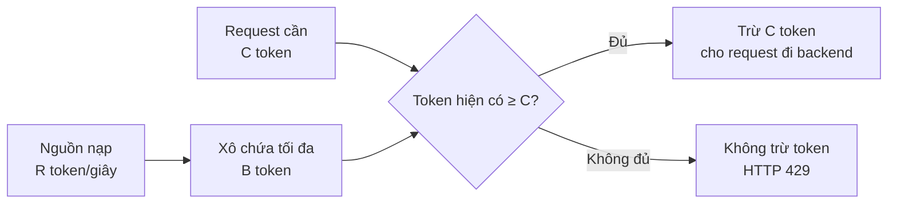
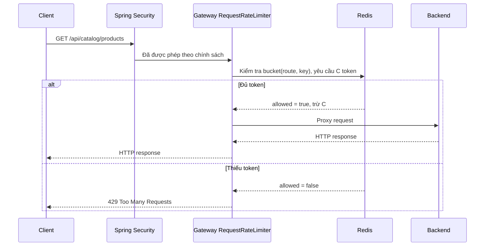
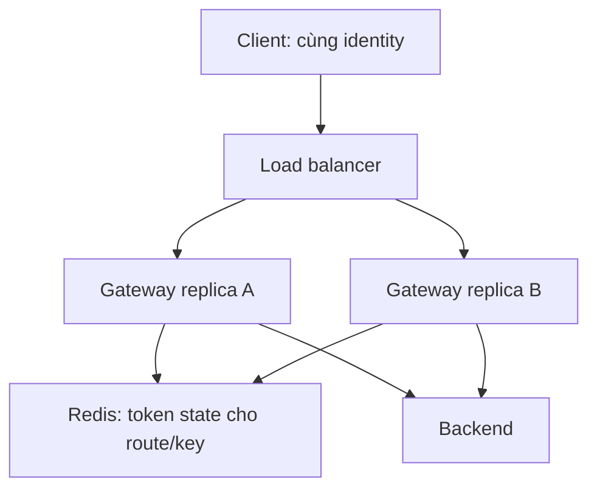

# Token bucket: tốc độ nạp, dung lượng và chi phí mỗi yêu cầu trong Spring Cloud Gateway

Một API Gateway không chỉ chọn route theo `Path`, `Method`, chạy filter chain và chuyển request tới microservices. Nó còn phải **giới hạn lưu lượng** để một người dùng hoặc ứng dụng không chiếm hết kết nối, CPU, tài nguyên backend và khả năng phục vụ của toàn hệ thống. Spring Cloud Gateway cung cấp filter `RequestRateLimiter`; khi dùng triển khai Redis `RedisRateLimiter`, cơ chế quyết định cho phép/từ chối request dựa trên thuật toán **token bucket**.

Ba tham số của bài học là:

- **`replenishRate` (R):** tốc độ **nạp token** vào xô, tính bằng token/giây.
- **`burstCapacity` (B):** **dung lượng tối đa** xô có thể chứa, tính bằng token.
- **`requestedTokens` (C):** số token **một request tiêu tốn**, mặc định bằng `1`.

Nếu xô còn đủ `C` token, request được phép đi tiếp và số token bị trừ `C`. Nếu không đủ, request bị từ chối, mặc định bằng **HTTP 429 Too Many Requests**. Khi không có lưu lượng, token tích lũy theo `R` nhưng không vượt `B`.

Bài thuộc chương **Giới hạn lưu lượng** của module `SPRING_CLOUD_GATEWAY`. Nó tập trung vào toán học token bucket, cách cấu hình Spring Cloud Gateway **Server WebFlux**, kiểm thử với Redis và các điểm an toàn cần phối hợp với xác thực, rate limiting theo danh tính, circuit breaker, retry, TLS và tracing.

> **Phạm vi phiên bản:** Các ví dụ cấu hình dùng **Spring Cloud Gateway Server WebFlux 5.0.x**, Spring Cloud 2025.1.x và Spring Boot 4.x, với tiền tố route `spring.cloud.gateway.server.webflux.routes`. Ở Server Web MVC, RateLimiter có API và triển khai Bucket4j riêng; không lấy nguyên ví dụ Redis/WebFlux áp dụng cho MVC. Các bài viết cho Gateway 4.x có thể dùng tiền tố cũ `spring.cloud.gateway.routes`.

## 1. Mục tiêu học tập

Sau bài này bạn có thể:

1. Tính số token trước và sau mỗi request với `R`, `B`, `C` cho trước.
2. Phân biệt **tốc độ nạp** với **sức chứa burst** và **chi phí token**; giải thích tại sao `burstCapacity` không luôn bằng số request có thể gửi.
3. Ước lượng **burst ban đầu**, **thông lượng dài hạn**, **thời gian hồi phục** và tác động khi `C > R`.
4. Khai báo `RequestRateLimiter` bằng `application.yml` với `redis-rate-limiter.replenishRate`, `burstCapacity` và `requestedTokens`.
5. Chọn `KeyResolver` dựa trên principal/tenant đáng tin thay vì query parameter, cookie hoặc header client tự sửa.
6. Thiết lập lab Redis + Gateway + backend, quan sát HTTP 429 và các response header kiểm thử.
7. Tách lỗi Redis khỏi lỗi backend, phân biệt quota với timeout, retry và giới hạn kích thước request.

## 2. Hình dung token bucket

Hãy tưởng tượng mỗi người dùng có **một xô token** riêng, giống ngân sách cho phép họ gửi request:



Ba đại lượng có **đơn vị khác nhau**:

| Ký hiệu | Property Redis | Đơn vị | Câu hỏi trả lời |
|---|---|---|---|
| `R` | `replenishRate` | token/giây | Mỗi giây có thêm bao nhiêu “ngân sách”? |
| `B` | `burstCapacity` | token | Khi đã nạp đầy, xô tích tối đa bao nhiêu token? |
| `C` | `requestedTokens` | token/request | Mỗi request tốn bao nhiêu ngân sách? |
| `T` | Trạng thái xô | token | Hiện xô còn đủ cho request kế tiếp không? |

Ví dụ `R=5, B=20, C=1`: một xô đầy có thể cho **tối đa 20 request liên tiếp trong thời gian rất ngắn**, sau đó bình quân về dài hạn nạp đủ cho khoảng **5 request/giây**. Một đợt burst dùng hết 20 token không thể lập tức được lặp lại nếu chưa có thời gian để xô nạp thêm.

**Quan trọng:** `burstCapacity` là **số token tối đa**, không nhất thiết là số request tối đa. Khi `C=2` thì xô có 20 token chỉ hỗ trợ tối đa 10 request đồng thời ở thời điểm đầy; khi `C=5` thì chỉ còn 4 request.

### 2.1. Khác gì fixed window và sliding window?

| Thuật toán | Ý tưởng | Hệ quả |
|---|---|---|
| Fixed window | Đếm request trong cửa sổ cố định, ví dụ phút 10:00–10:01 | Có thể xuất hiện burst mạnh ở ranh giới giữa hai cửa sổ |
| Sliding window | Kiểm tra count của khoảng thời gian trượt, ví dụ 60 giây gần nhất | Kiểm soát quota theo khoảng trượt; lưu/ước lượng lịch sử |
| **Token bucket** | Nạp token liên tục/theo bước, trừ token cho request | Cho phép burst tạm thời nhưng giới hạn thông lượng dài hạn |
| Leaky bucket / queue | Xếp hàng và thoát với tốc độ có kiểm soát | Có thể làm phẳng tốc độ xử lý bằng cách giữ/chờ request |

`RedisRateLimiter` của Spring Cloud Gateway **không phải** bộ đếm “N request trên mỗi phút theo fixed window”. Cấu hình `R, B, C` mô tả **tốc độ hồi phục và ngân sách burst**. Muốn quota tháng/ngày chính xác cho thanh toán, thường cần thêm cơ chế quota/usage counter riêng.

## 3. Công thức cập nhật token

Xét mô hình token bucket lý tưởng, xô có `T_old` token sau lần cập nhật trước, thời gian trôi qua `Δt` giây, với `R` token/giây. Trước khi xét request mới:

\[
T_{\text{before}} = \min(B,\; T_{\text{old}} + R \times \Delta t)
\]

Quyết định:

\[
\text{allowed} =
\begin{cases}
\text{true}, & T_{\text{before}} \ge C\\
\text{false}, & T_{\text{before}} < C
\end{cases}
\]

Và số token sau quyết định:

\[
T_{\text{after}} =
\begin{cases}
T_{\text{before}} - C, & \text{nếu được phép}\\
T_{\text{before}}, & \text{nếu bị từ chối}
\end{cases}
\]

Ba bước dễ nhớ:

1. **Nạp:** thêm token dựa trên thời gian trôi qua.
2. **Chặn trần:** nếu vượt `B` thì chỉ giữ `B`.
3. **Thu phí:** nếu đủ `C` token, trừ `C` và cho request đi tiếp; nếu thiếu, từ chối.

Công thức trên nhằm **suy luận**; implementation Redis cụ thể sử dụng script Lua, thời gian/giá trị nguyên và chính sách TTL nên số token/HTTP status tại thời điểm sát ranh giới có thể khác mô phỏng liên tục dưới đây. Không dùng bảng tính lý tưởng để khẳng định chính xác thời điểm microsecond khi test thực.

### 3.1. Bảng mô phỏng: `R=2, B=7, C=3`

Giả sử xô **ban đầu đầy**, mỗi thời điểm trong bảng có một request, không có request khác xen vào:

| Thời điểm (giây) | Token sau khi nạp | Quyết định | Token còn lại |
|---:|---:|---|---:|
| `t=0` — request A | 7 | Cho phép, trừ 3 | 4 |
| `t=0` — request B | 4 | Cho phép, trừ 3 | 1 |
| `t=0` — request C | 1 | Từ chối (`1 < 3`) | 1 |
| `t=1` — request D | 3 (`1 + 2`) | Cho phép, trừ 3 | 0 |
| `t=2` — request E | 2 (`0 + 2`) | Từ chối | 2 |
| `t=3` — request F | 4 (`2 + 2`) | Cho phép, trừ 3 | 1 |
| `t=10` — request G | 7 (`min(7,1+14)`) | Cho phép, trừ 3 | 4 |

Từ bảng này rút ra:

- Xô đầy `B=7` và mỗi request tốn `C=3` nên tại cùng thời điểm có tối đa `⌊7/3⌋ = 2` request thành công.
- `replenishRate=2` chỉ nạp 2 token mỗi giây, **không đủ trả cho một request `C=3` ở mỗi giây** mãi mãi.
- Khi request bị từ chối, mô hình không trừ thêm token; token được giữ lại cho lần sau.
- Sau một khoảng yên lặng đủ dài, xô lại đầy, nhưng **không vượt 7 token**.

### 3.2. Burst và thông lượng lâu dài

Nếu mọi request tốn cùng `C > 0` và xô đầy, **số request có thể chấp nhận ngay** xấp xỉ:

\[
N_{\text{burst}} = \left\lfloor \frac{B}{C} \right\rfloor
\]

Còn **tốc độ trung bình tối đa về lâu dài** có thể ước lượng:

\[
\lambda_{\text{sustain}} \approx \frac{R}{C}\;\text{request/giây}
\]

Ví dụ:

| `R` token/s | `B` token | `C` token/request | Burst ban đầu | Thông lượng lâu dài |
|---:|---:|---:|---:|---:|
| 10 | 20 | 1 | 20 request | ~10 request/s |
| 10 | 20 | 2 | 10 request | ~5 request/s |
| 2 | 7 | 3 | 2 request | ~0,67 request/s |
| 1 | 60 | 60 | 1 request | ~1 request/60 giây |
| 100 | 100 | 5 | 20 request | ~20 request/s |

Đây là **ước lượng** khi có đủ lưu lượng để tiêu hết ngân sách; request timing, lượng token nguyên, khóa phân nhóm, độ trễ backend và sự phân tán sẽ ảnh hưởng quan sát thực.

### 3.3. Thời gian hồi phục

Một xô hết token cần khoảng:

\[
t_{\text{fill}} \approx \frac{B}{R} \;\text{giây},\quad R>0
\]

để đầy trở lại trong mô hình liên tục, **nếu không có request nào tiêu token** trong khoảng đó. Với `B=20, R=5`, khoảng 4 giây từ rỗng đến đầy. Để phục vụ request giá `C=2` từ xô rỗng, cần khoảng `C/R=0,4` giây theo mô hình lý tưởng, nhưng implementation Redis có thể nạp theo độ phân giải thời gian nguyên nên quan sát thực tế không nhất thiết đúng `0,4s`.

Nếu `C > B`, **ngay cả xô đầy cũng không trả nổi một request**. Đây là lỗi thiết kế cấu hình đáng kiểm tra. Nếu `B=0`, tài liệu Gateway nêu trường hợp này chặn mọi request; đừng dùng để mô tả một hạn mức bình thường mà không có chủ đích.

## 4. Ba tham số trong `RedisRateLimiter`

Trong Spring Cloud Gateway Server WebFlux, `RequestRateLimiter` chọn triển khai `RateLimiter` để quyết định request được phép hay không. Với Redis, thuật toán token bucket thường có một bucket theo **route và key đã được giải quyết**; các Gateway instance dùng cùng Redis có thể phối hợp tiêu thụ token ở một nơi thay vì duy trì bộ đếm riêng từng JVM.

| Tham số trong `args` | Ý nghĩa chính xác | Mặc định / lưu ý |
|---|---|---|
| `redis-rate-limiter.replenishRate` | Tốc độ nạp token vào bucket, đơn vị token/giây | Chọn theo thông lượng mục tiêu và `requestedTokens` |
| `redis-rate-limiter.burstCapacity` | Sức chứa tối đa của bucket, đơn vị token | Cho phép một đợt burst khi có token tích lũy; `0` theo tài liệu là chặn mọi request |
| `redis-rate-limiter.requestedTokens` | Token tiêu tốn **mỗi request** trên route | Mặc định `1` |
| `key-resolver` | Bean tạo key nhận dạng bucket | Tên key khác có thể có ngân sách độc lập; không dùng giá trị client tự sửa cho quota quan trọng |
| `rate-limiter` | Bean `RateLimiter` riêng nếu cần | Không cần chỉ định trong ví dụ chuẩn khi `RedisRateLimiter` có sẵn và được dùng đúng theo auto-configuration |

**Thứ tự ba tham số không được tráo đổi**: `replenishRate` không phải số token giữ lại, `burstCapacity` không phải tốc độ nạp và `requestedTokens` không phải giới hạn số lượng người dùng.

Ví dụ cơ bản từ tài liệu Spring:

```yaml
filters:
  - name: RequestRateLimiter
    args:
      redis-rate-limiter.replenishRate: 10
      redis-rate-limiter.burstCapacity: 20
      redis-rate-limiter.requestedTokens: 1
```

Đây là **một đoạn filter**, cần đặt dưới route có `id`, `uri` và `predicates` thích hợp. Với bucket đầy và cùng một key, tối đa khoảng 20 request tới đồng thời có thể được chấp nhận ban đầu; sau đó ngân sách hồi phục với tốc độ 10 token/giây, tức xấp xỉ 10 request/giây nếu `C=1`.

### 4.1. Hạn mức thấp hơn một request/giây

Spring Cloud Gateway RedisRateLimiter có ba tham số dạng token/giây và token/request. Khi muốn **1 request mỗi phút**, không thể đơn giản khai báo `replenishRate=0.0167` nếu triển khai kỳ vọng cấu hình số nguyên. Cách tài liệu hướng dẫn là “phóng đại đơn vị token”:

```yaml
filters:
  - name: RequestRateLimiter
    args:
      redis-rate-limiter.replenishRate: 1
      redis-rate-limiter.burstCapacity: 60
      redis-rate-limiter.requestedTokens: 60
```

Phân tích:

- Xô đầy chứa `60` token.
- Một request tốn `60` token, nên ban đầu chỉ có **một** request được phép.
- Xô nạp thêm `1` token/giây; khoảng `60` giây sau mới đủ ngân sách cho lần tiếp theo nếu từ rỗng.
- Thông lượng dài hạn `R/C = 1/60` request/giây.

Đây là **token bucket**, không phải quy tắc “đúng một request trong mỗi phút đồng hồ” theo fixed window. Request sau khi đi qua trong một phút có thể nằm gần ranh giới thời gian; thời điểm được phép phụ thuộc mức token và độ phân giải thời gian của thuật toán.

Một ví dụ tương tự “2 request mỗi phút, cho phép burst tối đa 2” có thể chọn `R=2, B=120, C=60`. Khi xô đầy, hai request liên tiếp tiêu hết 120 token; sau đó mỗi request cần thêm 60 token, tương đương khoảng 30 giây ở `R=2`. Nếu chính sách yêu cầu **không bao giờ quá 2 request trong bất kỳ 60 giây trượt**, token bucket như vậy **không thay** quota sliding-window chính xác.

### 4.2. Tăng chi phí mỗi request

Hai route khác nhau có thể có chi phí token khác nhau:

| Loại thao tác | `R` | `B` | `C` | Ý nghĩa |
|---|---:|---:|---:|---|
| GET tra cứu dữ liệu | 20 | 40 | 1 | Burst 40; lâu dài ~20 GET/s cho mỗi bucket |
| Truy vấn báo cáo nặng | 20 | 40 | 5 | Burst 8; lâu dài ~4 report/s cho mỗi bucket |
| Tạo báo cáo rất nặng | 20 | 40 | 10 | Burst 4; lâu dài ~2 request/s cho mỗi bucket |

Nhưng có một điểm rất quan trọng: **các route có thể dùng bucket riêng nếu RedisRateLimiter định danh bucket theo route ID và key**. Chỉ đặt `R=20` ở cả ba route **không tự biến chúng thành một ngân sách 20 token/giây chung**. Khi cần một ngân sách **chia sẻ cho mọi API của một tenant**, phải thiết kế key/scope, dùng limiter chia sẻ có chủ đích hoặc triển khai một chính sách quota chung; đừng mặc định chỉ thay `requestedTokens` là mọi route đã cùng trừ một xô.

Với `RequestRateLimiter` Redis thông thường, `requestedTokens` là **cấu hình của filter/route**, không phải một tham số tự động thay đổi theo độ dài body, thời gian CPU thực hay hóa đơn của từng request. Muốn tính chi phí động theo kết quả xử lý, cần thiết kế custom limiter/quota có bảo toàn tính nguyên tử và lifecycle.

## 5. Lab thực hành: Redis + Gateway + backend

Mục tiêu lab là nhìn thấy một burst ban đầu được cho phép, các request tiếp theo trả `429` và bucket phục hồi dần. Lab sử dụng **một key chung** để kiểm tra thuật toán mà không cần dựng IdP; **không sử dụng mô hình một key cho mọi người làm chính sách production**.

### 5.1. Phụ thuộc Maven

Dùng Spring Initializr để tạo ứng dụng Spring Boot 4.x phù hợp với Spring Cloud 2025.1.x, bật **Spring Cloud Gateway Server WebFlux**. Nếu chỉnh Maven trực tiếp, cần ít nhất các starter:

```xml
<dependencies>
    <dependency>
        <groupId>org.springframework.cloud</groupId>
        <artifactId>spring-cloud-starter-gateway-server-webflux</artifactId>
    </dependency>
    <dependency>
        <groupId>org.springframework.boot</groupId>
        <artifactId>spring-boot-starter-data-redis-reactive</artifactId>
    </dependency>
</dependencies>
```

Đây **không phải một `pom.xml` hoàn chỉnh**: dự án phải có Spring Boot parent/plugin và **Spring Cloud BOM** tương thích. Redis reactive là dependency theo tài liệu Gateway cho `RedisRateLimiter`; không cần tự viết Lua script cho ví dụ bình thường.

Class khởi động tối thiểu:

```java
import org.springframework.boot.SpringApplication;
import org.springframework.boot.autoconfigure.SpringBootApplication;

@SpringBootApplication
public class RateLimitGatewayApplication {
    public static void main(String[] args) {
        SpringApplication.run(RateLimitGatewayApplication.class, args);
    }
}
```

### 5.2. Chạy Redis cho môi trường lab

Nếu máy đã có Redis trong mạng thử nghiệm, sử dụng host/port hiện có. Nếu có Docker, trong terminal có thể chạy:

```bash
docker run --rm --name gateway-redis-lab -p 6379:6379 redis:7-alpine
```

Đây là **Redis lab cục bộ**, không cấu hình authentication/TLS, **không dùng nguyên lệnh này cho server public**. Nếu chạy Docker Desktop, Redis container cần đang hoạt động trước khi khởi động Gateway. Không để port Redis `6379` được Internet truy cập.

Kiểm tra khi Redis sẵn sàng bằng một terminal khác:

```bash
docker exec gateway-redis-lab redis-cli ping
# Kỳ vọng: PONG
```

Nếu gateway chạy **bên trong container khác**, `localhost:6379` chỉ vào container Gateway, không tự trỏ tới Redis container. Khi đó cần Docker network/service DNS thích hợp.

### 5.3. Bean `KeyResolver` chung cho lab

Tạo file `RateLimitKeyConfiguration.java` trong package được Spring Boot quét:

```java
import org.springframework.cloud.gateway.filter.ratelimit.KeyResolver;
import org.springframework.context.annotation.Bean;
import org.springframework.context.annotation.Configuration;
import reactor.core.publisher.Mono;

@Configuration
public class RateLimitKeyConfiguration {

    @Bean
    KeyResolver labSharedKeyResolver() {
        // Chỉ dùng cho bài thử: tất cả request dùng một bucket logic.
        return exchange -> Mono.just("lab-shared-bucket");
    }
}
```

Lợi ích: mọi lần gọi đều cùng trừ một bucket; dễ quan sát 429 trong vài request.

**Hạn chế:** Hai người dùng khác nhau sẽ tranh cùng một ngân sách. Không phù hợp với giới hạn theo khách hàng/tenant; phần 8 trình bày cách chọn key an toàn hơn.

### 5.4. `application.yml` đầy đủ cho Server WebFlux 5.0.x

```yaml
server:
  port: 8080

spring:
  application:
    name: token-bucket-gateway

  data:
    redis:
      host: localhost
      port: 6379

  cloud:
    gateway:
      server:
        webflux:
          routes:
            - id: catalog-lab
              uri: http://localhost:9001
              predicates:
                - Path=/api/catalog/**
                - Method=GET
              filters:
                - name: RequestRateLimiter
                  args:
                    key-resolver: "#{@labSharedKeyResolver}"
                    redis-rate-limiter.replenishRate: 2
                    redis-rate-limiter.burstCapacity: 6
                    redis-rate-limiter.requestedTokens: 2
                - StripPrefix=2
```

Giải thích ví dụ:

| Phần | Vai trò |
|---|---|
| `Path=/api/catalog/**` và `Method=GET` | Chọn request thuộc route |
| `uri: http://localhost:9001` | Proxy tới backend lab |
| `key-resolver: "#{@labSharedKeyResolver}"` | Tham chiếu Spring bean bằng SpEL; trả key cố định `lab-shared-bucket` |
| `replenishRate: 2` | Nạp 2 token mỗi giây |
| `burstCapacity: 6` | Giữ tối đa 6 token |
| `requestedTokens: 2` | Mỗi request cần 2 token |
| `StripPrefix=2` | `/api/catalog/products/42` → `/products/42` |

Khi xô đã đầy và các request gửi rất sát nhau, đợt burst đầu có thể cho **3 request**, vì `⌊6/2⌋ = 3`. Sau khi hết ngân sách, về dài hạn trung bình khoảng **1 request/giây** vì `R/C = 2/2 = 1`.

**Không đặt `RequestRateLimiter` bằng shortcut như `RequestRateLimiter=2,6,2`.** Tài liệu Gateway chỉ rõ filter này **không hỗ trợ shortcut notation** cho cấu hình nói trên. Dùng dạng `name` và `args` để các tham số được bind chính xác.

**Lưu ý khi trộn ví dụ:** `application.yml` này là ví dụ chạy riêng, không ghép nguyên cùng một route demo khác có cùng ID. Khi chuyển sang production, bỏ key resolver cố định, bật xác thực và thiết kế key/limit theo chính sách riêng.

### 5.5. Backend echo để quan sát request đã được cho phép

Tạo file `CatalogBackend.java` trong một thư mục lab. Backend port `9001` tăng bộ đếm mỗi lần **thực sự nhận** request:

```java
import com.sun.net.httpserver.HttpServer;
import java.net.InetSocketAddress;
import java.nio.charset.StandardCharsets;
import java.util.concurrent.atomic.AtomicLong;

public class CatalogBackend {
    public static void main(String[] args) throws Exception {
        HttpServer server = HttpServer.create(
                new InetSocketAddress("127.0.0.1", 9001), 0);
        AtomicLong count = new AtomicLong();

        server.createContext("/", exchange -> {
            long received = count.incrementAndGet();
            String body =
                    "received=" + received + "\n" +
                    "method=" + exchange.getRequestMethod() + "\n" +
                    "path=" + exchange.getRequestURI().getRawPath() + "\n";

            byte[] bytes = body.getBytes(StandardCharsets.UTF_8);
            exchange.getResponseHeaders().set(
                    "Content-Type", "text/plain; charset=utf-8");
            exchange.sendResponseHeaders(200, bytes.length);
            try (var output = exchange.getResponseBody()) {
                output.write(bytes);
            }
        });

        server.start();
        System.out.println("Backend listening on localhost:9001");
    }
}
```

Chạy backend bằng JDK 17+ trong một terminal:

```bash
java --add-modules jdk.httpserver CatalogBackend.java
```

Redis phải chạy trong terminal khác. Khởi động dự án Gateway bằng Maven wrapper:

```bash
# Linux/macOS
./mvnw spring-boot:run

# Windows PowerShell
.\mvnw.cmd spring-boot:run
```

Gửi request:

```bash
curl -i http://localhost:8080/api/catalog/products/42
```

Khi còn token, phản hồi mẫu:

```text
HTTP/1.1 200 OK
Content-Type: text/plain; charset=utf-8

received=1
method=GET
path=/products/42
```

`received` chỉ đếm request đã tới backend; nó không tăng khi Gateway từ chối request bằng `429`. Đường dẫn `/products/42` cho thấy `StripPrefix=2` đã bỏ hai segment `api` và `catalog`.

### 5.6. Gửi liên tiếp để thử burst

Trên Bash:

```bash
for i in $(seq 1 10); do
  curl -s -o /dev/null -w "%{http_code}\n" "http://localhost:8080/api/catalog/products/42"
done
```

Trên PowerShell 5.1:

```powershell
1..10 | ForEach-Object {
    curl.exe -s -o NUL -w "%{http_code}\n" "http://localhost:8080/api/catalog/products/42"
}
```

Với `R=2, B=6, C=2` và bucket mới đầy, tối đa **3 request sát nhau** được chấp nhận trước khi cần thêm token; sau đó có thể xuất hiện nhiều `429 Too Many Requests`.

**Không khẳng định** cứ chạy vòng lặp là đúng ba kết quả `200` rồi bảy `429`: ngay lúc vòng lặp chạy, token có thể hồi phục; bucket có thể không đầy do lần test trước; Redis implementation có độ phân giải thời gian. Đây là lý do lab nên quan sát **xu hướng**, không kiểm tra số lần cố định khi không kiểm soát thời gian.

Gọi riêng từng request để xem cả response header:

```bash
curl -i http://localhost:8080/api/catalog/products/42
```

Khi limiter từ chối, Gateway mặc định trả `HTTP 429` mà không chuyển request tới backend. Backend lỗi `500` hoặc không chạy có thể tạo `5xx`, khác nguyên nhân với 429.

### 5.7. Quan sát bucket hồi phục

Ngừng gửi request trong một vài giây, rồi gọi lại. Trong mô hình lý tưởng, `R=2, C=2` cần khoảng **1 giây** từ trạng thái rỗng để đủ token cho một request; cần khoảng `B/R=3` giây yên lặng từ rỗng để bucket đầy trở lại. Implementation Redis thực tế có thể dùng thời gian nguyên/TTL, nên đừng lấy mốc này làm cam kết chính xác từng mili-giây.

### 5.8. Response headers của RedisRateLimiter

Theo bảng cấu hình Gateway 5.0, `include-headers` mặc định là `true`. Các header thường dùng:

| Header | Ý nghĩa |
|---|---|
| `X-RateLimit-Remaining` | Số token còn lại theo trạng thái limiter tại thời điểm xử lý |
| `X-RateLimit-Replenish-Rate` | Giá trị `replenishRate` |
| `X-RateLimit-Burst-Capacity` | Giá trị `burstCapacity` |
| `X-RateLimit-Requested-Tokens` | Giá trị `requestedTokens` |

Ví dụ phản hồi minh họa cho route `R=2, B=6, C=2`:

```http
HTTP/1.1 200 OK
X-RateLimit-Remaining: 4
X-RateLimit-Replenish-Rate: 2
X-RateLimit-Burst-Capacity: 6
X-RateLimit-Requested-Tokens: 2
```

`X-RateLimit-Remaining` phản ánh **token**, không mặc định là số request còn được phép khi `requestedTokens > 1`. Các request đồng thời hoặc token nạp thêm có thể khiến kết quả tiếp theo khác. Tùy cấu hình, các header có thể bị ẩn hoặc sửa tên; không mặc định mọi phản hồi `429` đều có `Retry-After`. Nếu client cần thời điểm thử lại, phải thiết kế hợp đồng/thời gian chờ phù hợp thay vì tự đoán.

## 6. `KeyResolver`: ai có bucket riêng?

Spring Cloud Gateway dùng `KeyResolver` để xác định **key** cho việc giới hạn. Một key có thể biểu thị user, tenant, ứng dụng hoặc workload. Interface WebFlux:

```java
public interface KeyResolver {
    Mono<String> resolve(ServerWebExchange exchange);
}
```

Nếu mỗi người dùng có key khác nhau, họ có thể có ngân sách riêng. Nếu mọi request dùng `lab-shared-bucket` như lab thì chúng cùng tranh một xô.

### 6.1. Production: lấy key từ principal đã xác thực

Thay `labSharedKeyResolver` bằng bean sau khi đã thiết lập Spring Security phù hợp:

```java
import java.security.Principal;
import org.springframework.cloud.gateway.filter.ratelimit.KeyResolver;
import org.springframework.context.annotation.Bean;
import org.springframework.context.annotation.Configuration;

@Configuration
public class ProductionRateLimitKeys {

    @Bean
    KeyResolver authenticatedUserKeyResolver() {
        return exchange -> exchange.getPrincipal()
                .map(Principal::getName)
                .filter(name -> !name.isBlank());
    }
}
```

Tham chiếu trong filter của route:

```yaml
filters:
  - name: RequestRateLimiter
    args:
      key-resolver: "#{@authenticatedUserKeyResolver}"
      redis-rate-limiter.replenishRate: 10
      redis-rate-limiter.burstCapacity: 20
      redis-rate-limiter.requestedTokens: 1
```

Đây chỉ là đoạn `filters` của một route, không phải YAML độc lập. `exchange.getPrincipal()` phải do Spring Security tạo từ thông tin **đã xác minh**, chẳng hạn JWT hợp lệ. Đối với API bắt buộc đăng nhập, Security nên trả `401` khi thiếu token **trước khi** limiter quyết định key.

Nếu principal không tồn tại, `KeyResolver` trên phát `Mono.empty()`. Tài liệu Gateway mô tả **mặc định từ chối khi key rỗng**; trường hợp này không nhất thiết là HTTP 429. Một số bản có cấu hình `deny-empty-key` và `empty-key-status-code`; cần kiểm tra prefix property đúng bản Gateway trước khi thay đổi, đồng thời test 401/403/429 riêng.

### 6.2. Không dùng query/header/cookie tùy ý để tạo quota

Ví dụ sau **chỉ để minh họa anti-pattern**:

```java
@Bean
KeyResolver insecureQueryKeyResolver() {
    return exchange -> Mono.justOrEmpty(
        exchange.getRequest().getQueryParams().getFirst("user"));
}
```

Nếu client gọi `?user=alice` rồi đổi thành `?user=bob`, nó có thể làm limiter sử dụng key khác, tránh quota của key trước. Tương tự, `X-User-Id`, `X-Tenant-Id`, cookie `role` hoặc `X-Forwarded-For` **không phải danh tính đáng tin** nếu client có thể tự gửi giá trị đó.

**KeyResolver chọn ai chia sẻ ngân sách; RateLimiter mới quyết định còn ngân sách hay không.** Một KeyResolver không an toàn có thể làm chính sách token bucket vô dụng dù `R, B, C` được tính chính xác.

### 6.3. Key theo tenant và nhiều nhà phát hành

Nếu business yêu cầu quota cho **tenant**:

1. Xác thực user, app hoặc workload qua token/mTLS identity.
2. Xác minh user có quyền trên tenant đang được chọn.
3. Chuẩn hóa tenant ID, có giới hạn ký tự và độ dài để tránh key cardinality không kiểm soát.
4. Dùng namespace an toàn như `prod:tenant:abc`. Với user từ nhiều issuer, cân nhắc `issuer + subject` để tránh trùng ID.
5. Xác định rõ quota muốn **chia theo từng route** hay **dùng chung nhiều route**.

Triển khai `RedisRateLimiter` thông thường có khóa liên quan đến **route ID và key**. Hai route đều trả key `tenant-a` không mặc nhiên chia sẻ đúng một bucket. Nếu muốn một quota dùng chung cho catalog, orders và payments, cần thiết kế limiter/quota có namespace chung, hoặc custom `RateLimiter` theo nhu cầu, không chỉ tăng `requestedTokens` trên từng route.

### 6.4. Public API không có principal

Có thể giới hạn theo:

- API key được hệ thống **xác minh** và liên kết với ứng dụng.
- Một bucket chung cho anonymous traffic, với quota tổng phù hợp.
- IP đã được ingress tin cậy chuẩn hóa (chấp nhận các vấn đề NAT/shared network).
- WAF/edge rate limiting cùng quota ở Gateway.

Không dùng `X-Forwarded-For` từ Internet một cách mù quáng. Client có thể giả mạo header này nếu ingress chưa xóa/ghi lại và cấu hình danh sách trusted proxies chưa phù hợp.

## 7. Dùng chi phí token để ưu tiên các loại API

`requestedTokens` là **chi phí tính bằng token cho mỗi request**. Một API nặng có thể cần nhiều token hơn một GET đơn giản:

| Loại request | `R` | `B` | `C` | Burst khi đầy | Trung bình tối đa |
|---|---:|---:|---:|---:|---:|
| GET tra cứu | 20 | 40 | 1 | 40 GET | ~20 GET/s |
| Lấy báo cáo nặng | 20 | 40 | 5 | 8 báo cáo | ~4/s |
| Xuất báo cáo | 20 | 40 | 10 | 4 export | ~2/s |

**Đây là ba bucket/route mẫu độc lập**, không ngầm chia sẻ 40 token giữa các route. Nếu muốn chi phí 1, 5, 10 token trừ từ **cùng ngân sách tenant**, phải thiết kế nguồn state/quota chung; không khẳng định các cấu hình giống nhau tự liên thông.

### 7.1. Route chồng lấn cần thứ tự tường minh

Ví dụ hai route có thể cùng khớp `GET /api/reports/exports/42`:

```yaml
spring:
  cloud:
    gateway:
      server:
        webflux:
          routes:
            - id: heavy-export
              uri: http://localhost:9002
              order: -10
              predicates:
                - Path=/api/reports/exports/**
                - Method=GET
              filters:
                - name: RequestRateLimiter
                  args:
                    key-resolver: "#{@authenticatedUserKeyResolver}"
                    redis-rate-limiter.replenishRate: 20
                    redis-rate-limiter.burstCapacity: 40
                    redis-rate-limiter.requestedTokens: 10

            - id: reports-general
              uri: http://localhost:9002
              order: 0
              predicates:
                - Path=/api/reports/**
                - Method=GET
              filters:
                - name: RequestRateLimiter
                  args:
                    key-resolver: "#{@authenticatedUserKeyResolver}"
                    redis-rate-limiter.replenishRate: 20
                    redis-rate-limiter.burstCapacity: 40
                    redis-rate-limiter.requestedTokens: 5
```

`order` nhỏ hơn có độ ưu tiên **chọn route** cao hơn, nên route `heavy-export` khớp trước khi có thể khớp `reports-general`. Nếu bucket `heavy-export` từ chối bằng 429, Gateway **không** thử route còn lại để né hạn mức: route đã được chọn trước khi filter limiter thực thi.

Lưu ý hai route này không có `StripPrefix`; upstream nhận đường dẫn nguyên dạng `/api/reports/...`. Nếu backend yêu cầu path khác, thêm filter viết lại path tương ứng.

### 7.2. `requestedTokens` không phải chi phí được đo tự động

Nếu đặt `requestedTokens: 5`, một request tốn 5 token **dù** upstream chạy nhanh hay chậm và trả 200, 404 hoặc 500 sau khi được phép đi tiếp. Filter thường quyết định và thu token **trước khi** backend thực thi, không chờ kết quả CPU/billing.

Muốn thu theo số byte xử lý, số bản ghi báo cáo hoặc tiền thật, cần cơ chế quota/billing riêng, có chính sách dự trữ, quyết toán, hoàn lại nếu cần và idempotency khi retry. Đừng để client gửi `?cost=1` rồi tự quyết định chi phí quota production.

## 8. Đặt limiter đúng chỗ trong filter chain

`RequestRateLimiter` là một `GatewayFilter`. Sau khi Gateway tìm được route phù hợp, filter được gọi trong chuỗi kết hợp các route filters, default filters và `GlobalFilter`. Nếu limiter quyết định **từ chối**, nó trả response mà không proxy request qua HTTP client thông thường.



**Hành vi quan trọng:**

- Nếu request không khớp route, filter của route không chạy.
- Nếu Spring Security chặn bằng `401`/`403` trước route Gateway, có thể chưa tiêu token ở `RequestRateLimiter` của route.
- Nếu đã được limiter cho qua, backend trả `500` vẫn không có nghĩa token tự được hoàn lại.
- Nếu request bị 429, backend của route thông thường không được gọi.
- `route.order` chỉ ưu tiên **route matching**; nó không phải `getOrder()` của filter và không điều khiển tốc độ nạp token.

### 8.1. Không dùng 429 để che lỗi xác thực

| Kết quả | Nguồn thường gặp | Ý nghĩa |
|---|---|---|
| `401 Unauthorized` | Spring Security | Chưa có credentials hợp lệ |
| `403 Forbidden` | Spring Security hoặc empty-key policy | Có xác thực nhưng thiếu quyền, hoặc một chính sách chặn khác cần được phân biệt |
| `429 Too Many Requests` | `RequestRateLimiter` khi không đủ token | Đã vượt hạn mức lưu lượng |
| `502`/`503`/`504` | Gateway/backend hoặc hạ tầng | Lỗi upstream/kết nối/timeout tùy trường hợp |

API client nên xử lý `429` bằng backoff và hướng dẫn về quota; không tự thử làm mới JWT liên tục như với `401`. Ngược lại, thêm Redis limiter không thay thế việc xác minh JWT, OAuth scope hay quyền sở hữu tài nguyên ở backend.

### 8.2. Retry có thể làm tải nặng hơn

Khi client nhận 429 rồi retry ngay 10 lần, nó vẫn có thể hết token và tạo thêm lưu lượng vào Gateway/Redis. Khi dùng `Retry` filter, phải kiểm tra có cấu hình retry status `429` hay không; retry không có backoff sẽ làm tình trạng quá tải tệ hơn.

**Token bucket chủ yếu là admission control**, không phải queue: request thiếu token bị từ chối thay vì chờ tự động đến lượt. Nếu hệ thống có công việc nặng cần xử lý tuần tự, nên cân nhắc hàng đợi/background job với quota riêng, không biến HTTP Gateway thành worker queue.

## 9. Sizing quota cho microservices

Không bắt đầu bằng câu hỏi “đặt `burstCapacity` bao nhiêu cho lớn?”, mà nên xác định năng lực backend, SLO và phân bố client.

Một quy trình thiết kế:

1. **Ước lượng năng lực backend:** throughput bền vững, p95/p99 latency, số kết nối, CPU/DB; dùng số đo tải, không đoán.
2. **Chọn mục tiêu phân bổ:** theo user, tenant, API key, tier trả phí, hay quota tổng.
3. **Chọn `C`:** bắt đầu với 1 token/request cho route đồng nhất, tăng cho thao tác tương đối nặng nếu có lý do rõ ràng.
4. **Chọn `R`:** với `C` cố định, đặt `R ≈ throughput mong muốn × C`.
5. **Chọn `B`:** `B ≥ C` để có thể xử lý ít nhất một request; mức cao hơn tạo burst, phải được backend chịu nổi.
6. **Thử tải hỗn hợp:** nhiều key, các route cùng lúc, request ngắn/dài, Redis chậm, backend 503, client retry và tăng traffic đột ngột.
7. **Tối ưu nhiều tầng:** giới hạn edge toàn hệ thống, Gateway theo tenant/user, backend theo tài nguyên đặc thù.

### 9.1. Ví dụ chọn tham số

Giả sử API đọc catalog có mục tiêu cho mỗi **user** khoảng **8 request/giây dài hạn**, nhưng có thể cho phép một đợt burst **24 request** khi người dùng tải trang:

```yaml
redis-rate-limiter.replenishRate: 8
redis-rate-limiter.burstCapacity: 24
redis-rate-limiter.requestedTokens: 1
```

Sau khi dùng hết 24 token rất nhanh, cần khoảng `24/8 = 3` giây yên lặng để xô đầy trở lại. Nếu mỗi request tốn `2` token mà vẫn muốn 8 request/giây và burst 24 request, nên điều chỉnh về:

```yaml
redis-rate-limiter.replenishRate: 16
redis-rate-limiter.burstCapacity: 48
redis-rate-limiter.requestedTokens: 2
```

Khi đổi `C` nhưng giữ nguyên `R` và `B`, cả burst lẫn throughput đều thay đổi. Đây là lỗi cấu hình thường gặp khi áp dụng “chi phí request nặng hơn”.

### 9.2. Per-user limit chưa chắc bảo vệ tổng backend

Nếu có 300 user mỗi người được `8 request/giây`, Gateway về lý thuyết có thể cho đến **2.400 request/giây** trong điều kiện mọi user đều hoạt động, chưa tính burst. Nếu backend chỉ chịu 500/s, per-user limiter riêng là không đủ.

Vì vậy:

- Dùng **global/tenant-wide quota** hoặc lớp concurrency control bổ sung khi cần bảo vệ năng lực tổng.
- Giới hạn kết nối, timeout và bulkhead cho các upstream quan trọng.
- Dùng circuit breaker khi upstream lỗi để giảm yêu cầu vô ích.
- Theo dõi tải tổng của Redis, Gateway, connection pool, backend và downstream database.

**RedisRateLimiter không mặc định là một global concurrency limiter**, cũng không đảm bảo số concurrent requests nhỏ hơn một ngưỡng. Nó kiểm soát **đơn vị token theo thời gian**, không giữ slot cho đến khi request hoàn tất.

## 10. Phân tán, Redis và failure modes

### 10.1. Vì sao dùng Redis?

Khi chạy nhiều instance Gateway sau một load balancer, nếu mỗi instance giữ bucket cục bộ, một client có thể được hưởng quota nhiều lần bằng cách phân tán request. Redis giúp các Gateway instance cùng đọc/cập nhật trạng thái bucket theo key dùng chung. Triển khai Redis của Gateway dùng script Lua để tính toán và cập nhật token, giúp kiểm soát cạnh tranh theo cơ chế atomic ở Redis cho một quyết định.



Khi vận hành:

- Các instance phải kết nối **cùng Redis/cluster và namespace/state** mà chính sách yêu cầu.
- Route IDs, key canonicalization và cấu hình R/B/C phải được triển khai nhất quán; một instance còn config cũ có thể làm quota khó dự đoán.
- Redis vẫn có network latency, connection pool, giới hạn tài nguyên và khả năng mất kết nối.
- Redis có thể lưu trạng thái bucket dưới dạng key hết hạn; khi state hết hạn sau thời gian yên lặng, request mới thường được xử lý như bucket mới. **Không dùng Redis token bucket như sổ cái billing vĩnh viễn**.
- Với Redis Cluster hoặc các proxy Redis, cần kiểm tra khả năng thực thi Lua script và cách các key liên quan được đặt cùng hash slot theo triển khai thực tế.

### 10.2. Redis down thì Gateway làm gì?

Đừng hứa rằng mọi Redis failure sẽ **tự fail-open** hoặc **tự fail-closed** theo ý bạn. Hành vi phụ thuộc implementation, cách xử lý error của reactive Redis client và custom filter/policy đang dùng; một exception Redis có thể xuất hiện dưới dạng lỗi Gateway `5xx` nếu không xử lý phù hợp.

Chính sách đề xuất:

| Loại route | Khi Redis không dùng được | Cần quyết định rõ |
|---|---|---|
| API thanh toán hoặc thao tác tốn kém | Cân nhắc fail-closed để bảo vệ backend/chống lạm dụng | Ảnh hưởng đến availability và trải nghiệm |
| API catalog public ít rủi ro | Có thể cân nhắc fallback hạn mức cục bộ rất thận trọng | Tránh mở vô hạn request khi Redis down |
| API xác thực/login | Phối hợp limiter tại ingress/WAF và server | Không mất lớp chống brute-force |
| API nội bộ từ workload đã xác minh | Theo SLO và độ tin cậy từng service | Cân bằng availability và overload risk |

Nếu triển khai fail-open/fail-closed tùy biến, cần **test rõ ràng**, đo outage, ghi metric, áp dụng circuit breaker/timeout cho kết nối Redis và bảo đảm fallback không biến Gateway thành chỗ cho phép traffic vô hạn. Không mô tả những phương án đó như hành vi mặc định đã được bảo đảm.

### 10.3. Phân biệt 429 với lỗi Redis

- `429` từ limiter: key có bucket hợp lệ nhưng **thiếu token**; không phải backend chết.
- `5xx` hoặc exception: có thể do Redis, cấu hình filter/keyResolver, backend, timeout hoặc gateway khác; phải xem log stacktrace và correlation ID.
- HTTP `401`/`403`: kiểm tra chính sách xác thực, có thể xảy ra trước limiter.
- Request không match route: có thể `404`, không chứng minh limiter đã từ chối.

**Không thêm retry vô hạn cho Redis** chỉ vì limiter được dùng để ngăn quá tải; Redis càng quá tải khi bị gọi lại liên tục.

## 11. Observability, Actuator và kiểm thử

Nếu dự án có `spring-boot-starter-actuator`, Gateway Server WebFlux 5.0.x có thể mở endpoint quản trị chỉ đọc:

```yaml
management:
  endpoint:
    gateway:
      access: read-only
  endpoints:
    web:
      exposure:
        include: health,info,gateway
```

Đặt khối `management` ở root YAML và kiểm tra:

```bash
curl -i http://localhost:8080/actuator/gateway/routes
curl -i http://localhost:8080/actuator/gateway/routes/catalog-lab
```

Actuator giúp xác minh route/filters đã được nạp, **không tự cho biết mọi key còn bao nhiêu token**. Đừng để endpoint quản trị lộ ra Internet không kiểm soát; nó có thể tiết lộ tên route/backend và chính sách.

### 11.1. Metric/log nên theo dõi

| Tín hiệu | Ý nghĩa |
|---|---|
| Số request được phép/từ chối theo route | Đánh giá mức quota và ảnh hưởng của burst |
| Tỷ lệ HTTP 429 | Phân biệt hạn mức thật với lỗi 401/403/5xx |
| Redis latency, connection failures và script errors | Phát hiện limiter không sẵn sàng |
| Backend throughput/p95/p99/5xx | Xác nhận limiter thực sự bảo vệ backend |
| Số key active/cardinality | Phát hiện key do client tạo vô hạn hoặc cấu hình key sai |
| Hành vi retry ở client/Gateway | Tránh 429 tạo vòng retry làm quá tải |
| Phân bố kích thước request và thời gian xử lý | Kiểm tra token cost có còn phản ánh tải thực không |

Log nên có `requestId`, route ID, result `allowed/denied`, mã HTTP và latency. **Không log raw Authorization, Cookie, key định danh cá nhân hoặc dữ liệu PII** trong metric tags cardinality cao. Khi thật sự cần khóa tra cứu, dùng ID băm/pseudonymized và kiểm soát quyền truy cập.

### 11.2. Ma trận test tối thiểu

| Ca thử | Kỳ vọng |
|---|---|
| Bucket mới đầy, gửi nhanh hơn `R/C` | Cho phép burst đến mức khả dụng, sau đó có 429 |
| Chờ đủ thời gian để nạp lại | Request được cho phép trở lại |
| Hai user đã xác thực khác nhau | Bucket phân biệt theo key chính sách |
| Cùng user qua hai Gateway replica | Dùng trạng thái quota chung khi Redis/namespace đúng |
| Client thay `?user=...` | Không né quota nếu key lấy từ principal thật |
| Route A và B có cùng key user | Không tự coi là quota chung nếu route ID tách bucket |
| `C > B` | Không có đủ token để cho một request qua xô đầy |
| Token JWT thiếu/hết hạn | Nhận 401 theo Security policy, không suy từ rate limiter |
| Redis không sẵn sàng | Kết quả theo failure policy đã test, không mặc định 429 |
| Backend trả HTTP 500 sau khi được cho qua | Không mặc định hoàn token hay đổi thành 429 |
| RequestRateLimiter không match route | Không được áp dụng trên request đó |
| Nhiều client cùng IP NAT | Không đánh đồng IP với user nếu dùng per-user policy |

Trong CI, hãy cô lập Redis test database/namespace, không chia sẻ key giữa các test case. Với thời gian nạp token, nên dùng test có tolerance và quan sát trạng thái thay vì so sánh chính xác từng mili-giây.

## 12. Những lỗi thường gặp và cách xử lý

| Triệu chứng | Nguyên nhân có thể | Hướng kiểm tra/khắc phục |
|---|---|---|
| Có `RequestRateLimiter` nhưng request nào cũng qua | Filter chưa nạp, sai route ID/prefix cấu hình, request không match route | Xem `/actuator/gateway/routes` và gọi đúng `Path`/`Method` |
| RequestRateLimiter không đọc được các tham số | Dùng shortcut hoặc sai cách khai báo `args` | Dùng `name: RequestRateLimiter` với các khóa `redis-rate-limiter.*` |
| Không có HTTP 429 dù gửi nhiều request | Mỗi request đang tạo key khác hoặc bucket được nạp lại khi thử | Log key loại đã chuẩn hóa, dùng key cố định trong lab, kiểm tra R/B/C |
| Mới vài request đã thấy 429 | `requestedTokens` lớn, `burstCapacity` nhỏ, bucket đã tiêu từ lần trước | Tính `⌊B/C⌋`, kiểm tra Redis state và thời gian hồi phục |
| Tất cả request đều 429 | `burstCapacity=0`, `C>B` hoặc policy đang chặn | Kiểm tra cấu hình, không tăng `R` vô điều kiện |
| Không thấy KeyResolver được gọi | Không match route, Security chặn trước hoặc filter không khởi tạo | Xác minh route và lifecycle xử lý |
| Request anonymous bị từ chối nhưng không phải 429 | Không có principal, key resolver trả empty | Phân biệt empty-key policy với bucket hết token; thiết kế chính sách anonymous |
| Client đổi query `user` để gọi được thêm | KeyResolver dùng dữ liệu client không tin cậy | Dùng principal/tenant ID đã được xác thực |
| Hai route “cùng tenant” không trừ chung ngân sách | Bucket được phân tách theo route ID/key | Thiết kế custom shared quota hoặc phân bổ riêng theo route |
| Gateway replica A và B cho quota khác | Không cùng Redis/namespace, config/version hoặc key canonicalization không đồng nhất | Kiểm tra topology, rollout và Redis keys |
| Redis lỗi nhưng client thấy `5xx` thay vì 429 | Lỗi kết nối/timeout/script, không phải thiếu token | Quan sát Redis, lỗi Gateway; chọn failure policy rõ ràng |
| Backend trả 429 nhưng không phải do Gateway limiter | Upstream có rate limiting riêng | Phân biệt nguồn response bằng tracing và log backend |
| Mỗi refresh trang bị 429 dù quota đủ theo thiết kế | Một thao tác frontend phát nhiều HTTP requests, retries hoặc preflight | Đếm request logic vs request HTTP, phân tích network waterfall |
| HTTP 429 gây retry storm | Client retry ngay, không backoff | Thêm retry policy hữu hạn, jitter, Retry-After nếu được cung cấp đúng |
| CPU Gateway/Redis tăng dù backend ít tải | Limiter xử lý quá nhiều request bị từ chối hoặc tạo quá nhiều key | Edge rate limit, bảo vệ bot/DDoS, kiểm soát cardinality |
| Header `X-RateLimit-Remaining` không đúng số request còn lại | Đây là **token**, `C` có thể lớn hơn 1, state thay đổi theo thời gian | Tính `⌊remaining/C⌋` tại một thời điểm; không đảm bảo cho tương lai |

### 12.1. Quy trình điều tra nhanh

1. **Kiểm tra route đã match**: gọi đúng URL/method, xem Actuator.
2. **Kiểm tra key**: bean `KeyResolver` có được đăng ký, trả key ổn định và đáng tin không?
3. **Kiểm tra Redis**: còn kết nối không, script có lỗi không, các Gateway cùng Redis không?
4. **Kiểm tra toán học**: `B≥C`, `R` đủ cho mục tiêu thông lượng, `C` có bị tăng mà không đổi `R/B` không?
5. **Kiểm tra thời gian**: bucket có đủ thời gian nạp lại, loop test có làm quá nhiều request không?
6. **Kiểm tra HTTP status nguồn nào**: Security 401/403, limiter 429, backend 5xx hay lỗi Redis?
7. **Kiểm tra retry và observability**: client có thử lại liên tục, gây tăng traffic và 429 hàng loạt không?

## 13. Câu hỏi tự kiểm tra

**Câu 1.** `replenishRate=10` có nghĩa ngay lập tức chỉ cho đúng 10 request mỗi giây không?

**Đáp án:** Không hẳn. Nó có nghĩa xô nạp 10 **token/giây**. Số request còn phụ thuộc `requestedTokens`, `burstCapacity` và token hiện có. Burst ban đầu có thể cao hơn tốc độ nạp.

**Câu 2.** Với `R=5, B=20, C=2`, xô đầy cho tối đa bao nhiêu request gửi sát nhau?

**Đáp án:** `⌊20/2⌋=10` request trước khi cần nạp thêm, trong mô hình không có thời gian trôi qua giữa các request.

**Câu 3.** Cấu hình ở Câu 2 có thông lượng dài hạn bao nhiêu?

**Đáp án:** Xấp xỉ `R/C=5/2=2,5` request/giây cho một bucket khi luôn có lưu lượng.

**Câu 4.** Với `R=1, B=60, C=60`, vì sao có thể mô tả mức khoảng một request/phút?

**Đáp án:** Xô đầy có 60 token, mỗi request dùng hết 60, sau đó mỗi giây nạp lại 1 token, khoảng 60 giây mới đủ cho request tiếp theo. Đây không phải quota fixed-window một phút.

**Câu 5.** `burstCapacity=10` có luôn nghĩa là có thể gửi 10 request liên tiếp không?

**Đáp án:** Không. Nếu `requestedTokens=5` thì tối đa `⌊10/5⌋=2` request khi đầy.

**Câu 6.** Nếu `requestedTokens=8` mà `burstCapacity=6` thì sao?

**Đáp án:** Xô đầy vẫn không đủ 8 token cho một request, nên request không được cho phép theo thuật toán thông thường.

**Câu 7.** Vì sao không dùng `?user=alice` làm key quota?

**Đáp án:** Client có thể đổi `user` để chuyển bucket và tránh hạn mức; dùng danh tính đã được xác thực mới đáng tin.

**Câu 8.** Hai route có `KeyResolver` cùng trả `tenant-a` có chắc chia sẻ một bucket không?

**Đáp án:** Không. RedisRateLimiter thông thường còn tách trạng thái theo route; phải thiết kế quota chung riêng nếu đó là yêu cầu.

**Câu 9.** Khi Redis không kết nối được, có thể suy ra chắc chắn HTTP 429 không?

**Đáp án:** Không. Đó là lỗi hạ tầng, khác việc bucket thiếu token. Cần kiểm tra exception/failure policy trên deployment thật.

**Câu 10.** Vì sao HTTP 429 không nên được retry liên tục ngay lập tức?

**Đáp án:** Token chưa hồi phục, retry storm làm tăng tải Gateway/Redis; nên có backoff, jitter, giới hạn số lần và tôn trọng header nếu chính sách cung cấp.

**Câu 11.** Khi `GET` được Gateway cho phép và backend trả HTTP 500, token có tự hoàn lại không?

**Đáp án:** Không mặc định. `RequestRateLimiter` tính chi phí khi request được cho qua, không hoàn tiền token dựa vào kết quả nghiệp vụ upstream.

**Câu 12.** `RequestRateLimiter` có thay cho `RequestSize`, `CircuitBreaker` hay Spring Security không?

**Đáp án:** Không. Mỗi cơ chế giải quyết một vấn đề: tốc độ vào, kích thước payload, resilience hoặc xác thực/phân quyền.

### Bài tập thực hành mở rộng

1. Từ lab `R=2, B=6, C=2`, dự đoán burst và thông lượng dài hạn.
2. Chỉ đổi `requestedTokens: 1`, giữ nguyên `R`/`B`; giải thích vì sao số request tối đa tăng.
3. Đổi thành `R=1, B=10, C=5`; chạy vòng `curl` rồi đợi vài giây, so sánh 429/200.
4. Thay key chung bằng `authenticatedUserKeyResolver`, cấu hình Spring Security Resource Server với issuer test thật, gửi request bằng hai tài khoản khác nhau; xác nhận quota tách theo user.
5. Chạy hai replica Gateway cùng Redis và thử cùng một key; kiểm chứng chúng không có hai bucket độc lập khi route ID/config giống nhau.
6. Tắt Redis trong môi trường lab để quan sát lỗi, sau đó lập **kế hoạch fail-open/fail-closed có kiểm soát**. Không làm bài test này trên production.

## 14. Tài liệu tham khảo

- [Spring Cloud Gateway Server WebFlux 5.0 — RequestRateLimiter GatewayFilter Factory](https://docs.spring.io/spring-cloud-gateway/reference/5.0/spring-cloud-gateway-server-webflux/gatewayfilter-factories/requestratelimiter-factory.html). Nguồn chính thức cho `replenishRate`, `burstCapacity`, `requestedTokens`, `KeyResolver` và HTTP 429.
- [Spring Cloud Gateway 5.0 — Common Application Properties](https://docs.spring.io/spring-cloud-gateway/reference/5.0/appendix.html). Các property tiền tố WebFlux và các response headers RedisRateLimiter.
- [Spring Cloud Gateway 5.0 — How It Works](https://docs.spring.io/spring-cloud-gateway/reference/5.0/spring-cloud-gateway-server-webflux/how-it-works.html). Route matching và filter chain.
- [Spring Cloud Gateway 5.0 — Actuator API](https://docs.spring.io/spring-cloud-gateway/reference/5.0/spring-cloud-gateway-server-webflux/actuator-api.html). Kiểm tra route và cấu hình filter.
- [Spring Boot 4.0 — Working with NoSQL Technologies / Redis](https://docs.spring.io/spring-boot/4.0/reference/data/nosql.html). Starter reactive Redis và `spring.data.redis.*`.
- [Spring Security 7 — Reactive OAuth2 Resource Server JWT](https://docs.spring.io/spring-security/reference/7.0/reactive/oauth2/resource-server/jwt.html). Cơ sở xác minh principal cho rate limit theo user.
- [RFC 6585 — Additional HTTP Status Codes (429)](https://www.rfc-editor.org/rfc/rfc6585). Ý nghĩa HTTP 429.
- [RFC 9331 — RateLimit Fields for HTTP](https://www.rfc-editor.org/rfc/rfc9331). Ngữ nghĩa các trường RateLimit chuẩn; **không đồng nhất** chúng với tên `X-RateLimit-*` riêng của Gateway.

**Ghi nhớ:** Token bucket có **ba trục độc lập**: `R` nạp bao nhiêu token/giây, `B` chứa tối đa bao nhiêu token và `C` tốn bao nhiêu token/request. Với mỗi bucket, burst xấp xỉ `⌊B/C⌋` và thông lượng lâu dài xấp xỉ `R/C`. Trong Spring Cloud Gateway, áp dụng chúng qua `RequestRateLimiter`, tạo key từ danh tính đã xác thực, quan sát HTTP 429/Redis và thiết kế thêm hạn mức tổng, resilience và phân quyền để bảo vệ các microservice thực sự.
